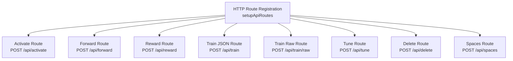
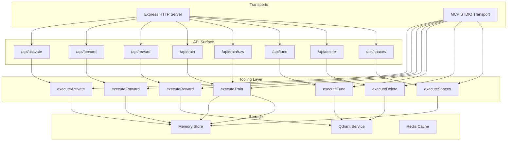
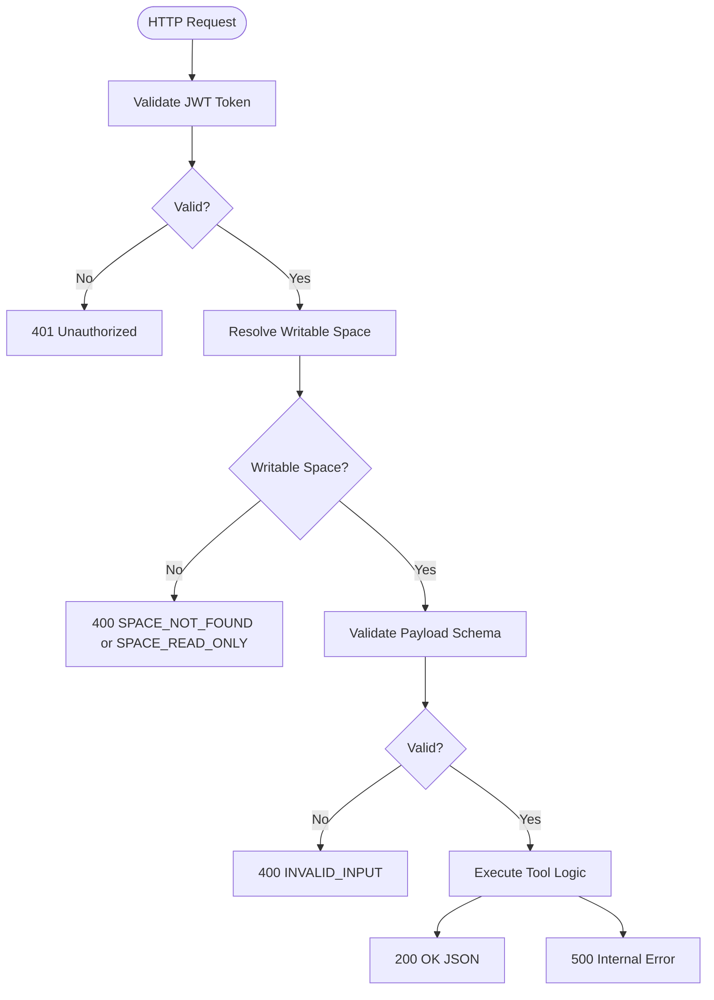
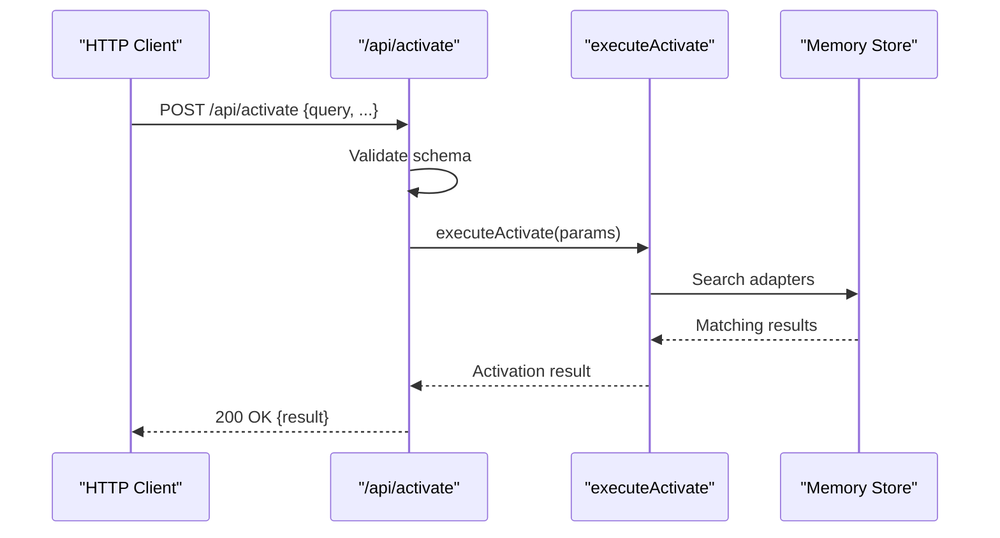
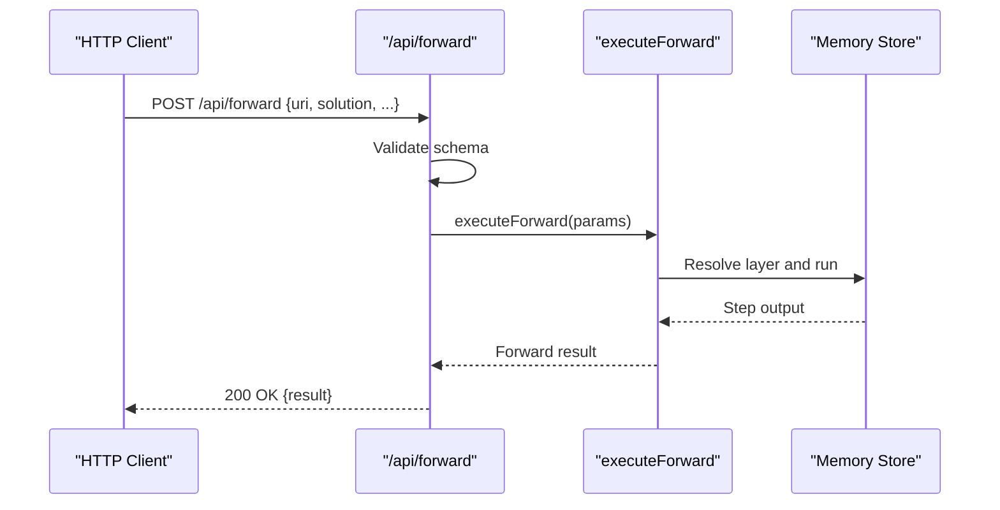
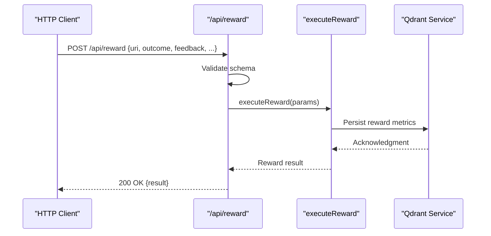
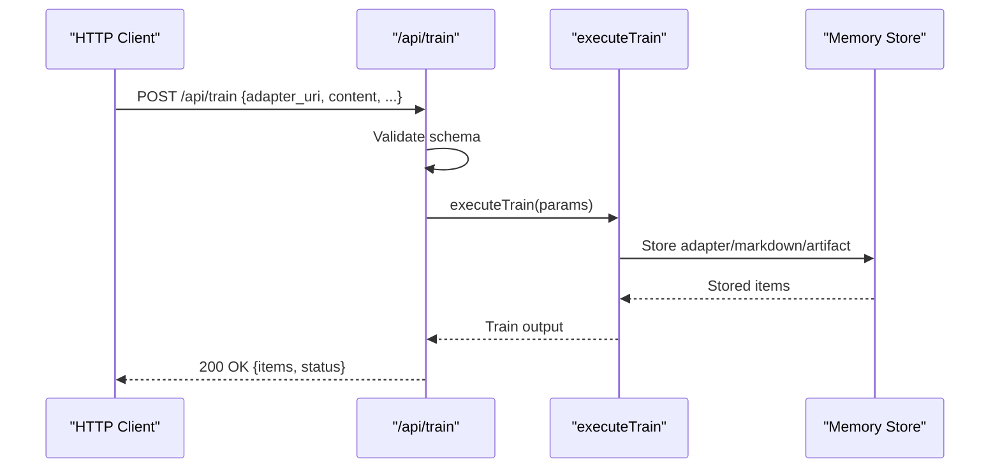
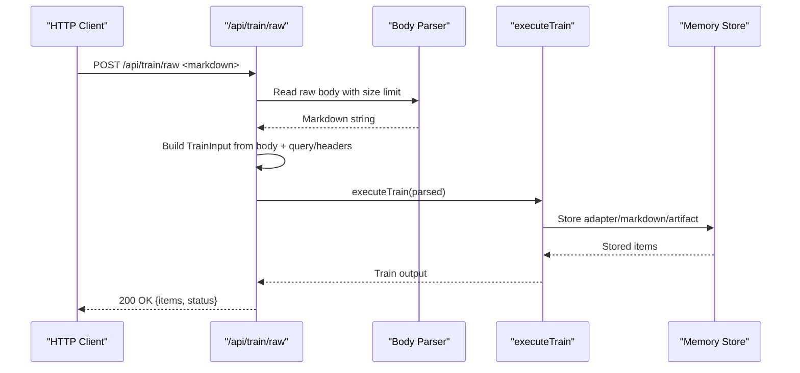
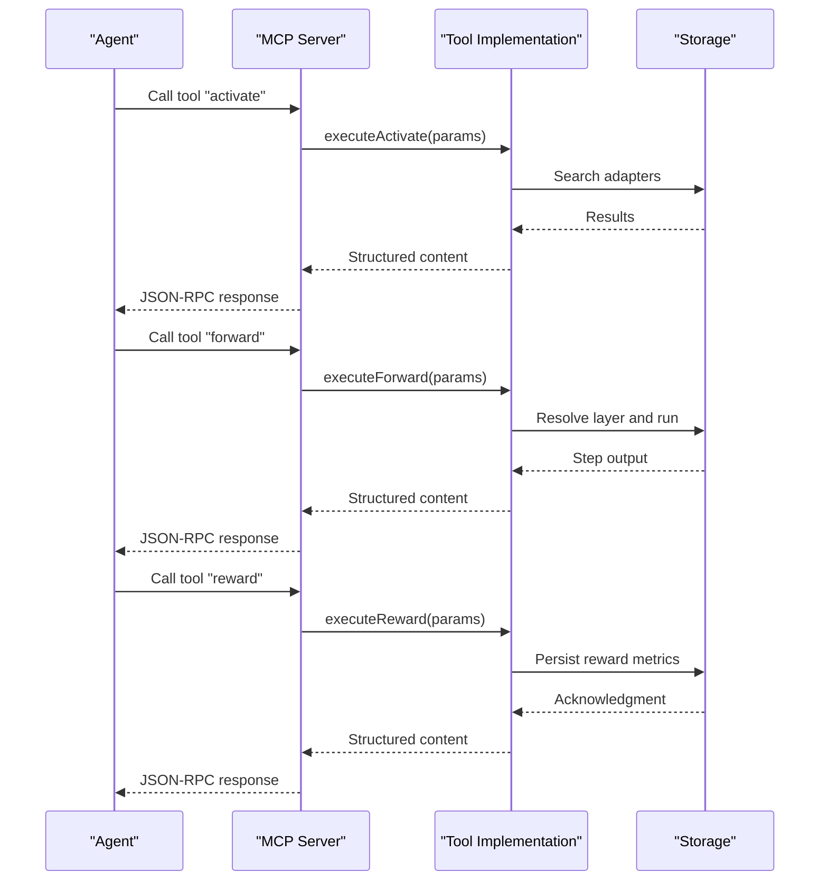
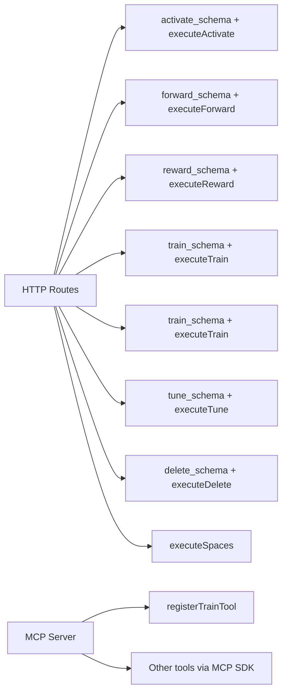

# API Reference

<cite>
**Referenced Files in This Document**
- [http-api-routes.ts](file://src/http/http-api-routes.ts)
- [http-api-begin.ts](file://src/http/http-api-begin.ts)
- [http-api-begin-step.ts](file://src/http/http-api-begin-step.ts)
- [http-api-attest.ts](file://src/http/http-api-attest.ts)
- [http-api-update.ts](file://src/http/http-api-update.ts)
- [http-api-delete.ts](file://src/http/http-api-delete.ts)
- [http-api-spaces.ts](file://src/http/http-api-spaces.ts)
- [http-api-train-json.ts](file://src/http/http-api-train-json.ts)
- [http-api-train-raw.ts](file://src/http/http-api-train-raw.ts)
- [train.ts](file://src/tools/train.ts)
- [activate_schema.ts](file://src/tools/activate_schema.ts)
- [forward_schema.ts](file://src/tools/forward_schema.ts)
- [reward_schema.ts](file://src/tools/reward_schema.ts)
- [tune_schema.ts](file://src/tools/tune_schema.ts)
- [delete_schema.ts](file://src/tools/delete_schema.ts)
- [export_schema.ts](file://src/tools/export_schema.ts)
- [activate.ts](file://src/cli/commands/activate.ts)
- [forward.ts](file://src/cli/commands/forward.ts)
- [reward.ts](file://src/cli/commands/reward.ts)
- [tune.ts](file://src/cli/commands/tune.ts)
- [delete.ts](file://src/cli/commands/delete.ts)
- [export.ts](file://src/cli/commands/export.ts)
- [spaces.ts](file://src/cli/commands/spaces.ts)
</cite>

## Table of Contents
1. [Introduction](#introduction)
2. [Project Structure](#project-structure)
3. [Core Components](#core-components)
4. [Architecture Overview](#architecture-overview)
5. [Detailed Component Analysis](#detailed-component-analysis)
6. [Dependency Analysis](#dependency-analysis)
7. [Performance Considerations](#performance-considerations)
8. [Troubleshooting Guide](#troubleshooting-guide)
9. [Conclusion](#conclusion)
10. [Appendices](#appendices)

## Introduction
This document is the authoritative API reference for the SquadRules framework. It covers:
- HTTP REST endpoints under /api/*, including request/response schemas, authentication requirements, error handling, and rate limiting.
- MCP protocol specification for tool execution, including STDIO transport, message formats, tool definitions, and real-time interaction patterns.
- Complete CLI command reference for activate, forward, train, reward, tune, delete, export, and spaces.
- JSON schema definitions for all request/response types, validation rules, and field constraints.
- Authentication methods including JWT token handling, OIDC integration, and space-based authorization.
- Client implementation guidelines for both HTTP and MCP protocol clients.
- Error response formats, status codes, and troubleshooting guidance for common API issues.

SquadRules is an agent-first MCP framework where AI agents are primary users and humans configure preferences through agents. The core flow is activate → forward → reward. Adapters provide deterministic, auditable task execution. Agents must create or repair adapters when workflows change.

## Project Structure
The API surface is implemented as Express routes that delegate to shared tooling logic. The route registration file wires public endpoints to their handlers.

**Diagram sources**
- [http-api-routes.ts:22-35](file://src/http/http-api-routes.ts#L22-L35)

**Section sources**
- [http-api-routes.ts:1-36](file://src/http/http-api-routes.ts#L1-L36)

## Core Components
- HTTP API layer: Express routes validate inputs with Zod schemas, enforce space context, and return standardized JSON responses.
- Tooling layer: Shared business logic for activate, forward, reward, train, tune, delete, export, and spaces.
- Storage layer: Qdrant (primary), LanceDB (secondary), Redis (sessions/rate limiting), filesystem (config/adapters).
- Auth layer: Keycloak + Google IdP for OAuth2/JWT; OIDC flows for browser-based login; JWT validates human and agent requests.
- MCP layer: Tools registered via MCP SDK with input/output schemas, structured content, and error reporting.

Key responsibilities:
- Input validation: All endpoints use strict schema validation and return INVALID_INPUT on failure.
- Space scoping: Endpoints resolve a writable space from request context and reject invalid or read-only spaces.
- Error normalization: Errors are mapped to stable error codes with optional details and next_action hints.

**Section sources**
- [http-api-begin.ts:14-39](file://src/http/http-api-begin.ts#L14-L39)
- [http-api-begin-step.ts:13-38](file://src/http/http-api-begin-step.ts#L13-L38)
- [http-api-attest.ts:12-35](file://src/http/http-api-attest.ts#L12-L35)
- [http-api-train-json.ts:46-172](file://src/http/http-api-train-json.ts#L46-L172)
- [http-api-train-raw.ts:48-214](file://src/http/http-api-train-raw.ts#L48-L214)
- [http-api-update.ts:11-34](file://src/http/http-api-update.ts#L11-L34)
- [http-api-delete.ts:11-35](file://src/http/http-api-delete.ts#L11-L35)
- [http-api-spaces.ts:11-31](file://src/http/http-api-spaces.ts#L11-L31)

## Architecture Overview
The system exposes two transports:
- HTTP REST API over Express for programmatic access.
- MCP protocol over STDIO for agent-driven tool calls.

Both transports share the same tool implementations and storage backends.

**Diagram sources**
- [http-api-routes.ts:22-35](file://src/http/http-api-routes.ts#L22-L35)
- [http-api-begin.ts:14-39](file://src/http/http-api-begin.ts#L14-L39)
- [http-api-begin-step.ts:13-38](file://src/http/http-api-begin-step.ts#L13-L38)
- [http-api-attest.ts:12-35](file://src/http/http-api-attest.ts#L12-L35)
- [http-api-train-json.ts:46-172](file://src/http/http-api-train-json.ts#L46-L172)
- [http-api-train-raw.ts:48-214](file://src/http/http-api-train-raw.ts#L48-L214)
- [http-api-update.ts:11-34](file://src/http/http-api-update.ts#L11-L34)
- [http-api-delete.ts:11-35](file://src/http/http-api-delete.ts#L11-L35)
- [http-api-spaces.ts:11-31](file://src/http/http-api-spaces.ts#L11-L31)
- [train.ts:246-382](file://src/tools/train.ts#L246-L382)

## Detailed Component Analysis

### HTTP REST API

#### Common Behavior
- Authentication: Requests require valid JWT tokens issued by Keycloak/Google IdP. OIDC flows are supported for browser-based login.
- Authorization: Space-based authorization enforces writable spaces for mutating operations. Invalid or read-only spaces return explicit errors.
- Validation: All endpoints validate payloads against Zod schemas and return INVALID_INPUT with field-level messages on failure.
- Rate Limiting: Rate limiting is backed by Redis; MCP runtime returns a dedicated rate limit error when exceeded.
- Response Format: Successful responses are JSON objects defined per endpoint. Errors include error code, message, and optional details.

**Diagram sources**
- [http-api-begin.ts:14-39](file://src/http/http-api-begin.ts#L14-L39)
- [http-api-train-json.ts:51-107](file://src/http/http-api-train-json.ts#L51-L107)
- [http-api-train-raw.ts:53-152](file://src/http/http-api-train-raw.ts#L53-L152)

#### Endpoint: POST /api/activate
- Purpose: Find the best matching adapter for a query.
- Request Body: Defined by activate schema.
- Response: Activation result object.
- Errors: INVALID_INPUT on validation failure; ACTIVATE_FAILED on unexpected errors.

**Diagram sources**
- [http-api-begin.ts:14-39](file://src/http/http-api-begin.ts#L14-L39)

**Section sources**
- [http-api-begin.ts:14-39](file://src/http/http-api-begin.ts#L14-L39)
- [activate_schema.ts](file://src/tools/activate_schema.ts)

#### Endpoint: POST /api/forward
- Purpose: Run the first or next adapter layer.
- Request Body: Defined by forward schema.
- Response: Forward step result object.
- Errors: INVALID_INPUT on validation failure; FORWARD_FAILED on unexpected errors.

**Diagram sources**
- [http-api-begin-step.ts:13-38](file://src/http/http-api-begin-step.ts#L13-L38)

**Section sources**
- [http-api-begin-step.ts:13-38](file://src/http/http-api-begin-step.ts#L13-L38)
- [forward_schema.ts](file://src/tools/forward_schema.ts)

#### Endpoint: POST /api/reward
- Purpose: Record a reward signal for an adapter execution.
- Request Body: Defined by reward schema.
- Response: Reward acknowledgment object.
- Errors: INVALID_INPUT on validation failure; REWARD_FAILED on unexpected errors.

**Diagram sources**
- [http-api-attest.ts:12-35](file://src/http/http-api-attest.ts#L12-L35)

**Section sources**
- [http-api-attest.ts:12-35](file://src/http/http-api-attest.ts#L12-L35)
- [reward_schema.ts](file://src/tools/reward_schema.ts)

#### Endpoint: POST /api/train (JSON)
- Purpose: Register a new adapter using a structured JSON payload.
- Request Body: Defined by train schema.
- Response: Training result with items and status.
- Errors:
  - 400 INVALID_INPUT for schema validation failures.
  - 400 TrainError variants with sanitized details and next_action hints.
  - 409 DUPLICATE_ADAPTER or SIMILAR_MEMORY_FOUND with guidance.
  - 413 PAYLOAD_TOO_LARGE for oversized raw bodies.
  - 500 STORE_FAILED for backend failures.

**Diagram sources**
- [http-api-train-json.ts:46-172](file://src/http/http-api-train-json.ts#L46-L172)
- [train.ts:137-244](file://src/tools/train.ts#L137-L244)

**Section sources**
- [http-api-train-json.ts:46-172](file://src/http/http-api-train-json.ts#L46-L172)
- [train_schema.ts](file://src/tools/train_schema.ts)

#### Endpoint: POST /api/train/raw
- Purpose: Upload raw markdown body for training with metadata via query parameters and headers.
- Request Body: Raw UTF-8 markdown string.
- Metadata Sources:
  - llm_model_id: query parameter or x-llm-model-id header or user-agent fallback.
  - force_update: query or x-force-update header boolean.
  - protocol_version: query or x-protocol-version header string.
  - space: query or x-space header string.
  - review_evidence: query or x-review-evidence header JSON object.
- Response: Same as JSON train endpoint.
- Errors: Same as JSON train plus 413 PAYLOAD_TOO_LARGE and 400 INVALID_INPUT for malformed review evidence.

**Diagram sources**
- [http-api-train-raw.ts:48-214](file://src/http/http-api-train-raw.ts#L48-L214)

**Section sources**
- [http-api-train-raw.ts:48-214](file://src/http/http-api-train-raw.ts#L48-L214)

#### Endpoint: POST /api/tune
- Purpose: Update one or more adapter layers.
- Request Body: Defined by tune schema.
- Response: Tune result with total_updated and total_failed counts.
- Errors: INVALID_INPUT on validation failure; TUNE_FAILED on unexpected errors.

**Section sources**
- [http-api-update.ts:11-34](file://src/http/http-api-update.ts#L11-L34)
- [tune_schema.ts](file://src/tools/tune_schema.ts)

#### Endpoint: POST /api/delete
- Purpose: Delete one or more adapter/layer resources.
- Request Body: Defined by delete schema.
- Response: Delete result with total_deleted and total_failed counts.
- Errors: INVALID_INPUT on validation failure; DELETE_FAILED on unexpected errors.

**Section sources**
- [http-api-delete.ts:11-35](file://src/http/http-api-delete.ts#L11-L35)
- [delete_schema.ts](file://src/tools/delete_schema.ts)

#### Endpoint: POST /api/spaces
- Purpose: List available spaces and adapter counts.
- Request Body: Optional include_adapter_titles and include_artifacts booleans.
- Response: Spaces listing with optional adapter titles and layer counts.
- Errors: SPACES_FAILED on unexpected errors.

**Section sources**
- [http-api-spaces.ts:11-31](file://src/http/http-api-spaces.ts#L11-L31)

### MCP Protocol Specification

#### Transport
- STDIO transport is used for agent-driven tool calls.
- Messages follow the MCP protocol format with JSON-RPC envelopes.

#### Tool Definitions
- activate, forward, train, reward, tune, delete, export, spaces are exposed as MCP tools.
- Each tool has:
  - title and description.
  - inputSchema (loose wrapper around Zod schema).
  - outputSchema (structured content).
- The train tool registers with mcpLooseToolInput wrapping its Zod schema and returns structuredContent alongside text content.

#### Real-Time Interaction Patterns
- Agents call tools sequentially following the activate → forward → reward chain.
- Errors are returned as MCP tool errors with isError flag and text content containing JSON error payloads.
- Metrics capture tool calls, durations, input/output sizes, and error rates.

**Diagram sources**
- [train.ts:246-382](file://src/tools/train.ts#L246-L382)

**Section sources**
- [train.ts:246-382](file://src/tools/train.ts#L246-L382)

### CLI Command Reference

#### activate
- Description: Activate the best matching SQUADRULES adapter for a query.
- Arguments:
  - query...: Search query (multiple words allowed).
- Options:
  - --space <space>: Scope results to this space ("personal" or a group name).
- Usage Example:
  - squadrules activate "find payment adapter" --space personal
- Output: Pretty-printed activation result with next-call hint.

**Section sources**
- [activate.ts:12-35](file://src/cli/commands/activate.ts#L12-L35)

#### forward
- Description: Run the first or next SQUADRULES adapter layer.
- Arguments:
  - uri: SQUADRULES adapter or layer URI.
- Options:
  - --solution <json>: Forward solution as JSON string.
- Usage Example:
  - squadrules forward "squadrules://layer/abc123" --solution '{"step":1}'
- Output: Pretty-printed forward result with next-call hint.

**Section sources**
- [forward.ts:12-32](file://src/cli/commands/forward.ts#L12-L32)

#### train
- Note: The train command is primarily exposed via MCP tools and HTTP endpoints. CLI usage may vary by environment; refer to MCP tool definition and HTTP endpoints for detailed behavior.
- MCP Tool: train
  - Input Schema: Defined by train schema.
  - Output Schema: Train output with items and status.
  - Behavior: Validates input, resolves space context, supports directory-based batch train, and returns structured content.

**Section sources**
- [train.ts:137-244](file://src/tools/train.ts#L137-L244)
- [train.ts:246-382](file://src/tools/train.ts#L246-L382)

#### reward
- Description: Record a reward signal for a SQUADRULES adapter execution.
- Arguments:
  - uri: SQUADRULES layer URI.
  - outcome: success or failure.
  - feedback: Reward feedback describing completion or failure.
- Options:
  - --score <number>: Normalized reward score in the 0..1 range.
  - --rater <rater>: Evaluator identifier used for export gating.
  - --rubric-version <version>: Rubric or policy version used for evaluation.
  - --model <model>: LLM model ID for attribution.
- Usage Example:
  - squadrules reward "squadrules://layer/abc123" success "Payment processed correctly" --score 0.95 --rater human-1 --rubric-version v2 --model gpt-4
- Output: Pretty-printed reward result.

**Section sources**
- [reward.ts:13-66](file://src/cli/commands/reward.ts#L13-L66)

#### tune
- Description: Update one or more SQUADRULES adapter layers.
- Arguments:
  - uris...: SQUADRULES adapter or layer URIs.
- Options:
  - --file <file>: Path to markdown file to apply to all specified URIs.
  - --files <files...>: Paths to markdown files, one per URI.
  - --updates <json>: Updates object as JSON string.
  - --space <space>: Move all layers of each target adapter to this space.
  - --allow-sensitive-upload: Allow uploads that contain token-like or private-key-like text.
- Usage Examples:
  - squadrules tune "squadrules://adapter/payments" --file updates.md
  - squadrules tune "squadrules://adapter/payments" --updates '{"title":"Updated Payments"}'
  - squadrules tune "squadrules://adapter/payments" --space group-name
- Output: Pretty-printed tune result.

**Section sources**
- [tune.ts:32-115](file://src/cli/commands/tune.ts#L32-L115)

#### delete
- Description: Delete one or more adapter/layer resources.
- Arguments:
  - uris...: SQUADRULES adapter or layer URIs.
- Usage Example:
  - squadrules delete "squadrules://adapter/payments" "squadrules://layer/abc123"
- Output: Pretty-printed delete result.

**Section sources**
- [delete.ts:13-30](file://src/cli/commands/delete.ts#L13-L30)

#### export
- Description: Machine-facing bulk export of adapters, skills, traces, rewards, or source data.
- Arguments:
  - [uri]: SQUADRULES adapter or layer URI (single-selection mode).
- Options:
  - --adapters <uri-or-slug>: Adapter URI or slug (repeatable).
  - --all-adapters: Export every adapter in --space.
  - --space <name>: Space name required with --all-adapters.
  - --as <format>: skill_zip (default), markdown, skill_tree, source, trace_jsonl, reward_jsonl, sft_jsonl, preference_jsonl.
  - --delivery <mode>: skill_zip delivery: download_ref or inline_base64.
  - --directory <dir>: Local mode only with --as markdown: backend writes <dir>/<slug>.md per adapter.
  - --out <dir>: Write exported artifact(s) into this directory.
  - --to <file>: Write single <uri> payload to exact file path.
  - --zip-out <file>: Write skill_zip bytes to explicit file path.
- Usage Examples:
  - squadrules export "squadrules://adapter/payments" --as skill_zip --out ./exports
  - squadrules export --all-adapters --space personal --as skill_tree --out ./skill-tree
  - squadrules export "squadrules://adapter/payments" --as markdown --directory ./markdown
- Output: Manifest or summary of written artifacts; never prints raw content bytes.

**Section sources**
- [export.ts:296-345](file://src/cli/commands/export.ts#L296-L345)
- [export_schema.ts](file://src/tools/export_schema.ts)

#### spaces
- Description: List available spaces and adapter counts.
- Options:
  - --include-adapter-titles: Include per-space adapter titles and layer counts.
- Usage Example:
  - squadrules spaces --include-adapter-titles
- Output: Pretty-printed spaces listing.

**Section sources**
- [spaces.ts:12-34](file://src/cli/commands/spaces.ts#L12-L34)

## Dependency Analysis
The HTTP routes depend on shared tooling modules and storage services. The MCP server registers tools that reuse the same implementations.

**Diagram sources**
- [http-api-routes.ts:22-35](file://src/http/http-api-routes.ts#L22-L35)
- [train.ts:246-382](file://src/tools/train.ts#L246-L382)

**Section sources**
- [http-api-routes.ts:1-36](file://src/http/http-api-routes.ts#L1-L36)
- [train.ts:246-382](file://src/tools/train.ts#L246-L382)

## Performance Considerations
- Input Size Limits: Raw train endpoint enforces HTTP_TRAIN_RAW_BODY_LIMIT to prevent oversized payloads.
- Batch Operations: Directory-based train and export reduce round trips and improve throughput.
- Metrics: MCP and HTTP paths emit metrics for tool calls, durations, input/output sizes, and error rates.
- Caching: Redis is used for sessions and rate limiting; vector DBs support semantic search performance.

[No sources needed since this section provides general guidance]

## Troubleshooting Guide

Common HTTP Error Responses:
- 400 INVALID_INPUT: Payload failed schema validation. Check field-level messages.
- 400 SPACE_NOT_FOUND or SPACE_READ_ONLY: Space resolution failed. Use list spaces to find writable spaces.
- 409 DUPLICATE_ADAPTER: Adapter label already exists. Use force_update or choose a different label.
- 409 SIMILAR_MEMORY_FOUND: Similar adapter exists by title. Inspect existing_memory and similarity_score.
- 413 PAYLOAD_TOO_LARGE: Request body exceeds configured limit. Split or compress content.
- 500 STORE_FAILED/TUNE_FAILED/DELETE_FAILED/REWARD_FAILED/ACTIVATE_FAILED/FORWARD_FAILED: Backend or storage failure. Retry with retries and check logs.

MCP Error Handling:
- Tools return isError flag with text content containing JSON error payloads.
- Rate limiting returns a dedicated MCP rate limit error result.
- Validation errors include structured error details for debugging.

Authentication Issues:
- Ensure JWT tokens are valid and not expired.
- For OIDC flows, verify callback configuration and state handling.
- Space-based authorization requires appropriate claims in the token.

**Section sources**
- [http-api-train-json.ts:108-172](file://src/http/http-api-train-json.ts#L108-L172)
- [http-api-train-raw.ts:154-214](file://src/http/http-api-train-raw.ts#L154-L214)
- [train.ts:334-382](file://src/tools/train.ts#L334-L382)

## Conclusion
The SquadRules API provides a robust, schema-validated interface for agent-driven adapter lifecycle management across HTTP and MCP transports. Consistent error handling, space-based authorization, and comprehensive CLI commands enable both human operators and AI agents to operate effectively. Clients should adhere to the documented schemas, handle error codes gracefully, and respect rate limits and size constraints.

[No sources needed since this section summarizes without analyzing specific files]

## Appendices

### JSON Schema Definitions Summary
- activate schema: Defines query and optional space selection for activation.
- forward schema: Defines uri, solution, and step progression fields.
- reward schema: Defines uri, outcome, feedback, score, rater, rubricVersion, and model fields.
- train schema: Defines adapter_uri, content, source_adapter_uri, force_update, protocol_version, space, mime, artifact_name, relative_path, directory, recursive, and review_evidence fields.
- tune schema: Defines uris array and update options including markdownDoc, updates, space, and reviewEvidence.
- delete schema: Defines uris array for deletion targets.
- export schema: Defines selection modes (uri, adapters, all_adapters), format, delivery, directory, and output flags.

For precise field types, constraints, and validation rules, refer to the schema files:
- [activate_schema.ts](file://src/tools/activate_schema.ts)
- [forward_schema.ts](file://src/tools/forward_schema.ts)
- [reward_schema.ts](file://src/tools/reward_schema.ts)
- [train_schema.ts](file://src/tools/train_schema.ts)
- [tune_schema.ts](file://src/tools/tune_schema.ts)
- [delete_schema.ts](file://src/tools/delete_schema.ts)
- [export_schema.ts](file://src/tools/export_schema.ts)

**Section sources**
- [activate_schema.ts](file://src/tools/activate_schema.ts)
- [forward_schema.ts](file://src/tools/forward_schema.ts)
- [reward_schema.ts](file://src/tools/reward_schema.ts)
- [train_schema.ts](file://src/tools/train_schema.ts)
- [tune_schema.ts](file://src/tools/tune_schema.ts)
- [delete_schema.ts](file://src/tools/delete_schema.ts)
- [export_schema.ts](file://src/tools/export_schema.ts)