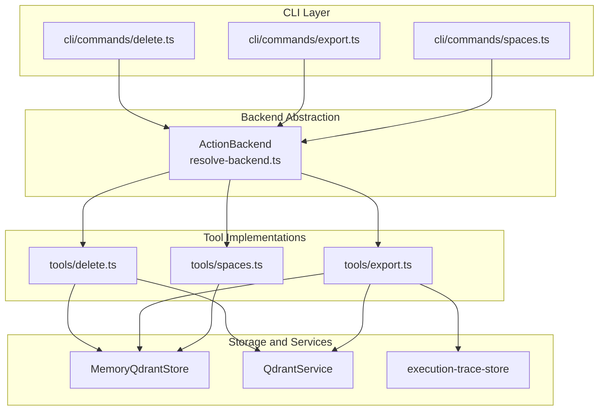
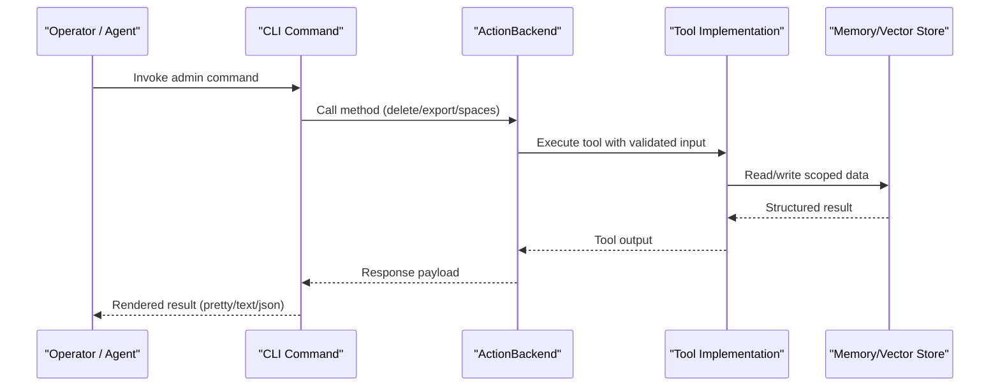
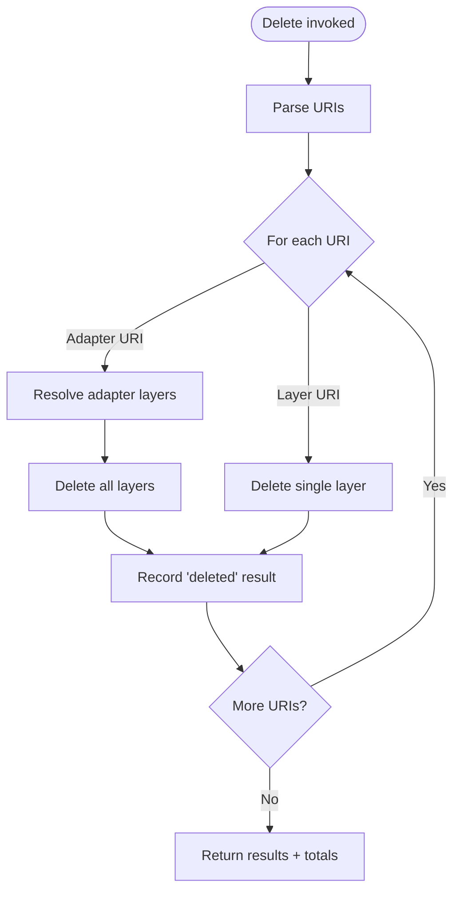
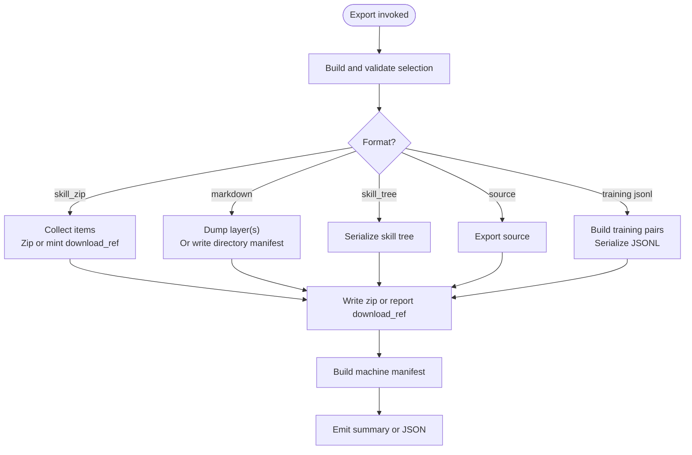
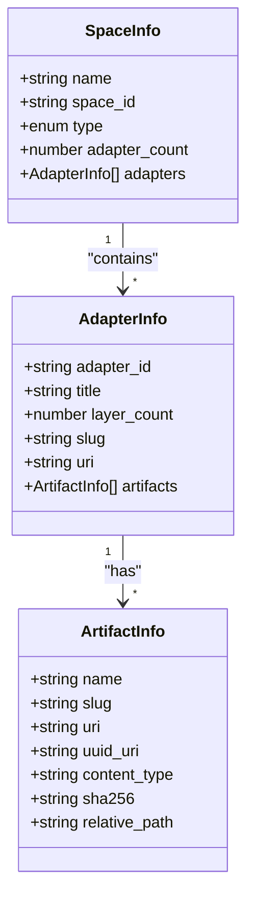
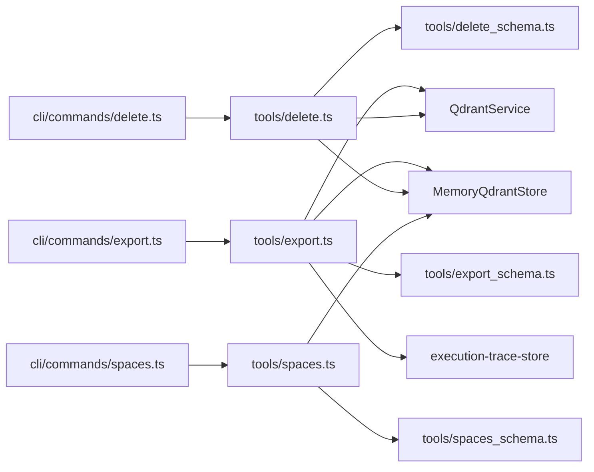
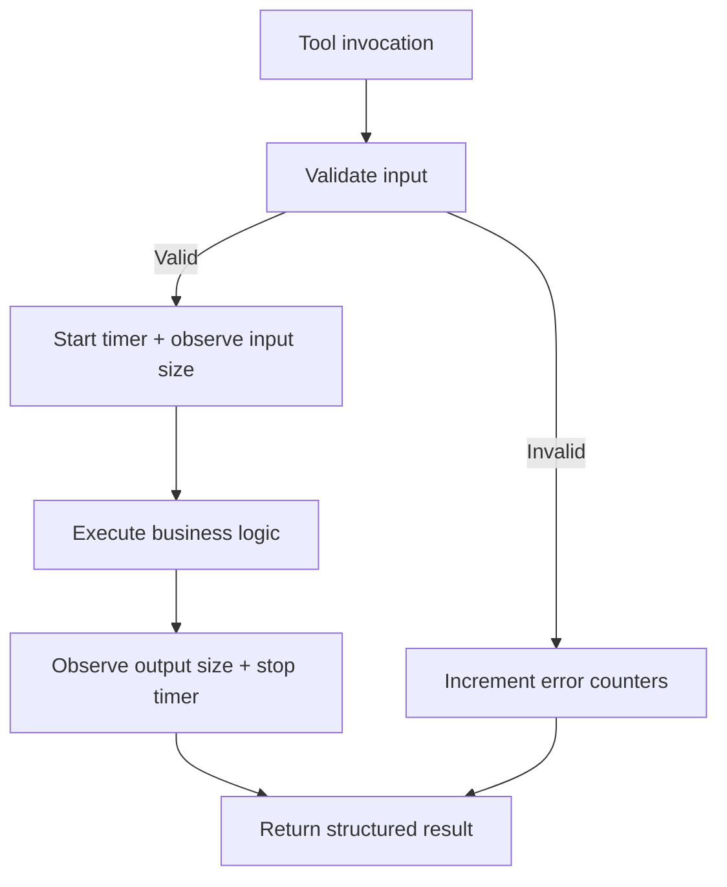

# Administration Commands

<cite>
**Referenced Files in This Document**
- [CLI.md](file://docs/CLI.md)
- [delete.ts](file://src/cli/commands/delete.ts)
- [delete-metadata.ts](file://src/cli/commands/delete-metadata.ts)
- [delete.ts](file://src/tools/delete.ts)
- [delete_schema.ts](file://src/tools/delete_schema.ts)
- [export.ts](file://src/cli/commands/export.ts)
- [export.ts](file://src/tools/export.ts)
- [export_schema.ts](file://src/tools/export_schema.ts)
- [spaces.ts](file://src/cli/commands/spaces.ts)
- [spaces.ts](file://src/tools/spaces.ts)
- [spaces_schema.ts](file://src/tools/spaces_schema.ts)
</cite>

## Table of Contents
1. [Introduction](#introduction)
2. [Project Structure](#project-structure)
3. [Core Components](#core-components)
4. [Architecture Overview](#architecture-overview)
5. [Detailed Component Analysis](#detailed-component-analysis)
6. [Dependency Analysis](#dependency-analysis)
7. [Performance Considerations](#performance-considerations)
8. [Security Considerations](#security-considerations)
9. [Audit Logging and Observability](#audit-logging-and-observability)
10. [Bulk Operations Guide](#bulk-operations-guide)
11. [Troubleshooting Guide](#troubleshooting-guide)
12. [Conclusion](#conclusion)

## Introduction
This document explains the administrative and operational commands exposed by the SquadRules CLI that are relevant to administrators, operators, and automation scripts: delete, export, and spaces. It focuses on how these commands remove adapters and associated artifacts, create portable skill bundles with artifact sanitization and metadata preservation, and manage multi-tenant spaces. It also covers security considerations, audit logging, and bulk operation capabilities.

SquadRules is an agent-first MCP framework where agents drive workflows through adapters. The CLI exposes MCP tools for activation, forwarding, rewards, training, tuning, deletion, export, and space listing. By default, data commands run locally against an embedded store; authentication applies only when targeting a remote HTTP server.

**Section sources**
- [CLI.md:29-44](file://docs/CLI.md#L29-L44)
- [CLI.md:46-75](file://docs/CLI.md#L46-L75)

## Project Structure
The administration commands are implemented as CLI command handlers that delegate to backend abstractions, which in turn call MCP tool implementations. The tool implementations perform validation, tenant/space scoping, storage access, and output construction.

**Diagram sources**
- [delete.ts:1-31](file://src/cli/commands/delete.ts#L1-L31)
- [export.ts:1-346](file://src/cli/commands/export.ts#L1-L346)
- [spaces.ts:1-35](file://src/cli/commands/spaces.ts#L1-L35)
- [delete.ts:1-116](file://src/tools/delete.ts#L1-L116)
- [export.ts:1-391](file://src/tools/export.ts#L1-L391)
- [spaces.ts:1-255](file://src/tools/spaces.ts#L1-L255)

**Section sources**
- [delete.ts:1-31](file://src/cli/commands/delete.ts#L1-L31)
- [export.ts:1-346](file://src/cli/commands/export.ts#L1-L346)
- [spaces.ts:1-35](file://src/cli/commands/spaces.ts#L1-L35)

## Core Components
- Delete command: Removes adapter or layer resources by URI. Adapter URIs cascade-delete all layers; layer URIs remove a single layer. Returns per-URI results with status and messages.
- Export command: Produces portable skill bundles and other export formats. Supports skill_zip (default), markdown, skill_tree, source, and several JSONL training formats. Handles artifact sanitization, metadata preservation, directory-based bulk writes, and download references.
- Spaces command: Lists available spaces with adapter counts and optional adapter titles, layer counts, and artifact metadata. Operates within the current request’s space context.

Key behaviors:
- All three commands use structured input/output schemas validated at runtime.
- Output is emitted via a shared result emitter supporting pretty, text, and JSON modes.
- Errors are normalized through a common API error handler.

**Section sources**
- [delete.ts:13-30](file://src/cli/commands/delete.ts#L13-L30)
- [delete-metadata.ts:1-6](file://src/cli/commands/delete-metadata.ts#L1-L6)
- [export.ts:296-345](file://src/cli/commands/export.ts#L296-L345)
- [spaces.ts:12-34](file://src/cli/commands/spaces.ts#L12-L34)

## Architecture Overview
The CLI commands are thin wrappers around backend calls. The backend resolves either local or remote transport and invokes the corresponding MCP tool implementation. Tool implementations enforce schema validation, apply tenant and space scoping, interact with memory/vector stores, and return structured outputs.

**Diagram sources**
- [delete.ts:13-30](file://src/cli/commands/delete.ts#L13-L30)
- [export.ts:296-345](file://src/cli/commands/export.ts#L296-L345)
- [spaces.ts:12-34](file://src/cli/commands/spaces.ts#L12-L34)
- [delete.ts:73-116](file://src/tools/delete.ts#L73-L116)
- [export.ts:347-391](file://src/tools/export.ts#L347-L391)
- [spaces.ts:195-255](file://src/tools/spaces.ts#L195-L255)

## Detailed Component Analysis

### Delete Command
Purpose: Remove one or more SQUADRULES adapter or layer resources.

Behavior:
- Accepts multiple URIs.
- Adapter URIs trigger cascade deletion of all layers belonging to that adapter.
- Layer URIs delete a single layer.
- Returns per-URI results including status and message, plus totals for deleted and failed operations.

Operational notes:
- There is no explicit backup flag in the delete flow; backups should be created before deletion using export.
- Space isolation is enforced by the underlying storage layer and tenant context used by the tool implementation.

**Diagram sources**
- [delete.ts:12-71](file://src/tools/delete.ts#L12-L71)

Security and safety:
- Input URIs are validated against strict regex patterns for adapter and layer URIs.
- Errors during deletion are captured per URI so partial failures do not abort the entire batch.

Backup strategy:
- Use export before delete to create portable backups. Prefer `skill_zip` for bundles or `markdown --directory` for slug-named files in local mode.

Space isolation:
- Deletion operates under the active tenant and space context. Ensure the correct space scope before running bulk deletes.

**Section sources**
- [delete.ts:13-30](file://src/cli/commands/delete.ts#L13-L30)
- [delete-metadata.ts:1-6](file://src/cli/commands/delete-metadata.ts#L1-L6)
- [delete.ts:12-71](file://src/tools/delete.ts#L12-L71)
- [delete_schema.ts:1-33](file://src/tools/delete_schema.ts#L1-L33)

### Export Command
Purpose: Create portable skill bundles and other export formats from adapters, layers, or artifacts.

Supported formats:
- skill_zip: Default. Portable bundle with sanitized artifacts and preserved metadata. Delivery can be inline base64 or a short-lived download reference.
- markdown: Flat markdown for a single adapter, or directory-based bulk export writing `<directory>/<slug>.md` per adapter in local mode.
- skill_tree: JSON tree representation of skills and files.
- source: Source content for a single artifact or adapter.
- trace_jsonl, reward_jsonl, sft_jsonl, preference_jsonl: Training-oriented JSONL datasets derived from execution traces.

Key options:
- Selection: positional `<uri>`, `--adapters`, or `--all-adapters` with `--space`.
- Format: `--as <format>`.
- Delivery (skill_zip only): `--delivery download_ref|inline_base64`.
- Directory export (local mode, markdown only): `--directory <dir>` writes slug-named files and returns a manifest instead of inline content.
- Output control: `--out <dir>`, `--to <file>`, `--zip-out <file>`.

Artifact sanitization and metadata:
- File names are sanitized to safe basenames.
- Skill bundles include a compact manifest describing skills, entrypoints, and artifacts.
- Bundle integrity includes SHA-256 when applicable.
- Markdown exports preserve frontmatter slug when present, ensuring stable file naming.

**Diagram sources**
- [export.ts:48-143](file://src/cli/commands/export.ts#L48-L143)
- [export.ts:202-266](file://src/cli/commands/export.ts#L202-L266)
- [export.ts:67-345](file://src/tools/export.ts#L67-L345)

Backup and portability:
- skill_zip bundles are portable and include sanitized artifacts and metadata.
- markdown directory export provides human-readable, scriptable backups with stable slug-based filenames.
- Training JSONL formats support downstream model training pipelines.

Space isolation:
- `--all-adapters` requires `--space`; selection is scoped to the named space.
- Markdown adapter exports may include space metadata fields when available.

Error handling:
- Invalid combinations of flags are rejected early with actionable errors.
- Directory export failures are reported per adapter while preserving already written files.

**Section sources**
- [export.ts:296-345](file://src/cli/commands/export.ts#L296-L345)
- [export.ts:67-345](file://src/tools/export.ts#L67-L345)
- [export_schema.ts:44-117](file://src/tools/export_schema.ts#L44-L117)
- [CLI.md:166-219](file://docs/CLI.md#L166-L219)

### Spaces Command
Purpose: List available spaces and adapter counts, optionally including adapter titles, layer counts, and artifact metadata.

Behavior:
- Uses the current request’s space context to determine visible spaces.
- Includes app space alongside user-visible spaces.
- Optionally enriches output with adapter titles, layer counts, and artifact details.

Multi-tenant considerations:
- Space enumeration respects allowed space IDs from the tenant context.
- Human-readable names and space types are included in the response.

Cross-space operations:
- Listing is read-only and scoped to the authenticated context.
- To operate across spaces, run separate commands with the appropriate `--space` scope or target different tenants.

**Diagram sources**
- [spaces.ts:25-48](file://src/tools/spaces.ts#L25-L48)
- [spaces_schema.ts:23-52](file://src/tools/spaces_schema.ts#L23-L52)

**Section sources**
- [spaces.ts:12-34](file://src/cli/commands/spaces.ts#L12-L34)
- [spaces.ts:172-189](file://src/tools/spaces.ts#L172-L189)
- [spaces_schema.ts:1-53](file://src/tools/spaces_schema.ts#L1-L53)

## Dependency Analysis
The following diagram shows dependencies among CLI commands, tool implementations, and core services.

**Diagram sources**
- [delete.ts:1-31](file://src/cli/commands/delete.ts#L1-L31)
- [export.ts:1-346](file://src/cli/commands/export.ts#L1-L346)
- [spaces.ts:1-35](file://src/cli/commands/spaces.ts#L1-L35)
- [delete.ts:1-116](file://src/tools/delete.ts#L1-L116)
- [export.ts:1-391](file://src/tools/export.ts#L1-L391)
- [spaces.ts:1-255](file://src/tools/spaces.ts#L1-L255)
- [delete_schema.ts:1-33](file://src/tools/delete_schema.ts#L1-L33)
- [export_schema.ts:1-162](file://src/tools/export_schema.ts#L1-L162)
- [spaces_schema.ts:1-53](file://src/tools/spaces_schema.ts#L1-L53)

**Section sources**
- [delete.ts:1-31](file://src/cli/commands/delete.ts#L1-L31)
- [export.ts:1-346](file://src/cli/commands/export.ts#L1-L346)
- [spaces.ts:1-35](file://src/cli/commands/spaces.ts#L1-L35)

## Performance Considerations
- Bulk export: Use `--all-adapters` with `--space` and `--as skill_zip` or `--as skill_tree` for efficient bundling. For local markdown backups, prefer `--directory` to avoid large in-memory payloads.
- Large ZIP delivery: When using `download_ref`, the backend generates a capability URL for the client to fetch the bundle, reducing response size.
- Training JSONL: Building training pairs scans execution traces; limit to a single adapter per format to avoid unnecessary work.
- Spaces listing: Scrolling over space records is bounded by a scroll limit; include only required fields (`include_adapter_titles`, `include_artifacts`) to reduce payload size.

[No sources needed since this section provides general guidance]

## Security Considerations
- Input validation: All commands validate inputs using Zod schemas. Invalid URIs, unsupported format combinations, and disallowed selections are rejected early.
- Path safety: Directory export validates absolute paths, prevents traversal, resolves symlinks, enforces allowlists, and limits depth.
- Artifact filtering: Spaces listing filters artifacts by allowed MIME types and requires valid slugs.
- Delivery controls: skill_zip supports short-lived download references for secure external downloads.
- Tenant and space scoping: Operations respect tenant context and allowed space IDs.

**Section sources**
- [export.ts:112-117](file://src/tools/export.ts#L112-L117)
- [spaces.ts:112-151](file://src/tools/spaces.ts#L112-L151)
- [export_schema.ts:44-117](file://src/tools/export_schema.ts#L44-L117)

## Audit Logging and Observability
- Tool metrics: Each tool observes call counts, durations, input sizes, and output sizes, tagged with tenant ID.
- Error tracking: Validation and runtime errors increment error counters and record timing information.
- Export telemetry: Export operations wrap execution in a telemetry context and finalize observations regardless of success or failure.

**Diagram sources**
- [delete.ts:73-116](file://src/tools/delete.ts#L73-L116)
- [export.ts:347-391](file://src/tools/export.ts#L347-L391)
- [spaces.ts:195-255](file://src/tools/spaces.ts#L195-L255)

**Section sources**
- [delete.ts:73-116](file://src/tools/delete.ts#L73-L116)
- [export.ts:347-391](file://src/tools/export.ts#L347-L391)
- [spaces.ts:195-255](file://src/tools/spaces.ts#L195-L255)

## Bulk Operations Guide
- Delete in bulk: Pass multiple URIs to delete. Adapter URIs cascade-delete all layers; layer URIs delete a single layer. Review per-URI results and totals.
- Export in bulk:
  - skill_zip: `squadrules export --all-adapters --space <name> --out <dir>`
  - markdown directory: `squadrules export --all-adapters --space <name> --as markdown --directory <dir>` (local mode)
  - skill_tree: `squadrules export --all-adapters --space <name> --as skill_tree --out <dir>`
- Spaces management:
  - List spaces with optional adapter titles and artifact metadata.
  - Use the returned adapter URIs for targeted export or forward operations.

Best practices:
- Always back up before deleting using export.
- Pin adapter slugs in frontmatter for stable file naming in markdown exports.
- Use `--format json` for machine-friendly manifests when scripting.

**Section sources**
- [CLI.md:115-129](file://docs/CLI.md#L115-L129)
- [CLI.md:166-219](file://docs/CLI.md#L166-L219)
- [delete.ts:12-71](file://src/tools/delete.ts#L12-L71)
- [export.ts:296-345](file://src/cli/commands/export.ts#L296-L345)
- [spaces.ts:12-34](file://src/cli/commands/spaces.ts#L12-L34)

## Troubleshooting Guide
Common issues and resolutions:
- Export selection conflicts: Ensure exactly one selection mode (`<uri>`, `--adapters`, or `--all-adapters`). Combine `--all-adapters` with `--space`.
- Directory export restrictions: `--directory` is local-mode only and markdown-only; it cannot be combined with `--out`, `--to`, or `--zip-out`. Against HTTP targets, switch to `skill_zip` or `skill_tree` with `--out`.
- skill_zip delivery: Local mode defaults to inline base64; passing `download_ref` without a capable backend fails with an actionable error.
- Training JSONL formats: Require a single adapter URI; they cannot be used with `--adapters` or `--all-adapters`.
- Spaces listing overhead: Disable `include_adapter_titles` and `include_artifacts` unless needed to reduce payload size.

**Section sources**
- [export.ts:48-143](file://src/cli/commands/export.ts#L48-L143)
- [export.ts:189-199](file://src/cli/commands/export.ts#L189-L199)
- [export.ts:193-248](file://src/tools/export.ts#L193-L248)
- [export_schema.ts:81-117](file://src/tools/export_schema.ts#L81-L117)

## Conclusion
The delete, export, and spaces commands provide robust administrative capabilities for managing adapters, creating portable skill bundles, and operating across multi-tenant spaces. They emphasize safe defaults, strong validation, clear error reporting, and observability. For production operations, combine export-backed backups with careful space scoping and selective field inclusion to balance functionality, performance, and security.

[No sources needed since this section summarizes without analyzing specific files]