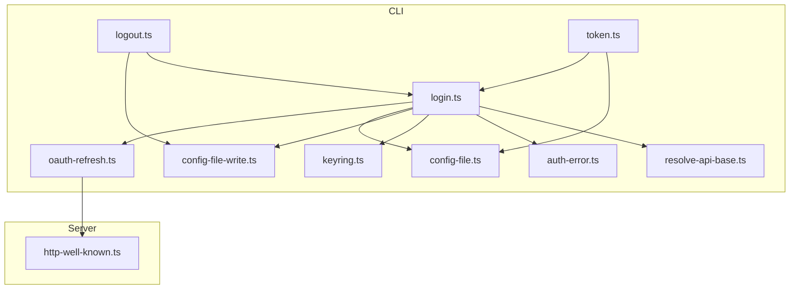
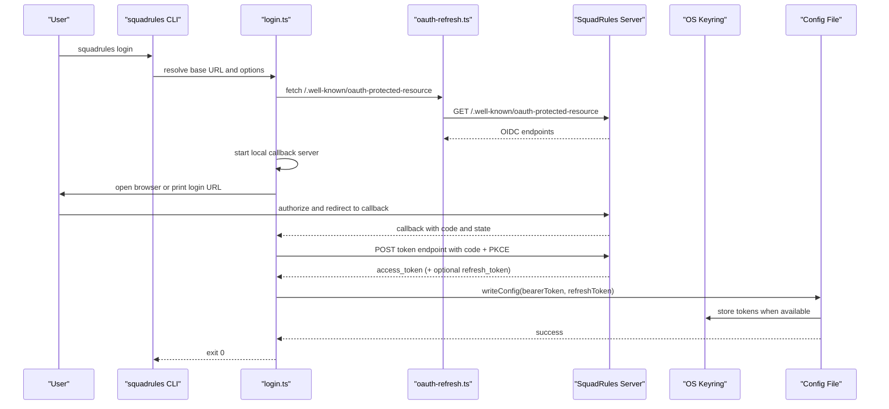
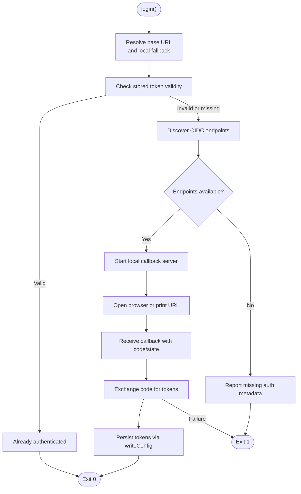
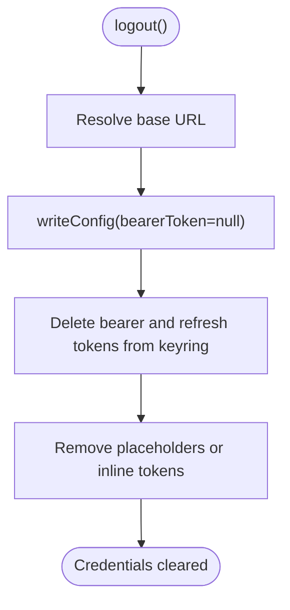
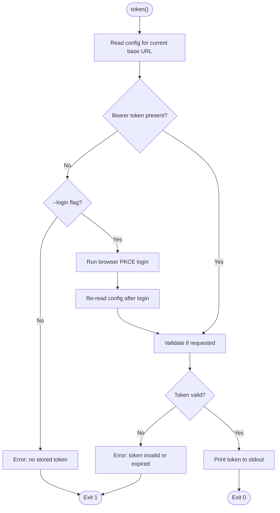
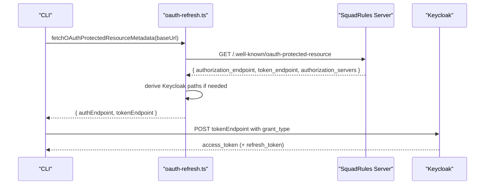
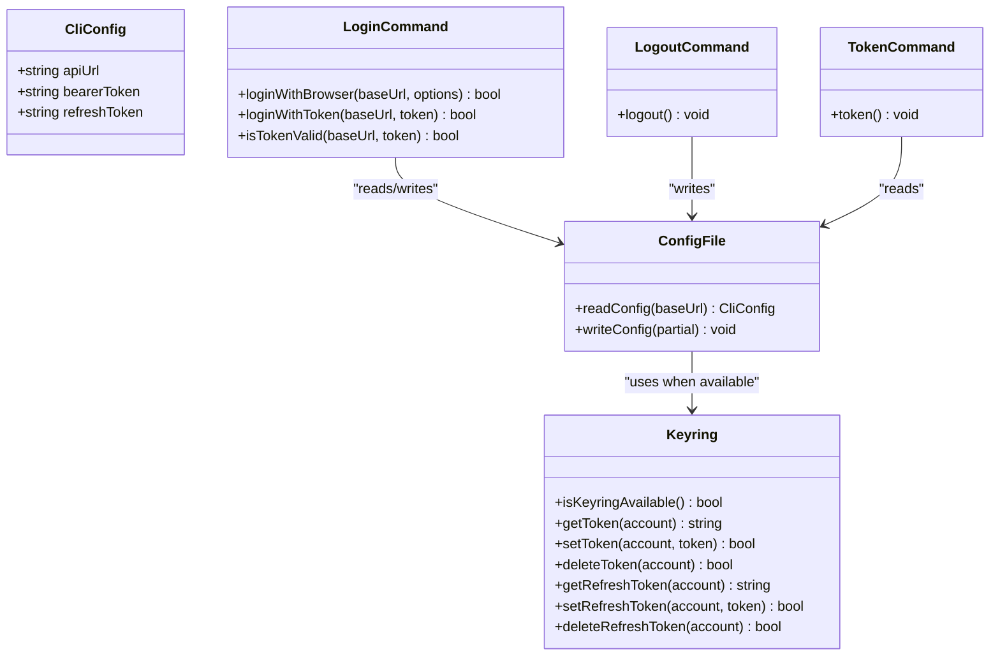
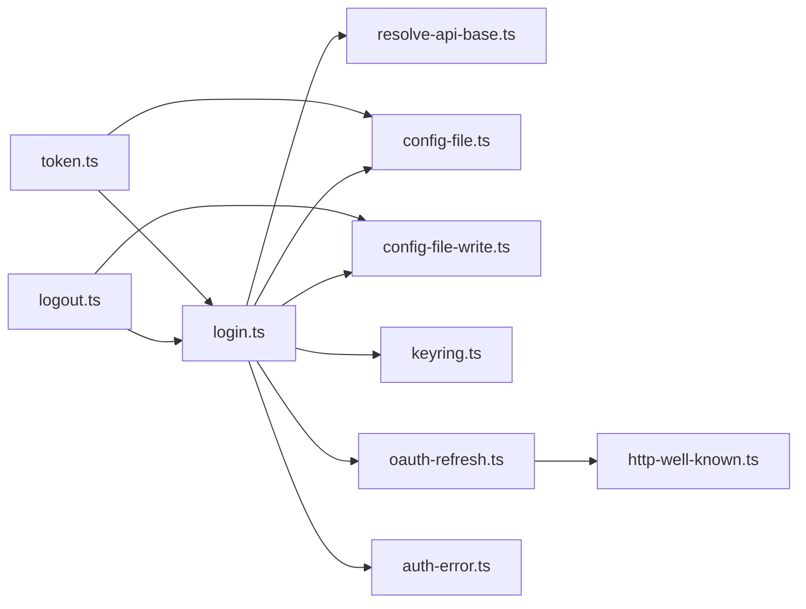

# Authentication Commands

<cite>
**Referenced Files in This Document**
- [login.ts](file://src/cli/commands/login.ts)
- [logout.ts](file://src/cli/commands/logout.ts)
- [token.ts](file://src/cli/commands/token.ts)
- [oauth-refresh.ts](file://src/cli/oauth-refresh.ts)
- [keyring.ts](file://src/cli/keyring.ts)
- [config-file.ts](file://src/cli/config-file.ts)
- [config-file-write.ts](file://src/cli/config-file-write.ts)
- [auth-error.ts](file://src/cli/auth-error.ts)
- [resolve-api-base.ts](file://src/cli/resolve-api-base.ts)
- [http-well-known.ts](file://src/http/http-well-known.ts)
</cite>

## Table of Contents
1. [Introduction](#introduction)
2. [Project Structure](#project-structure)
3. [Core Components](#core-components)
4. [Architecture Overview](#architecture-overview)
5. [Detailed Component Analysis](#detailed-component-analysis)
6. [Dependency Analysis](#dependency-analysis)
7. [Performance Considerations](#performance-considerations)
8. [Troubleshooting Guide](#troubleshooting-guide)
9. [CI/CD Integration](#cicd-integration)
10. [Conclusion](#conclusion)

## Introduction
This document explains the authentication and credential management commands in the SquadRules CLI:

- `squadrules login`: authenticates using OIDC/OAuth2, supports browser-based PKCE login, direct token input, Keycloak integration, and automatic fallback to a local HTTP server when the target is local.
- `squadrules logout`: clears stored credentials for the current environment.
- `squadrules token`: prints or validates the stored bearer token for scripting and programmatic access.

The implementation uses:
- OIDC discovery via `/.well-known/oauth-protected-resource`.
- PKCE browser login with a local callback server.
- Optional refresh-token exchange against the IdP’s token endpoint.
- OS keyring storage with file-based fallback.
- Environment-scoped configuration keyed by normalized API base URL.

## Project Structure
Authentication-related code is primarily under `src/cli`, with supporting HTTP well-known metadata on the server side:

**Diagram sources**
- [login.ts:1-288](file://src/cli/commands/login.ts#L1-L288)
- [logout.ts:1-21](file://src/cli/commands/logout.ts#L1-L21)
- [token.ts:1-53](file://src/cli/commands/token.ts#L1-L53)
- [oauth-refresh.ts:1-111](file://src/cli/oauth-refresh.ts#L1-L111)
- [keyring.ts:1-224](file://src/cli/keyring.ts#L1-L224)
- [config-file.ts:1-208](file://src/cli/config-file.ts#L1-L208)
- [config-file-write.ts:1-172](file://src/cli/config-file-write.ts#L1-L172)
- [auth-error.ts:1-133](file://src/cli/auth-error.ts#L1-L133)
- [resolve-api-base.ts:1-17](file://src/cli/resolve-api-base.ts#L1-L17)
- [http-well-known.ts:1-90](file://src/http/http-well-known.ts#L1-L90)

**Section sources**
- [login.ts:1-288](file://src/cli/commands/login.ts#L1-L288)
- [logout.ts:1-21](file://src/cli/commands/logout.ts#L1-L21)
- [token.ts:1-53](file://src/cli/commands/token.ts#L1-L53)
- [oauth-refresh.ts:1-111](file://src/cli/oauth-refresh.ts#L1-L111)
- [keyring.ts:1-224](file://src/cli/keyring.ts#L1-L224)
- [config-file.ts:1-208](file://src/cli/config-file.ts#L1-L208)
- [config-file-write.ts:1-172](file://src/cli/config-file-write.ts#L1-L172)
- [auth-error.ts:1-133](file://src/cli/auth-error.ts#L1-L133)
- [resolve-api-base.ts:1-17](file://src/cli/resolve-api-base.ts#L1-L17)
- [http-well-known.ts:1-90](file://src/http/http-well-known.ts#L1-L90)

## Core Components

### Login Command
`login` supports two primary flows:

1. Direct token mode:
   - Validates the provided token by calling `/api/me`.
   - Stores it as the bearer token for the resolved API base URL.

2. Browser-based PKCE flow:
   - Discovers OIDC endpoints from `/.well-known/oauth-protected-resource`.
   - Starts a local callback server bound to `127.0.0.1`.
   - Opens the authorization URL in the system browser (or prints it when `--no-browser` is used).
   - Exchanges the authorization code for an access token and optional refresh token.
   - Persists tokens through the config layer, which prefers the OS keyring and falls back to the config file.

Important behaviors:
- Local target fallback: when the configured API URL resolves to the local sentinel, auth commands fall back to `http://localhost:3000` so `login` works against a local `serve --transport http`.
- Token validation: existing valid tokens are detected before starting the browser flow.
- Timeout handling: network calls use an abort controller with configurable timeout resolution.
- Error reporting: missing auth metadata, invalid callbacks, port conflicts, and token exchange failures produce user-facing messages.

Key responsibilities:
- Resolve effective base URL for auth.
- Validate or obtain tokens.
- Persist tokens via `writeConfig`.
- Open browser safely with allowed binaries and protocol checks.

**Section sources**
- [login.ts:29-87](file://src/cli/commands/login.ts#L29-L87)
- [login.ts:111-253](file://src/cli/commands/login.ts#L111-L253)
- [login.ts:255-287](file://src/cli/commands/login.ts#L255-L287)
- [auth-error.ts:22-117](file://src/cli/auth-error.ts#L22-L117)

### Logout Command
`logout` clears stored credentials for the current environment:

- Resolves the effective base URL.
- Applies the local target fallback hint when needed.
- Writes configuration with the bearer token removed.
- The write path also deletes refresh tokens from the keyring when available.

Output indicates that credentials were cleared from the config.

**Section sources**
- [logout.ts:10-20](file://src/cli/commands/logout.ts#L10-L20)
- [config-file-write.ts:73-113](file://src/cli/config-file-write.ts#L73-L113)

### Token Command
`token` is designed for scripting and programmatic access:

- Reads the stored bearer token for the current environment.
- Supports `--validate` to call `/api/me` before printing.
- Supports `--login` to trigger browser PKCE login when no token exists.
- Prints only the token to stdout; adds a newline when running in a TTY.
- Exits with non-zero status on missing or invalid tokens.

**Section sources**
- [token.ts:11-52](file://src/cli/commands/token.ts#L11-L52)
- [login.ts:80-102](file://src/cli/commands/login.ts#L80-L102)

### OAuth Refresh and OIDC Discovery
The OAuth helper provides:

- OIDC protected resource metadata discovery from `/.well-known/oauth-protected-resource`.
- Resolution of authorization and token endpoints, including Keycloak-style paths derived from `authorization_servers`.
- Refresh token exchange returning new access tokens and optionally rotated refresh tokens.
- A helper to parse JWT expiration seconds from the access token payload.

This module is shared between browser login and refresh flows.

**Section sources**
- [oauth-refresh.ts:1-51](file://src/cli/oauth-refresh.ts#L1-L51)
- [oauth-refresh.ts:59-110](file://src/cli/oauth-refresh.ts#L59-L110)
- [http-well-known.ts:40-90](file://src/http/http-well-known.ts#L40-L90)

### Keyring and Config Storage
Credential storage has two layers:

1. OS keyring:
   - Uses a native keyring binding.
   - Stores bearer tokens and refresh tokens separately per normalized API URL.
   - Includes timeouts and degradation logic to avoid hanging on unresponsive keychains.
   - Provides availability checks and error reasons.

2. Config file fallback:
   - XDG-compliant configuration directory.
   - Environment-scoped entries keyed by normalized API URL.
   - Migrates inline secrets into the keyring when available.
   - Marks keychain-backed values with placeholders instead of storing plaintext.

Write behavior:
- When keyring is available, tokens are written to the keyring and replaced with placeholders in the config file.
- When keyring is unavailable, tokens are written directly to the config file with a one-time warning.
- Logout removes both bearer and refresh tokens from the keyring and cleans config entries.

**Section sources**
- [keyring.ts:1-117](file://src/cli/keyring.ts#L1-L117)
- [keyring.ts:141-223](file://src/cli/keyring.ts#L141-L223)
- [config-file.ts:1-38](file://src/cli/config-file.ts#L1-L38)
- [config-file.ts:85-207](file://src/cli/config-file.ts#L85-L207)
- [config-file-write.ts:25-42](file://src/cli/config-file-write.ts#L25-L42)
- [config-file-write.ts:44-171](file://src/cli/config-file-write.ts#L44-L171)

## Architecture Overview
The authentication architecture connects CLI commands, OIDC discovery, browser login, token persistence, and server-side metadata:

**Diagram sources**
- [login.ts:111-253](file://src/cli/commands/login.ts#L111-L253)
- [oauth-refresh.ts:26-51](file://src/cli/oauth-refresh.ts#L26-L51)
- [config-file.ts:90-207](file://src/cli/config-file.ts#L90-L207)
- [config-file-write.ts:44-171](file://src/cli/config-file-write.ts#L44-L171)
- [http-well-known.ts:40-90](file://src/http/http-well-known.ts#L40-L90)

## Detailed Component Analysis

### Login Flow Details
The login command implements a robust OIDC/PKCE flow:

- Endpoint discovery:
  - Fetches `/.well-known/oauth-protected-resource`.
  - If missing, reports that auth may be disabled.
- Browser login:
  - Generates PKCE verifier and challenge.
  - Creates a request-bound callback path token.
  - Binds a local HTTP server to `127.0.0.1`.
  - Validates callback parameters (`state`, `code`).
  - Handles errors returned by the IdP.
- Token exchange:
  - POSTs to the discovered token endpoint.
  - Sends `grant_type=authorization_code`, `client_id`, `code`, `redirect_uri`, and `code_verifier`.
  - Parses response for `access_token` and optional `refresh_token`.
- Persistence:
  - Calls `writeConfig` with API URL, bearer token, and refresh token.
  - Keyring is preferred; file fallback is supported.
- Validation shortcut:
  - If a stored token already passes `/api/me`, login exits early with a storage hint.

**Diagram sources**
- [login.ts:73-102](file://src/cli/commands/login.ts#L73-L102)
- [login.ts:111-253](file://src/cli/commands/login.ts#L111-L253)
- [login.ts:255-287](file://src/cli/commands/login.ts#L255-L287)

**Section sources**
- [login.ts:73-102](file://src/cli/commands/login.ts#L73-L102)
- [login.ts:111-253](file://src/cli/commands/login.ts#L111-L253)
- [login.ts:255-287](file://src/cli/commands/login.ts#L255-L287)

### Logout Flow Details
Logout performs session cleanup:

- Resolves the current environment using the same base URL logic as login.
- Clears bearer token from configuration.
- Removes refresh token from keyring when available.
- Updates the config file structure accordingly.

**Diagram sources**
- [logout.ts:10-20](file://src/cli/commands/logout.ts#L10-L20)
- [config-file-write.ts:73-113](file://src/cli/config-file-write.ts#L73-L113)

**Section sources**
- [logout.ts:10-20](file://src/cli/commands/logout.ts#L10-L20)
- [config-file-write.ts:73-113](file://src/cli/config-file-write.ts#L73-L113)

### Token Command Flow Details
The token command supports three modes:

- Print stored token without validation.
- Validate token with `/api/me` before printing.
- Trigger login if no token exists.

**Diagram sources**
- [token.ts:11-52](file://src/cli/commands/token.ts#L11-L52)
- [login.ts:80-102](file://src/cli/commands/login.ts#L80-L102)

**Section sources**
- [token.ts:11-52](file://src/cli/commands/token.ts#L11-L52)
- [login.ts:80-102](file://src/cli/commands/login.ts#L80-L102)

### OIDC Discovery and Keycloak Integration
The CLI integrates with OIDC servers such as Keycloak through standard discovery:

- Protected resource metadata:
  - `GET /.well-known/oauth-protected-resource` returns authorization and token endpoints.
- Keycloak fallback paths:
  - If `authorization_servers` is present, the CLI derives Keycloak-style paths:
    - Authorization: `<issuer>/protocol/openid-connect/auth`
    - Token: `<issuer>/protocol/openid-connect/token`
- Server-side registration:
  - The server exposes both root and MCP-specific protected resource endpoints.

**Diagram sources**
- [oauth-refresh.ts:26-51](file://src/cli/oauth-refresh.ts#L26-L51)
- [http-well-known.ts:40-90](file://src/http/http-well-known.ts#L40-L90)

**Section sources**
- [oauth-refresh.ts:26-51](file://src/cli/oauth-refresh.ts#L26-L51)
- [http-well-known.ts:40-90](file://src/http/http-well-known.ts#L40-L90)

### Credential Storage Model
The CLI separates concerns between runtime token validation and persistent storage:

**Diagram sources**
- [config-file.ts:33-38](file://src/cli/config-file.ts#L33-L38)
- [config-file.ts:90-207](file://src/cli/config-file.ts#L90-L207)
- [config-file-write.ts:38-42](file://src/cli/config-file-write.ts#L38-L42)
- [config-file-write.ts:44-171](file://src/cli/config-file-write.ts#L44-L171)
- [keyring.ts:109-117](file://src/cli/keyring.ts#L109-L117)
- [keyring.ts:141-223](file://src/cli/keyring.ts#L141-L223)
- [login.ts:80-102](file://src/cli/commands/login.ts#L80-L102)
- [login.ts:111-253](file://src/cli/commands/login.ts#L111-L253)
- [logout.ts:10-20](file://src/cli/commands/logout.ts#L10-L20)
- [token.ts:11-52](file://src/cli/commands/token.ts#L11-L52)

**Section sources**
- [config-file.ts:33-38](file://src/cli/config-file.ts#L33-L38)
- [config-file.ts:90-207](file://src/cli/config-file.ts#L90-L207)
- [config-file-write.ts:38-42](file://src/cli/config-file-write.ts#L38-L42)
- [config-file-write.ts:44-171](file://src/cli/config-file-write.ts#L44-L171)
- [keyring.ts:109-117](file://src/cli/keyring.ts#L109-L117)
- [keyring.ts:141-223](file://src/cli/keyring.ts#L141-L223)
- [login.ts:80-102](file://src/cli/commands/login.ts#L80-L102)
- [login.ts:111-253](file://src/cli/commands/login.ts#L111-L253)
- [logout.ts:10-20](file://src/cli/commands/logout.ts#L10-L20)
- [token.ts:11-52](file://src/cli/commands/token.ts#L11-L52)

## Dependency Analysis
The authentication subsystem has clear boundaries:

- Commands depend on:
  - Base URL resolution helpers.
  - Config read/write layer.
  - OAuth discovery and refresh utilities.
  - Keyring abstraction.
  - Browser opening utilities.

- Server dependency:
  - Well-known OIDC metadata must be reachable at `/.well-known/oauth-protected-resource`.

Potential coupling points:
- All auth commands share `getBaseUrl()` and local target fallback logic.
- Token validation uses `/api/me`, requiring the backend to support bearer token verification.
- Keyring degradation affects all config reads and writes.

**Diagram sources**
- [login.ts:1-288](file://src/cli/commands/login.ts#L1-L288)
- [logout.ts:1-21](file://src/cli/commands/logout.ts#L1-L21)
- [token.ts:1-53](file://src/cli/commands/token.ts#L1-L53)
- [oauth-refresh.ts:1-111](file://src/cli/oauth-refresh.ts#L1-L111)
- [config-file.ts:1-208](file://src/cli/config-file.ts#L1-L208)
- [config-file-write.ts:1-172](file://src/cli/config-file-write.ts#L1-L172)
- [keyring.ts:1-224](file://src/cli/keyring.ts#L1-L224)
- [auth-error.ts:1-133](file://src/cli/auth-error.ts#L1-L133)
- [resolve-api-base.ts:1-17](file://src/cli/resolve-api-base.ts#L1-L17)
- [http-well-known.ts:1-90](file://src/http/http-well-known.ts#L1-L90)

**Section sources**
- [login.ts:1-288](file://src/cli/commands/login.ts#L1-L288)
- [logout.ts:1-21](file://src/cli/commands/logout.ts#L1-L21)
- [token.ts:1-53](file://src/cli/commands/token.ts#L1-L53)
- [oauth-refresh.ts:1-111](file://src/cli/oauth-refresh.ts#L1-L111)
- [config-file.ts:1-208](file://src/cli/config-file.ts#L1-L208)
- [config-file-write.ts:1-172](file://src/cli/config-file-write.ts#L1-L172)
- [keyring.ts:1-224](file://src/cli/keyring.ts#L1-L224)
- [auth-error.ts:1-133](file://src/cli/auth-error.ts#L1-L133)
- [resolve-api-base.ts:1-17](file://src/cli/resolve-api-base.ts#L1-L17)
- [http-well-known.ts:1-90](file://src/http/http-well-known.ts#L1-L90)

## Performance Considerations
- Network timeouts:
  - Auth-related fetch calls use an abort controller with configurable timeout.
  - Default authentication timeout is applied unless overridden.
- Keyring responsiveness:
  - Native keyring operations are wrapped with a timeout to prevent indefinite hangs.
  - Once a keyring operation times out, the system degrades to config-file fallback to avoid repeated stalls.
- Callback server:
  - Local callback server binds to `127.0.0.1` and can be pinned to a specific port via environment variable.
  - Port-in-use errors are surfaced clearly.
- Token validation:
  - Existing valid tokens skip browser login, reducing unnecessary network calls.

Recommendations:
- Ensure the OIDC server responds promptly to `/.well-known/oauth-protected-resource`.
- Avoid blocking or interactive prompts from the OS keychain during automated runs.
- Use `--timeout` or environment variables controlling timeout resolution where applicable.

[No sources needed since this section provides general guidance]

## Troubleshooting Guide

### Authentication Failures
Symptoms:
- “Server did not return auth metadata.”
- “Token exchange failed.”
- “No access_token in response.”

Likely causes:
- OIDC discovery endpoint missing or unreachable.
- Incorrect or inaccessible authorization/token endpoints.
- Misconfigured client ID or redirect URI.
- Backend not exposing required OIDC metadata.

Actions:
- Verify `/.well-known/oauth-protected-resource` is reachable.
- Confirm the server exposes Keycloak-compatible endpoints.
- Ensure the CLI client ID matches the configured OIDC client.
- Run `squadrules login --no-browser` to inspect the generated authorization URL.

**Section sources**
- [login.ts:111-120](file://src/cli/commands/login.ts#L111-L120)
- [login.ts:167-210](file://src/cli/commands/login.ts#L167-L210)
- [oauth-refresh.ts:26-51](file://src/cli/oauth-refresh.ts#L26-L51)

### Network Connectivity Issues
Symptoms:
- Token exchange timed out.
- General fetch failures during login or validation.

Likely causes:
- Proxy or firewall blocking outbound requests.
- DNS resolution failure.
- Slow or unresponsive OIDC server.

Actions:
- Increase timeout using the CLI’s timeout resolution.
- Test connectivity to the OIDC issuer and token endpoint manually.
- Confirm that the Squadrules server is reachable at the configured base URL.

**Section sources**
- [login.ts:33-41](file://src/cli/commands/login.ts#L33-L41)
- [login.ts:212-218](file://src/cli/commands/login.ts#L212-L218)
- [oauth-refresh.ts:69-87](file://src/cli/oauth-refresh.ts#L69-L87)

### Certificate Configuration Problems
Symptoms:
- TLS handshake failures.
- Untrusted certificate errors.
- Inability to reach HTTPS OIDC endpoints.

Likely causes:
- Custom CA certificates not trusted by the Node.js runtime.
- Self-signed certificates without proper trust configuration.
- Misconfigured OIDC issuer URLs.

Actions:
- Configure Node.js trust stores or environment variables for custom CAs.
- Validate HTTPS endpoints independently.
- Ensure the base URL and OIDC issuer URLs match the deployed environment.

[No sources needed since this section provides general guidance]

### Keyring and Credential Storage Issues
Symptoms:
- “Token was saved to the OS keychain but the keyring is now unavailable.”
- Tokens not found even though they appear to exist.
- Logout does not remove credentials.

Likely causes:
- Native keyring binding missing or incompatible.
- OS keychain locked or unresponsive.
- Degraded keyring state causing fallback to config file.

Actions:
- Re-run `squadrules login` to re-authenticate.
- Check OS keychain permissions and lock state.
- Inspect whether tokens are stored in the keyring or config file.
- Use `squadrules logout` to clear stale credentials.

**Section sources**
- [keyring.ts:45-117](file://src/cli/keyring.ts#L45-L117)
- [keyring.ts:123-132](file://src/cli/keyring.ts#L123-L132)
- [config-file.ts:45-55](file://src/cli/config-file.ts#L45-L55)
- [config-file.ts:170-200](file://src/cli/config-file.ts#L170-L200)
- [config-file-write.ts:25-36](file://src/cli/config-file-write.ts#L25-L36)

### Local Target Fallback
Symptoms:
- Auth commands unexpectedly target `http://localhost:3000`.
- Messages indicate local mode has no auth server.

Likely causes:
- The configured API URL resolves to the local sentinel.
- Running against a local `serve --transport http` instance.

Actions:
- Pass `--url http://<host>:<port>` to target a specific server.
- Adjust the configured API URL if the intended target is remote.

**Section sources**
- [login.ts:53-78](file://src/cli/commands/login.ts#L53-L78)

## CI/CD Integration
For automated pipelines, prefer service accounts and deterministic token management:

- Service account tokens:
  - Generate a long-lived or short-lived service account token outside the CLI.
  - Use `squadrules login --token <service-account-token>` to authenticate programmatically.
  - Avoid browser interaction by setting `SQUADRULES_NO_BROWSER=1`.

- Automated token refresh:
  - For environments where refresh tokens are issued, rely on the OIDC refresh flow or manage tokens externally.
  - Store tokens securely in CI secret managers rather than relying on the CLI config file.

- Programmatic access patterns:
  - Use `squadrules token --validate` to verify tokens before downstream steps.
  - Capture output with `squadrules token` for passing into scripts or tools.

- Cleanup:
  - Run `squadrules logout` in pipeline teardown to avoid leaking credentials across jobs.

Best practices:
- Never log full tokens.
- Scope service accounts to the minimum required permissions.
- Rotate tokens according to organizational policy.
- Prefer environment-scoped configuration when multiple targets are used.

[No sources needed since this section provides general guidance]

## Conclusion
The SquadRules CLI provides a complete authentication surface for OIDC/OAuth2 workflows:

- `login` supports browser-based PKCE login, direct token input, Keycloak integration, and safe local fallback.
- `logout` performs reliable credential cleanup across keyring and config file layers.
- `token` enables scripting and programmatic access with optional validation and auto-login.
- The underlying design emphasizes secure defaults, graceful degradation, and clear troubleshooting signals.

For production automation, combine service account tokens, explicit URL targeting, and secure secret management to ensure predictable, auditable authentication in CI/CD pipelines.