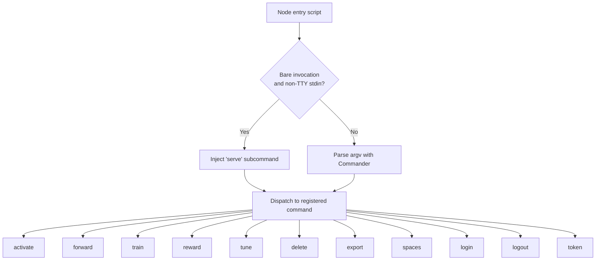
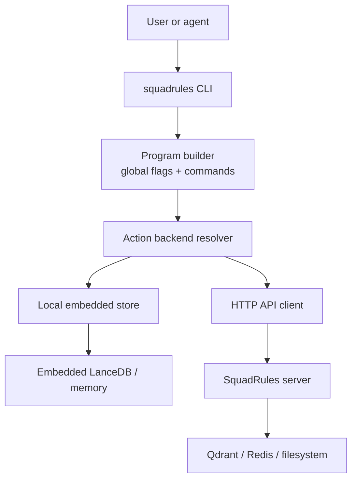
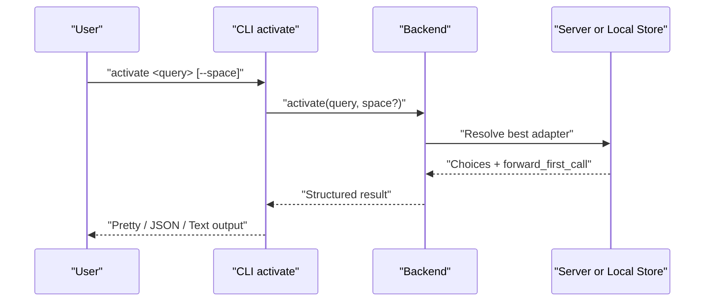
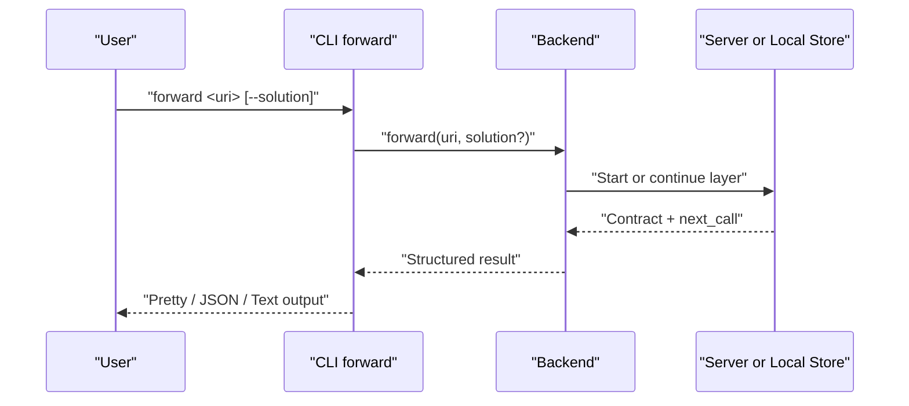
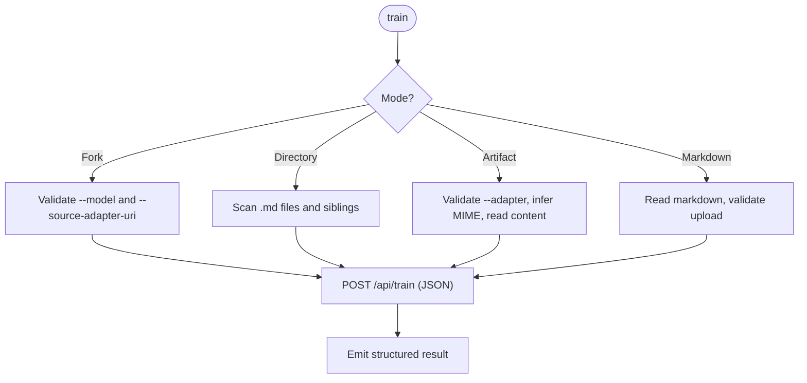
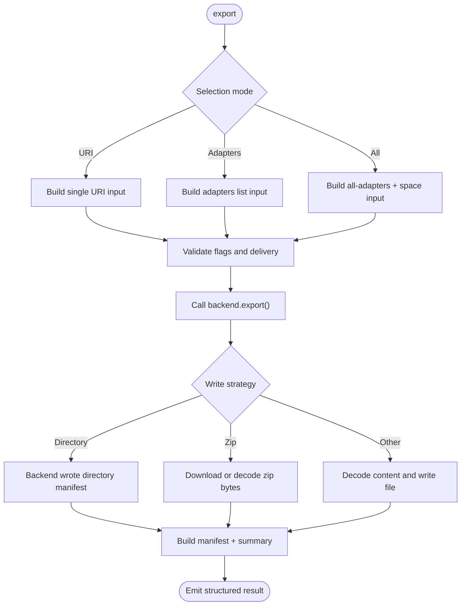
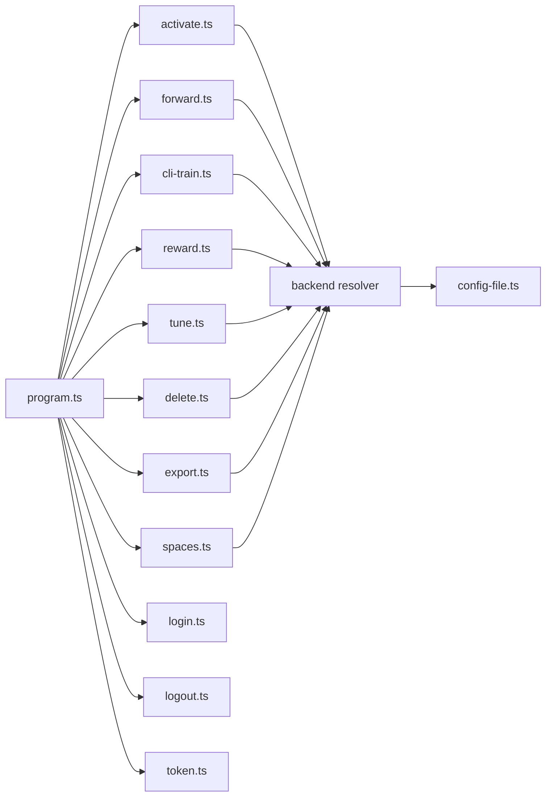

# CLI Command Reference

<cite>
**Referenced Files in This Document**
- [CLI.md](file://docs/CLI.md)
- [index.ts](file://src/cli/index.ts)
- [program.ts](file://src/cli/program.ts)
- [activate.ts](file://src/cli/commands/activate.ts)
- [forward.ts](file://src/cli/commands/forward.ts)
- [reward.ts](file://src/cli/commands/reward.ts)
- [tune.ts](file://src/cli/commands/tune.ts)
- [delete.ts](file://src/cli/commands/delete.ts)
- [export.ts](file://src/cli/commands/export.ts)
- [spaces.ts](file://src/cli/commands/spaces.ts)
- [login.ts](file://src/cli/commands/login.ts)
- [logout.ts](file://src/cli/commands/logout.ts)
- [token.ts](file://src/cli/commands/token.ts)
- [cli-train.ts](file://src/cli/commands/cli-train.ts)
- [config-file.ts](file://src/cli/config-file.ts)
- [activate.md](file://src/embed-docs/tools/activate.md)
- [forward.md](file://src/embed-docs/tools/forward.md)
</cite>

## Table of Contents
1. [Introduction](#introduction)
2. [Project Structure](#project-structure)
3. [Core Components](#core-components)
4. [Architecture Overview](#architecture-overview)
5. [Detailed Component Analysis](#detailed-component-analysis)
6. [Dependency Analysis](#dependency-analysis)
7. [Performance Considerations](#performance-considerations)
8. [Troubleshooting Guide](#troubleshooting-guide)
9. [Conclusion](#conclusion)
10. [Appendices](#appendices)

## Introduction
This document is the command reference for the SquadRules CLI. It covers invocation, global options, output formats, and every data command: `activate`, `forward`, `train`, `reward`, `tune`, `delete`, `export`, `spaces`, `login`, `logout`, and `token`. It also documents environment variables, configuration storage, authentication behavior, workspace scoping, automation patterns, CI/CD integration, and debugging techniques.

The CLI supports three equivalent binaries (`squadrules`, `sq`, `sqr`) and defaults to local embedded mode unless an HTTP API URL is configured. Authentication commands require an HTTP target; against the local sentinel they print guidance and fall back to `http://localhost:3000`.

**Section sources**
- [CLI.md:1-44](file://docs/CLI.md#L1-L44)
- [index.ts:1-21](file://src/cli/index.ts#L1-L21)

## Project Structure
The CLI entry point detects a bare invocation without arguments and automatically injects `serve` when stdin is not a TTY (MCP host mode). Otherwise it parses the program and dispatches to subcommands registered by the program builder.

**Diagram sources**
- [index.ts:11-19](file://src/cli/index.ts#L11-L19)
- [program.ts:31-79](file://src/cli/program.ts#L31-L79)

**Section sources**
- [index.ts:1-21](file://src/cli/index.ts#L1-L21)
- [program.ts:31-79](file://src/cli/program.ts#L31-L79)

## Core Components
- Global flags apply before or after the subcommand and control transport, timeouts, retries, output formatting, workspace scope, local reseed behavior, and browser behavior.
- Output format selection is automatic: pretty on a terminal, JSON when piped, with additional explicit modes.
- The backend resolves either a local embedded store or an HTTP client based on the resolved API URL.

Key global options:
- `-u, --url`: API base URL or local sentinel.
- `--timeout`: Request timeout in seconds.
- `--retries`: Max retries on network errors.
- `--format`: Output format (`auto`, `pretty`, `json`, `text`).
- `--space`: Space scope for multi-tenancy.
- `--reseed`: Local-mode hatch repair flag.
- `--no-browser`: Disable browser opening during auth flows.

Environment variables:
- `SQUADRULES_API_URL`, `SQUADRULES_TIMEOUT_MS`, `SQUADRULES_RETRIES`, `SQUADRULES_FORMAT`, `MEM_BOOT_FORCE_INJECT`.

Configuration file:
- Stores default API URL and per-environment tokens. Tokens may be stored in the OS keyring when available; otherwise they are persisted in the config file.

**Section sources**
- [CLI.md:46-75](file://docs/CLI.md#L46-L75)
- [CLI.md:248-257](file://docs/CLI.md#L248-L257)
- [config-file.ts:1-11](file://src/cli/config-file.ts#L1-L11)
- [config-file.ts:90-207](file://src/cli/config-file.ts#L90-L207)

## Architecture Overview
The CLI follows a consistent pattern: parse arguments, resolve backend, call the action backend method, render structured results, and handle errors uniformly.

**Diagram sources**
- [program.ts:31-79](file://src/cli/program.ts#L31-L79)
- [CLI.md:29-44](file://docs/CLI.md#L29-L44)

**Section sources**
- [program.ts:31-79](file://src/cli/program.ts#L31-L79)
- [CLI.md:29-44](file://docs/CLI.md#L29-L44)

## Detailed Component Analysis

### activate
Finds the best matching adapter for a query and returns the next `forward` call arguments.

Usage:
- `squadrules activate <query...> [--space <space>]`

Parameters:
- `<query...>`: Required search query.
- `--space <space>`: Optional space scope.

Output:
- Structured response including choices, scores, roles, and `forward_first_call`.
- Pretty and text renderers provide human-readable summaries; JSON mode exposes full structure.

Automation notes:
- Use `--format json` for scripts.
- Pipe output to extract URIs or forward calls.

**Diagram sources**
- [activate.ts:12-35](file://src/cli/commands/activate.ts#L12-L35)
- [activate.md:1-55](file://src/embed-docs/tools/activate.md#L1-L55)

**Section sources**
- [activate.ts:12-35](file://src/cli/commands/activate.ts#L12-L35)
- [activate.md:1-55](file://src/embed-docs/tools/activate.md#L1-L55)

### forward
Runs the first or next layer of an adapter and advances workflow state.

Usage:
- `squadrules forward <uri> [--solution <json>]`

Parameters:
- `<uri>`: Adapter or layer URI.
- `--solution <json>`: Optional solution envelope for continuation steps.

Output:
- Contract, next action guidance, and authoritative `next_call`.
- Terminal layers indicate reward; non-terminal layers indicate further forward steps.

Workflow contract notes:
- Shell contracts specify interpreter, command, display invocation, and timeout.
- Solution envelope includes type, outcome, evidence, nonce, and proof hash.
- Failure handling includes error codes, retry counts, and nonce mismatch recovery.

**Diagram sources**
- [forward.ts:12-32](file://src/cli/commands/forward.ts#L12-L32)
- [forward.md:1-71](file://src/embed-docs/tools/forward.md#L1-L71)

**Section sources**
- [forward.ts:12-32](file://src/cli/commands/forward.ts#L12-L32)
- [forward.md:1-71](file://src/embed-docs/tools/forward.md#L1-L71)

### train
Registers a new adapter from markdown, attaches artifacts, or forks an existing adapter.

Usage:
- Single markdown file: `squadrules train ./my-adapter.md --model gpt-4 [--space personal] [--force]`
- Directory batch: `squadrules train ./adapters --recursive --model gpt-4`
- Fork: `squadrules train --source-adapter-uri squadrules://adapter/my-adapter --model gpt-4`
- Artifact attachment: `squadrules train ./notes.txt --adapter squadrules://adapter/my-adapter [--mime text/plain]`

Parameters:
- `[path]`: Markdown file, artifact file, or directory.
- `--model`: LLM model ID for attribution; required for fork and artifact modes.
- `--force`: Force update if label already exists.
- `--recursive`: Include nested `.md` files in directory batches.
- `--source-adapter-uri`: Fork from existing adapter.
- `--space`: Target space for train or fork.
- `--adapter`: Parent adapter URI for artifact mode.
- `--artifact-name`: Artifact filename override.
- `--mime`: MIME override for artifact mode.
- `--relative-path`: Skill-root-relative path for export bundles.
- `--allow-sensitive-upload`: Allow uploads containing token-like or private-key-like text.

Batch behavior:
- Each `.md` becomes an adapter; sibling files attach to every `.md` in that directory.
- Machine-facing summary or JSON manifest; never dumps content bytes to stdout.

**Diagram sources**
- [cli-train.ts:40-211](file://src/cli/commands/cli-train.ts#L40-L211)

**Section sources**
- [cli-train.ts:40-211](file://src/cli/commands/cli-train.ts#L40-L211)
- [CLI.md:131-165](file://docs/CLI.md#L131-L165)

### reward
Records a reward signal for an adapter execution.

Usage:
- `squadrules reward <uri> <outcome> <feedback> [--score <number>] [--rater <rater>] [--rubric-version <version>] [--model <model>]`

Parameters:
- `<uri>`: Layer URI.
- `<outcome>`: `success` or `failure`.
- `<feedback>`: Human-readable reason.
- `--score`: Normalized score in 0..1.
- `--rater`: Evaluator identifier.
- `--rubric-version`: Rubric/policy version.
- `--model`: LLM model ID for attribution.

Validation:
- Outcome must be `success` or `failure`.
- Score must be numeric when provided.

Output:
- Structured confirmation with pretty/text renderers.

**Section sources**
- [reward.ts:13-66](file://src/cli/commands/reward.ts#L13-L66)
- [CLI.md:95-103](file://docs/CLI.md#L95-L103)

### tune
Updates one or more adapter layers or moves them between spaces.

Usage:
- `squadrules tune <uris...> [--file <file> | --files <files...> | --updates <json>] [--space <space>] [--allow-sensitive-upload]`

Parameters:
- `<uris...>`: One or more adapter or layer URIs.
- `--file <file>`: Apply same markdown to all URIs.
- `--files <files...>`: One markdown file per URI.
- `--updates <json>`: Updates object as JSON string.
- `--space <space>`: Move-only operation when used alone.
- `--allow-sensitive-upload`: Allow sensitive content in uploads.

Validation:
- File count must match URI count when using `--files`.
- Must provide `--file`, `--updates`, or `--space` alone.

Output:
- Structured result with pretty/text renderers.

**Section sources**
- [tune.ts:32-115](file://src/cli/commands/tune.ts#L32-L115)
- [CLI.md:105-113](file://docs/CLI.md#L105-L113)

### delete
Deletes one or more adapter or layer resources.

Usage:
- `squadrules delete <uris...>`

Parameters:
- `<uris...>`: One or more URIs to delete.

Output:
- Structured deletion result with pretty/text renderers.

**Section sources**
- [delete.ts:13-30](file://src/cli/commands/delete.ts#L13-L30)
- [CLI.md:115-121](file://docs/CLI.md#L115-L121)

### export
Machine-facing bulk export of adapters and artifacts.

Usage:
- `squadrules export [uri] [--adapters <uri-or-slug>...] [--all-adapters --space <name>] [--as <format>] [--delivery <download_ref|inline_base64>] [--directory <dir>] [--out <dir>] [--to <file>] [--zip-out <file>]`

Parameters:
- `[uri]`: Single-selection mode.
- `--adapters`: Repeatable adapter URIs or slugs.
- `--all-adapters`: Export every adapter in `--space`.
- `--space <name>`: Required with `--all-adapters`.
- `--as <format>`: Content format (`skill_zip`, `markdown`, `skill_tree`, `source`, `trace_jsonl`, `reward_jsonl`, `sft_jsonl`, `preference_jsonl`).
- `--delivery <mode>`: `download_ref` or `inline_base64` for `skill_zip`.
- `--directory <dir>`: Local mode only, `markdown` only; writes `<dir>/<slug>.md`.
- `--out <dir>`: Write artifacts into this directory.
- `--to <file>`: Write single payload to exact path (non-`skill_zip`).
- `--zip-out <file>`: Write `skill_zip` bytes to explicit path.

Behavior:
- Never dumps content bytes to stdout.
- JSON mode emits a machine manifest of written artifacts.
- `--directory` is rejected against HTTP targets with actionable guidance.

**Diagram sources**
- [export.ts:48-143](file://src/cli/commands/export.ts#L48-L143)
- [export.ts:201-266](file://src/cli/commands/export.ts#L201-L266)
- [export.ts:296-345](file://src/cli/commands/export.ts#L296-L345)

**Section sources**
- [export.ts:48-143](file://src/cli/commands/export.ts#L48-L143)
- [export.ts:201-266](file://src/cli/commands/export.ts#L201-L266)
- [export.ts:296-345](file://src/cli/commands/export.ts#L296-L345)
- [CLI.md:166-219](file://docs/CLI.md#L166-L219)

### spaces
Lists available spaces and adapter counts.

Usage:
- `squadrules spaces [--include-adapter-titles]`

Parameters:
- `--include-adapter-titles`: Include per-space adapter titles and layer counts.

Output:
- Structured space listing with pretty/text renderers.

**Section sources**
- [spaces.ts:12-34](file://src/cli/commands/spaces.ts#L12-L34)
- [CLI.md:123-129](file://docs/CLI.md#L123-L129)

### login
Obtains and stores a bearer token via browser PKCE or direct token validation.

Usage:
- `squadrules login --token <token>`
- `squadrules login` (browser PKCE)

Parameters:
- `--token <token>`: Validate and store an existing token.
- `--no-browser`: Only print login URL; do not open browser.

Behavior:
- Against local sentinel, prints fallback guidance and uses `http://localhost:3000`.
- Validates token via `/api/me`.
- Stores access and refresh tokens (when present) in keyring or config file.

**Section sources**
- [login.ts:255-287](file://src/cli/commands/login.ts#L255-L287)
- [CLI.md:231-246](file://docs/CLI.md#L231-L246)

### logout
Clears stored credentials for the current environment.

Usage:
- `squadrules logout`

Behavior:
- Clears bearer token for the current API URL.
- Prints fallback guidance against local sentinel.

**Section sources**
- [logout.ts:10-20](file://src/cli/commands/logout.ts#L10-L20)
- [CLI.md:231-246](file://docs/CLI.md#L231-L246)

### token
Prints the stored bearer token to stdout for scripting.

Usage:
- `squadrules token --validate`
- `squadrules token --login`

Parameters:
- `--validate`: Validate token with `/api/me` before printing.
- `--login`: Trigger browser login if no valid token exists.

Behavior:
- Reads token from config/keyring.
- Exits with error if no token or invalid token.

**Section sources**
- [token.ts:11-52](file://src/cli/commands/token.ts#L11-L52)
- [CLI.md:231-246](file://docs/CLI.md#L231-L246)

## Dependency Analysis
Commands share common dependencies:
- Backend resolution: `createBackendFromProgram(program)` selects local or HTTP transport.
- Error handling: `handleApiError(error, !isBrowserDisabled())`.
- Output rendering: `emitResult(resolveOutputFormat(program), response, { pretty, text, nextCall })`.
- Global flag propagation: pre-action hook sets `SQUADRULES_API_URL` and `SQUADRULES_NO_BROWSER`.

**Diagram sources**
- [program.ts:31-79](file://src/cli/program.ts#L31-L79)
- [activate.ts:12-35](file://src/cli/commands/activate.ts#L12-L35)
- [forward.ts:12-32](file://src/cli/commands/forward.ts#L12-L32)
- [cli-train.ts:40-211](file://src/cli/commands/cli-train.ts#L40-L211)
- [reward.ts:13-66](file://src/cli/commands/reward.ts#L13-L66)
- [tune.ts:32-115](file://src/cli/commands/tune.ts#L32-L115)
- [delete.ts:13-30](file://src/cli/commands/delete.ts#L13-L30)
- [export.ts:296-345](file://src/cli/commands/export.ts#L296-L345)
- [spaces.ts:12-34](file://src/cli/commands/spaces.ts#L12-L34)
- [login.ts:255-287](file://src/cli/commands/login.ts#L255-L287)
- [logout.ts:10-20](file://src/cli/commands/logout.ts#L10-L20)
- [token.ts:11-52](file://src/cli/commands/token.ts#L11-L52)
- [config-file.ts:90-207](file://src/cli/config-file.ts#L90-L207)

**Section sources**
- [program.ts:31-79](file://src/cli/program.ts#L31-L79)
- [config-file.ts:90-207](file://src/cli/config-file.ts#L90-L207)

## Performance Considerations
- Prefer `--format json` for scripts to avoid parsing pretty output.
- Use `--timeout` and `--retries` to tune network resilience.
- For large exports, use `--as skill_zip` with `--zip-out` to avoid buffering large payloads in memory unnecessarily.
- Avoid repeated failed shell contracts; fix adapter contracts or artifacts instead of retrying indefinitely.

[No sources needed since this section provides general guidance]

## Troubleshooting Guide
Common issues and resolutions:
- No stored token: Run `squadrules login` or `squadrules token --login`.
- Invalid or expired token: Re-authenticate with `squadrules login`; use `squadrules token --validate` to check.
- Local mode auth fallback: When using local sentinel, auth commands fall back to `http://localhost:3000`; pass `--url http://<host>:<port>` to target a specific server.
- Missing artifact in forward: Obtain via `export` with `skill_tree` or `skill_zip`; follow `materialize` instructions from `activate` choice.
- Export `--directory` against HTTP: Not supported; use `--as skill_zip` or `--as skill_tree` plus `--out`.
- Reward success conflict: If last proof failed, rate failure or fix step and rerun.

Debugging techniques:
- Use `--format json` to inspect full responses.
- Check stderr for diagnostic messages; stdout carries payload.
- Inspect config storage location and keyring availability.
- Validate tokens explicitly with `squadrules token --validate`.

**Section sources**
- [CLI.md:231-246](file://docs/CLI.md#L231-L246)
- [forward.md:173-185](file://src/embed-docs/tools/forward.md#L173-L185)
- [export.ts:189-199](file://src/cli/commands/export.ts#L189-L199)
- [login.ts:53-78](file://src/cli/commands/login.ts#L53-L78)

## Conclusion
The SquadRules CLI provides a consistent, script-friendly interface for adapter activation, workflow execution, training, tuning, rewards, cleanup, export, multi-tenancy, and authentication. Use global flags and environment variables to control transport and output, prefer JSON for automation, and follow the activate→forward→reward chain for deterministic, auditable workflows.

[No sources needed since this section summarizes without analyzing specific files]

## Appendices

### Environment Variables
- `SQUADRULES_API_URL`: Default target URL or local sentinel.
- `SQUADRULES_TIMEOUT_MS`: Default request timeout in milliseconds.
- `SQUADRULES_RETRIES`: Default max retries.
- `SQUADRULES_FORMAT`: Default output format.
- `MEM_BOOT_FORCE_INJECT`: Force boot re-injection (same as `--reseed`).

**Section sources**
- [CLI.md:248-257](file://docs/CLI.md#L248-L257)

### Configuration File Options
- Stores default API URL and per-environment tokens.
- Supports migration from legacy flat config to multi-environment shape.
- Integrates with OS keyring when available; falls back to file storage otherwise.

**Section sources**
- [config-file.ts:1-11](file://src/cli/config-file.ts#L1-L11)
- [config-file.ts:90-207](file://src/cli/config-file.ts#L90-L207)

### Automation Scripting Patterns
- Extract URIs from `activate` output: pipe JSON through a processor.
- Materialize artifacts before running shell contracts using `export` with `source` format and `--to`.
- Batch train directories with `--recursive` and consume JSON manifests for CI reporting.
- Use `--no-browser` in automated environments; supply tokens via `--token` or environment-driven login.

**Section sources**
- [CLI.md:60-75](file://docs/CLI.md#L60-L75)
- [forward.md:85-97](file://src/embed-docs/tools/forward.md#L85-L97)
- [cli-train.ts:127-130](file://src/cli/commands/cli-train.ts#L127-L130)

### CI/CD Integration
- Run `squadrules serve` in stdio mode when invoked without arguments in MCP hosts.
- Pin `--url` to a known server endpoint in CI jobs.
- Use `--format json` for stable machine output and artifact manifests.
- Validate tokens early with `squadrules token --validate` and fail fast on invalid credentials.

**Section sources**
- [index.ts:11-19](file://src/cli/index.ts#L11-L19)
- [CLI.md:221-229](file://docs/CLI.md#L221-L229)