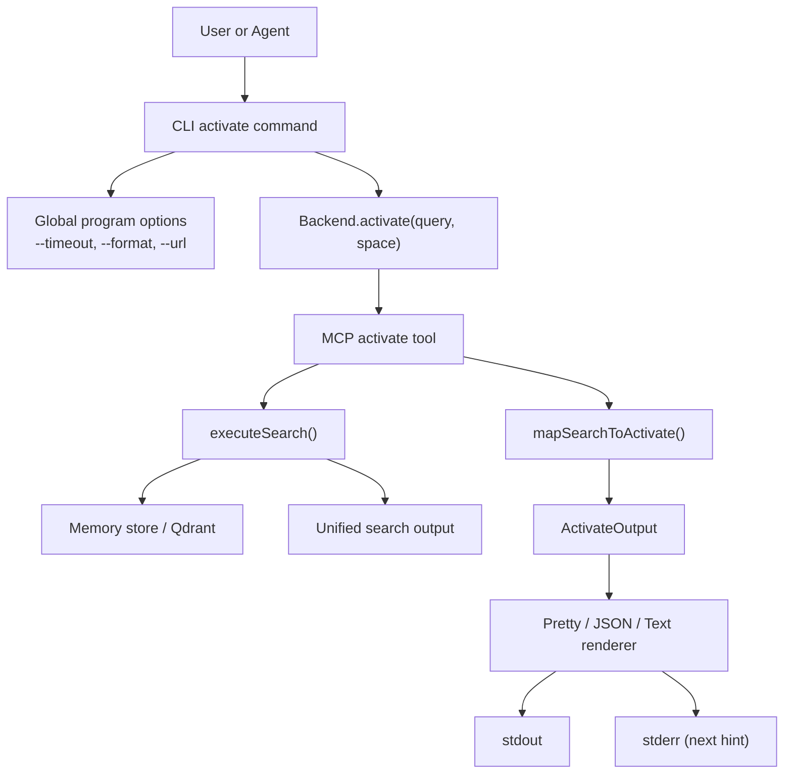
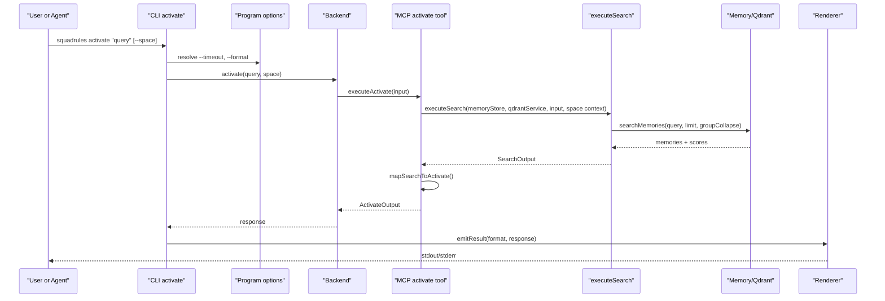
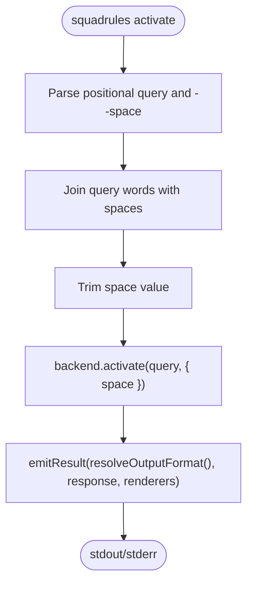
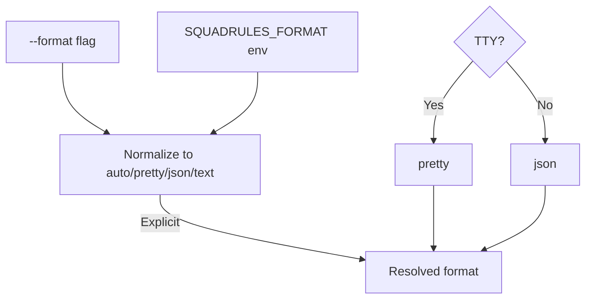
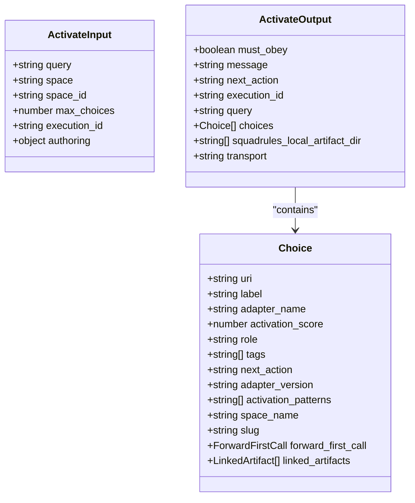
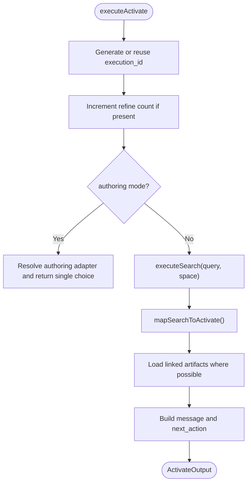
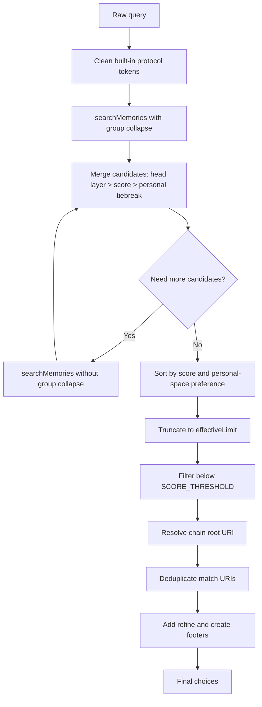
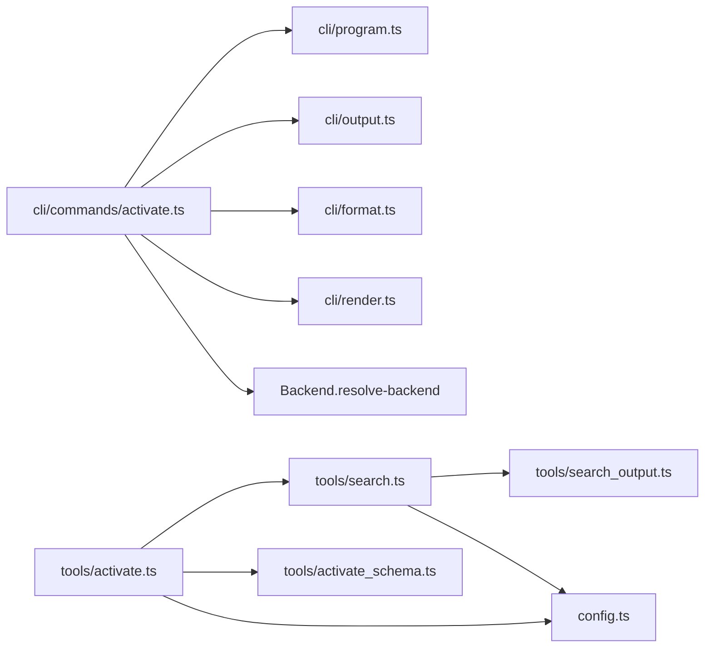

# Activate Command

<cite>
**Referenced Files in This Document**
- [activate.ts](file://src/cli/commands/activate.ts)
- [program.ts](file://src/cli/program.ts)
- [format.ts](file://src/cli/format.ts)
- [output.ts](file://src/cli/output.ts)
- [render.ts](file://src/cli/render.ts)
- [CLI.md](file://docs/CLI.md)
- [activate.ts](file://src/tools/activate.ts)
- [activate_schema.ts](file://src/tools/activate_schema.ts)
- [search.ts](file://src/tools/search.ts)
- [search_output.ts](file://src/tools/search_output.ts)
- [config.ts](file://src/config.ts)
</cite>

## Table of Contents
1. [Introduction](#introduction)
2. [Project Structure](#project-structure)
3. [Core Components](#core-components)
4. [Architecture Overview](#architecture-overview)
5. [Detailed Component Analysis](#detailed-component-analysis)
6. [Dependency Analysis](#dependency-analysis)
7. [Performance Considerations](#performance-considerations)
8. [Troubleshooting Guide](#troubleshooting-guide)
9. [Conclusion](#conclusion)

## Introduction
The SquadRules `activate` command selects the best matching adapter for a natural-language query and returns ranked choices that guide an AI agent or human operator to the next step. It is part of the core activation workflow: `activate` → `forward` → `reward`.

At a high level, `activate`:
- Accepts a search query.
- Optionally scopes results to a workspace called a **space**.
- Searches stored adapters using semantic similarity and metadata.
- Ranks candidates through vector similarity, thresholding, group collapse, head-layer preference, personal-space tiebreaking, and chain-root resolution.
- Returns structured choices with labels, URIs, scores, tags, and instructions for calling `forward`.

This document focuses on the CLI `activate` command while explaining the underlying selection logic implemented by the MCP tool layer.

## Project Structure
The `activate` command spans two layers:
- **CLI layer**: parses arguments, resolves output format, calls a backend, and renders results.
- **MCP/tool layer**: validates input, runs semantic search, builds unified choices, and emits the canonical activation response.



**Diagram sources**
- [activate.ts:12-35](file://src/cli/commands/activate.ts#L12-L35)
- [program.ts:31-44](file://src/cli/program.ts#L31-L44)
- [activate.ts:168-229](file://src/tools/activate.ts#L168-L229)
- [search.ts:192-253](file://src/tools/search.ts#L192-L253)
- [output.ts:42-55](file://src/cli/output.ts#L42-L55)
- [render.ts:79-101](file://src/cli/render.ts#L79-L101)

**Section sources**
- [activate.ts:12-35](file://src/cli/commands/activate.ts#L12-L35)
- [program.ts:31-44](file://src/cli/program.ts#L31-L44)
- [CLI.md:79-85](file://docs/CLI.md#L79-L85)

## Core Components
The most important components for understanding `activate` are:

| Component | Responsibility | Key behavior |
|---|---|---|
| CLI `activate` command | Parses positional query and `--space`, calls backend, emits result | Supports only `--space`; other flags come from global options |
| Global program | Defines `--timeout`, `--format`, `--url`, retries, browser control | Affects network requests and output rendering |
| Output formatter | Resolves effective format | `auto` → pretty on TTY, JSON when piped; also supports `pretty`, `json`, `text` |
| MCP `activate` tool | Validates input, executes search, maps results to activation choices | Enforces schema limits, execution IDs, refinement flow, and artifact guidance |
| Search engine | Performs semantic search and candidate ranking | Uses memory store, optional Qdrant service, cache, thresholds, and group collapse |
| Unified output builder | Builds match/refine/create choices and messages | Normalizes scores, resolves chain roots, deduplicates matches, appends meta footers |

**Section sources**
- [activate.ts:12-35](file://src/cli/commands/activate.ts#L12-L35)
- [program.ts:31-44](file://src/cli/program.ts#L31-L44)
- [format.ts:1-35](file://src/cli/format.ts#L1-L35)
- [activate.ts:168-281](file://src/tools/activate.ts#L168-L281)
- [search.ts:93-186](file://src/tools/search.ts#L93-L186)
- [search_output.ts:77-240](file://src/tools/search_output.ts#L77-L240)

## Architecture Overview
The activation architecture separates user-facing CLI concerns from the data-selection logic.



**Diagram sources**
- [activate.ts:12-35](file://src/cli/commands/activate.ts#L12-L35)
- [program.ts:31-44](file://src/cli/program.ts#L31-L44)
- [activate.ts:168-229](file://src/tools/activate.ts#L168-L229)
- [search.ts:192-253](file://src/tools/search.ts#L192-L253)
- [output.ts:42-55](file://src/cli/output.ts#L42-L55)

## Detailed Component Analysis

### CLI Command Definition
The CLI `activate` command:
- Registers the `activate` subcommand.
- Requires one or more positional words forming the query.
- Accepts `--space` to scope results.
- Calls the backend with the joined query and optional space.
- Emits the response through the global output formatter.

Important note: the CLI `activate` command does **not** define its own `--query`, `--limit`, `--format`, or `--timeout` flags. Those behaviors come from different places:
- `--query` is the required positional argument.
- `--format` and `--timeout` are global program options.
- `--limit` is not exposed by the CLI `activate` command; it exists in the MCP tool input schema as `max_choices`.



**Diagram sources**
- [activate.ts:12-35](file://src/cli/commands/activate.ts#L12-L35)

**Section sources**
- [activate.ts:12-35](file://src/cli/commands/activate.ts#L12-L35)
- [CLI.md:79-85](file://docs/CLI.md#L79-L85)

### Global Options: `--format` and `--timeout`
The global program defines:
- `--timeout <seconds>`: request timeout in seconds, backed by `SQUADRULES_TIMEOUT_MS`.
- `--format <format>`: output format, defaulting to `auto`.
- Other global options such as `--url`, `--retries`, and `--no-browser`.

The `--format` resolver accepts:
- `auto`: pretty on a TTY, JSON when piped or redirected.
- `pretty`: human-readable summary on stdout, next-call hint on stderr.
- `json`: canonical structured response on stdout.
- `text`: minimal plain-text rendering.



**Diagram sources**
- [program.ts:38-44](file://src/cli/program.ts#L38-L44)
- [format.ts:12-35](file://src/cli/format.ts#L12-L35)

**Section sources**
- [program.ts:31-44](file://src/cli/program.ts#L31-L44)
- [format.ts:1-35](file://src/cli/format.ts#L1-L35)
- [CLI.md:46-75](file://docs/CLI.md#L46-L75)

### MCP Tool Input Schema: `query`, `space`, `max_choices`, `execution_id`
The MCP `activate` tool enforces a stricter contract than the CLI wrapper. Its input schema includes:
- `query`: required non-empty string.
- `space` or `space_id`: optional space scoping.
- `max_choices`: optional integer bounded by configured minimum and maximum search limits.
- `execution_id`: optional UUID used for refinement sequences.
- `authoring`: optional adapter authoring workflow context.



**Diagram sources**
- [activate_schema.ts:86-139](file://src/tools/activate_schema.ts#L86-L139)

**Section sources**
- [activate_schema.ts:86-139](file://src/tools/activate_schema.ts#L86-L139)

### Activation Workflow
The MCP `activate` tool performs these steps:
1. Generate or reuse an execution ID.
2. Track refinement count for the execution.
3. Handle special authoring mode if requested.
4. Execute semantic search with optional space scoping.
5. Map search results into activation choices.
6. Attach artifact materialization guidance when applicable.
7. Return structured output with choices and next-action instructions.



**Diagram sources**
- [activate.ts:168-229](file://src/tools/activate.ts#L168-L229)
- [activate.ts:44-166](file://src/tools/activate.ts#L44-L166)

**Section sources**
- [activate.ts:168-229](file://src/tools/activate.ts#L168-L229)
- [activate.ts:44-166](file://src/tools/activate.ts#L44-L166)

### Adapter Ranking Algorithms, Similarity Scoring, and Context Matching
The ranking pipeline combines several mechanisms:

| Stage | Behavior | Purpose |
|---|---|---|
| Query normalization | Removes built-in protocol URIs and slugs before search | Prevents internal protocol tokens from polluting embeddings |
| Candidate collection | First pass with group collapse, second pass without collapse if needed | Improves recall while controlling cost |
| Candidate merging | Keeps head layer, higher score, or personal-space tiebreak | Prefers latest version and user’s preferred copy |
| Sorting | Sorts by score, then personal-space preference | Ensures top results are meaningful |
| Limiting | Truncates to effective limit | Controls output size and downstream latency |
| Threshold filtering | Filters results below normalized threshold | Removes low-confidence matches |
| Chain-root resolution | Resolves chain root URI when available | Routes to the correct entry point for multi-step adapters |
| Deduplication | Removes duplicate match URIs after chain resolution | Avoids redundant choices |
| Meta footers | Adds refine and create choices | Provides fallback workflows |



**Diagram sources**
- [search.ts:35-47](file://src/tools/search.ts#L35-L47)
- [search.ts:93-111](file://src/tools/search.ts#L93-L111)
- [search.ts:143-186](file://src/tools/search.ts#L143-L186)
- [search_output.ts:77-92](file://src/tools/search_output.ts#L77-L92)
- [search_output.ts:117-240](file://src/tools/search_output.ts#L117-L240)

**Section sources**
- [search.ts:35-47](file://src/tools/search.ts#L35-L47)
- [search.ts:93-111](file://src/tools/search.ts#L93-L111)
- [search.ts:143-186](file://src/tools/search.ts#L143-L186)
- [search_output.ts:77-92](file://src/tools/search_output.ts#L77-L92)
- [search_output.ts:117-240](file://src/tools/search_output.ts#L117-L240)
- [config.ts:108-116](file://src/config.ts#L108-L116)
- [config.ts:284-294](file://src/config.ts#L284-L294)

### Command-Line Parameters

#### Positional Query
- The CLI requires one or more words.
- They are joined with spaces and passed as the activation query.
- Example: `squadrules activate deploy release` becomes the query `"deploy release"`.

**Section sources**
- [activate.ts:12-35](file://src/cli/commands/activate.ts#L12-L35)

#### `--space`
- Available on the CLI `activate` command.
- Scopes results to a space such as `personal` or a group name.
- Internally, the MCP tool accepts both `space` and `space_id`.

**Section sources**
- [activate.ts:12-35](file://src/cli/commands/activate.ts#L12-L35)
- [activate_schema.ts:94-98](file://src/tools/activate_schema.ts#L94-L98)

#### `--query`
- Not a named CLI option for `activate`.
- The query is provided as positional arguments.
- The MCP tool still expects a `query` field in its input schema.

**Section sources**
- [activate.ts:12-35](file://src/cli/commands/activate.ts#L12-L35)
- [activate_schema.ts:86-88](file://src/tools/activate_schema.ts#L86-L88)

#### `--limit`
- Not exposed by the CLI `activate` command.
- The MCP tool input schema exposes `max_choices`.
- Effective values are clamped between configured minimum and maximum limits.

**Section sources**
- [activate_schema.ts:99-105](file://src/tools/activate_schema.ts#L99-L105)
- [config.ts:110-115](file://src/config.ts#L110-L115)

#### `--format`
- Global option.
- Accepted values: `auto`, `pretty`, `json`, `text`.
- `auto` is human-first: pretty on TTY, JSON when piped.

**Section sources**
- [program.ts:41-44](file://src/cli/program.ts#L41-L44)
- [format.ts:12-35](file://src/cli/format.ts#L12-L35)
- [CLI.md:60-75](file://docs/CLI.md#L60-L75)

#### `--timeout`
- Global option.
- Specifies request timeout in seconds.
- Environment variable: `SQUADRULES_TIMEOUT_MS`.

**Section sources**
- [program.ts:38-40](file://src/cli/program.ts#L38-L40)
- [CLI.md:46-58](file://docs/CLI.md#L46-L58)

### Practical Examples

#### Basic Activation with Query Text
Use multiple words to describe the task. The CLI joins them into a single query.

```bash
squadrules activate "how do I deploy a release"
```

Expected outcome:
- Returns ranked adapter choices.
- Includes a top confidence percentage when matches exist.
- Suggests calling `forward` with the selected adapter URI.

**Section sources**
- [CLI.md:21-23](file://docs/CLI.md#L21-L23)
- [CLI.md:79-85](file://docs/CLI.md#L79-L85)
- [search_output.ts:220-239](file://src/tools/search_output.ts#L220-L239)

#### Space-Scoped Activation
Scope the search to a specific workspace.

```bash
squadrules activate "run integration tests" --space personal
```

Behavior:
- The CLI trims the space value.
- The MCP tool passes the space to the search layer.
- Results are filtered and ranked within that space context.

**Section sources**
- [activate.ts:12-35](file://src/cli/commands/activate.ts#L12-L35)
- [search.ts:192-253](file://src/tools/search.ts#L192-L253)

#### JSON Output for Automation
Use `--format json` to get machine-parseable output.

```bash
squadrules activate "build and ship hotfix" --format json
```

Behavior:
- Prints the canonical response object.
- Suitable for piping to tools like `jq`.
- Keeps structured fields such as `choices`, `activation_score`, and `next_action`.

**Section sources**
- [CLI.md:60-75](file://docs/CLI.md#L60-L75)
- [output.ts:27-29](file://src/cli/output.ts#L27-L29)
- [output.ts:42-55](file://src/cli/output.ts#L42-L55)

#### Integration with AI Agents
Agents should:
1. Call `activate` with a clear, intent-focused query.
2. Inspect `choices`.
3. Pick the highest-confidence match unless business rules require otherwise.
4. Follow the chosen choice’s `next_action`, typically invoking `forward`.
5. Use `execution_id` when refining the same request.

```bash
squadrules activate "validate PR checks before merge" --format json
```

Agent guidance:
- Prefer explicit queries over vague terms.
- Use `--space` when the agent knows the relevant workspace.
- Re-run `activate` with a refined query and the same `execution_id` when no good match appears.

**Section sources**
- [activate.ts:168-229](file://src/tools/activate.ts#L168-L229)
- [activate_schema.ts:89-93](file://src/tools/activate_schema.ts#L89-L93)
- [search_output.ts:220-239](file://src/tools/search_output.ts#L220-L239)

### Authentication Requirements
Authentication depends on the target:
- Local mode: no authentication is required because commands run against the embedded store.
- HTTP mode: authentication may be required depending on server configuration.
- `login`, `token`, and `logout` are used to manage credentials for HTTP targets.

Key points:
- Without configuration, data commands run locally.
- After `login`, later data commands use the stored HTTP API URL.
- If auth is enabled but environment variables are missing, startup can fail closed.

**Section sources**
- [CLI.md:29-44](file://docs/CLI.md#L29-L44)
- [CLI.md:231-246](file://docs/CLI.md#L231-L246)
- [config.ts:248-266](file://src/config.ts#L248-L266)

### Error Responses and Debugging Techniques

#### Common Failure Modes
| Symptom | Likely Cause | Debugging Action |
|---|---|---|
| No matching adapters | Query too broad, wrong space, or no suitable adapter exists | Refine query, try `--space personal`, or choose the create footer choice |
| Low confidence score | Weak semantic match or poor adapter metadata | Improve adapter descriptions/tags, adjust `SCORE_THRESHOLD` carefully |
| Unexpected number of choices | `max_choices` outside configured bounds or search limits applied | Check `SQUADRULES_SEARCH_LIMIT_MIN`, `SQUADRULES_SEARCH_LIMIT_CAP`, and `SQUADRULES_SEARCH_MAX_CHOICES` |
| Auth error against HTTP target | Missing token, expired token, or misconfigured Keycloak | Use `squadrules login`, validate token, check server auth settings |
| Timeout | Network delay or slow embedding/vector provider | Increase `--timeout`, inspect `SQUADRULES_TIMEOUT_MS`, check backend health |

#### Debugging Steps
1. Run with `--format json` to inspect the full response.
2. Check `choices` and their `activation_score`.
3. Verify the active space with `squadrules spaces`.
4. For HTTP targets, confirm authentication with `squadrules token --validate`.
5. For repeated identical queries, remember the activate/search cache may return cached results.
6. For failed activations, prefer refining the query or creating a new adapter rather than guessing.

**Section sources**
- [search.ts:206-247](file://src/tools/search.ts#L206-L247)
- [CLI.md:231-246](file://docs/CLI.md#L231-L246)
- [config.ts:108-116](file://src/config.ts#L108-L116)
- [config.ts:284-294](file://src/config.ts#L284-L294)

## Dependency Analysis
The `activate` command depends on several modules:



**Diagram sources**
- [activate.ts:12-35](file://src/cli/commands/activate.ts#L12-L35)
- [activate.ts:168-281](file://src/tools/activate.ts#L168-L281)
- [search.ts:192-253](file://src/tools/search.ts#L192-L253)
- [search_output.ts:117-240](file://src/tools/search_output.ts#L117-L240)
- [config.ts:108-116](file://src/config.ts#L108-L116)

**Section sources**
- [activate.ts:12-35](file://src/cli/commands/activate.ts#L12-L35)
- [activate.ts:168-281](file://src/tools/activate.ts#L168-L281)
- [search.ts:192-253](file://src/tools/search.ts#L192-L253)
- [search_output.ts:117-240](file://src/tools/search_output.ts#L117-L240)

## Performance Considerations
Optimizing `activate` performance involves query design, configuration tuning, and understanding caching:

| Area | Recommendation | Reason |
|---|---|---|
| Query clarity | Use precise verbs and nouns describing the real task | Better embeddings improve semantic similarity |
| Space scoping | Include `--space` when known | Reduces search space and avoids irrelevant matches |
| Output format | Use `json` for automation | Avoids pretty-render overhead and stabilizes parsing |
| Result count | Do not rely on CLI `--limit`; tune server-side limits if needed | CLI does not expose `--limit`; MCP `max_choices` is clamped |
| Caching | Repeat similar queries when safe | Activate/search results are cached with a TTL |
| Embedding provider | Ensure embedding provider is healthy and fast | Slow providers increase activation latency |
| Vector store | Keep Qdrant or LanceDB healthy and indexed | Search latency depends on vector store performance |

Relevant configuration:
- `SQUADRULES_SEARCH_MAX_CHOICES`: default number of choices returned.
- `SQUADRULES_SEARCH_LIMIT_CAP`: absolute cap for `max_choices`.
- `SQUADRULES_SEARCH_LIMIT_MIN`: minimum match choices.
- `SQUADRULES_ENABLE_GROUP_COLLAPSE`: controls candidate grouping behavior.
- `SCORE_THRESHOLD`: filters low-confidence results.

**Section sources**
- [search.ts:206-247](file://src/tools/search.ts#L206-L247)
- [config.ts:108-116](file://src/config.ts#L108-L116)
- [config.ts:284-294](file://src/config.ts#L284-L294)

## Troubleshooting Guide

### Failed Activations Checklist
1. Confirm the query describes a concrete task.
2. Try `--space personal` if you expect a user-owned adapter.
3. Switch to `--format json` to inspect `choices` and `activation_score`.
4. Check whether the top choice has a reasonable confidence percentage.
5. If no match exists, consider the create or refine footer choices.
6. For HTTP targets, verify authentication and API URL.
7. For timeouts, increase `--timeout` and inspect backend availability.

### When to Refine vs Create
- Choose **refine** when a close match exists but the query needs adjustment.
- Choose **create** when no existing adapter fits the task.
- The activation message often indicates whether to run, refine, or create.

**Section sources**
- [search_output.ts:220-239](file://src/tools/search_output.ts#L220-L239)
- [activate.ts:139-165](file://src/tools/activate.ts#L139-L165)
- [CLI.md:231-246](file://docs/CLI.md#L231-L246)

## Conclusion
The SquadRules `activate` command is the entry point for selecting optimal adapters based on context and semantic similarity. While the CLI provides a simple interface with `--space`, `--format`, and `--timeout`, the real selection logic lives in the MCP tool layer, which performs semantic search, candidate ranking, thresholding, chain-root resolution, and structured output generation.

For reliable automation:
- Write clear queries.
- Scope searches with `--space` when appropriate.
- Use `--format json` for machine consumption.
- Follow the returned `next_action` and `forward_first_call` guidance.
- Treat `activate` as the first step in the `activate` → `forward` → `reward` chain.