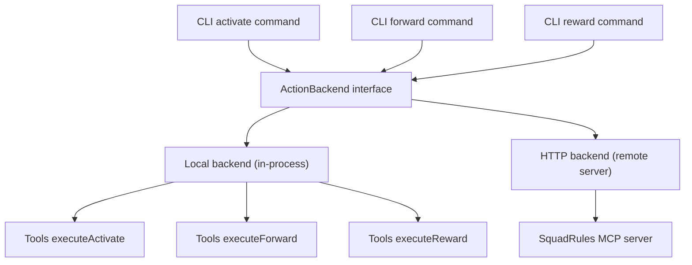
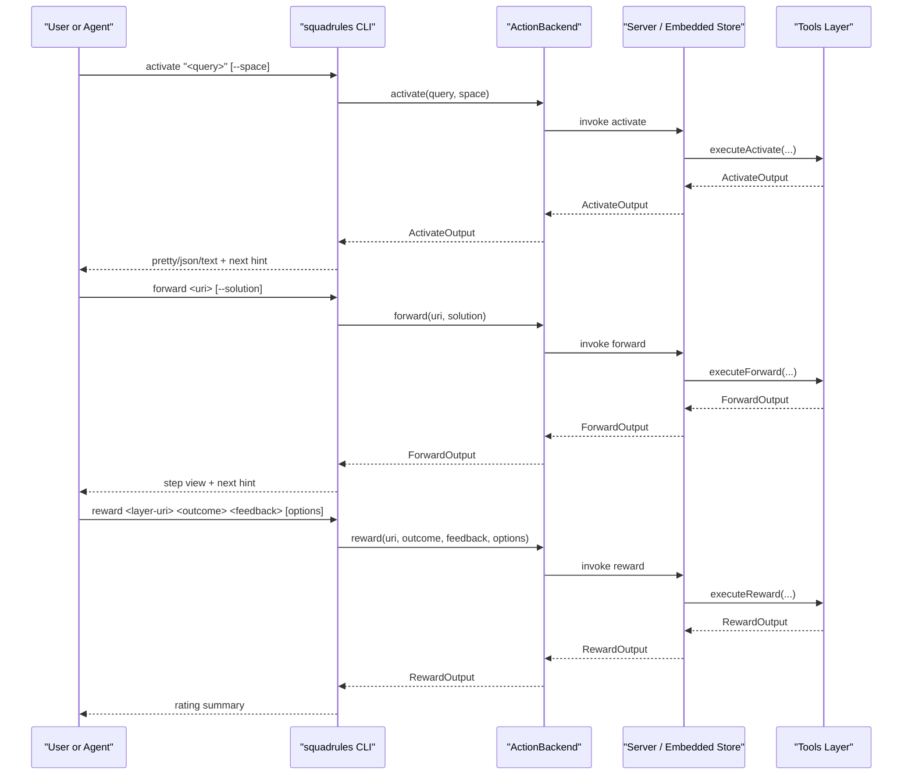
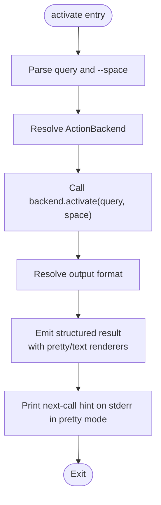
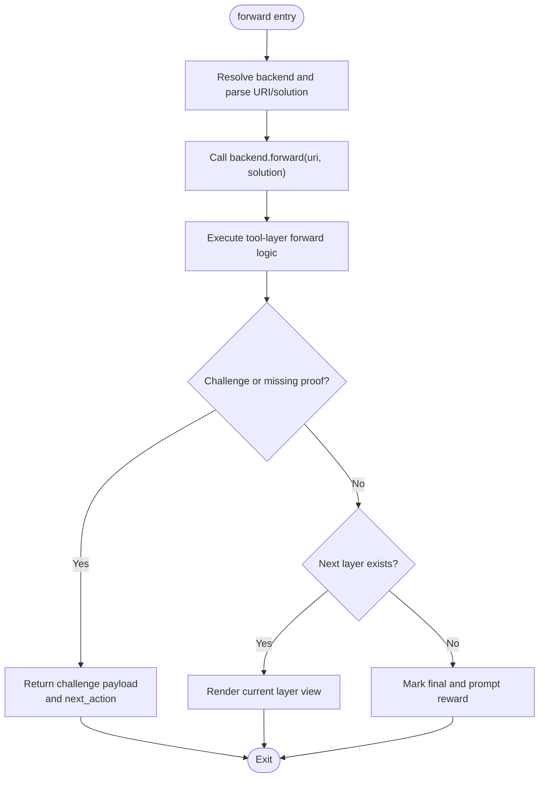
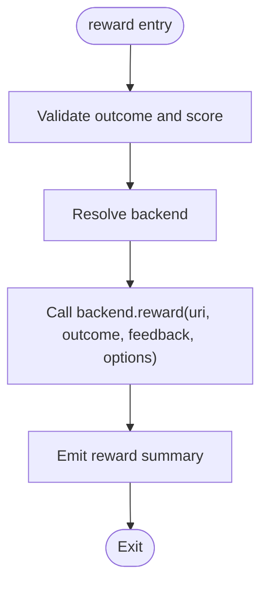
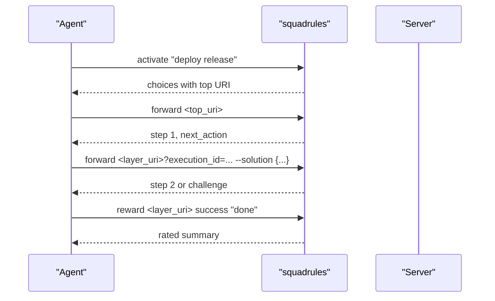
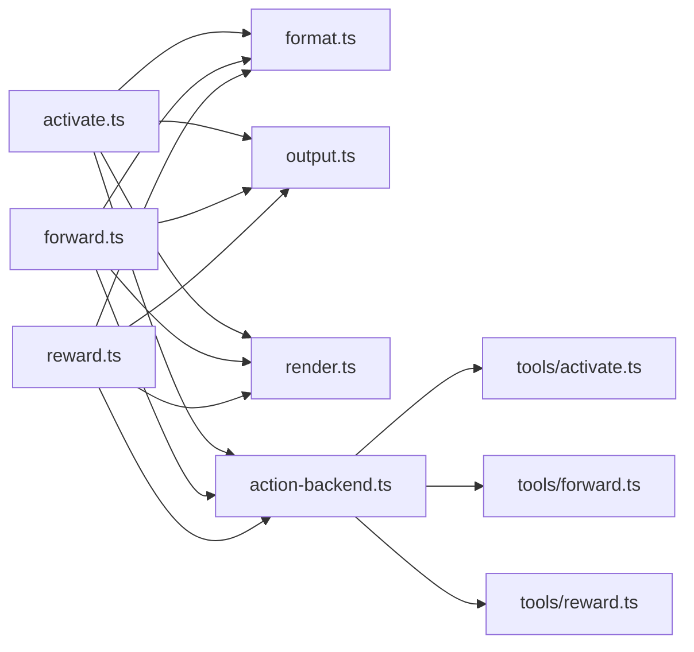

# Core Commands

<cite>
**Referenced Files in This Document**
- [activate.ts](file://src/cli/commands/activate.ts)
- [forward.ts](file://src/cli/commands/forward.ts)
- [reward.ts](file://src/cli/commands/reward.ts)
- [CLI.md](file://docs/CLI.md)
- [render.ts](file://src/cli/render.ts)
- [output.ts](file://src/cli/output.ts)
- [format.ts](file://src/cli/format.ts)
- [resolve-timeout.ts](file://src/cli/resolve-timeout.ts)
- [action-backend.ts](file://src/cli/backend/action-backend.ts)
- [activate.ts](file://src/tools/activate.ts)
- [forward.ts](file://src/tools/forward.ts)
- [reward.ts](file://src/tools/reward.ts)
</cite>

## Table of Contents
1. [Introduction](#introduction)
2. [Project Structure](#project-structure)
3. [Core Components](#core-components)
4. [Architecture Overview](#architecture-overview)
5. [Detailed Component Analysis](#detailed-component-analysis)
6. [Dependency Analysis](#dependency-analysis)
7. [Performance Considerations](#performance-considerations)
8. [Troubleshooting Guide](#troubleshooting-guide)
9. [Conclusion](#conclusion)

## Introduction
This document explains the core SquadRules CLI commands that implement the agent workflow: activate, forward, and reward. These commands form a deterministic chain where an AI agent selects an adapter through semantic search, executes it step-by-step with challenge-response patterns and evidence collection, and finally records a reward signal for evaluation and export gating.

The CLI is local by default against an embedded store, but can target a remote server after login or explicit URL configuration. Output is structured for both humans and machines, with automatic JSON when piped to scripts or agents.

## Project Structure
At the command layer, each subcommand is a small Commander program that resolves a backend, calls a transport-agnostic action method, and emits a result through a shared output formatter. The backend abstracts HTTP and local execution so the same command surface drives both modes.

**Diagram sources**
- [activate.ts:12-35](file://src/cli/commands/activate.ts#L12-L35)
- [forward.ts:12-33](file://src/cli/commands/forward.ts#L12-L33)
- [reward.ts:13-67](file://src/cli/commands/reward.ts#L13-L67)
- [action-backend.ts:91-116](file://src/cli/backend/action-backend.ts#L91-L116)
- [activate.ts:168-229](file://src/tools/activate.ts#L168-L229)
- [forward.ts:91-339](file://src/tools/forward.ts#L91-L339)
- [reward.ts:28-130](file://src/tools/reward.ts#L28-L130)

**Section sources**
- [CLI.md:29-57](file://docs/CLI.md#L29-L57)
- [action-backend.ts:1-20](file://src/cli/backend/action-backend.ts#L1-L20)

## Core Components
- activate: Finds the best matching adapter for a query using semantic search and returns ranked choices with guidance on the next action.
- forward: Executes one or more adapter layers, handling solutions, challenges, missing proofs, and step progression.
- reward: Records a success or failure outcome for a layer URI, including optional scoring, rater attribution, rubric version, and model attribution.

All three commands share:
- Global options such as `--url`, `--timeout`, `--retries`, `--format`, and `--space`.
- Structured output via `emitResult` with pretty, text, and JSON modes.
- A “next call” hint in pretty mode that suggests the following command.

**Section sources**
- [CLI.md:46-75](file://docs/CLI.md#L46-L75)
- [output.ts:31-55](file://src/cli/output.ts#L31-L55)
- [format.ts:1-35](file://src/cli/format.ts#L1-L35)

## Architecture Overview
The end-to-end flow starts at the CLI, moves through a transport-agnostic backend, and reaches either the local embedded store or a remote server. The tools layer implements the canonical activation, forwarding, and reward logic used by both backends.

**Diagram sources**
- [activate.ts:12-35](file://src/cli/commands/activate.ts#L12-L35)
- [forward.ts:12-33](file://src/cli/commands/forward.ts#L12-L33)
- [reward.ts:13-67](file://src/cli/commands/reward.ts#L13-L67)
- [action-backend.ts:91-116](file://src/cli/backend/action-backend.ts#L91-L116)
- [activate.ts:168-229](file://src/tools/activate.ts#L168-L229)
- [forward.ts:91-339](file://src/tools/forward.ts#L91-L339)
- [reward.ts:28-130](file://src/tools/reward.ts#L28-L130)

## Detailed Component Analysis

### activate Command
Purpose: Select the optimal adapter based on context and similarity search.

Key parameters:
- Positional argument: `<query...>` — multi-word search query.
- Option: `--space <space>` — scope results to personal or a group space.

Output formatting:
- Uses `resolveOutputFormat` to select auto/pretty/json/text.
- Emits structured data through `emitResult` with pretty and text renderers.
- In pretty mode, prints a “next call” hint on stderr suggesting the next forward command.

Behavior:
- Resolves a backend from the global program configuration.
- Normalizes the space option and calls `backend.activate(query, { space })`.
- Catches errors and renders them through the shared API error handler.

Example usage patterns:
- Interactive terminal: `squadrules activate "deploy a release"`
- Scripting: pipe to JSON parser when not attached to a TTY.
- Scoped search: `squadrules activate "release checklist" --space engineering`

**Diagram sources**
- [activate.ts:12-35](file://src/cli/commands/activate.ts#L12-L35)
- [format.ts:29-35](file://src/cli/format.ts#L29-L35)
- [output.ts:42-55](file://src/cli/output.ts#L42-L55)
- [render.ts:64-73](file://src/cli/render.ts#L64-L73)

**Section sources**
- [activate.ts:12-35](file://src/cli/commands/activate.ts#L12-L35)
- [CLI.md:79-85](file://docs/CLI.md#L79-L85)
- [CLI.md:60-75](file://docs/CLI.md#L60-L75)

### forward Command
Purpose: Execute the first or next adapter layer, supporting step-by-step workflows.

Key parameters:
- Positional argument: `<uri>` — SQUADRULES adapter or layer URI.
- Option: `--solution <json>` — submit a solution payload for the current step.

Workflow highlights:
- Starts or continues an execution session tied to a layer URI and optional execution ID.
- Handles user input elicitation, proof-of-work challenges, missing previous proofs, and step quality updates.
- Produces a current-layer view with contract type, content, and next-action guidance.
- Returns a final state when no next layer exists, prompting reward submission.

Example usage patterns:
- Start an adapter: `squadrules forward squadrules://adapter/my-adapter`
- Submit a solution: `squadrules forward squadrules://layer/<id>?execution_id=<id> --solution '{"answer":"..."}'`
- Continue until completion, then run reward.

**Diagram sources**
- [forward.ts:12-33](file://src/cli/commands/forward.ts#L12-L33)
- [forward.ts:91-339](file://src/tools/forward.ts#L91-L339)
- [render.ts:107-127](file://src/cli/render.ts#L107-L127)

**Section sources**
- [forward.ts:12-33](file://src/cli/commands/forward.ts#L12-L33)
- [CLI.md:87-93](file://docs/CLI.md#L87-L93)
- [forward.ts:91-339](file://src/tools/forward.ts#L91-L339)

### reward Command
Purpose: Record a reward signal for an adapter execution.

Key parameters:
- Positional arguments: `<uri>`, `<outcome>`, `<feedback>`.
- Options: `--score <number>`, `--rater <rater>`, `--rubric-version <version>`, `--model <model>`.

Validation and behavior:
- Validates outcome must be success or failure.
- Validates score if provided is numeric.
- Calls `backend.reward(uri, outcome, feedback, options)` and emits structured results.
- The tools layer enforces policy such as rejecting success rewards when the last stored proof failed.

Example usage patterns:
- Simple success: `squadrules reward squadrules://layer/<id> success "completed"`
- With scoring and attribution: `squadrules reward squadrules://layer/<id> success "verified" --score 0.9 --rater human-reviewer --rubric-version v2 --model gpt-4`

**Diagram sources**
- [reward.ts:13-67](file://src/cli/commands/reward.ts#L13-L67)
- [reward.ts:28-130](file://src/tools/reward.ts#L28-L130)

**Section sources**
- [reward.ts:13-67](file://src/cli/commands/reward.ts#L13-L67)
- [CLI.md:95-103](file://docs/CLI.md#L95-L103)
- [reward.ts:28-130](file://src/tools/reward.ts#L28-L130)

### Complete activate → forward → reward Chain
Recommended sequence for an agent or automation script:
1. Run activate with a natural-language query and optional space.
2. Pick a choice URI and run forward without a solution to start the workflow.
3. Follow the returned next_action and challenge payloads, submitting solutions as needed.
4. When the final layer indicates completion, run reward with the layer URI, outcome, and feedback.

[No sources needed since this diagram shows conceptual workflow, not actual code structure]

## Dependency Analysis
The CLI commands depend on:
- Commander for argument parsing.
- Backend resolution for transport selection.
- Output formatting and rendering utilities.
- Tools layer for canonical business logic.

**Diagram sources**
- [activate.ts:12-35](file://src/cli/commands/activate.ts#L12-L35)
- [forward.ts:12-33](file://src/cli/commands/forward.ts#L12-L33)
- [reward.ts:13-67](file://src/cli/commands/reward.ts#L13-L67)
- [format.ts:1-35](file://src/cli/format.ts#L1-L35)
- [output.ts:1-55](file://src/cli/output.ts#L1-L55)
- [render.ts:1-232](file://src/cli/render.ts#L1-L232)
- [action-backend.ts:91-116](file://src/cli/backend/action-backend.ts#L91-L116)
- [activate.ts:168-229](file://src/tools/activate.ts#L168-L229)
- [forward.ts:91-339](file://src/tools/forward.ts#L91-L339)
- [reward.ts:28-130](file://src/tools/reward.ts#L28-L130)

**Section sources**
- [action-backend.ts:1-20](file://src/cli/backend/action-backend.ts#L1-L20)
- [format.ts:1-35](file://src/cli/format.ts#L1-L35)
- [output.ts:1-55](file://src/cli/output.ts#L1-L55)
- [render.ts:1-232](file://src/cli/render.ts#L1-L232)

## Performance Considerations
- Use JSON output for machine pipelines; auto mode switches to JSON automatically when stdout is not a TTY.
- Tune request timeouts and retries globally to match network conditions and server load.
- Prefer scoped searches with `--space` to reduce embedding search space and improve relevance.
- Avoid unnecessary repeated activations; cache the chosen adapter URI in automation scripts.

[No sources needed since this section provides general guidance]

## Troubleshooting Guide
Common issues and resolutions:
- No matching adapters: Re-run activate with a more specific query or adjust the space scope.
- Missing proof or challenge response: Follow the next_action and challenge payload returned by forward; resubmit the required solution.
- Success reward rejected: If the last stored proof for the layer failed, record failure first or fix the step and rerun before recording success.
- Timeout or retry failures: Increase `--timeout` and/or `--retries`; verify server availability and authentication.
- Authentication problems: Ensure login succeeded for HTTP targets or use `--url` to target a known server.

Debugging techniques:
- Inspect structured JSON responses for detailed fields like `error_code`, `retry_count`, and `next_call`.
- Use pretty mode interactively to read human-friendly summaries and stderr hints.
- For local development, run without login to use the embedded store and avoid auth overhead.

**Section sources**
- [CLI.md:46-75](file://docs/CLI.md#L46-L75)
- [CLI.md:231-246](file://docs/CLI.md#L231-L246)
- [reward.ts:37-54](file://src/tools/reward.ts#L37-L54)
- [forward.ts:278-316](file://src/tools/forward.ts#L278-L316)

## Conclusion
The activate, forward, and reward commands provide a complete, auditable workflow for AI agents: discover the right adapter, execute it deterministically through layered steps, and record outcomes for evaluation. By leveraging structured output, global timeout and retry controls, and clear next-action hints, these commands integrate cleanly into both interactive sessions and automated agent pipelines.