# Forward Command

<cite>
**Referenced Files in This Document**
- [forward.ts](file://src/cli/commands/forward.ts)
- [CLI.md](file://docs/CLI.md)
- [forward.ts](file://src/tools/forward.ts)
- [forward_schema.ts](file://src/tools/forward_schema.ts)
- [forward-view.ts](file://src/tools/forward-view.ts)
- [next-pow-helpers.ts](file://src/tools/next-pow-helpers.ts)
- [next-previous-step.ts](file://src/tools/next-previous-step.ts)
- [next-missing-proof-payload.ts](file://src/tools/next-missing-proof-payload.ts)
- [forward-runtime-store.ts](file://src/services/forward-runtime-store.ts)
- [adapter-example-forward.md](file://docs/examples/adapter-example-forward.md)
- [challenge-types.md](file://docs/examples/challenge-types.md)
</cite>

## Table of Contents
1. [Introduction](#introduction)
2. [Project Structure](#project-structure)
3. [Core Components](#core-components)
4. [Architecture Overview](#architecture-overview)
5. [Detailed Component Analysis](#detailed-component-analysis)
6. [Dependency Analysis](#dependency-analysis)
7. [Performance Considerations](#performance-considerations)
8. [Troubleshooting Guide](#troubleshooting-guide)
9. [Security Considerations](#security-considerations)
10. [Conclusion](#conclusion)

## Introduction
The SquadRules `forward` command is the continuation point for adapter workflows. It does not execute arbitrary MCP tools directly; instead, it advances one step of a trained adapter by validating a submitted solution against that step’s contract, collecting evidence, generating or propagating proof hashes, and returning structured guidance for the next call. The canonical workflow is:

1. **Activate** an adapter for a task.
2. **Forward** to load the first step’s contract.
3. **Forward again** with a matching solution containing evidence.
4. Repeat until the final step returns a reward instruction.
5. **Reward** the run with success or failure feedback.

This document focuses on the forward command and its runtime behavior, including how adapters are identified, how solutions and evidence are validated, how challenges and proofs flow across steps, and how failures and missing prior proofs are handled.

## Project Structure
The forward command spans three layers:

- **CLI layer**: parses the command-line arguments and delegates to the backend.
- **Tool layer**: validates inputs, resolves the adapter or layer, executes proof logic, and builds the response view.
- **Schema and view layer**: defines input/output shapes, normalizes legacy formats, and renders user-facing output.

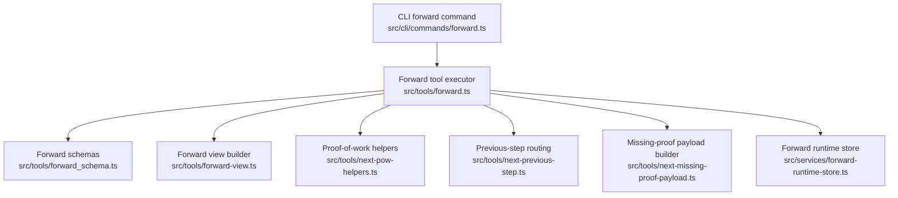

**Diagram sources**
- [forward.ts:12-31](file://src/cli/commands/forward.ts#L12-L31)
- [forward.ts:91-339](file://src/tools/forward.ts#L91-L339)
- [forward_schema.ts:234-318](file://src/tools/forward_schema.ts#L234-L318)
- [forward-view.ts:210-309](file://src/tools/forward-view.ts#L210-L309)
- [next-pow-helpers.ts:127-333](file://src/tools/next-pow-helpers.ts#L127-L333)
- [next-previous-step.ts:29-167](file://src/tools/next-previous-step.ts#L29-L167)
- [next-missing-proof-payload.ts:29-56](file://src/tools/next-missing-proof-payload.ts#L29-L56)
- [forward-runtime-store.ts:27-58](file://src/services/forward-runtime-store.ts#L27-L58)

**Section sources**
- [forward.ts:12-31](file://src/cli/commands/forward.ts#L12-L31)
- [CLI.md:87-93](file://docs/CLI.md#L87-L93)

## Core Components
The forward command exposes a small but precise interface:

| Parameter | Meaning | Required? | Notes |
|---|---|---|---|
| `<uri>` | Adapter or layer URI to start or continue | Yes | Accepts `squadrules://adapter/<slug>` to start, or `squadrules://layer/{uuid}?execution_id={uuid}` to continue. |
| `--solution <json>` | Layer solution containing type, outcome, and evidence | Only for continuation calls | Omit when starting a new run. Must match the current step’s contract type. |
| `authoring` (internal) | Authoring context from activation | Optional | Fixed per execution for authoring workflows. |
| `nonce` (in solution) | Challenge nonce echoed back | When present in challenge | Prevents replay and stale-nonce loops. |
| `proof_hash` (in solution) | Hash of the previous step’s proof | When required by chain rules | Enforces ordered proof chaining. |

Important clarification about terminology:

- The CLI parameter is `--solution`, not `--input`.
- There is no dedicated `--challenge-id` flag; challenges are returned inside the response contract and include a `nonce`.
- Evidence is part of the solution envelope under `evidence`, not a separate CLI flag.
- Proof submission is implicit through validation of the solution; the server computes and returns `proof_hash` when applicable.

**Section sources**
- [CLI.md:87-93](file://docs/CLI.md#L87-L93)
- [forward_schema.ts:234-258](file://src/tools/forward_schema.ts#L234-L258)
- [forward_schema.ts:295-318](file://src/tools/forward_schema.ts#L295-L318)
- [challenge-types.md:80-95](file://docs/examples/challenge-types.md#L80-L95)

## Architecture Overview
At runtime, `forward` performs these phases:

1. Parse and validate the URI.
2. Resolve the adapter or layer memory.
3. Start or resume an execution session.
4. Load the current step’s contract.
5. If no solution is provided, return the current step and next-call guidance.
6. If a solution is provided, normalize it, elicit user input if needed, validate proof-of-work, check prior-step requirements, trace execution, and advance to the next step or finalize.

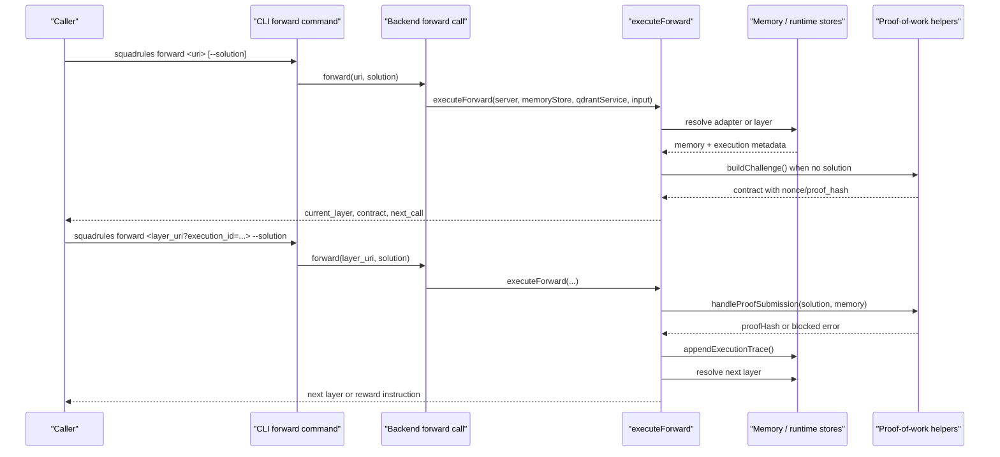

**Diagram sources**
- [forward.ts:12-31](file://src/cli/commands/forward.ts#L12-L31)
- [forward.ts:91-339](file://src/tools/forward.ts#L91-L339)
- [forward-view.ts:210-309](file://src/tools/forward-view.ts#L210-L309)
- [next-pow-helpers.ts:43-61](file://src/tools/next-pow-helpers.ts#L43-L61)
- [next-pow-helpers.ts:127-333](file://src/tools/next-pow-helpers.ts#L127-L333)

## Detailed Component Analysis

### CLI Entry Point
The CLI command registers `squadrules forward <uri> [--solution <json>]`. It creates a backend from program configuration, optionally parses the JSON solution, calls `backend.forward`, and emits structured output with pretty/text renderers and a `nextCallHint`.

Key behaviors:
- The argument is a SQUADRULES adapter or layer URI.
- `--solution` must be valid JSON.
- Errors are routed through API error handling.
- Output includes guidance for the next call.

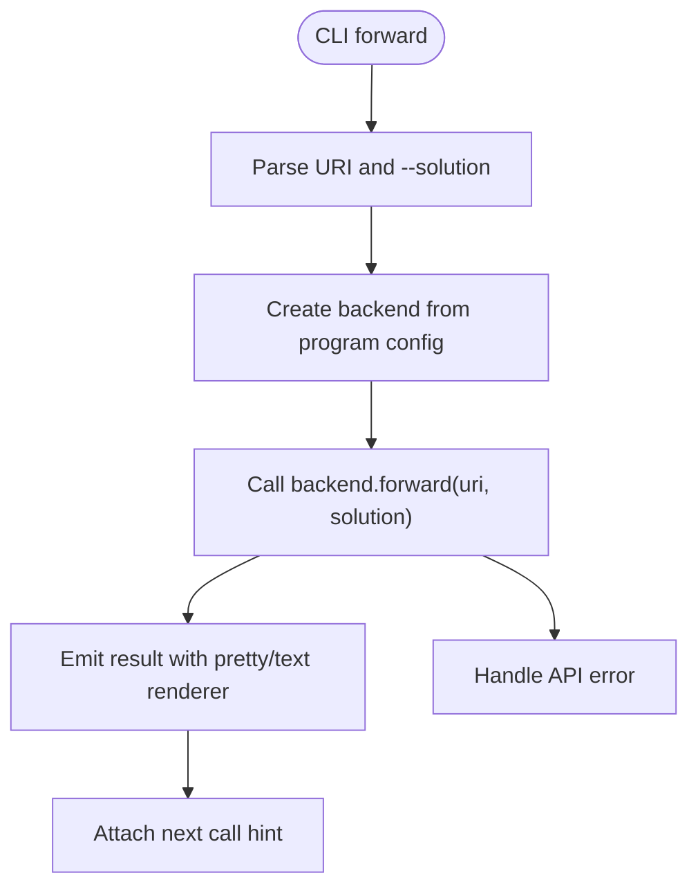

**Diagram sources**
- [forward.ts:12-31](file://src/cli/commands/forward.ts#L12-L31)

**Section sources**
- [forward.ts:12-31](file://src/cli/commands/forward.ts#L12-L31)
- [CLI.md:87-93](file://docs/CLI.md#L87-L93)

### Input and Output Contracts
The forward tool uses strict Zod schemas to define:

- **Input**: `authoring`, `uri`, and optional `solution`.
- **Solution shape**: normalized v2 format prefers `type`, `outcome`, and `evidence`; legacy fields like `shell`, `forward`, `user_input`, `comment`, and top-level `trace` are still accepted.
- **Output**: `must_obey`, `current_layer`, `contract`, `next_action`, `proof_hash`, `execution_id`, `message`, `error_code`, `retry_count`, `next_call`, plus UI and adapter metadata.

Validation rules include:
- Starting a run with `solution` is forbidden.
- Continuing a run without `solution` is forbidden.
- Solution fields must match the contract type.
- Subagent solutions require `evidence.report`.

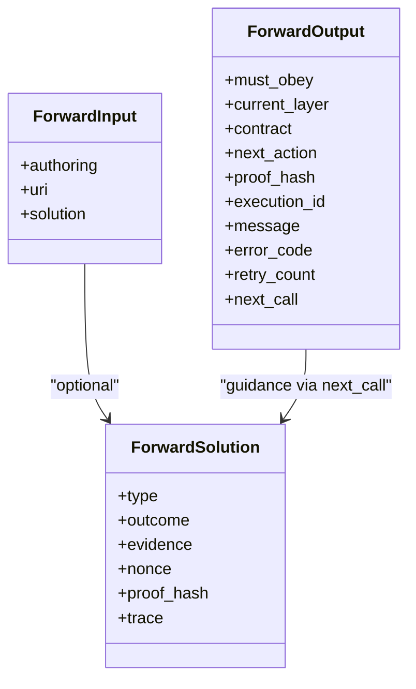

**Diagram sources**
- [forward_schema.ts:234-318](file://src/tools/forward_schema.ts#L234-L318)

**Section sources**
- [forward_schema.ts:16-45](file://src/tools/forward_schema.ts#L16-L45)
- [forward_schema.ts:182-216](file://src/tools/forward_schema.ts#L182-L216)
- [forward_schema.ts:234-258](file://src/tools/forward_schema.ts#L234-L258)
- [forward_schema.ts:295-318](file://src/tools/forward_schema.ts#L295-L318)

### Workflow Execution Model
The core execution function handles several cases:

1. **Start call**: No solution → return current step contract and next-call guidance.
2. **Continuation call with solution**: Normalize solution, elicit user input if needed, validate proof-of-work, check prior-step completion, record execution trace, and resolve next layer.
3. **No contract on current step**: Attempt to apply solution to previous step if it has a required contract.
4. **Solution matches previous step**: Redirect proof to previous step to avoid hash mismatch.
5. **Final step**: Return final comment contract and instruct caller to use `reward`.

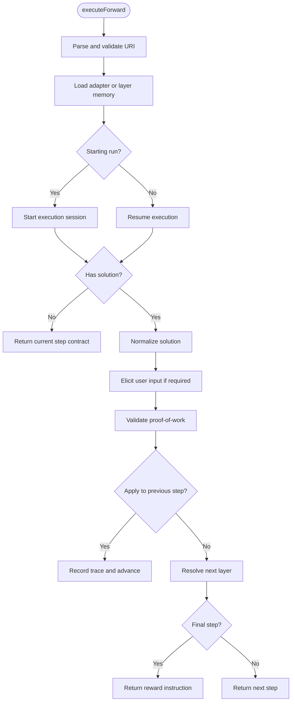

**Diagram sources**
- [forward.ts:91-339](file://src/tools/forward.ts#L91-L339)
- [forward-view.ts:210-309](file://src/tools/forward-view.ts#L210-L309)

**Section sources**
- [forward.ts:91-339](file://src/tools/forward.ts#L91-L339)

### Step Progression and Chain Resolution
Step progression depends on whether the URI refers to an adapter slug or a specific layer:

- **Adapter slug**: Resolves to the first layer of the adapter.
- **Layer UUID**: Loads that exact layer.
- **Execution ID**: Ties multiple forward calls into one logical run.
- **Authoring workflows**: Fix target adapter and operation for the duration of the run.

The runtime store persists execution metadata, including adapter identity, authoring context, merge depth, creation time, and slug disambiguation notes.

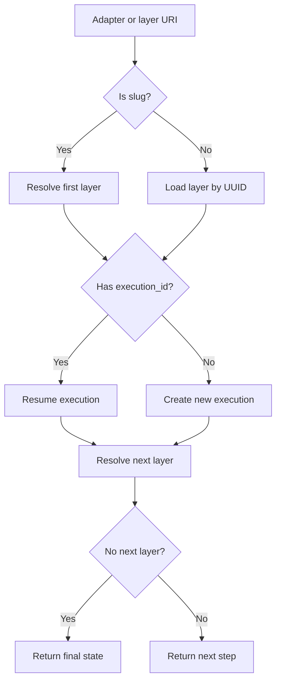

**Diagram sources**
- [forward.ts:97-152](file://src/tools/forward.ts#L97-L152)
- [forward-view.ts:131-150](file://src/tools/forward-view.ts#L131-L150)
- [forward-runtime-store.ts:27-58](file://src/services/forward-runtime-store.ts#L27-L58)

**Section sources**
- [forward.ts:97-152](file://src/tools/forward.ts#L97-L152)
- [forward-view.ts:131-150](file://src/tools/forward-view.ts#L131-L150)
- [forward-runtime-store.ts:27-58](file://src/services/forward-runtime-store.ts#L27-L58)

### Evidence Collection and Proof Generation
Evidence is collected through the solution envelope:

- **Shell**: `exit_code`, optional `stdout`, `stderr`, `duration_seconds`.
- **Forward**: `target` and `success`; target must match the contract.
- **Subagent**: `report` in `evidence`.
- **User input**: `confirmation` and optional `timestamp`.
- **Comment**: `text` with minimum length and optional semantic relevance checks.

Proof generation:
- A nonce is stored per layer to prevent replay.
- A proof record is saved with status and type-specific data.
- A deterministic `proof_hash` is computed and persisted.
- Failed required proofs block progression.
- Successful proofs reset retry counters.

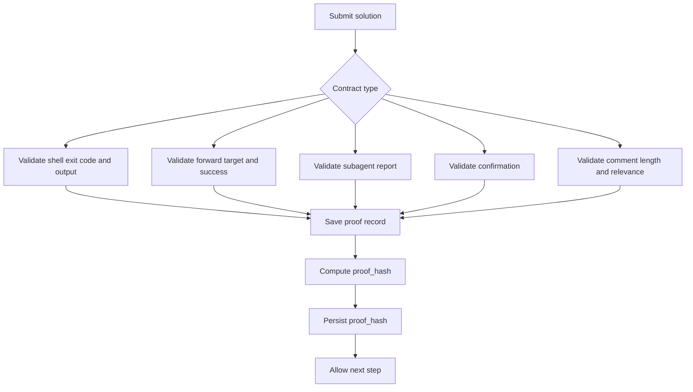

**Diagram sources**
- [next-pow-helpers.ts:127-333](file://src/tools/next-pow-helpers.ts#L127-L333)
- [forward-schema.ts:182-216](file://src/tools/forward_schema.ts#L182-L216)

**Section sources**
- [next-pow-helpers.ts:127-333](file://src/tools/next-pow-helpers.ts#L127-L333)
- [forward_schema.ts:182-216](file://src/tools/forward_schema.ts#L182-L216)

### Reward Propagation
When the final step is reached:
- The response contract becomes a non-required comment indicating completion.
- `next_call.kind` is `reward`.
- `next_call.args.uri` points to the current layer.
- `next_call.args.outcome_template.outcome` reflects stored proof status: failed proofs force `failure`, otherwise `success`.
- The caller must invoke `reward` with the layer URI and an outcome.

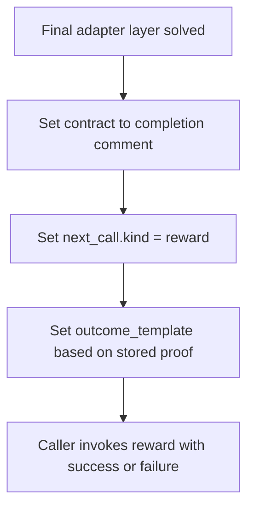

**Diagram sources**
- [forward-view.ts:179-195](file://src/tools/forward-view.ts#L179-L195)
- [forward-view.ts:224-233](file://src/tools/forward-view.ts#L224-L233)

**Section sources**
- [forward-view.ts:179-195](file://src/tools/forward-view.ts#L179-L195)
- [forward-view.ts:224-233](file://src/tools/forward-view.ts#L224-L233)

### Handling Challenges and Proofs
Challenges are built from the current step’s contract:
- Nonces are generated or reused.
- `proof_hash` may be injected when chaining requires the previous step’s hash.
- Blocked submissions return error payloads with `error_code`, `retry_count`, and recovery guidance.

Common challenge-related codes:
- `NONCE_MISMATCH`: Submitted nonce does not match stored nonce.
- `PROOF_HASH_MISMATCH`: Submitted `proof_hash` does not match expected chain hash.
- `TYPE_MISMATCH`: Solution type does not match contract type.
- `MISSING_FIELD`: Required proof field is absent.
- `PLACEHOLDER_EVIDENCE`: Shell stdout/stderr still contains template placeholders.
- `FORWARD_TARGET_MISMATCH`: Forward target does not match contract.
- `COMMENT_TOO_SHORT`: Comment below minimum length.
- `COMMENT_IRRELEVANT`: Comment fails semantic relevance threshold.
- `COMMAND_FAILED`: Required proof reports failure.
- `MISSING_PROOF`: Previous required step is incomplete.

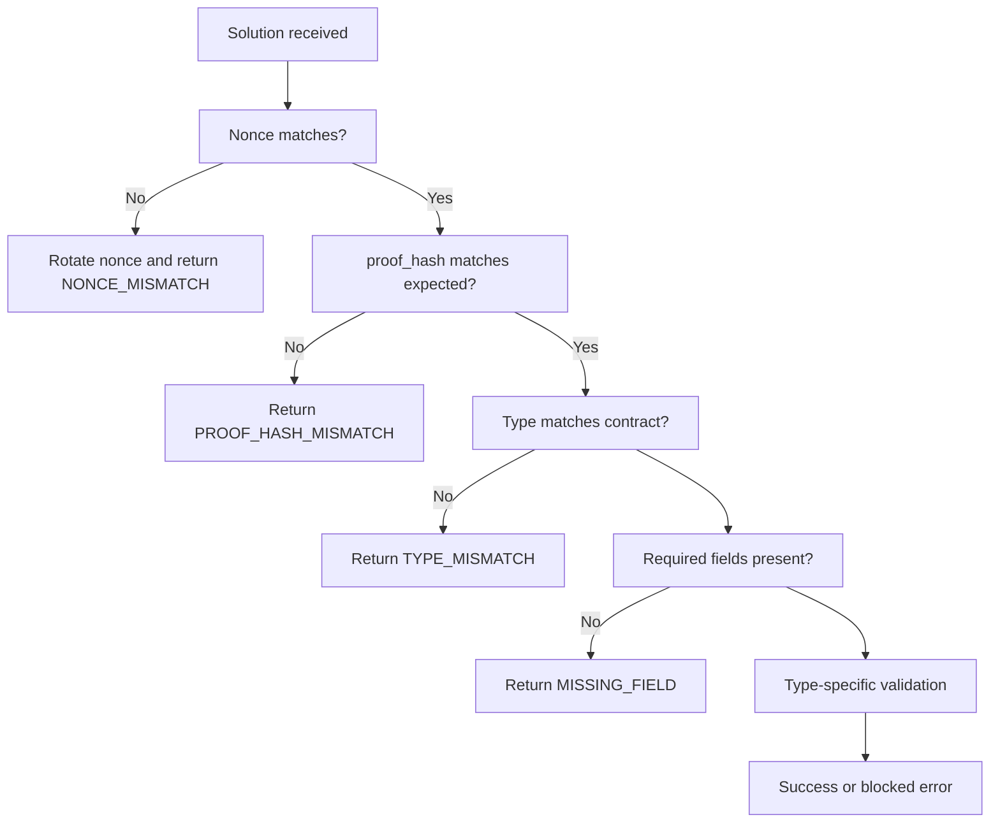

**Diagram sources**
- [next-pow-helpers.ts:127-333](file://src/tools/next-pow-helpers.ts#L127-L333)

**Section sources**
- [next-pow-helpers.ts:127-333](file://src/tools/next-pow-helpers.ts#L127-L333)

### Completing Missing Prior Steps
If the current step has no stored inference contract but the previous step has a required contract, the system attempts to apply the solution to the previous step. If the previous step is still missing, the response includes:
- `current_step` pointing to the previous step.
- `challenge` with the correct nonce and `proof_hash`.
- `next_action` describing what to do before continuing.
- `error_code` set to `MISSING_PROOF`.
- `retry_count` incremented for recovery tracking.

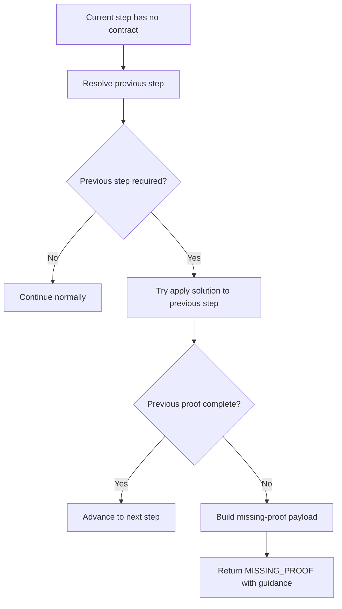

**Diagram sources**
- [next-previous-step.ts:29-54](file://src/tools/next-previous-step.ts#L29-L54)
- [next-missing-proof-payload.ts:29-56](file://src/tools/next-missing-proof-payload.ts#L29-L56)

**Section sources**
- [next-previous-step.ts:29-167](file://src/tools/next-previous-step.ts#L29-L167)
- [next-missing-proof-payload.ts:29-56](file://src/tools/next-missing-proof-payload.ts#L29-L56)

### Complete Workflow Examples

#### Example 1: Simple Two-Step Adapter Ending in a Forward Link
A typical adapter example contains:
- Step 1: a shell contract performing work.
- Step 2: a forward contract linking to another adapter.

Execution chain:
1. `squadrules activate "example forward"` returns an adapter URI.
2. `squadrules forward squadrules://adapter/example-forward` loads step 1 contract.
3. Submit step 1 solution with shell evidence.
4. Server returns step 2 contract requiring a forward link.
5. Submit step 2 solution with `evidence.target` equal to the contracted adapter URI and `success: true`.
6. Server returns final step or next adapter depending on design.
7. Final step instructs `reward`.

**Section sources**
- [adapter-example-forward.md:1-61](file://docs/examples/adapter-example-forward.md#L1-L61)
- [challenge-types.md:42-48](file://docs/examples/challenge-types.md#L42-L48)

#### Example 2: Multi-Step Linear Chain with Challenges
For a linear chain:
1. Start with adapter URI.
2. For each step, submit a solution whose `type` matches the contract.
3. Echo `nonce` and `proof_hash` when present.
4. If a step fails, inspect `error_code`, `retry_count`, and `next_action`.
5. After the final step, call `reward` with the layer URI and outcome.

**Section sources**
- [challenge-types.md:80-95](file://docs/examples/challenge-types.md#L80-L95)
- [forward_schema.ts:295-318](file://src/tools/forward_schema.ts#L295-L318)

#### Example 3: Automated System Integration
An automated agent should:
1. Use `activate` to select an adapter.
2. Call `forward` without `solution` to load the contract.
3. Read `next_call.args.solution_template.type` and populate `evidence` from real execution results.
4. Preserve `nonce` and `proof_hash` from the contract or previous response.
5. On errors, follow `next_action` and retry up to the indicated limit.
6. On final step, call `reward` with `outcome` derived from stored proof status and human feedback.

**Section sources**
- [forward-view.ts:234-245](file://src/tools/forward-view.ts#L234-L245)
- [next-pow-helpers.ts:127-333](file://src/tools/next-pow-helpers.ts#L127-L333)

## Dependency Analysis
The forward command depends on several subsystems:

- **URI resolution**: adapter slugs, layer UUIDs, and execution IDs.
- **Memory store**: adapter content, contracts, and layer metadata.
- **Qdrant service**: adapter lookup and navigation between layers.
- **Runtime store**: execution lifecycle and manifest pinning.
- **Proof-of-work store**: nonces, proof records, and proof hashes.
- **Execution trace store**: auditability of solutions and tensors.
- **View builders**: rendering current step, next action, and UI hints.

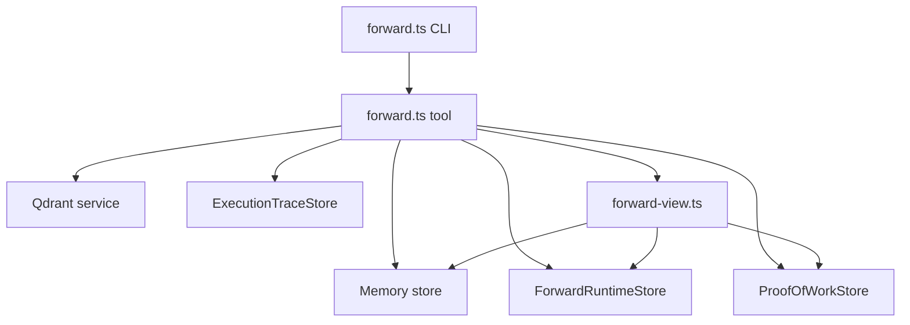

**Diagram sources**
- [forward.ts:91-339](file://src/tools/forward.ts#L91-L339)
- [forward-view.ts:210-309](file://src/tools/forward-view.ts#L210-L309)
- [forward-runtime-store.ts:27-58](file://src/services/forward-runtime-store.ts#L27-L58)

**Section sources**
- [forward.ts:91-339](file://src/tools/forward.ts#L91-L339)
- [forward-view.ts:210-309](file://src/tools/forward-view.ts#L210-L309)
- [forward-runtime-store.ts:27-58](file://src/services/forward-runtime-store.ts#L27-L58)

## Performance Considerations
- **Execution TTL**: Forward execution metadata and pinned manifests have a default TTL of seven days.
- **Manifest pinning**: The first forward pins the ordered layer manifest for an execution to reduce UUID churn.
- **Trace persistence**: Execution traces are appended asynchronously and failures are logged rather than blocking the main flow.
- **Semantic validation timeout**: Comment relevance checks use a configurable timeout to avoid long embedding operations.
- **Retry counters**: Nonce-based retry tracking helps agents recover from repeated failures without infinite loops.

Recommendations:
- Keep evidence minimal and factual.
- Avoid large stdout/stderr payloads unless required.
- Respect `retry_count` and stop after the indicated limit.
- Use local mode for fast iteration and remote mode for shared state.

**Section sources**
- [forward-runtime-store.ts:5-17](file://src/services/forward-runtime-store.ts#L5-L17)
- [forward.ts:145-152](file://src/tools/forward.ts#L145-L152)
- [forward.ts:40-42](file://src/tools/forward.ts#L40-L42)
- [next-pow-helpers.ts:275-296](file://src/tools/next-pow-helpers.ts#L275-L296)

## Troubleshooting Guide

### Common Error Codes and Remediation

| Error Code | Meaning | Recommended Action |
|---|---|---|
| `AUTHORING_CONTEXT_MISMATCH` | Authoring operation or target changed mid-run | Use the returned `next_call` or start a new run. |
| `INVALID_AUTHORING_WORKFLOW` | Authoring used on a non-authoring adapter | Start from the authoring adapter URI. |
| `NOT_FOUND` | Adapter or target adapter not found | Verify slug, space, and target URI. |
| `NONCE_MISMATCH` | Submitted nonce does not match stored nonce | Use the fresh `retry_nonce` from the response. |
| `PROOF_HASH_MISMATCH` | Submitted `proof_hash` does not match expected | Use `proof_hash` from the previous response or contract. |
| `TYPE_MISMATCH` | Solution type does not match contract | Match `solution.type` to `contract.type`. |
| `MISSING_FIELD` | Required proof field absent | Include required fields such as `shell.exit_code`, `evidence.target`, or `evidence.report`. |
| `PLACEHOLDER_EVIDENCE` | Shell output still contains template placeholders | Run the command and replace placeholders with real output. |
| `FORWARD_TARGET_MISMATCH` | Forward target does not match contract | Forward to the exact contracted adapter URI. |
| `COMMENT_TOO_SHORT` | Comment below minimum length | Write a longer verification summary. |
| `COMMENT_IRRELEVANT` | Comment not semantically relevant | Engage with the step content meaningfully. |
| `COMMAND_FAILED` | Required proof reports failure | Fix the underlying command and retry. |
| `MISSING_PROOF` | Previous required step incomplete | Complete the previous step before continuing. |
| `USER_DECLINED` | User declined elicitation | Treat as failure and adjust workflow or prompt. |
| `ELICITATION_FAILED` | Elicitation mechanism failed | Retry or fall back to manual handling. |

### Debugging Techniques
- Inspect `error_code`, `retry_count`, and `next_action` in the response.
- Use `current_layer.uri` to identify the exact step being evaluated.
- Echo `nonce` and `proof_hash` exactly as returned.
- Log the full `solution_template` to ensure the agent constructs the correct evidence shape.
- For shell steps, verify interpreter, command, timeout, and actual output.
- For forward links, confirm the target URI matches the contract exactly.
- For subagent steps, ensure the delegation report is real and not fabricated.
- For comment steps, ensure the text is meaningful and meets length requirements.

**Section sources**
- [forward.ts:113-131](file://src/tools/forward.ts#L113-L131)
- [next-pow-helpers.ts:143-199](file://src/tools/next-pow-helpers.ts#L143-L199)
- [next-pow-helpers.ts:208-333](file://src/tools/next-pow-helpers.ts#L208-L333)
- [next-previous-step.ts:119-167](file://src/tools/next-previous-step.ts#L119-L167)

## Security Considerations

### Evidence Handling
- Evidence must reflect real execution results, not inferred or fabricated values.
- Shell proofs must contain actual output; placeholder outputs are rejected.
- Forward proofs must target the exact adapter URI defined in the contract.
- Subagent proofs must include a genuine delegation report.
- Comment proofs undergo length and optional semantic relevance checks.

### Proof Validation
- Nonces prevent replay attacks and stale-nonce loops.
- Proof hashes enforce ordered chaining across steps.
- Required proofs block progression when they fail.
- Failed required proofs influence the reward outcome template to prevent unjustified success signals.

### Timeout Management
- CLI requests have a configurable timeout.
- Shell contracts specify `timeout_seconds`.
- Semantic comment validation has a configurable timeout to avoid hanging embedding calls.
- Execution metadata expires after seven days.

### Authentication and Context
- HTTP targets require authentication; local mode runs without auth.
- Authoring workflows fix operation and target for the lifetime of the execution.
- Tenant and space context affect adapter resolution and display names.

**Section sources**
- [next-pow-helpers.ts:143-199](file://src/tools/next-pow-helpers.ts#L143-L199)
- [next-pow-helpers.ts:208-333](file://src/tools/next-pow-helpers.ts#L208-L333)
- [forward_runtime_store.ts:5-17](file://src/services/forward-runtime-store.ts#L5-L17)
- [CLI.md:46-58](file://docs/CLI.md#L46-L58)
- [CLI.md:231-246](file://docs/CLI.md#L231-L246)

## Conclusion
The SquadRules `forward` command is the central control point for executing adapter workflows step by step. It enforces strict contract matching, collects verifiable evidence, chains proofs securely, and guides callers toward the next action. Correct usage requires understanding the difference between starting a run and continuing one, matching solution types to contracts, preserving nonces and proof hashes, and following error guidance when challenges arise. For automation, treat `next_call` as the authoritative instruction and always derive outcomes from real execution results rather than assumptions.