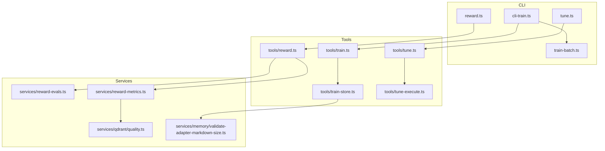
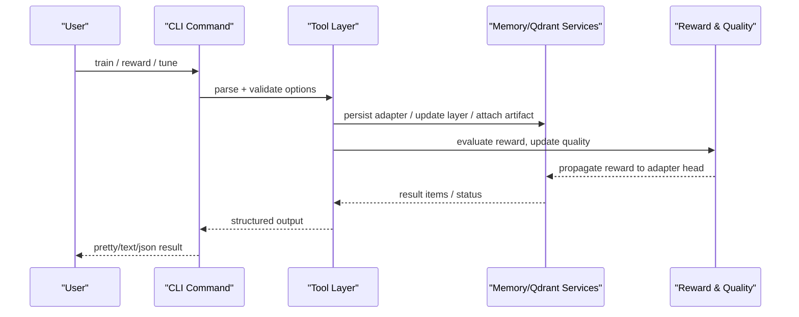
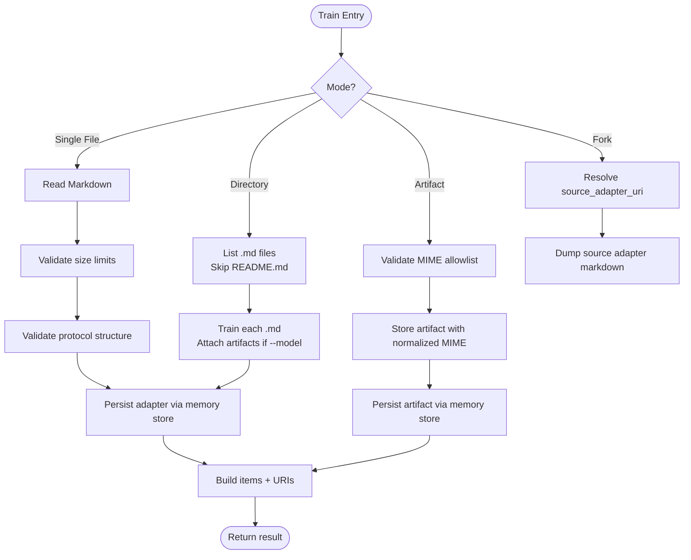
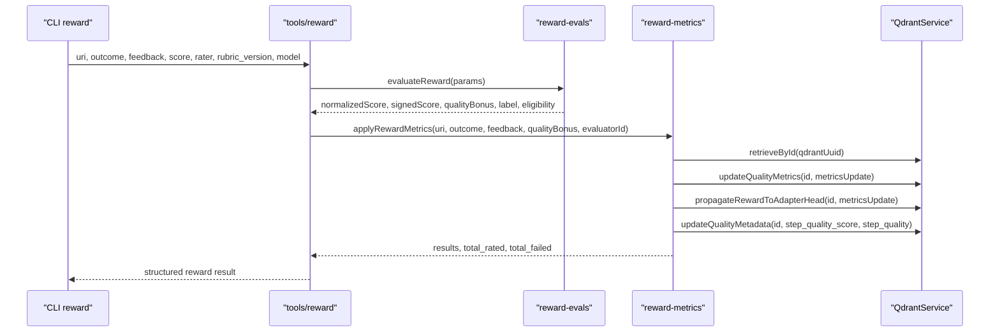
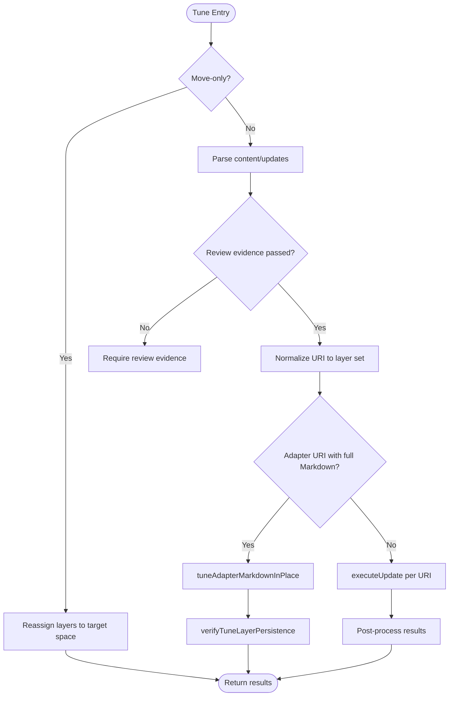
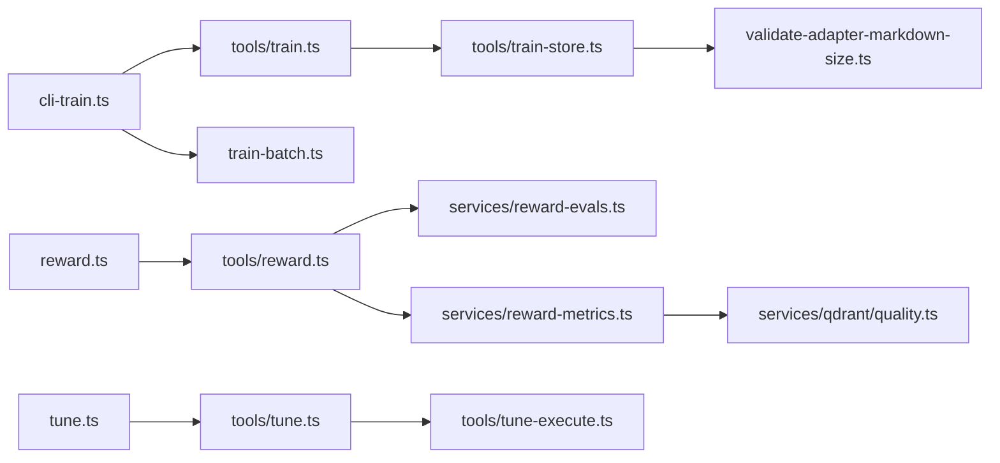

# Data Management Commands

<cite>
**Referenced Files in This Document**
- [cli-train.ts](file://src/cli/commands/cli-train.ts)
- [reward.ts](file://src/cli/commands/reward.ts)
- [tune.ts](file://src/cli/commands/tune.ts)
- [train-batch.ts](file://src/cli/train-batch.ts)
- [train.ts](file://src/tools/train.ts)
- [train-store.ts](file://src/tools/train-store.ts)
- [validate-adapter-markdown-size.ts](file://src/services/memory/validate-adapter-markdown-size.ts)
- [reward.ts](file://src/tools/reward.ts)
- [reward-evals.ts](file://src/services/reward-evals.ts)
- [reward-metrics.ts](file://src/services/reward-metrics.ts)
- [quality.ts](file://src/services/qdrant/quality.ts)
- [tune.ts](file://src/tools/tune.ts)
- [tune-execute.ts](file://src/tools/tune-execute.ts)
</cite>

## Table of Contents
1. [Introduction](#introduction)
2. [Project Structure](#project-structure)
3. [Core Components](#core-components)
4. [Architecture Overview](#architecture-overview)
5. [Detailed Component Analysis](#detailed-component-analysis)
6. [Dependency Analysis](#dependency-analysis)
7. [Performance Considerations](#performance-considerations)
8. [Troubleshooting Guide](#troubleshooting-guide)
9. [Conclusion](#conclusion)

## Introduction
This document explains the data lifecycle management commands in the SquadRules CLI: train, reward, and tune. It covers how adapters are registered from Markdown or artifacts, how performance feedback is recorded and propagated to vector storage, and how existing adapter content is updated while preserving version history and semantic search integrity. It also documents batch processing capabilities, error recovery patterns, and monitoring signals used for large-scale operations.

SquadRules treats AI agents as primary users. Adapters are deterministic, auditable task execution units. The core flow is activate → forward → reward. Training registers new adapters; tuning updates them; rewarding records outcomes that influence future selection through quality metrics and attest boosts.

## Project Structure
The data lifecycle spans three layers:
- CLI command layer: parses user input, validates options, and delegates to backend services.
- Tool layer: implements MCP tool logic, validation, persistence, and orchestration.
- Service layer: manages Qdrant vector store, memory store, reward evaluation, and quality metrics.

**Diagram sources**
- [cli-train.ts:40-210](file://src/cli/commands/cli-train.ts#L40-L210)
- [reward.ts:13-66](file://src/cli/commands/reward.ts#L13-L66)
- [tune.ts:32-115](file://src/cli/commands/tune.ts#L32-L115)
- [train-batch.ts:135-227](file://src/cli/train-batch.ts#L135-L227)
- [train.ts:137-244](file://src/tools/train.ts#L137-L244)
- [train-store.ts:47-130](file://src/tools/train-store.ts#L47-L130)
- [reward.ts:28-130](file://src/tools/reward.ts#L28-L130)
- [tune.ts:19-69](file://src/tools/tune.ts#L19-L69)
- [tune-execute.ts:219-349](file://src/tools/tune-execute.ts#L219-L349)
- [reward-evals.ts:105-147](file://src/services/reward-evals.ts#L105-L147)
- [reward-metrics.ts:20-119](file://src/services/reward-metrics.ts#L20-L119)
- [quality.ts:25-58](file://src/services/qdrant/quality.ts#L25-L58)
- [validate-adapter-markdown-size.ts:31-106](file://src/services/memory/validate-adapter-markdown-size.ts#L31-L106)

**Section sources**
- [cli-train.ts:40-210](file://src/cli/commands/cli-train.ts#L40-L210)
- [reward.ts:13-66](file://src/cli/commands/reward.ts#L13-L66)
- [tune.ts:32-115](file://src/cli/commands/tune.ts#L32-L115)
- [train-batch.ts:135-227](file://src/cli/train-batch.ts#L135-L227)
- [train.ts:137-244](file://src/tools/train.ts#L137-L244)
- [train-store.ts:47-130](file://src/tools/train-store.ts#L47-L130)
- [reward.ts:28-130](file://src/tools/reward.ts#L28-L130)
- [tune.ts:19-69](file://src/tools/tune.ts#L19-L69)
- [tune-execute.ts:219-349](file://src/tools/tune-execute.ts#L219-L349)
- [reward-evals.ts:105-147](file://src/services/reward-evals.ts#L105-L147)
- [reward-metrics.ts:20-119](file://src/services/reward-metrics.ts#L20-L119)
- [quality.ts:25-58](file://src/services/qdrant/quality.ts#L25-L58)
- [validate-adapter-markdown-size.ts:31-106](file://src/services/memory/validate-adapter-markdown-size.ts#L31-L106)

## Core Components
- Train command: Registers new adapters from Markdown or attaches text artifacts to an adapter. Supports single file, directory batch, fork from source adapter, and artifact mode. Validates protocol structure and size limits, then persists via the memory store and vector store.
- Reward command: Records a success or failure outcome with optional score, rater identity, rubric version, and model attribution. Evaluates eligibility for SFT and preference datasets, updates quality metrics, and propagates rewards to adapter heads.
- Tune command: Updates existing adapter layers in place, enforcing layer count and title stability, optionally moving all layers to a target space, and invalidating caches to preserve semantic search integrity.

Key responsibilities:
- Validation: Protocol structure, MIME allowlist, size limits, URI parsing, space permissions.
- Persistence: Memory store for adapters/artifacts; Qdrant for vectors and payload metadata.
- Quality: Reward evaluation, implementation bonus, attest boost, step quality metadata.
- Batch: Directory-based training with per-item results and artifact attachment.

**Section sources**
- [cli-train.ts:40-210](file://src/cli/commands/cli-train.ts#L40-L210)
- [train-batch.ts:135-227](file://src/cli/train-batch.ts#L135-L227)
- [train.ts:137-244](file://src/tools/train.ts#L137-L244)
- [train-store.ts:47-130](file://src/tools/train-store.ts#L47-L130)
- [reward.ts:13-66](file://src/cli/commands/reward.ts#L13-L66)
- [reward.ts:28-130](file://src/tools/reward.ts#L28-L130)
- [reward-evals.ts:105-147](file://src/services/reward-evals.ts#L105-L147)
- [reward-metrics.ts:20-119](file://src/services/reward-metrics.ts#L20-L119)
- [tune.ts:32-115](file://src/cli/commands/tune.ts#L32-L115)
- [tune.ts:19-69](file://src/tools/tune.ts#L19-L69)
- [tune-execute.ts:219-349](file://src/tools/tune-execute.ts#L219-L349)

## Architecture Overview
The data lifecycle flows from CLI to tools to services, with vector DBs (Qdrant/LanceDB) providing semantic search and Qdrant storing rich payloads for quality and retrieval analytics.

**Diagram sources**
- [cli-train.ts:40-210](file://src/cli/commands/cli-train.ts#L40-L210)
- [reward.ts:13-66](file://src/cli/commands/reward.ts#L13-L66)
- [tune.ts:32-115](file://src/cli/commands/tune.ts#L32-L115)
- [train.ts:137-244](file://src/tools/train.ts#L137-L244)
- [reward.ts:28-130](file://src/tools/reward.ts#L28-L130)
- [reward-metrics.ts:20-119](file://src/services/reward-metrics.ts#L20-L119)
- [quality.ts:25-58](file://src/services/qdrant/quality.ts#L25-L58)

## Detailed Component Analysis

### Train Command
Purpose: Register a new adapter from Markdown or attach an artifact to an existing adapter. Supports single-file, directory batch, fork from source adapter, and artifact modes.

Key behaviors:
- Input modes:
  - Single Markdown file: validated and stored as adapter.
  - Directory: trains each .md file; README.md is skipped; sibling artifacts attached if --model provided.
  - Fork: copies content from an existing adapter slug via source_adapter_uri.
  - Artifact: attaches non-Markdown content to an adapter with allowed MIME types.
- Validation:
  - Protocol structure validation for adapters.
  - Size limits for Markdown and artifacts.
  - MIME allowlist and normalization.
- Storage:
  - Adapter Markdown persisted via memory store.
  - Artifacts persisted with normalized MIME and relative path.
  - Vector embeddings generated by underlying store/service integration.
- Output:
  - Uniform result format with items, status, and URIs.

**Diagram sources**
- [cli-train.ts:40-210](file://src/cli/commands/cli-train.ts#L40-L210)
- [train-batch.ts:135-227](file://src/cli/train-batch.ts#L135-L227)
- [train.ts:88-135](file://src/tools/train.ts#L88-L135)
- [train-store.ts:47-130](file://src/tools/train-store.ts#L47-L130)
- [validate-adapter-markdown-size.ts:31-106](file://src/services/memory/validate-adapter-markdown-size.ts#L31-L106)

Validation rules:
- Protocol structure must be valid; otherwise returns guidance to use guided creation.
- Markdown total bytes, line length, and line count enforced.
- Artifact MIME must be allowed; size capped at configured limit.
- Duplicate adapter label handled with force_update flag.

Embedding generation and vector storage:
- Embeddings are produced by the underlying embedding provider integrated into the memory store and Qdrant service.
- Vectors are stored alongside payload metadata for semantic search.

Quality metrics:
- Train does not directly record rewards; it ensures adapters are searchable and storable.
- Quality metrics are updated later via reward and usage telemetry.

Batch processing:
- Directory batch enumerates .md files, trains each, and attaches sibling artifacts when --model is provided.
- Outputs a compact manifest with per-item ok/err status and adapter URIs.

Error recovery:
- ENOENT and ENOTREG errors surfaced clearly.
- API errors forwarded via handleApiError.
- Batch continues on item-level failures and aggregates results.

Monitoring:
- Tool calls, duration, input/output sizes, and similar adapter detection tracked via MCP metrics.

**Section sources**
- [cli-train.ts:40-210](file://src/cli/commands/cli-train.ts#L40-L210)
- [train-batch.ts:135-227](file://src/cli/train-batch.ts#L135-L227)
- [train.ts:137-244](file://src/tools/train.ts#L137-L244)
- [train-store.ts:47-130](file://src/tools/train-store.ts#L47-L130)
- [validate-adapter-markdown-size.ts:31-106](file://src/services/memory/validate-adapter-markdown-size.ts#L31-L106)

### Reward Command
Purpose: Record performance feedback for an adapter execution outcome.

Key behaviors:
- Inputs:
  - Layer URI, outcome (success/failure), feedback string.
  - Optional score (0..1), rater identifier, rubric version, model attribution.
- Evaluation:
  - Normalizes score; defaults to 1 for success, 0 for failure.
  - Computes signed score and quality bonus.
  - Determines grader kind (human/model/unknown).
  - Computes eligibility for SFT and preference datasets based on thresholds and required fields.
- Persistence:
  - Applies reward metrics to Qdrant point payload.
  - Propagates reward to adapter head.
  - Writes execution trace reward details when execution ID present.
- Impact:
  - Updates retrieval counts, success/failure counts, last rated/rater, quality bonus.
  - Calculates attest boost based on runs and confidence.
  - Updates step quality metadata and model stats.

**Diagram sources**
- [reward.ts:13-66](file://src/cli/commands/reward.ts#L13-L66)
- [reward.ts:28-130](file://src/tools/reward.ts#L28-L130)
- [reward-evals.ts:105-147](file://src/services/reward-evals.ts#L105-L147)
- [reward-metrics.ts:20-119](file://src/services/reward-metrics.ts#L20-L119)
- [quality.ts:25-58](file://src/services/qdrant/quality.ts#L25-L58)

Scoring mechanisms:
- Score clamped to 0..1; default success=1, failure=0.
- Signed score reflects directionality; quality bonus equals signed score.
- Implementation bonus computed via model stats and added to basic quality bonus.

Impact on future selections:
- Attest boost increases retrieval ranking based on success ratio and confidence.
- Step quality metadata influences downstream quality scoring.
- Redis cache invalidated to ensure fresh reads.

Error handling:
- Invalid URI or conflict with failed proof yields explicit errors.
- Persistence failures wrapped with retry guidance.

**Section sources**
- [reward.ts:13-66](file://src/cli/commands/reward.ts#L13-L66)
- [reward.ts:28-130](file://src/tools/reward.ts#L28-L130)
- [reward-evals.ts:105-147](file://src/services/reward-evals.ts#L105-L147)
- [reward-metrics.ts:20-119](file://src/services/reward-metrics.ts#L20-L119)
- [quality.ts:25-58](file://src/services/qdrant/quality.ts#L25-L58)

### Tune Command
Purpose: Update existing adapter layers in place while preserving version history and semantic search integrity.

Key behaviors:
- Inputs:
  - One or more adapter or layer URIs.
  - Optional Markdown file(s), JSON updates object, or move-only space option.
- Validation:
  - Review evidence required for content updates.
  - Protected spaces blocked for writes.
  - Title and layer count must match when tuning by adapter URI.
- Operations:
  - Move-only: reassign all layers of target adapters to a specified space.
  - In-place update: parse frontmatter, rebuild header adapter, verify expected adapter ID and layer count, then update each layer’s payload.
  - Cache invalidation after successful updates.
- Semantic search integrity:
  - Preserves existing UUIDs and vectors; only payload and text fields updated.
  - Verification step ensures persistence matches intended changes.

**Diagram sources**
- [tune.ts:32-115](file://src/cli/commands/tune.ts#L32-L115)
- [tune.ts:19-69](file://src/tools/tune.ts#L19-L69)
- [tune-execute.ts:219-349](file://src/tools/tune-execute.ts#L219-L349)

Version history and integrity:
- Existing layer UUIDs preserved; vectors remain intact.
- Frontmatter version propagated to protocol_version across layers.
- Title change detected early to prevent structural drift.

Error handling:
- Missing content/updates/space raises clear errors.
- Protected space writes rejected.
- Layer count mismatch directs users to train(force_update=true) for structural changes.

**Section sources**
- [tune.ts:32-115](file://src/cli/commands/tune.ts#L32-L115)
- [tune.ts:19-69](file://src/tools/tune.ts#L19-L69)
- [tune-execute.ts:219-349](file://src/tools/tune-execute.ts#L219-L349)

## Dependency Analysis

**Diagram sources**
- [cli-train.ts:40-210](file://src/cli/commands/cli-train.ts#L40-L210)
- [train-batch.ts:135-227](file://src/cli/train-batch.ts#L135-L227)
- [train.ts:137-244](file://src/tools/train.ts#L137-L244)
- [train-store.ts:47-130](file://src/tools/train-store.ts#L47-L130)
- [validate-adapter-markdown-size.ts:31-106](file://src/services/memory/validate-adapter-markdown-size.ts#L31-L106)
- [reward.ts:13-66](file://src/cli/commands/reward.ts#L13-L66)
- [reward.ts:28-130](file://src/tools/reward.ts#L28-L130)
- [reward-evals.ts:105-147](file://src/services/reward-evals.ts#L105-L147)
- [reward-metrics.ts:20-119](file://src/services/reward-metrics.ts#L20-L119)
- [quality.ts:25-58](file://src/services/qdrant/quality.ts#L25-L58)
- [tune.ts:32-115](file://src/cli/commands/tune.ts#L32-L115)
- [tune.ts:19-69](file://src/tools/tune.ts#L19-L69)
- [tune-execute.ts:219-349](file://src/tools/tune-execute.ts#L219-L349)

**Section sources**
- [cli-train.ts:40-210](file://src/cli/commands/cli-train.ts#L40-L210)
- [train-batch.ts:135-227](file://src/cli/train-batch.ts#L135-L227)
- [train.ts:137-244](file://src/tools/train.ts#L137-L244)
- [train-store.ts:47-130](file://src/tools/train-store.ts#L47-L130)
- [validate-adapter-markdown-size.ts:31-106](file://src/services/memory/validate-adapter-markdown-size.ts#L31-L106)
- [reward.ts:13-66](file://src/cli/commands/reward.ts#L13-L66)
- [reward.ts:28-130](file://src/tools/reward.ts#L28-L130)
- [reward-evals.ts:105-147](file://src/services/reward-evals.ts#L105-L147)
- [reward-metrics.ts:20-119](file://src/services/reward-metrics.ts#L20-L119)
- [quality.ts:25-58](file://src/services/qdrant/quality.ts#L25-L58)
- [tune.ts:32-115](file://src/cli/commands/tune.ts#L32-L115)
- [tune.ts:19-69](file://src/tools/tune.ts#L19-L69)
- [tune-execute.ts:219-349](file://src/tools/tune-execute.ts#L219-L349)

## Performance Considerations
- Batch training avoids dumping adapter/content bytes to stdout; uses compact summaries and JSON manifests for machine consumption.
- Size checks run in a single pass over content to minimize overhead.
- Reward metrics compute implementation bonuses and attest boosts efficiently, updating only necessary payload fields.
- Cache invalidation occurs after reward and tune operations to reduce stale reads.
- Tool-level metrics capture call counts, durations, and I/O sizes for observability.

[No sources needed since this section provides general guidance]

## Troubleshooting Guide
Common issues and resolutions:
- Missing path or invalid file type: Ensure a regular file or directory is provided; check ENOENT/ENOTREG messages.
- No .md files in directory: Add .md files; README.md is intentionally skipped in batch mode.
- Artifact flags misused: Artifact-specific flags are single-file-only; remove them for directory batches.
- Unsupported MIME type: Use an allowed MIME or adjust filename extension; see allowlist behavior.
- Similar adapter found: Inspect similarity match; use force_update with same adapter id to replace.
- Duplicate adapter label: Use force_update to overwrite or choose a different label.
- Reward conflicts: Cannot mark success if last proof failed; fix step or record failure.
- Tune validation errors: Keep H1 title unchanged and layer count stable; otherwise use train(force_update=true).
- Protected space write: Tune and train cannot modify protected spaces; select an allowed space.

**Section sources**
- [cli-train.ts:197-208](file://src/cli/commands/cli-train.ts#L197-L208)
- [train-batch.ts:142-157](file://src/cli/train-batch.ts#L142-L157)
- [train-store.ts:64-73](file://src/tools/train-store.ts#L64-L73)
- [train.ts:38-86](file://src/tools/train.ts#L38-L86)
- [reward.ts:31-42](file://src/cli/commands/reward.ts#L31-L42)
- [reward.ts:37-54](file://src/tools/reward.ts#L37-L54)
- [tune-execute.ts:143-171](file://src/tools/tune-execute.ts#L143-L171)
- [tune-execute.ts:63-70](file://src/tools/tune-execute.ts#L63-L70)

## Conclusion
The SquadRules CLI data lifecycle commands provide robust, auditable workflows for registering adapters, recording performance feedback, and updating existing content safely. Validation, size limits, and protocol checks protect data integrity. Reward signals drive quality metrics and attest boosts that improve future selection. Batch capabilities and consistent error handling support large-scale operations, while metrics and cache invalidation maintain observability and freshness.

[No sources needed since this section summarizes without analyzing specific files]