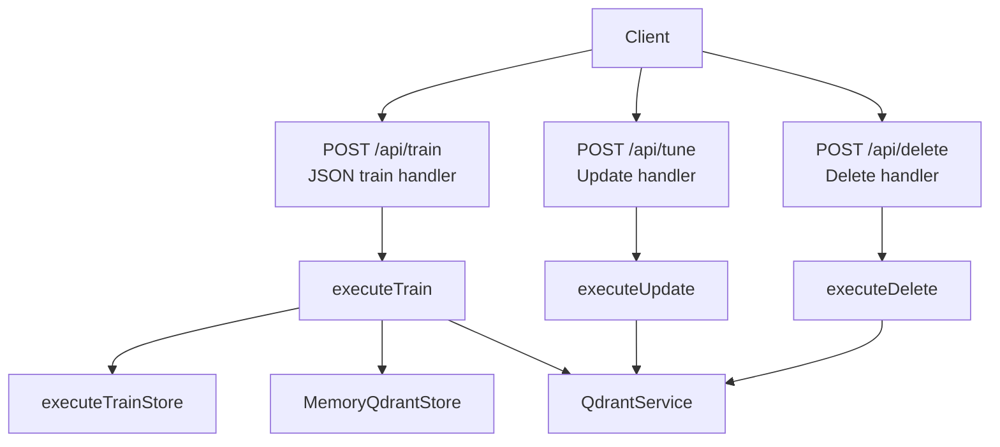
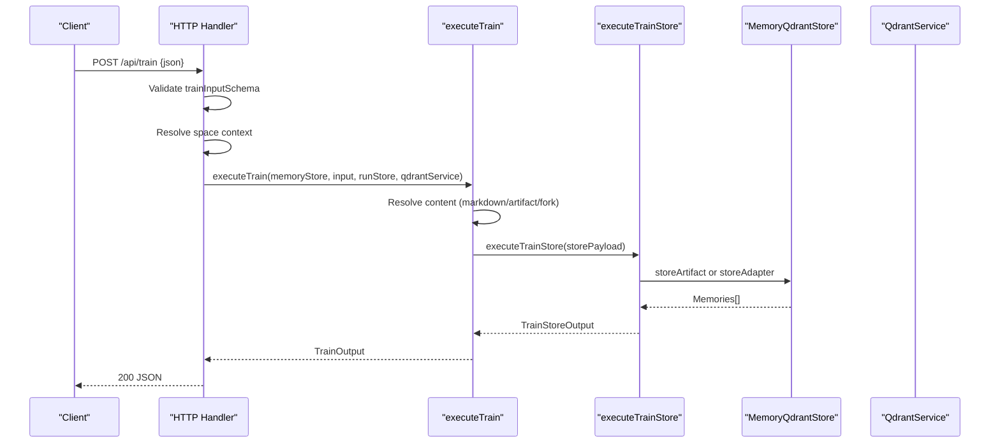
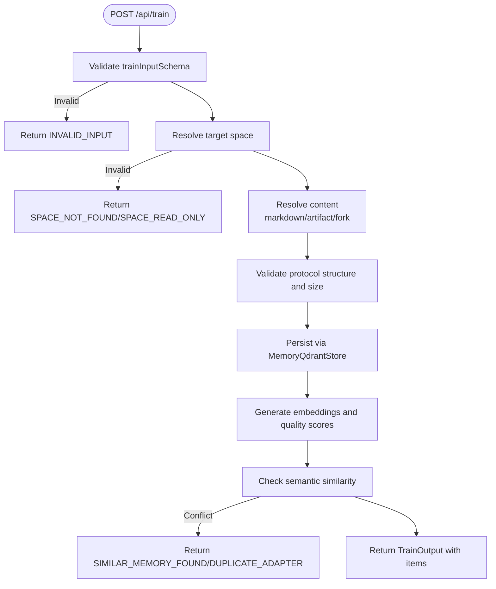
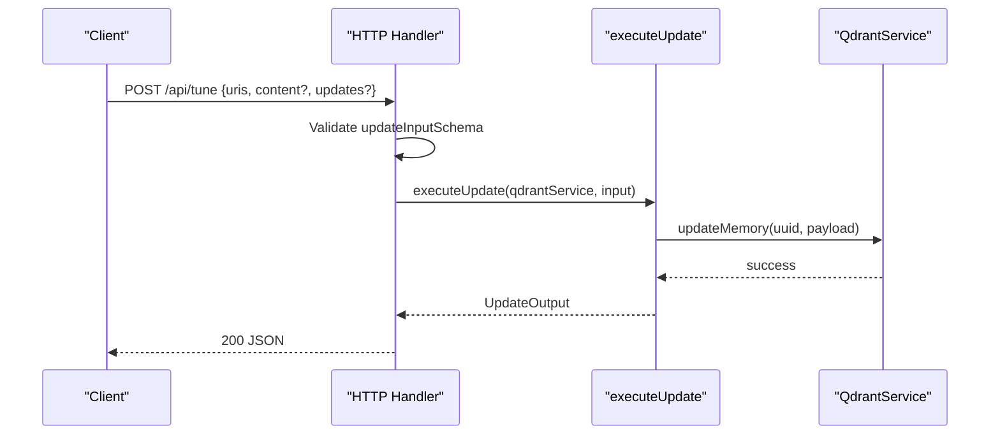
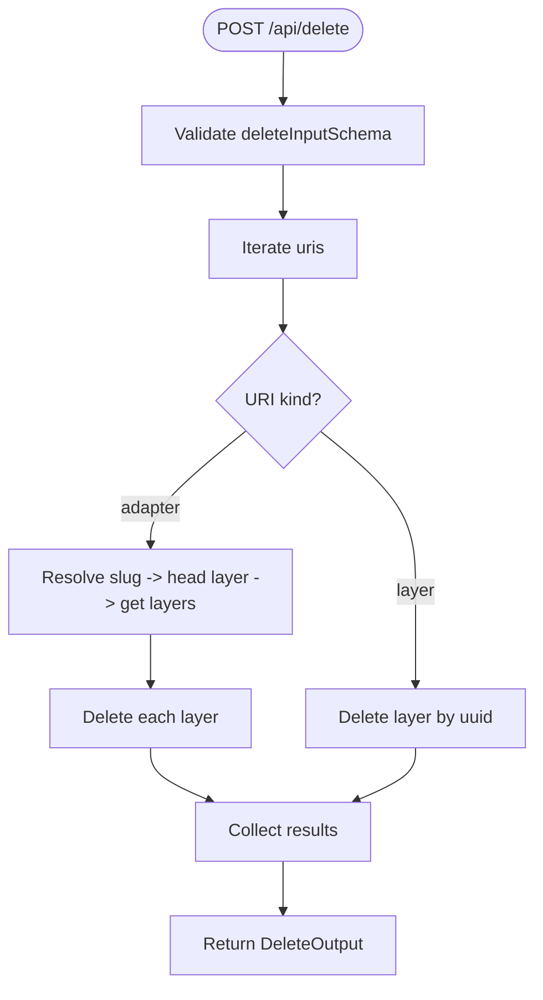
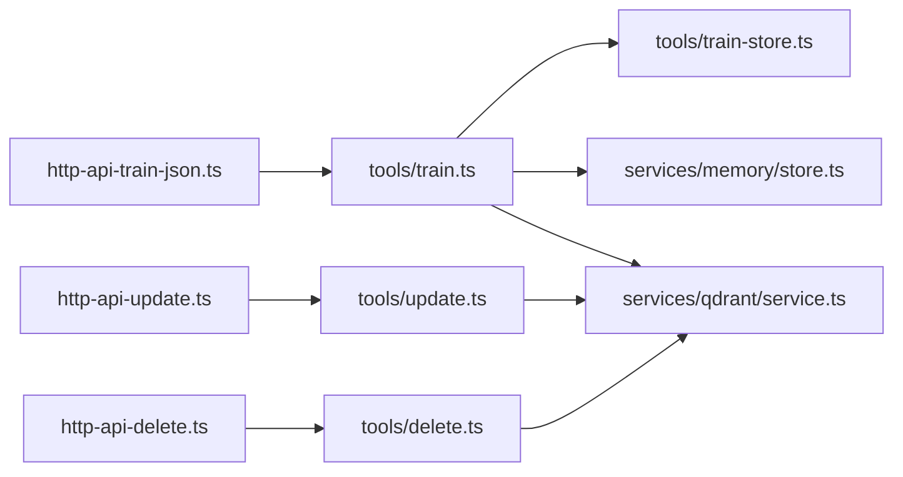

# Adapter Management Endpoints

<cite>
**Referenced Files in This Document**
- [http-api-train-json.ts](file://src/http/http-api-train-json.ts)
- [http-api-update.ts](file://src/http/http-api-update.ts)
- [http-api-delete.ts](file://src/http/http-api-delete.ts)
- [train.ts](file://src/tools/train.ts)
- [update.ts](file://src/tools/update.ts)
- [delete.ts](file://src/tools/delete.ts)
- [train_schema.ts](file://src/tools/train_schema.ts)
- [update_schema.ts](file://src/tools/update_schema.ts)
- [delete_schema.ts](file://src/tools/delete_schema.ts)
- [train-store.ts](file://src/tools/train-store.ts)
</cite>

## Table of Contents
1. [Introduction](#introduction)
2. [Project Structure](#project-structure)
3. [Core Components](#core-components)
4. [Architecture Overview](#architecture-overview)
5. [Detailed Component Analysis](#detailed-component-analysis)
6. [Dependency Analysis](#dependency-analysis)
7. [Performance Considerations](#performance-considerations)
8. [Troubleshooting Guide](#troubleshooting-guide)
9. [Conclusion](#conclusion)
10. [Appendices](#appendices)

## Introduction
This document describes the adapter management REST endpoints for registering, updating, and deleting adapters. It focuses on:
- POST /api/train: JSON schema–based adapter registration with markdown processing, vector embedding generation, semantic similarity checks, artifact handling, and multi-tenant space isolation.
- POST /api/tune (referred to as update endpoint): Layer-level updates with validation and per-item results.
- POST /api/delete: Adapter or layer deletion with cascade behavior and per-item status reporting.

The system uses Qdrant for vector storage and memory persistence, supports personal and group spaces, and enforces strict input schemas via Zod.

## Project Structure
Adapter management is implemented through HTTP route handlers that delegate to shared tool executors and store logic:
- HTTP routes parse and validate requests, resolve tenant/space context, and return structured JSON responses.
- Tool executors implement business logic for training, updating, and deleting memories/adapters.
- Schemas define request/response contracts and validation rules.

**Diagram sources**
- [http-api-train-json.ts:46-107](file://src/http/http-api-train-json.ts#L46-L107)
- [train.ts:137-244](file://src/tools/train.ts#L137-L244)
- [train-store.ts:47-130](file://src/tools/train-store.ts#L47-L130)
- [http-api-update.ts:11-33](file://src/http/http-api-update.ts#L11-L33)
- [update.ts:8-72](file://src/tools/update.ts#L8-L72)
- [http-api-delete.ts:11-34](file://src/http/http-api-delete.ts#L11-L34)
- [delete.ts:12-71](file://src/tools/delete.ts#L12-L71)

**Section sources**
- [http-api-train-json.ts:46-107](file://src/http/http-api-train-json.ts#L46-L107)
- [http-api-update.ts:11-33](file://src/http/http-api-update.ts#L11-L33)
- [http-api-delete.ts:11-34](file://src/http/http-api-delete.ts#L11-L34)
- [train.ts:137-244](file://src/tools/train.ts#L137-L244)
- [update.ts:8-72](file://src/tools/update.ts#L8-L72)
- [delete.ts:12-71](file://src/tools/delete.ts#L12-L71)

## Core Components
- POST /api/train
  - Validates JSON body against trainInputSchema.
  - Resolves target space from request or tenant context.
  - Delegates to executeTrain, which may fork content from an existing adapter, process artifacts, validate protocol structure, and persist via MemoryQdrantStore.
  - Returns structured items with URIs, labels, tags, and content types.
- POST /api/tune (update)
  - Validates updateInputSchema.
  - Updates one or more layer rows by URI; supports full-body replacement or field-level updates.
  - Returns per-item results with updated/error status.
- POST /api/delete
  - Validates deleteInputSchema.
  - Deletes either a single layer row or all layers under an adapter (cascade).
  - Returns per-item results with deleted/error status.

Key behaviors:
- Multi-tenant space isolation: Space resolution ensures writes are scoped to the requested or default writable space.
- Semantic similarity checks: Duplicate or similar adapter detection returns specific error codes with guidance.
- Artifact handling: Non-markdown MIMEs are validated and stored as artifacts attached to an adapter.
- Version control: Protocol version can be supplied; duplicate detection prevents accidental overwrites unless force_update is enabled.

**Section sources**
- [http-api-train-json.ts:46-107](file://src/http/http-api-train-json.ts#L46-L107)
- [train.ts:88-180](file://src/tools/train.ts#L88-L180)
- [train-store.ts:47-130](file://src/tools/train-store.ts#L47-L130)
- [http-api-update.ts:11-33](file://src/http/http-api-update.ts#L11-L33)
- [update.ts:8-72](file://src/tools/update.ts#L8-L72)
- [http-api-delete.ts:11-34](file://src/http/http-api-delete.ts#L11-L34)
- [delete.ts:12-71](file://src/tools/delete.ts#L12-L71)

## Architecture Overview
The adapter management flow integrates HTTP routing, schema validation, tenant/space resolution, and storage services.

**Diagram sources**
- [http-api-train-json.ts:46-107](file://src/http/http-api-train-json.ts#L46-L107)
- [train.ts:137-244](file://src/tools/train.ts#L137-L244)
- [train-store.ts:47-130](file://src/tools/train-store.ts#L47-L130)

## Detailed Component Analysis

### POST /api/train: Register New Adapters
Responsibilities:
- Input validation via trainInputSchema.
- Space resolution for multi-tenant isolation.
- Content resolution supporting direct markdown, artifact payloads, and forking from an existing adapter.
- Protocol structure validation and size limits.
- Vector embedding generation and quality scoring occur within the store layer when storing adapters or artifacts.
- Similarity checks and duplicate detection produce actionable errors.

Processing logic highlights:
- Forking: If source_adapter_uri is provided, the handler exports markdown from the source adapter and trains into the target space.
- Artifacts: When mime is non-markdown or inferred from artifact_name, content is stored as an artifact attached to an adapter URI.
- Review evidence: Required for adapter (markdown) training to ensure critic-loop approval before persistence.
- Batch directory train: Supports scanning directories for .md files and training each file as a separate adapter.

Error handling:
- INVALID_INPUT for schema failures.
- SPACE_NOT_FOUND or SPACE_READ_ONLY for invalid or read-only spaces.
- DUPLICATE_ADAPTER or SIMILAR_MEMORY_FOUND for conflicts, including similarity_score and next_action guidance.
- STORE_FAILED for unexpected storage errors.

**Diagram sources**
- [http-api-train-json.ts:46-107](file://src/http/http-api-train-json.ts#L46-L107)
- [train.ts:88-180](file://src/tools/train.ts#L88-L180)
- [train-store.ts:47-130](file://src/tools/train-store.ts#L47-L130)

**Section sources**
- [http-api-train-json.ts:46-107](file://src/http/http-api-train-json.ts#L46-L107)
- [train.ts:88-180](file://src/tools/train.ts#L88-L180)
- [train-store.ts:47-130](file://src/tools/train-store.ts#L47-L130)

### POST /api/tune: Modify Existing Adapters
Responsibilities:
- Validate updateInputSchema.
- Update one or more layer rows identified by squadrules://layer/{uuid}.
- Support full-body replacement via content array or field-level updates via updates object.
- Enforce markdown size validation and extract memory body markers.

Behavior:
- Iterates over URIs, validates each as a layer URI, and applies updates.
- Returns per-item results with status updated or error and messages.

**Diagram sources**
- [http-api-update.ts:11-33](file://src/http/http-api-update.ts#L11-L33)
- [update.ts:8-72](file://src/tools/update.ts#L8-L72)

**Section sources**
- [http-api-update.ts:11-33](file://src/http/http-api-update.ts#L11-L33)
- [update.ts:8-72](file://src/tools/update.ts#L8-L72)

### POST /api/delete: Cleanup Adapters and Layers
Responsibilities:
- Validate deleteInputSchema.
- Delete either a single layer row or all layers under an adapter (cascade).
- Return per-item results with deleted or error status.

Cascade behavior:
- For adapter URIs, resolves canonical slug, finds head layer UUID, retrieves all adapter layers, and deletes each layer.
- For layer URIs, deletes the specified layer directly.

**Diagram sources**
- [http-api-delete.ts:11-34](file://src/http/http-api-delete.ts#L11-L34)
- [delete.ts:12-71](file://src/tools/delete.ts#L12-L71)

**Section sources**
- [http-api-delete.ts:11-34](file://src/http/http-api-delete.ts#L11-L34)
- [delete.ts:12-71](file://src/tools/delete.ts#L12-L71)

## Dependency Analysis
- HTTP handlers depend on:
  - Schema validators (Zod) for input validation.
  - Tenant/space utilities for multi-tenant isolation.
  - Shared executors for core operations.
- Executors depend on:
  - QdrantService for vector operations and memory CRUD.
  - MemoryQdrantStore for adapter/artifact persistence.
  - Utilities for markdown parsing, frontmatter, and protocol validation.

**Diagram sources**
- [http-api-train-json.ts:46-107](file://src/http/http-api-train-json.ts#L46-L107)
- [train.ts:137-244](file://src/tools/train.ts#L137-L244)
- [train-store.ts:47-130](file://src/tools/train-store.ts#L47-L130)
- [http-api-update.ts:11-33](file://src/http/http-api-update.ts#L11-L33)
- [update.ts:8-72](file://src/tools/update.ts#L8-L72)
- [http-api-delete.ts:11-34](file://src/http/http-api-delete.ts#L11-L34)
- [delete.ts:12-71](file://src/tools/delete.ts#L12-L71)

**Section sources**
- [http-api-train-json.ts:46-107](file://src/http/http-api-train-json.ts#L46-L107)
- [train.ts:137-244](file://src/tools/train.ts#L137-L244)
- [train-store.ts:47-130](file://src/tools/train-store.ts#L47-L130)
- [http-api-update.ts:11-33](file://src/http/http-api-update.ts#L11-L33)
- [update.ts:8-72](file://src/tools/update.ts#L8-L72)
- [http-api-delete.ts:11-34](file://src/http/http-api-delete.ts#L11-L34)
- [delete.ts:12-71](file://src/tools/delete.ts#L12-L71)

## Performance Considerations
- Batch directory train: Scans directories for .md files and trains each file independently, aggregating results and manifest entries.
- Per-item result aggregation: Update and delete operations iterate over URIs and collect per-item statuses to avoid partial failure masking.
- Size validations: Markdown and artifact content sizes are checked early to prevent large payloads from reaching storage.
- Metrics: Tool calls, durations, input/output sizes, and error counts are recorded for observability.

[No sources needed since this section provides general guidance]

## Troubleshooting Guide
Common errors and resolutions:
- INVALID_INPUT: Fix schema violations based on error message and field details.
- SPACE_NOT_FOUND or SPACE_READ_ONLY: Ensure the requested space exists and is writable; use available_spaces hints where provided.
- DUPLICATE_ADAPTER: Use force_update to overwrite or choose a different label.
- SIMILAR_MEMORY_FOUND: Inspect similarity_score and existing_memory; adjust title/content or use force_update with the same adapter id to replace.
- UNSUPPORTED_MIME: Provide a supported MIME type or recognized artifact extension.
- PROTOCOL_STRUCTURE_INVALID: Follow guided creation flow or fix missing required fields in adapter markdown.

Operational tips:
- For adapter training, always provide review_evidence for markdown content to satisfy critic-loop requirements.
- For artifact training, ensure artifact_name and adapter_uri are present and MIME is allowed.
- For updates, prefer content arrays for body changes; use updates for advanced field-level edits.
- For deletions, confirm whether you intend to cascade across all layers of an adapter.

**Section sources**
- [http-api-train-json.ts:108-170](file://src/http/http-api-train-json.ts#L108-L170)
- [train-store.ts:47-130](file://src/tools/train-store.ts#L47-L130)
- [update.ts:8-72](file://src/tools/update.ts#L8-L72)
- [delete.ts:12-71](file://src/tools/delete.ts#L12-L71)

## Conclusion
The adapter management endpoints provide a robust, schema-driven interface for registering, updating, and deleting adapters with strong validation, multi-tenant space isolation, and clear error semantics. The design separates HTTP concerns from business logic, enabling consistent behavior across MCP tools and REST clients while leveraging vector storage for semantic search and quality scoring.

[No sources needed since this section summarizes without analyzing specific files]

## Appendices

### JSON Schemas and Contracts

#### Train Input Schema (trainInputSchema)
- content: string (optional) — Markdown or artifact source.
- llm_model_id: string (required) — LLM model identifier.
- force_update: boolean (optional, default false) — Overwrite existing adapter with the same label.
- protocol_version: string (optional) — Adapter version (e.g., semver).
- space: string | 'personal' (optional) — Target space name.
- source_adapter_uri: string (optional) — Fork from an existing adapter.
- mime: string (optional) — Content MIME type; omit or set text/markdown for adapters.
- artifact_name: string (optional) — Artifact file name; required for artifact mode and MIME inference.
- adapter_uri: string (optional) — Attach artifact to an existing adapter; required when mime is non-markdown.
- relative_path: string (optional) — Skill-root-relative path for artifact storage.
- review_evidence: object (optional) — Critic-loop proof for adapter (markdown) training.
- directory: string (optional) — Absolute directory path for batch train.
- recursive: boolean (optional, default false) — Scan subdirectories recursively.

Validation rules:
- At least one of content, source_adapter_uri, or directory must be provided.
- Non-markdown MIME requires artifact_name and adapter_uri.
- When MIME is omitted but artifact_name and adapter_uri are present, MIME is inferred from artifact_name; unknown extensions require explicit MIME.
- relative_path is only valid for artifact modes and must be normalized (no .. segments, forward slashes).
- review_evidence is required for adapter (markdown) training unless content is an artifact or forked.

**Section sources**
- [train_schema.ts:54-177](file://src/tools/train_schema.ts#L54-L177)

#### Train Output Schema (trainOutputSchema)
- items: array of objects with uri, layer_uuid (optional), artifact_uuid (optional), adapter_uri (optional), label, tags, content_type (optional).
- status: literal 'stored'.
- batch_manifest: optional array of { source_file, status ('ok'|'failed'), uri (optional), error (optional) }.

**Section sources**
- [train_schema.ts:179-196](file://src/tools/train_schema.ts#L179-L196)

#### Update Input Schema (updateInputSchema)
- uris: non-empty array of layer URIs (squadrules://layer/{uuid}).
- content: array of strings (optional) — One content body per URI.
- updates: record<string, any> (optional) — Field-level updates.

Validation rules:
- content length must match uris length if provided.
- Each URI must be a layer URI; adapter or artifact URIs are rejected.
- Markdown bodies are validated for size and memory body markers.

**Section sources**
- [update_schema.ts:1-32](file://src/tools/update_schema.ts#L1-L32)
- [update.ts:8-72](file://src/tools/update.ts#L8-L72)

#### Update Output Schema (updateOutputSchema)
- results: array of { uri, status ('updated'|'error'), message }.
- total_updated: number.
- total_failed: number.

**Section sources**
- [update_schema.ts:18-28](file://src/tools/update_schema.ts#L18-L28)

#### Delete Input Schema (deleteInputSchema)
- uris: non-empty array of adapter or layer URIs.

Validation rules:
- Accepts squadrules://adapter/{slug} and squadrules://layer/{uuid}[?execution_id={uuid}].

**Section sources**
- [delete_schema.ts:1-33](file://src/tools/delete_schema.ts#L1-L33)

#### Delete Output Schema (deleteOutputSchema)
- results: array of { uri, status ('deleted'|'error'), message }.
- total_deleted: number.
- total_failed: number.

**Section sources**
- [delete_schema.ts:21-29](file://src/tools/delete_schema.ts#L21-L29)

### Practical Examples

- Register a new adapter (markdown)
  - Provide content (markdown), llm_model_id, and review_evidence.
  - Optionally specify protocol_version and space.
  - On conflict, handle DUPLICATE_ADAPTER or SIMILAR_MEMORY_FOUND by adjusting content or using force_update.

- Fork an existing adapter
  - Provide source_adapter_uri to export markdown from an existing adapter and train into the target space.
  - Optional content overrides exported body.

- Attach an artifact
  - Provide mime (non-markdown), artifact_name, adapter_uri, and content.
  - relative_path is optional for skill-root-relative storage.

- Update adapter layers
  - Provide uris and content array matching length, or updates object for field-level changes.
  - Handle per-item error statuses.

- Delete adapters or layers
  - Provide uris for adapters or layers.
  - Deleting an adapter cascades to all its layers.

- Bulk operations
  - Use directory-based train to scan multiple .md files and train them as separate adapters.
  - Use update or delete with multiple URIs to aggregate results and minimize round trips.

[No sources needed since this section provides general guidance]