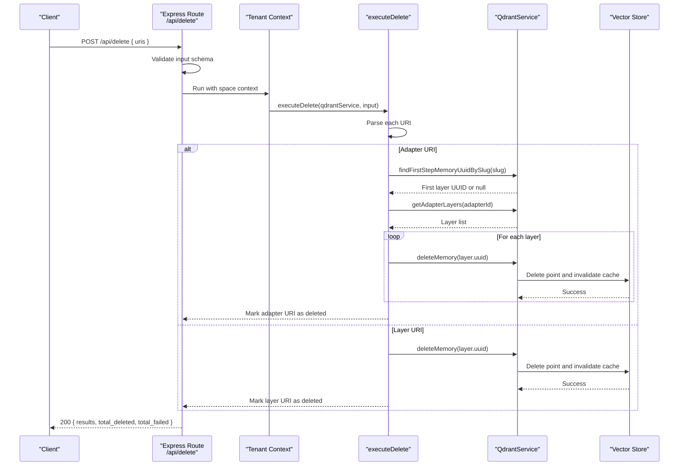
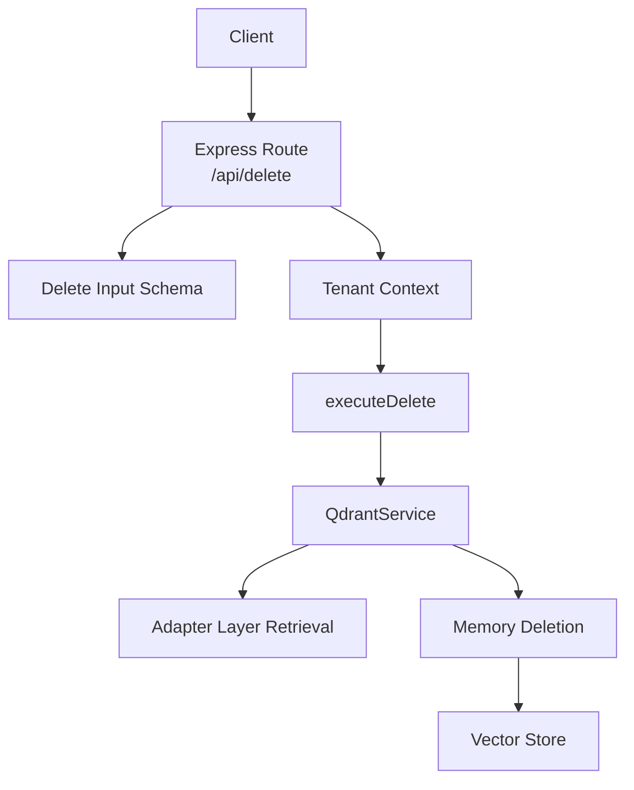

# Delete Endpoint (/api/delete)

<cite>
**Referenced Files in This Document**
- [http-api-delete.ts](file://src/http/http-api-delete.ts)
- [delete.ts](file://src/tools/delete.ts)
- [delete_schema.ts](file://src/tools/delete_schema.ts)
- [squadrules-uri.ts](file://src/tools/squadrules-uri.ts)
- [service.ts](file://src/services/qdrant/service.ts)
- [memory-retrieval.ts](file://src/services/qdrant/memory-retrieval.ts)
- [memory-updates.ts](file://src/services/qdrant/memory-updates.ts)
- [delete.ts (CLI command)](file://src/cli/commands/delete.ts)
- [embedded-mcp-resources.ts](file://src/resources/embedded-mcp-resources.ts)
</cite>

## Table of Contents
1. [Introduction](#introduction)
2. [Endpoint Summary](#endpoint-summary)
3. [Request Format](#request-format)
4. [Response Format](#response-format)
5. [Deletion Workflow](#deletion-workflow)
6. [Slug-Based Targeting and Ambiguity Handling](#slug-based-targeting-and-ambiguity-handling)
7. [Soft Delete vs Hard Delete](#soft-delete-vs-hard-delete)
8. [Bulk Deletion Patterns](#bulk-deletion-patterns)
9. [Recovery Procedures](#recovery-procedures)
10. [Security, Permissions, and Audit Trail](#security-permissions-and-audit-trail)
11. [Error Handling and Troubleshooting](#error-handling-and-troubleshooting)
12. [Architecture Overview](#architecture-overview)
13. [Detailed Component Analysis](#detailed-component-analysis)
14. [Performance Considerations](#performance-considerations)
15. [Conclusion](#conclusion)

## Introduction
This document provides detailed API documentation for the `/api/delete` endpoint used to remove SQUADRULES adapter resources. The endpoint supports deletion by adapter slug or layer UUID, performs vector database cleanup, and returns per-resource results with aggregate counts. It is part of the MCP tool surface that follows the activate → forward → reward lifecycle, where adapters are deterministic, auditable task execution units.

The delete operation is destructive: it removes stored memory records from the vector store and invalidates related caches. Operators should export adapters before deleting production content and verify that slugs are not chain dependencies.

## Endpoint Summary
- Method: `POST`
- Path: `/api/delete`
- Purpose: Delete one or more adapter or layer resources by URI.
- Authentication: Uses HTTP API space context; authentication and authorization are handled by the surrounding HTTP middleware and tenant context.
- Primary storage backend: Qdrant via `QdrantService`.
- Input validation: Zod schema enforces a non-empty array of valid SQUADRULES URIs.

**Section sources**
- [http-api-delete.ts:12-34](file://src/http/http-api-delete.ts#L12-L34)
- [embedded-mcp-resources.ts:17-17](file://src/resources/embedded-mcp-resources.ts#L17-L17)

## Request Format
The request body must be JSON with a single required field:

| Field | Type | Required | Description |
|---|---|---:|---|
| `uris` | Array of strings | Yes | Non-empty array of SQUADRULES URIs targeting adapters or layers. |

Supported URI forms:

| URI form | Meaning | Behavior |
|---|---|---|
| `squadrules://adapter/{slug}` | Adapter target | Deletes all layers belonging to the adapter. |
| `squadrules://adapter/{uuid}` | Adapter target by identifier | Deletes all layers belonging to the adapter. |
| `squadrules://layer/{uuid}` | Layer target | Deletes only that layer memory. |
| `squadrules://layer/{uuid}?execution_id={uuid}` | Layer target with execution context | Deletes only that layer memory; execution ID is accepted by the URI parser but does not change delete behavior. |

Validation rules:
- `uris` must be present and contain at least one value.
- Each URI must match the allowed adapter or layer patterns.
- Invalid URIs produce a `INVALID_INPUT` response.

Example request shapes:

- Delete an adapter by slug:
  ```json
  {
    "uris": ["squadrules://adapter/my-workflow"]
  }
  ```

- Delete multiple adapters and layers:
  ```json
  {
    "uris": [
      "squadrules://adapter/report-generator",
      "squadrules://adapter/data-pipeline",
      "squadrules://layer/a1b2c3d4-e5f6-7890-abcd-ef1234567890"
    ]
  }
  ```

**Section sources**
- [delete_schema.ts:14-19](file://src/tools/delete_schema.ts#L14-L19)
- [squadrules-uri.ts:14-25](file://src/tools/squadrules-uri.ts#L14-L25)
- [embedded-mcp-resources.ts:17-17](file://src/resources/embedded-mcp-resources.ts#L17-L17)

## Response Format
On success, the endpoint returns HTTP 200 with a structured result object:

| Field | Type | Description |
|---|---|---|
| `results` | Array | Per-URI deletion outcome. |
| `results[].uri` | String | The original URI submitted for deletion. |
| `results[].status` | Enum | `deleted` or `error`. |
| `results[].message` | String | Human-readable status message. |
| `total_deleted` | Number | Total number of successfully deleted items across all URIs. |
| `total_failed` | Number | Total number of failed deletions across all URIs. |

Per-URI outcomes:

| Scenario | Status | Message pattern |
|---|---:|---|
| Adapter deleted | `deleted` | Confirms adapter deletion. |
| Layer deleted | `deleted` | Confirms layer deletion. |
| Adapter not found | `error` | Reports adapter not found. |
| Layer not found | `error` | Reports memory not found. |
| Validation error | `INVALID_INPUT` (HTTP 400) | Describes input schema failure. |
| Unexpected server error | `DELETE_FAILED` (HTTP 500) | Describes internal failure. |

Important note: `total_deleted` counts individual memory records removed, not necessarily URIs. Deleting an adapter can remove multiple layers, so `total_deleted` may exceed the number of successful URIs.

**Section sources**
- [http-api-delete.ts:12-34](file://src/http/http-api-delete.ts#L12-L34)
- [delete.ts:12-70](file://src/tools/delete.ts#L12-L70)
- [delete_schema.ts:21-29](file://src/tools/delete_schema.ts#L21-L29)

## Deletion Workflow
The delete workflow proceeds as follows:



Key steps:
1. **Input validation**: The HTTP route validates the request body using the delete input schema.
2. **Tenant scoping**: The operation runs under HTTP API space context.
3. **URI parsing**: Each URI is parsed into adapter or layer targets.
4. **Adapter deletion**: For adapter URIs, the system resolves the slug to a first-layer UUID, retrieves all adapter layers, and deletes each layer.
5. **Layer deletion**: For layer URIs, the system deletes the specified layer directly.
6. **Vector store cleanup**: Each deletion removes the point from the vector store and invalidates related caches.
7. **Result aggregation**: Per-URI results are collected, and totals are computed.

**Diagram sources**
- [http-api-delete.ts:12-34](file://src/http/http-api-delete.ts#L12-L34)
- [delete.ts:21-70](file://src/tools/delete.ts#L21-L70)
- [service.ts:78-100](file://src/services/qdrant/service.ts#L78-L100)
- [memory-retrieval.ts:152-199](file://src/services/qdrant/memory-retrieval.ts#L152-L199)
- [memory-updates.ts:199-233](file://src/services/qdrant/memory-updates.ts#L199-L233)

**Section sources**
- [http-api-delete.ts:12-34](file://src/http/http-api-delete.ts#L12-L34)
- [delete.ts:21-70](file://src/tools/delete.ts#L21-L70)
- [memory-updates.ts:199-233](file://src/services/qdrant/memory-updates.ts#L199-L233)

## Slug-Based Targeting and Ambiguity Handling
Adapter URIs accept both slugs and UUIDs. When a slug is used:

- The slug is normalized.
- The system searches for the first step memory record matching the slug within searchable spaces.
- If no match exists, the adapter is considered not found.
- If multiple adapters share the same slug, the system selects one deterministically based on space precedence: personal > group > app/system, then stable identifier ordering.
- A disambiguation warning is logged, recommending explicit adapter URIs when ambiguity exists.

Recommended practice:
- Prefer explicit adapter URIs when possible to avoid ambiguity.
- Use `export` or activation search to discover the correct adapter identity before deletion.

**Section sources**
- [squadrules-uri.ts:42-102](file://src/tools/squadrules-uri.ts#L42-L102)
- [memory-retrieval.ts:228-300](file://src/services/qdrant/memory-retrieval.ts#L228-L300)
- [delete.ts:24-35](file://src/tools/delete.ts#L24-L35)

## Soft Delete vs Hard Delete
Current implementation performs hard deletion:

- Vector store points are removed.
- Cache entries are invalidated.
- No tombstone or soft-delete flag is created by this endpoint.
- Deleted data is not recoverable through `/api/delete`.

Implications:
- There is no built-in undo operation for this endpoint.
- Recovery requires external backup, export artifacts, or retraining.
- Operators should treat `/api/delete` as irreversible unless backups exist.

**Section sources**
- [memory-updates.ts:199-233](file://src/services/qdrant/memory-updates.ts#L199-L233)
- [delete.ts:21-70](file://src/tools/delete.ts#L21-L70)

## Bulk Deletion Patterns
The endpoint accepts multiple URIs in a single request. This enables bulk operations such as:

- Removing all adapters in a known list.
- Cleaning up temporary or experimental adapters.
- Removing specific layers after failed experiments.

Bulk behavior:
- Each URI is processed independently.
- Failures for one URI do not abort processing of other URIs.
- Results include per-URI status and aggregate counts.
- Clients should inspect `results` to determine which URIs succeeded and which failed.

Recommended bulk patterns:
- Export adapters before bulk deletion.
- Group related URIs logically.
- Retry only failed URIs after remediation.
- Monitor `total_failed` and log per-URI error messages.

**Section sources**
- [delete_schema.ts:14-19](file://src/tools/delete_schema.ts#L14-L19)
- [delete.ts:21-70](file://src/tools/delete.ts#L21-L70)

## Recovery Procedures
Because deletion is hard and irreversible at the API level, recovery depends on operational controls:

1. **Export before delete**: Use the export capability to preserve adapter content before deletion.
2. **External backups**: Rely on vector store snapshots, filesystem backups, or application-level exports.
3. **Retraining**: Recreate adapters from source material if backups are unavailable.
4. **Verification after restore**: Confirm restored adapters resolve correctly and do not break chains.

Operational guidance:
- Do not assume `/api/delete` supports rollback.
- Treat deletion as a final state change.
- Maintain export artifacts for critical adapters.
- Verify slug resolution after restoration to ensure chain dependencies remain intact.

**Section sources**
- [embedded-mcp-resources.ts:17-17](file://src/resources/embedded-mcp-resources.ts#L17-L17)
- [memory-updates.ts:199-233](file://src/services/qdrant/memory-updates.ts#L199-L233)

## Security, Permissions, and Audit Trail
Security considerations:

- **Authentication**: Requests are authenticated through the HTTP API stack. JWT tokens validate both human and agent requests.
- **Authorization**: Space-scoped access is applied through tenant context. Deletion affects only resources visible to the current space context.
- **Destructive operation**: Deletion is irreversible without external backups.
- **Audit trail**: The HTTP route logs request and completion events. Vector store operations emit metrics. MCP tool usage emits call counts, durations, and error metrics.

Permission requirements:
- The caller must have write access to the target space.
- Adapters in protected spaces require appropriate permissions.
- Agents should consult team knowledge before acting, even for familiar tasks.

Audit-related signals:
- Structured logging for delete requests and completions.
- Metrics for MCP tool calls, durations, errors, input size, and output size.
- Vector store operation metrics for delete operations.

**Section sources**
- [http-api-delete.ts:23-33](file://src/http/http-api-delete.ts#L23-L33)
- [delete.ts:73-115](file://src/tools/delete.ts#L73-L115)
- [memory-updates.ts:199-233](file://src/services/qdrant/memory-updates.ts#L199-L233)

## Error Handling and Troubleshooting
Common errors:

| Condition | HTTP Status | Error Code | Meaning |
|---|---:|---|---|
| Missing or invalid `uris` | 400 | `INVALID_INPUT` | Input schema validation failed. |
| Adapter not found | 200 with per-URI error | `error` | Slug did not resolve to an existing adapter. |
| Layer not found | 200 with per-URI error | `MEMORY_NOT_FOUND` | Layer UUID does not exist. |
| Unexpected server failure | 500 | `DELETE_FAILED` | Internal error during deletion. |

Troubleshooting steps:

1. **Validate URIs**: Ensure URIs use the correct scheme and format.
2. **Check slug resolution**: Confirm the slug exists and is unambiguous.
3. **Inspect per-URI results**: Review `results[].status` and `results[].message`.
4. **Verify space context**: Confirm the request is scoped to the intended space.
5. **Check vector store connectivity**: Ensure Qdrant is reachable and configured.
6. **Review logs**: Look for structured logger warnings about slug disambiguation or deletion failures.

**Section sources**
- [http-api-delete.ts:14-33](file://src/http/http-api-delete.ts#L14-L33)
- [delete.ts:55-63](file://src/tools/delete.ts#L55-L63)
- [memory-updates.ts:204-210](file://src/services/qdrant/memory-updates.ts#L204-L210)

## Architecture Overview
The `/api/delete` endpoint integrates HTTP routing, input validation, shared business logic, and vector store operations.



**Diagram sources**
- [http-api-delete.ts:12-34](file://src/http/http-api-delete.ts#L12-L34)
- [delete.ts:12-70](file://src/tools/delete.ts#L12-L70)
- [service.ts:78-100](file://src/services/qdrant/service.ts#L78-L100)

## Detailed Component Analysis

### HTTP Route: `/api/delete`
Responsibilities:
- Accept POST requests.
- Validate request body using the delete input schema.
- Log request and completion.
- Execute deletion under tenant context.
- Return structured results or error responses.

Behavior highlights:
- Returns 400 for invalid input.
- Returns 200 with structured results on success.
- Returns 500 for unexpected errors.

**Section sources**
- [http-api-delete.ts:12-34](file://src/http/http-api-delete.ts#L12-L34)

### Shared Delete Logic: `executeDelete`
Responsibilities:
- Iterate over requested URIs.
- Parse URIs into adapter or layer targets.
- Resolve adapter slugs to layer identifiers.
- Retrieve all adapter layers.
- Delete each layer.
- Aggregate per-URI results and totals.

Design notes:
- Errors per URI are captured rather than failing the entire batch.
- Adapter deletion cascades to all associated layers.
- Layer deletion is direct and targeted.

**Section sources**
- [delete.ts:12-70](file://src/tools/delete.ts#L12-L70)

### Input and Output Schemas
Responsibilities:
- Define validated request and response shapes.
- Enforce URI format constraints.
- Provide TypeScript types for consumers.

Key constraints:
- `uris` must be a non-empty array.
- URIs must match adapter or layer patterns.
- Output includes per-URI results and aggregate counts.

**Section sources**
- [delete_schema.ts:1-33](file://src/tools/delete_schema.ts#L1-L33)

### URI Parsing and Normalization
Responsibilities:
- Parse SQUADRULES URIs.
- Normalize slugs.
- Support adapter, artifact, and layer URIs.
- Throw descriptive errors for invalid URIs.

Usage in delete:
- Adapter URIs are validated and normalized before slug resolution.
- Layer URIs are parsed to extract the layer UUID.

**Section sources**
- [squadrules-uri.ts:42-130](file://src/tools/squadrules-uri.ts#L42-L130)

### Qdrant Service Integration
Responsibilities:
- Provide a unified interface to vector store operations.
- Expose methods for retrieval, updates, and deletion.
- Abstract connection details and collection configuration.

Delete-related methods:
- `findFirstStepMemoryUuidBySlug`: Resolves slug to first-layer UUID.
- `getAdapterLayers`: Retrieves all layers for an adapter.
- `deleteMemory`: Deletes a memory point and invalidates caches.

**Section sources**
- [service.ts:78-100](file://src/services/qdrant/service.ts#L78-L100)

### Vector Store Retrieval and Deletion
Responsibilities:
- Query vector store for adapter layers.
- Resolve slugs with space precedence.
- Delete memory points.
- Invalidate Redis cache after deletion.

Deletion guarantees:
- Existing record check before deletion.
- Cache invalidation on successful delete.
- Metrics and timing instrumentation.

**Section sources**
- [memory-retrieval.ts:152-199](file://src/services/qdrant/memory-retrieval.ts#L152-L199)
- [memory-retrieval.ts:228-300](file://src/services/qdrant/memory-retrieval.ts#L228-L300)
- [memory-updates.ts:199-233](file://src/services/qdrant/memory-updates.ts#L199-L233)

### CLI Delete Command
Responsibilities:
- Provide a command-line interface for deletion.
- Call the backend delete method.
- Render results in pretty or text format.
- Handle API errors.

Relationship to HTTP API:
- The CLI uses the same conceptual delete operation but communicates through the backend abstraction.
- The HTTP API is the primary REST entry point documented here.

**Section sources**
- [delete.ts (CLI command):13-30](file://src/cli/commands/delete.ts#L13-L30)

## Performance Considerations
- Batch deletion reduces round trips compared to one URI per request.
- Adapter deletion may trigger multiple layer deletions; expect `total_deleted` to reflect individual records removed.
- Slug resolution scans searchable spaces and may paginate results.
- Vector store deletion includes cache invalidation, which adds overhead but ensures consistency.
- Metrics capture operation duration and error rates for monitoring.

Optimization recommendations:
- Group related deletions into a single request.
- Avoid repeated slug-based deletions when UUIDs are known.
- Monitor vector store latency and cache invalidation costs.
- Use explicit adapter URIs when ambiguity could cause extra resolution work.

**Section sources**
- [delete.ts:21-70](file://src/tools/delete.ts#L21-L70)
- [memory-retrieval.ts:228-300](file://src/services/qdrant/memory-retrieval.ts#L228-L300)
- [memory-updates.ts:199-233](file://src/services/qdrant/memory-updates.ts#L199-L233)

## Conclusion
The `/api/delete` endpoint provides a safe, validated, and observable way to remove SQUADRULES adapter and layer resources. It supports slug-based targeting, cascade deletion of adapter layers, and per-URI result reporting. Because deletion is hard and irreversible, operators should export adapters before removal, verify slug dependencies, and rely on external backups for recovery. Security is enforced through authentication and space-scoped context, while auditability is supported through structured logging and metrics.