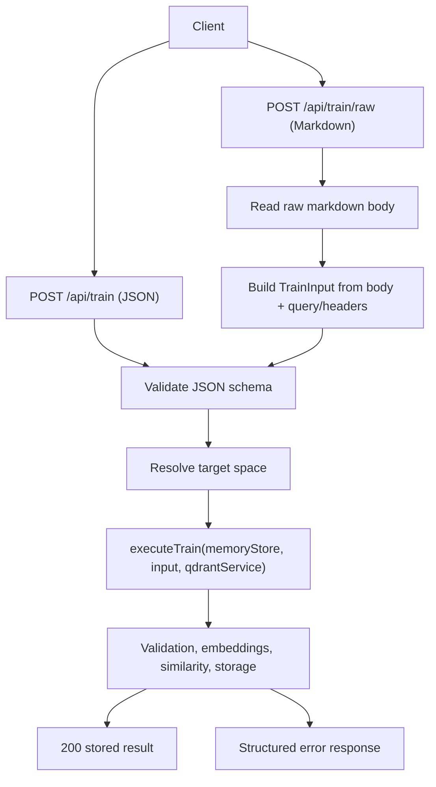
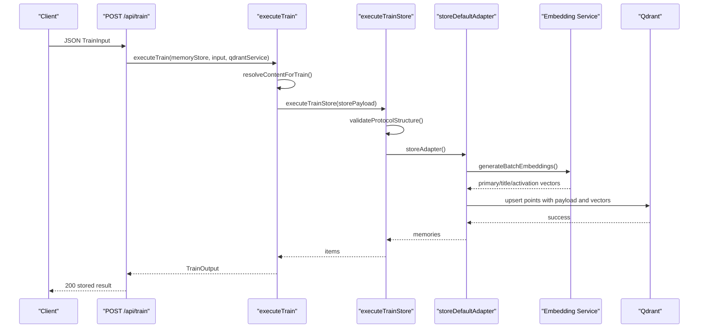
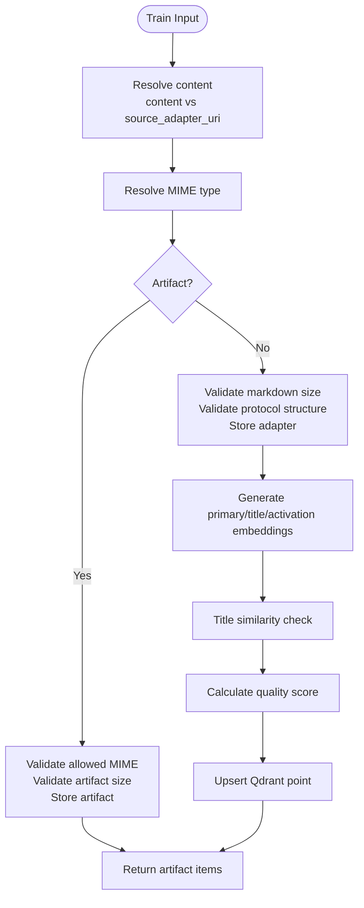
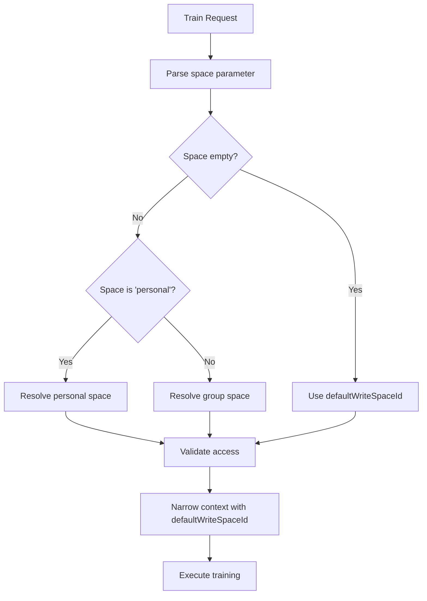
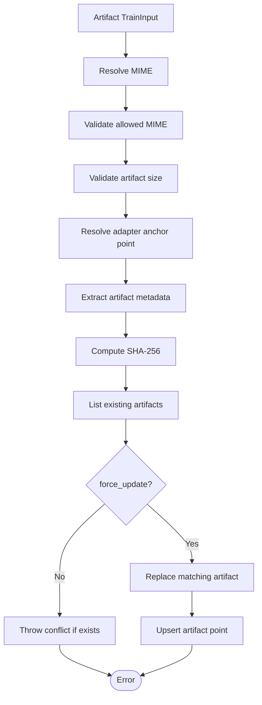
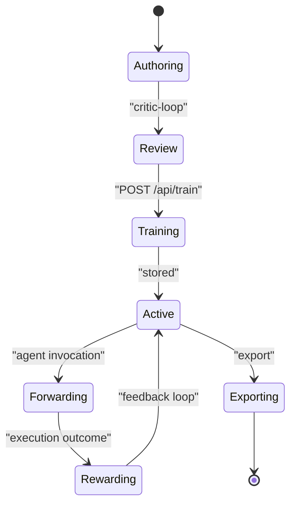

# Train Endpoint (/api/train)

<cite>
**Referenced Files in This Document**
- [http-api-train-json.ts](file://src/http/http-api-train-json.ts)
- [http-api-train-raw.ts](file://src/http/http-api-train-raw.ts)
- [train.ts](file://src/tools/train.ts)
- [train_schema.ts](file://src/tools/train_schema.ts)
- [train-store.ts](file://src/tools/train-store.ts)
- [store-adapter-default-handler.ts](file://src/services/memory/store-adapter-default-handler.ts)
- [store-title-similarity-search.ts](file://src/services/memory/store-title-similarity-search.ts)
- [store-adapter-helpers.ts](file://src/services/memory/store-adapter-helpers.ts)
- [validate-adapter-markdown-size.ts](file://src/services/memory/validate-adapter-markdown-size.ts)
- [store-artifact.ts](file://src/services/memory/store-artifact.ts)
- [train-mime.ts](file://src/tools/train-mime.ts)
- [train-artifact-adapter-uri.ts](file://src/tools/train-artifact-adapter-uri.ts)
</cite>

## Table of Contents
1. [Introduction](#introduction)
2. [Endpoint Overview](#endpoint-overview)
3. [Request and Response Formats](#request-and-response-formats)
4. [Adapter Definition Schema](#adapter-definition-schema)
5. [Training Pipeline](#training-pipeline)
6. [Error Model and Status Codes](#error-model-and-status-codes)
7. [Multi-Tenant Space Isolation](#multi-tenant-space-isolation)
8. [Artifact Handling for Binary and Non-Markdown Content](#artifact-handling-for-binary-and-non-markdown-content)
9. [Adapter Lifecycle Relationship](#adapter-lifecycle-relationship)
10. [Practical Examples by Adapter Type](#practical-examples-by-adapter-type)
11. [Performance and Reliability Considerations](#performance-and-reliability-considerations)
12. [Troubleshooting Guide](#troubleshooting-guide)
13. [Conclusion](#conclusion)

## Introduction
The `/api/train` endpoint registers new adapters and artifacts into the SquadRules adapter store. It is part of the agent-first MCP workflow where agents create or repair adapters when workflows change. The endpoint supports:
- Markdown-based adapter definitions with protocol validation, metadata extraction, and vector embedding generation.
- Artifact attachment to existing adapters for binary or non-markdown content such as scripts, configuration files, and tooling assets.
- Duplicate detection, semantic similarity checks against existing adapters, quality scoring, and storage in Qdrant and LanceDB-backed memory infrastructure.
- Multi-tenant space isolation so that adapters are written into a caller-resolved target space.

This document focuses on the JSON body variant at `POST /api/train`, while also explaining how raw markdown training works through `POST /api/train/raw`.

## Endpoint Overview
There are two HTTP entry points for training:
- `POST /api/train`: accepts a structured JSON payload describing the adapter or artifact.
- `POST /api/train/raw`: accepts raw markdown text and derives metadata from query parameters and headers.

Both routes validate input, resolve the target space, execute the training pipeline, and return structured results or errors.



**Diagram sources**
- [http-api-train-json.ts:46-107](file://src/http/http-api-train-json.ts#L46-L107)
- [http-api-train-raw.ts:48-153](file://src/http/http-api-train-raw.ts#L48-L153)
- [train.ts:137-180](file://src/tools/train.ts#L137-L180)

**Section sources**
- [http-api-train-json.ts:46-107](file://src/http/http-api-train-json.ts#L46-L107)
- [http-api-train-raw.ts:48-153](file://src/http/http-api-train-raw.ts#L48-L153)

## Request and Response Formats

### POST /api/train JSON Request
The JSON request uses the validated `TrainInput` schema. Required fields depend on whether you are training an adapter or attaching an artifact.

| Field | Type | Required | Description |
|---|---|---:|---|
| `content` | string | Conditional | Markdown content for adapters; optional when using `source_adapter_uri` or `directory`. |
| `llm_model_id` | string | Yes | LLM model identifier used for telemetry and embedding context. |
| `force_update` | boolean | No | Overwrite an existing adapter with the same label or replace an existing artifact. |
| `protocol_version` | string | No | Adapter version, for example semver. |
| `space` | string | No | Target space: `"personal"` or a group name. If omitted, defaults to the caller’s default write space. |
| `source_adapter_uri` | string | Conditional | Fork from an existing adapter slug formatted as `squadrules://adapter/{slug}`. |
| `mime` | string | Conditional | MIME type. Omit or use `text/markdown` for adapters. Required for non-markdown artifacts unless inferred from `artifact_name`. |
| `artifact_name` | string | Conditional | File name used for artifact mode and MIME inference. |
| `adapter_uri` | string | Conditional | Attach artifact to an existing adapter slug formatted as `squadrules://adapter/{slug}`. |
| `relative_path` | string | Optional | Skill-root-relative path preserved during export; forward slashes only, no parent traversal. |
| `review_evidence` | object | Conditional | Critic-loop review evidence required for adapter markdown train calls. |
| `directory` | string | Conditional | Absolute directory path for batch training `.md` files. |
| `recursive` | boolean | No | When `directory` is set, scan subdirectories recursively. |

#### Review Evidence Shape
| Field | Type | Description |
|---|---|---|
| `verdict_file` | string | Absolute path to the critic-loop verdict file. |
| `exit_code` | number | Shell exit code; must be `0`. |
| `stdout` | string | Shell stdout; first line must indicate success. |

### POST /api/train/raw Request
Raw markdown training reads the entire request body as UTF-8 text and builds a `TrainInput` from:
- Query parameters: `llm_model_id`, `force`, `protocol_version`, `space`, `review_evidence`.
- Headers: `x-llm-model-id`, `x-force-update`, `x-protocol-version`, `x-space`, `x-review-evidence`.
- User-agent fallback for `llm_model_id`.
- Body limit enforced by `HTTP_TRAIN_RAW_BODY_LIMIT`.

### Successful Response
A successful training call returns status `200` with a `TrainOutput` structure:

| Field | Type | Description |
|---|---|---|
| `items` | array | Stored layer or artifact entries. |
| `status` | string | Always `"stored"` on success. |
| `batch_manifest` | array | Present for directory-based batch training; per-file status and optional URI or error. |

Each item includes:
| Field | Type | Description |
|---|---|---|
| `uri` | string | Layer URI for markdown adapters or artifact URI for attached artifacts. |
| `layer_uuid` | string | Memory UUID for markdown layers. |
| `artifact_uuid` | string | Memory UUID for artifacts. |
| `adapter_uri` | string | Resolved adapter URI when applicable. |
| `label` | string | Generated or derived label. |
| `tags` | array | Tags including domain tags, code identifiers, and artifact tags. |
| `content_type` | string | MIME type; `text/markdown` for adapters. |

**Section sources**
- [train_schema.ts:54-196](file://src/tools/train_schema.ts#L54-L196)
- [http-api-train-raw.ts:53-113](file://src/http/http-api-train-raw.ts#L53-L113)
- [train.ts:176-243](file://src/tools/train.ts#L176-L243)

## Adapter Definition Schema
Adapter definitions are primarily markdown documents processed through protocol validation and frontmatter extraction. The schema enforces:
- At least one of `content`, `source_adapter_uri`, or `directory`.
- Adapter markdown requires `review_evidence`.
- Artifact mode requires either explicit `mime` or inferable MIME from `artifact_name`, plus `adapter_uri`.
- `relative_path` is only valid for artifact rows.

### Markdown Validation
Before persistence, adapter markdown is checked for:
- Total byte size.
- Maximum line length.
- Maximum line count.
- Protocol structure validity.

If validation fails, the system returns a structured error indicating missing protocol fields and guidance to open the guided adapter creation flow.

### Metadata Extraction
During storage, the system extracts:
- Label and tags.
- Code block identifiers.
- Frontmatter values such as slug, version, chain root, and activation patterns.
- Domain task classification and content type classification.

These metadata values influence search behavior, quality scoring, and downstream adapter discovery.

**Section sources**
- [train_schema.ts:54-177](file://src/tools/train_schema.ts#L54-L177)
- [validate-adapter-markdown-size.ts:31-106](file://src/services/memory/validate-adapter-markdown-size.ts#L31-L106)
- [store-adapter-default-handler.ts:49-106](file://src/services/memory/store-adapter-default-handler.ts#L49-L106)

## Training Pipeline
The training pipeline transforms a validated request into persisted memory records.



**Diagram sources**
- [http-api-train-json.ts:51-107](file://src/http/http-api-train-json.ts#L51-L107)
- [train.ts:88-180](file://src/tools/train.ts#L88-L180)
- [train-store.ts:47-129](file://src/tools/train-store.ts#L47-L129)
- [store-adapter-default-handler.ts:108-217](file://src/services/memory/store-adapter-default-handler.ts#L108-L217)

### Step-by-Step Processing Logic



**Diagram sources**
- [train.ts:137-180](file://src/tools/train.ts#L137-L180)
- [train-mime.ts:4-20](file://src/tools/train-mime.ts#L4-L20)
- [train-store.ts:47-129](file://src/tools/train-store.ts#L47-L129)
- [store-adapter-default-handler.ts:108-217](file://src/services/memory/store-adapter-default-handler.ts#L108-L217)
- [store-adapter-helpers.ts:112-172](file://src/services/memory/store-adapter-helpers.ts#L112-L172)

### Markdown Validation
Adapter markdown validation rejects:
- Excessive total bytes.
- Lines exceeding maximum UTF-8 length.
- Documents exceeding maximum line count.

Errors include diagnostic details such as limits, actual sizes, and safety factors.

### Vector Embedding Generation
For default adapter storage:
- Enhanced text is built from original markdown and code block processing.
- Three embedding sets are generated: primary dense text, title dense text, and activation pattern dense text.
- Embedding dimension is resolved from configuration.
- If embedding generation fails, zero vectors are used as a fallback with a warning.

### Semantic Similarity Checks
Before storing an adapter:
- A similarity search is performed against adapter titles.
- The query is limited to the adapter title or H1 content.
- Results are filtered by space and exclude internal creation/refining protocols.
- If similarity exceeds the configured threshold, the system returns `SIMILAR_MEMORY_FOUND` with existing memory details, similarity score, and next action guidance.

### Quality Scoring Algorithms
After persistence:
- Domain task and content type are derived from label, text, and tags.
- Quality metadata is calculated using model statistics.
- Contribution metrics are recorded per LLM model ID.
- Memory quality counters are updated.

### Storage in Qdrant/LanceDB
- Qdrant is used for vector and sparse BM25 storage.
- Points include payload fields for space isolation, labels, tags, text, timestamps, author information, slug, adapter metadata, task/type classification, and quality metadata.
- The implementation retries upsert without sparse BM25 if the collection lacks sparse configuration.
- LanceDB is referenced as a secondary embedded vector store in project documentation, but the adapter training path shown here primarily persists through Qdrant via the memory store.

**Section sources**
- [validate-adapter-markdown-size.ts:31-106](file://src/services/memory/validate-adapter-markdown-size.ts#L31-L106)
- [store-adapter-default-handler.ts:108-217](file://src/services/memory/store-adapter-default-handler.ts#L108-L217)
- [store-title-similarity-search.ts:9-61](file://src/services/memory/store-title-similarity-search.ts#L9-L61)
- [store-adapter-helpers.ts:112-172](file://src/services/memory/store-adapter-helpers.ts#L112-L172)
- [store-adapter-default-handler.ts:236-250](file://src/services/memory/store-adapter-default-handler.ts#L236-L250)

## Error Model and Status Codes

### HTTP-Level Errors
| Status | Error Code | Meaning |
|---|---|---|
| 400 | `INVALID_INPUT` | JSON schema validation failed. |
| 400 | `SPACE_NOT_FOUND` | Target space does not exist or is not accessible. |
| 400 | `SPACE_READ_ONLY` | Target space exists but cannot be written to. |
| 409 | `DUPLICATE_ADAPTER` | Adapter with the same label already exists; use `force_update: true`. |
| 409 | `SIMILAR_MEMORY_FOUND` | Title similarity exceeds threshold; inspect existing memory before overwriting. |
| 413 | `PAYLOAD_TOO_LARGE` | Raw markdown body exceeds configured limit. |
| 500 | `STORE_FAILED` | Generic storage failure. |

### Train Pipeline Errors
| Error Code | Meaning |
|---|---|
| `CONTENT_REQUIRED` | No content, source adapter, or directory provided. |
| `SOURCE_ADAPTER_UNAVAILABLE` | Forking requires adapter store service. |
| `SOURCE_ADAPTER_NOT_FOUND` | Source adapter slug not found. |
| `INVALID_SOURCE_URI` | `source_adapter_uri` is not a valid adapter URI. |
| `SOURCE_EXPORT_EMPTY` | Exported markdown from source adapter is empty. |
| `PROTOCOL_STRUCTURE_INVALID` | Markdown protocol validation failed. |
| `UNSUPPORTED_MIME` | Artifact MIME type is not allowed. |
| `ADAPTER_MARKDOWN_TOTAL_BYTES_EXCEEDED` | Markdown exceeds maximum total size. |
| `ADAPTER_MARKDOWN_LINE_TOO_LONG` | Line exceeds maximum length. |
| `ADAPTER_MARKDOWN_LINE_COUNT_EXCEEDED` | Document exceeds maximum line count. |
| `ARTIFACT_CONTENT_TOTAL_BYTES_EXCEEDED` | Artifact content exceeds maximum size. |
| `INVALID_ADAPTER_URI` | `adapter_uri` is not a valid adapter URI. |
| `ADAPTER_LOOKUP_UNAVAILABLE` | Adapter slug resolution requires adapter storage service. |
| `ADAPTER_NOT_FOUND` | Adapter slug not found for artifact attachment. |

### Duplicate Detection Behavior
- Duplicate adapter detection uses adapter UUIDs across allowed spaces.
- Without `force_update`, duplicate detection throws `DUPLICATE_ADAPTER`.
- With `force_update`, existing points are deleted unless they belong to protected spaces, which returns `PROTECTED_SPACE_WRITE_FORBIDDEN`.
- Slug allocation enforces uniqueness across spaces and may auto-suffix slugs when needed.

**Section sources**
- [http-api-train-json.ts:51-170](file://src/http/http-api-train-json.ts#L51-L170)
- [http-api-train-raw.ts:53-211](file://src/http/http-api-train-raw.ts#L53-L211)
- [train-store.ts:31-129](file://src/tools/train-store.ts#L31-L129)
- [store-adapter-helpers.ts:52-93](file://src/services/memory/store-adapter-helpers.ts#L52-L93)
- [store-adapter-helpers.ts:201-254](file://src/services/memory/store-adapter-helpers.ts#L201-L254)

## Multi-Tenant Space Isolation
Space resolution determines where adapters are written:
- If `space` is omitted or empty, the caller’s default write space is used.
- If `space` is `"personal"`, it resolves to the caller’s personal space.
- Otherwise, the value is treated as a group name.
- Read-only or inaccessible spaces return `SPACE_READ_ONLY` or `SPACE_NOT_FOUND`.
- The narrowed context carries `defaultWriteSpaceId` into the training pipeline.
- Qdrant points include `space_id` in their payload for isolation.



**Diagram sources**
- [http-api-train-json.ts:68-103](file://src/http/http-api-train-json.ts#L68-L103)
- [http-api-train-raw.ts:116-149](file://src/http/http-api-train-raw.ts#L116-L149)
- [store-adapter-default-handler.ts:144-146](file://src/services/memory/store-adapter-default-handler.ts#L144-L146)

**Section sources**
- [http-api-train-json.ts:68-103](file://src/http/http-api-train-json.ts#L68-L103)
- [http-api-train-raw.ts:116-149](file://src/http/http-api-train-raw.ts#L116-L149)

## Artifact Handling for Binary and Non-Markdown Content
Artifacts are non-markdown content attached to an existing adapter. They support:
- Explicit MIME types or inference from `artifact_name`.
- Allowed MIME validation.
- Size validation.
- SHA-256 checksum computation.
- Slug derivation from header or filename.
- Optional `relative_path` preservation for skill exports.
- Zero dense vectors with BM25 sparse indexing for searchable metadata.

Artifact storage resolves the target adapter by slug or UUID, lists existing artifacts under the same space and adapter, and prevents accidental overwrites unless `force_update` is enabled.



**Diagram sources**
- [train-mime.ts:4-20](file://src/tools/train-mime.ts#L4-L20)
- [train-store.ts:64-97](file://src/tools/train-store.ts#L64-L97)
- [store-artifact.ts:168-300](file://src/services/memory/store-artifact.ts#L168-L300)

**Section sources**
- [train-mime.ts:4-20](file://src/tools/train-mime.ts#L4-L20)
- [train-store.ts:64-97](file://src/tools/train-store.ts#L64-L97)
- [store-artifact.ts:168-300](file://src/services/memory/store-artifact.ts#L168-L300)

## Adapter Lifecycle Relationship
Training is one phase in the broader adapter lifecycle:
- **Authoring**: Adapters are authored as markdown or created through guided flows.
- **Review**: Critic-loop review evidence is required for adapter markdown training.
- **Training**: `/api/train` validates, embeds, checks similarity, scores quality, and persists adapters/artifacts.
- **Activation**: Adapters become available for agent execution through activation flows.
- **Forwarding**: Agents invoke adapters through forwarding.
- **Rewarding**: Execution outcomes can be rewarded and tracked.
- **Exporting**: Adapters and artifacts can be exported for distribution or inspection.



[No sources needed since this diagram shows conceptual lifecycle, not specific code structure]

**Section sources**
- [train.ts:246-382](file://src/tools/train.ts#L246-L382)

## Practical Examples by Adapter Type

### Shell Adapter Example
A shell adapter typically executes commands through a shell interpreter. In training terms, it is represented as markdown with appropriate protocol fields, tags, and optionally activation patterns.

Example JSON payload shape:
```json
{
  "content": "<adapter markdown>",
  "llm_model_id": "example-model",
  "space": "personal",
  "review_evidence": {
    "verdict_file": "/absolute/path/to/verdict.md",
    "exit_code": 0,
    "stdout": "PASS\n..."
  }
}
```

Notes:
- `content` must pass protocol structure validation.
- `review_evidence` is required for adapter markdown.
- `space` controls target space isolation.

### Comment Adapter Example
A comment adapter provides contextual rules or annotations rather than executable logic. Training follows the same adapter markdown path.

Example JSON payload shape:
```json
{
  "content": "<adapter markdown>",
  "llm_model_id": "example-model",
  "protocol_version": "1.0.0",
  "review_evidence": {
    "verdict_file": "/absolute/path/to/verdict.md",
    "exit_code": 0,
    "stdout": "PASS\n..."
  }
}
```

### Forward Adapter Example
A forward adapter delegates execution to another service or tool. Its markdown should describe forwarding contracts and expected inputs/outputs.

Example JSON payload shape:
```json
{
  "content": "<adapter markdown>",
  "llm_model_id": "example-model",
  "space": "engineering",
  "review_evidence": {
    "verdict_file": "/absolute/path/to/verdict.md",
    "exit_code": 0,
    "stdout": "PASS\n..."
  }
}
```

### Subagent Adapter Example
A subagent adapter represents a delegated agent workflow. Its markdown should define scope, authority, and termination conditions.

Example JSON payload shape:
```json
{
  "content": "<adapter markdown>",
  "llm_model_id": "example-model",
  "protocol_version": "2.1.0",
  "review_evidence": {
    "verdict_file": "/absolute/path/to/verdict.md",
    "exit_code": 0,
    "stdout": "PASS\n..."
  }
}
```

### Artifact Attachment Example
To attach a script or configuration file to an existing adapter:

Example JSON payload shape:
```json
{
  "content": "<script or config content>",
  "llm_model_id": "example-model",
  "mime": "application/x-shellscript",
  "artifact_name": "deploy.sh",
  "adapter_uri": "squadrules://adapter/my-deploy-adapter",
  "relative_path": "scripts/deploy.sh"
}
```

Notes:
- `mime` must be allowed.
- `artifact_name` is required for artifact mode.
- `adapter_uri` must reference an existing adapter.
- `relative_path` is preserved for skill exports.

**Section sources**
- [train_schema.ts:54-177](file://src/tools/train_schema.ts#L54-L177)
- [train-store.ts:64-97](file://src/tools/train-store.ts#L64-L97)
- [store-artifact.ts:168-300](file://src/services/memory/store-artifact.ts#L168-L300)

## Performance and Reliability Considerations
- Embedding generation is batched for primary, title, and activation vectors.
- Embedding failures fall back to zero vectors with warnings rather than failing the entire operation.
- Qdrant upsert retries without sparse BM25 when the collection lacks sparse configuration.
- Redis cache invalidation occurs after updates.
- Raw markdown requests enforce a configurable body size limit.
- Directory-based batch training processes each `.md` file independently and reports per-file status.

**Section sources**
- [store-adapter-default-handler.ts:112-142](file://src/services/memory/store-adapter-default-handler.ts#L112-L142)
- [store-adapter-default-handler.ts:216-234](file://src/services/memory/store-adapter-default-handler.ts#L216-L234)
- [http-api-train-raw.ts:53-60](file://src/http/http-api-train-raw.ts#L53-L60)
- [train.ts:304-332](file://src/tools/train.ts#L304-L332)

## Troubleshooting Guide

### Common Validation Failures
- Missing `content`, `source_adapter_uri`, or `directory`: ensure at least one is provided.
- Missing `review_evidence` for adapter markdown: run critic-loop and provide verdict proof.
- Invalid `adapter_uri` or `source_adapter_uri`: use `squadrules://adapter/{slug}`.
- Unknown artifact MIME: provide explicit `mime` or use recognized extensions.

### Duplicate and Similarity Issues
- `DUPLICATE_ADAPTER`: reuse the same adapter id with `force_update: true`, or choose a distinct label.
- `SIMILAR_MEMORY_FOUND`: inspect the similar adapter, export its markdown, and decide whether to replace or rename.
- Protected space writes: avoid overwriting adapters in protected spaces unless authorized.

### Embedding Provider Errors
- Embedding failures trigger zero-vector fallback and warnings.
- If semantic search behaves unexpectedly, verify embedding provider configuration and availability.
- For raw markdown training, large payloads may exceed `HTTP_TRAIN_RAW_BODY_LIMIT`.

### Storage Failures
- `STORE_FAILED` indicates generic persistence issues.
- Check Qdrant connectivity, collection configuration, and sparse vector support.
- Verify space permissions and tenant context.

**Section sources**
- [http-api-train-json.ts:51-170](file://src/http/http-api-train-json.ts#L51-L170)
- [http-api-train-raw.ts:53-211](file://src/http/http-api-train-raw.ts#L53-L211)
- [store-adapter-default-handler.ts:112-142](file://src/services/memory/store-adapter-default-handler.ts#L112-L142)
- [store-adapter-helpers.ts:52-93](file://src/services/memory/store-adapter-helpers.ts#L52-L93)

## Conclusion
The `/api/train` endpoint is the central registration point for SquadRules adapters and artifacts. It enforces strict validation, protects against duplicates and near-duplicates, generates semantic embeddings, computes quality signals, and persists data into Qdrant with multi-tenant space isolation. For agents, training is a critical step between authoring/review and activation/forwarding. For humans, it provides structured feedback, safe guards, and clear next actions when something is missing, similar, or conflicting.