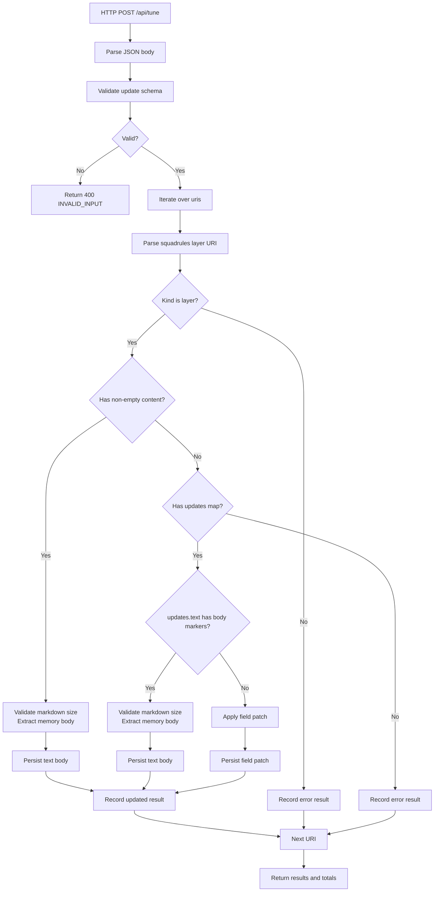
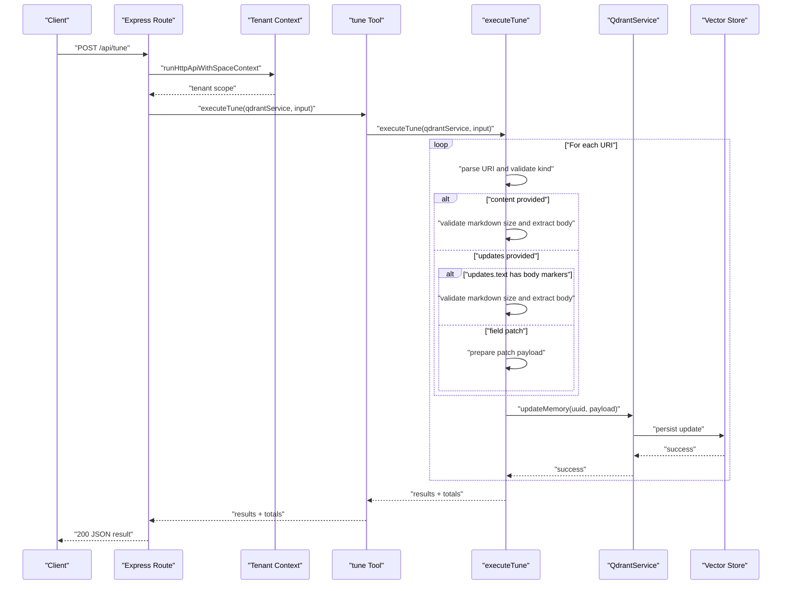
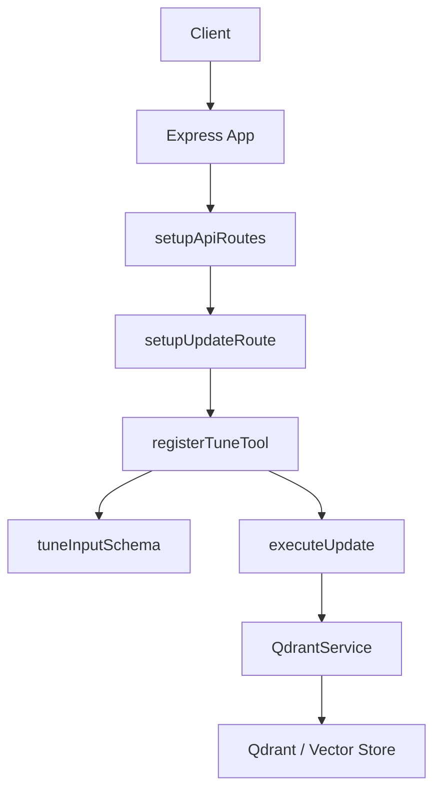
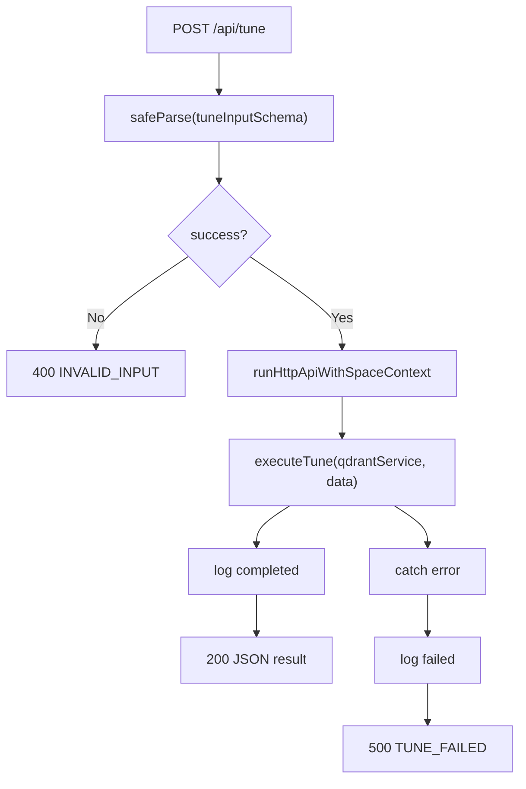
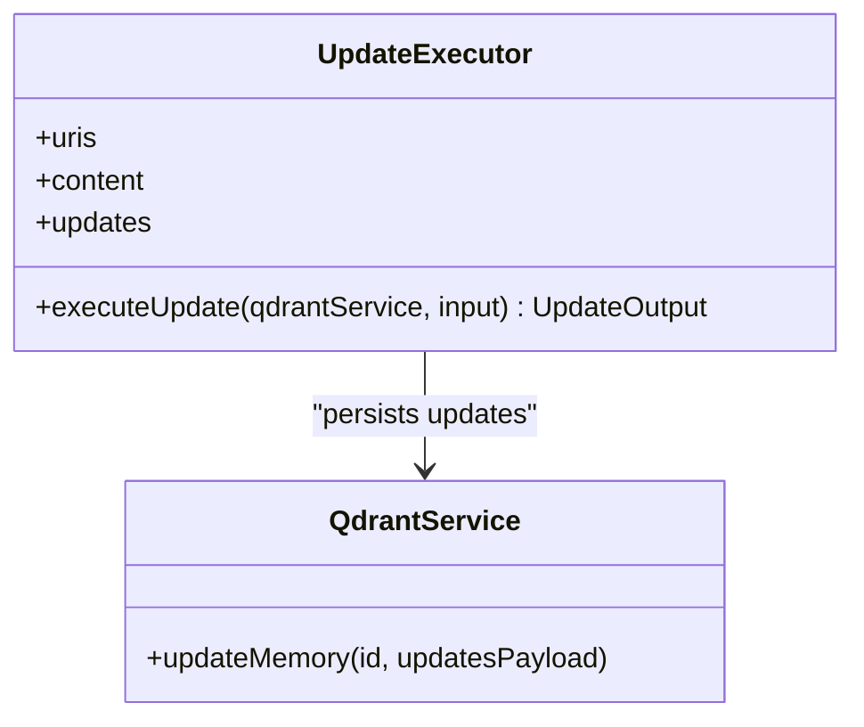
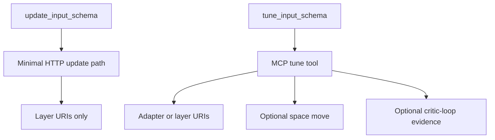
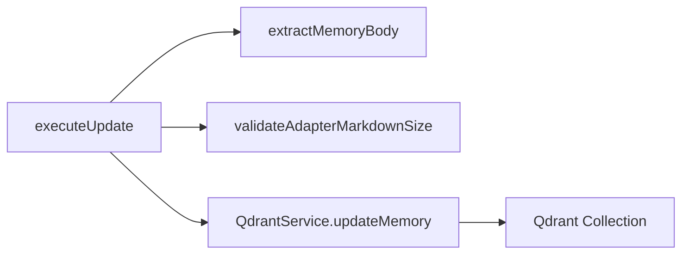

# Update Endpoint (/api/update)

<cite>
**Referenced Files in This Document**   
- [http-api-routes.ts](file://src/http/http-api-routes.ts)
- [http-api-update.ts](file://src/http/http-api-update.ts)
- [update.ts](file://src/tools/update.ts)
- [update_schema.ts](file://src/tools/update_schema.ts)
- [tune.ts](file://src/tools/tune.ts)
- [tune_schema.ts](file://src/tools/tune_schema.ts)
- [service.ts](file://src/services/qdrant/service.ts)
- [memory-store.ts](file://src/services/qdrant/memory-store.ts)
- [memory-updates.ts](file://src/services/qdrant/memory-updates.ts)
- [store.ts](file://src/services/memory/store.ts)
- [memory-body.ts](file://src/utils/memory-body.js)
- [validate-adapter-markdown-size.ts](file://src/services/memory/validate-adapter-markdown-size.ts)
- [squadrules-uri.ts](file://src/tools/squadrules-uri.ts)
</cite>

## Table of Contents
1. [Introduction](#introduction)
2. [Endpoint Scope and Naming Clarification](#endpoint-scope-and-naming-clarification)
3. [Request Schema](#request-schema)
4. [Update Workflow](#update-workflow)
5. [Response Format](#response-format)
6. [Common Update Scenarios](#common-update-scenarios)
7. [Validation, Versioning, and Conflict Handling](#validation-versioning-and-conflict-handling)
8. [Atomicity, Rollback, and Audit Logging](#atomicity-rollback-and-audit-logging)
9. [Error Responses and Troubleshooting](#error-responses-and-troubleshooting)
10. [Architecture Overview](#architecture-overview)
11. [Detailed Component Analysis](#detailed-component-analysis)
12. [Performance Considerations](#performance-considerations)
13. [Conclusion](#conclusion)

## Introduction
This document describes the adapter update capability exposed by the HTTP API layer that is registered under the update route setup. The implementation focuses on updating stored adapter layers through a structured input schema, validating content size and structure, extracting memory bodies, and persisting changes to the vector store via the Qdrant service.

The documentation covers:
- Request schema for partial updates and field-level patches.
- Validation rules applied before persistence.
- The end-to-end call flow from HTTP handler to storage.
- Response format with per-target status and totals.
- Guidance for common update scenarios such as content refinement, artifact replacement, and metadata corrections.
- Notes on version control, conflict handling, atomicity, rollback, and audit logging based on the available code.

## Endpoint Scope and Naming Clarification
The repository registers an update-related route through `setupUpdateRoute`, which currently exposes `/api/tune`. The file name `http-api-update.ts` indicates this route belongs to the update family, while the actual HTTP path is `/api/tune`.

Important implications:
- Clients should target `/api/tune` when using the HTTP endpoint described here.
- The MCP tool named `tune` shares the same update semantics but has its own richer schema including optional space moves and critic-loop review evidence.
- The internal `executeUpdate` function in `src/tools/update.ts` implements a simpler update path used by both the MCP tool and the HTTP route.

**Section sources**
- [http-api-routes.ts:22-35](file://src/http/http-api-routes.ts#L22-L35)
- [http-api-update.ts:11-33](file://src/http/http-api-update.ts#L11-L33)
- [update.ts:7-11](file://src/tools/update.ts#L7-L11)

## Request Schema
The HTTP update request uses the update schema defined in `update_schema.ts`.

### Required Fields
| Field | Type | Required | Description |
|---|---|---:|---|
| `uris` | Array of strings | Yes | Non-empty array of canonical layer URIs targeting stored layer rows. Each URI must match `squadrules://layer/{uuid}` with an optional `?execution_id={uuid}` query parameter. |
| `content` | Array of strings | No | Parallel array of full content bodies to store for each URI. Must be provided only when you want to replace the body text. |
| `updates` | Record<string, any> | No | Advanced field patch map. Prefer `content` for ordinary body edits; use `updates` for targeted field updates. |

### Validation Rules
- `uris` must be non-empty.
- If `content` is provided, its length must equal the length of `uris`.
- Each URI must be a layer URI; adapter or artifact URIs are rejected by the update executor.
- When `content` contains a string with memory body markers, the system extracts the memory body and validates it against adapter Markdown size limits.
- When `updates.text` contains memory body markers, the same extraction and validation apply.
- At least one of `content` or `updates` must be present for a successful update.



**Diagram sources**
- [http-api-update.ts:11-33](file://src/http/http-api-update.ts#L11-L33)
- [update.ts:8-71](file://src/tools/update.ts#L8-L71)
- [update_schema.ts:1-31](file://src/tools/update_schema.ts#L1-L31)

**Section sources**
- [update_schema.ts:1-31](file://src/tools/update_schema.ts#L1-L31)
- [update.ts:8-71](file://src/tools/update.ts#L8-L71)

## Update Workflow
The update workflow proceeds as follows:

1. **HTTP entry**: Express receives `POST /api/tune`.
2. **Input validation**: The tune input schema is validated. For the HTTP route, the current handler uses `tuneInputSchema` from `tune_schema.ts`.
3. **Tenant context**: The handler runs inside `runHttpApiWithSpaceContext`, applying tenant-aware behavior.
4. **Executor dispatch**: The handler calls `executeTune(qdrantService, input.data)`.
5. **Per-URI processing**:
   - Parse the URI and require it to be a layer URI.
   - If `content` is provided for that index, validate Markdown size and extract the memory body.
   - If `updates` is provided, check whether `updates.text` contains memory body markers; if so, validate and extract the body.
   - Otherwise, apply the field patch directly.
6. **Persistence**: Call `qdrantService.updateMemory(uuid, payload)` to persist the change.
7. **Result aggregation**: Collect per-URI status and compute `total_updated` and `total_failed`.
8. **HTTP response**: Return the aggregated result.



**Diagram sources**
- [http-api-update.ts:11-33](file://src/http/http-api-update.ts#L11-L33)
- [tune.ts:19-69](file://src/tools/tune.ts#L19-L69)
- [update.ts:8-71](file://src/tools/update.ts#L8-L71)
- [service.ts:91-97](file://src/services/qdrant/service.ts#L91-L97)

**Section sources**
- [http-api-update.ts:11-33](file://src/http/http-api-update.ts#L11-L33)
- [tune.ts:19-69](file://src/tools/tune.ts#L19-L69)
- [update.ts:8-71](file://src/tools/update.ts#L8-L71)

## Response Format
The update response includes:

| Field | Type | Description |
|---|---|---|
| `results` | Array | Per-URI result objects. |
| `results[].uri` | String | The layer URI processed. |
| `results[].status` | Enum | `updated` or `error`. |
| `results[].message` | String | Human-readable status message. |
| `total_updated` | Number | Count of successfully updated URIs. |
| `total_failed` | Number | Count of failed URIs. |

Example response shape:
```json
{
  "results": [
    {
      "uri": "squadrules://layer/<uuid>?execution_id=<uuid>",
      "status": "updated",
      "message": "Adapter layer squadrules://layer/<uuid>?execution_id=<uuid> updated successfully"
    }
  ],
  "total_updated": 1,
  "total_failed": 0
}
```

**Section sources**
- [update_schema.ts:18-31](file://src/tools/update_schema.ts#L18-L31)
- [update.ts:50-71](file://src/tools/update.ts#L50-L71)

## Common Update Scenarios

### Content Refinement
Use `content` to replace the stored Markdown body for one or more layers.

- Provide `uris` with layer URIs.
- Provide `content` with one string per URI.
- The system validates Markdown size and extracts the memory body before storing.

Recommended usage:
- Use `content` for ordinary prose or instruction refinements.
- Avoid `updates` unless you need targeted field patches.

### Artifact Replacement
Artifact replacement is not performed by the update executor itself. Artifacts are handled by the training and artifact storage flows. For artifact-related changes:
- Use the training or artifact upload paths to attach or replace artifacts.
- After replacing artifacts, refresh execution context by starting a new forward run from the adapter URI.

Note: The update executor explicitly rejects non-layer URIs, so artifact URIs cannot be passed to `uris`.

### Metadata Corrections
Use `updates` to patch specific fields on a layer.

- Provide `uris` with layer URIs.
- Provide `updates` as a record of field names to values.
- If `updates.text` contains memory body markers, the system treats it as a body update and applies Markdown validation and body extraction.

### Space Moves
Space moves are supported by the MCP `tune` tool schema but are not part of the simple `executeUpdate` implementation shown in `update.ts`. If you need to move adapters or layers between spaces, use the MCP `tune` tool with the `space` field rather than the minimal HTTP update path.

**Section sources**
- [update.ts:20-49](file://src/tools/update.ts#L20-L49)
- [tune_schema.ts:14-57](file://src/tools/tune_schema.ts#L14-L57)
- [update_schema.ts:12-16](file://src/tools/update_schema.ts#L12-L16)

## Validation, Versioning, and Conflict Handling

### Input Validation
- Layer URI format is enforced.
- Adapter and artifact URIs are rejected by the update executor.
- `content` length must match `uris` length.
- Markdown size validation is applied when body content is detected.
- At least one mutation source (`content` or `updates`) is required.

### Version Control
The update executor does not implement explicit semantic version comparison or protocol version enforcement. Version control for adapters is primarily associated with the training flow and stored adapter metadata. For structural replacements or identity changes, the recommended approach is to use the training flow with `force_update: true`.

### Conflict Handling
- Duplicate adapter identity conflicts are handled by the training and adapter helper logic, not by the update executor.
- Similar adapter title detection is implemented in adapter storage helpers and LanceDB write helpers; these are relevant for creation/replacement workflows rather than in-place layer updates.
- The update executor records per-URI errors without failing the entire batch.

### Semantic Similarity Re-evaluation
The update executor does not trigger semantic similarity re-evaluation directly. It persists updated memory payloads through `qdrantService.updateMemory`. Any downstream embedding or search relevance effects depend on how the vector store handles updates and whether separate re-indexing or cache invalidation is configured.

**Section sources**
- [update.ts:20-49](file://src/tools/update.ts#L20-L49)
- [update_schema.ts:3-16](file://src/tools/update_schema.ts#L3-L16)
- [store-adapter-helpers.ts:110-165](file://src/services/memory/store-adapter-helpers.ts#L110-L165)
- [lance-records-write-helpers.ts:162-173](file://src/services/vector-store/lancedb/lance-records-write-helpers.ts#L162-L173)

## Atomicity, Rollback, and Audit Logging

### Atomicity
The update executor processes URIs sequentially and aggregates results. A failure for one URI does not roll back previously updated URIs. There is no transactional boundary across multiple URIs in the visible update implementation.

### Rollback
No automatic rollback mechanism is implemented in the update executor. If a partial update occurs, clients should:
- Inspect `results` and `total_failed`.
- Re-run corrective updates for failed URIs.
- Maintain external change logs or snapshots if strict rollback is required.

### Audit Logging
The HTTP route logs request and completion events using `structuredLogger`. Audit logging for compliance requirements should be extended at the HTTP middleware or service layer if detailed mutation auditing is needed. The current implementation provides basic success/failure logging but does not emit structured audit records for every field change.

**Section sources**
- [http-api-update.ts:22-31](file://src/http/http-api-update.ts#L22-L31)
- [update.ts:20-71](file://src/tools/update.ts#L20-L71)

## Error Responses and Troubleshooting

### HTTP-Level Errors
- Invalid input returns `400` with `INVALID_INPUT`.
- Internal failures return `500` with `TUNE_FAILED`.

### Per-URI Errors
Each failed URI produces a result object with:
- `status: "error"`
- `message` describing the failure reason

Common causes:
- Non-layer URI passed to `uris`.
- `content` length mismatch.
- Markdown size validation failure.
- Missing `content` and `updates`.

### Troubleshooting Checklist
1. Verify all URIs are layer URIs.
2. Ensure `content.length === uris.length` when `content` is provided.
3. Check Markdown size limits if body content is large.
4. Confirm at least one of `content` or `updates` is provided.
5. Review per-URI messages for exact failure reasons.
6. For space moves, use the MCP `tune` tool with the `space` field.
7. For structural adapter changes, use the training flow instead of in-place updates.

**Section sources**
- [http-api-update.ts:12-31](file://src/http/http-api-update.ts#L12-L31)
- [update.ts:12-64](file://src/tools/update.ts#L12-L64)

## Architecture Overview
The update capability spans HTTP routing, tool registration, schema validation, executor logic, and vector store persistence.



**Diagram sources**
- [http-api-routes.ts:22-35](file://src/http/http-api-routes.ts#L22-L35)
- [http-api-update.ts:11-33](file://src/http/http-api-update.ts#L11-L33)
- [tune.ts:19-69](file://src/tools/tune.ts#L19-L69)
- [service.ts:91-97](file://src/services/qdrant/service.ts#L91-L97)

## Detailed Component Analysis

### HTTP Update Route
The update route handler:
- Validates input using `tuneInputSchema`.
- Logs request and completion.
- Runs within tenant context.
- Calls `executeTune`.
- Returns aggregated results or error responses.



**Diagram sources**
- [http-api-update.ts:11-33](file://src/http/http-api-update.ts#L11-L33)

**Section sources**
- [http-api-update.ts:11-33](file://src/http/http-api-update.ts#L11-L33)

### Update Executor
The executor:
- Iterates over `uris`.
- Parses each URI and requires layer kind.
- Handles `content` and `updates`.
- Validates Markdown size when body content is detected.
- Extracts memory body when markers are present.
- Persists updates via `qdrantService.updateMemory`.
- Aggregates per-URI results and totals.



**Diagram sources**
- [update.ts:8-71](file://src/tools/update.ts#L8-L71)
- [service.ts:91-97](file://src/services/qdrant/service.ts#L91-L97)

**Section sources**
- [update.ts:8-71](file://src/tools/update.ts#L8-L71)

### Schemas
- `update_schema.ts` defines the minimal update input/output schema used by the simple update path.
- `tune_schema.ts` defines the richer MCP `tune` schema, including `space` and `review_evidence`.



**Diagram sources**
- [update_schema.ts:1-31](file://src/tools/update_schema.ts#L1-L31)
- [tune_schema.ts:1-72](file://src/tools/tune_schema.ts#L1-L72)

**Section sources**
- [update_schema.ts:1-31](file://src/tools/update_schema.ts#L1-L31)
- [tune_schema.ts:1-72](file://src/tools/tune_schema.ts#L1-L72)

### Storage Integration
The update path integrates with:
- `QdrantService.updateMemory` for persistence.
- Memory body utilities for extracting structured content.
- Markdown size validation for safety.



**Diagram sources**
- [update.ts:3-46](file://src/tools/update.ts#L3-L46)
- [service.ts:91-97](file://src/services/qdrant/service.ts#L91-L97)

**Section sources**
- [update.ts:3-46](file://src/tools/update.ts#L3-L46)
- [service.ts:91-97](file://src/services/qdrant/service.ts#L91-L97)

## Performance Considerations
- Sequential URI processing means update latency scales linearly with the number of URIs.
- Large Markdown bodies incur validation and body extraction overhead.
- Batch updates should avoid excessively large payloads.
- Cache invalidation for tune operations is handled in the MCP tool registration path; ensure callers rely on the latest persisted state after updates.

[No sources needed since this section provides general guidance]

## Conclusion
The update endpoint family provides a controlled way to modify existing adapter layers. The HTTP route `/api/tune` validates input, enforces layer URI constraints, validates Markdown size, extracts memory bodies, and persists changes through `QdrantService`. The response format gives clear per-URI status and aggregate totals. For advanced operations such as space moves, critic-loop review evidence, and structural adapter replacement, use the MCP `tune` tool or the training flow. Atomicity is per-URI, not cross-URI, and rollback is manual. Extend audit logging at the HTTP or service layer if compliance requires detailed mutation records.

[No sources needed since this section summarizes without analyzing specific files]