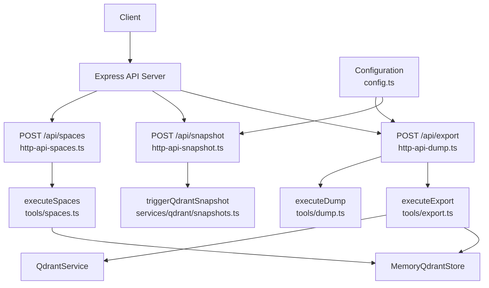
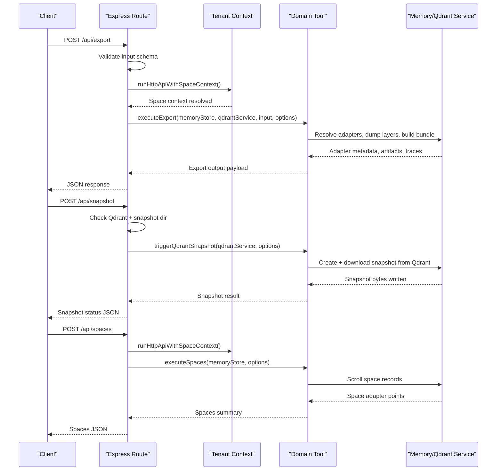
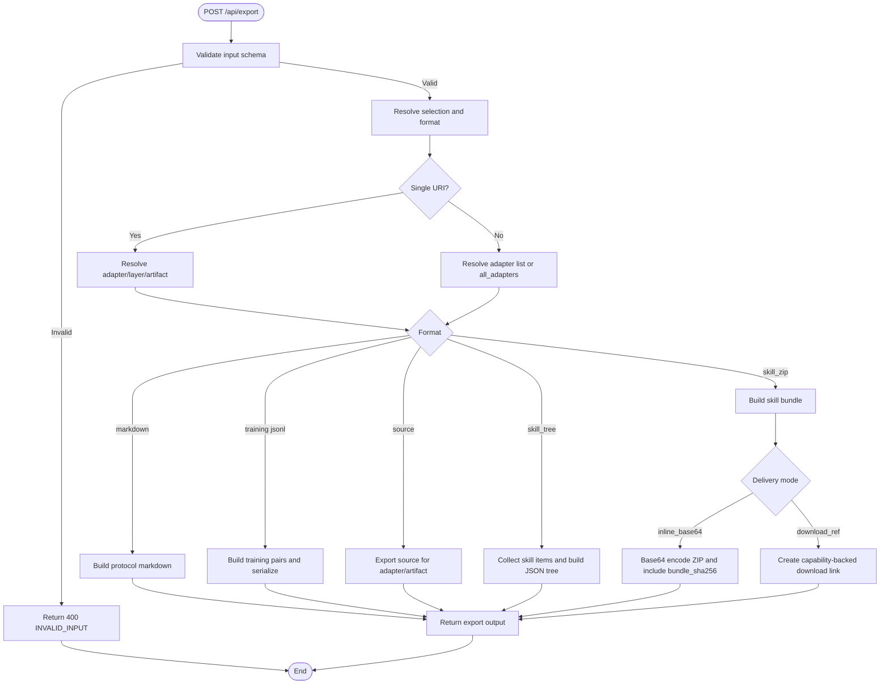
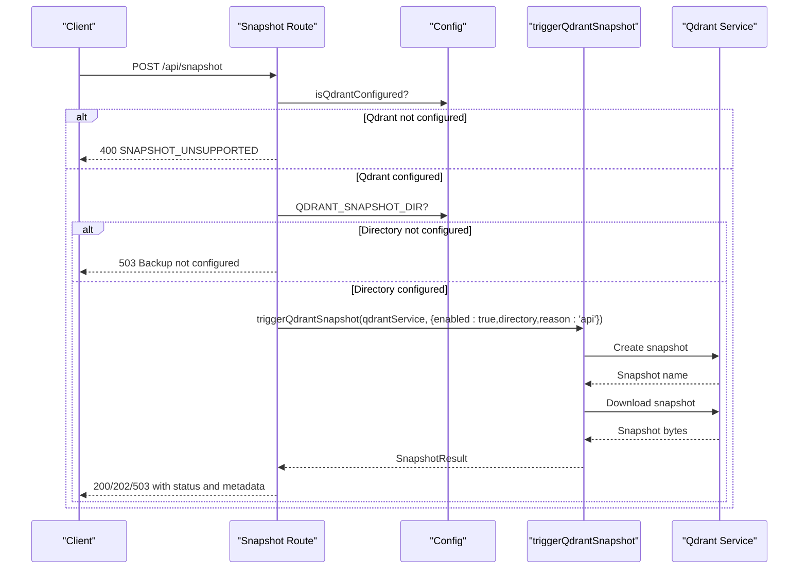
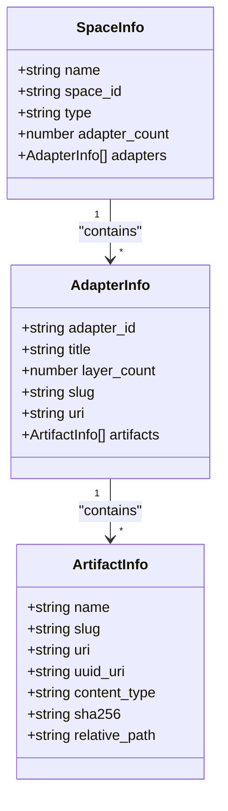
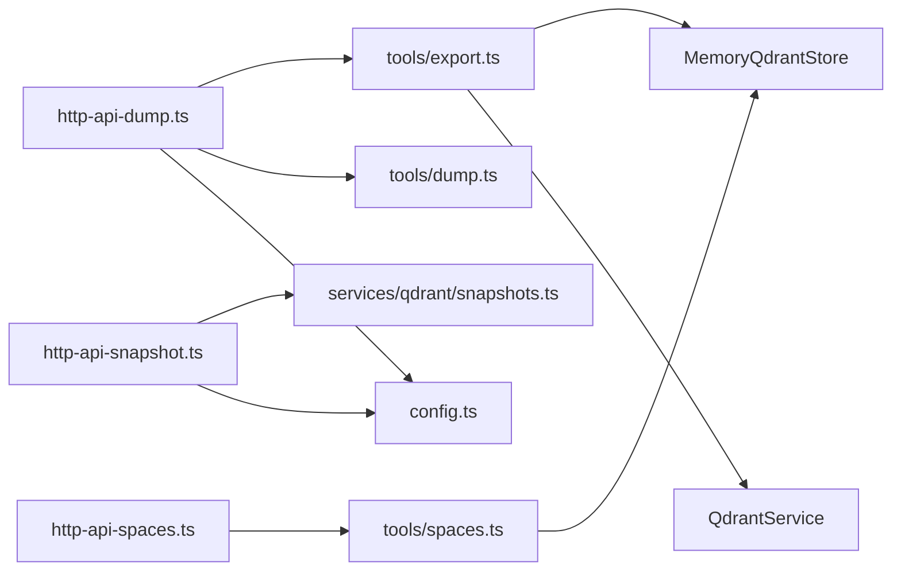

# Administration Endpoints

<cite>
**Referenced Files in This Document**
- [http-api-dump.ts](file://src/http/http-api-dump.ts)
- [http-api-snapshot.ts](file://src/http/http-api-snapshot.ts)
- [http-api-spaces.ts](file://src/http/http-api-spaces.ts)
- [export.ts](file://src/tools/export.ts)
- [export_schema.ts](file://src/tools/export_schema.ts)
- [dump.ts](file://src/tools/dump.ts)
- [spaces.ts](file://src/tools/spaces.ts)
- [snapshots.ts](file://src/services/qdrant/snapshots.ts)
- [config.ts](file://src/config.ts)
</cite>

## Table of Contents
1. [Introduction](#introduction)
2. [Project Structure](#project-structure)
3. [Core Components](#core-components)
4. [Architecture Overview](#architecture-overview)
5. [Detailed Component Analysis](#detailed-component-analysis)
6. [Dependency Analysis](#dependency-analysis)
7. [Performance Considerations](#performance-considerations)
8. [Troubleshooting Guide](#troubleshooting-guide)
9. [Conclusion](#conclusion)

## Introduction
This document describes the administrative REST endpoints used for system management and data operations:

- `/api/export` (documented as the dump endpoint): exports adapter metadata, artifacts, training data, and skill bundles.
- `/api/snapshot`: creates Qdrant vector-store snapshots for backup and disaster recovery.
- `/api/spaces`: lists spaces and adapters for multi-tenant administration.

The endpoints are implemented on top of Express handlers that delegate to tooling services, memory stores, and the Qdrant service. The project is an agent-first MCP framework where adapters provide deterministic task execution, and administrators use these endpoints to export, back up, and manage tenant-scoped resources.

## Project Structure
The administrative endpoints live under `src/http`, with business logic delegated to `src/tools` and persistence/infrastructure code under `src/services`. Configuration is centralized in `src/config.ts`.

**Diagram sources**
- [http-api-dump.ts:19-60](file://src/http/http-api-dump.ts#L19-L60)
- [http-api-snapshot.ts:14-52](file://src/http/http-api-snapshot.ts#L14-L52)
- [http-api-spaces.ts:11-30](file://src/http/http-api-spaces.ts#L11-L30)
- [export.ts:67-345](file://src/tools/export.ts#L67-L345)
- [dump.ts:96-179](file://src/tools/dump.ts#L96-L179)
- [spaces.ts:172-188](file://src/tools/spaces.ts#L172-L188)
- [snapshots.ts:68-168](file://src/services/qdrant/snapshots.ts#L68-L168)
- [config.ts:268-277](file://src/config.ts#L268-L277)

**Section sources**
- [http-api-dump.ts:19-60](file://src/http/http-api-dump.ts#L19-L60)
- [http-api-snapshot.ts:14-52](file://src/http/http-api-snapshot.ts#L14-L52)
- [http-api-spaces.ts:11-30](file://src/http/http-api-spaces.ts#L11-L30)
- [export.ts:67-345](file://src/tools/export.ts#L67-L345)
- [dump.ts:96-179](file://src/tools/dump.ts#L96-L179)
- [spaces.ts:172-188](file://src/tools/spaces.ts#L172-L188)
- [snapshots.ts:68-168](file://src/services/qdrant/snapshots.ts#L68-L168)
- [config.ts:268-277](file://src/config.ts#L268-L277)

## Core Components
- `/api/export` handler validates input using a Zod schema, resolves space context, and delegates to `executeExport`. It supports multiple export formats and large dataset handling through directory writes or capability-backed downloads.
- `/api/snapshot` handler checks whether Qdrant is configured and whether a snapshot directory is set, then triggers a server-side Qdrant snapshot.
- `/api/spaces` handler reads the current request’s space context and returns space summaries, optionally including adapter titles and artifact metadata.

Key responsibilities:
- Input validation and error mapping.
- Space-aware execution via tenant context.
- Delegation to domain tools for export, listing, and snapshotting.
- Structured logging and metrics integration.

**Section sources**
- [http-api-dump.ts:19-60](file://src/http/http-api-dump.ts#L19-L60)
- [http-api-snapshot.ts:14-52](file://src/http/http-api-snapshot.ts#L14-L52)
- [http-api-spaces.ts:11-30](file://src/http/http-api-spaces.ts#L11-L30)
- [export_schema.ts:44-117](file://src/tools/export_schema.ts#L44-L117)

## Architecture Overview
The administrative endpoints follow a consistent pattern:

1. Express route receives the request.
2. Request body is validated against schemas.
3. Tenant/space context is applied.
4. Domain tool functions perform the actual work.
5. Responses include structured metadata such as format, content type, item counts, and optional download references.

**Diagram sources**
- [http-api-dump.ts:24-49](file://src/http/http-api-dump.ts#L24-L49)
- [http-api-snapshot.ts:15-51](file://src/http/http-api-snapshot.ts#L15-L51)
- [http-api-spaces.ts:12-24](file://src/http/http-api-spaces.ts#L12-L24)
- [export.ts:67-345](file://src/tools/export.ts#L67-L345)
- [snapshots.ts:68-168](file://src/services/qdrant/snapshots.ts#L68-L168)
- [spaces.ts:172-188](file://src/tools/spaces.ts#L172-L188)

## Detailed Component Analysis

### `/api/export` (Dump Endpoint)
The dump endpoint is exposed as `POST /api/export`. It validates the request body, applies space context, and calls `executeExport`.

Request schema
- Selection modes (exactly one required):
  - `uri`: single adapter, layer, or artifact URI.
  - `adapters`: array of adapter URIs (max 256).
  - `all_adapters`: boolean; requires `space_name`.
- Format:
  - `markdown`: flat markdown for a single adapter.
  - `trace_jsonl`, `reward_jsonl`, `sft_jsonl`, `preference_jsonl`: training datasets for a single adapter.
  - `source`: source export for a single adapter or artifact.
  - `skill_tree`: JSON tree of skills and files.
  - `skill_zip`: ZIP bundle of skills.
- Delivery (only valid with `skill_zip`):
  - `download_ref`: short-lived capability URL.
  - `inline_base64`: base64-encoded ZIP in response.
- Optional flags:
  - `include_reward`: include reward data for training formats.
  - `directory`: absolute path for per-adapter markdown writes when exporting multiple adapters.

Response fields
- Common:
  - `uri`, `format`, `content_type`, `content`, `item_count`.
- Metadata:
  - `adapter_name`, `adapter_version`.
- Space fields (when present):
  - `space_id`, `space_name`, `space_type`.
- Large dataset support:
  - `content_encoding`: `base64` when content is encoded.
  - `bundle_sha256`: SHA-256 of decoded export bytes.
  - `export_adapter_count`: number of adapters in a multi-export bundle.
  - `skill_bundle_manifest`: compact manifest JSON string.
  - `download_ref`: `{ url, expires_at, filename?, content_type? }`.
  - `directory_manifest`: per-file write results when `directory` is used.

Error behavior
- Invalid input returns 400 with `INVALID_INPUT`.
- Not found returns 404 with `NOT_FOUND`.
- Other failures return 500 with `EXPORT_FAILED`.

Large dataset handling
- For `skill_zip` without `inline_base64`, the response includes a capability-backed download reference instead of embedding large binary content.
- For multi-adapter `markdown`, writing to a filesystem directory avoids large in-memory payloads and returns a manifest of written files.

Automated export strategies
- Use `format: skill_zip` with `delivery: download_ref` for automated pipelines that fetch the ZIP later.
- Use `format: markdown` with `directory` for bulk adapter documentation generation.
- Use training JSONL formats for downstream model fine-tuning workflows.

**Diagram sources**
- [http-api-dump.ts:24-49](file://src/http/http-api-dump.ts#L24-L49)
- [export.ts:67-345](file://src/tools/export.ts#L67-L345)
- [export_schema.ts:44-117](file://src/tools/export_schema.ts#L44-L117)

**Section sources**
- [http-api-dump.ts:19-60](file://src/http/http-api-dump.ts#L19-L60)
- [export.ts:67-345](file://src/tools/export.ts#L67-L345)
- [export_schema.ts:22-162](file://src/tools/export_schema.ts#L22-L162)
- [dump.ts:96-179](file://src/tools/dump.ts#L96-L179)

### `/api/snapshot` (Backup and Recovery)
The snapshot endpoint triggers a server-side Qdrant snapshot. It is not supported on embedded LanceDB backends.

Behavior
- If Qdrant is not configured, returns 400 with `SNAPSHOT_UNSUPPORTED`.
- If snapshot directory is not configured, returns 503 with `Backup not configured`.
- Otherwise, creates a snapshot, downloads it, and writes it to the configured directory.

Response fields
- `status`: `completed`, `skipped`, or `failed`.
- `target`: `qdrant`.
- `snapshotName`: name returned by Qdrant.
- `bytesWritten`: number of bytes written to disk.
- `durationMs`: elapsed time in milliseconds.
- `message`: human-readable status message.

Disaster recovery procedure
- Ensure `QDRANT_URL` is set so Qdrant is configured.
- Set `QDRANT_SNAPSHOT_DIR` to an absolute or resolvable directory.
- Call `POST /api/snapshot` periodically or before maintenance.
- On failure, inspect logs and verify Qdrant connectivity and permissions.
- Restore by using Qdrant’s snapshot restore process with the downloaded `.snapshot` file.

**Diagram sources**
- [http-api-snapshot.ts:14-52](file://src/http/http-api-snapshot.ts#L14-L52)
- [snapshots.ts:68-168](file://src/services/qdrant/snapshots.ts#L68-L168)
- [config.ts:268-277](file://src/config.ts#L268-L277)

**Section sources**
- [http-api-snapshot.ts:14-52](file://src/http/http-api-snapshot.ts#L14-L52)
- [snapshots.ts:68-168](file://src/services/qdrant/snapshots.ts#L68-L168)
- [config.ts:268-277](file://src/config.ts#L268-L277)

### `/api/spaces` (Multi-Tenancy Management)
The spaces endpoint lists available spaces and adapter counts based on the current request’s space context. It can optionally include adapter titles and artifact metadata.

Request fields
- `include_adapter_titles`: boolean; includes adapter title, layer count, slug, and URI per adapter.
- `include_artifacts`: boolean; includes artifact metadata per adapter point.

Response structure
- `spaces`: array of space summaries.
- Each space includes:
  - `name`: human-readable space name.
  - `space_id`: internal space identifier.
  - `type`: `personal`, `group`, `app`, or `other`.
  - `adapter_count`: number of distinct adapters in the space.
  - `adapters`: optional array of adapter info when requested.
  - Each adapter info includes:
    - `adapter_id`, `title`, `layer_count`, `slug`, `uri`.
    - `artifacts`: optional array of artifact metadata when requested.

Multi-tenant workflow
- The endpoint respects the authenticated user’s allowed spaces.
- Administrators can enumerate spaces and adapter inventories across tenants.
- Artifact metadata enables auditing and verification of exported assets.

**Diagram sources**
- [spaces.ts:25-48](file://src/tools/spaces.ts#L25-L48)
- [spaces.ts:65-166](file://src/tools/spaces.ts#L65-L166)

**Section sources**
- [http-api-spaces.ts:11-30](file://src/http/http-api-spaces.ts#L11-L30)
- [spaces.ts:172-188](file://src/tools/spaces.ts#L172-L188)
- [spaces.ts:25-48](file://src/tools/spaces.ts#L25-L48)
- [spaces.ts:65-166](file://src/tools/spaces.ts#L65-L166)

## Dependency Analysis
The administrative endpoints depend on:

- Express routes for request handling and validation.
- Tenant context utilities for space scoping.
- Memory store for adapter and artifact metadata.
- Qdrant service for vector-store operations and snapshot creation.
- Configuration module for runtime settings such as snapshot directory and backend detection.

**Diagram sources**
- [http-api-dump.ts:19-60](file://src/http/http-api-dump.ts#L19-L60)
- [http-api-snapshot.ts:14-52](file://src/http/http-api-snapshot.ts#L14-L52)
- [http-api-spaces.ts:11-30](file://src/http/http-api-spaces.ts#L11-L30)
- [export.ts:67-345](file://src/tools/export.ts#L67-L345)
- [dump.ts:96-179](file://src/tools/dump.ts#L96-L179)
- [spaces.ts:172-188](file://src/tools/spaces.ts#L172-L188)
- [snapshots.ts:68-168](file://src/services/qdrant/snapshots.ts#L68-L168)
- [config.ts:268-277](file://src/config.ts#L268-L277)

**Section sources**
- [http-api-dump.ts:19-60](file://src/http/http-api-dump.ts#L19-L60)
- [http-api-snapshot.ts:14-52](file://src/http/http-api-snapshot.ts#L14-L52)
- [http-api-spaces.ts:11-30](file://src/http/http-api-spaces.ts#L11-L30)
- [export.ts:67-345](file://src/tools/export.ts#L67-L345)
- [dump.ts:96-179](file://src/tools/dump.ts#L96-L179)
- [spaces.ts:172-188](file://src/tools/spaces.ts#L172-L188)
- [snapshots.ts:68-168](file://src/services/qdrant/snapshots.ts#L68-L168)
- [config.ts:268-277](file://src/config.ts#L268-L277)

## Performance Considerations
- Export size:
  - Prefer `skill_zip` with `delivery: download_ref` for large bundles to avoid embedding binary content in responses.
  - Use `directory` for bulk markdown exports to stream files to disk rather than returning large payloads.
- Validation limits:
  - Maximum 256 adapters per export selection.
  - Training formats require a single adapter URI.
- Snapshot performance:
  - Snapshot duration and bytes written are reported; monitor for slow Qdrant connections or large collections.
- Space enumeration:
  - The spaces endpoint scrolls space records with a scroll limit; large spaces may incur latency proportional to record count.

[No sources needed since this section provides general guidance]

## Troubleshooting Guide
Common issues and resolutions:

- `/api/export` returns `INVALID_INPUT`:
  - Ensure exactly one selection mode is provided: `uri`, non-empty `adapters`, or `all_adapters: true` with `space_name`.
  - For training formats or `source`, provide a single `uri`.
  - For `format: markdown` with multiple adapters, provide `directory`.

- `/api/export` returns `NOT_FOUND`:
  - Verify the adapter or layer URI exists in the current space context.

- `/api/export` returns `EXPORT_FAILED`:
  - Inspect logs for underlying errors during adapter resolution, dump building, or bundle creation.

- `/api/snapshot` returns `SNAPSHOT_UNSUPPORTED`:
  - The server is running with embedded LanceDB; server-side snapshots require Qdrant. Back up the data directory manually.

- `/api/snapshot` returns `Backup not configured`:
  - Set `QDRANT_SNAPSHOT_DIR` to an absolute or resolvable directory.

- `/api/spaces` returns empty or incomplete data:
  - Confirm the authenticated user has access to the expected spaces.
  - Use `include_adapter_titles` or `include_artifacts` to enrich the response.

**Section sources**
- [http-api-dump.ts:24-59](file://src/http/http-api-dump.ts#L24-L59)
- [http-api-snapshot.ts:15-51](file://src/http/http-api-snapshot.ts#L15-L51)
- [http-api-spaces.ts:12-29](file://src/http/http-api-spaces.ts#L12-L29)
- [export_schema.ts:44-117](file://src/tools/export_schema.ts#L44-L117)

## Conclusion
The administrative endpoints provide robust capabilities for exporting system data, creating backups, and managing multi-tenant spaces:

- `/api/export` supports flexible export formats, large dataset handling, and capability-backed downloads.
- `/api/snapshot` integrates with Qdrant for reliable vector-store backups and disaster recovery.
- `/api/spaces` exposes tenant-scoped inventory information for administration and auditing.

Operational best practices include using capability-backed downloads for large exports, configuring snapshot directories for Qdrant, and leveraging space context for secure multi-tenant operations.

[No sources needed since this section summarizes without analyzing specific files]