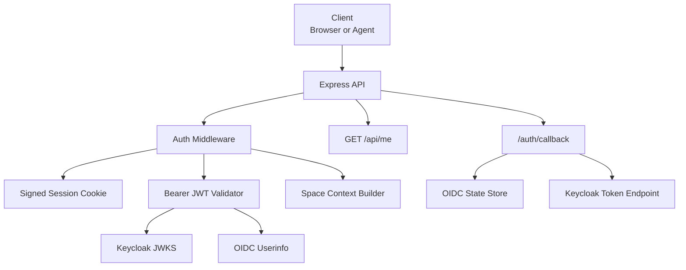
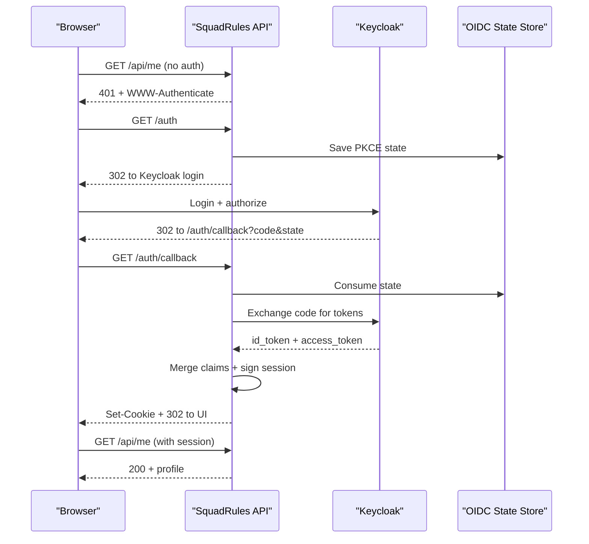
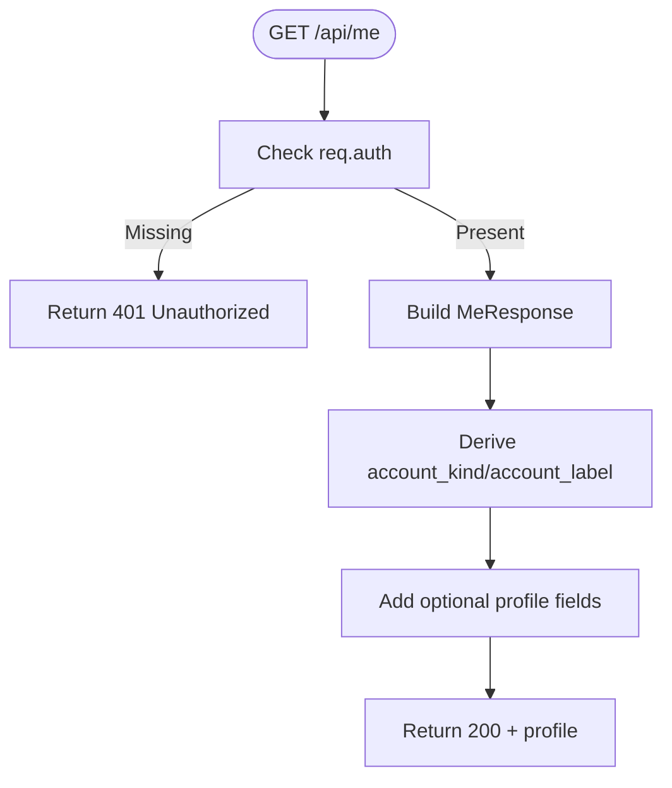
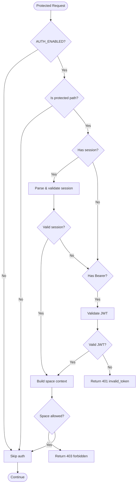
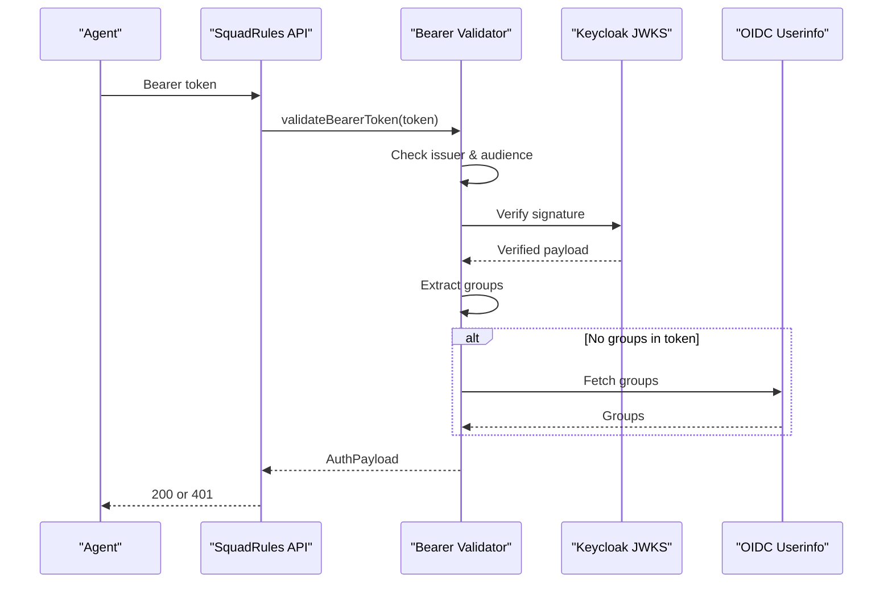
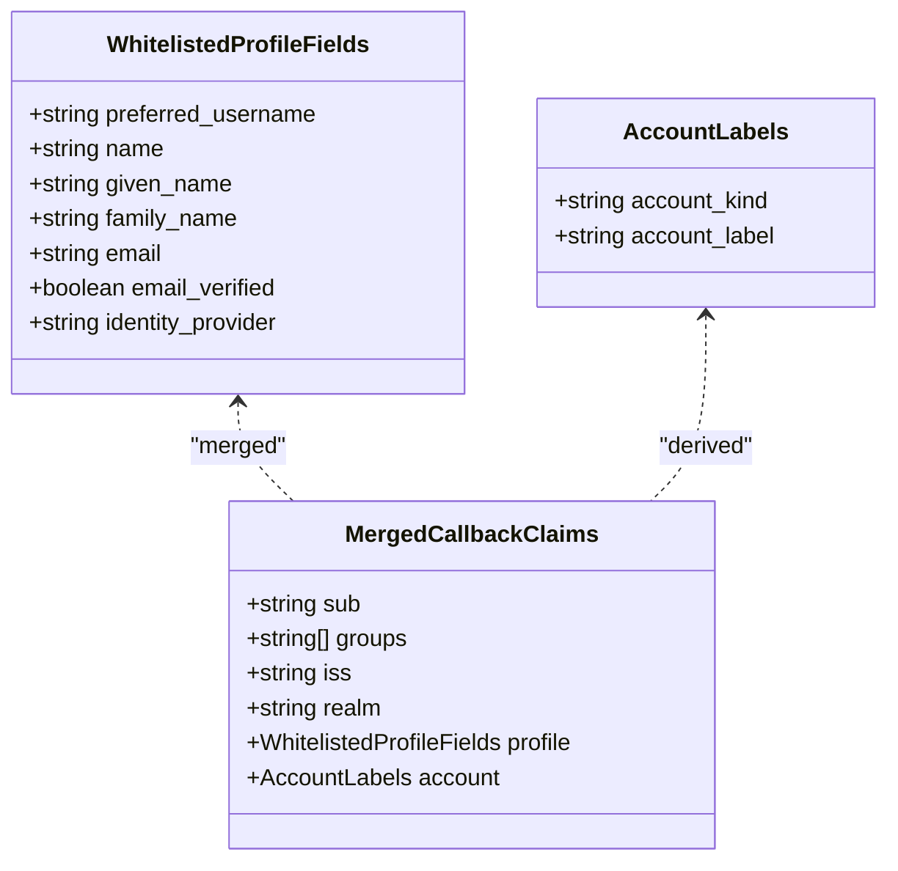
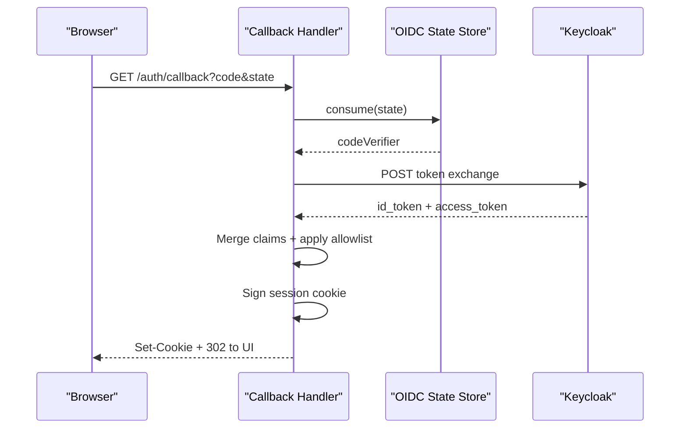
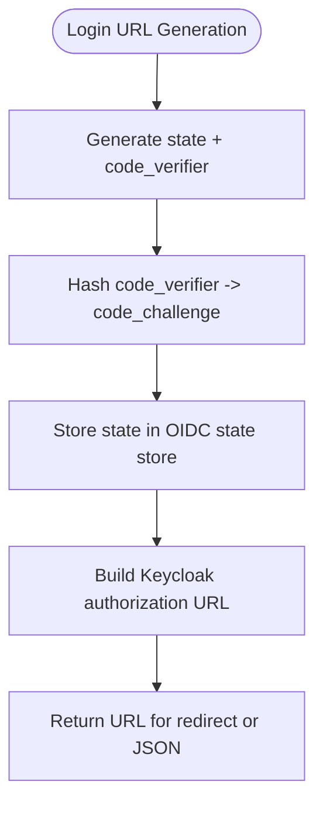
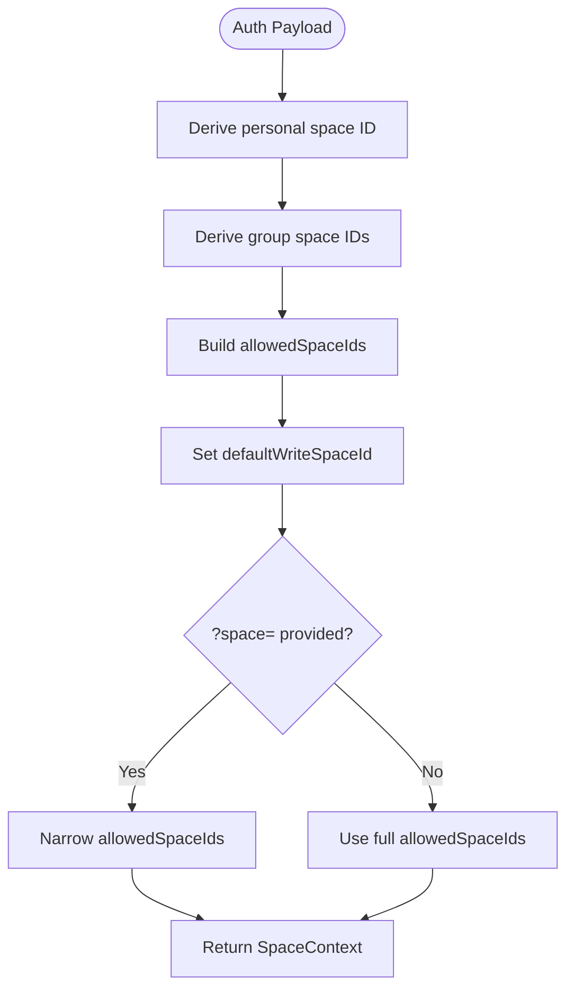
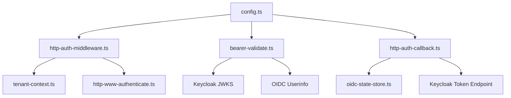

# Authentication Endpoints

<cite>
**Referenced Files in This Document**
- [http-api-me.ts](file://src/http/http-api-me.ts)
- [me-response.ts](file://src/me-response.ts)
- [http-auth-middleware.ts](file://src/http/http-auth-middleware.ts)
- [bearer-validate.ts](file://src/http/bearer-validate.ts)
- [oidc-profile-claims.ts](file://src/http/oidc-profile-claims.ts)
- [http-auth-callback.ts](file://src/http/http-auth-callback.ts)
- [http-auth-oidc-redirect.ts](file://src/http/http-auth-oidc-redirect.ts)
- [oidc-state-store.ts](file://src/services/oidc-state-store.ts)
- [tenant-context.ts](file://src/utils/tenant-context.ts)
- [http-www-authenticate.ts](file://src/http/http-www-authenticate.ts)
- [oauth-refresh.ts](file://src/cli/oauth-refresh.ts)
- [config.ts](file://src/config.ts)
- [threat-model.md](file://docs/security/threat-model.md)
</cite>

## Table of Contents
1. [Introduction](#introduction)
2. [Project Structure](#project-structure)
3. [Core Components](#core-components)
4. [Architecture Overview](#architecture-overview)
5. [Detailed Component Analysis](#detailed-component-analysis)
6. [Dependency Analysis](#dependency-analysis)
7. [Performance Considerations](#performance-considerations)
8. [Troubleshooting Guide](#troubleshooting-guide)
9. [Conclusion](#conclusion)
10. [Appendices](#appendices)

## Introduction
This document explains SquadRules authentication for HTTP and MCP endpoints, focusing on:
- The `/api/me` endpoint for retrieving the authenticated user profile.
- Browser-based OIDC login with PKCE via Keycloak.
- Bearer JWT validation for machine-to-machine or agent access.
- Space-based authorization context derived from Keycloak groups and realm.
- Token expiration handling, refresh token flows, and security considerations.

SquadRules supports two primary authentication paths:
- **Browser session flow**: Redirects to Keycloak, exchanges an authorization code for tokens, stores a signed session cookie, and uses that cookie for subsequent requests.
- **Bearer token flow**: Validates a JWT access token against trusted issuers and allowed audiences, optionally enriching group membership through the OIDC userinfo endpoint.

The system is designed for both human users (browser sessions) and agents (Bearer tokens), while enforcing multi-tenant space isolation based on `sub`, `groups`, `realm`, and issuer.

## Project Structure
Authentication-related code is split across HTTP handlers, OIDC utilities, bearer validation, tenant context, and CLI refresh helpers:



**Diagram sources**
- [http-auth-middleware.ts:172-327](file://src/http/http-auth-middleware.ts#L172-L327)
- [bearer-validate.ts:120-208](file://src/http/bearer-validate.ts#L120-L208)
- [http-api-me.ts:31-39](file://src/http/http-api-me.ts#L31-L39)
- [http-auth-callback.ts:122-229](file://src/http/http-auth-callback.ts#L122-L229)
- [oidc-state-store.ts:50-61](file://src/services/oidc-state-store.ts#L50-L61)

**Section sources**
- [http-api-me.ts:1-41](file://src/http/http-api-me.ts#L1-L41)
- [http-auth-middleware.ts:1-330](file://src/http/http-auth-middleware.ts#L1-L330)
- [bearer-validate.ts:1-209](file://src/http/bearer-validate.ts#L1-L209)
- [http-auth-callback.ts:1-231](file://src/http/http-auth-callback.ts#L1-L231)
- [oidc-state-store.ts:1-76](file://src/services/oidc-state-store.ts#L1-L76)
- [tenant-context.ts:1-312](file://src/utils/tenant-context.ts#L1-L312)

## Core Components
- **`/api/me` handler**: Returns a whitelisted user profile derived from either a valid session or a validated Bearer token.
- **Auth middleware**: Enforces authentication for protected paths, handles browser redirects, validates Bearer tokens, and builds space context.
- **Bearer validator**: Verifies JWT issuer, audience, expiration, and signature using JWKS; optionally fetches groups from userinfo.
- **OIDC callback**: Exchanges authorization codes for tokens, merges id_token and access_token claims, signs a session cookie, and sets TTL.
- **OIDC redirect helpers**: Build PKCE authorization URLs, end-session URLs, and JSON login URLs for clients.
- **OIDC state store**: Stores PKCE state with TTL using Redis when available, otherwise in-memory.
- **Tenant context**: Derives personal and group spaces from `sub`, `groups`, `realm`, and issuer; enforces space isolation.
- **WWW-Authenticate helper**: Builds RFC-compliant challenge headers for MCP clients.
- **OAuth refresh helper**: Discovers token endpoints and exchanges refresh tokens for new access tokens.

**Section sources**
- [http-api-me.ts:6-39](file://src/http/http-api-me.ts#L6-L39)
- [me-response.ts:1-20](file://src/me-response.ts#L1-L20)
- [http-auth-middleware.ts:35-133](file://src/http/http-auth-middleware.ts#L35-L133)
- [bearer-validate.ts:22-39](file://src/http/bearer-validate.ts#L22-L39)
- [http-auth-callback.ts:34-67](file://src/http/http-auth-callback.ts#L34-L67)
- [http-auth-oidc-redirect.ts:15-92](file://src/http/http-auth-oidc-redirect.ts#L15-L92)
- [oidc-state-store.ts:16-76](file://src/services/oidc-state-store.ts#L16-L76)
- [tenant-context.ts:23-42](file://src/utils/tenant-context.ts#L23-L42)
- [http-www-authenticate.ts:18-47](file://src/http/http-www-authenticate.ts#L18-L47)
- [oauth-refresh.ts:26-96](file://src/cli/oauth-refresh.ts#L26-L96)

## Architecture Overview
The authentication architecture combines browser-based OIDC login and server-side JWT validation:



**Diagram sources**
- [http-auth-middleware.ts:297-326](file://src/http/http-auth-middleware.ts#L297-L326)
- [http-auth-oidc-redirect.ts:52-78](file://src/http/http-auth-oidc-redirect.ts#L52-L78)
- [http-auth-callback.ts:122-229](file://src/http/http-auth-callback.ts#L122-L229)
- [oidc-state-store.ts:50-61](file://src/services/oidc-state-store.ts#L50-L61)

## Detailed Component Analysis

### `/api/me` Endpoint
The `/api/me` endpoint returns a minimal, whitelisted user profile. It requires authentication and returns a structured response including subject, groups, realm, identity provider, and account labels.

Key behaviors:
- Requires `req.auth` set by middleware.
- Falls back to deriving `account_kind` and `account_label` from `identity_provider`.
- Omits optional fields if not present in the auth payload.
- Returns `401 Unauthorized` when unauthenticated.



**Diagram sources**
- [http-api-me.ts:6-39](file://src/http/http-api-me.ts#L6-L39)

**Section sources**
- [http-api-me.ts:6-39](file://src/http/http-api-me.ts#L6-L39)
- [me-response.ts:4-19](file://src/me-response.ts#L4-L19)

### Authentication Middleware Flow
The middleware enforces authentication for protected paths (`/api`, `/mcp`, `/ui`). It supports:
- Session cookies for browser flows.
- Bearer tokens for agent/MCP flows.
- Browser redirects to Keycloak for unauthenticated GET requests.
- JSON `401` responses with `login_url` for non-browser clients.
- Space context derivation and validation.



**Diagram sources**
- [http-auth-middleware.ts:172-327](file://src/http/http-auth-middleware.ts#L172-L327)
- [tenant-context.ts:256-291](file://src/utils/tenant-context.ts#L256-L291)

**Section sources**
- [http-auth-middleware.ts:151-160](file://src/http/http-auth-middleware.ts#L151-L160)
- [http-auth-middleware.ts:172-327](file://src/http/http-auth-middleware.ts#L172-L327)
- [http-www-authenticate.ts:18-47](file://src/http/http-www-authenticate.ts#L18-L47)

### Bearer JWT Validation
Bearer tokens are validated using:
- Trusted issuer check.
- Allowed audience check.
- Expiration check.
- Signature verification via JWKS.
- Optional userinfo call to merge groups.



**Diagram sources**
- [bearer-validate.ts:120-208](file://src/http/bearer-validate.ts#L120-L208)

**Section sources**
- [bearer-validate.ts:41-59](file://src/http/bearer-validate.ts#L41-L59)
- [bearer-validate.ts:70-100](file://src/http/bearer-validate.ts#L70-L100)
- [bearer-validate.ts:120-208](file://src/http/bearer-validate.ts#L120-L208)

### OIDC Profile Claims Mapping
Profile claims are whitelisted to prevent leaking arbitrary JWT fields. The system maps:
- `preferred_username`, `name`, `given_name`, `family_name`, `email`, `email_verified`, `identity_provider`.
- Derives `account_kind` and `account_label` from `identity_provider`.
- Normalizes group paths and applies allowlist filtering.



**Diagram sources**
- [oidc-profile-claims.ts:24-54](file://src/http/oidc-profile-claims.ts#L24-L54)
- [oidc-profile-claims.ts:163-190](file://src/http/oidc-profile-claims.ts#L163-L190)

**Section sources**
- [oidc-profile-claims.ts:56-95](file://src/http/oidc-profile-claims.ts#L56-L95)
- [oidc-profile-claims.ts:119-153](file://src/http/oidc-profile-claims.ts#L119-L153)
- [oidc-profile-claims.ts:163-190](file://src/http/oidc-profile-claims.ts#L163-L190)
- [oidc-profile-claims.ts:200-256](file://src/http/oidc-profile-claims.ts#L200-L256)

### OIDC Callback and Session Handling
The callback exchanges the authorization code for tokens, merges claims, and sets a signed session cookie:
- Validates state from PKCE.
- Exchanges code for `id_token` and `access_token`.
- Merges claims with precedence rules.
- Applies group allowlist.
- Sets session TTL based on token expiration or fallback.



**Diagram sources**
- [http-auth-callback.ts:122-229](file://src/http/http-auth-callback.ts#L122-L229)
- [oidc-state-store.ts:50-61](file://src/services/oidc-state-store.ts#L50-L61)

**Section sources**
- [http-auth-callback.ts:34-67](file://src/http/http-auth-callback.ts#L34-L67)
- [http-auth-callback.ts:122-229](file://src/http/http-auth-callback.ts#L122-L229)

### OIDC Redirect Helpers
Helpers build:
- Authorization URLs with PKCE.
- End-session URLs for logout.
- JSON login URLs for API responses.



**Diagram sources**
- [http-auth-oidc-redirect.ts:52-78](file://src/http/http-auth-oidc-redirect.ts#L52-L78)

**Section sources**
- [http-auth-oidc-redirect.ts:15-32](file://src/http/http-auth-oidc-redirect.ts#L15-L32)
- [http-auth-oidc-redirect.ts:38-50](file://src/http/http-auth-oidc-redirect.ts#L38-L50)
- [http-auth-oidc-redirect.ts:52-92](file://src/http/http-auth-oidc-redirect.ts#L52-L92)

### Space-Based Authorization Context
Space context is derived from:
- `sub`: Personal space ID.
- `groups`: Group space IDs.
- `realm` and `iss`: Deterministic space ID generation.
- Query parameter `space` or `space_id`: Narrows allowed spaces.



**Diagram sources**
- [tenant-context.ts:217-248](file://src/utils/tenant-context.ts#L217-L248)
- [http-auth-middleware.ts:196-220](file://src/http/http-auth-middleware.ts#L196-L220)

**Section sources**
- [tenant-context.ts:23-42](file://src/utils/tenant-context.ts#L23-L42)
- [tenant-context.ts:217-248](file://src/utils/tenant-context.ts#L217-L248)
- [tenant-context.ts:256-291](file://src/utils/tenant-context.ts#L256-L291)

## Dependency Analysis
Authentication components depend on configuration, external services, and internal utilities:



**Diagram sources**
- [config.ts:141-195](file://src/config.ts#L141-L195)
- [bearer-validate.ts:120-208](file://src/http/bearer-validate.ts#L120-L208)
- [http-auth-callback.ts:122-229](file://src/http/http-auth-callback.ts#L122-L229)
- [http-auth-middleware.ts:172-327](file://src/http/http-auth-middleware.ts#L172-L327)

**Section sources**
- [config.ts:141-195](file://src/config.ts#L141-L195)
- [bearer-validate.ts:120-208](file://src/http/bearer-validate.ts#L120-L208)
- [http-auth-callback.ts:122-229](file://src/http/http-auth-callback.ts#L122-L229)
- [http-auth-middleware.ts:172-327](file://src/http/http-auth-middleware.ts#L172-L327)

## Performance Considerations
- **JWKS caching**: JWKS keys are cached per issuer to avoid repeated network calls.
- **Userinfo fallback**: Groups are fetched from userinfo only when missing from the token, with an 8-second timeout.
- **Session TTL optimization**: Session max age is derived from token expiration when possible, reducing unnecessary re-authentication.
- **AsyncLocalStorage**: Space context is propagated efficiently without request object passing.

[No sources needed since this section provides general guidance]

## Troubleshooting Guide
Common issues and resolutions:
- **401 Unauthorized**: Missing or invalid session/Bearer token. Check `AUTH_ENABLED`, `SESSION_SECRET`, and Keycloak configuration.
- **invalid_token**: Expired or malformed JWT. Re-authenticate or reconnect MCP client.
- **forbidden**: Requested space not in allowed spaces. Verify group membership and `OIDC_GROUPS_ALLOWLIST`.
- **Auth misconfigured**: Missing `AUTH_CALLBACK_BASE_URL` or Keycloak settings. Ensure all required environment variables are set.
- **Bearer not validated**: `AUTH_TRUSTED_ISSUERS` and `AUTH_ALLOWED_AUDIENCES` not configured. Set these for Bearer validation.

**Section sources**
- [http-auth-middleware.ts:243-251](file://src/http/http-auth-middleware.ts#L243-L251)
- [http-auth-middleware.ts:289-295](file://src/http/http-auth-middleware.ts#L289-L295)
- [http-auth-callback.ts:122-129](file://src/http/http-auth-callback.ts#L122-L129)

## Conclusion
SquadRules authentication combines browser-based OIDC login and server-side JWT validation to support both human and agent workflows. The `/api/me` endpoint provides a consistent user profile, while space-based authorization ensures multi-tenant isolation. Security is enforced through JWKS validation, group allowlists, and strict session handling. Clients should handle token expiration, refresh flows, and error scenarios appropriately.

[No sources needed since this section summarizes without analyzing specific files]

## Appendices

### Request/Response Schemas

#### GET /api/me Response
```json
{
  "sub": "user-subject",
  "groups": ["group/path"],
  "realm": "squadrules-dev",
  "identity_provider": "keycloak",
  "account_kind": "local",
  "account_label": "Local",
  "preferred_username": "username",
  "name": "Full Name",
  "given_name": "First",
  "family_name": "Last",
  "email": "user@example.com",
  "email_verified": true
}
```

#### Error Responses
- **401 Unauthorized**:
  ```json
  {
    "error": "Unauthorized",
    "message": "Not authenticated"
  }
  ```
- **401 invalid_token**:
  ```json
  {
    "error": "invalid_token",
    "message": "Your SSO session or access token is no longer accepted.",
    "reauth_required": true,
    "login_url": "https://keycloak/.../protocol/openid-connect/auth"
  }
  ```
- **403 Forbidden**:
  ```json
  {
    "error": "forbidden",
    "message": "Requested space is not in your allowed spaces"
  }
  ```

### Token Structures
- **Access Token**: JWT with `iss`, `aud`, `exp`, `sub`, optional `groups`, `id_token`.
- **ID Token**: JWT with profile claims (`preferred_username`, `name`, `email`, etc.).
- **Refresh Token**: Opaque string exchanged for new access tokens.

### Security Considerations
- **JWT Validation**: Always verify issuer, audience, expiration, and signature.
- **Group Allowlist**: Restrict which groups become spaces using `OIDC_GROUPS_ALLOWLIST`.
- **Session Security**: Use HTTPS for secure cookies in production.
- **Token Expiration**: Handle `invalid_token` errors and prompt re-authentication.
- **Multi-Tenant Isolation**: Enforce space context derived from `sub`, `groups`, `realm`, and `iss`.

**Section sources**
- [bearer-validate.ts:120-208](file://src/http/bearer-validate.ts#L120-L208)
- [oidc-profile-claims.ts:119-153](file://src/http/oidc-profile-claims.ts#L119-L153)
- [tenant-context.ts:217-248](file://src/utils/tenant-context.ts#L217-L248)
- [threat-model.md:76-85](file://docs/security/threat-model.md#L76-L85)

### Client Implementation Examples

#### Human Authentication (Browser)
1. Call `/api/me`.
2. If `401`, redirect to `login_url` from `WWW-Authenticate` or response body.
3. Complete Keycloak login.
4. Receive session cookie.
5. Retry `/api/me` with cookie.

#### Agent Authentication (Bearer Token)
1. Obtain access token from Keycloak.
2. Include `Authorization: Bearer <token>` header.
3. Handle `401 invalid_token` by refreshing token or prompting re-login.
4. Use `login_url` for initial OAuth flow if needed.

#### Refresh Token Flow
1. Discover token endpoint from `/.well-known/oauth-protected-resource`.
2. POST `refresh_token` grant with `client_id`.
3. Handle new access token and optional rotated refresh token.

**Section sources**
- [http-auth-middleware.ts:297-326](file://src/http/http-auth-middleware.ts#L297-L326)
- [oauth-refresh.ts:26-96](file://src/cli/oauth-refresh.ts#L26-L96)