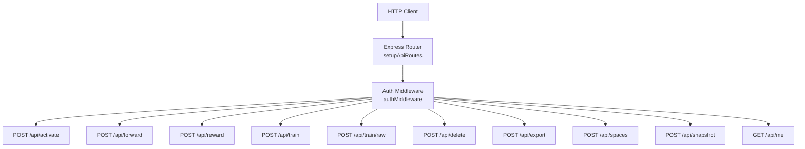
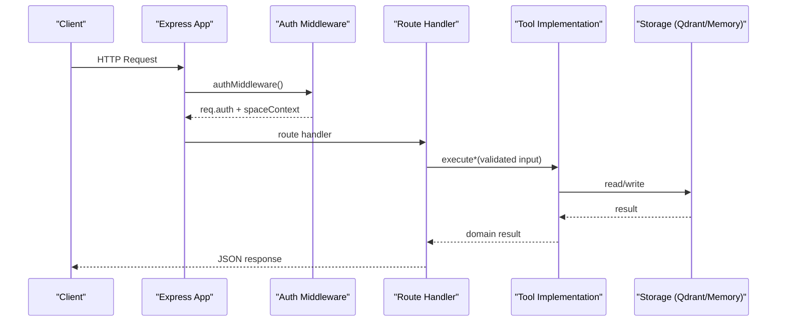
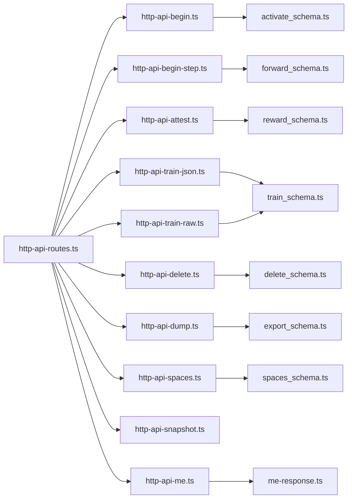

# HTTP REST API

<cite>
**Referenced Files in This Document**
- [http-api-routes.ts](file://src/http/http-api-routes.ts)
- [http-auth-middleware.ts](file://src/http/http-auth-middleware.ts)
- [bearer-validate.ts](file://src/http/bearer-validate.ts)
- [http-error-handlers.ts](file://src/http/http-error-handlers.ts)
- [http-api-begin.ts](file://src/http/http-api-begin.ts)
- [activate_schema.ts](file://src/tools/activate_schema.ts)
- [http-api-begin-step.ts](file://src/http/http-api-begin-step.ts)
- [forward_schema.ts](file://src/tools/forward_schema.ts)
- [http-api-attest.ts](file://src/http/http-api-attest.ts)
- [reward_schema.ts](file://src/tools/reward_schema.ts)
- [http-api-train-json.ts](file://src/http/http-api-train-json.ts)
- [train_schema.ts](file://src/tools/train_schema.ts)
- [http-api-train-raw.ts](file://src/http/http-api-train-raw.ts)
- [http-api-delete.ts](file://src/http/http-api-delete.ts)
- [delete_schema.ts](file://src/tools/delete_schema.ts)
- [http-api-dump.ts](file://src/http/http-api-dump.ts)
- [export_schema.ts](file://src/tools/export_schema.ts)
- [http-api-spaces.ts](file://src/http/http-api-spaces.ts)
- [spaces_schema.ts](file://src/tools/spaces_schema.ts)
- [http-api-snapshot.ts](file://src/http/http-api-snapshot.ts)
- [http-api-me.ts](file://src/http/http-api-me.ts)
- [me-response.ts](file://src/me-response.ts)
</cite>

## Table of Contents
1. Introduction
2. Project Structure
3. Core Components
4. Architecture Overview
5. Detailed Component Analysis
6. Dependency Analysis
7. Performance Considerations
8. Troubleshooting Guide
9. Conclusion

## Introduction
This document describes the SquadRules HTTP REST API surface under /api/*. It covers authentication, request/response schemas, validation rules, error handling, and operational endpoints for adapter lifecycle, workflow execution, multi-tenancy, snapshots, and user information. The API is built on Express and integrates with OIDC/JWT for authentication, Qdrant for vector storage, and Redis for runtime services.

Key concepts:
- Authentication supports session cookies (browser flows) and Bearer tokens (machine-to-machine).
- Space-based authorization scopes operations to a specific tenant space via query parameters or headers.
- The core agent workflow follows activate → forward → reward.

## Project Structure
The HTTP layer registers routes, applies authentication middleware, and delegates business logic to tool implementations.

**Diagram sources**
- [http-api-routes.ts:22-35](file://src/http/http-api-routes.ts#L22-L35)
- [http-auth-middleware.ts:172-220](file://src/http/http-auth-middleware.ts#L172-L220)

**Section sources**
- [http-api-routes.ts:1-36](file://src/http/http-api-routes.ts#L1-L36)

## Core Components
- Authentication middleware enforces session or Bearer auth for protected paths (/api/*, /mcp, /ui), sets req.auth, and resolves space context.
- Route handlers validate inputs using Zod schemas, call domain tools, and return standardized JSON responses.
- Global error handler normalizes errors and returns consistent payloads.

Authentication modes:
- Session cookie flow for browsers (OIDC redirect when needed).
- Bearer token flow for machine clients; validates issuer and audience against configured trusted issuers and allowed audiences.

Space-based authorization:
- Requests may include space= or space_id= query parameter to restrict operations to a single allowed space.
- If not provided, default write space is used based on user permissions.

Rate limiting:
- No explicit rate-limiting middleware is present in the referenced files. Use an external proxy or middleware if required.

**Section sources**
- [http-auth-middleware.ts:1-330](file://src/http/http-auth-middleware.ts#L1-L330)
- [bearer-validate.ts](file://src/http/bearer-validate.ts)
- [http-error-handlers.ts:1-53](file://src/http/http-error-handlers.ts#L1-L53)

## Architecture Overview
The API follows a layered design:
- HTTP layer: Express routes and middleware.
- Validation layer: Zod schemas per endpoint.
- Domain layer: Tool implementations (activate, forward, reward, train, delete, export, spaces).
- Storage layer: Qdrant service and memory store.

**Diagram sources**
- [http-api-routes.ts:22-35](file://src/http/http-api-routes.ts#L22-L35)
- [http-auth-middleware.ts:172-220](file://src/http/http-auth-middleware.ts#L172-L220)

## Detailed Component Analysis

### Authentication and Authorization
- Protected paths: /api, /api/*, /mcp, /ui, /ui/*.
- Browser GET without session redirects to OIDC login; other methods return 401 with WWW-Authenticate and a JSON body including login_url.
- Bearer tokens are validated only when trusted issuers and allowed audiences are configured; otherwise, bearer path is rejected with a clear message.
- Space scoping: If space or space_id is provided and belongs to allowed spaces, the request runs within that space context.

Common error responses:
- 401 Unauthorized: missing or invalid credentials.
- 403 Forbidden: requested space not allowed.
- 503 Service Unavailable: OIDC callback base URL misconfigured.

JWT/OIDC integration patterns:
- Session cookies carry signed payload with exp/sub/groups/realm/iss and optional profile fields.
- Bearer validation checks issuer and audience against configuration.

Security considerations:
- Do not expose sensitive claims beyond what is necessary.
- Always configure AUTH_TRUSTED_ISSUERS and AUTH_ALLOWED_AUDIENCES when enabling bearer validation.
- Enforce HTTPS in production and set appropriate CORS policies at the reverse proxy.

**Section sources**
- [http-auth-middleware.ts:1-330](file://src/http/http-auth-middleware.ts#L1-L330)
- [bearer-validate.ts](file://src/http/bearer-validate.ts)

### GET /api/me
Returns current user profile derived from session or Bearer token. Requires authentication.

Request:
- Method: GET
- Path: /api/me
- Headers: Authorization: Bearer <token> (optional if using session)

Response schema (MeResponse):
- sub: string
- groups: string[]
- realm: string
- account_kind: string
- account_label: string
- preferred_username?: string
- name?: string
- given_name?: string
- family_name?: string
- email?: string
- email_verified?: boolean
- identity_provider?: string

Status codes:
- 200 OK: success
- 401 Unauthorized: not authenticated

Example response:
{
  "sub": "user-id",
  "groups": ["group-a"],
  "realm": "default",
  "account_kind": "sso",
  "account_label": "example",
  "email": "user@example.com",
  "identity_provider": "keycloak"
}

**Section sources**
- [http-api-me.ts:1-41](file://src/http/http-api-me.ts#L1-L41)
- [me-response.ts](file://src/me-response.ts)

### POST /api/activate
Selects an adapter for a query. Validates canonical input schema and returns activation results.

Request:
- Method: POST
- Path: /api/activate
- Body: conforms to activateInputSchema

Validation:
- Uses activateInputSchema.safeParse(req.body).
- On validation failure: 400 INVALID_INPUT with field-level messages.

Response:
- 200 OK: activation result object (no metadata).

Error handling:
- 400 INVALID_INPUT: malformed request body.
- 500 ACTIVATE_FAILED: internal error.

Notes:
- Runs within space context resolved by auth middleware.

**Section sources**
- [http-api-begin.ts:1-40](file://src/http/http-api-begin.ts#L1-L40)
- [activate_schema.ts](file://src/tools/activate_schema.ts)

### POST /api/forward
Executes a workflow step for a selected adapter.

Request:
- Method: POST
- Path: /api/forward
- Body: conforms to forwardInputSchema

Validation:
- Uses forwardInputSchema.safeParse(req.body).
- On validation failure: 400 INVALID_INPUT.

Response:
- 200 OK: forward execution result.

Error handling:
- 400 INVALID_INPUT: malformed request body.
- 500 FORWARD_FAILED: internal error.

Notes:
- Designed for the second phase of the activate→forward→reward chain.

**Section sources**
- [http-api-begin-step.ts:1-39](file://src/http/http-api-begin-step.ts#L1-L39)
- [forward_schema.ts](file://src/tools/forward_schema.ts)

### POST /api/reward
Submits performance feedback for an executed workflow.

Request:
- Method: POST
- Path: /api/reward
- Body: conforms to rewardInputSchema

Validation:
- Uses rewardInputSchema.safeParse(req.body).
- On validation failure: 400 INVALID_INPUT.

Response:
- 200 OK: reward processing result.

Error handling:
- 400 INVALID_INPUT: malformed request body.
- 500 REWARD_FAILED: internal error.

**Section sources**
- [http-api-attest.ts:1-36](file://src/http/http-api-attest.ts#L1-L36)
- [reward_schema.ts](file://src/tools/reward_schema.ts)

### POST /api/train
Registers or updates an adapter via structured JSON input. Supports space selection and force update.

Request:
- Method: POST
- Path: /api/train
- Body: conforms to trainInputSchema
- Optional fields: space, llm_model_id, force_update, protocol_version, review_evidence

Validation:
- Uses trainInputSchema.safeParse(req.body).
- On validation failure: 400 INVALID_INPUT.

Space resolution:
- If space is omitted or empty: uses defaultWriteSpaceId or first allowed space.
- If space is personal: resolves to user’s personal space.
- Otherwise: resolves to named space; read-only spaces return SPACE_READ_ONLY.

Response:
- 200 OK: training result.
- 400 BAD_REQUEST: TRAIN_* errors (e.g., missing fields, next_action guidance).
- 409 CONFLICT: DUPLICATE_ADAPTER or SIMILAR_MEMORY_FOUND with similarity details.
- 500 STORE_FAILED: storage failure.

Error enrichment:
- Details are sanitized to safe keys before inclusion in responses.

**Section sources**
- [http-api-train-json.ts:1-173](file://src/http/http-api-train-json.ts#L1-L173)
- [train_schema.ts](file://src/tools/train_schema.ts)

### POST /api/train/raw
Registers or updates an adapter by sending raw markdown content.

Request:
- Method: POST
- Path: /api/train/raw
- Body: raw markdown text
- Query/header options:
  - llm_model_id: query or x-llm-model-id header
  - force: query or x-force-update header
  - protocol_version: query or x-protocol-version header
  - space: query or x-space header
  - review_evidence: query or x-review-evidence header (JSON object)

Validation:
- Reads raw body up to configured limit.
- Builds TrainInput from body + query/headers.
- Uses trainInputSchema.safeParse(bodyInput).
- On validation failure: 400 INVALID_INPUT.

Space resolution:
- Same as JSON train endpoint.

Response:
- 200 OK: training result.
- 400 BAD_REQUEST: TRAIN_* errors.
- 409 CONFLICT: DUPLICATE_ADAPTER or SIMILAR_MEMORY_FOUND.
- 413 PAYLOAD_TOO_LARGE: body exceeds limit.
- 500 STORE_FAILED: storage failure.

**Section sources**
- [http-api-train-raw.ts:1-215](file://src/http/http-api-train-raw.ts#L1-L215)

### POST /api/delete
Deletes one or more adapters by URI array.

Request:
- Method: POST
- Path: /api/delete
- Body: conforms to deleteInputSchema

Validation:
- Uses deleteInputSchema.safeParse(req.body).
- On validation failure: 400 INVALID_INPUT.

Response:
- 200 OK: deletion summary (total_deleted, total_failed).
- 500 DELETE_FAILED: internal error.

**Section sources**
- [http-api-delete.ts:1-38](file://src/http/http-api-delete.ts#L1-L38)
- [delete_schema.ts](file://src/tools/delete_schema.ts)

### POST /api/export
Exports data (adapters, artifacts, telemetry) in supported formats.

Request:
- Method: POST
- Path: /api/export
- Body: conforms to exportInputSchema

Validation:
- Uses exportInputSchema.safeParse(req.body).
- On validation failure: 400 INVALID_INPUT.

Response:
- 200 OK: export payload.
- 404 NOT_FOUND: resource not found.
- 500 EXPORT_FAILED: internal error.

Notes:
- Uses x-forwarded-host/proxy headers to compute download base URL when available.

**Section sources**
- [http-api-dump.ts:1-62](file://src/http/http-api-dump.ts#L1-L62)
- [export_schema.ts](file://src/tools/export_schema.ts)

### POST /api/spaces
Lists available spaces and optionally includes adapter titles/artifacts.

Request:
- Method: POST
- Path: /api/spaces
- Body: { include_adapter_titles?: boolean; include_artifacts?: boolean }

Validation:
- Accepts optional flags; defaults to false.

Response:
- 200 OK: spaces listing with counts and optional details.
- 500 SPACES_FAILED: internal error.

**Section sources**
- [http-api-spaces.ts:1-32](file://src/http/http-api-spaces.ts#L1-L32)
- [spaces_schema.ts](file://src/tools/spaces_schema.ts)

### POST /api/snapshot
Triggers a server-side snapshot of Qdrant. Not supported on embedded LanceDB backend.

Request:
- Method: POST
- Path: /api/snapshot

Behavior:
- If Qdrant is not configured: 400 SNAPSHOT_UNSUPPORTED.
- If backup directory is not configured: 503 Backup not configured.
- Otherwise: triggers snapshot and returns status.

Response:
- 200 OK: completed
- 202 ACCEPTED: skipped
- 503 FAILED: failed

Fields:
- status: "completed" | "skipped" | "failed"
- target: "qdrant"
- snapshotName?: string
- bytesWritten?: number
- durationMs?: number
- message?: string

**Section sources**
- [http-api-snapshot.ts:1-56](file://src/http/http-api-snapshot.ts#L1-L56)

### Error Handling and Status Codes
Global error handling:
- 413 PAYLOAD_TOO_LARGE: request body too large.
- 500 Internal server error: generic fallback.
- 404 Not found: catch-all for undefined routes.
- 405 Method Not Allowed: /mcp GET requests.

Per-endpoint errors:
- 400 INVALID_INPUT: validation failures.
- 409 CONFLICT: duplicate or similar adapter conflicts.
- 413 PAYLOAD_TOO_LARGE: raw train body size exceeded.
- 500 various: operation-specific failures.

**Section sources**
- [http-error-handlers.ts:1-53](file://src/http/http-error-handlers.ts#L1-L53)

## Dependency Analysis
High-level dependencies between HTTP components and domain modules:

**Diagram sources**
- [http-api-routes.ts:22-35](file://src/http/http-api-routes.ts#L22-L35)
- [http-api-begin.ts:1-40](file://src/http/http-api-begin.ts#L1-L40)
- [http-api-begin-step.ts:1-39](file://src/http/http-api-begin-step.ts#L1-L39)
- [http-api-attest.ts:1-36](file://src/http/http-api-attest.ts#L1-L36)
- [http-api-train-json.ts:1-173](file://src/http/http-api-train-json.ts#L1-L173)
- [http-api-train-raw.ts:1-215](file://src/http/http-api-train-raw.ts#L1-L215)
- [http-api-delete.ts:1-38](file://src/http/http-api-delete.ts#L1-L38)
- [http-api-dump.ts:1-62](file://src/http/http-api-dump.ts#L1-L62)
- [http-api-spaces.ts:1-32](file://src/http/http-api-spaces.ts#L1-L32)
- [http-api-snapshot.ts:1-56](file://src/http/http-api-snapshot.ts#L1-L56)
- [http-api-me.ts:1-41](file://src/http/http-api-me.ts#L1-L41)

**Section sources**
- [http-api-routes.ts:1-36](file://src/http/http-api-routes.ts#L1-L36)

## Performance Considerations
- Input validation occurs early; ensure clients send minimal payloads.
- Raw train endpoint enforces a configurable body limit to prevent oversized uploads.
- Avoid unnecessary include flags on /api/spaces to reduce response size.
- For high-throughput scenarios, consider adding rate limiting at the reverse proxy or application level.

[No sources needed since this section provides general guidance]

## Troubleshooting Guide
Common issues and resolutions:
- 401 Unauthorized:
  - Ensure session cookie is present or Authorization: Bearer token is sent.
  - Verify OIDC callback base URL is configured when AUTH_ENABLED.
  - For bearer tokens, confirm issuer and audience are configured and token is valid.
- 403 Forbidden:
  - Check space= or space_id= value is in allowed spaces for the authenticated user.
- 400 INVALID_INPUT:
  - Validate request body against the endpoint’s schema.
  - For /api/train/raw, ensure markdown is non-empty and headers/query params are correct.
- 409 Conflict:
  - Duplicate adapter or similar memory detected; use force_update where applicable or verify existing content.
- 413 Payload Too Large:
  - Reduce payload size or adjust server limits.
- 503 Service Unavailable:
  - Missing OIDC callback base URL or backup directory for snapshots.

Operational tips:
- Inspect logs for structured error events and request IDs.
- Use /api/me to verify current user context and groups.
- Use /api/spaces to enumerate writable spaces and adapter counts.

**Section sources**
- [http-auth-middleware.ts:172-330](file://src/http/http-auth-middleware.ts#L172-L330)
- [http-error-handlers.ts:1-53](file://src/http/http-error-handlers.ts#L1-L53)

## Conclusion
The SquadRules HTTP REST API provides a secure, space-aware interface for managing adapters and executing workflows. Authentication supports both browser sessions and bearer tokens, while endpoints follow consistent validation and error patterns. Operators should configure OIDC settings carefully, enforce HTTPS, and apply rate limiting at the edge. Clients should handle standard error codes and leverage /api/me and /api/spaces for context discovery.

[No sources needed since this section summarizes without analyzing specific files]