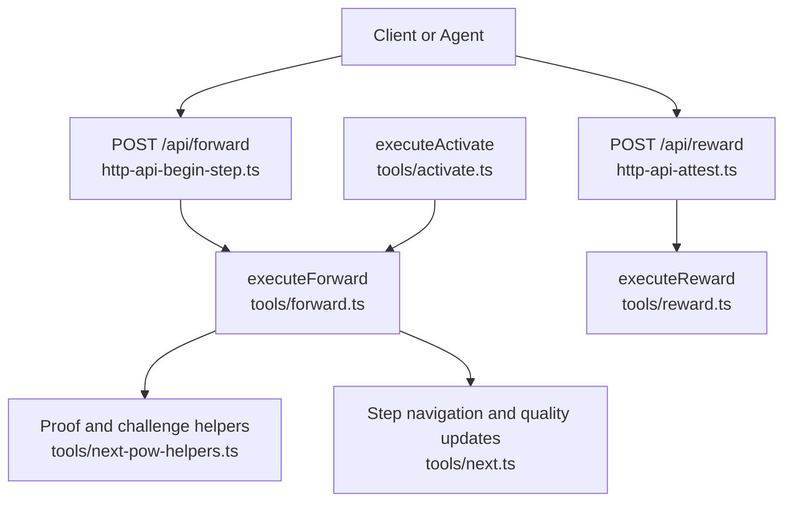
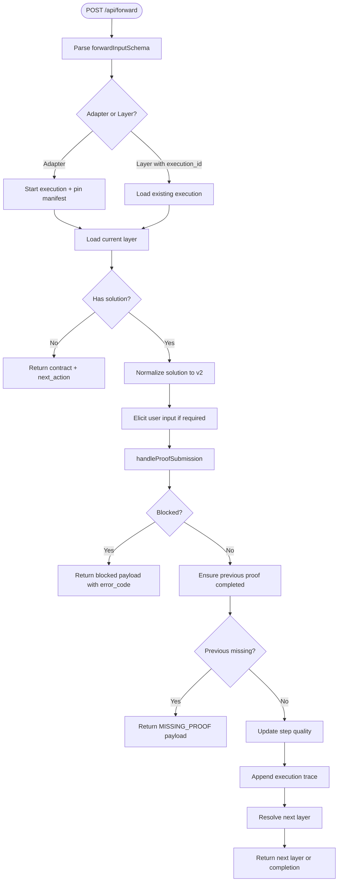
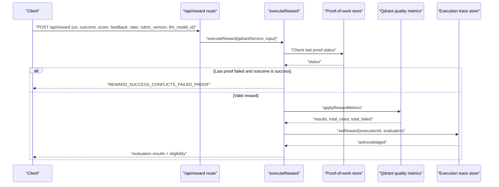
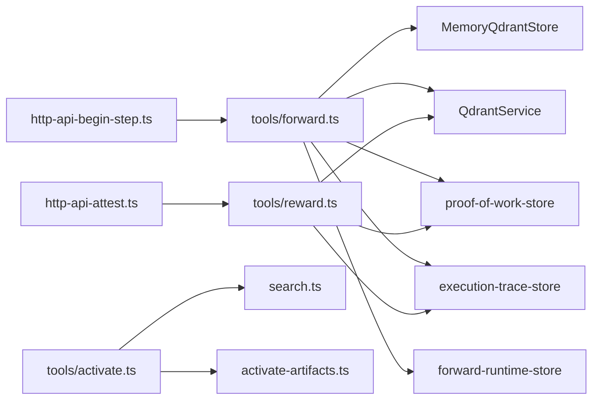

# Workflow Execution Endpoints

<cite>
**Referenced Files in This Document**
- [http-api-begin-step.ts](file://src/http/http-api-begin-step.ts)
- [http-api-attest.ts](file://src/http/http-api-attest.ts)
- [forward.ts](file://src/tools/forward.ts)
- [next.ts](file://src/tools/next.ts)
- [reward.ts](file://src/tools/reward.ts)
- [activate.ts](file://src/tools/activate.ts)
- [forward_schema.ts](file://src/tools/forward_schema.ts)
- [next_schema.ts](file://src/tools/next_schema.ts)
- [reward_schema.ts](file://src/tools/reward_schema.ts)
- [activate_schema.ts](file://src/tools/activate_schema.ts)
- [next-pow-helpers.ts](file://src/tools/next-pow-helpers.ts)
</cite>

## Table of Contents
1. [Introduction](#introduction)
2. [Project Structure](#project-structure)
3. [Core Components](#core-components)
4. [Architecture Overview](#architecture-overview)
5. [Detailed Component Analysis](#detailed-component-analysis)
6. [Dependency Analysis](#dependency-analysis)
7. [Performance Considerations](#performance-considerations)
8. [Troubleshooting Guide](#troubleshooting-guide)
9. [Conclusion](#conclusion)

## Introduction
This document explains the workflow execution REST endpoints that implement the activate → forward → reward chain, with special focus on:
- The `/api/forward` endpoint used to initiate and continue workflow steps.
- The `/api/reward` endpoint used for quality scoring and proof verification.
- The underlying `next`, `forward`, and `reward` tool integrations that power these endpoints.
- Protocol-driven execution, step chaining, challenge-response patterns, evidence collection, state persistence, error propagation, and multi-step workflow examples.

The system is agent-first: AI agents drive workflows by selecting adapters, executing protocol-defined steps, submitting proofs, and recording rewards. Human users configure preferences through agents rather than calling low-level APIs directly.

## Project Structure
The relevant runtime surface for this documentation consists of HTTP route handlers and MCP tool implementations:
- HTTP routes expose `/api/forward` and `/api/reward`.
- Tool implementations provide the core logic for activation, step execution, proof handling, and reward evaluation.
- Schemas define request/response contracts for activation, forward, next, and reward operations.



**Diagram sources**
- [http-api-begin-step.ts:13-37](file://src/http/http-api-begin-step.ts#L13-L37)
- [http-api-attest.ts:12-34](file://src/http/http-api-attest.ts#L12-L34)
- [forward.ts:91-339](file://src/tools/forward.ts#L91-L339)
- [reward.ts:28-130](file://src/tools/reward.ts#L28-L130)
- [next-pow-helpers.ts:127-333](file://src/tools/next-pow-helpers.ts#L127-L333)
- [next.ts:85-279](file://src/tools/next.ts#L85-L279)
- [activate.ts:168-229](file://src/tools/activate.ts#L168-L229)

**Section sources**
- [http-api-begin-step.ts:1-39](file://src/http/http-api-begin-step.ts#L1-L39)
- [http-api-attest.ts:1-36](file://src/http/http-api-attest.ts#L1-L36)
- [forward.ts:1-340](file://src/tools/forward.ts#L1-L340)
- [reward.ts:1-176](file://src/tools/reward.ts#L1-L176)
- [activate.ts:1-281](file://src/tools/activate.ts#L1-L281)

## Core Components
- Activation: `executeActivate` searches and ranks adapters, returns choices, and instructs the client to call `forward` with a specific adapter URI.
- Forward execution: `executeForward` starts an execution, loads the current layer, validates solutions, applies challenges, chains to the next layer, and records execution traces.
- Proof and challenge engine: shared helpers validate nonces, proof hashes, shell/forward/user_input/comment/subagent submissions, and produce retryable error payloads.
- Reward evaluation: `executeReward` evaluates outcome and optional score, updates vector-store quality metrics, persists execution trace rewards, and returns eligibility metadata.

Key responsibilities:
- Input validation uses Zod schemas for activation, forward, next, and reward.
- State persistence uses Redis for sessions and nonce tracking, Qdrant for memory and quality metrics, and execution trace stores for auditability.
- Error propagation uses structured error codes such as `NONCE_MISMATCH`, `PROOF_HASH_MISMATCH`, `TYPE_MISMATCH`, `COMMAND_FAILED`, `MISSING_PROOF`, and `REWARD_SUCCESS_CONFLICTS_FAILED_PROOF`.

**Section sources**
- [activate_schema.ts:86-135](file://src/tools/activate_schema.ts#L86-L135)
- [forward_schema.ts:234-314](file://src/tools/forward_schema.ts#L234-L314)
- [next_schema.ts:83-110](file://src/tools/next_schema.ts#L83-L110)
- [reward_schema.ts:10-48](file://src/tools/reward_schema.ts#L10-L48)
- [next-pow-helpers.ts:127-333](file://src/tools/next-pow-helpers.ts#L127-L333)

## Architecture Overview
The workflow follows a protocol-driven model:
1. Activate selects an adapter and returns a `next_action` directing the client to call `forward`.
2. Forward initializes an execution, loads the first layer, and returns a contract describing the required proof type.
3. The client submits a solution matching the contract; the server validates it, updates previous layers when applicable, and either continues to the next layer or signals completion.
4. Reward finalizes the run, evaluates quality, and records export eligibility.

```mermaid
sequenceDiagram
participant Client as "Client"
participant Activate as "activate.ts"
participant Forward as "forward.ts"
participant Next as "next.ts"
participant Proof as "next-pow-helpers.ts"
participant Reward as "reward.ts"
Client->>Activate : "activate(query)"
Activate-->>Client : "choices + next_action"
Client->>Forward : "forward(adapter_uri)"
Forward-->>Client : "contract + next_action"
Client->>Forward : "forward(layer_uri?execution_id=..., solution)"
Forward->>Proof : "handleProofSubmission(solution, memory)"
Proof-->>Forward : "blockedPayload | proofHash"
Forward->>Next : "resolve next layer + update quality"
Next-->>Forward : "next layer view"
Forward-->>Client : "next layer or completion"
Client->>Reward : "reward(layer_uri, outcome, score, feedback)"
Reward-->>Client : "evaluation results + eligibility"
```

**Diagram sources**
- [activate.ts:168-229](file://src/tools/activate.ts#L168-L229)
- [forward.ts:91-339](file://src/tools/forward.ts#L91-L339)
- [next.ts:85-279](file://src/tools/next.ts#L85-L279)
- [next-pow-helpers.ts:127-333](file://src/tools/next-pow-helpers.ts#L127-L333)
- [reward.ts:28-130](file://src/tools/reward.ts#L28-L130)

## Detailed Component Analysis

### POST /api/forward (Begin Step)
The `/api/forward` endpoint is exposed by the HTTP route setup and delegates to `executeForward`. It accepts adapter URIs to start a run or layer URIs with `execution_id` to continue a run.

Request schema:
- `authoring`: Optional authoring context from activation.
- `uri`: Adapter URI or layer URI with optional `execution_id`.
- `solution`: Required only for continuation calls; must match the contract’s proof type and include `outcome` and `evidence`.

Response schema:
- `authoring`: Echoed authoring context.
- `must_obey`: Boolean directive for clients.
- `current_layer`: Current layer content and MIME type.
- `contract`: Required proof contract for the current step.
- `next_action`: Instruction for the next tool call.
- `proof_hash`: Hash of stored proof when present.
- `execution_id`: Server-assigned execution identifier.
- `message`, `error_code`, `retry_count`: Diagnostics and retry guidance.
- `slug_disambiguation_note`: Explanation when slug resolution matched multiple adapters.
- `next_call`: Structured hint for the next operation (`forward` or `reward`).
- `activation_space_name`, `context_adapter_name`, `current_layer_label`, `adapter_layer_index`, `adapter_layer_count`: UI and debugging fields.
- `squadrules_local_artifact_dir`: Ordered artifact directory hints.

Execution behavior:
- Starts a new execution if no `execution_id` is provided.
- Pins layer manifests to prevent UUID churn during an execution.
- Normalizes legacy solution formats into v2 format with `outcome` and `evidence`.
- Applies user-input elicitation when the contract requires human confirmation.
- Validates proof submission via shared helpers.
- Attempts to apply submitted solutions to pending prior layers when appropriate.
- Ensures previous proofs are completed before continuing.
- Updates step quality metrics on success or failure paths.
- Appends execution traces including activation query and tensor outputs.



**Diagram sources**
- [http-api-begin-step.ts:13-37](file://src/http/http-api-begin-step.ts#L13-L37)
- [forward.ts:91-339](file://src/tools/forward.ts#L91-L339)
- [next-pow-helpers.ts:127-333](file://src/tools/next-pow-helpers.ts#L127-L333)

**Section sources**
- [http-api-begin-step.ts:13-37](file://src/http/http-api-begin-step.ts#L13-L37)
- [forward_schema.ts:234-314](file://src/tools/forward_schema.ts#L234-L314)
- [forward.ts:91-339](file://src/tools/forward.ts#L91-L339)

### POST /api/reward (Attest and Quality Scoring)
The `/api/reward` endpoint exposes reward recording and quality evaluation. It validates the input schema, enforces honest verification rules, evaluates the reward, updates vector-store metrics, and persists execution trace data.

Request schema:
- `uri`: Final layer URI.
- `outcome`: `success` or `failure`.
- `score`: Optional normalized score between 0 and 1.
- `feedback`: Optional evaluator feedback.
- `rater`: Optional human evaluator identifier.
- `rubric_version`: Optional rubric/policy version tag.
- `llm_model_id`: Optional LLM model identifier for evaluator attribution.

Response schema:
- `results`: Array of result objects containing URI, outcome, score, feedback, rater, rubric version, LLM model ID, grader kind, evaluation label, export eligibility flags, blockers, and rated timestamp.
- `total_rated`: Count of rated items.
- `total_failed`: Count of failed items.
- `next_call`: Always null for reward.

Honest verification:
- A layer whose last stored proof failed cannot be recorded as success. Attempting to do so raises a conflict error with diagnostic exit code information.

Evaluation and persistence:
- Evaluates outcome, optional score, rater, rubric version, and LLM model ID.
- Updates Qdrant quality metrics and metadata.
- Persists execution trace reward data when an `execution_id` is present.
- Returns eligibility metadata indicating whether the reward is exportable for supervised fine-tuning or preference learning.



**Diagram sources**
- [http-api-attest.ts:12-34](file://src/http/http-api-attest.ts#L12-L34)
- [reward.ts:28-130](file://src/tools/reward.ts#L28-L130)

**Section sources**
- [http-api-attest.ts:12-34](file://src/http/http-api-attest.ts#L12-L34)
- [reward_schema.ts:10-48](file://src/tools/reward_schema.ts#L10-L48)
- [reward.ts:28-130](file://src/tools/reward.ts#L28-L130)

### Underlying Tool Integrations

#### Activate Tool
Activation finds the best adapter(s), maps search results to activation choices, and instructs the client to call `forward` with the selected adapter URI. It supports authoring workflows for create/review/update operations and includes linked artifact instructions for shell contracts.

Key behaviors:
- Canonicalizes adapter URIs.
- Loads linked artifacts and materialization instructions.
- Produces `next_action` strings guiding the client to call `forward`.
- Supports refinement sequences via `execution_id`.

**Section sources**
- [activate.ts:30-166](file://src/tools/activate.ts#L30-L166)
- [activate.ts:168-229](file://src/tools/activate.ts#L168-L229)
- [activate_schema.ts:86-135](file://src/tools/activate_schema.ts#L86-L135)

#### Next Logic and Quality Updates
The `next` module provides shared step navigation and quality update logic used by both the forward bridge and older HTTP next routes. It resolves next and previous layers, builds next payloads, handles missing proofs, and updates step quality metrics.

Key behaviors:
- Resolves adapter next/previous layers.
- Builds next payloads with current step, challenge, and next action.
- Updates quality metrics and metadata on success/failure.
- Handles missing proof scenarios and retry counts.

**Section sources**
- [next.ts:85-129](file://src/tools/next.ts#L85-L129)
- [next.ts:137-279](file://src/tools/next.ts#L137-L279)
- [next_schema.ts:83-110](file://src/tools/next_schema.ts#L83-L110)

#### Proof and Challenge Helpers
Shared helpers implement challenge generation, nonce rotation, proof submission validation, and error payload construction. They support shell, forward, user_input, comment, and subagent proof types.

Key behaviors:
- Generates nonces and rotates them on mismatch.
- Validates proof hash chains using genesis hash and previous proof hashes.
- Enforces type-specific constraints and semantic relevance checks for comments.
- Produces structured error payloads with retry guidance.

**Section sources**
- [next-pow-helpers.ts:43-61](file://src/tools/next-pow-helpers.ts#L43-L61)
- [next-pow-helpers.ts:127-333](file://src/tools/next-pow-helpers.ts#L127-L333)

## Dependency Analysis
The endpoints depend on several services and modules:
- HTTP routes depend on Express and route error utilities.
- Forward depends on memory store, Qdrant service, proof-of-work store, execution trace store, forward runtime store, and adapter navigation.
- Reward depends on Qdrant service, proof-of-work store, execution trace store, and reward evaluation/metrics.
- Activation depends on search, artifact loading, and authoring context.



**Diagram sources**
- [http-api-begin-step.ts:1-39](file://src/http/http-api-begin-step.ts#L1-L39)
- [http-api-attest.ts:1-36](file://src/http/http-api-attest.ts#L1-L36)
- [forward.ts:1-39](file://src/tools/forward.ts#L1-L39)
- [reward.ts:1-13](file://src/tools/reward.ts#L1-L13)
- [activate.ts:1-23](file://src/tools/activate.ts#L1-L23)

**Section sources**
- [forward.ts:1-39](file://src/tools/forward.ts#L1-L39)
- [reward.ts:1-13](file://src/tools/reward.ts#L1-L13)
- [activate.ts:1-23](file://src/tools/activate.ts#L1-L23)

## Performance Considerations
- Caching: Memory resources are cached via Redis to reduce repeated reads during step navigation.
- Fire-and-forget tracing: Execution trace persistence failures are logged without failing the primary request path.
- Quality update errors: Quality metric updates are wrapped in try/catch and emit metrics on failure to avoid blocking workflow progress.
- Tokenization and embedding timeouts: Comment semantic validation has a timeout to prevent slow providers from stalling proof validation.

Recommendations:
- Prefer v2 solution format with `outcome` and `evidence` to minimize normalization overhead.
- Reuse `execution_id` across continuation calls to avoid redundant manifest pinning and improve trace continuity.
- Monitor `squadrulesQualityUpdateErrors` and reward persistence errors for operational visibility.

[No sources needed since this section provides general guidance]

## Troubleshooting Guide
Common issues and resolutions:
- Nonce mismatch: Rotate nonce and use `retry_nonce` from the error response.
- Proof hash mismatch: Echo `proof_hash` from the previous response or contract.
- Type mismatch: Ensure `solution.type` matches the contract’s required proof type.
- Missing field: Include required fields such as `shell.exit_code`, `forward.target`, `user_input.confirmation`, or `comment.text`.
- Placeholder evidence: Replace template placeholders with real command output.
- Command failed: Fix the shell command and retry; diagnosis may include recovery guidance.
- Missing proof: Complete the previous layer’s proof before continuing.
- Reward conflicts: Do not record success for a layer whose last proof failed; fix the step or record failure.

Operational diagnostics:
- Check structured logs for `pow_nonce_mismatch`, `COMMENT_SEMANTIC_TIMEOUT`, and quality update warnings.
- Inspect execution traces for activation queries, solution tensors, and reward evaluations.
- Use error codes returned in responses to guide automated retries and client-side UX.

**Section sources**
- [next-pow-helpers.ts:167-195](file://src/tools/next-pow-helpers.ts#L167-L195)
- [next-pow-helpers.ts:208-230](file://src/tools/next-pow-helpers.ts#L208-L230)
- [next-pow-helpers.ts:265-298](file://src/tools/next-pow-helpers.ts#L265-L298)
- [next-pow-helpers.ts:317-332](file://src/tools/next-pow-helpers.ts#L317-L332)
- [reward.ts:37-54](file://src/tools/reward.ts#L37-L54)

## Conclusion
The workflow execution endpoints implement a robust, protocol-driven chain:
- Activation selects adapters and directs clients to forward.
- Forward manages execution state, validates proofs, chains layers, and records traces.
- Reward finalizes runs, evaluates quality, and records eligibility for downstream training pipelines.

Clients should follow the `next_action` directives, echo nonces and proof hashes correctly, and handle structured error codes for resilient automation. Operators should monitor quality updates, proof validation timeouts, and reward persistence for healthy workflow execution.

[No sources needed since this section summarizes without analyzing specific files]