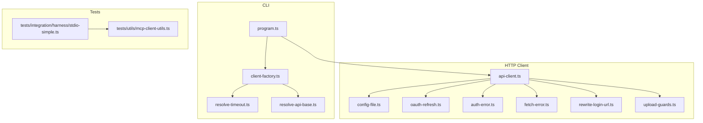
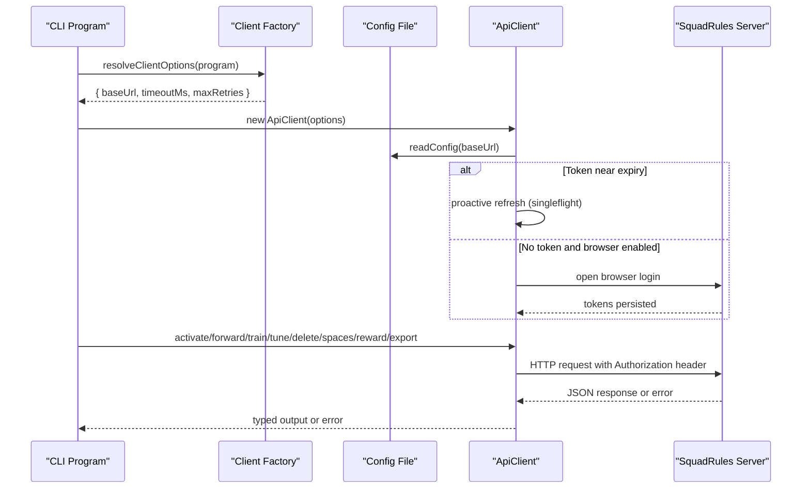
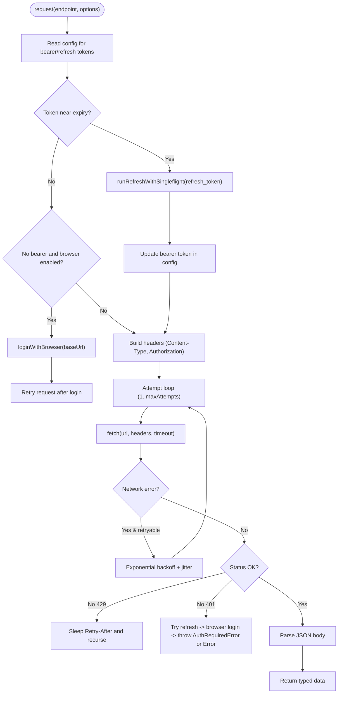
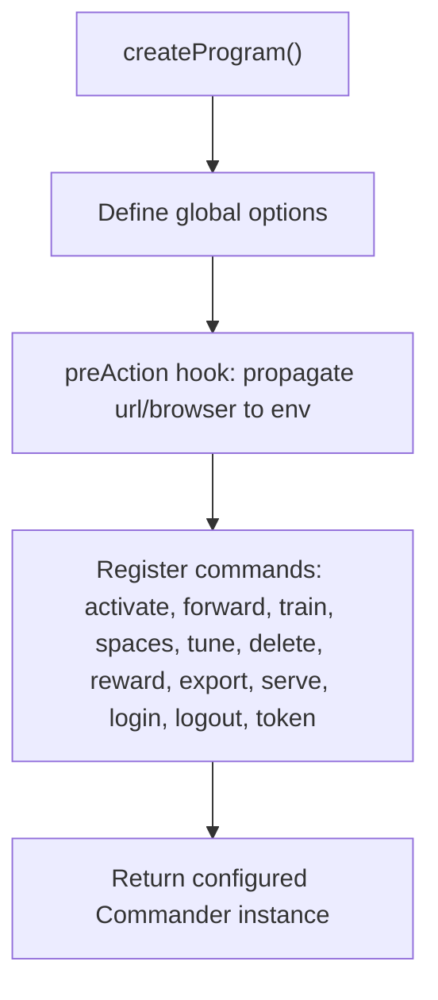
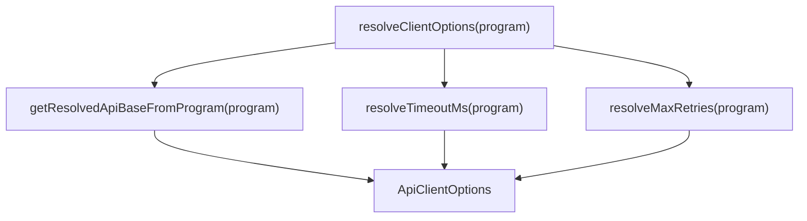
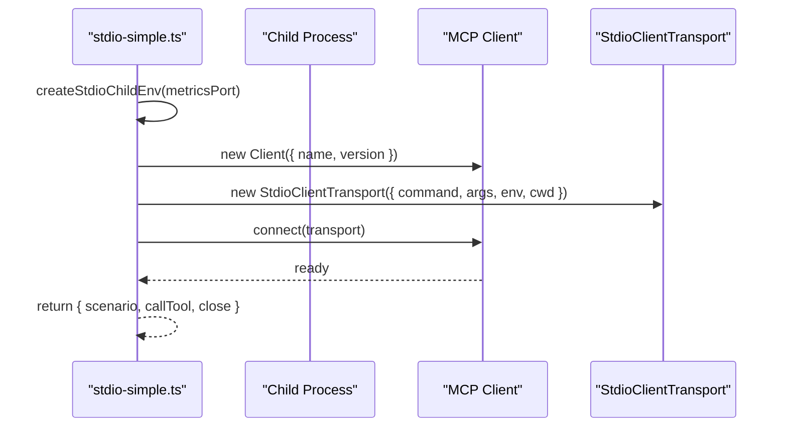
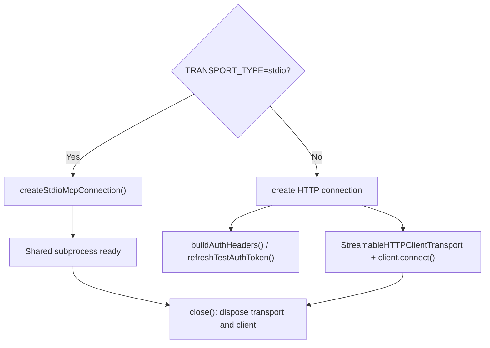
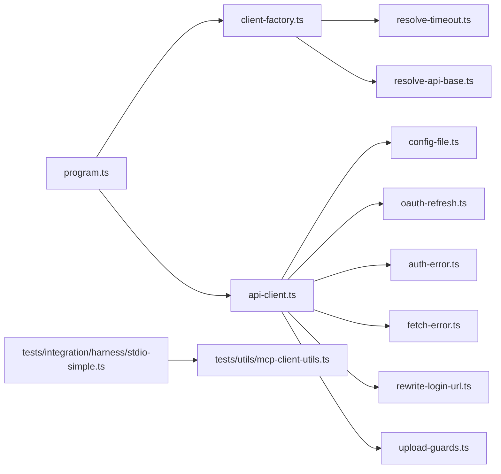

# Client Implementation Guide

<cite>
**Referenced Files in This Document**
- [api-client.ts](file://src/cli/api-client.ts)
- [client-factory.ts](file://src/cli/client-factory.ts)
- [program.ts](file://src/cli/program.ts)
- [resolve-timeout.ts](file://src/cli/resolve-timeout.ts)
- [resolve-api-base.ts](file://src/cli/resolve-api-base.ts)
- [config-file.ts](file://src/cli/config-file.ts)
- [oauth-refresh.ts](file://src/cli/oauth-refresh.ts)
- [auth-error.ts](file://src/cli/auth-error.ts)
- [fetch-error.ts](file://src/cli/fetch-error.ts)
- [rewrite-login-url.ts](file://src/cli/rewrite-login-url.ts)
- [upload-guards.ts](file://src/cli/upload-guards.ts)
- [stdio-simple.ts](file://tests/integration/harness/stdio-simple.ts)
- [mcp-client-utils.ts](file://tests/utils/mcp-client-utils.ts)
</cite>

## Table of Contents
1. [Introduction](#introduction)
2. [Project Structure](#project-structure)
3. [Core Components](#core-components)
4. [Architecture Overview](#architecture-overview)
5. [Detailed Component Analysis](#detailed-component-analysis)
6. [Dependency Analysis](#dependency-analysis)
7. [Performance Considerations](#performance-considerations)
8. [Troubleshooting Guide](#troubleshooting-guide)
9. [Conclusion](#conclusion)
10. [Appendices](#appendices)

## Introduction
This guide documents client implementation patterns for both HTTP and STDIO transports, focusing on the CLI client’s factory pattern, connection establishment, authentication flow, request/response handling, and testing utilities. It also covers protocol versioning, capability negotiation, feature detection, retry logic, debugging, security, and migration guidance.

The repository provides:
- An HTTP REST API client with robust retry, proactive token refresh, and browser-based login flows.
- A CLI program that wires commands, options, and environment configuration.
- Test harnesses for MCP clients over both HTTP (streamable) and STDIO transports.

## Project Structure
At a high level:
- CLI layer: command registration, option parsing, and client option resolution.
- HTTP client: authenticated requests, retries, token refresh, and error normalization.
- Test harnesses: shared utilities to connect via HTTP or STDIO and call tools.

**Diagram sources**
- [program.ts:31-79](file://src/cli/program.ts#L31-L79)
- [client-factory.ts:16-22](file://src/cli/client-factory.ts#L16-L22)
- [api-client.ts:46-72](file://src/cli/api-client.ts#L46-L72)
- [stdio-simple.ts:57-88](file://tests/integration/harness/stdio-simple.ts#L57-L88)
- [mcp-client-utils.ts:191-223](file://tests/utils/mcp-client-utils.ts#L191-L223)

**Section sources**
- [program.ts:31-79](file://src/cli/program.ts#L31-L79)
- [client-factory.ts:16-22](file://src/cli/client-factory.ts#L16-L22)

## Core Components
- ApiClient: Central HTTP client with authentication, retries, timeouts, and method wrappers for activate, forward, train, tune, delete, spaces, reward, export, and downloadExportRef.
- CLI Program: Registers commands and global flags; propagates URL, timeout, retries, and browser behavior into environment and client options.
- Client Factory: Resolves ApiClientOptions from CLI flags and environment.
- Test Harnesses: Provide reusable MCP client connections over HTTP and STDIO for integration tests.

Key responsibilities:
- Connection establishment: HTTP uses fetch with bearer tokens; STDIO uses MCP SDK StdioClientTransport.
- Authentication: Browser-based login, proactive token refresh, singleflight refresh coalescing, and 401 recovery.
- Request/response: JSON payloads, custom headers for training/tuning, normalized errors, and retry/backoff.
- Testing: Shared stdio subprocess, ref-counted cleanup, and auth-aware HTTP transport.

**Section sources**
- [api-client.ts:46-339](file://src/cli/api-client.ts#L46-L339)
- [program.ts:31-79](file://src/cli/program.ts#L31-L79)
- [client-factory.ts:16-22](file://src/cli/client-factory.ts#L16-L22)
- [stdio-simple.ts:57-88](file://tests/integration/harness/stdio-simple.ts#L57-L88)
- [mcp-client-utils.ts:191-223](file://tests/utils/mcp-client-utils.ts#L191-L223)

## Architecture Overview
The client architecture separates concerns across CLI wiring, HTTP transport, and test harnesses.

**Diagram sources**
- [client-factory.ts:16-22](file://src/cli/client-factory.ts#L16-L22)
- [api-client.ts:101-249](file://src/cli/api-client.ts#L101-L249)
- [config-file.ts:1-200](file://src/cli/config-file.ts#L1-L200)

## Detailed Component Analysis

### HTTP Client (ApiClient)
Responsibilities:
- Base URL resolution with precedence: explicit > env > config file > default.
- Proactive token refresh before requests when close to expiry.
- Singleflight refresh to avoid concurrent refresh_token exchanges.
- Retry with exponential backoff for transient network errors.
- Rate-limit handling using Retry-After.
- 401 recovery: refresh token, then re-authenticate via browser if enabled.
- Typed methods for each tool endpoint.

**Diagram sources**
- [api-client.ts:101-249](file://src/cli/api-client.ts#L101-L249)
- [api-client.ts:78-99](file://src/cli/api-client.ts#L78-L99)
- [oauth-refresh.ts:1-200](file://src/cli/oauth-refresh.ts#L1-L200)
- [auth-error.ts:1-200](file://src/cli/auth-error.ts#L1-L200)
- [fetch-error.ts:1-200](file://src/cli/fetch-error.ts#L1-L200)

Implementation highlights:
- Constructor resolves baseUrl and sets defaults for timeout and retries.
- Proactive refresh skew ensures tokens are refreshed before they expire.
- Singleflight prevents duplicate refresh calls during bursts.
- Retry strategy includes exponential backoff and jitter.
- 401 handling attempts refresh, then browser login, then throws structured errors.
- Methods like train and tune set specialized headers for server-side processing.

**Section sources**
- [api-client.ts:27-72](file://src/cli/api-client.ts#L27-L72)
- [api-client.ts:78-99](file://src/cli/api-client.ts#L78-L99)
- [api-client.ts:101-249](file://src/cli/api-client.ts#L101-L249)
- [api-client.ts:251-339](file://src/cli/api-client.ts#L251-L339)

### CLI Program and Command Wiring
Responsibilities:
- Define global flags: URL, timeout, retries, format, browser control.
- Propagate flags into environment variables for downstream modules.
- Register all MCP tool commands.

**Diagram sources**
- [program.ts:31-79](file://src/cli/program.ts#L31-L79)

**Section sources**
- [program.ts:31-79](file://src/cli/program.ts#L31-L79)

### Client Factory Pattern
Responsibilities:
- Resolve ApiClientOptions from CLI program options and environment.
- Use shared helpers for base URL and timeout/retry resolution.

**Diagram sources**
- [client-factory.ts:16-22](file://src/cli/client-factory.ts#L16-L22)
- [resolve-api-base.ts:1-200](file://src/cli/resolve-api-base.ts#L1-L200)
- [resolve-timeout.ts:1-200](file://src/cli/resolve-timeout.ts#L1-L200)

**Section sources**
- [client-factory.ts:16-22](file://src/cli/client-factory.ts#L16-L22)

### STDIO Transport Test Harness
Responsibilities:
- Spawn a child process running the bootstrap entrypoint with appropriate environment.
- Create an MCP Client connected via StdioClientTransport.
- Expose a simple harness with scenario metadata and a callTool helper.

**Diagram sources**
- [stdio-simple.ts:38-55](file://tests/integration/harness/stdio-simple.ts#L38-L55)
- [stdio-simple.ts:57-88](file://tests/integration/harness/stdio-simple.ts#L57-L88)

**Section sources**
- [stdio-simple.ts:57-88](file://tests/integration/harness/stdio-simple.ts#L57-L88)

### HTTP Transport Test Utilities
Responsibilities:
- Determine transport mode (HTTP vs STDIO).
- For HTTP: build auth headers, handle 401 by refreshing token, and connect via StreamableHTTPClientTransport.
- For STDIO: reuse shared subprocess with ref-counted lifecycle and cleanup.

**Diagram sources**
- [mcp-client-utils.ts:22-48](file://tests/utils/mcp-client-utils.ts#L22-L48)
- [mcp-client-utils.ts:115-174](file://tests/utils/mcp-client-utils.ts#L115-L174)
- [mcp-client-utils.ts:191-223](file://tests/utils/mcp-client-utils.ts#L191-L223)

**Section sources**
- [mcp-client-utils.ts:191-223](file://tests/utils/mcp-client-utils.ts#L191-L223)

## Dependency Analysis

**Diagram sources**
- [program.ts:31-79](file://src/cli/program.ts#L31-L79)
- [client-factory.ts:16-22](file://src/cli/client-factory.ts#L16-L22)
- [api-client.ts:1-22](file://src/cli/api-client.ts#L1-L22)
- [stdio-simple.ts:57-88](file://tests/integration/harness/stdio-simple.ts#L57-L88)
- [mcp-client-utils.ts:191-223](file://tests/utils/mcp-client-utils.ts#L191-L223)

**Section sources**
- [program.ts:31-79](file://src/cli/program.ts#L31-L79)
- [api-client.ts:1-22](file://src/cli/api-client.ts#L1-L22)

## Performance Considerations
- Timeouts: Default 15 seconds; configurable via CLI flag and environment.
- Retries: Default 2 retries with exponential backoff and jitter; can be disabled by setting maxRetries to 0.
- Rate limiting: Honors Retry-After headers with bounded recursion.
- Proactive refresh: Reduces 401 churn by refreshing tokens before expiry.
- Singleflight refresh: Prevents redundant refresh_token exchanges under load.
- STDIO harness: Uses a shared subprocess to reduce startup overhead in tests.

[No sources needed since this section provides general guidance]

## Troubleshooting Guide
Common issues and resolutions:
- Network errors: The client logs retry attempts and applies backoff; check stderr for retry messages.
- Timeouts: Requests abort after the configured timeout; increase timeoutMs if endpoints are slow.
- 401 Unauthorized:
  - If a refresh token exists, the client attempts a silent refresh.
  - If browser is enabled, it opens a login flow; otherwise, it throws an AuthRequiredError with a login URL.
- Rate limiting: The client respects Retry-After and retries once per rate limit event.
- STDIO connectivity: Ensure the child process starts successfully; the harness enforces a connect timeout to fail fast.

Operational tips:
- Validate baseUrl normalization and ensure HTTPS in production.
- Inspect config file for stale tokens; clear or refresh as needed.
- For training/tuning, verify custom headers (e.g., x-space, x-force-update) are set correctly.

**Section sources**
- [api-client.ts:101-249](file://src/cli/api-client.ts#L101-L249)
- [auth-error.ts:1-200](file://src/cli/auth-error.ts#L1-L200)
- [fetch-error.ts:1-200](file://src/cli/fetch-error.ts#L1-L200)

## Conclusion
The client implementation provides a robust, secure, and testable foundation for interacting with the SquadRules API over HTTP and STDIO. The CLI integrates cleanly with environment configuration and offers sensible defaults for timeouts and retries. Test harnesses support both transports, enabling comprehensive integration testing. By following the patterns documented here, you can build custom clients, implement real-time communication, add retry logic, and maintain strong security practices.

[No sources needed since this section summarizes without analyzing specific files]

## Appendices

### Building Custom Clients
- Use ApiClientOptions to configure baseUrl, timeoutMs, and maxRetries.
- Prefer constructing ApiClient with an options object for clarity.
- Wrap ApiClient calls in your own retry and logging layers if needed.

**Section sources**
- [api-client.ts:27-72](file://src/cli/api-client.ts#L27-L72)

### Handling Real-Time Communication
- Over HTTP: Use streaming-capable transports where supported by the server; the test harness demonstrates StreamableHTTPClientTransport usage.
- Over STDIO: Use StdioClientTransport to communicate with a long-lived child process.

**Section sources**
- [mcp-client-utils.ts:191-223](file://tests/utils/mcp-client-utils.ts#L191-L223)
- [stdio-simple.ts:57-88](file://tests/integration/harness/stdio-simple.ts#L57-L88)

### Implementing Retry Logic
- Leverage built-in retries in ApiClient for transient errors.
- Respect Retry-After for rate-limited responses.
- Add application-level retries around Idempotent operations if necessary.

**Section sources**
- [api-client.ts:131-189](file://src/cli/api-client.ts#L131-L189)

### Debugging Techniques and Logging Strategies
- Enable verbose stderr output for retries and network errors.
- Log token refresh events and login redirects for troubleshooting.
- In tests, capture harness logs and inspect child process environment.

**Section sources**
- [api-client.ts:147-167](file://src/cli/api-client.ts#L147-L167)
- [stdio-simple.ts:38-55](file://tests/integration/harness/stdio-simple.ts#L38-L55)

### Security Considerations
- Token management: Tokens are stored in the config file; refresh tokens are rotated securely.
- Connection encryption: Use HTTPS base URLs; validate and normalize baseUrl.
- Input sanitization: Training inputs are validated through upload guards.

**Section sources**
- [api-client.ts:61-72](file://src/cli/api-client.ts#L61-L72)
- [upload-guards.ts:1-200](file://src/cli/upload-guards.ts#L1-L200)

### Protocol Versioning and Capability Negotiation
- MCP clients declare name and version during initialization.
- Tests use fixed client versions; servers should negotiate capabilities based on client version.

**Section sources**
- [stdio-simple.ts:68-76](file://tests/integration/harness/stdio-simple.ts#L68-L76)
- [mcp-client-utils.ts:201-209](file://tests/utils/mcp-client-utils.ts#L201-L209)

### Migration Guides
- Upgrading between protocol versions:
  - Review breaking changes in server APIs and adjust headers/body shapes accordingly.
  - Update client version strings and capability checks in tests.
  - Validate backward compatibility for existing integrations.

[No sources needed since this section provides general guidance]