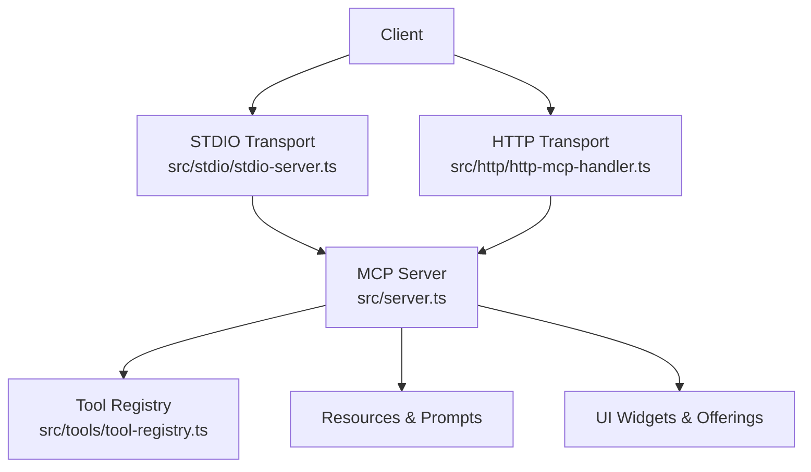
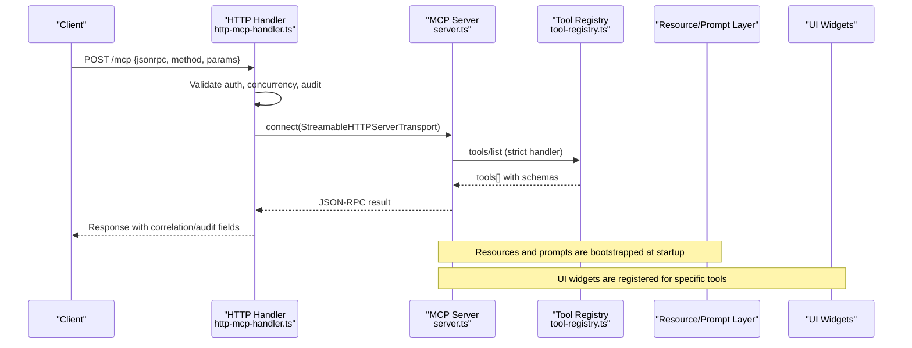
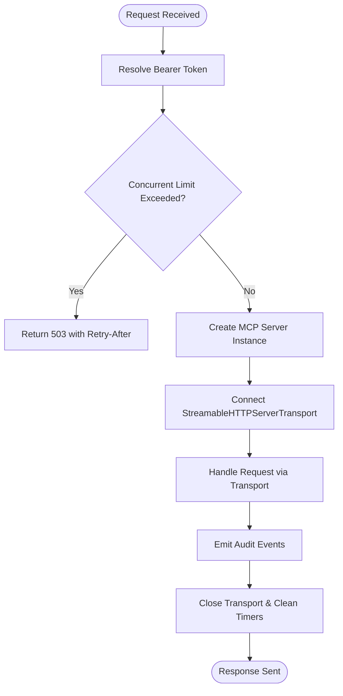
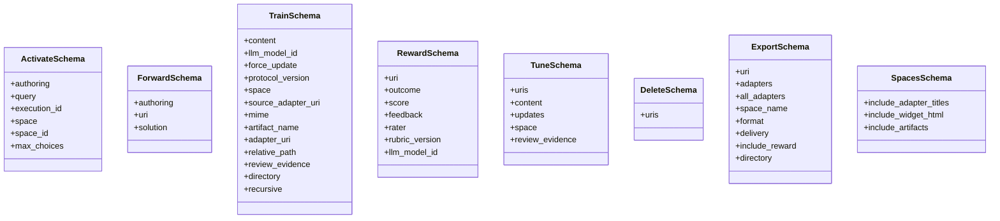
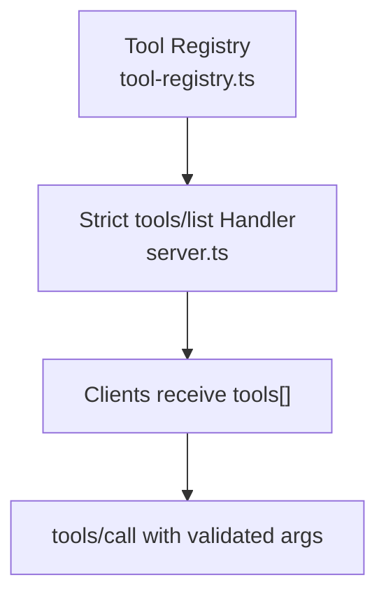
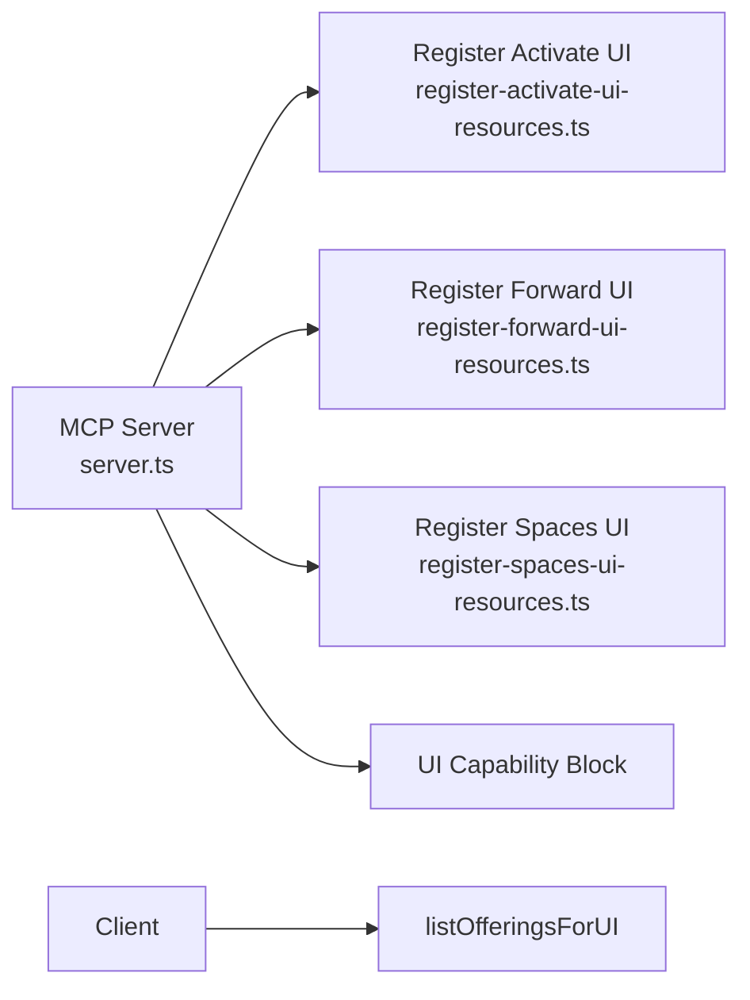
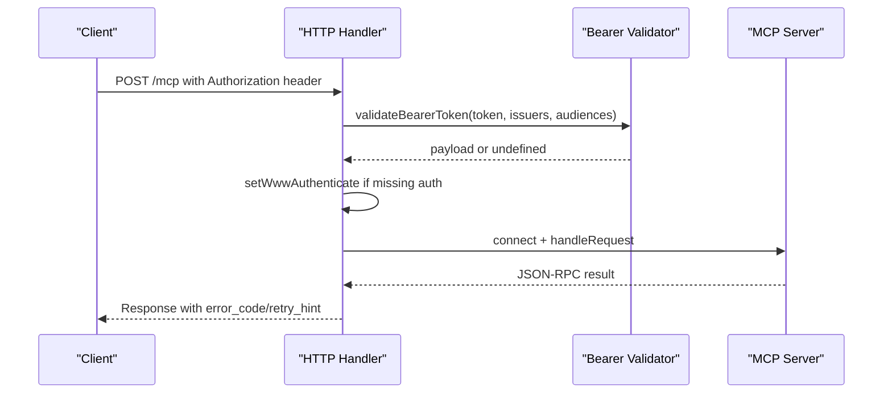
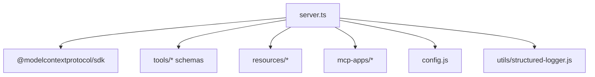

# MCP Protocol Specification

<cite>
**Referenced Files in This Document**
- [server.ts](file://src/server.ts)
- [stdio-server.ts](file://src/stdio/stdio-server.ts)
- [http-mcp-handler.ts](file://src/http/http-mcp-handler.ts)
- [tool-registry.ts](file://src/tools/tool-registry.ts)
- [activate_schema.ts](file://src/tools/activate_schema.ts)
- [forward_schema.ts](file://src/tools/forward_schema.ts)
- [train_schema.ts](file://src/tools/train_schema.ts)
- [reward_schema.ts](file://src/tools/reward_schema.ts)
- [tune_schema.ts](file://src/tools/tune_schema.ts)
- [delete_schema.ts](file://src/tools/delete_schema.ts)
- [export_schema.ts](file://src/tools/export_schema.ts)
- [spaces_schema.ts](file://src/tools/spaces_schema.ts)
</cite>

## Table of Contents
1. [Introduction](#introduction)
2. [Project Structure](#project-structure)
3. [Core Components](#core-components)
4. [Architecture Overview](#architecture-overview)
5. [Detailed Component Analysis](#detailed-component-analysis)
6. [Dependency Analysis](#dependency-analysis)
7. [Performance Considerations](#performance-considerations)
8. [Troubleshooting Guide](#troubleshooting-guide)
9. [Conclusion](#conclusion)
10. [Appendices](#appendices)

## Introduction
This document specifies the Model Context Protocol (MCP) implementation used by the project, focusing on STDIO and HTTP transports, message formats, tool definitions, real-time interaction patterns, error handling, connection lifecycle, and security. It also documents the built-in tools: activate, forward, train, reward, tune, delete, export, and spaces, including their input/output schemas, execution context, and state management. The tool registry system, dynamic tool discovery, widget system for UI integration, resource management, protocol versioning, compatibility guarantees, migration strategies, client implementation guidelines, debugging techniques, performance optimization tips, and authentication/authorization flows are covered.

The project is an agent-first MCP framework where AI agents are primary users and humans configure preferences through agents. The core flow is activate → forward → reward. Adapters provide deterministic, auditable task execution. Agents must create or repair adapters when workflows change. Vector storage uses Qdrant (primary) and LanceDB (secondary). Storage includes Redis for sessions and rate limiting, vector DBs for embeddings, and filesystem for configuration and adapters. Authentication uses Keycloak and Google IdP with OAuth2/JWT.

## Project Structure
At runtime, the application exposes MCP capabilities through two transport layers:
- STDIO transport for local CLI-driven agent interactions.
- HTTP transport using streamable JSON-RPC over HTTP for remote clients and UI integrations.

**Diagram sources**
- [stdio-server.ts:6-12](file://src/stdio/stdio-server.ts#L6-L12)
- [http-mcp-handler.ts:115-348](file://src/http/http-mcp-handler.ts#L115-L348)
- [server.ts:44-114](file://src/server.ts#L44-L114)
- [tool-registry.ts:25-91](file://src/tools/tool-registry.ts#L25-L91)

**Section sources**
- [stdio-server.ts:6-12](file://src/stdio/stdio-server.ts#L6-L12)
- [http-mcp-handler.ts:115-348](file://src/http/http-mcp-handler.ts#L115-L348)
- [server.ts:44-114](file://src/server.ts#L44-L114)

## Core Components
- MCP server creation and capability registration:
  - Creates an MCP server instance with name and build version.
  - Registers capabilities for tools, resources, prompts, and UI extensions.
  - Installs a strict tools/list handler that returns canonical tool metadata and schemas.
- Tool registry:
  - Centralized list of built-in tools with titles, descriptions, input/output schemas, and optional UI metadata.
  - Used to generate tools/list responses and ensure parity across HTTP routes and CLI commands.
- Transports:
  - STDIO transport connects the MCP server to stdin/stdout for protocol frames.
  - HTTP transport handles JSON-RPC requests, auth, concurrency limits, audit logging, and cancellation.

Key responsibilities:
- Server: orchestrate tool registration, resource/prompt registration, and capability exposure.
- Tool registry: define canonical tool surface and schemas.
- STDIO: lightweight transport for local agent runs.
- HTTP: robust transport with auth, concurrency control, timeouts, and audit trails.

**Section sources**
- [server.ts:29-41](file://src/server.ts#L29-L41)
- [server.ts:44-114](file://src/server.ts#L44-L114)
- [tool-registry.ts:16-24](file://src/tools/tool-registry.ts#L16-L24)
- [tool-registry.ts:25-91](file://src/tools/tool-registry.ts#L25-L91)
- [stdio-server.ts:6-12](file://src/stdio/stdio-server.ts#L6-L12)
- [http-mcp-handler.ts:115-348](file://src/http/http-mcp-handler.ts#L115-L348)

## Architecture Overview
The MCP architecture consists of:
- Clients invoking tools via STDIO or HTTP.
- A single MCP server exposing tools/resources/prompts/UI offerings.
- Tool implementations backed by memory stores, vector services, and external systems.
- UI widgets and static assets registered for interactive experiences.

**Diagram sources**
- [http-mcp-handler.ts:115-348](file://src/http/http-mcp-handler.ts#L115-L348)
- [server.ts:44-114](file://src/server.ts#L44-L114)
- [tool-registry.ts:25-91](file://src/tools/tool-registry.ts#L25-L91)

## Detailed Component Analysis

### Protocol Handshake and Connection Lifecycle
- STDIO handshake:
  - The STDIO transport initializes the MCP server and connects it to stdio for protocol frames.
  - stdout is reserved for protocol frames; stderr can be used for logs.
- HTTP handshake:
  - Requests arrive at POST /mcp.
  - The handler validates Bearer tokens when enabled, enforces concurrency limits, sets up per-request server instances, tracks request timestamps, and emits audit events.
  - Each request creates a new StreamableHTTPServerTransport and calls server.connect(transport), then delegates to transport.handleRequest.
  - On response close/finish, the handler cleans up timers, deletes request timestamps, closes transport, and emits completion metrics.

**Diagram sources**
- [http-mcp-handler.ts:115-348](file://src/http/http-mcp-handler.ts#L115-L348)

**Section sources**
- [stdio-server.ts:6-12](file://src/stdio/stdio-server.ts#L6-L12)
- [http-mcp-handler.ts:44-60](file://src/http/http-mcp-handler.ts#L44-L60)
- [http-mcp-handler.ts:115-348](file://src/http/http-mcp-handler.ts#L115-L348)

### Message Serialization Formats
- JSON-RPC 2.0 messages are used over both transports.
- For HTTP, the handler enables JSON responses and wraps transport handling around Express requests/responses.
- Tool calls use methods like tools/call with parameters including tool name and arguments validated against Zod schemas.
- The tools/list endpoint returns tool metadata and JSON schemas derived from Zod definitions.

Key points:
- Strict tools/list handler ensures consistent tool surface.
- Input/output schemas are converted to JSON Schema for clients.
- Error responses include structured error_code and retry_hint for client guidance.

**Section sources**
- [server.ts:29-41](file://src/server.ts#L29-L41)
- [http-mcp-handler.ts:194-308](file://src/http/http-mcp-handler.ts#L194-L308)

### Built-in Tools: Schemas, Execution Context, and State Management
- activate:
  - Purpose: Find best adapter(s) and return ranked choices with next_action directives.
  - Input schema includes authoring context, query, execution_id, space/space_id, max_choices.
  - Output schema includes must_obey, message, next_action, execution_id, query, choices discriminated by role (match/refine/create), artifact dir hints, and transport mode.
  - Execution context: Uses authoring context for create/review/update flows; supports refinement sequences via execution_id.
- forward:
  - Purpose: Run first or next adapter layer; supports shell, forward, user_input, comment, subagent contracts.
  - Input schema includes authoring context, uri (adapter or layer), solution (required only for continuation calls).
  - Output schema includes current_layer, contract, next_action, proof_hash, execution_id, next_call (forward/reward), and metadata.
  - State management: Continuation requires layer URI with ?execution_id=... and matching solution.type; server maintains run state.
- train:
  - Purpose: Register new adapters or artifacts; supports batch directory training and fork from existing adapters.
  - Input schema includes content, llm_model_id, force_update, protocol_version, space, source_adapter_uri, mime, artifact_name, adapter_uri, relative_path, review_evidence, directory, recursive.
  - Output schema includes items with URIs and labels, status stored, and optional batch manifest.
  - Validation enforces MIME/artifact rules and critic-loop review evidence for markdown adapters.
- reward:
  - Purpose: Record reward signals for final layers; computes evaluation labels and export eligibility.
  - Input schema includes uri (layer), outcome, score, feedback, rater, rubric_version, llm_model_id.
  - Output schema includes results array with eligibility blockers and rated_at timestamp.
- tune:
  - Purpose: Update adapter content or advanced fields; optionally move adapters between spaces.
  - Input schema includes uris, content, updates, space, review_evidence (required when content provided).
  - Output schema includes per-URI results with status and counts.
- delete:
  - Purpose: Delete adapters or layers by URI.
  - Input schema includes non-empty array of URIs.
  - Output schema includes per-URI results and counts.
- export:
  - Purpose: Export adapters, traces, rewards, SFT/preference datasets, source files, skill trees, or ZIP bundles.
  - Input schema includes selection modes (uri/adapters/all_adapters), format, delivery, include_reward, directory.
  - Output schema includes content, encoding, SHA-256, download_ref, directory_manifest, and bundle metadata.
- spaces:
  - Purpose: List spaces with adapter counts and optional adapter details/artifacts.
  - Input schema includes flags for adapter titles, widget HTML, and artifacts.
  - Output schema includes spaces array with type and adapter info.

**Diagram sources**
- [activate_schema.ts:86-135](file://src/tools/activate_schema.ts#L86-L135)
- [forward_schema.ts:234-314](file://src/tools/forward_schema.ts#L234-L314)
- [train_schema.ts:54-196](file://src/tools/train_schema.ts#L54-L196)
- [reward_schema.ts:10-48](file://src/tools/reward_schema.ts#L10-L48)
- [tune_schema.ts:14-67](file://src/tools/tune_schema.ts#L14-L67)
- [delete_schema.ts:14-29](file://src/tools/delete_schema.ts#L14-L29)
- [export_schema.ts:44-158](file://src/tools/export_schema.ts#L44-L158)
- [spaces_schema.ts:3-52](file://src/tools/spaces_schema.ts#L3-L52)

**Section sources**
- [activate_schema.ts:86-135](file://src/tools/activate_schema.ts#L86-L135)
- [forward_schema.ts:234-314](file://src/tools/forward_schema.ts#L234-L314)
- [train_schema.ts:54-196](file://src/tools/train_schema.ts#L54-L196)
- [reward_schema.ts:10-48](file://src/tools/reward_schema.ts#L10-L48)
- [tune_schema.ts:14-67](file://src/tools/tune_schema.ts#L14-L67)
- [delete_schema.ts:14-29](file://src/tools/delete_schema.ts#L14-L29)
- [export_schema.ts:44-158](file://src/tools/export_schema.ts#L44-L158)
- [spaces_schema.ts:3-52](file://src/tools/spaces_schema.ts#L3-L52)

### Tool Registry System and Dynamic Discovery
- Canonical registry:
  - SQUADRULES_TOOL_REGISTRY defines all built-in tools with names, titles, descriptions, strictInputSchema, outputSchema, and optional uiMeta.
- Dynamic discovery:
  - The server installs a strict tools/list handler that maps registry entries to MCP tool descriptors, converting Zod schemas to JSON Schema.
  - UI metadata is included when present, enabling richer client experiences.
- Extensibility:
  - New tools should be added to the registry and corresponding register* functions in server.ts.
  - Tests and parity gates rely on this central registry to ensure consistency across surfaces.

**Diagram sources**
- [tool-registry.ts:25-91](file://src/tools/tool-registry.ts#L25-L91)
- [server.ts:29-41](file://src/server.ts#L29-L41)

**Section sources**
- [tool-registry.ts:16-24](file://src/tools/tool-registry.ts#L16-L24)
- [tool-registry.ts:25-91](file://src/tools/tool-registry.ts#L25-L91)
- [server.ts:29-41](file://src/server.ts#L29-L41)

### Widget System and Presentation Layer
- UI widgets:
  - Dedicated modules register UI resources for activate, forward, and spaces tools.
  - HTML/CSS/JS assets are embedded and injected into MCP App contexts.
- Server UI capability:
  - The server advertises UI capabilities via squadrulesServerUiCapabilityBlock.
- Offerings discovery:
  - Special method listOfferingsForUI provides UI offerings metadata; when auth is required, the handler returns appropriate 401 JSON-RPC responses.

**Diagram sources**
- [server.ts:60-72](file://src/server.ts#L60-L72)
- [http-mcp-handler.ts:149-166](file://src/http/http-mcp-handler.ts#L149-L166)

**Section sources**
- [server.ts:60-72](file://src/server.ts#L60-L72)
- [http-mcp-handler.ts:149-166](file://src/http/http-mcp-handler.ts#L149-L166)

### Resource Management and Prompts
- Resources:
  - Bootstrap empty resource handlers and register docs resources from embedded MCP resources.
- Prompts:
  - Register prompt resources from embedded MCP resources.
- These enable MCP clients to discover and consume documentation and templated prompts alongside tools.

**Section sources**
- [server.ts:74-80](file://src/server.ts#L74-L80)

### Protocol Versioning and Backward Compatibility
- Server identity:
  - The MCP server reports its name and build version during initialization.
- Schema evolution:
  - Zod-based schemas enforce strict validation while supporting normalization helpers for backward-compatible wire formats (e.g., forward solution normalization).
- Migration strategy:
  - Prefer v2 solution envelopes with outcome and evidence; older type-specific fields remain accepted but deprecated.
  - Review evidence requirements ensure critic-loop validation before storing or updating adapters.

**Section sources**
- [server.ts:44-58](file://src/server.ts#L44-L58)
- [forward_schema.ts:149-180](file://src/tools/forward_schema.ts#L149-L180)
- [train_schema.ts:167-177](file://src/tools/train_schema.ts#L167-L177)

### Security, Authentication, and Authorization
- Authentication:
  - Bearer token validation is performed when AUTH_ENABLED; tokens are validated against trusted issuers and allowed audiences.
  - If validation fails, the handler falls back gracefully and may reject requests requiring auth.
- Authorization:
  - Space context and tenant ID are resolved per request; operations are scoped accordingly.
- Security considerations:
  - Error details are sanitized before being exposed to clients.
  - Concurrency limits protect against overload; timeouts and cancellation are tracked.
  - Audit events capture request start/end and tool call details for compliance.

**Diagram sources**
- [http-mcp-handler.ts:44-60](file://src/http/http-mcp-handler.ts#L44-L60)
- [http-mcp-handler.ts:151-166](file://src/http/http-mcp-handler.ts#L151-L166)
- [http-mcp-handler.ts:312-343](file://src/http/http-mcp-handler.ts#L312-L343)

**Section sources**
- [http-mcp-handler.ts:44-60](file://src/http/http-mcp-handler.ts#L44-L60)
- [http-mcp-handler.ts:151-166](file://src/http/http-mcp-handler.ts#L151-L166)
- [http-mcp-handler.ts:312-343](file://src/http/http-mcp-handler.ts#L312-L343)

## Dependency Analysis
The MCP server depends on:
- SDK types and server classes for MCP protocol handling.
- Tool registries and schema modules for tool definitions.
- Resource and prompt modules for documentation and templates.
- UI capability blocks and widget registrations for presentation.
- Configuration and logging utilities for runtime behavior.

**Diagram sources**
- [server.ts:1-27](file://src/server.ts#L1-L27)
- [server.ts:60-80](file://src/server.ts#L60-L80)

**Section sources**
- [server.ts:1-27](file://src/server.ts#L1-L27)
- [server.ts:60-80](file://src/server.ts#L60-L80)

## Performance Considerations
- Concurrency control:
  - The HTTP handler enforces MAX_CONCURRENT_MCP_REQUESTS_RAW; excess requests receive 503 with Retry-After.
- Timeouts and cancellation:
  - Long-running requests log warnings at thresholds; client cancellations emit audit events indicating background continuation.
- Per-request servers:
  - Creating a new MCP server per HTTP request avoids single-transport limits and improves throughput.
- Audit overhead:
  - Audit level 3 captures full JSON-RPC responses for replay; consider enabling only when necessary.

Optimization tips:
- Tune concurrency limits based on node capacity.
- Use stdio transport for local agent runs to reduce HTTP overhead.
- Avoid excessive debug logging in production.
- Batch operations where possible (e.g., train directory mode, export multi-adapter bundles).

**Section sources**
- [http-mcp-handler.ts:168-192](file://src/http/http-mcp-handler.ts#L168-L192)
- [http-mcp-handler.ts:199-251](file://src/http/http-mcp-handler.ts#L199-L251)
- [http-mcp-handler.ts:253-286](file://src/http/http-mcp-handler.ts#L253-L286)

## Troubleshooting Guide
Common issues and resolutions:
- Authentication failures:
  - Ensure Bearer token is valid and matches trusted issuers/audiences.
  - For UI offerings, reconnect after authenticating if host caches tokens.
- Overloaded server:
  - Observe 503 responses with Retry-After; implement exponential backoff.
- Connection conflicts:
  - Errors mentioning “Already connected to a transport” indicate reuse of a single transport; start a new MCP session.
- Invalid tool inputs:
  - Validate against Zod schemas; follow strict input/output contracts defined per tool.
- Forward state mismatches:
  - Ensure continuation calls include layer URI with ?execution_id=... and matching solution.type.
- Export constraints:
  - Single-URI formats require exactly one uri; multi-adapter selections require directory for markdown exports.

Debugging techniques:
- Enable LOG_LEVEL debug to capture detailed request/response logs.
- Use correlation IDs and audit events to trace requests end-to-end.
- Inspect error_code and retry_hint in JSON-RPC errors for actionable guidance.

**Section sources**
- [http-mcp-handler.ts:62-105](file://src/http/http-mcp-handler.ts#L62-L105)
- [http-mcp-handler.ts:151-166](file://src/http/http-mcp-handler.ts#L151-L166)
- [http-mcp-handler.ts:312-343](file://src/http/http-mcp-handler.ts#L312-L343)

## Conclusion
This specification outlines the MCP protocol implementation for STDIO and HTTP transports, detailing message formats, tool definitions, and real-time interaction patterns. The canonical tool registry ensures consistent discovery and invocation across surfaces. Built-in tools support the activate → forward → reward chain with robust validation and state management. Security and authorization are enforced via Bearer tokens and space-scoped contexts. Clients should adhere to strict schemas, handle concurrency and timeouts gracefully, and leverage audit logs for troubleshooting. The widget system and resource/prompt layers enhance the presentation and usability of MCP capabilities.

## Appendices

### Client Implementation Guidelines
- STDIO transport:
  - Initialize StdioServerTransport and connect to the MCP server.
  - stdout is reserved for protocol frames; use stderr for logs.
- HTTP transport:
  - Send JSON-RPC 2.0 requests to POST /mcp.
  - Include Authorization: Bearer <token> when AUTH_ENABLED.
  - Implement retries with backoff on 503 responses.
  - Respect Retry-After headers and cancellation semantics.

### Real-Time Interaction Patterns
- Activation sequence:
  - Call activate with query and optional execution_id; follow next_action to select a choice.
- Forward sequence:
  - Start with adapter URI or layer URI without execution_id; omit solution.
  - Continue with layer URI including ?execution_id=... and solution.type matching contract.type.
- Reward submission:
  - After successful completion, call reward with layer URI, outcome, and optional score/feedback.

### Custom Tool Development Patterns
- Add tool entry to SQUADRULES_TOOL_REGISTRY with name, title, description, strictInputSchema, outputSchema, and optional uiMeta.
- Implement register* function and invoke it from server.ts.
- Ensure Zod schemas reflect strict validation and backward compatibility where needed.