# Tool Definitions & Registry

<cite>
**Referenced Files in This Document**
- [tool-registry.ts](file://src/tools/tool-registry.ts)
- [activate_schema.ts](file://src/tools/activate_schema.ts)
- [forward_schema.ts](file://src/tools/forward_schema.ts)
- [train_schema.ts](file://src/tools/train_schema.ts)
- [reward_schema.ts](file://src/tools/reward_schema.ts)
- [tune_schema.ts](file://src/tools/tune_schema.ts)
- [delete_schema.ts](file://src/tools/delete_schema.ts)
- [export_schema.ts](file://src/tools/export_schema.ts)
- [spaces_schema.ts](file://src/tools/spaces_schema.ts)
- [activate.ts](file://src/tools/activate.ts)
- [forward.ts](file://src/tools/forward.ts)
- [train.ts](file://src/tools/train.ts)
- [reward.ts](file://src/tools/reward.ts)
- [tune.ts](file://src/tools/tune.ts)
- [delete.ts](file://src/tools/delete.ts)
- [export.ts](file://src/tools/export.ts)
- [spaces.ts](file://src/tools/spaces.ts)
</cite>

## Table of Contents
1. [Introduction](#introduction)
2. [Project Structure](#project-structure)
3. [Core Components](#core-components)
4. [Architecture Overview](#architecture-overview)
5. [Detailed Component Analysis](#detailed-component-analysis)
6. [Dependency Analysis](#dependency-analysis)
7. [Performance Considerations](#performance-considerations)
8. [Troubleshooting Guide](#troubleshooting-guide)
9. [Conclusion](#conclusion)

## Introduction
This document explains the MCP tool definitions and registry system for SquadRules. It covers all built-in tools: activate, forward, train, reward, tune, delete, export, and spaces. For each tool, it specifies input/output schemas, execution context, state management, error handling, and integration points. It also documents the registry architecture, dynamic discovery, schema validation, parameter binding, result serialization, async operation handling, custom tool development patterns, registration procedures, versioning and compatibility guidance, and complex workflow orchestration examples.

The core operational flow is an agent-driven chain:
- activate selects or creates an adapter
- forward executes the adapter’s layers with solutions and proof-of-work checks
- reward records evaluation signals after completion
- train, tune, delete, export, and spaces support lifecycle, content updates, cleanup, portability, and multi-tenancy

## Project Structure
The tool surface is defined centrally and consumed by multiple surfaces (MCP tools, HTTP routes, CLI commands). Each tool has:
- A schema file defining Zod-based strict input/output types
- An implementation file exposing an execute function and a register function
- Optional supporting modules for tracing, storage, UI metadata, and utilities

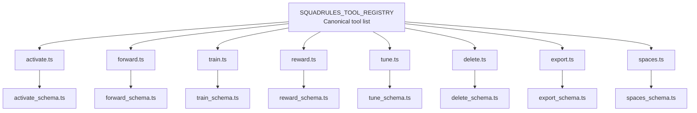

**Diagram sources**
- [tool-registry.ts:25-90](file://src/tools/tool-registry.ts#L25-L90)
- [activate.ts:231-280](file://src/tools/activate.ts#L231-L280)
- [forward.ts:91-339](file://src/tools/forward.ts#L91-L339)
- [train.ts:246-382](file://src/tools/train.ts#L246-L382)
- [reward.ts:132-175](file://src/tools/reward.ts#L132-L175)
- [tune.ts:19-69](file://src/tools/tune.ts#L19-L69)
- [delete.ts:73-115](file://src/tools/delete.ts#L73-L115)
- [export.ts:347-390](file://src/tools/export.ts#L347-L390)
- [spaces.ts:195-254](file://src/tools/spaces.ts#L195-L254)

**Section sources**
- [tool-registry.ts:16-24](file://src/tools/tool-registry.ts#L16-L24)

## Core Components
- Canonical registry: SQUADRULES_TOOL_REGISTRY defines the single source of truth for tool names, titles, descriptions, UI metadata, and Zod schemas.
- Schema layer: Each tool exports strict Zod schemas for inputs and outputs, ensuring consistent validation across MCP, HTTP, and CLI surfaces.
- Registration layer: Each tool module exposes a register function that binds the schema to server.registerTool, wraps execution with metrics, and returns structured content.
- Execution layer: Each tool exposes an execute function implementing business logic, interacting with memory stores, Qdrant services, runtime stores, and external capabilities.

Key responsibilities:
- activate: search and select adapters; optionally route to authoring workflow
- forward: run adapter layers, manage execution state, validate solutions, handle proof-of-work and user-input challenges
- train: store adapters/artifacts, fork from existing adapters, batch directory training
- reward: record outcomes, compute eligibility, persist metrics and traces
- tune: update adapter content or move adapters between spaces
- delete: remove adapters or layers
- export: serialize adapters, artifacts, traces, rewards, and skill bundles
- spaces: enumerate available spaces and adapter metadata

**Section sources**
- [tool-registry.ts:25-90](file://src/tools/tool-registry.ts#L25-L90)

## Architecture Overview
The tool system follows a layered architecture:
- Registry: central definition of tool metadata and schemas
- Validation: Zod schemas enforce input contracts and provide type inference
- Binding: register functions bind schemas to server handlers
- Execution: execute functions implement domain logic
- Persistence: memory store and Qdrant service provide storage and vector operations
- Runtime state: forward-runtime-store and execution-trace-store maintain long-running workflows
- Metrics: mcp-metrics tracks calls, durations, errors, and payload sizes

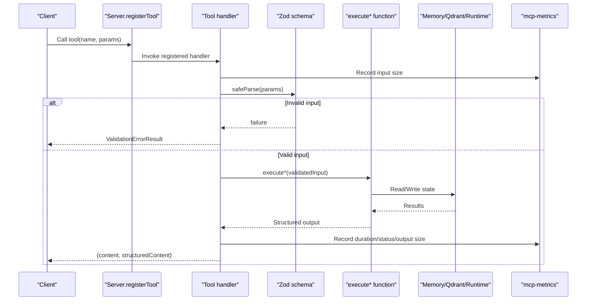

**Diagram sources**
- [activate.ts:231-280](file://src/tools/activate.ts#L231-L280)
- [forward.ts:91-339](file://src/tools/forward.ts#L91-L339)
- [train.ts:246-382](file://src/tools/train.ts#L246-L382)
- [reward.ts:132-175](file://src/tools/reward.ts#L132-L175)
- [tune.ts:19-69](file://src/tools/tune.ts#L19-L69)
- [delete.ts:73-115](file://src/tools/delete.ts#L73-L115)
- [export.ts:347-390](file://src/tools/export.ts#L347-L390)
- [spaces.ts:195-254](file://src/tools/spaces.ts#L195-L254)

## Detailed Component Analysis

### activate
Purpose:
- Select the best matching adapter for a query
- Support refinement sequences via execution_id
- Route to authoring workflow when authoring context is provided

Input schema highlights:
- query: activation query string
- execution_id: optional UUID for refinement sequences
- space/space_id: scope results to a space
- max_choices: bounded number of choices
- authoring: optional authoring context for create/review/update flows

Output schema highlights:
- must_obey: always true
- message: human-readable guidance
- next_action: directive to pick one choice and follow its next_action
- execution_id: echoed back for refinement
- choices: discriminated union of match/refine/create roles
- transport: stdio or http hint
- squadrules_local_artifact_dir: client-resolved artifact directories

Execution context:
- Uses memory store and Qdrant service for search
- Optionally runs within a space context
- Tracks refinement counts and includes refine footer for early refinements

Error handling:
- Input validation errors return teaching-friendly messages
- Rate-limiting errors are converted to MCP-compatible responses
- Authoring workflow requires valid target adapter existence

Async operation handling:
- Asynchronous artifact loading per choice
- Space-scoped search execution

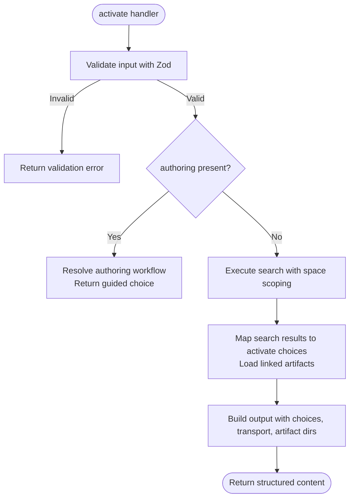

**Diagram sources**
- [activate.ts:168-229](file://src/tools/activate.ts#L168-L229)
- [activate.ts:231-280](file://src/tools/activate.ts#L231-L280)

State management:
- Refinement count stored per execution_id
- Local artifact directory hints provided to clients

Complex interactions:
- Linked artifacts require materialization before running shell contracts
- Transport mode affects artifact retrieval strategy

**Section sources**
- [activate_schema.ts:86-139](file://src/tools/activate_schema.ts#L86-L139)
- [activate.ts:168-229](file://src/tools/activate.ts#L168-L229)
- [activate.ts:231-280](file://src/tools/activate.ts#L231-L280)

### forward
Purpose:
- Execute the first or next adapter layer
- Manage multi-step workflows with execution_id
- Validate solutions against contract types and proof-of-work requirements
- Handle user-input elicitation and missing proof challenges

Input schema highlights:
- uri: adapter or layer URI
- solution: optional; required only for continuation calls
- authoring: optional; fixed for authoring workflows

Output schema highlights:
- current_layer: markdown view of the active layer
- contract: expected payload shape for this layer
- next_action: instruction for the next step
- execution_id: persisted across continuation calls
- next_call: either forward or reward continuation
- proof_hash: optional proof hash for chained steps

Execution context:
- Loads memory for the given URI
- Starts new execution if starting a run
- Pins layer manifest on first forward to prevent UUID churn
- Applies solutions to previous steps when appropriate
- Handles proof-of-work submission and missing proof redirections

Error handling:
- NOT_FOUND for missing layers/adapters
- AUTHORING_CONTEXT_MISMATCH for invalid authoring continuations
- MISSING_PROOF redirects to required prior steps
- Quality updates recorded on success/failure

Async operation handling:
- Asynchronous layer resolution and trace appending
- Fire-and-forget trace persistence

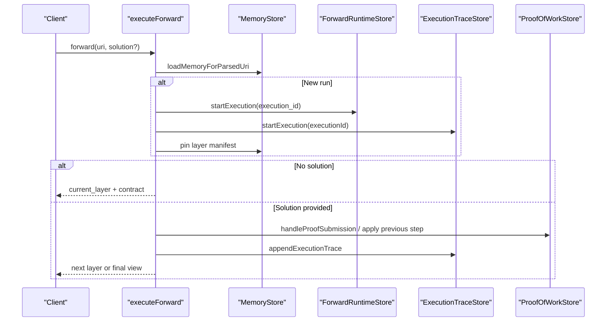

**Diagram sources**
- [forward.ts:91-339](file://src/tools/forward.ts#L91-L339)

State management:
- execution_id persists across continuation calls
- authoring context validated and locked per run
- slug disambiguation note preserved for ambiguous starts

Complex interactions:
- User-input elicitation can redirect to interactive prompts
- Previous-step application allows correcting earlier layers

**Section sources**
- [forward_schema.ts:234-318](file://src/tools/forward_schema.ts#L234-L318)
- [forward.ts:91-339](file://src/tools/forward.ts#L91-L339)

### train
Purpose:
- Register new adapters or artifacts
- Fork from existing adapters
- Batch train from directories

Input schema highlights:
- content: markdown or artifact source
- llm_model_id: evaluator attribution
- force_update: overwrite behavior
- protocol_version: adapter version tag
- space: target space
- source_adapter_uri: fork source
- mime/artifact_name/adapter_uri: artifact mode fields
- relative_path: skill-root-relative path for artifacts
- review_evidence: critic-loop proof for markdown adapters
- directory/recursive: batch train options

Output schema highlights:
- items: stored URIs and metadata
- status: stored
- batch_manifest: per-file results for directory training

Execution context:
- Resolves content from input or source adapter dump
- Validates MIME and artifact fields
- Requires review evidence for markdown adapters
- Delegates to train-store for persistence
- Builds output URIs and labels

Error handling:
- Custom TrainError codes normalized into user-friendly payloads
- Duplicate adapter and similar adapter detection
- Directory scanning and file read errors captured in batch manifest

Async operation handling:
- Parallel item mapping and adapter resolution
- Batch processing with per-file error tracking

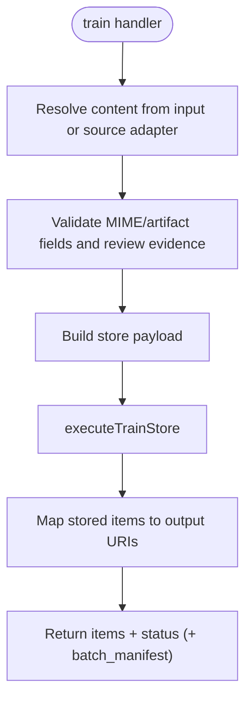

**Diagram sources**
- [train.ts:137-244](file://src/tools/train.ts#L137-L244)
- [train.ts:246-382](file://src/tools/train.ts#L246-L382)

State management:
- Space context resolved and narrowed for writes
- Forking sets internal flags for new adapter allocation

Complex interactions:
- Directory-based batch training invokes executeTrain recursively
- Artifact relative paths normalized and validated

**Section sources**
- [train_schema.ts:54-199](file://src/tools/train_schema.ts#L54-L199)
- [train.ts:137-244](file://src/tools/train.ts#L137-L244)
- [train.ts:246-382](file://src/tools/train.ts#L246-L382)

### reward
Purpose:
- Record outcome and optional score/feedback for a completed layer
- Compute eligibility for SFT and preference datasets
- Persist metrics and execution trace rewards

Input schema highlights:
- uri: layer URI
- outcome: success or failure
- score: optional normalized score
- feedback: optional text
- rater/llm_model_id: evaluator identity
- rubric_version: policy version tag

Output schema highlights:
- results: per-layer evaluation details
- total_rated/total_failed: counters
- next_call: null

Execution context:
- Validates layer URI
- Guards against rewarding failed proofs as success
- Computes evaluation label and blockers
- Persists reward metrics and trace data

Error handling:
- INVALID_URI for non-layer URIs
- REWARD_SUCCESS_CONFLICTS_FAILED_PROOF for conflicting outcomes
- REWARD_FAILED for persistence failures

Async operation handling:
- Asynchronous metric application and trace persistence

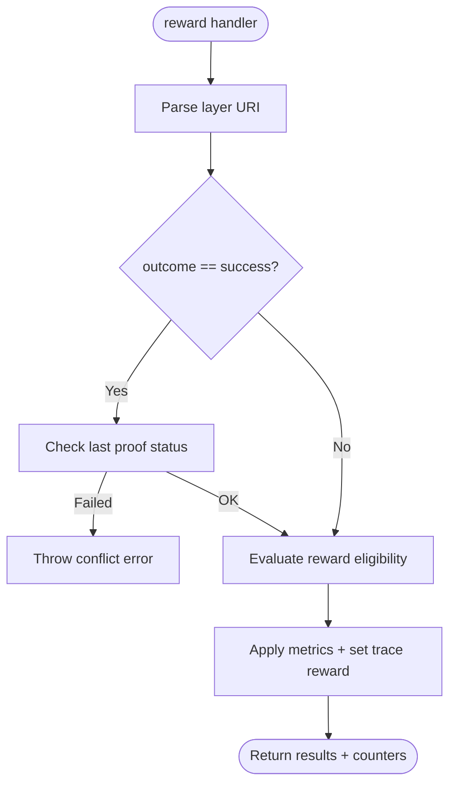

**Diagram sources**
- [reward.ts:28-130](file://src/tools/reward.ts#L28-L130)
- [reward.ts:132-175](file://src/tools/reward.ts#L132-L175)

State management:
- Execution trace reward keyed by execution_id
- Evaluator identity influences export eligibility

Complex interactions:
- Rubric version and model ID affect dataset eligibility

**Section sources**
- [reward_schema.ts:10-53](file://src/tools/reward_schema.ts#L10-L53)
- [reward.ts:28-130](file://src/tools/reward.ts#L28-L130)
- [reward.ts:132-175](file://src/tools/reward.ts#L132-L175)

### tune
Purpose:
- Update adapter content or move adapters between spaces
- Require critic-loop review evidence for content edits

Input schema highlights:
- uris: non-empty array of adapter or layer URIs
- content: updated bodies (one per URI)
- updates: advanced field updates
- space: move targets
- review_evidence: required when content edits are provided

Output schema highlights:
- results: per-URI status and message
- total_updated/total_failed: counters

Execution context:
- Validates content length parity with URIs
- Ensures at least one of content/updates/space is provided
- Lazily loads Qdrant service if not injected
- Invalidates caches after successful updates

Error handling:
- Input validation errors return teaching-friendly messages
- Cache invalidation ensures subsequent reads reflect changes

Async operation handling:
- Lazy import of Qdrant service
- Asynchronous cache invalidation

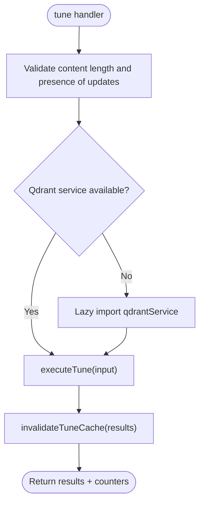

**Diagram sources**
- [tune.ts:19-69](file://src/tools/tune.ts#L19-L69)

State management:
- Cache invalidation prevents stale reads after updates

Complex interactions:
- Space moves applied after content updates

**Section sources**
- [tune_schema.ts:14-70](file://src/tools/tune_schema.ts#L14-L70)
- [tune.ts:19-69](file://src/tools/tune.ts#L19-L69)

### delete
Purpose:
- Delete adapters or layers by URI
- Provide per-URI results with aggregated counters

Input schema highlights:
- uris: non-empty array of adapter or layer URIs

Output schema highlights:
- results: per-URI status and message
- total_deleted/total_failed: counters

Execution context:
- Parses URIs and distinguishes adapter vs layer
- For adapters, resolves canonical slug and deletes all layers
- For layers, deletes directly

Error handling:
- Per-URI errors captured without aborting the entire batch

Async operation handling:
- Iterative deletion with per-item try/catch

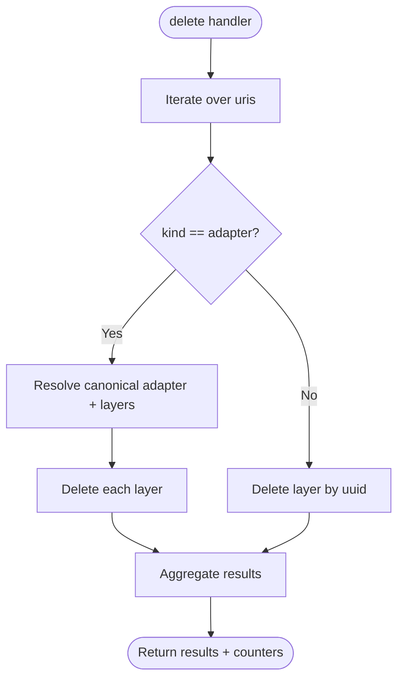

**Diagram sources**
- [delete.ts:12-71](file://src/tools/delete.ts#L12-L71)
- [delete.ts:73-115](file://src/tools/delete.ts#L73-L115)

State management:
- Aggregates deleted/failed counts across URIs

Complex interactions:
- Adapter deletion cascades to all layers

**Section sources**
- [delete_schema.ts:14-33](file://src/tools/delete_schema.ts#L14-L33)
- [delete.ts:12-71](file://src/tools/delete.ts#L12-L71)
- [delete.ts:73-115](file://src/tools/delete.ts#L73-L115)

### export
Purpose:
- Export adapters, artifacts, traces, rewards, and skill bundles
- Support inline base64 delivery or short-lived download references

Input schema highlights:
- uri/adapters/all_adapters: selection modes (exactly one)
- format: markdown, trace_jsonl, reward_jsonl, sft_jsonl, preference_jsonl, source, skill_tree, skill_zip
- delivery: download_ref or inline_base64 (only for skill_zip)
- include_reward: include reward data for training formats
- directory: bulk markdown export to filesystem

Output schema highlights:
- content/content_type: serialized export
- item_count/export_adapter_count: bundle sizing
- skill_bundle_manifest/download_ref: ZIP delivery metadata
- directory_manifest: per-file write results

Execution context:
- Resolves adapter URIs based on selection mode
- Branches by format to produce markdown, JSONL, skill tree, or ZIP
- For skill_zip, supports inline base64 or capability-backed download URL
- Validates directory access and writes per-adapter files

Error handling:
- Format-specific constraints enforced by schema superRefine
- Unsupported format throws descriptive error

Async operation handling:
- Telemetry context wraps export execution
- Capability minting for secure downloads

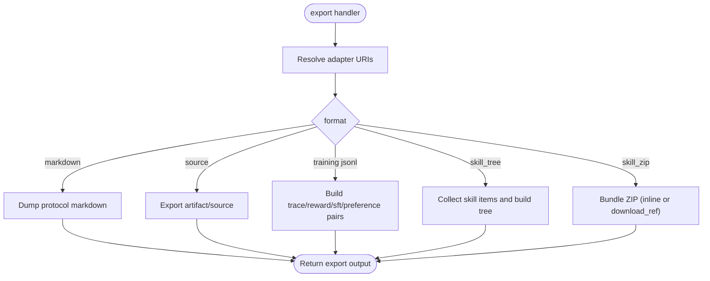

**Diagram sources**
- [export.ts:67-345](file://src/tools/export.ts#L67-L345)
- [export.ts:347-390](file://src/tools/export.ts#L347-L390)

State management:
- Space metadata included for markdown exports
- Download capability minted for large ZIP bundles

Complex interactions:
- Directory-based bulk export writes files and returns manifest
- Skill bundle manifest describes skills and entrypoints

**Section sources**
- [export_schema.ts:44-162](file://src/tools/export_schema.ts#L44-L162)
- [export.ts:67-345](file://src/tools/export.ts#L67-L345)
- [export.ts:347-390](file://src/tools/export.ts#L347-L390)

### spaces
Purpose:
- List available spaces with adapter counts and optional adapter titles/artifacts
- Render optional HTML widget for UI consumption

Input schema highlights:
- include_adapter_titles: include adapter metadata
- include_widget_html: append HTML table
- include_artifacts: include artifact metadata per adapter

Output schema highlights:
- spaces: array of space info with adapter lists

Execution context:
- Enumerates allowed spaces plus app space
- Scrolls memory records per space and aggregates adapter information
- Builds artifact metadata when requested

Error handling:
- Internal errors logged and returned as generic error payloads

Async operation handling:
- Asynchronous space enumeration and scrolling

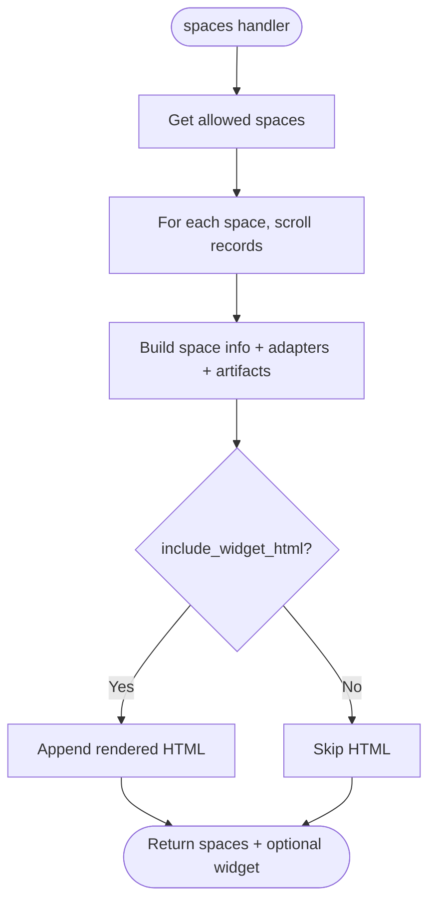

**Diagram sources**
- [spaces.ts:172-189](file://src/tools/spaces.ts#L172-L189)
- [spaces.ts:195-254](file://src/tools/spaces.ts#L195-L254)

State management:
- Space names and kinds derived from context
- Artifact filtering applies allowed MIME types

Complex interactions:
- Widget rendering implies adapter title loading

**Section sources**
- [spaces_schema.ts:3-53](file://src/tools/spaces_schema.ts#L3-L53)
- [spaces.ts:172-189](file://src/tools/spaces.ts#L172-L189)
- [spaces.ts:195-254](file://src/tools/spaces.ts#L195-L254)

## Dependency Analysis
The registry centralizes tool definitions and imports schemas from dedicated modules. Each tool implementation depends on:
- Memory store for adapter and layer data
- Qdrant service for vector operations and persistence
- Runtime stores for forward execution and execution traces
- Utilities for tenant context, space context, and URI parsing
- Metrics for observability

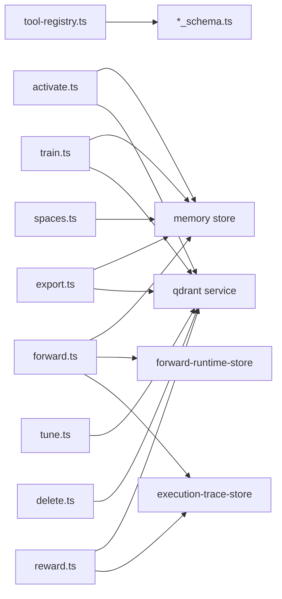

**Diagram sources**
- [tool-registry.ts:25-90](file://src/tools/tool-registry.ts#L25-L90)
- [activate.ts:168-229](file://src/tools/activate.ts#L168-L229)
- [forward.ts:91-339](file://src/tools/forward.ts#L91-L339)
- [train.ts:137-244](file://src/tools/train.ts#L137-L244)
- [reward.ts:28-130](file://src/tools/reward.ts#L28-L130)
- [tune.ts:19-69](file://src/tools/tune.ts#L19-L69)
- [delete.ts:12-71](file://src/tools/delete.ts#L12-L71)
- [export.ts:67-345](file://src/tools/export.ts#L67-L345)
- [spaces.ts:172-189](file://src/tools/spaces.ts#L172-L189)

**Section sources**
- [tool-registry.ts:25-90](file://src/tools/tool-registry.ts#L25-L90)

## Performance Considerations
- Schema validation overhead is minimized by using Zod schemas once per call and reusing types via z.infer.
- Async operations are parallelized where possible (e.g., artifact loading in activate, item mapping in train).
- Metrics capture input/output sizes and durations for performance monitoring.
- Directory-based operations (train/export) avoid large in-memory payloads by writing to disk and returning manifests.
- Lazy loading of Qdrant service in tune reduces startup cost when not needed.

[No sources needed since this section provides general guidance]

## Troubleshooting Guide
Common issues and resolutions:
- Activation refinement loop: If activate repeatedly suggests refine, echo execution_id and adjust query.
- Forward missing solution: Omit solution on first call; include solution.type and evidence on continuation calls.
- Proof-of-work conflicts: If reward success conflicts with failed proof, fix the step and retry or record failure.
- Train duplicate adapter: Use force_update or choose a different label; inspect similarity suggestions.
- Export unsupported format: Ensure format matches selection mode; use skill_zip for multi-adapter bundles.
- Spaces widget not rendering: Enable include_widget_html; ensure adapter titles are loaded.

**Section sources**
- [activate.ts:231-280](file://src/tools/activate.ts#L231-L280)
- [forward_schema.ts:234-258](file://src/tools/forward_schema.ts#L234-L258)
- [reward.ts:28-54](file://src/tools/reward.ts#L28-L54)
- [train.ts:334-382](file://src/tools/train.ts#L334-L382)
- [export_schema.ts:55-117](file://src/tools/export_schema.ts#L55-L117)
- [spaces.ts:195-254](file://src/tools/spaces.ts#L195-L254)

## Conclusion
The SquadRules MCP tool system provides a robust, schema-driven registry for adapter lifecycle management and workflow execution. The centralized registry ensures consistency across surfaces, while Zod schemas enforce strict contracts. Tools implement clear execution contexts, state management, and error handling patterns, enabling agents to operate autonomously and reliably. The architecture supports complex workflows through forward chaining, proof-of-work validation, and reward-based evaluation, with comprehensive export and multi-tenancy capabilities.

[No sources needed since this section summarizes without analyzing specific files]