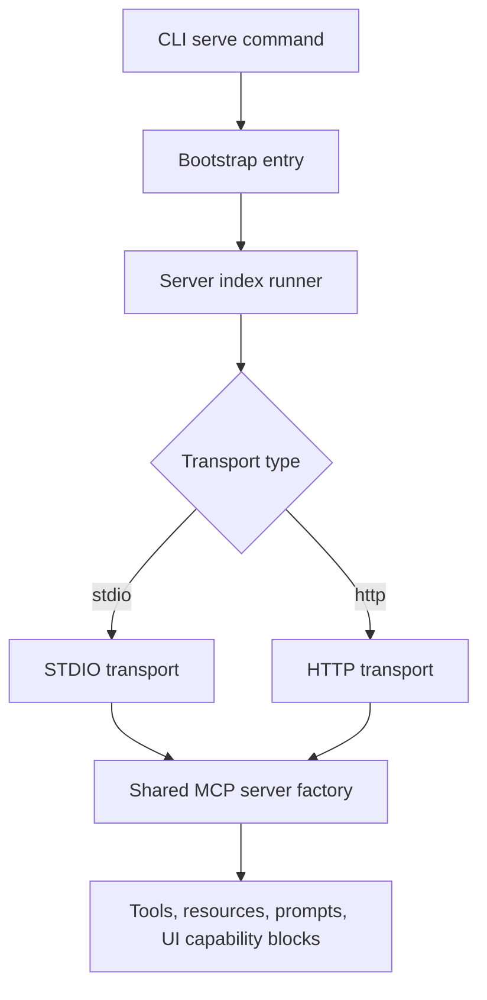
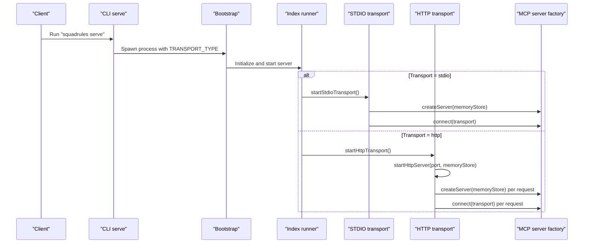
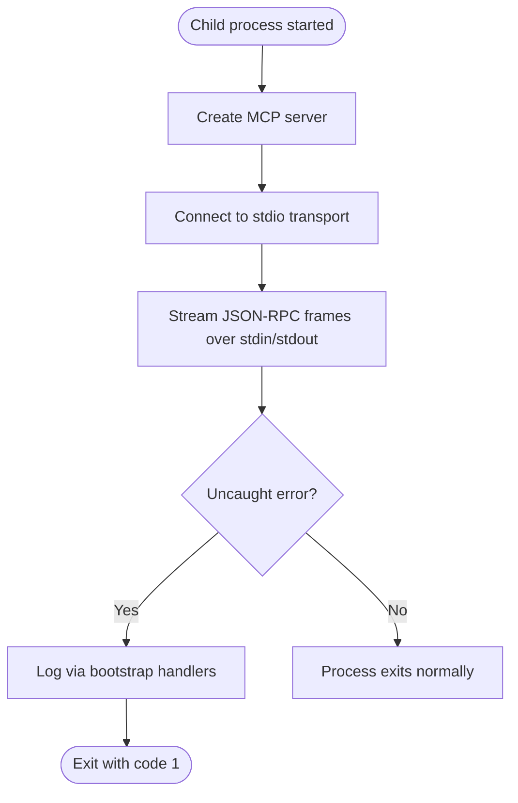
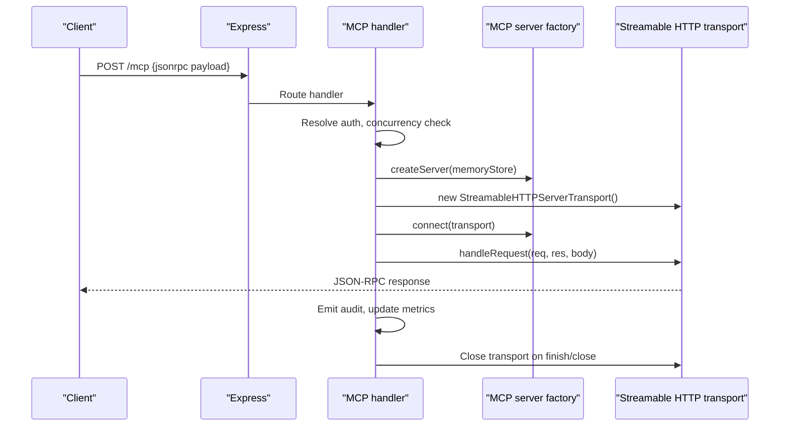
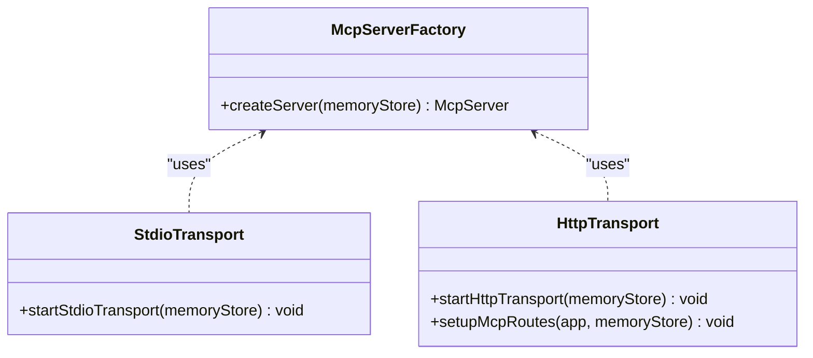
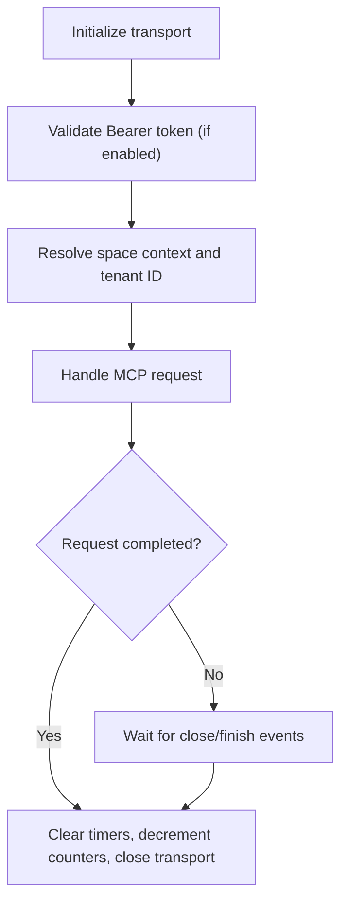
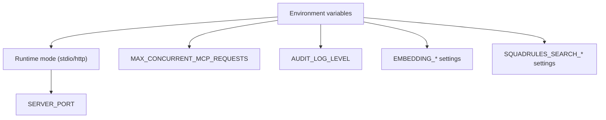
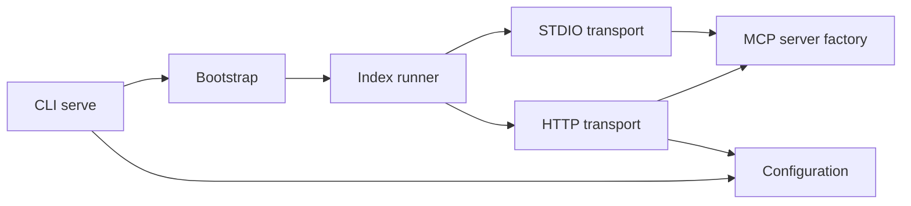

# Transport Layer & Connection Management

<cite>
**Referenced Files in This Document**
- [bootstrap.ts](file://src/bootstrap.ts)
- [index.ts](file://src/index.ts)
- [server.ts](file://src/server.ts)
- [stdio-server.ts](file://src/stdio/stdio-server.ts)
- [http-server.ts](file://src/http/http-server.ts)
- [http-mcp-handler.ts](file://src/http/http-mcp-handler.ts)
- [serve.ts](file://src/cli/commands/serve.ts)
- [config.ts](file://src/config.ts)
</cite>

## Table of Contents
1. [Introduction](#introduction)
2. [Project Structure](#project-structure)
3. [Core Components](#core-components)
4. [Architecture Overview](#architecture-overview)
5. [Detailed Component Analysis](#detailed-component-analysis)
6. [Dependency Analysis](#dependency-analysis)
7. [Performance Considerations](#performance-considerations)
8. [Troubleshooting Guide](#troubleshooting-guide)
9. [Conclusion](#conclusion)

## Introduction
This document explains the MCP transport layer and connection management system, focusing on:
- STDIO transport implementation and process lifecycle
- HTTP transport with Streamable HTTP (MCP over HTTP), request handling, concurrency control, and error propagation
- The transport abstraction that enables dual transport support via a shared MCP server factory
- Connection initialization, authentication handshake, session context, and graceful shutdown
- Configuration options, performance tuning parameters, monitoring, retry behavior, and debugging techniques

The design centers around a single MCP server factory that can be connected to either STDIO or HTTP transports, allowing the same tooling and capabilities to run in local interactive mode or as a networked service.

## Project Structure
At runtime, the application boots through an entrypoint that installs global error handlers and then starts the server. The CLI `serve` command selects the transport and spawns the bootstrap process with appropriate environment variables.

**Diagram sources**
- [serve.ts:92-195](file://src/cli/commands/serve.ts#L92-L195)
- [bootstrap.ts:1-34](file://src/bootstrap.ts#L1-L34)
- [stdio-server.ts:6-12](file://src/stdio/stdio-server.ts#L6-L12)
- [http-server.ts:22-58](file://src/http/http-server.ts#L22-L58)
- [server.ts:44-113](file://src/server.ts#L44-L113)

**Section sources**
- [bootstrap.ts:1-34](file://src/bootstrap.ts#L1-L34)
- [serve.ts:92-195](file://src/cli/commands/serve.ts#L92-L195)

## Core Components
- Bootstrap and process-level error handling
- CLI transport selection and child process orchestration
- Shared MCP server factory for tools, resources, and capabilities
- STDIO transport adapter
- HTTP transport adapter with per-request MCP server instances
- Centralized configuration and runtime mode resolution

Key responsibilities:
- Bootstrap: install uncaught exception and rejection handlers before app code loads.
- CLI serve: parse flags, resolve transport and port, spawn bootstrap process with correct env.
- Server factory: create and configure the MCP server once per process (or per request for HTTP).
- STDIO: connect the MCP server to a stdio transport for local interactive use.
- HTTP: register Express routes, handle auth, enforce concurrency limits, and manage request lifecycle.

**Section sources**
- [bootstrap.ts:1-34](file://src/bootstrap.ts#L1-L34)
- [serve.ts:17-60](file://src/cli/commands/serve.ts#L17-L60)
- [server.ts:44-113](file://src/server.ts#L44-L113)
- [stdio-server.ts:6-12](file://src/stdio/stdio-server.ts#L6-L12)
- [http-server.ts:22-58](file://src/http/http-server.ts#L22-L58)
- [http-mcp-handler.ts:115-348](file://src/http/http-mcp-handler.ts#L115-L348)
- [config.ts:245-282](file://src/config.ts#L245-L282)

## Architecture Overview
The transport abstraction is implemented by creating an MCP server instance from a shared factory and connecting it to a transport-specific adapter. For HTTP, each incoming request creates its own MCP server and transport to avoid transport-level contention and enable concurrent processing.

**Diagram sources**
- [serve.ts:92-195](file://src/cli/commands/serve.ts#L92-L195)
- [bootstrap.ts:1-34](file://src/bootstrap.ts#L1-L34)
- [stdio-server.ts:6-12](file://src/stdio/stdio-server.ts#L6-L12)
- [http-server.ts:22-58](file://src/http/http-server.ts#L22-L58)
- [server.ts:44-113](file://src/server.ts#L44-L113)

## Detailed Component Analysis

### STDIO Transport Implementation
Responsibilities:
- Create the MCP server using the shared factory
- Connect it to a stdio transport provided by the SDK
- Reserve stdout for protocol frames; logs go to stderr

Process lifecycle:
- Parent CLI process spawns a child process running the bootstrap
- Child process initializes the server and connects to stdio
- The parent forwards signals and exit codes to ensure clean shutdown

Message streaming:
- Messages are streamed over stdin/stdout as JSON-RPC frames defined by the SDK’s stdio transport

Error handling and cleanup:
- Global error handlers log uncaught exceptions and rejections
- Child process errors and exit codes are propagated to the parent

Resource cleanup:
- On process termination, Node cleans up stdio streams
- No explicit resource teardown beyond process exit

**Diagram sources**
- [bootstrap.ts:12-33](file://src/bootstrap.ts#L12-L33)
- [stdio-server.ts:6-12](file://src/stdio/stdio-server.ts#L6-L12)

**Section sources**
- [stdio-server.ts:6-12](file://src/stdio/stdio-server.ts#L6-L12)
- [bootstrap.ts:12-33](file://src/bootstrap.ts#L12-L33)
- [serve.ts:161-192](file://src/cli/commands/serve.ts#L161-L192)

### HTTP Transport with Streamable HTTP
Responsibilities:
- Register Express middleware, auth, health, API, and MCP routes
- Handle MCP requests at POST /mcp with per-request MCP server instances
- Enforce concurrency limits and provide structured error responses
- Integrate audit logging and correlation IDs

Connection pooling and request/response patterns:
- Per-request MCP server and transport creation avoids transport contention
- Requests are handled concurrently up to a configured limit
- Long-running operations are tracked for timeout warnings and cancellation events

Authentication handshake:
- Optional Bearer token validation against trusted issuers and allowed audiences
- Special handling for listOfferingsForUI to return proper auth-related responses

Session management:
- Space context and tenant ID are resolved per request
- AsyncLocalStorage captures request-scoped context for downstream handlers

Graceful shutdown:
- Request completion and close events clear timers and release resources
- Concurrency counters are decremented in finally blocks

**Diagram sources**
- [http-mcp-handler.ts:115-348](file://src/http/http-mcp-handler.ts#L115-L348)
- [http-server.ts:22-58](file://src/http/http-server.ts#L22-L58)
- [server.ts:44-113](file://src/server.ts#L44-L113)

**Section sources**
- [http-mcp-handler.ts:44-105](file://src/http/http-mcp-handler.ts#L44-L105)
- [http-mcp-handler.ts:115-348](file://src/http/http-mcp-handler.ts#L115-L348)
- [http-server.ts:22-58](file://src/http/http-server.ts#L22-L58)

### Transport Abstraction Layer
The abstraction is achieved by:
- A shared MCP server factory that configures tools, resources, prompts, and UI capabilities
- Transport adapters that connect the same server to different transports

Benefits:
- Single source of truth for MCP capabilities
- Consistent behavior across STDIO and HTTP modes
- Simplified testing and maintenance

**Diagram sources**
- [server.ts:44-113](file://src/server.ts#L44-L113)
- [stdio-server.ts:6-12](file://src/stdio/stdio-server.ts#L6-L12)
- [http-server.ts:22-58](file://src/http/http-server.ts#L22-L58)

**Section sources**
- [server.ts:44-113](file://src/server.ts#L44-L113)
- [stdio-server.ts:6-12](file://src/stdio/stdio-server.ts#L6-L12)
- [http-server.ts:22-58](file://src/http/http-server.ts#L22-L58)

### Connection Initialization, Authentication, Session Management, and Shutdown

#### Connection Initialization
- STDIO: initialize server and connect to stdio transport
- HTTP: initialize Express app, register routes, start listener on configured port

#### Authentication Handshake
- Bearer token validation when enabled
- Special-case handling for UI discovery endpoints to return proper auth responses

#### Session Management
- Space context and tenant ID resolved per request
- AsyncLocalStorage used to propagate request-scoped context

#### Graceful Shutdown
- Request completion and close events clear timers and release resources
- Concurrency counters decremented in finally blocks
- Process-level error handlers ensure unhandled exceptions are logged

**Diagram sources**
- [http-mcp-handler.ts:44-105](file://src/http/http-mcp-handler.ts#L44-L105)
- [http-mcp-handler.ts:194-348](file://src/http/http-mcp-handler.ts#L194-L348)

**Section sources**
- [http-mcp-handler.ts:44-105](file://src/http/http-mcp-handler.ts#L44-L105)
- [http-mcp-handler.ts:194-348](file://src/http/http-mcp-handler.ts#L194-L348)

### Configuration Options and Performance Tuning

#### Transport Selection and Ports
- Transport type: selected via CLI flag or environment variable
- HTTP listen port: configurable via CLI flag or environment variable

#### Concurrency and Backpressure
- Maximum concurrent MCP requests enforced; excess requests receive 503 with Retry-After guidance

#### Audit Logging
- Configurable verbosity for MCP audit events written to file

#### Embedding and Search Tuning
- Embedding provider, model, retries, and latency thresholds
- Search overfetch factor, max fetch, group collapse

**Diagram sources**
- [serve.ts:47-60](file://src/cli/commands/serve.ts#L47-L60)
- [config.ts:245-282](file://src/config.ts#L245-L282)
- [config.ts:87-126](file://src/config.ts#L87-L126)

**Section sources**
- [serve.ts:47-60](file://src/cli/commands/serve.ts#L47-L60)
- [config.ts:87-126](file://src/config.ts#L87-L126)
- [config.ts:245-282](file://src/config.ts#L245-L282)

## Dependency Analysis
The transport layer depends on:
- CLI serve for transport selection and process orchestration
- Bootstrap for process-level error handling
- Server factory for MCP capabilities
- HTTP handler for request lifecycle, auth, and concurrency control
- Configuration module for runtime settings

**Diagram sources**
- [serve.ts:92-195](file://src/cli/commands/serve.ts#L92-L195)
- [bootstrap.ts:1-34](file://src/bootstrap.ts#L1-L34)
- [stdio-server.ts:6-12](file://src/stdio/stdio-server.ts#L6-L12)
- [http-server.ts:22-58](file://src/http/http-server.ts#L22-L58)
- [server.ts:44-113](file://src/server.ts#L44-L113)
- [config.ts:245-282](file://src/config.ts#L245-L282)

**Section sources**
- [serve.ts:92-195](file://src/cli/commands/serve.ts#L92-L195)
- [bootstrap.ts:1-34](file://src/bootstrap.ts#L1-L34)
- [server.ts:44-113](file://src/server.ts#L44-L113)
- [http-mcp-handler.ts:115-348](file://src/http/http-mcp-handler.ts#L115-L348)
- [config.ts:245-282](file://src/config.ts#L245-L282)

## Performance Considerations
- Concurrency control: Use MAX_CONCURRENT_MCP_REQUESTS to cap in-flight requests and prevent overload. Excess requests receive 503 with Retry-After guidance.
- Per-request MCP servers: Avoids transport contention and allows high concurrency on HTTP.
- Timeout warnings: Requests exceeding thresholds are logged to aid performance diagnostics.
- Audit logging: Configure AUDIT_LOG_LEVEL to balance observability and overhead.
- Embedding retries: Tune EMBEDDING_MAX_RETRIES and related settings to handle external provider throttling gracefully.
- Search tuning: Adjust SQUADRULES_SEARCH_OVERFETCH_FACTOR, SQUADRULES_SEARCH_MAX_FETCH, and group collapse to optimize result quality and latency.

[No sources needed since this section provides general guidance]

## Troubleshooting Guide
Common issues and remedies:
- “Already connected to a transport” errors: Indicates reuse of a transport instance; clients should start a new MCP session after a short wait.
- Overloaded server: When concurrent requests exceed the limit, clients receive 503 with Retry-After; implement exponential backoff with jitter.
- Authentication failures: Ensure Bearer tokens are valid and match trusted issuers and allowed audiences; UI discovery endpoints require proper auth headers.
- Long-running requests: Monitor timeout warnings and client cancellation logs; consider adjusting client timeouts and server-side thresholds.
- Process crashes: Check bootstrap error logs for uncaught exceptions and unhandled rejections.

Debugging techniques:
- Enable debug logging via LOG_LEVEL to capture detailed request lifecycle events.
- Inspect audit logs at appropriate AUDIT_LOG_LEVEL for request/response replay.
- Use correlation IDs and request IDs to trace requests across logs.
- Validate environment variables for transport type, ports, and auth configuration.

**Section sources**
- [http-mcp-handler.ts:75-105](file://src/http/http-mcp-handler.ts#L75-L105)
- [http-mcp-handler.ts:168-192](file://src/http/http-mcp-handler.ts#L168-L192)
- [http-mcp-handler.ts:199-286](file://src/http/http-mcp-handler.ts#L199-L286)
- [bootstrap.ts:12-33](file://src/bootstrap.ts#L12-L33)
- [config.ts:97-105](file://src/config.ts#L97-L105)

## Conclusion
The transport layer provides a robust abstraction over STDIO and HTTP transports, enabling consistent MCP capabilities across local and networked deployments. The HTTP transport includes strong concurrency controls, structured error handling, and comprehensive audit logging. Configuration is centralized and tunable for performance and observability. By following the guidance in this document, operators can deploy reliable, scalable MCP services and effectively diagnose transport-level issues.

[No sources needed since this section summarizes without analyzing specific files]