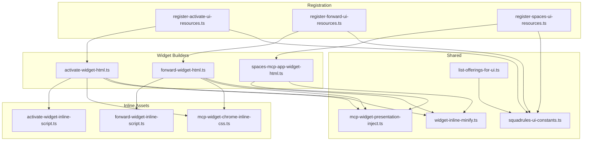
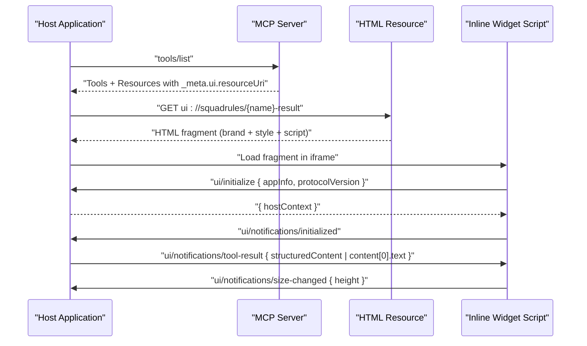
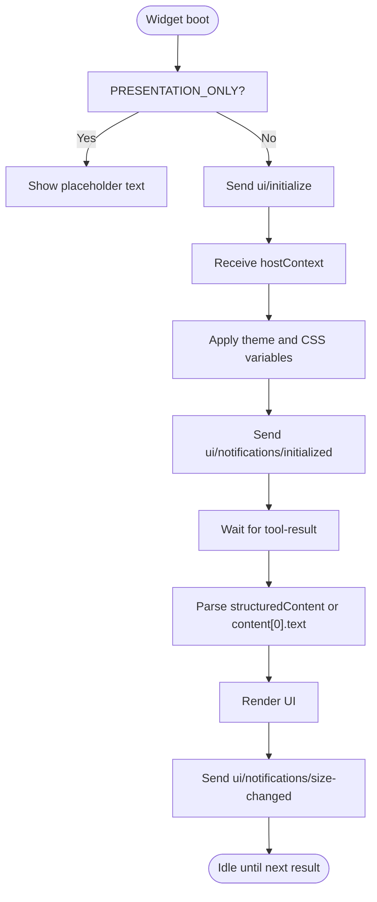
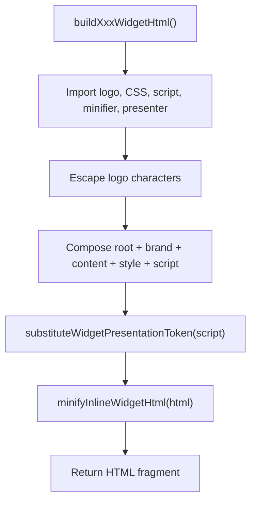
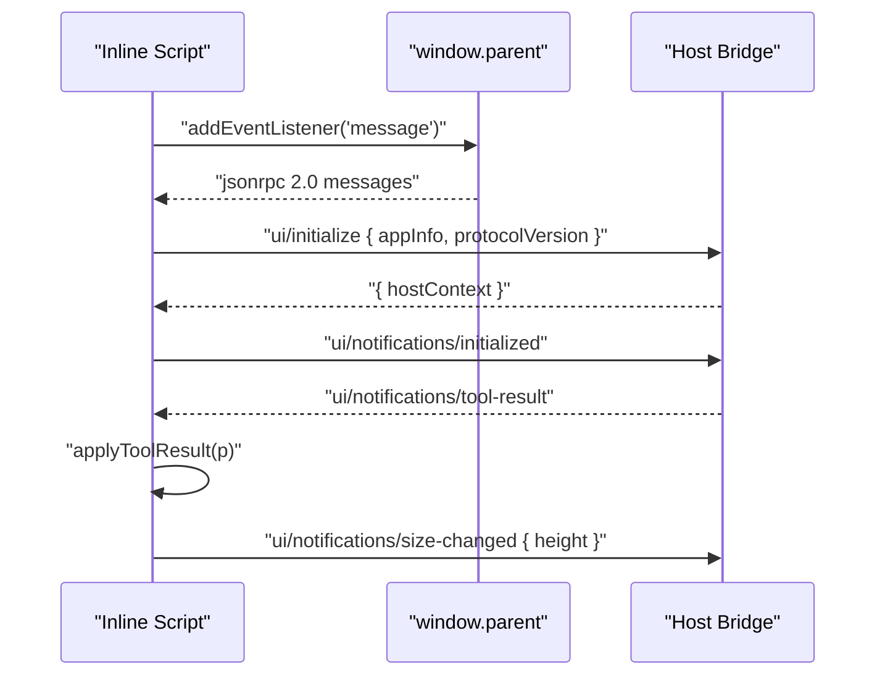
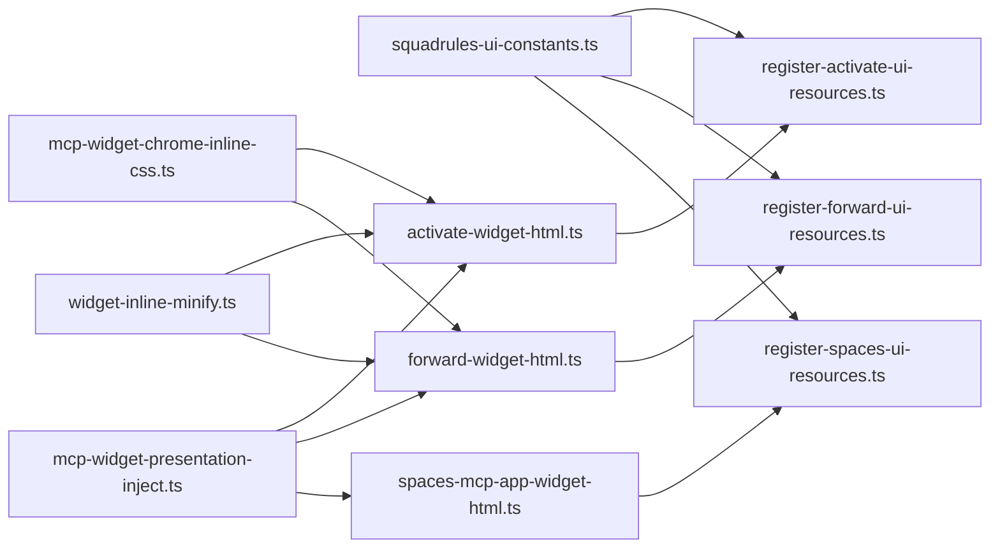
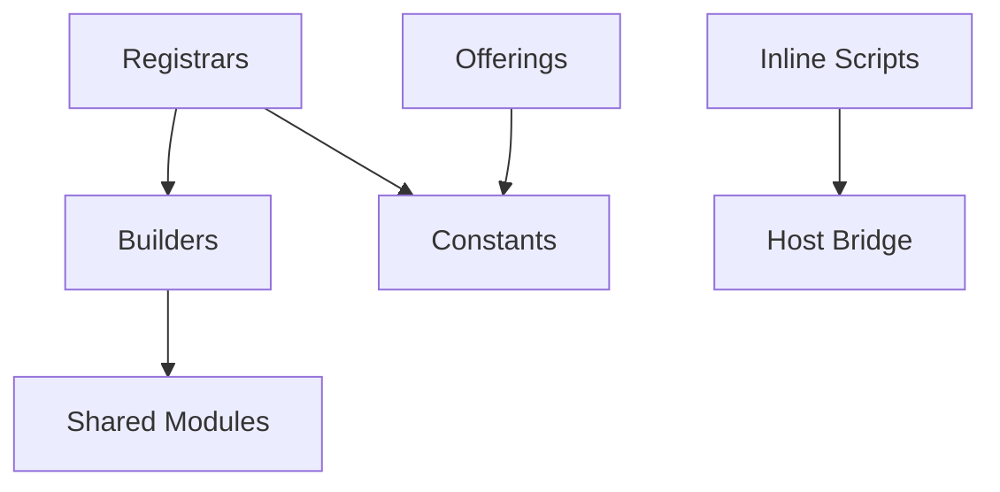

# Widget System & UI Integration

<cite>
**Referenced Files in This Document**
- [README.md](file://src/mcp-apps/README.md)
- [squadrules-ui-constants.ts](file://src/mcp-apps/squadrules-ui-constants.ts)
- [mcp-widget-chrome-inline-css.ts](file://src/mcp-apps/mcp-widget-chrome-inline-css.ts)
- [mcp-widget-presentation-inject.ts](file://src/mcp-apps/mcp-widget-presentation-inject.ts)
- [list-offerings-for-ui.ts](file://src/mcp-apps/list-offerings-for-ui.ts)
- [register-activate-ui-resources.ts](file://src/mcp-apps/register-activate-ui-resources.ts)
- [register-forward-ui-resources.ts](file://src/mcp-apps/register-forward-ui-resources.ts)
- [register-spaces-ui-resources.ts](file://src/mcp-apps/register-spaces-ui-resources.ts)
- [activate-widget-html.ts](file://src/mcp-apps/activate-widget-html.ts)
- [forward-widget-html.ts](file://src/mcp-apps/forward-widget-html.ts)
- [spaces-mcp-app-widget-html.ts](file://src/mcp-apps/spaces-mcp-app-widget-html.ts)
- [activate-widget-inline-script.ts](file://src/mcp-apps/activate-widget-inline-script.ts)
- [forward-widget-inline-script.ts](file://src/mcp-apps/forward-widget-inline-script.ts)
- [widget-inline-minify.ts](file://src/mcp-apps/widget-inline-minify.ts)
</cite>

## Table of Contents
1. [Introduction](#introduction)
2. [Project Structure](#project-structure)
3. [Core Components](#core-components)
4. [Architecture Overview](#architecture-overview)
5. [Detailed Component Analysis](#detailed-component-analysis)
6. [Dependency Analysis](#dependency-analysis)
7. [Performance Considerations](#performance-considerations)
8. [Troubleshooting Guide](#troubleshooting-guide)
9. [Conclusion](#conclusion)
10. [Appendices](#appendices)

## Introduction
This document explains the MCP widget system and UI integration framework used by the project. It covers how interactive HTML widgets are generated, injected, and rendered inside host iframes; how static assets and dynamic content are managed; and how the built-in activate, forward, and spaces widgets work end-to-end. It also documents the widget lifecycle, event handling, state synchronization with the host, styling guidelines, responsive behavior, accessibility considerations, and patterns for creating custom widgets.

The system is designed around MCP Apps (SEP-1865), where a tool returns structured data and a resource URI points to an HTML fragment that the host renders in a sandboxed iframe. The server assembles each widget at request time from three TypeScript string exports: HTML assembly, inline CSS, and inline JavaScript. Widgets communicate with the host via JSON-RPC 2.0 over `postMessage`.

## Project Structure
The widget system lives under `src/mcp-apps/`. Each widget follows a consistent layout:
- `{name}-widget-html.ts` — Assembles the root DOM node, shared chrome, inline style, and inline script.
- `{name}-widget-inline-css.ts` — Widget-specific CSS that imports shared tokens.
- `{name}-widget-inline-script.ts` — Self-contained IIFE implementing the MCP Apps handshake, message routing, rendering, and sizing notifications.
- `register-{name}-ui-resources.ts` — Registers both MCP App and Skybridge HTML resources on the server.

Shared modules provide URIs, MIME types, theme tokens, presentation-only injection, minification helpers, and UI offerings for discovery.



**Diagram sources**
- [activate-widget-html.ts:1-30](file://src/mcp-apps/activate-widget-html.ts#L1-L30)
- [forward-widget-html.ts:1-35](file://src/mcp-apps/forward-widget-html.ts#L1-L35)
- [spaces-mcp-app-widget-html.ts:1-410](file://src/mcp-apps/spaces-mcp-app-widget-html.ts#L1-L410)
- [activate-widget-inline-script.ts:1-453](file://src/mcp-apps/activate-widget-inline-script.ts#L1-L453)
- [forward-widget-inline-script.ts:1-520](file://src/mcp-apps/forward-widget-inline-script.ts#L1-L520)
- [mcp-widget-chrome-inline-css.ts:1-99](file://src/mcp-apps/mcp-widget-chrome-inline-css.ts#L1-L99)
- [register-activate-ui-resources.ts:1-41](file://src/mcp-apps/register-activate-ui-resources.ts#L1-L41)
- [register-forward-ui-resources.ts:1-41](file://src/mcp-apps/register-forward-ui-resources.ts#L1-L41)
- [register-spaces-ui-resources.ts:1-41](file://src/mcp-apps/register-spaces-ui-resources.ts#L1-L41)
- [squadrules-ui-constants.ts:1-71](file://src/mcp-apps/squadrules-ui-constants.ts#L1-L71)
- [mcp-widget-presentation-inject.ts:1-13](file://src/mcp-apps/mcp-widget-presentation-inject.ts#L1-L13)
- [widget-inline-minify.ts:1-21](file://src/mcp-apps/widget-inline-minify.ts#L1-L21)
- [list-offerings-for-ui.ts:1-257](file://src/mcp-apps/list-offerings-for-ui.ts#L1-L257)

**Section sources**
- [README.md:74-131](file://src/mcp-apps/README.md#L74-L131)
- [README.md:230-254](file://src/mcp-apps/README.md#L230-L254)

## Core Components
- Widget HTML builders assemble a minimal fragment containing a mount root, brand header, content area, inline styles, and inline scripts. They inject a presentation-only flag and minify output.
- Inline CSS provides shared tokens (colors, typography, dark mode) and base layout rules.
- Inline scripts implement the MCP Apps handshake, host context theming, JSON-RPC messaging, result parsing, error display, and size notifications.
- Registration files expose two MIME profiles per widget: MCP App (`text/html;profile=mcp-app`) and Skybridge (`text/html+skybridge`).
- Constants define URIs, tool metadata, and MIME types.
- Offerings builder exposes tools and resources for host discovery.

Key responsibilities:
- HTML generation: compose DOM structure and embed assets.
- CSS injection: include shared tokens and widget-specific styles.
- JS embedding: self-contained IIFE with postMessage bridge.
- Resource management: serve HTML fragments for multiple URIs and MIME types.
- Dependency resolution: constants and shared modules referenced by builders and registrars.

**Section sources**
- [activate-widget-html.ts:1-30](file://src/mcp-apps/activate-widget-html.ts#L1-L30)
- [forward-widget-html.ts:1-35](file://src/mcp-apps/forward-widget-html.ts#L1-L35)
- [spaces-mcp-app-widget-html.ts:1-410](file://src/mcp-apps/spaces-mcp-app-widget-html.ts#L1-L410)
- [mcp-widget-chrome-inline-css.ts:1-99](file://src/mcp-apps/mcp-widget-chrome-inline-css.ts#L1-L99)
- [register-activate-ui-resources.ts:1-41](file://src/mcp-apps/register-activate-ui-resources.ts#L1-L41)
- [register-forward-ui-resources.ts:1-41](file://src/mcp-apps/register-forward-ui-resources.ts#L1-L41)
- [register-spaces-ui-resources.ts:1-41](file://src/mcp-apps/register-spaces-ui-resources.ts#L1-L41)
- [squadrules-ui-constants.ts:1-71](file://src/mcp-apps/squadrules-ui-constants.ts#L1-L71)
- [list-offerings-for-ui.ts:1-257](file://src/mcp-apps/list-offerings-for-ui.ts#L1-L257)

## Architecture Overview
The widget architecture consists of:
- Server-side builders that generate HTML fragments at runtime.
- Resource registration that maps URIs to builders and MIME profiles.
- Host-driven iframe rendering with JSON-RPC 2.0 messages.
- Client-side IIFEs that handle initialization, theming, and rendering.



**Diagram sources**
- [README.md:49-72](file://src/mcp-apps/README.md#L49-L72)
- [list-offerings-for-ui.ts:232-256](file://src/mcp-apps/list-offerings-for-ui.ts#L232-L256)
- [register-activate-ui-resources.ts:17-40](file://src/mcp-apps/register-activate-ui-resources.ts#L17-L40)
- [register-forward-ui-resources.ts:17-40](file://src/mcp-apps/register-forward-ui-resources.ts#L17-L40)
- [register-spaces-ui-resources.ts:17-40](file://src/mcp-apps/register-spaces-ui-resources.ts#L17-L40)

## Detailed Component Analysis

### Widget Lifecycle and Handshake
Widgets follow a strict handshake:
- Send `ui/initialize` with app info and protocol version.
- Receive `hostContext` including theme and CSS variables.
- Acknowledge with `ui/notifications/initialized`.
- Receive tool results via `ui/notifications/tool-result` or legacy `notifications/tool-result`.
- Notify size changes after render using `ui/notifications/size-changed`.

Presentation-only mode disables all postMessage calls and shows a static placeholder.



**Diagram sources**
- [README.md:49-72](file://src/mcp-apps/README.md#L49-L72)
- [activate-widget-inline-script.ts:411-450](file://src/mcp-apps/activate-widget-inline-script.ts#L411-L450)
- [forward-widget-inline-script.ts:472-518](file://src/mcp-apps/forward-widget-inline-script.ts#L472-L518)
- [spaces-mcp-app-widget-html.ts:377-407](file://src/mcp-apps/spaces-mcp-app-widget-html.ts#L377-L407)

**Section sources**
- [README.md:49-72](file://src/mcp-apps/README.md#L49-L72)
- [README.md:195-213](file://src/mcp-apps/README.md#L195-L213)
- [activate-widget-inline-script.ts:107-132](file://src/mcp-apps/activate-widget-inline-script.ts#L107-L132)
- [forward-widget-inline-script.ts:109-134](file://src/mcp-apps/forward-widget-inline-script.ts#L109-L134)

### HTML Generation and Asset Injection
Each widget HTML builder:
- Imports the embedded logo, inline CSS, inline script, minifier, and presentation token injector.
- Escapes special characters in the logo.
- Composes a root container, brand header, content area, inline style, and inline script.
- Injects the presentation-only flag into the script source.
- Minifies the final HTML.



**Diagram sources**
- [activate-widget-html.ts:1-30](file://src/mcp-apps/activate-widget-html.ts#L1-L30)
- [forward-widget-html.ts:1-35](file://src/mcp-apps/forward-widget-html.ts#L1-L35)
- [mcp-widget-presentation-inject.ts:1-13](file://src/mcp-apps/mcp-widget-presentation-inject.ts#L1-L13)
- [widget-inline-minify.ts:1-21](file://src/mcp-apps/widget-inline-minify.ts#L1-L21)

**Section sources**
- [activate-widget-html.ts:1-30](file://src/mcp-apps/activate-widget-html.ts#L1-L30)
- [forward-widget-html.ts:1-35](file://src/mcp-apps/forward-widget-html.ts#L1-L35)
- [mcp-widget-presentation-inject.ts:1-13](file://src/mcp-apps/mcp-widget-presentation-inject.ts#L1-L13)
- [widget-inline-minify.ts:1-21](file://src/mcp-apps/widget-inline-minify.ts#L1-L21)

### CSS Injection and Theming
Shared CSS tokens define colors, typography, spacing, and dark mode. Widgets import these tokens and add widget-specific rules. Theme application occurs through:
- Setting `data-theme` and `colorScheme` on the document element.
- Applying CSS variables from `hostContext.styles.variables`.
- Optionally injecting host-provided fonts via a `<style>` tag.

```mermaid
classDiagram
class SharedChromeCSS {
"+Color tokens"
"+Typography tokens"
"+Dark mode overrides"
"+Base layout rules"
}
class WidgetCSS {
"+Widget-specific styles"
"+Brand row layout"
"+Progress footer styles"
}
class ThemeApplier {
"+mergeHostContextDelta(prev, delta)"
"+paintHostContext(ctx)"
}
SharedChromeCSS <.. WidgetCSS : "import tokens"
ThemeApplier --> SharedChromeCSS : "applies variables"
```

**Diagram sources**
- [mcp-widget-chrome-inline-css.ts:1-99](file://src/mcp-apps/mcp-widget-chrome-inline-css.ts#L1-L99)
- [activate-widget-inline-script.ts:37-101](file://src/mcp-apps/activate-widget-inline-script.ts#L37-L101)
- [forward-widget-inline-script.ts:36-103](file://src/mcp-apps/forward-widget-inline-script.ts#L36-L103)
- [spaces-mcp-app-widget-html.ts:192-259](file://src/mcp-apps/spaces-mcp-app-widget-html.ts#L192-L259)

**Section sources**
- [mcp-widget-chrome-inline-css.ts:1-99](file://src/mcp-apps/mcp-widget-chrome-inline-css.ts#L1-L99)
- [activate-widget-inline-script.ts:37-101](file://src/mcp-apps/activate-widget-inline-script.ts#L37-L101)
- [forward-widget-inline-script.ts:36-103](file://src/mcp-apps/forward-widget-inline-script.ts#L36-L103)
- [spaces-mcp-app-widget-html.ts:192-259](file://src/mcp-apps/spaces-mcp-app-widget-html.ts#L192-L259)

### JavaScript Embedding and Message Handling
Inline scripts are self-contained IIFEs that:
- Listen for `message` events and route JSON-RPC 2.0 messages.
- Maintain pending requests with timeouts.
- Handle host context changes and tool results.
- Render structured data or fallback to raw JSON.
- Notify size changes after rendering.



**Diagram sources**
- [activate-widget-inline-script.ts:11-35](file://src/mcp-apps/activate-widget-inline-script.ts#L11-L35)
- [forward-widget-inline-script.ts:10-34](file://src/mcp-apps/forward-widget-inline-script.ts#L10-L34)
- [spaces-mcp-app-widget-html.ts:352-375](file://src/mcp-apps/spaces-mcp-app-widget-html.ts#L352-L375)

**Section sources**
- [activate-widget-inline-script.ts:107-132](file://src/mcp-apps/activate-widget-inline-script.ts#L107-L132)
- [forward-widget-inline-script.ts:109-134](file://src/mcp-apps/forward-widget-inline-script.ts#L109-L134)
- [spaces-mcp-app-widget-html.ts:261-283](file://src/mcp-apps/spaces-mcp-app-widget-html.ts#L261-L283)

### Built-in Widgets

#### Activate Widget
Purpose:
- Displays ranked activation choices, roles, scores, space names, slugs, and next actions.
- Shows a top match indicator and query-aware header.
- Supports batched rendering for large choice lists.

UI patterns:
- Brand header with protocol label and query.
- Choice list with role pills and tier indicators.
- Collapsible “More choices” section.
- Error summary with technical details.

Customization options:
- Visible choices count and batch size.
- Tier thresholds for score visualization.
- Header labels and title formatting.

**Section sources**
- [activate-widget-html.ts:1-30](file://src/mcp-apps/activate-widget-html.ts#L1-L30)
- [activate-widget-inline-script.ts:142-153](file://src/mcp-apps/activate-widget-inline-script.ts#L142-L153)
- [activate-widget-inline-script.ts:163-189](file://src/mcp-apps/activate-widget-inline-script.ts#L163-L189)
- [activate-widget-inline-script.ts:276-348](file://src/mcp-apps/activate-widget-inline-script.ts#L276-L348)
- [activate-widget-inline-script.ts:350-383](file://src/mcp-apps/activate-widget-inline-script.ts#L350-L383)
- [activate-widget-inline-script.ts:385-409](file://src/mcp-apps/activate-widget-inline-script.ts#L385-L409)

#### Forward Widget
Purpose:
- Renders step-by-step progress for adapter forward runs.
- Shows current layer label, progress segments, and completion status.
- Provides human-friendly error states and suggested next steps.

UI patterns:
- Brand header with protocol name.
- Step panel with running/retrying/error states.
- Footer progress bar with segment markers.
- Technical details collapsible section.

Customization options:
- Error normalization and labeling.
- Next action suggestion logic.
- Progress segment rendering and done state.

**Section sources**
- [forward-widget-html.ts:1-35](file://src/mcp-apps/forward-widget-html.ts#L1-L35)
- [forward-widget-inline-script.ts:144-157](file://src/mcp-apps/forward-widget-inline-script.ts#L144-L157)
- [forward-widget-inline-script.ts:159-225](file://src/mcp-apps/forward-widget-inline-script.ts#L159-L225)
- [forward-widget-inline-script.ts:250-280](file://src/mcp-apps/forward-widget-inline-script.ts#L250-L280)
- [forward-widget-inline-script.ts:365-419](file://src/mcp-apps/forward-widget-inline-script.ts#L365-L419)
- [forward-widget-inline-script.ts:421-442](file://src/mcp-apps/forward-widget-inline-script.ts#L421-L442)
- [forward-widget-inline-script.ts:444-470](file://src/mcp-apps/forward-widget-inline-script.ts#L444-L470)

#### Spaces Widget
Purpose:
- Lists available spaces with display names, kinds, and adapter counts.
- Highlights personal spaces and provides guidance on using space names.

UI patterns:
- Brand header and hint text.
- Structured table with badges for space type.
- Graceful fallback to raw JSON when needed.

Customization options:
- Space type classification and labels.
- Styling for personal/group/app/other categories.
- Rendering of structured vs. text payloads.

**Section sources**
- [spaces-mcp-app-widget-html.ts:16-410](file://src/mcp-apps/spaces-mcp-app-widget-html.ts#L16-L410)
- [spaces-mcp-app-widget-html.ts:300-328](file://src/mcp-apps/spaces-mcp-app-widget-html.ts#L300-L328)
- [spaces-mcp-app-widget-html.ts:330-350](file://src/mcp-apps/spaces-mcp-app-widget-html.ts#L330-L350)

### Resource Management and Dependency Resolution
Resources are registered for both MCP App and Skybridge profiles:
- URIs use `ui://squadrules/*` for MCP Apps and `ui://open-ai/squadrules/*` for Skybridge.
- MIME types distinguish profiles: `text/html;profile=mcp-app` and `text/html+skybridge`.
- Each registration function builds the HTML fragment and returns it as a resource response.

Dependency resolution:
- Constants centralize URIs, tool metadata, and MIME types.
- Builders depend on shared CSS tokens, embedded logo, minifier, and presentation token injector.
- Registrars depend on builders and constants.



**Diagram sources**
- [squadrules-ui-constants.ts:1-71](file://src/mcp-apps/squadrules-ui-constants.ts#L1-L71)
- [register-activate-ui-resources.ts:1-41](file://src/mcp-apps/register-activate-ui-resources.ts#L1-L41)
- [register-forward-ui-resources.ts:1-41](file://src/mcp-apps/register-forward-ui-resources.ts#L1-L41)
- [register-spaces-ui-resources.ts:1-41](file://src/mcp-apps/register-spaces-ui-resources.ts#L1-L41)
- [activate-widget-html.ts:1-30](file://src/mcp-apps/activate-widget-html.ts#L1-L30)
- [forward-widget-html.ts:1-35](file://src/mcp-apps/forward-widget-html.ts#L1-L35)
- [spaces-mcp-app-widget-html.ts:1-410](file://src/mcp-apps/spaces-mcp-app-widget-html.ts#L1-L410)
- [mcp-widget-chrome-inline-css.ts:1-99](file://src/mcp-apps/mcp-widget-chrome-inline-css.ts#L1-L99)
- [mcp-widget-presentation-inject.ts:1-13](file://src/mcp-apps/mcp-widget-presentation-inject.ts#L1-L13)
- [widget-inline-minify.ts:1-21](file://src/mcp-apps/widget-inline-minify.ts#L1-L21)

**Section sources**
- [squadrules-ui-constants.ts:1-71](file://src/mcp-apps/squadrules-ui-constants.ts#L1-L71)
- [register-activate-ui-resources.ts:1-41](file://src/mcp-apps/register-activate-ui-resources.ts#L1-L41)
- [register-forward-ui-resources.ts:1-41](file://src/mcp-apps/register-forward-ui-resources.ts#L1-L41)
- [register-spaces-ui-resources.ts:1-41](file://src/mcp-apps/register-spaces-ui-resources.ts#L1-L41)

### Widget API for Custom Components
To create a custom widget:
- Create inline CSS importing shared tokens.
- Create inline script following the IIFE pattern with handshake, message routing, rendering, and size notifications.
- Create HTML builder assembling root, brand, content, style, and script, injecting the presentation token and minifying output.
- Create a registrar registering both MCP App and Skybridge resources.
- Add constants for URIs and tool metadata.
- Wire the tool’s `_meta.ui.resourceUri` and call the registrar in server setup.
- Add offering builders to the UI listings.

Best practices:
- Avoid hard `max-height`; let content flow naturally.
- Always send `ui/notifications/size-changed` after render.
- Handle both `structuredContent` and `content[0].text`.
- Support older hosts by listening for `notifications/tool-result`.

**Section sources**
- [README.md:230-254](file://src/mcp-apps/README.md#L230-L254)
- [README.md:256-270](file://src/mcp-apps/README.md#L256-L270)
- [README.md:282-295](file://src/mcp-apps/README.md#L282-L295)

### React Frontend Integration Notes
The MCP widget system is separate from the React frontend under `src/ui/`. Widgets run in host-managed iframes and do not integrate directly with React components. If you need React-based UIs, build them separately and link to them from tools or resources; MCP widgets remain vanilla JS bundles.

[No sources needed since this section does not analyze specific files]

### Styling Guidelines and Responsive Design
Guidelines:
- Use shared tokens for colors, typography, and spacing.
- Respect host theme via `data-theme` and CSS variables.
- Avoid `max-height` on body or main containers.
- Let the host control outer scrolling; notify size changes for inner content.
- Use semantic elements and ARIA attributes for accessibility.

Responsive patterns:
- Fluid typography with clamp where appropriate.
- Flexible layouts using flexbox.
- Dark mode overrides for surfaces and borders.

Accessibility:
- Use `role="status"` and `aria-live="polite"` for dynamic updates.
- Provide meaningful labels for progress and errors.
- Ensure contrast ratios meet standards with tokenized colors.

**Section sources**
- [README.md:256-270](file://src/mcp-apps/README.md#L256-L270)
- [mcp-widget-chrome-inline-css.ts:1-99](file://src/mcp-apps/mcp-widget-chrome-inline-css.ts#L1-L99)
- [activate-widget-html.ts:13-22](file://src/mcp-apps/activate-widget-html.ts#L13-L22)
- [forward-widget-html.ts:13-26](file://src/mcp-apps/forward-widget-html.ts#L13-L26)

### Advanced Customization Scenarios
- Composition: Combine multiple widgets by nesting content areas and coordinating size notifications.
- Theming: Extend shared tokens and apply host-provided CSS variables dynamically.
- Error UX: Normalize errors, show human-readable messages, and provide actionable next steps.
- Performance: Batch-render large lists and defer heavy computations off the main thread where possible.

[No sources needed since this section provides general guidance]

## Dependency Analysis
The widget system has clear boundaries:
- Builders depend on shared assets and minifiers.
- Registrars depend on builders and constants.
- Offerings depend on constants and tool schemas.
- Scripts are self-contained and only depend on the host bridge.

Potential circular dependencies:
- None observed; builders and registrars are one-directional.

External dependencies:
- MCP SDK server interface for resource registration.
- Host bridge via `postMessage` and JSON-RPC 2.0.



**Diagram sources**
- [activate-widget-html.ts:1-30](file://src/mcp-apps/activate-widget-html.ts#L1-L30)
- [forward-widget-html.ts:1-35](file://src/mcp-apps/forward-widget-html.ts#L1-L35)
- [spaces-mcp-app-widget-html.ts:1-410](file://src/mcp-apps/spaces-mcp-app-widget-html.ts#L1-L410)
- [register-activate-ui-resources.ts:1-41](file://src/mcp-apps/register-activate-ui-resources.ts#L1-L41)
- [register-forward-ui-resources.ts:1-41](file://src/mcp-apps/register-forward-ui-resources.ts#L1-L41)
- [register-spaces-ui-resources.ts:1-41](file://src/mcp-apps/register-spaces-ui-resources.ts#L1-L41)
- [squadrules-ui-constants.ts:1-71](file://src/mcp-apps/squadrules-ui-constants.ts#L1-L71)
- [list-offerings-for-ui.ts:1-257](file://src/mcp-apps/list-offerings-for-ui.ts#L1-L257)

**Section sources**
- [activate-widget-html.ts:1-30](file://src/mcp-apps/activate-widget-html.ts#L1-L30)
- [forward-widget-html.ts:1-35](file://src/mcp-apps/forward-widget-html.ts#L1-L35)
- [spaces-mcp-app-widget-html.ts:1-410](file://src/mcp-apps/spaces-mcp-app-widget-html.ts#L1-L410)
- [register-activate-ui-resources.ts:1-41](file://src/mcp-apps/register-activate-ui-resources.ts#L1-L41)
- [register-forward-ui-resources.ts:1-41](file://src/mcp-apps/register-forward-ui-resources.ts#L1-L41)
- [register-spaces-ui-resources.ts:1-41](file://src/mcp-apps/register-spaces-ui-resources.ts#L1-L41)
- [squadrules-ui-constants.ts:1-71](file://src/mcp-apps/squadrules-ui-constants.ts#L1-L71)
- [list-offerings-for-ui.ts:1-257](file://src/mcp-apps/list-offerings-for-ui.ts#L1-L257)

## Performance Considerations
- Minify HTML, CSS, and scripts to reduce payload size.
- Batch-render large lists using requestAnimationFrame to avoid jank.
- Measure scroll height after DOM settles before notifying size changes.
- Avoid network requests from widget JS due to CSP restrictions; rely on postMessage or pre-fetched data.

[No sources needed since this section provides general guidance]

## Troubleshooting Guide
Common issues:
- Host crashes during widget boot: Use presentation-only mode to isolate JS issues.
- Missing tool results: Verify both `ui/notifications/tool-result` and `notifications/tool-result` handlers.
- Incorrect sizing: Ensure `notifySize()` is called after every render path.
- Theme mismatch: Confirm host context application and CSS variable propagation.

Diagnostics:
- Inspect raw JSON payloads in technical details sections.
- Use visible breadcrumb elements for DOM-based debugging.
- Validate offerings include `_meta.ui.resourceUri` and resources are readable.

**Section sources**
- [README.md:206-213](file://src/mcp-apps/README.md#L206-L213)
- [README.md:272-295](file://src/mcp-apps/README.md#L272-L295)
- [activate-widget-inline-script.ts:385-409](file://src/mcp-apps/activate-widget-inline-script.ts#L385-L409)
- [forward-widget-inline-script.ts:444-470](file://src/mcp-apps/forward-widget-inline-script.ts#L444-L470)
- [spaces-mcp-app-widget-html.ts:330-350](file://src/mcp-apps/spaces-mcp-app-widget-html.ts#L330-L350)

## Conclusion
The MCP widget system provides a robust, host-compatible way to deliver interactive UIs alongside tool results. By separating HTML generation, CSS injection, and JS embedding, and by standardizing the resource registration and lifecycle, the system ensures consistent behavior across hosts. The built-in activate, forward, and spaces widgets demonstrate best practices for theming, responsiveness, accessibility, and error handling. Extending the system with custom widgets follows the same patterns and constraints.

[No sources needed since this section summarizes without analyzing specific files]

## Appendices

### Adding a New Widget Checklist
- Create inline CSS importing shared tokens.
- Create inline script with handshake, message routing, rendering, and size notifications.
- Create HTML builder assembling root, brand, content, style, and script.
- Create registrar for MCP App and Skybridge profiles.
- Add constants for URIs and tool metadata.
- Wire tool `_meta.ui.resourceUri` and call registrar in server setup.
- Add offering builders to UI listings.
- Test unit outputs, integration listings, and manual host rendering.

**Section sources**
- [README.md:230-254](file://src/mcp-apps/README.md#L230-L254)