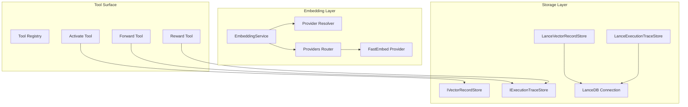
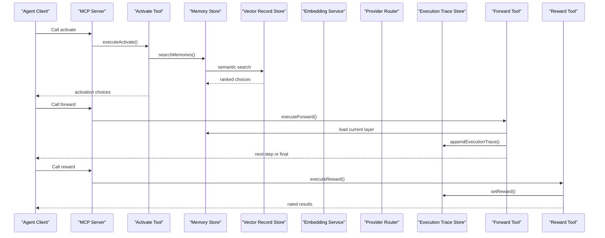
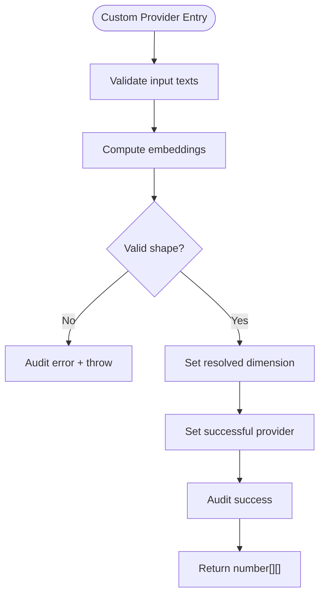
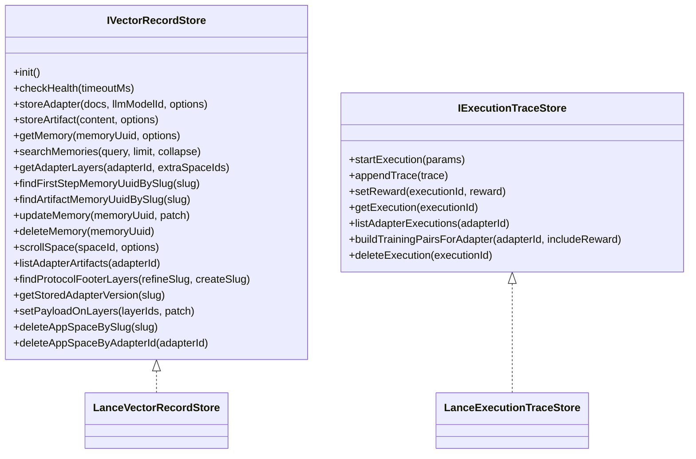
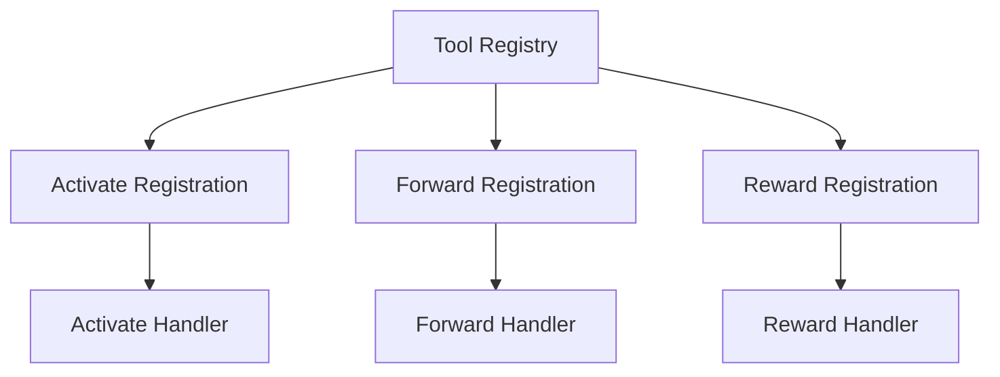
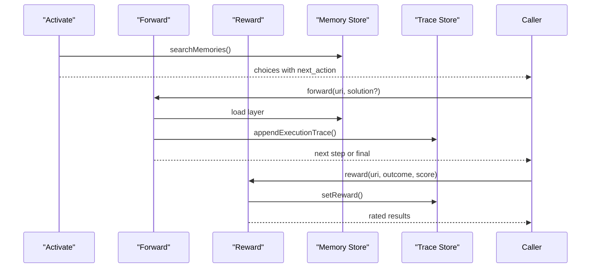
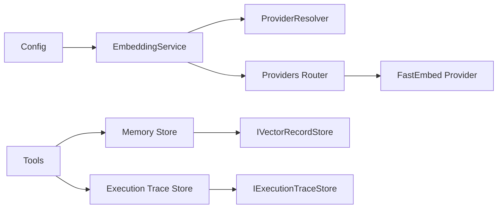

# Advanced Topics

<cite>
**Referenced Files in This Document**
- [config.ts](file://src/config.ts)
- [embedding-service.ts](file://src/services/embedding/service.ts)
- [embedding-providers.ts](file://src/services/embedding/providers.ts)
- [embedding-provider-resolver.ts](file://src/services/embedding/provider-resolver.ts)
- [embedding-fastembed-provider.ts](file://src/services/embedding/fastembed-provider.ts)
- [embedding-types.ts](file://src/services/embedding/types.ts)
- [vector-record-store-interface.ts](file://src/services/vector-store/IVectorRecordStore.ts)
- [execution-trace-store-interface.ts](file://src/services/vector-store/IExecutionTraceStore.ts)
- [lancedb-vector-record-store.ts](file://src/services/vector-store/lancedb/LanceVectorRecordStore.ts)
- [lancedb-execution-trace-store.ts](file://src/services/vector-store/lancedb/LanceExecutionTraceStore.ts)
- [lancedb-connection.ts](file://src/services/vector-store/lancedb-connection.ts)
- [vector-store-types.ts](file://src/services/vector-store/types.ts)
- [tool-registry.ts](file://src/tools/tool-registry.ts)
- [activate-tool.ts](file://src/tools/activate.ts)
- [forward-tool.ts](file://src/tools/forward.ts)
- [reward-tool.ts](file://src/tools/reward.ts)
</cite>

## Table of Contents
1. [Introduction](#introduction)
2. [Project Structure](#project-structure)
3. [Core Components](#core-components)
4. [Architecture Overview](#architecture-overview)
5. [Detailed Component Analysis](#detailed-component-analysis)
6. [Dependency Analysis](#dependency-analysis)
7. [Performance Considerations](#performance-considerations)
8. [Troubleshooting Guide](#troubleshooting-guide)
9. [Conclusion](#conclusion)
10. [Appendices](#appendices)

## Introduction
This document provides expert-level guidance for extending SquadRules beyond its default configuration. It focuses on:
- Custom embedding provider development
- Storage backend extensions through vector-store ports
- Plugin-style tool extension mechanisms
- Performance optimization, caching strategies, and scalability patterns
- Advanced configuration options and migration considerations
- Architectural deep dives into the activate → forward → reward chain and its internal implementation details

SquadRules is an agent-first MCP framework where AI agents are primary users. The core workflow is activate → forward → reward. Adapters provide deterministic, auditable task execution. Vector storage uses Qdrant (remote-capable) as the primary backend and LanceDB (embedded) as a secondary backend. Redis is used for sessions and rate limiting; filesystem stores configuration and adapters. Authentication uses Keycloak with OIDC/JWT.

## Project Structure
The advanced extension surface lives primarily under:
- `src/services/embedding` — embedding service, provider selection, retry/backoff, metrics, and local fastembed support
- `src/services/vector-store` — backend-neutral ports and LanceDB implementations
- `src/tools` — canonical MCP tool registry and activation/forward/reward orchestration
- `src/config.ts` — centralized environment-driven configuration

**Diagram sources**
- [embedding-service.ts:39-278](file://src/services/embedding/service.ts#L39-L278)
- [embedding-provider-resolver.ts:28-81](file://src/services/embedding/provider-resolver.ts#L28-L81)
- [embedding-providers.ts:296-333](file://src/services/embedding/providers.ts#L296-L333)
- [embedding-fastembed-provider.ts:41-82](file://src/services/embedding/fastembed-provider.ts#L41-L82)
- [vector-record-store-interface.ts:27-73](file://src/services/vector-store/IVectorRecordStore.ts#L27-L73)
- [execution-trace-store-interface.ts:10-31](file://src/services/vector-store/IExecutionTraceStore.ts#L10-L31)
- [lancedb-vector-record-store.ts:35-191](file://src/services/vector-store/lancedb/LanceVectorRecordStore.ts#L35-L191)
- [lancedb-execution-trace-store.ts:51-257](file://src/services/vector-store/lancedb/LanceExecutionTraceStore.ts#L51-L257)
- [lancedb-connection.ts:30-33](file://src/services/vector-store/lancedb-connection.ts#L30-L33)
- [tool-registry.ts:25-91](file://src/tools/tool-registry.ts#L25-L91)
- [activate-tool.ts:168-229](file://src/tools/activate.ts#L168-L229)
- [forward-tool.ts:91-156](file://src/tools/forward.ts#L91-L156)
- [reward-tool.ts:28-130](file://src/tools/reward.ts#L28-L130)

**Section sources**
- [config.ts:1-137](file://src/config.ts#L1-L137)
- [tool-registry.ts:16-91](file://src/tools/tool-registry.ts#L16-L91)

## Core Components
- Embedding Service: orchestrates provider selection, dimension probing, anomaly detection, metrics, and audit logging.
- Provider Resolution: pure candidate resolver plus successful provider descriptor tracking.
- Providers: OpenAI-compatible HTTP client, TEI fallback (deprecated), and local fastembed provider.
- Vector Store Ports: `IVectorRecordStore` for memory/artifact records and `IExecutionTraceStore` for non-vector execution traces.
- LanceDB Implementations: embedded record store and trace store with strong consistency and MVCC durability.
- Tools: canonical registry and activation/forward/reward handlers that drive the agent workflow.

Key responsibilities:
- Embedding providers must return consistent dimensions per process and set the resolved dimension.
- Vector store backends implement focused interfaces so callers remain backend-neutral.
- Tools expose stable schemas and UI metadata, enabling MCP clients to discover capabilities.

**Section sources**
- [embedding-service.ts:39-278](file://src/services/embedding/service.ts#L39-L278)
- [embedding-provider-resolver.ts:28-81](file://src/services/embedding/provider-resolver.ts#L28-L81)
- [embedding-providers.ts:17-74](file://src/services/embedding/providers.ts#L17-L74)
- [vector-record-store-interface.ts:27-73](file://src/services/vector-store/IVectorRecordStore.ts#L27-L73)
- [execution-trace-store-interface.ts:10-31](file://src/services/vector-store/IExecutionTraceStore.ts#L10-L31)
- [lancedb-vector-record-store.ts:35-191](file://src/services/vector-store/lancedb/LanceVectorRecordStore.ts#L35-L191)
- [lancedb-execution-trace-store.ts:51-257](file://src/services/vector-store/lancedb/LanceExecutionTraceStore.ts#L51-L257)

## Architecture Overview
The system composes three major layers:
- Embedding layer: selects provider, performs retries/backoff, validates dimensions, and emits metrics/audit events.
- Storage layer: abstracts vector and trace persistence behind ports; LanceDB provides embedded defaults.
- Tool layer: exposes MCP tools with canonical schemas and orchestrates the activate → forward → reward lifecycle.

**Diagram sources**
- [activate-tool.ts:168-229](file://src/tools/activate.ts#L168-L229)
- [forward-tool.ts:91-156](file://src/tools/forward.ts#L91-L156)
- [reward-tool.ts:28-130](file://src/tools/reward.ts#L28-L130)
- [vector-record-store-interface.ts:42-44](file://src/services/vector-store/IVectorRecordStore.ts#L42-L44)
- [execution-trace-store-interface.ts:14-18](file://src/services/vector-store/IExecutionTraceStore.ts#L14-L18)

## Detailed Component Analysis

### Custom Embedding Provider Development
To add a custom embedding provider:
- Implement a function compatible with the provider router’s expected signature returning `number[][]`.
- Set the resolved embedding dimension and successful provider descriptor after a successful call.
- Emit provider audit events for success/error paths.
- Integrate with retry/backoff semantics if using HTTP.

Implementation pattern:
- Use `setResolvedEmbeddingDimension` and `setSuccessfulProvider` from the provider resolver module.
- Follow the existing provider contract in the providers router for consistent error handling and audit logging.
- Ensure model name and dimension are reported via the service configuration interface.

**Diagram sources**
- [embedding-fastembed-provider.ts:41-82](file://src/services/embedding/fastembed-provider.ts#L41-L82)
- [embedding-provider-resolver.ts:68-81](file://src/services/embedding/provider-resolver.ts#L68-L81)
- [embedding-providers.ts:184-186](file://src/services/embedding/providers.ts#L184-L186)

**Section sources**
- [embedding-service.ts:48-128](file://src/services/embedding/service.ts#L48-L128)
- [embedding-service.ts:130-222](file://src/services/embedding/service.ts#L130-L222)
- [embedding-provider-resolver.ts:28-81](file://src/services/embedding/provider-resolver.ts#L28-L81)
- [embedding-providers.ts:296-333](file://src/services/embedding/providers.ts#L296-L333)
- [embedding-fastembed-provider.ts:17-39](file://src/services/embedding/fastembed-provider.ts#L17-L39)

### Storage Backend Extensions
SquadRules exposes two ports:
- `IVectorRecordStore`: memory/artifact records with writes, reads, search, and admin operations.
- `IExecutionTraceStore`: execution traces without vectors, keyed by execution id.

To extend storage:
- Implement both ports for your backend if you need vector and trace persistence.
- For vector records, ensure methods like `storeAdapter`, `storeArtifact`, `searchMemories`, and slug resolution match the neutral contract.
- For traces, preserve per-execution mutation ordering and idempotent upsert behavior.

**Diagram sources**
- [vector-record-store-interface.ts:27-73](file://src/services/vector-store/IVectorRecordStore.ts#L27-L73)
- [execution-trace-store-interface.ts:10-31](file://src/services/vector-store/IExecutionTraceStore.ts#L10-L31)
- [lancedb-vector-record-store.ts:35-191](file://src/services/vector-store/lancedb/LanceVectorRecordStore.ts#L35-L191)
- [lancedb-execution-trace-store.ts:51-257](file://src/services/vector-store/lancedb/LanceExecutionTraceStore.ts#L51-L257)

**Section sources**
- [vector-record-store-interface.ts:1-74](file://src/services/vector-store/IVectorRecordStore.ts#L1-L74)
- [execution-trace-store-interface.ts:1-32](file://src/services/vector-store/IExecutionTraceStore.ts#L1-L32)
- [lancedb-vector-record-store.ts:1-193](file://src/services/vector-store/lancedb/LanceVectorRecordStore.ts#L1-L193)
- [lancedb-execution-trace-store.ts:1-258](file://src/services/vector-store/lancedb/LanceExecutionTraceStore.ts#L1-L258)

### Plugin Architecture and Tool Extension Mechanisms
The MCP tool surface is centrally defined in the tool registry. Each tool has:
- A canonical name
- Title and description (with optional doc resolution)
- Strict input schema and output schema
- Optional UI metadata

To extend:
- Add entries to the registry with Zod schemas for validation.
- Register handlers that parse inputs, perform domain logic, and emit structured outputs.
- Ensure cross-surface parity: CLI, HTTP routes, and MCP discovery derive from the same registry.

**Diagram sources**
- [tool-registry.ts:25-91](file://src/tools/tool-registry.ts#L25-L91)
- [activate-tool.ts:231-280](file://src/tools/activate.ts#L231-L280)
- [forward-tool.ts:91-156](file://src/tools/forward.ts#L91-L156)
- [reward-tool.ts:132-175](file://src/tools/reward.ts#L132-L175)

**Section sources**
- [tool-registry.ts:16-91](file://src/tools/tool-registry.ts#L16-L91)
- [activate-tool.ts:231-280](file://src/tools/activate.ts#L231-L280)
- [reward-tool.ts:132-175](file://src/tools/reward.ts#L132-L175)

### Internal Implementation Details: Activate → Forward → Reward Chain
- Activate resolves candidates via search and returns actionable choices with linked artifacts and next actions.
- Forward loads the current layer, enforces authoring context constraints, handles proof-of-work challenges, updates step quality, and appends execution traces.
- Reward evaluates outcomes, applies metrics, persists rewards to the trace store, and prevents contradictory success ratings when prior proofs failed.

**Diagram sources**
- [activate-tool.ts:168-229](file://src/tools/activate.ts#L168-L229)
- [forward-tool.ts:91-156](file://src/tools/forward.ts#L91-L156)
- [reward-tool.ts:28-130](file://src/tools/reward.ts#L28-L130)

**Section sources**
- [activate-tool.ts:44-166](file://src/tools/activate.ts#L44-L166)
- [forward-tool.ts:40-89](file://src/tools/forward.ts#L40-L89)
- [forward-tool.ts:154-339](file://src/tools/forward.ts#L154-L339)
- [reward-tool.ts:19-130](file://src/tools/reward.ts#L19-L130)

## Dependency Analysis
Embedding and storage components have clear separation:
- Embedding service depends on provider resolver and providers router.
- Providers depend on configuration and audit/metrics utilities.
- Vector store ports are independent of backend implementations.
- Tools depend on memory store, qdrant service, and trace store but not directly on embedding providers.

**Diagram sources**
- [config.ts:70-93](file://src/config.ts#L70-L93)
- [embedding-service.ts:39-278](file://src/services/embedding/service.ts#L39-L278)
- [embedding-provider-resolver.ts:28-81](file://src/services/embedding/provider-resolver.ts#L28-L81)
- [embedding-providers.ts:296-333](file://src/services/embedding/providers.ts#L296-L333)
- [vector-record-store-interface.ts:27-73](file://src/services/vector-store/IVectorRecordStore.ts#L27-L73)
- [execution-trace-store-interface.ts:10-31](file://src/services/vector-store/IExecutionTraceStore.ts#L10-L31)

**Section sources**
- [config.ts:70-93](file://src/config.ts#L70-L93)
- [embedding-service.ts:39-278](file://src/services/embedding/service.ts#L39-L278)
- [vector-store-types.ts:1-95](file://src/services/vector-store/types.ts#L1-L95)

## Performance Considerations
- Embedding retries: exponential backoff with full jitter, Retry-After header honoring, and wall-clock budget enforcement prevent runaway retries.
- Dimension validation: critical anomalies abort early to avoid downstream failures.
- Embedded LanceDB: strong consistency via `readConsistencyInterval: 0`; lazy SDK import avoids native binding overhead unless needed.
- Search tuning: overfetch factor, max fetch cap, and choice limits balance recall vs latency.
- Metrics: request counts, durations, errors, batch sizes, and vector sizes are instrumented for observability.

Recommendations:
- Tune `EMBEDDING_MAX_RETRIES`, `EMBEDDING_RETRY_BASE_DELAY_MS`, `EMBEDDING_RETRY_MAX_DELAY_MS`, and `EMBEDDING_RETRY_BUDGET_MS` based on provider SLAs.
- Monitor `SEARCH_SCORE_WARN_THRESHOLD` and adjust `SQUADRULES_SEARCH_OVERFETCH_FACTOR` and `SQUADRULES_SEARCH_MAX_FETCH` for workload characteristics.
- Prefer fastembed for zero-config environments; use OpenAI-compatible endpoints for higher-quality embeddings when available.

**Section sources**
- [embedding-providers.ts:49-74](file://src/services/embedding/providers.ts#L49-L74)
- [embedding-service.ts:64-74](file://src/services/embedding/service.ts#L64-L74)
- [lancedb-connection.ts:30-33](file://src/services/vector-store/lancedb-connection.ts#L30-L33)
- [config.ts:84-93](file://src/config.ts#L84-L93)
- [config.ts:108-116](file://src/config.ts#L108-L116)

## Troubleshooting Guide
Common issues and resolutions:
- Embedding dimension mismatch: indicates provider returned unexpected vector size; check provider configuration and model compatibility.
- Rate limiting (429): distinguish transient throttling from non-retriable quota issues; insufficient quota requires billing/quota fixes.
- TEI deprecation: TEI provider emits warnings and is transitional; migrate to OpenAI-compatible or fastembed.
- Reward conflicts: cannot mark success when last stored proof failed; fix step and rerun or record failure.
- Missing execution traces: persistence failures are logged; retry once the store is healthy.

Operational checks:
- Verify `OPENAI_API_KEY` or explicit `OPENAI_API_URL` when selecting OpenAI.
- Confirm `TEI_BASE_URL` and `TEI_MODEL` when using TEI.
- Ensure `QDRANT_URL` is configured for remote vector storage; otherwise, embedded LanceDB path is active.
- Inspect audit logs and metrics for provider health and latency.

**Section sources**
- [embedding-service.ts:64-74](file://src/services/embedding/service.ts#L64-L74)
- [embedding-providers.ts:147-172](file://src/services/embedding/providers.ts#L147-L172)
- [embedding-providers.ts:250-261](file://src/services/embedding/providers.ts#L250-L261)
- [embedding-providers.ts:335-341](file://src/services/embedding/providers.ts#L335-L341)
- [reward-tool.ts:37-54](file://src/tools/reward.ts#L37-L54)
- [config.ts:70-93](file://src/config.ts#L70-L93)

## Conclusion
SquadRules’ advanced extension points center on embedding provider customization, backend-neutral storage ports, and a canonical tool registry. By adhering to these contracts, experienced developers can integrate new providers, swap storage backends, and extend the MCP surface while preserving performance, reliability, and backward compatibility. Configuration knobs enable fine-tuning of retries, search behavior, and operational modes across diverse deployment scenarios.

## Appendices

### Advanced Configuration Options
Key environment variables for advanced usage:
- Embedding: `EMBEDDING_PROVIDER`, `OPENAI_EMBEDDING_MODEL`, `OPENAI_API_KEY`, `OPENAI_API_URL`, `TEI_BASE_URL`, `TEI_MODEL`, `FASTEMBED_MODEL`, `FASTEMBED_CACHE_DIR`
- Retries: `EMBEDDING_MAX_RETRIES`, `EMBEDDING_RETRY_BASE_DELAY_MS`, `EMBEDDING_RETRY_MAX_DELAY_MS`, `EMBEDDING_RETRY_AFTER_CAP_MS`, `EMBEDDING_RETRY_BUDGET_MS`
- Search: `SQUADRULES_SEARCH_OVERFETCH_FACTOR`, `SQUADRULES_SEARCH_MAX_FETCH`, `SQUADRULES_SEARCH_MAX_CHOICES`, `SQUADRULES_SEARCH_LIMIT_CAP`, `SQUADRULES_SEARCH_LIMIT_MIN`
- Runtime: `SERVER_PORT`, `METRICS_PORT`, `MAX_CONCURRENT_MCP_REQUESTS_RAW`
- Auth/OIDC: `AUTH_MODE`, `AUTH_TRUSTED_ISSUERS_STRING`, `AUTH_ALLOWED_AUDIENCES_STRING`, `OIDC_GROUPS_ALLOWLIST`, `OIDC_BEARER_MERGE_USERINFO_GROUPS`

**Section sources**
- [config.ts:70-93](file://src/config.ts#L70-L93)
- [config.ts:108-126](file://src/config.ts#L108-L126)
- [config.ts:141-195](file://src/config.ts#L141-L195)
- [config.ts:245-282](file://src/config.ts#L245-L282)

### Migration Strategies and Version Compatibility
- TEI deprecation: treat TEI as transitional; plan migration to OpenAI-compatible or fastembed.
- Vector store ports: maintain behavioral parity between Qdrant and LanceDB implementations; validate read/admin surfaces and search ranking against integration suites.
- Execution traces: preserve per-execution mutation ordering and idempotent upsert semantics during migrations.
- Tool schemas: keep canonical schemas stable; extend via registry additions rather than breaking changes.

**Section sources**
- [embedding-providers.ts:335-341](file://src/services/embedding/providers.ts#L335-L341)
- [lancedb-vector-record-store.ts:1-12](file://src/services/vector-store/lancedb/LanceVectorRecordStore.ts#L1-L12)
- [lancedb-execution-trace-store.ts:1-12](file://src/services/vector-store/lancedb/LanceExecutionTraceStore.ts#L1-L12)
- [tool-registry.ts:16-24](file://src/tools/tool-registry.ts#L16-L24)