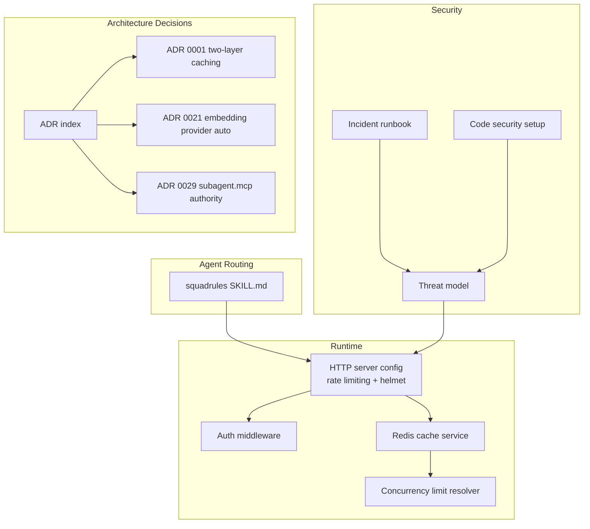
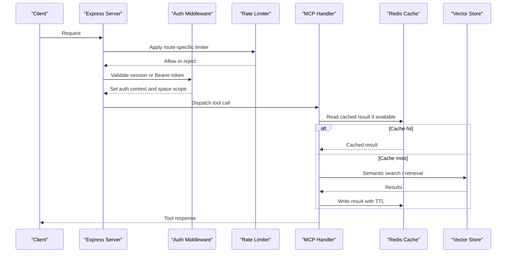
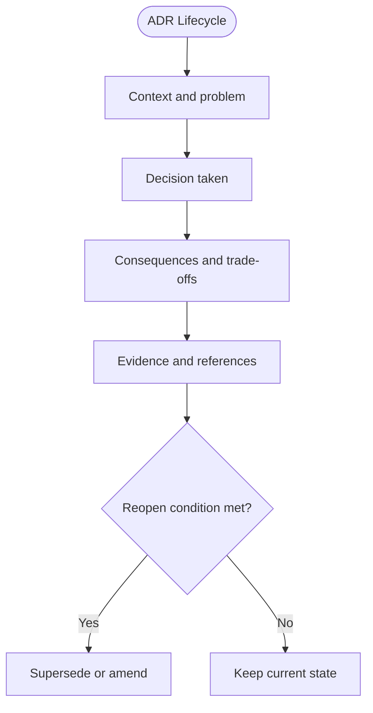
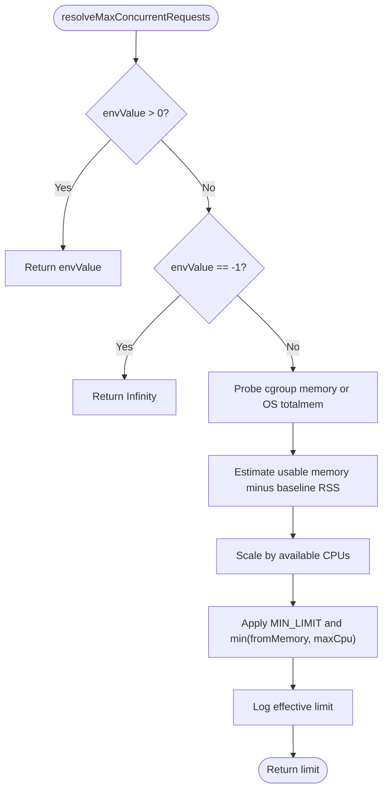
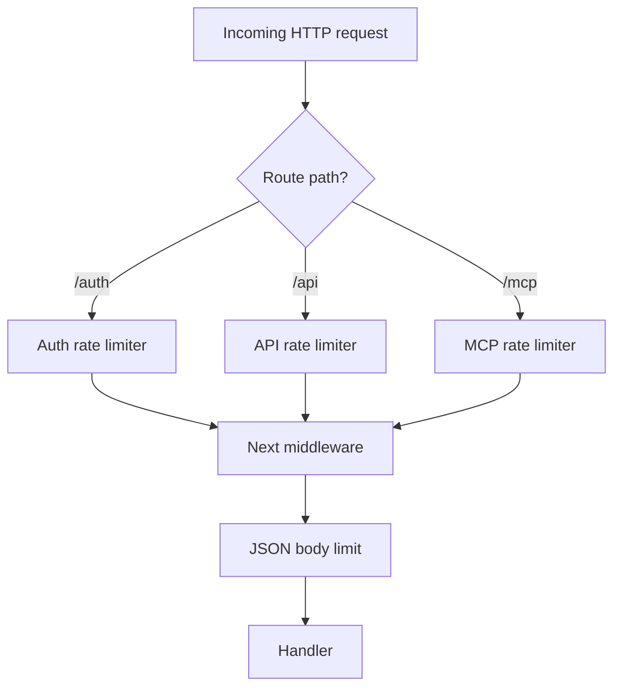
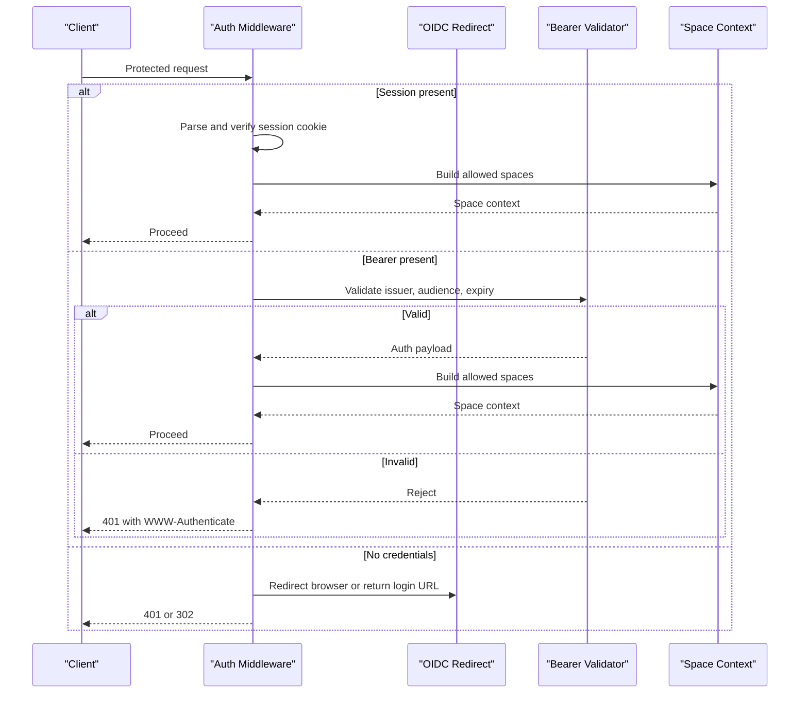
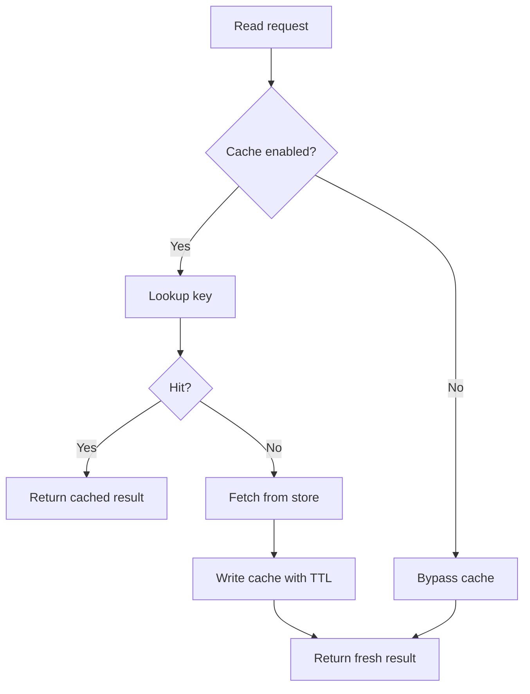
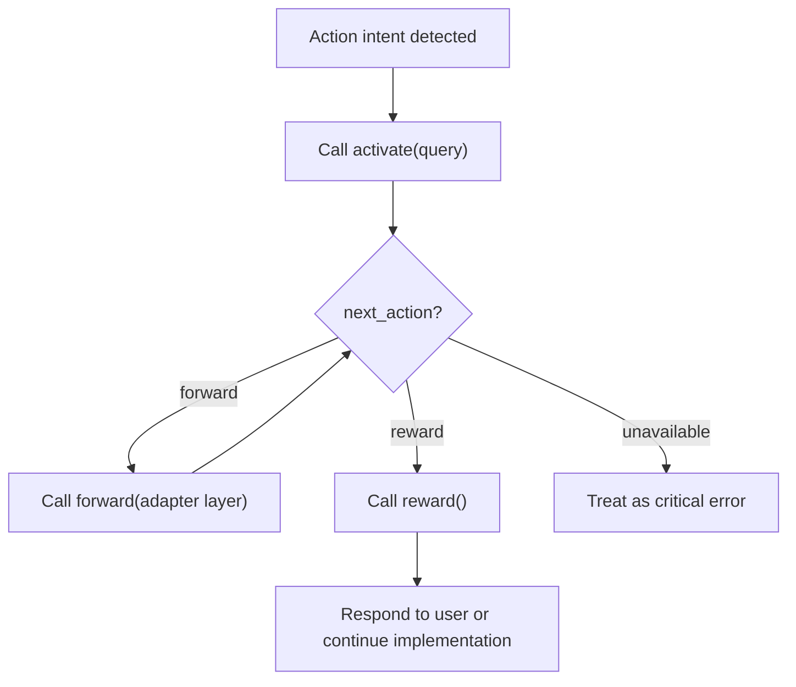
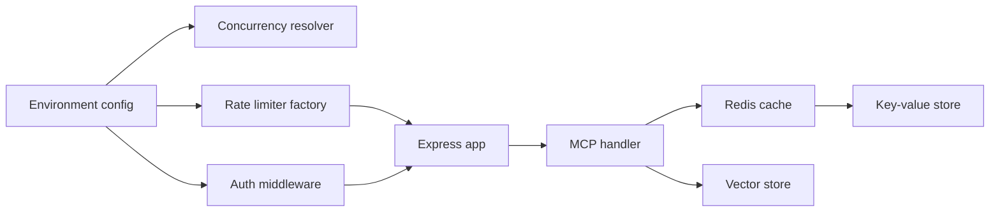

# Advanced Topics

<cite>
**Referenced Files in This Document**
- [SKILL.md](file://.agents/skills/squadrules/SKILL.md)
- [README.md](file://docs/adr/README.md)
- [0001-two-layer-adapter-write-caching.md](file://docs/adr/0001-two-layer-adapter-write-caching.md)
- [0021-embedding-provider-auto-resolution-and-store-width-binding.md](file://docs/adr/0021-embedding-provider-auto-resolution-and-store-width-binding.md)
- [0029-subagent-mcp-and-context-authority.md](file://docs/adr/0029-subagent-mcp-and-context-authority.md)
- [known-issues-and-limitations.md](file://docs/known-issues-and-limitations.md)
- [threat-model.md](file://docs/security/threat-model.md)
- [incident-runbook.md](file://docs/security/incident-runbook.md)
- [code-security-setup.md](file://docs/security/code-security-setup.md)
- [concurrency-limit.ts](file://src/utils/concurrency-limit.ts)
- [http-server-config.ts](file://src/http/http-server-config.ts)
- [redis-cache.ts](file://src/services/redis-cache.ts)
- [http-auth-middleware.ts](file://src/http/http-auth-middleware.ts)
</cite>

## Table of Contents
1. [Introduction](#introduction)
2. [Project Structure](#project-structure)
3. [Core Components](#core-components)
4. [Architecture Overview](#architecture-overview)
5. [Detailed Component Analysis](#detailed-component-analysis)
6. [Dependency Analysis](#dependency-analysis)
7. [Performance Considerations](#performance-considerations)
8. [Troubleshooting Guide](#troubleshooting-guide)
9. [Conclusion](#conclusion)
10. [Appendices](#appendices)

## Introduction
This document covers advanced and expert-level usage patterns for the SquadRules framework. It focuses on architectural decision records, known limitations, concurrency control, rate limiting, resource management, debugging and profiling techniques, skills-based routing, security posture, penetration testing guidance, and contribution workflow expectations. The content is grounded in the repository’s ADRs, security documentation, runtime configuration, and service implementations.

SquadRules is an agent-first MCP framework where AI agents are primary users and humans configure preferences through agents. The core flow is activate → forward → reward. Adapters provide deterministic, auditable task execution. Vector storage uses Qdrant (primary) and LanceDB (secondary). Authentication integrates Keycloak and Google IdP via OAuth2/JWT. Skills under `.agents/skills/` contain hand-authored routing logic that is never auto-generated.

## Project Structure
The advanced topics span several areas:

- Architectural decisions and evolution are captured as ADRs.
- Security posture is documented in threat modeling, incident response, and code security setup guides.
- Runtime behavior includes concurrency limits, HTTP middleware, rate limiting, and Redis-backed caching.
- Agent routing is defined by the `squadrules` skill and its references.

**Diagram sources**
- [SKILL.md:1-91](file://.agents/skills/squadrules/SKILL.md#L1-L91)
- [http-server-config.ts:1-100](file://src/http/http-server-config.ts#L1-L100)
- [http-auth-middleware.ts:1-330](file://src/http/http-auth-middleware.ts#L1-L330)
- [redis-cache.ts:1-274](file://src/services/redis-cache.ts#L1-L274)
- [concurrency-limit.ts:1-81](file://src/utils/concurrency-limit.ts#L1-L81)
- [threat-model.md:1-131](file://docs/security/threat-model.md#L1-L131)
- [incident-runbook.md:1-115](file://docs/security/incident-runbook.md#L1-L115)
- [code-security-setup.md:1-46](file://docs/security/code-security-setup.md#L1-L46)
- [README.md:1-74](file://docs/adr/README.md#L1-L74)
- [0001-two-layer-adapter-write-caching.md:1-73](file://docs/adr/0001-two-layer-adapter-write-caching.md#L1-L73)
- [0021-embedding-provider-auto-resolution-and-store-width-binding.md:1-245](file://docs/adr/0021-embedding-provider-auto-resolution-and-store-width-binding.md#L1-L245)
- [0029-subagent-mcp-and-context-authority.md:1-275](file://docs/adr/0029-subagent-mcp-and-context-authority.md#L1-L275)

**Section sources**
- [SKILL.md:1-91](file://.agents/skills/squadrules/SKILL.md#L1-L91)
- [README.md:1-74](file://docs/adr/README.md#L1-L74)

## Core Components
Advanced operation depends on a small set of runtime components:

- **Concurrency control**: Resolves effective maximum concurrent MCP requests from environment or cgroup memory, with a minimum floor and CPU scaling heuristic.
- **Rate limiting**: Per-route rate limiters for `/auth`, `/api`, and `/mcp`, using structured error responses and standard headers.
- **Authentication middleware**: Supports session cookies and Bearer tokens, OIDC redirect flows, space scoping, and JSON-RPC-aware 401 responses for MCP clients.
- **Redis-backed cache**: Search result and memory resource caching with TTLs, invalidation channels, and stats counters; disabled when embedded LanceDB is used to avoid cross-process staleness.

These components together enable high-throughput, secure, and observable operation.

**Section sources**
- [concurrency-limit.ts:1-81](file://src/utils/concurrency-limit.ts#L1-L81)
- [http-server-config.ts:1-100](file://src/http/http-server-config.ts#L1-L100)
- [http-auth-middleware.ts:1-330](file://src/http/http-auth-middleware.ts#L1-L330)
- [redis-cache.ts:1-274](file://src/services/redis-cache.ts#L1-L274)

## Architecture Overview
At a high level, incoming requests pass through authentication and rate limiting before reaching MCP or API handlers. Embedding services and vector stores perform semantic search and retrieval. Redis provides application-level caching and invalidation signals. Concurrency limits protect the process from overloading based on memory and CPU availability.

**Diagram sources**
- [http-server-config.ts:49-99](file://src/http/http-server-config.ts#L49-L99)
- [http-auth-middleware.ts:172-327](file://src/http/http-auth-middleware.ts#L172-L327)
- [redis-cache.ts:43-79](file://src/services/redis-cache.ts#L43-L79)

## Detailed Component Analysis

### Architectural Decision Records (ADRs)
ADRs capture why key design choices were made, their consequences, and evidence. They also define reopen conditions so decisions can evolve.

- Two-layer adapter write caching separates CI snapshot reuse from runtime boot injection reuse.
- Embedding provider auto-resolution binds store vector width to the resolved provider and handles mismatches rather than tolerating them.
- Subagent MCP delegation establishes `subagent.context` as authoritative and adds optional structured `subagent.mcp` for rung-3 tool calls.

**Diagram sources**
- [README.md:1-74](file://docs/adr/README.md#L1-L74)

Key ADRs relevant to advanced usage:

- **Two-layer caching**: Layer 1 is CI snapshot reuse; Layer 2 is runtime boot injection reuse. Misunderstanding which layer is being optimized leads to incorrect performance assumptions.
- **Embedding provider auto**: `auto` remains default; provider resolution precedes store decisions; width mismatch is detected and handled; reads use stored width; startup reports actual resolution.
- **Subagent MCP authority**: `subagent.context` is authoritative; `subagent.mcp` is optional structured list of required MCP tool calls; proof remains flat and does not include nested arguments.

**Section sources**
- [0001-two-layer-adapter-write-caching.md:1-73](file://docs/adr/0001-two-layer-adapter-write-caching.md#L1-L73)
- [0021-embedding-provider-auto-resolution-and-store-width-binding.md:1-245](file://docs/adr/0021-embedding-provider-auto-resolution-and-store-width-binding.md#L1-L245)
- [0029-subagent-mcp-and-context-authority.md:1-275](file://docs/adr/0029-subagent-mcp-and-context-authority.md#L1-L275)

### Concurrency Control and Resource Management
Concurrency control protects the process from memory pressure and CPU saturation during high-throughput scenarios.

- Environment override: positive value sets explicit limit; `-1` disables limits; `0` or unset enables auto-detection.
- Auto-detection probes cgroups v2/v1 memory limits, falls back to OS total memory, estimates per-request RSS, applies headroom, and scales by CPU count.
- Minimum limit ensures baseline throughput even under conservative estimates.

**Diagram sources**
- [concurrency-limit.ts:57-80](file://src/utils/concurrency-limit.ts#L57-L80)

Operational guidance:
- Tune `MAX_CONCURRENT_MCP_REQUESTS` explicitly in constrained environments.
- Monitor RSS growth and request latency; adjust concurrency if memory headroom is insufficient.
- Disable concurrency limits only in controlled test environments.

**Section sources**
- [concurrency-limit.ts:1-81](file://src/utils/concurrency-limit.ts#L1-L81)

### Rate Limiting and HTTP Security
Rate limiting is applied per route group with structured error messages and standardized headers. Helmet enforces a minimal CSP for the API server.

- `/auth`: Authentication rate limiter.
- `/api`: General API rate limiter.
- `/mcp`: MCP protocol rate limiter.
- JSON body size is limited to prevent oversized payloads.

**Diagram sources**
- [http-server-config.ts:49-99](file://src/http/http-server-config.ts#L49-L99)

Operational guidance:
- Adjust window and limit values per deployment tier.
- Observe `RATE_LIMITED` responses and correlate with client retry behavior.
- Keep CSP directives aligned with UI/static assets if serving the Squadrules page.

**Section sources**
- [http-server-config.ts:1-100](file://src/http/http-server-config.ts#L1-L100)

### Authentication and Authorization Flow
Authentication supports both session cookies and Bearer tokens. For MCP clients, unauthenticated requests receive structured 401 responses with WWW-Authenticate hints. Space scoping is enforced after successful authentication.

**Diagram sources**
- [http-auth-middleware.ts:172-327](file://src/http/http-auth-middleware.ts#L172-L327)

Operational guidance:
- Ensure `AUTH_TRUSTED_ISSUERS` and `AUTH_ALLOWED_AUDIENCES` are configured for Bearer validation.
- Verify `AUTH_CALLBACK_BASE_URL` when enabling session-based OIDC flows.
- Inspect `space_id` and tenant context in logs for cross-tenant isolation verification.

**Section sources**
- [http-auth-middleware.ts:1-330](file://src/http/http-auth-middleware.ts#L1-L330)

### Caching Strategy and Invalidation
Redis-backed caching improves read-heavy workloads. Cache keys include query, limit, and collapse mode. Memory resources are cached with bounded TTLs. Invalidation events propagate across processes.

- Search results: short-lived cache with explicit invalidation on writes.
- Memory resources: per-UUID cache with TTL safety net.
- Begin/activate caches: invalidated on updates.
- Embedded LanceDB: application-level cache disabled to prevent cross-process staleness.

**Diagram sources**
- [redis-cache.ts:29-79](file://src/services/redis-cache.ts#L29-L79)

Operational guidance:
- Monitor cache hit/miss ratios and tune TTLs for workload characteristics.
- Use strict invalidation methods after critical writes to avoid stale reads.
- Confirm Redis connectivity and prefix scoping for multi-tenant deployments.

**Section sources**
- [redis-cache.ts:1-274](file://src/services/redis-cache.ts#L1-L274)

### Skills System for Hand-Authored Routing Logic
The `squadrules` skill defines the canonical action router. It routes action intents through the activate → forward → reward chain and instructs agents to treat MCP server URIs, nonces, hashes, IDs, `must_obey`, and `next_action` as authoritative.

- Allowed tools: activate, forward, reward, train, tune, export, delete, spaces.
- When unavailable or unauthenticated, treat as critical error and remediate endpoint/auth configuration.
- Repository alignment guidance keeps agent docs synchronized with this skill.

**Diagram sources**
- [SKILL.md:1-91](file://.agents/skills/squadrules/SKILL.md#L1-L91)

Operational guidance:
- Do not alter server-generated URIs, nonces, hashes, IDs, `must_obey`, or `next_action`.
- For real MCP calls, rely on the connected server’s tool names and schemas.
- If the MCP server is unreachable or unauthenticated, stop and ask the user to remediate.

**Section sources**
- [SKILL.md:1-91](file://.agents/skills/squadrules/SKILL.md#L1-L91)

### Known Limitations and Workarounds
Known issues document expected behaviors that resemble defects, including transitive dependency warnings and platform-specific constraints.

- `@anush008/tokenizers` deprecation warning is expected due to transitive dependency resolution and archived publisher status.
- Root `overrides` pin a compatible version for local development and CI but do not affect consumers’ installs.
- Changing the override does not resolve consumer-side notices unless they apply their own override.

Workaround guidance:
- Ignore the deprecation notice in this repository unless upstream changes occur.
- Consumers requiring arm64 native bindings should pin their own override.
- Measure package sizes and API compatibility before considering replacement strategies.

**Section sources**
- [known-issues-and-limitations.md:1-59](file://docs/known-issues-and-limitations.md#L1-L59)

## Dependency Analysis
The advanced runtime depends on:

- Express server with Helmet and express-rate-limit.
- Redis-backed key-value store for caching and invalidation.
- Environment-driven configuration for concurrency, rate limits, and auth.
- ADRs guiding embedding provider selection and store width binding.

**Diagram sources**
- [http-server-config.ts:1-100](file://src/http/http-server-config.ts#L1-L100)
- [http-auth-middleware.ts:1-330](file://src/http/http-auth-middleware.ts#L1-L330)
- [redis-cache.ts:1-274](file://src/services/redis-cache.ts#L1-L274)
- [concurrency-limit.ts:1-81](file://src/utils/concurrency-limit.ts#L1-L81)

**Section sources**
- [http-server-config.ts:1-100](file://src/http/http-server-config.ts#L1-L100)
- [http-auth-middleware.ts:1-330](file://src/http/http-auth-middleware.ts#L1-L330)
- [redis-cache.ts:1-274](file://src/services/redis-cache.ts#L1-L274)
- [concurrency-limit.ts:1-81](file://src/utils/concurrency-limit.ts#L1-L81)

## Performance Considerations
- Embedding provider selection affects latency and cost. Prefer explicit configuration in production; keep `auto` for zero-config environments.
- Vector store width mismatches cause silent degradation; ensure provider initialization precedes store decisions and monitor startup logs.
- Redis cache effectiveness depends on query stability and write frequency; tune TTLs and invalidation strategy accordingly.
- Concurrency limits should be tuned to observed RSS growth and request latency; disable only in controlled environments.
- Rate limits protect against abuse and cost amplification; monitor `RATE_LIMITED` responses and adjust windows/limits per traffic profile.

[No sources needed since this section provides general guidance]

## Troubleshooting Guide
Use these steps to diagnose advanced operational issues:

- **Authentication failures**:
  - Verify session cookie validity and OIDC callback configuration.
  - Confirm Bearer token issuer and audience configuration.
  - Check MCP client receives structured 401 with WWW-Authenticate.

- **Rate limiting spikes**:
  - Identify route groups (`/auth`, `/api`, `/mcp`) and adjust limits.
  - Correlate client retry behavior with `RATE_LIMITED` responses.

- **Cache inconsistencies**:
  - Confirm Redis connectivity and prefix scoping.
  - Use strict invalidation after writes; check TTLs and invalidation events.
  - For embedded LanceDB, expect application-level cache to be disabled.

- **Embedding provider issues**:
  - Review startup logs for resolved provider and dimension.
  - Address width mismatch errors by restoring provider or migrating store.

- **Concurrency pressure**:
  - Monitor RSS and request latency; adjust `MAX_CONCURRENT_MCP_REQUESTS`.
  - Avoid disabling concurrency limits in production.

**Section sources**
- [http-auth-middleware.ts:172-327](file://src/http/http-auth-middleware.ts#L172-L327)
- [http-server-config.ts:49-99](file://src/http/http-server-config.ts#L49-L99)
- [redis-cache.ts:141-152](file://src/services/redis-cache.ts#L141-L152)
- [0021-embedding-provider-auto-resolution-and-store-width-binding.md:101-127](file://docs/adr/0021-embedding-provider-auto-resolution-and-store-width-binding.md#L101-L127)
- [concurrency-limit.ts:57-80](file://src/utils/concurrency-limit.ts#L57-L80)

## Conclusion
Advanced SquadRules operation relies on disciplined configuration of concurrency, rate limiting, authentication, caching, and embedding providers. ADRs provide durable rationale for design choices and clear reopen conditions. Security documentation outlines threat models, incident response, and code security setup. The skills system ensures agents follow deterministic, auditable workflows. Operators should monitor startup logs, cache metrics, rate limit responses, and embedding provider resolution to maintain reliable, secure, and high-throughput performance.

[No sources needed since this section summarizes without analyzing specific files]

## Appendices

### Security Auditing and Penetration Testing Guidance
- Enforce GitHub security workflows: dependency review, npm audit, CodeQL.
- Enable secret scanning and push protection.
- Use the threat model to identify attack surfaces: data poisoning, prompt injection, cross-tenant leakage, embedding API abuse, supply-chain compromise.
- Follow the incident runbook for triage, containment, recovery, and communication.

**Section sources**
- [code-security-setup.md:1-46](file://docs/security/code-security-setup.md#L1-L46)
- [threat-model.md:1-131](file://docs/security/threat-model.md#L1-L131)
- [incident-runbook.md:1-115](file://docs/security/incident-runbook.md#L1-L115)

### Contributing Workflow Notes
- ADRs must not rewrite history; supersede with new records and link to code/workflow changes.
- Every ADR names an issue that can reopen it.
- Documentation split: auto-generated Wiki vs curated docs; keep ADRs focused on “why” and link to implementation details.

**Section sources**
- [README.md:1-74](file://docs/adr/README.md#L1-L74)