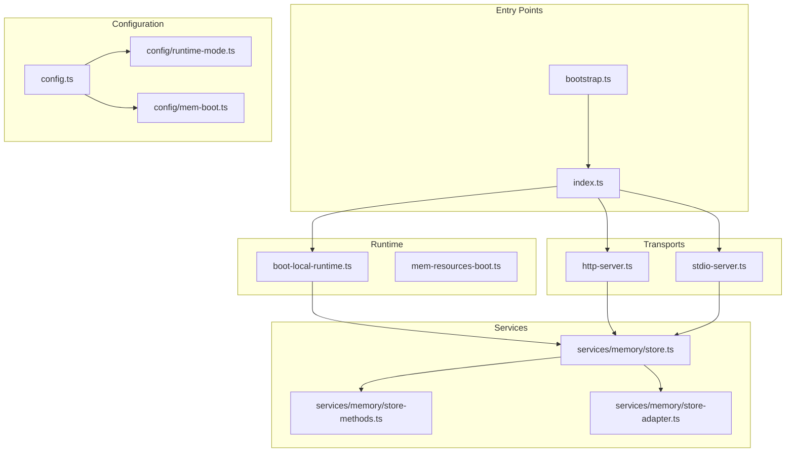
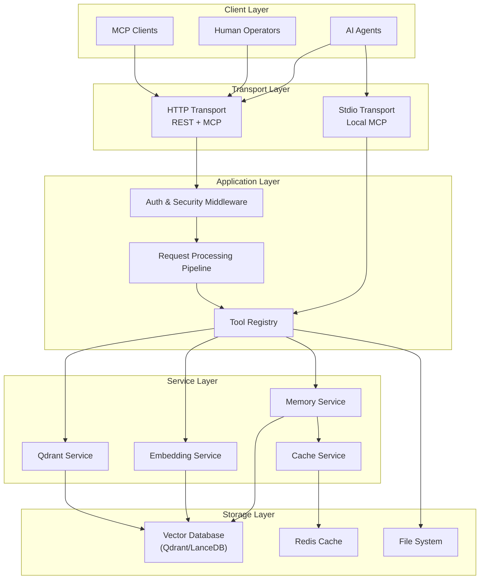
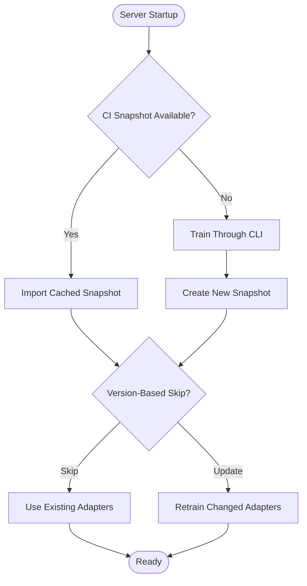
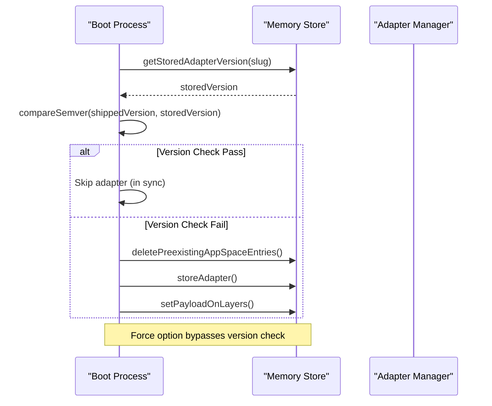
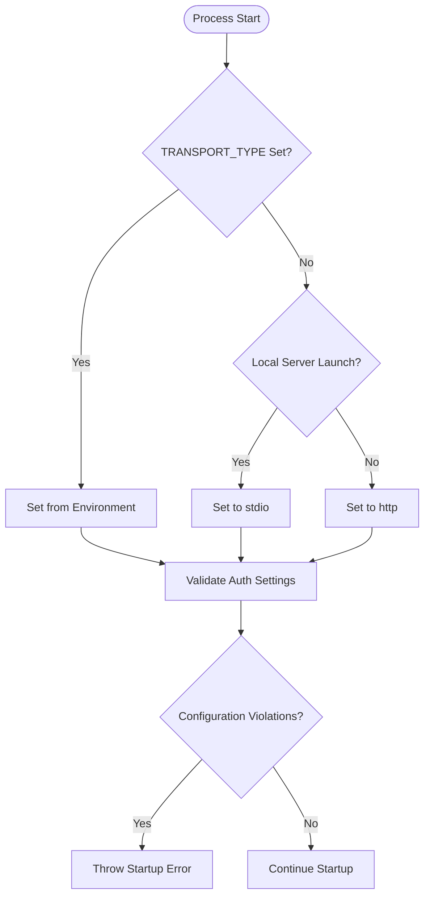
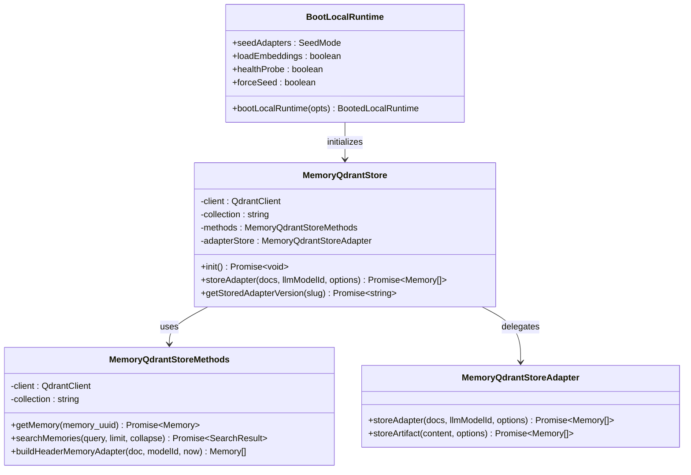
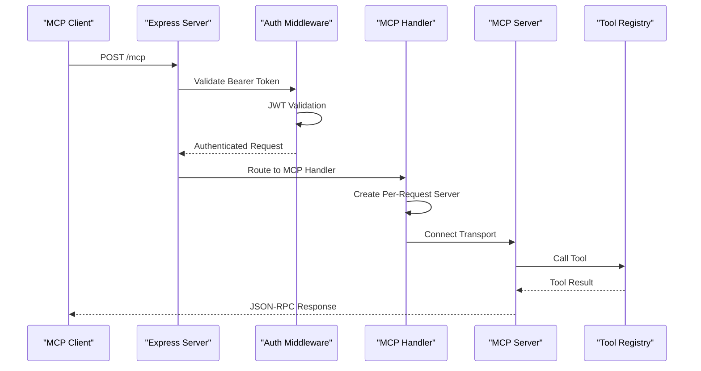
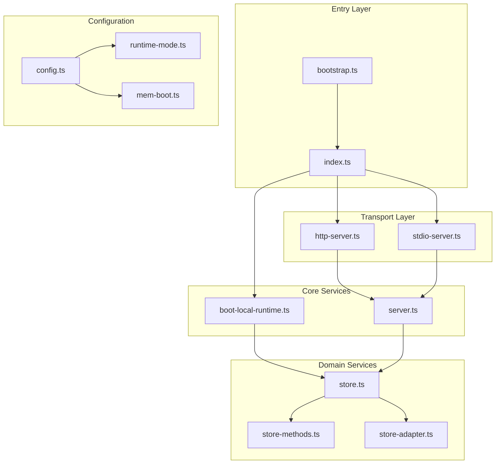

# Architectural Deep Dive

<cite>
**Referenced Files in This Document**
- [bootstrap.ts](file://src/bootstrap.ts)
- [index.ts](file://src/index.ts)
- [server.ts](file://src/server.ts)
- [http-server.ts](file://src/http/http-server.ts)
- [http-mcp-handler.ts](file://src/http/http-mcp-handler.ts)
- [http-api-routes.ts](file://src/http/http-api-routes.ts)
- [stdio-server.ts](file://src/stdio/stdio-server.ts)
- [boot-local-runtime.ts](file://src/runtime/boot-local-runtime.ts)
- [mem-resources-boot.ts](file://src/resources/mem-resources-boot.ts)
- [store.ts](file://src/services/memory/store.ts)
- [store-methods.ts](file://src/services/memory/store-methods.ts)
- [store-adapter.ts](file://src/services/memory/store-adapter.ts)
- [tool-registry.ts](file://src/tools/tool-registry.ts)
- [config.ts](file://src/config.ts)
- [runtime-mode.ts](file://src/config/runtime-mode.ts)
- [mem-boot.ts](file://src/config/mem-boot.ts)
- [0001-two-layer-adapter-write-caching.md](file://docs/adr/0001-two-layer-adapter-write-caching.md)
- [0002-boot-injection-reuse-rule.md](file://docs/adr/0002-boot-injection-reuse-rule.md)
</cite>

## Table of Contents
1. [Introduction](#introduction)
2. [Project Structure](#project-structure)
3. [Core Components](#core-components)
4. [Architecture Overview](#architecture-overview)
5. [Detailed Component Analysis](#detailed-component-analysis)
6. [Dependency Analysis](#dependency-analysis)
7. [Performance Considerations](#performance-considerations)
8. [Troubleshooting Guide](#troubleshooting-guide)
9. [Conclusion](#conclusion)

## Introduction
SquadRules is an agent-first Model Context Protocol (MCP) framework where AI agents are the primary users and humans configure preferences through agents. The core workflow follows an activate → forward → reward chain, with deterministic, auditable adapters representing workflows. The system supports two transport modes: a local single-user stdio mode backed by embedded LanceDB, and a clustered HTTP mode backed by Qdrant or embedded LanceDB depending on configuration. It uses Redis for shared caching and sessions, vector databases for semantic search, and filesystem storage for configuration and adapters. Authentication integrates with Keycloak and Google IdP via OAuth2/JWT.

This document provides an architectural deep dive into SquadRules internal design patterns, focusing on the two-layer adapter write caching strategy, boot injection reuse, runtime mode resolution, service initialization, component lifecycle management, transport abstraction, middleware chain, request processing pipeline, and extension points for advanced customization.

## Project Structure
The repository is organized by feature and layer:
- `src/` contains the application code: bootstrap, server, HTTP transport, stdio transport, runtime boot, services (memory, embedding, qdrant, metrics), tools, config, resources, and utilities.
- `docs/adr/` contains Architecture Decision Records explaining key design choices.
- `.agents/skills/` contains hand-authored routing logic used by the action router.

**Diagram sources**
- [bootstrap.ts:1-34](file://src/bootstrap.ts#L1-L34)
- [index.ts:1-130](file://src/index.ts#L1-L130)
- [http-server.ts:1-59](file://src/http/http-server.ts#L1-L59)
- [stdio-server.ts:1-13](file://src/stdio/stdio-server.ts#L1-L13)
- [boot-local-runtime.ts:1-184](file://src/runtime/boot-local-runtime.ts#L1-L184)
- [mem-resources-boot.ts:1-135](file://src/resources/mem-resources-boot.ts#L1-L135)
- [store.ts:1-272](file://src/services/memory/store.ts#L1-L272)
- [store-methods.ts:1-270](file://src/services/memory/store-methods.ts#L1-L270)
- [store-adapter.ts:1-154](file://src/services/memory/store-adapter.ts#L1-L154)
- [config.ts:1-351](file://src/config.ts#L1-L351)
- [runtime-mode.ts:1-150](file://src/config/runtime-mode.ts#L1-L150)
- [mem-boot.ts:1-21](file://src/config/mem-boot.ts#L1-L21)

**Section sources**
- [bootstrap.ts:1-34](file://src/bootstrap.ts#L1-L34)
- [index.ts:1-130](file://src/index.ts#L1-L130)
- [config.ts:1-351](file://src/config.ts#L1-L351)

## Core Components
SquadRules consists of several core components that work together to provide the MCP server functionality:

### Bootstrap and Server Initialization
The bootstrap process installs global error handlers before any application code loads, then dynamically imports the main index module and runs the server startup sequence. The main index handles signal processing, transport selection, and runtime boot.

### Transport Layer Abstraction
SquadRules supports two transport types:
- **HTTP transport**: Full-featured server with REST API, Streamable HTTP MCP, browser UI, and metrics
- **Stdio transport**: Local single-user MCP server without HTTP listener

### Memory Storage Layer
The memory storage layer abstracts over different backends:
- **Qdrant**: Remote-capable vector database for production deployments
- **LanceDB**: Embedded vector database for local development and simple mode

### Service Architecture
Key services include:
- **Memory store**: Primary interface for adapter and artifact operations
- **Embedding service**: Handles text embeddings with multiple provider support
- **Qdrant service**: Manages connection and operations with Qdrant backend
- **Metrics service**: Collects and exposes system metrics

**Section sources**
- [bootstrap.ts:1-34](file://src/bootstrap.ts#L1-L34)
- [index.ts:1-130](file://src/index.ts#L1-L130)
- [http-server.ts:1-59](file://src/http/http-server.ts#L1-L59)
- [stdio-server.ts:1-13](file://src/stdio/stdio-server.ts#L1-L13)
- [store.ts:1-272](file://src/services/memory/store.ts#L1-L272)

## Architecture Overview
The SquadRules architecture follows a layered approach with clear separation of concerns:

**Diagram sources**
- [http-server.ts:1-59](file://src/http/http-server.ts#L1-L59)
- [stdio-server.ts:1-13](file://src/stdio/stdio-server.ts#L1-L13)
- [tool-registry.ts:1-100](file://src/tools/tool-registry.ts#L1-L100)
- [store.ts:1-272](file://src/services/memory/store.ts#L1-L272)
- [store-methods.ts:1-270](file://src/services/memory/store-methods.ts#L1-L270)

## Detailed Component Analysis

### Two-Layer Adapter Write Caching Strategy
SquadRules implements a sophisticated two-layer caching strategy for adapter writes, as documented in ADR 0001:

#### Layer 1: CI Snapshot Reuse
- Uses Qdrant snapshots stored in Actions cache
- Cache identity based on semantic inputs of seed data
- Hit path: Import snapshot (~5 seconds)
- Miss path: Train through CLI and create snapshot (~60 seconds)

#### Layer 2: Runtime Boot Injection
- Runs on every server start via `injectMemResourcesAtBoot()`
- Cache identity based on stored adapter version vs shipped version
- Version-based skip prevents unnecessary re-embedding

**Diagram sources**
- [0001-two-layer-adapter-write-caching.md:1-73](file://docs/adr/0001-two-layer-adapter-write-caching.md#L1-L73)
- [mem-resources-boot.ts:1-135](file://src/resources/mem-resources-boot.ts#L1-L135)

**Section sources**
- [0001-two-layer-adapter-write-caching.md:1-73](file://docs/adr/0001-two-layer-adapter-write-caching.md#L1-L73)
- [mem-resources-boot.ts:1-135](file://src/resources/mem-resources-boot.ts#L1-L135)

### Boot Injection Reuse Pattern
ADR 0002 establishes the boot injection reuse rule based on semver comparison rather than content hashing:

#### Version-Based Decision Logic
- If stored adapter version exists and shipped version is not greater → skip
- Otherwise → delete and re-train
- `options.force` bypasses version check for structural repair
- `MEM_BOOT_FORCE_INJECT` environment variable controls force behavior

#### Implementation Details
- Content hash (`CONTENT_SHA256_KEY`) still written but not read
- Slug-based adapter identity (not static UUIDs)
- Repair path available through force injection

**Diagram sources**
- [0002-boot-injection-reuse-rule.md:1-100](file://docs/adr/0002-boot-injection-reuse-rule.md#L1-L100)
- [mem-resources-boot.ts:73-96](file://src/resources/mem-resources-boot.ts#L73-L96)
- [store.ts:190-206](file://src/services/memory/store.ts#L190-L206)

**Section sources**
- [0002-boot-injection-reuse-rule.md:1-100](file://docs/adr/0002-boot-injection-reuse-rule.md#L1-L100)
- [mem-boot.ts:1-21](file://src/config/mem-boot.ts#L1-L21)
- [mem-resources-boot.ts:1-135](file://src/resources/mem-resources-boot.ts#L1-L135)

### Runtime Mode System
The runtime mode system determines whether the server operates in simple (stdio) or cluster (http) mode:

#### Mode Resolution Logic
- Explicit `TRANSPORT_TYPE` always wins
- Local server launch (via `squadrules-mcp` bin or `squadrules serve`) defaults to stdio
- Other entrypoints default to http
- Auth enabled by default for http, disabled for stdio

#### Configuration Validation
- Prevents auth enablement under stdio (no OIDC callback surface)
- Enforces embedded LanceDB for stdio mode (no external Qdrant)
- Provides clear error messages for invalid configurations

**Diagram sources**
- [runtime-mode.ts:49-56](file://src/config/runtime-mode.ts#L49-L56)
- [runtime-mode.ts:91-121](file://src/config/runtime-mode.ts#L91-L121)

**Section sources**
- [runtime-mode.ts:1-150](file://src/config/runtime-mode.ts#L1-L150)
- [config.ts:132-140](file://src/config.ts#L132-L140)

### Service Initialization and Lifecycle Management
The service initialization follows a carefully orchestrated sequence:

#### Boot Sequence
1. Install global error handlers and signal processors
2. Resolve transport type and validate configuration
3. Initialize embedding dimension and providers
4. Select and initialize vector store (Qdrant or LanceDB)
5. Optional Qdrant health probe and snapshot creation
6. Boot injection of embedded adapters with version-based skipping
7. Start appropriate transport (HTTP or stdio)

#### Component Relationships

**Diagram sources**
- [boot-local-runtime.ts:103-184](file://src/runtime/boot-local-runtime.ts#L103-L184)
- [store.ts:29-62](file://src/services/memory/store.ts#L29-L62)
- [store-methods.ts:25-36](file://src/services/memory/store-methods.ts#L25-L36)
- [store-adapter.ts:35-41](file://src/services/memory/store-adapter.ts#L35-L41)

**Section sources**
- [boot-local-runtime.ts:1-184](file://src/runtime/boot-local-runtime.ts#L1-184)
- [store.ts:1-272](file://src/services/memory/store.ts#L1-L272)
- [store-methods.ts:1-270](file://src/services/memory/store-methods.ts#L1-L270)
- [store-adapter.ts:1-154](file://src/services/memory/store-adapter.ts#L1-L154)

### Transport Layer and Request Processing Pipeline
The transport layer provides abstraction over different communication protocols while maintaining consistent request processing:

#### HTTP Transport Pipeline

**Diagram sources**
- [http-mcp-handler.ts:115-348](file://src/http/http-mcp-handler.ts#L115-L348)
- [http-server.ts:22-48](file://src/http/http-server.ts#L22-L48)

#### Stdio Transport Pipeline
The stdio transport provides a simpler path for local single-user scenarios:
- Direct connection to MCP server
- No authentication overhead
- Embedded LanceDB only
- No HTTP listener or metrics

#### Middleware Chain
The HTTP middleware chain includes:
1. CORS configuration
2. Well-known endpoints (OAuth discovery)
3. Authentication middleware
4. API route handlers
5. MCP route handlers
6. Static UI assets
7. Error handlers

**Section sources**
- [http-mcp-handler.ts:1-348](file://src/http/http-mcp-handler.ts#L1-L348)
- [http-server.ts:1-59](file://src/http/http-server.ts#L1-L59)
- [stdio-server.ts:1-13](file://src/stdio/stdio-server.ts#L1-L13)

### Extension Points for Advanced Customization
SquadRules provides several extension points for advanced customization:

#### Tool Registration
The tool registry serves as the single source of truth for MCP tools:
- Centralized schema definitions
- Consistent tool surface across HTTP and stdio transports
- Extensible through additional tool registrations

#### Store Interface
The memory store interface allows for custom storage implementations:
- Abstracted over Qdrant and LanceDB backends
- Consistent API for adapter and artifact operations
- Pluggable caching layer

#### Embedding Provider Resolution
Multiple embedding providers supported:
- OpenAI embeddings
- TEI (Text Embeddings Inference)
- Fastembed (local embeddings)
- Auto-resolution based on availability

**Section sources**
- [tool-registry.ts:1-100](file://src/tools/tool-registry.ts#L1-L100)
- [store.ts:1-272](file://src/services/memory/store.ts#L1-L272)
- [config.ts:76-93](file://src/config.ts#L76-L93)

## Dependency Analysis
The dependency structure shows clear separation between layers and minimal coupling:

**Diagram sources**
- [bootstrap.ts:1-34](file://src/bootstrap.ts#L1-L34)
- [index.ts:1-130](file://src/index.ts#L1-L130)
- [http-server.ts:1-59](file://src/http/http-server.ts#L1-L59)
- [stdio-server.ts:1-13](file://src/stdio/stdio-server.ts#L1-L13)
- [boot-local-runtime.ts:1-184](file://src/runtime/boot-local-runtime.ts#L1-L184)
- [server.ts:1-115](file://src/server.ts#L1-L115)
- [store.ts:1-272](file://src/services/memory/store.ts#L1-L272)
- [store-methods.ts:1-270](file://src/services/memory/store-methods.ts#L1-L270)
- [store-adapter.ts:1-154](file://src/services/memory/store-adapter.ts#L1-L154)
- [config.ts:1-351](file://src/config.ts#L1-L351)
- [runtime-mode.ts:1-150](file://src/config/runtime-mode.ts#L1-L150)
- [mem-boot.ts:1-21](file://src/config/mem-boot.ts#L1-L21)

**Section sources**
- [index.ts:1-130](file://src/index.ts#L1-L130)
- [boot-local-runtime.ts:1-184](file://src/runtime/boot-local-runtime.ts#L1-L184)
- [config.ts:1-351](file://src/config.ts#L1-L351)

## Performance Considerations
Several performance optimizations are built into SquadRules:

### Caching Strategies
- **Two-layer adapter caching**: CI snapshots + runtime version-based skipping
- **Redis-backed memory cache**: Shared cache for frequently accessed memories
- **Embedding provider caching**: Lazy loading with eager fallback for critical paths
- **Search result caching**: Query results cached with configurable TTL

### Concurrency Control
- **MCP request limiting**: Configurable concurrent request limits with 503 responses
- **Health check timeouts**: Prevents blocking on slow external dependencies
- **Signal handling**: Graceful shutdown with timeout protection

### Resource Optimization
- **Embedded vs remote storage**: Automatic selection based on transport mode
- **Lazy embedding model loading**: Defers expensive model loading until needed
- **Vector dimension validation**: Prevents costly mismatches at startup

## Troubleshooting Guide
Common issues and their resolutions:

### Boot Injection Problems
- **Symptom**: Adapters retrained on every startup
- **Cause**: Version mismatch or corrupted store state
- **Resolution**: Set `MEM_BOOT_FORCE_INJECT=true` for structural repair

### Transport Mode Issues
- **Symptom**: Authentication errors in stdio mode
- **Cause**: Invalid configuration combination
- **Resolution**: Disable auth for stdio or switch to http transport

### Vector Store Connectivity
- **Symptom**: Startup hangs waiting for Qdrant
- **Cause**: Network connectivity or authentication issues
- **Resolution**: Verify Qdrant URL, API key, and network access

### Embedding Provider Issues
- **Symptom**: Slow startup or embedding failures
- **Cause**: External provider unavailability or rate limiting
- **Resolution**: Configure fallback providers or use local fastembed

**Section sources**
- [mem-boot.ts:1-21](file://src/config/mem-boot.ts#L1-L21)
- [runtime-mode.ts:91-121](file://src/config/runtime-mode.ts#L91-L121)
- [boot-local-runtime.ts:69-95](file://src/runtime/boot-local-runtime.ts#L69-L95)

## Conclusion
SquadRules implements a sophisticated architecture designed for agent-first workflows with strong emphasis on reliability, performance, and extensibility. The two-layer caching strategy effectively balances CI efficiency with runtime responsiveness, while the flexible transport abstraction supports both local development and production deployment scenarios. The modular service architecture enables easy extension and customization while maintaining clear boundaries between components.

Key architectural strengths include:
- Clear separation of concerns across layers
- Robust error handling and graceful degradation
- Comprehensive configuration management
- Extensible plugin architecture
- Strong focus on observability and debugging

The system's design decisions, documented in ADRs, reflect careful consideration of trade-offs between simplicity, performance, and maintainability, making it suitable for both individual developers and enterprise deployments.