# Architecture Decisions & Design Patterns

<cite>
**Referenced Files in This Document**   
- [0001-two-layer-adapter-write-caching.md](file://docs/adr/0001-two-layer-adapter-write-caching.md)
- [0002-boot-injection-reuse-rule.md](file://docs/adr/0002-boot-injection-reuse-rule.md)
- [0003-no-lancedb-store-snapshot.md](file://docs/adr/0003-no-lancedb-store-snapshot.md)
- [0004-fastembed-default-for-testing.md](file://docs/adr/0004-fastembed-default-for-testing.md)
- [0006-two-integration-lanes.md](file://docs/adr/0006-two-integration-lanes.md)
- [0008-bare-cli-defaults-to-stdio-and-console-log-hygiene.md](file://docs/adr/0008-bare-cli-defaults-to-stdio-and-console-log-hygiene.md)
- [0009-autonomous-adapter-execution-no-human-gates.md](file://docs/adr/0009-autonomous-adapter-execution-no-human-gates.md)
- [0010-critic-loop-and-proof-splitting.md](file://docs/adr/0010-critic-loop-and-proof-splitting.md)
- [0013-embedded-store-multiprocess-safety.md](file://docs/adr/0013-embedded-store-multiprocess-safety.md)
- [0015-cli-local-by-default-transport-agnostic-backend.md](file://docs/adr/0015-cli-local-by-default-transport-agnostic-backend.md)
- [0021-embedding-provider-auto-resolution-and-store-width-binding.md](file://docs/adr/0021-embedding-provider-auto-resolution-and-store-width-binding.md)
- [0024-adapter-contract-verification-ladder.md](file://docs/adr/0024-adapter-contract-verification-ladder.md)
- [0029-subagent-mcp-and-context-authority.md](file://docs/adr/0029-subagent-mcp-and-context-authority.md)
- [0034-verification-isolation-critic-hop.md](file://docs/adr/0034-verification-isolation-critic-hop.md)
</cite>

## Table of Contents
1. [Introduction](#introduction)
2. [Project Structure](#project-structure)
3. [Core Components](#core-components)
4. [Architecture Overview](#architecture-overview)
5. [Detailed Component Analysis](#detailed-component-analysis)
6. [Dependency Analysis](#dependency-analysis)
7. [Performance Considerations](#performance-considerations)
8. [Troubleshooting Guide](#troubleshooting-guide)
9. [Conclusion](#conclusion)

## Introduction
This document synthesizes the SquadRules architectural decisions that shape agent-first adapter execution, storage strategy, embedding provider selection, transport design, and verification policy. It focuses on how ADRs formalize trade-offs between agent autonomy, security boundaries, operational simplicity, and extensibility. The goal is to make these choices understandable for both developers and operators while preserving their provenance in the repository’s architecture decision records.

SquadRules treats AI agents as primary users: one AI plus one human forms a team. Adapters provide deterministic, auditable task execution along an activate → forward → reward chain. Vector stores (Qdrant and LanceDB) back semantic search over rules and workflows. The CLI defaults to local, embedded operation for humans, while MCP tools drive automated flows. Security and verification are enforced through objective contracts, critic loops, and structured delegation rather than human confirmation gates.

## Project Structure
The project separates curated documentation from code-derived content. ADRs live under `docs/adr` and capture why decisions were made, their consequences, and when they should be revisited. Implementation lives under `src`, with CLI commands, HTTP server routes, MCP tool handlers, embedding services, vector store backends, and embedded memory resources.

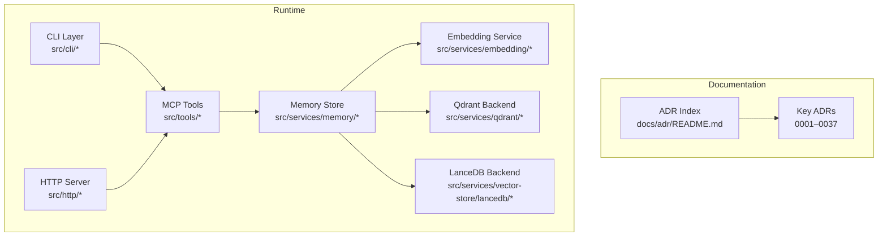

**Diagram sources**
- [0001-two-layer-adapter-write-caching.md:7-37](file://docs/adr/0001-two-layer-adapter-write-caching.md#L7-L37)
- [0008-bare-cli-defaults-to-stdio-and-console-log-hygiene.md:37-75](file://docs/adr/0008-bare-cli-defaults-to-stdio-and-console-log-hygiene.md#L37-L75)
- [0015-cli-local-by-default-transport-agnostic-backend.md:23-73](file://docs/adr/0015-cli-local-by-default-transport-agnostic-backend.md#L23-L73)
- [0021-embedding-provider-auto-resolution-and-store-width-binding.md:40-127](file://docs/adr/0021-embedding-provider-auto-resolution-and-store-width-binding.md#L40-L127)

**Section sources**
- [0001-two-layer-adapter-write-caching.md:7-37](file://docs/adr/0001-two-layer-adapter-write-caching.md#L7-L37)
- [0008-bare-cli-defaults-to-stdio-and-console-log-hygiene.md:37-75](file://docs/adr/0008-bare-cli-defaults-to-stdio-and-console-log-hygiene.md#L37-L75)
- [0015-cli-local-by-default-transport-agnostic-backend.md:23-73](file://docs/adr/0015-cli-local-by-default-transport-agnostic-backend.md#L23-L73)
- [0021-embedding-provider-auto-resolution-and-store-width-binding.md:40-127](file://docs/adr/0021-embedding-provider-auto-resolution-and-store-width-binding.md#L40-L127)

## Core Components
- Two-layer write caching: CI snapshot reuse and runtime boot injection reuse are separate concerns with different invalidation inputs.
- Boot injection reuse rule: semver-based skip controls whether shipped adapters are retrained at startup.
- Storage backend selection: Qdrant is remote-capable; LanceDB is embedded and zero-infrastructure.
- Embedding provider strategy: `auto` resolves OpenAI-compatible providers when configured, otherwise fastembed; width binding ties provider choice to stored vector columns.
- Transport layer design: CLI defaults to stdio for zero-config MCP hosts; HTTP serves multi-client scenarios.
- Verification policy: autonomous execution without human gates, backed by a structured verification ladder and critic-loop isolation.

**Section sources**
- [0001-two-layer-adapter-write-caching.md:7-37](file://docs/adr/0001-two-layer-adapter-write-caching.md#L7-L37)
- [0002-boot-injection-reuse-rule.md:30-48](file://docs/adr/0002-boot-injection-reuse-rule.md#L30-L48)
- [0003-no-lancedb-store-snapshot.md:22-49](file://docs/adr/0003-no-lancedb-store-snapshot.md#L22-L49)
- [0004-fastembed-default-for-testing.md:38-58](file://docs/adr/0004-fastembed-default-for-testing.md#L38-L58)
- [0015-cli-local-by-default-transport-agnostic-backend.md:23-73](file://docs/adr/0015-cli-local-by-default-transport-agnostic-backend.md#L23-L73)
- [0021-embedding-provider-auto-resolution-and-store-width-binding.md:40-127](file://docs/adr/0021-embedding-provider-auto-resolution-and-store-width-binding.md#L40-L127)
- [0009-autonomous-adapter-execution-no-human-gates.md:29-54](file://docs/adr/0009-autonomous-adapter-execution-no-human-gates.md#L29-L54)
- [0024-adapter-contract-verification-ladder.md:61-145](file://docs/adr/0024-adapter-contract-verification-ladder.md#L61-L145)

## Architecture Overview
The system centers on an agent-first workflow where adapters execute tasks deterministically and verifiably. Embeddings power semantic retrieval across rules and workflows. Storage may be remote (Qdrant) or embedded (LanceDB). The CLI provides a human-friendly local path, while MCP tools enable automation. Verification relies on machine-checkable contracts and critic-loop reviews rather than human approval prompts.

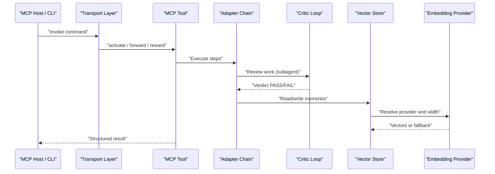

**Diagram sources**
- [0008-bare-cli-defaults-to-stdio-and-console-log-hygiene.md:37-75](file://docs/adr/0008-bare-cli-defaults-to-stdio-and-console-log-hygiene.md#L37-L75)
- [0009-autonomous-adapter-execution-no-human-gates.md:29-54](file://docs/adr/0009-autonomous-adapter-execution-no-human-gates.md#L29-L54)
- [0010-critic-loop-and-proof-splitting.md:30-62](file://docs/adr/0010-critic-loop-and-proof-splitting.md#L30-L62)
- [0021-embedding-provider-auto-resolution-and-store-width-binding.md:40-127](file://docs/adr/0021-embedding-provider-auto-resolution-and-store-width-binding.md#L40-L127)

## Detailed Component Analysis

### Two-Layer Adapter Write Caching
Two independent caching layers exist:
- CI snapshot reuse: seeds test collections via Qdrant snapshots, keyed by seed inputs.
- Runtime boot injection: trains shipped adapters into the configured store, keyed by adapter version versus stored version.

These layers answer different questions and must not be conflated. A CI hit does not make runtime boot cheap, and a runtime skip does not remove the need for seeded fixtures.

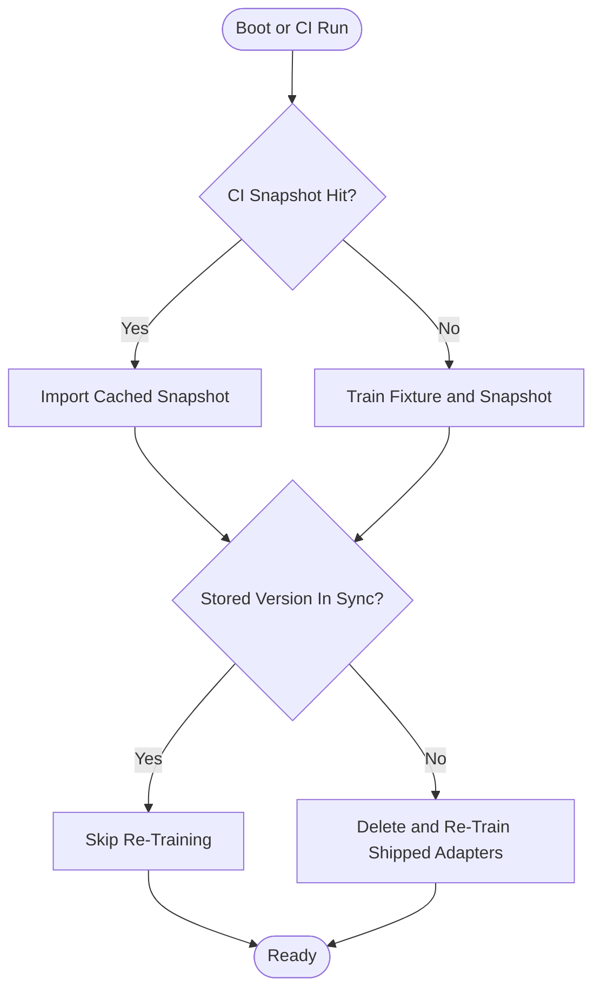

**Diagram sources**
- [0001-two-layer-adapter-write-caching.md:7-37](file://docs/adr/0001-two-layer-adapter-write-caching.md#L7-L37)
- [0002-boot-injection-reuse-rule.md:30-48](file://docs/adr/0002-boot-injection-reuse-rule.md#L30-L48)

**Section sources**
- [0001-two-layer-adapter-write-caching.md:7-37](file://docs/adr/0001-two-layer-adapter-write-caching.md#L7-L37)
- [0002-boot-injection-reuse-rule.md:30-48](file://docs/adr/0002-boot-injection-reuse-rule.md#L30-L48)

### Boot Injection Reuse Rule
Reuse is decided by semver comparison: if a stored adapter version exists and the shipped version is not greater, the adapter is skipped; otherwise it is deleted and re-trained. A structural repair switch allows forced re-injection for corrupted or dimension-mismatched stores.

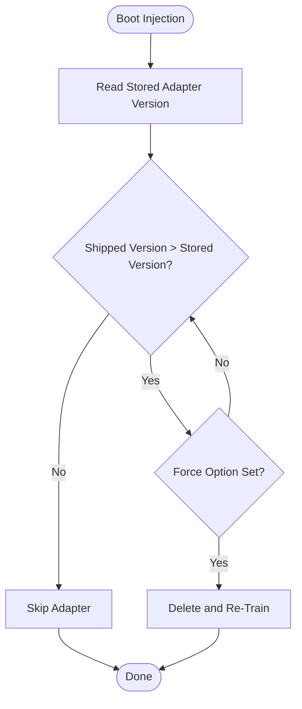

**Diagram sources**
- [0002-boot-injection-reuse-rule.md:30-48](file://docs/adr/0002-boot-injection-reuse-rule.md#L30-L48)

**Section sources**
- [0002-boot-injection-reuse-rule.md:30-48](file://docs/adr/0002-boot-injection-reuse-rule.md#L30-L48)

### Storage Backend Selection: Qdrant vs LanceDB
- Qdrant: primary, remote-capable, supports boot-time vector space migration.
- LanceDB: secondary, embedded, zero-infrastructure, safe across multiple local processes via MVCC and bounded commit retry.

No LanceDB store snapshot is built in CI because the cost and complexity do not justify the measured savings, especially once the boot-injection reuse skip works.

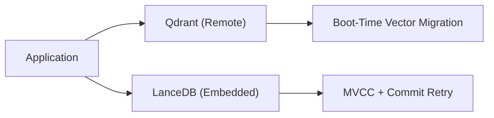

**Diagram sources**
- [0003-no-lancedb-store-snapshot.md:22-49](file://docs/adr/0003-no-lancedb-store-snapshot.md#L22-L49)
- [0013-embedded-store-multiprocess-safety.md:27-51](file://docs/adr/0013-embedded-store-multiprocess-safety.md#L27-L51)

**Section sources**
- [0003-no-lancedb-store-snapshot.md:22-49](file://docs/adr/0003-no-lancedb-store-snapshot.md#L22-L49)
- [0013-embedded-store-multiprocess-safety.md:27-51](file://docs/adr/0013-embedded-store-multiprocess-safety.md#L27-L51)

### Embedding Provider Strategies
The default provider resolution is `auto`:
- If an OpenAI-compatible endpoint is explicitly configured, use it.
- Otherwise, fall back to the built-in fastembed model.
- The resolved provider determines the vector width bound to the store.

Width mismatch is handled rather than tolerated: reads derive column names from the stored width, and writes fail closed with actionable guidance.

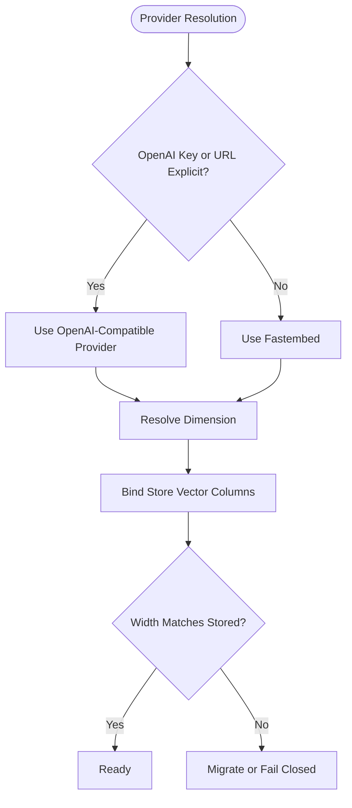

**Diagram sources**
- [0004-fastembed-default-for-testing.md:38-58](file://docs/adr/0004-fastembed-default-for-testing.md#L38-L58)
- [0021-embedding-provider-auto-resolution-and-store-width-binding.md:40-127](file://docs/adr/0021-embedding-provider-auto-resolution-and-store-width-binding.md#L40-L127)

**Section sources**
- [0004-fastembed-default-for-testing.md:38-58](file://docs/adr/0004-fastembed-default-for-testing.md#L38-L58)
- [0021-embedding-provider-auto-resolution-and-store-width-binding.md:40-127](file://docs/adr/0021-embedding-provider-auto-resolution-and-store-width-binding.md#L40-L127)

### Transport Layer Design
The CLI defaults to stdio for zero-config MCP host launches. Stdout is reserved strictly for MCP protocol frames; all logs go to stderr. Local mode runs commands in-process against the embedded store, skipping server boot costs and lazy-loading embeddings only when needed.

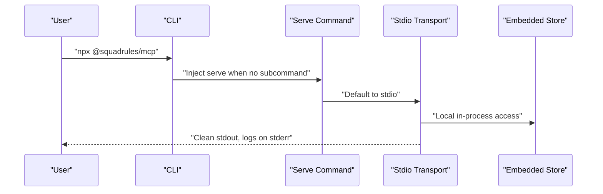

**Diagram sources**
- [0008-bare-cli-defaults-to-stdio-and-console-log-hygiene.md:37-75](file://docs/adr/0008-bare-cli-defaults-to-stdio-and-console-log-hygiene.md#L37-L75)
- [0015-cli-local-by-default-transport-agnostic-backend.md:23-73](file://docs/adr/0015-cli-local-by-default-transport-agnostic-backend.md#L23-L73)

**Section sources**
- [0008-bare-cli-defaults-to-stdio-and-console-log-hygiene.md:37-75](file://docs/adr/0008-bare-cli-defaults-to-stdio-and-console-log-hygiene.md#L37-L75)
- [0015-cli-local-by-default-transport-agnostic-backend.md:23-73](file://docs/adr/0015-cli-local-by-default-transport-agnostic-backend.md#L23-L73)

### Autonomous Execution and Critic Loop
Human confirmation gates are removed from bundled adapters. Agents resolve intent from context and proceed autonomously. Quality is enforced by:
- Objective pre/post verification.
- Critic-loop reviews until verdict is PASS.
- Proof splitting by reversibility cost.

A critic hop is a `subagent` contract, never a `forward` contract executed on the audited agent’s thread. The caller’s shell verdict gate remains the mechanical anchor.

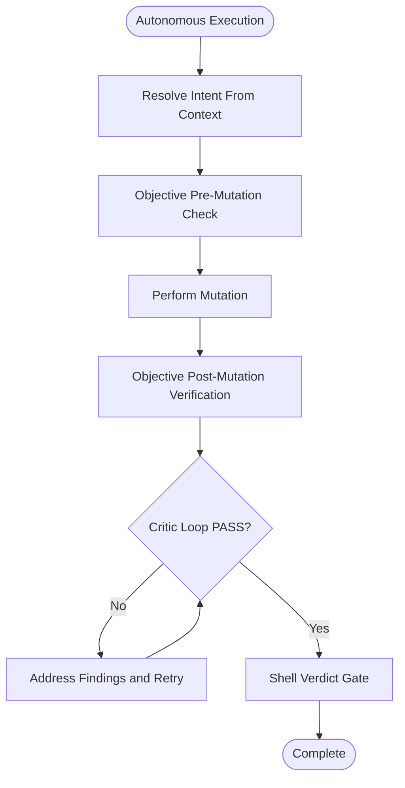

**Diagram sources**
- [0009-autonomous-adapter-execution-no-human-gates.md:29-54](file://docs/adr/0009-autonomous-adapter-execution-no-human-gates.md#L29-L54)
- [0010-critic-loop-and-proof-splitting.md:30-62](file://docs/adr/0010-critic-loop-and-proof-splitting.md#L30-L62)
- [0034-verification-isolation-critic-hop.md:59-100](file://docs/adr/0034-verification-isolation-critic-hop.md#L59-L100)

**Section sources**
- [0009-autonomous-adapter-execution-no-human-gates.md:29-54](file://docs/adr/0009-autonomous-adapter-execution-no-human-gates.md#L29-L54)
- [0010-critic-loop-and-proof-splitting.md:30-62](file://docs/adr/0010-critic-loop-and-proof-splitting.md#L30-L62)
- [0034-verification-isolation-critic-hop.md:59-100](file://docs/adr/0034-verification-isolation-critic-hop.md#L59-L100)

### Integration Lane Architecture
Exactly two integration lanes run the full suite and both gate merges:
- Cluster lane: Qdrant + Valkey + Postgres + Keycloak over HTTP with auth enabled.
- Single lane: embedded LanceDB, no Docker, stdio-only, auth disabled.

Both lanes blank external embedding keys and pin fastembed in CI.

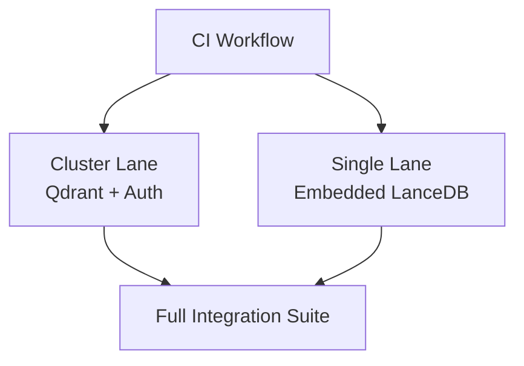

**Diagram sources**
- [0006-two-integration-lanes.md:20-50](file://docs/adr/0006-two-integration-lanes.md#L20-L50)
- [0004-fastembed-default-for-testing.md:38-58](file://docs/adr/0004-fastembed-default-for-testing.md#L38-L58)

**Section sources**
- [0006-two-integration-lanes.md:20-50](file://docs/adr/0006-two-integration-lanes.md#L20-L50)
- [0004-fastembed-default-for-testing.md:38-58](file://docs/adr/0004-fastembed-default-for-testing.md#L38-L58)

### Contract Verification Approaches
Verification follows an ordered ladder:
1. Shell empirical check.
2. Subagent critic.
3. Subagent performing MCP calls.
Fallback is a single comment acknowledgement only for read-only or knowledge adapters.

Subagent MCP delegation lists specify required tool calls, keeping transcripts out of the caller’s context. The proof record stays flat to avoid hash weakening.

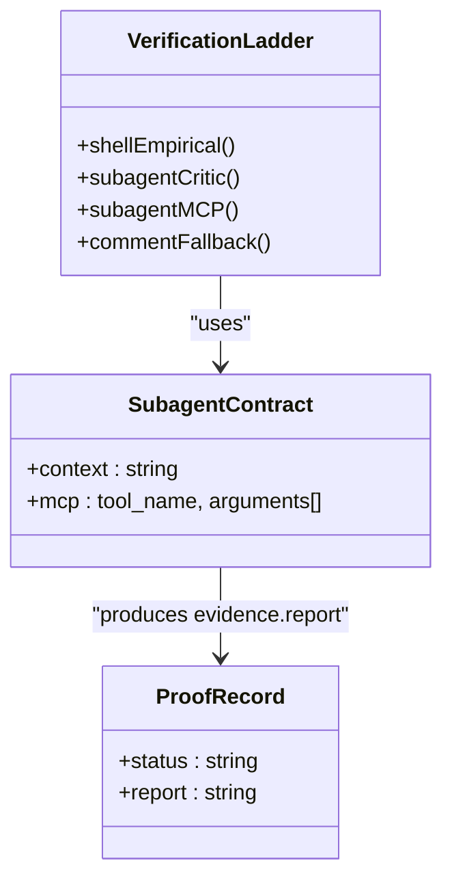

**Diagram sources**
- [0024-adapter-contract-verification-ladder.md:61-145](file://docs/adr/0024-adapter-contract-verification-ladder.md#L61-L145)
- [0029-subagent-mcp-and-context-authority.md:74-138](file://docs/adr/0029-subagent-mcp-and-context-authority.md#L74-L138)

**Section sources**
- [0024-adapter-contract-verification-ladder.md:61-145](file://docs/adr/0024-adapter-contract-verification-ladder.md#L61-L145)
- [0029-subagent-mcp-and-context-authority.md:74-138](file://docs/adr/0029-subagent-mcp-and-context-authority.md#L74-L138)

## Dependency Analysis
The key ADRs form a dependency graph where later decisions refine earlier ones:
- Autonomy (0009) enables critic-loop evolution (0010).
- Critic-loop isolation (0034) refines verification ladder (0024).
- Subagent MCP structure (0029) strengthens rung-3 delegation.
- Embedding provider auto-resolution (0021) binds provider choice to store width.
- CLI defaults (0008, 0015) shape transport and local safety (0013).

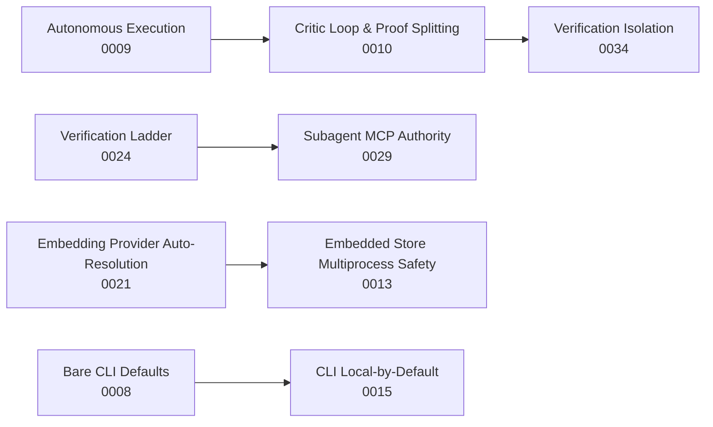

**Diagram sources**
- [0009-autonomous-adapter-execution-no-human-gates.md:29-54](file://docs/adr/0009-autonomous-adapter-execution-no-human-gates.md#L29-L54)
- [0010-critic-loop-and-proof-splitting.md:30-62](file://docs/adr/0010-critic-loop-and-proof-splitting.md#L30-L62)
- [0024-adapter-contract-verification-ladder.md:61-145](file://docs/adr/0024-adapter-contract-verification-ladder.md#L61-L145)
- [0029-subagent-mcp-and-context-authority.md:74-138](file://docs/adr/0029-subagent-mcp-and-context-authority.md#L74-L138)
- [0021-embedding-provider-auto-resolution-and-store-width-binding.md:40-127](file://docs/adr/0021-embedding-provider-auto-resolution-and-store-width-binding.md#L40-L127)
- [0013-embedded-store-multiprocess-safety.md:27-51](file://docs/adr/0013-embedded-store-multiprocess-safety.md#L27-L51)
- [0008-bare-cli-defaults-to-stdio-and-console-log-hygiene.md:37-75](file://docs/adr/0008-bare-cli-defaults-to-stdio-and-console-log-hygiene.md#L37-L75)
- [0015-cli-local-by-default-transport-agnostic-backend.md:23-73](file://docs/adr/0015-cli-local-by-default-transport-agnostic-backend.md#L23-L73)

**Section sources**
- [0009-autonomous-adapter-execution-no-human-gates.md:29-54](file://docs/adr/0009-autonomous-adapter-execution-no-human-gates.md#L29-L54)
- [0010-critic-loop-and-proof-splitting.md:30-62](file://docs/adr/0010-critic-loop-and-proof-splitting.md#L30-L62)
- [0024-adapter-contract-verification-ladder.md:61-145](file://docs/adr/0024-adapter-contract-verification-ladder.md#L61-L145)
- [0029-subagent-mcp-and-context-authority.md:74-138](file://docs/adr/0029-subagent-mcp-and-context-authority.md#L74-L138)
- [0021-embedding-provider-auto-resolution-and-store-width-binding.md:40-127](file://docs/adr/0021-embedding-provider-auto-resolution-and-store-width-binding.md#L40-L127)
- [0013-embedded-store-multiprocess-safety.md:27-51](file://docs/adr/0013-embedded-store-multiprocess-safety.md#L27-L51)
- [0008-bare-cli-defaults-to-stdio-and-console-log-hygiene.md:37-75](file://docs/adr/0008-bare-cli-defaults-to-stdio-and-console-log-hygiene.md#L37-L75)
- [0015-cli-local-by-default-transport-agnostic-backend.md:23-73](file://docs/adr/0015-cli-local-by-default-transport-agnostic-backend.md#L23-L73)

## Performance Considerations
- CI performance: Qdrant snapshot import is faster than training; however, Layer 1 is parked pending further evaluation.
- Boot performance: With working reuse, warm boots skip adapters quickly; without it, cold injections dominate startup time.
- Embedding cost: Local fastembed avoids OpenAI quota spend in CI; model weights are cached per runner.
- Multi-process safety: Embedded LanceDB uses MVCC and bounded retries; per-process cache staleness is acceptable at target scale.
- Transport overhead: Local CLI avoids server boot and client hops; HTTP transport serves multi-client scenarios efficiently.

[No sources needed since this section provides general guidance]

## Troubleshooting Guide
- Boot injection skips not firing: verify semver reuse logic and ensure the reader accessor resolves nested payload versions correctly.
- Width mismatch errors: inspect stored vector columns and resolved provider dimension; follow the actionable failure message rather than forcing re-injection.
- Stdio stdout corruption: ensure bare CLI invocation defaults to serve and that logging goes to stderr.
- Critic loop not terminating: confirm requirement coverage and iteration ceiling; avoid weak conjunction proofs.
- Subagent MCP validation failures: validate the shape of `subagent.mcp` entries and ensure tool names and arguments conform to the schema.

**Section sources**
- [0002-boot-injection-reuse-rule.md:30-48](file://docs/adr/0002-boot-injection-reuse-rule.md#L30-L48)
- [0021-embedding-provider-auto-resolution-and-store-width-binding.md:101-127](file://docs/adr/0021-embedding-provider-auto-resolution-and-store-width-binding.md#L101-L127)
- [0008-bare-cli-defaults-to-stdio-and-console-log-hygiene.md:37-75](file://docs/adr/0008-bare-cli-defaults-to-stdio-and-console-log-hygiene.md#L37-L75)
- [0010-critic-loop-and-proof-splitting.md:30-62](file://docs/adr/0010-critic-loop-and-proof-splitting.md#L30-L62)
- [0029-subagent-mcp-and-context-authority.md:74-138](file://docs/adr/0029-subagent-mcp-and-context-authority.md#L74-L138)

## Conclusion
SquadRules’ architecture balances agent autonomy with strong verification. Two-layer caching isolates CI provisioning from runtime reuse; semver-based boot injection prevents unnecessary retraining; Qdrant and LanceDB offer complementary storage strategies; embedding provider auto-resolution binds provider choice to store width; CLI defaults favor zero-config local operation; and the verification ladder ensures honest, observable outcomes. These decisions collectively prioritize operational simplicity and extensibility while maintaining security boundaries through objective contracts and isolated critic reviews.

[No sources needed since this section summarizes without analyzing specific files]