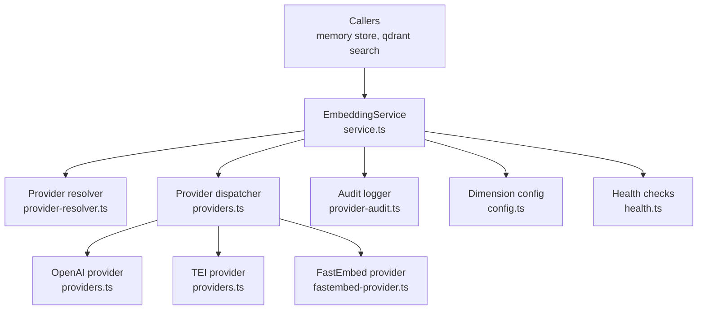
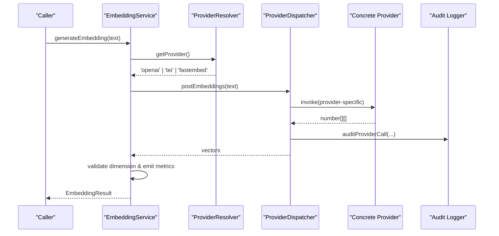
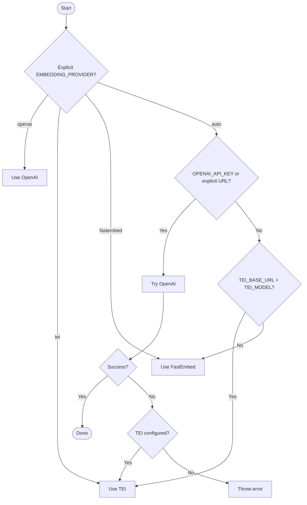
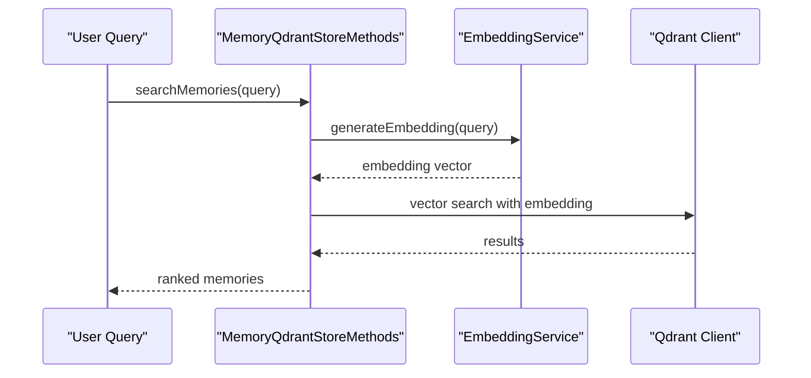
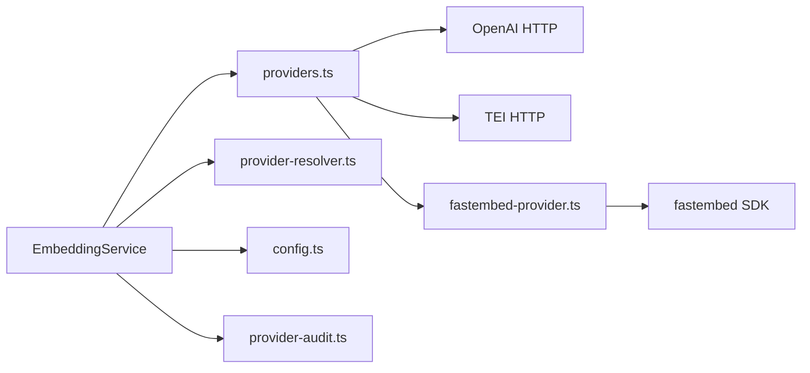

# Custom Embedding Providers

<cite>
**Referenced Files in This Document**
- [service.ts](file://src/services/embedding/service.ts)
- [providers.ts](file://src/services/embedding/providers.ts)
- [provider-resolver.ts](file://src/services/embedding/provider-resolver.ts)
- [fastembed-provider.ts](file://src/services/embedding/fastembed-provider.ts)
- [config.ts](file://src/services/embedding/config.ts)
- [embedding-fastembed.ts](file://src/config/embedding-fastembed.ts)
- [provider-audit.ts](file://src/services/embedding/provider-audit.ts)
- [health.ts](file://src/services/embedding/health.ts)
- [lazy-probe.ts](file://src/services/embedding/lazy-probe.ts)
- [store-methods.ts](file://src/services/memory/store-methods.ts)
- [store-init.ts](file://src/services/memory/store-init.ts)
- [search.ts](file://src/services/qdrant/search.ts)
</cite>

## Table of Contents
1. [Introduction](#introduction)
2. [Project Structure](#project-structure)
3. [Core Components](#core-components)
4. [Architecture Overview](#architecture-overview)
5. [Detailed Component Analysis](#detailed-component-analysis)
6. [Dependency Analysis](#dependency-analysis)
7. [Performance Considerations](#performance-considerations)
8. [Troubleshooting Guide](#troubleshooting-guide)
9. [Conclusion](#conclusion)
10. [Appendices](#appendices)

## Introduction
This document explains how to develop custom embedding providers for SquadRules, focusing on the provider interface, registration mechanism, configuration patterns, and integration with the vector search pipeline. It covers:
- The provider selection and resolution system
- Built-in providers (OpenAI-compatible API, TEI, and local fastembed)
- How to implement new backends beyond FastEmbed
- Authentication handling and model caching
- Provider fallback behavior and retry semantics
- Testing strategies and integration points with memory and Qdrant search

SquadRules uses embeddings for semantic search across adapters, memories, and resources. The embedding layer is intentionally pluggable so you can run locally with fastembed or connect to cloud APIs without changing callers.

## Project Structure
The embedding subsystem lives under `src/services/embedding`. Key responsibilities:
- `service.ts`: Public service used by the rest of the application
- `providers.ts`: Provider dispatch, retries, rate limiting, and audit emission
- `fastembed-provider.ts`: Local ONNX-based provider
- `provider-resolver.ts`: Candidate selection and successful provider tracking
- `config.ts`: Runtime dimension cache and endpoint construction
- `embedding-fastembed.ts`: Default fastembed model and cache directory
- `provider-audit.ts`: Structured audit logging for all providers
- `health.ts`: Health checks per provider
- `lazy-probe.ts`: Memoized dimension probe for startup vs lazy initialization

**Diagram sources**
- [service.ts:39-278](file://src/services/embedding/service.ts#L39-L278)
- [providers.ts:76-333](file://src/services/embedding/providers.ts#L76-L333)
- [fastembed-provider.ts:41-82](file://src/services/embedding/fastembed-provider.ts#L41-L82)
- [provider-resolver.ts:28-81](file://src/services/embedding/provider-resolver.ts#L28-L81)
- [config.ts:12-36](file://src/services/embedding/config.ts#L12-L36)
- [provider-audit.ts:26-42](file://src/services/embedding/provider-audit.ts#L26-L42)
- [health.ts:92-121](file://src/services/embedding/health.ts#L92-L121)

**Section sources**
- [service.ts:39-278](file://src/services/embedding/service.ts#L39-L278)
- [providers.ts:76-333](file://src/services/embedding/providers.ts#L76-L333)
- [fastembed-provider.ts:41-82](file://src/services/embedding/fastembed-provider.ts#L41-L82)
- [provider-resolver.ts:28-81](file://src/services/embedding/provider-resolver.ts#L28-L81)
- [config.ts:12-36](file://src/services/embedding/config.ts#L12-L36)
- [embedding-fastembed.ts:14-22](file://src/config/embedding-fastembed.ts#L14-L22)
- [provider-audit.ts:26-42](file://src/services/embedding/provider-audit.ts#L26-L42)
- [health.ts:92-121](file://src/services/embedding/health.ts#L92-L121)

## Core Components
- EmbeddingService: Public API for single and batch embeddings, cosine similarity, health check, and configuration exposure. It delegates provider selection to the resolver and calls into the provider dispatcher.
- Provider dispatcher: Routes requests to OpenAI, TEI, or fastembed based on explicit preference or auto-detection. Implements retries, backoff, budgeting, and structured audit logging.
- FastEmbed provider: Local ONNX inference via fastembed SDK, lazily initialized and cached. Downloads models once into a shared cache directory.
- Provider resolver: Determines candidate provider from environment variables and tracks the successful provider descriptor after first success.
- Dimension config: Caches the resolved embedding dimension after the first successful call and enforces consistency across subsequent calls.
- Audit logger: Emits structured logs for every provider call with status, latency, input/output metrics, and optional HTTP details.
- Health checks: Per-provider probes that validate connectivity, authentication, and response shape.

Key implementation references:
- EmbeddingService methods and configuration: [service.ts:48-275](file://src/services/embedding/service.ts#L48-L275)
- Provider dispatch and retries: [providers.ts:76-333](file://src/services/embedding/providers.ts#L76-L333)
- FastEmbed provider: [fastembed-provider.ts:41-82](file://src/services/embedding/fastembed-provider.ts#L41-L82)
- Provider resolver: [provider-resolver.ts:28-81](file://src/services/embedding/provider-resolver.ts#L28-L81)
- Dimension cache: [config.ts:12-36](file://src/services/embedding/config.ts#L12-L36)
- Audit logger: [provider-audit.ts:26-42](file://src/services/embedding/provider-audit.ts#L26-L42)
- Health checks: [health.ts:92-121](file://src/services/embedding/health.ts#L92-L121)

**Section sources**
- [service.ts:48-275](file://src/services/embedding/service.ts#L48-L275)
- [providers.ts:76-333](file://src/services/embedding/providers.ts#L76-L333)
- [fastembed-provider.ts:41-82](file://src/services/embedding/fastembed-provider.ts#L41-L82)
- [provider-resolver.ts:28-81](file://src/services/embedding/provider-resolver.ts#L28-L81)
- [config.ts:12-36](file://src/services/embedding/config.ts#L12-L36)
- [provider-audit.ts:26-42](file://src/services/embedding/provider-audit.ts#L26-L42)
- [health.ts:92-121](file://src/services/embedding/health.ts#L92-L121)

## Architecture Overview
The embedding architecture separates concerns between caller-facing service, provider selection, concrete providers, and cross-cutting concerns like auditing and dimension validation.

**Diagram sources**
- [service.ts:48-127](file://src/services/embedding/service.ts#L48-L127)
- [provider-resolver.ts:28-46](file://src/services/embedding/provider-resolver.ts#L28-L46)
- [providers.ts:296-333](file://src/services/embedding/providers.ts#L296-L333)
- [provider-audit.ts:26-42](file://src/services/embedding/provider-audit.ts#L26-L42)

## Detailed Component Analysis

### Provider Interface and Registration Mechanism
There is no formal TypeScript interface exported for providers. Instead, the system uses function contracts:
- Each provider exports a function returning `Promise<number[][]>` for an input string or array of strings.
- The dispatcher (`postEmbeddings`) selects which provider to call based on configuration and environment.
- Successful providers record their model name and output dimension through the resolver.

To register a new provider:
1. Implement a function with the same signature as existing providers: accepts `string[] | string`, returns `number[][]`.
2. Add a branch in the dispatcher to select your provider by a new preference value or auto-detection rule.
3. Emit structured audit logs using the shared audit helper.
4. Record the successful provider descriptor with model name and dimension after a successful call.
5. Optionally add health check support if your provider has its own endpoint or initialization requirements.

References:
- Provider contract examples: [providers.ts:93-201](file://src/services/embedding/providers.ts#L93-L201), [providers.ts:203-295](file://src/services/embedding/providers.ts#L203-L295), [fastembed-provider.ts:41-82](file://src/services/embedding/fastembed-provider.ts#L41-L82)
- Successful provider tracking: [provider-resolver.ts:68-81](file://src/services/embedding/provider-resolver.ts#L68-L81)
- Audit logging: [provider-audit.ts:26-42](file://src/services/embedding/provider-audit.ts#L26-L42)

**Section sources**
- [providers.ts:93-201](file://src/services/embedding/providers.ts#L93-L201)
- [providers.ts:203-295](file://src/services/embedding/providers.ts#L203-L295)
- [fastembed-provider.ts:41-82](file://src/services/embedding/fastembed-provider.ts#L41-L82)
- [provider-resolver.ts:68-81](file://src/services/embedding/provider-resolver.ts#L68-L81)
- [provider-audit.ts:26-42](file://src/services/embedding/provider-audit.ts#L26-L42)

### Provider Resolution System and Fallbacks
Candidate selection rules:
- Explicit preference wins: `EMBEDDING_PROVIDER` set to `openai`, `tei`, or `fastembed`.
- Auto mode:
  - If `OPENAI_API_KEY` is set or `OPENAI_API_URL` is explicitly overridden, prefer OpenAI-compatible provider.
  - Otherwise, if `TEI_BASE_URL` and `TEI_MODEL` are configured, use TEI (deprecated but supported).
  - Otherwise, default to fastembed.

Fallback behavior:
- In auto mode, if OpenAI fails, the dispatcher attempts TEI when configured, then throws the original error if neither succeeds.
- Health checks mirror this logic to report the expected operational provider.

References:
- Candidate resolution: [provider-resolver.ts:28-46](file://src/services/embedding/provider-resolver.ts#L28-L46)
- Dispatcher fallback: [providers.ts:296-333](file://src/services/embedding/providers.ts#L296-L333)
- Health check routing: [health.ts:92-121](file://src/services/embedding/health.ts#L92-L121)

**Diagram sources**
- [provider-resolver.ts:28-46](file://src/services/embedding/provider-resolver.ts#L28-L46)
- [providers.ts:296-333](file://src/services/embedding/providers.ts#L296-L333)

**Section sources**
- [provider-resolver.ts:28-46](file://src/services/embedding/provider-resolver.ts#L28-L46)
- [providers.ts:296-333](file://src/services/embedding/providers.ts#L296-L333)
- [health.ts:92-121](file://src/services/embedding/health.ts#L92-L121)

### Configuration Patterns
Environment-driven configuration:
- `EMBEDDING_PROVIDER`: Selects provider explicitly (`openai`, `tei`, `fastembed`) or `auto`.
- OpenAI: `OPENAI_API_KEY`, `OPENAI_EMBEDDING_MODEL`, `OPENAI_API_URL` (endpoint base).
- TEI: `TEI_BASE_URL`, `TEI_MODEL`, `TEI_API_KEY`.
- FastEmbed: `FASTEMBED_MODEL`, `FASTEMBED_CACHE_DIR`.

Runtime dimension caching:
- After the first successful embedding, the dimension is cached and enforced for subsequent calls.
- A startup probe ensures the dimension is resolved before memory stores initialize.

References:
- OpenAI/TEI endpoints and dimension cache: [config.ts:1-40](file://src/services/embedding/config.ts#L1-L40)
- FastEmbed defaults: [embedding-fastembed.ts:14-22](file://src/config/embedding-fastembed.ts#L14-L22)
- Startup probe: [service.ts:280-284](file://src/services/embedding/service.ts#L280-L284), [lazy-probe.ts:19-27](file://src/services/embedding/lazy-probe.ts#L19-L27)

**Section sources**
- [config.ts:1-40](file://src/services/embedding/config.ts#L1-L40)
- [embedding-fastembed.ts:14-22](file://src/config/embedding-fastembed.ts#L14-L22)
- [service.ts:280-284](file://src/services/embedding/service.ts#L280-L284)
- [lazy-probe.ts:19-27](file://src/services/embedding/lazy-probe.ts#L19-L27)

### Implementing New Embedding Backends
Steps to add a new backend (e.g., Ollama, Cohere, Azure OpenAI):
1. Create a provider file (e.g., `ollama-provider.ts`) exporting a function that:
   - Accepts `string[] | string`
   - Returns `Promise<number[][]>`
   - Emits audit logs via `auditProviderCall`
   - Records successful provider descriptor with model and dimension
2. Update the dispatcher in `providers.ts` to recognize your provider preference or auto-detect it.
3. Add any required environment variables and endpoint construction in `config.ts` or a dedicated config module.
4. Add health check support in `health.ts` if your provider has a distinct endpoint or initialization step.
5. Ensure dimension probing works at startup; verify that the returned vectors match the expected dimension.

Example reference paths:
- Provider function pattern: [fastembed-provider.ts:41-82](file://src/services/embedding/fastembed-provider.ts#L41-L82)
- Dispatcher extension point: [providers.ts:296-333](file://src/services/embedding/providers.ts#L296-L333)
- Audit emission: [provider-audit.ts:26-42](file://src/services/embedding/provider-audit.ts#L26-L42)
- Successful provider recording: [provider-resolver.ts:68-81](file://src/services/embedding/provider-resolver.ts#L68-L81)

**Section sources**
- [fastembed-provider.ts:41-82](file://src/services/embedding/fastembed-provider.ts#L41-L82)
- [providers.ts:296-333](file://src/services/embedding/providers.ts#L296-L333)
- [provider-audit.ts:26-42](file://src/services/embedding/provider-audit.ts#L26-L42)
- [provider-resolver.ts:68-81](file://src/services/embedding/provider-resolver.ts#L68-L81)

### Handling Authentication
- OpenAI: Uses `Authorization: Bearer <OPENAI_API_KEY>` when key is present; allows keyless requests only when `OPENAI_API_URL` is explicitly overridden.
- TEI: Optional `x-api-key` header when `TEI_API_KEY` is set.
- FastEmbed: No API key; runs locally.

Authentication errors:
- 401 responses throw clear errors indicating missing or invalid keys.
- Non-retriable quota errors (e.g., OpenAI `insufficient_quota`) fail fast with a specific rate limit error type.

References:
- OpenAI auth and error handling: [providers.ts:93-201](file://src/services/embedding/providers.ts#L93-L201)
- TEI auth and error handling: [providers.ts:203-295](file://src/services/embedding/providers.ts#L203-L295)

**Section sources**
- [providers.ts:93-201](file://src/services/embedding/providers.ts#L93-L201)
- [providers.ts:203-295](file://src/services/embedding/providers.ts#L203-L295)

### Managing Model Caching
- FastEmbed caches model weights in `FASTEMBED_CACHE_DIR`, defaulting to a user-shared directory.
- The fastembed SDK instance is lazily initialized and memoized per process.
- Dimension is cached after the first successful embedding and validated on subsequent calls.

References:
- FastEmbed cache dir and model: [embedding-fastembed.ts:14-22](file://src/config/embedding-fastembed.ts#L14-L22)
- Lazy init and memoization: [fastembed-provider.ts:17-39](file://src/services/embedding/fastembed-provider.ts#L17-L39)
- Dimension cache enforcement: [config.ts:12-36](file://src/services/embedding/config.ts#L12-L36)

**Section sources**
- [embedding-fastembed.ts:14-22](file://src/config/embedding-fastembed.ts#L14-L22)
- [fastembed-provider.ts:17-39](file://src/services/embedding/fastembed-provider.ts#L17-L39)
- [config.ts:12-36](file://src/services/embedding/config.ts#L12-L36)

### Retry Semantics and Rate Limiting
- Network errors matching known transient tokens trigger retries with exponential backoff and full jitter.
- HTTP status codes 429, 502, 503, 504 are retriable.
- Retry delay honors `Retry-After` or `retry-after-ms` headers, capped by a maximum.
- Wall-clock retry budget prevents indefinite retries.
- OpenAI non-retriable quota errors (e.g., `insufficient_quota`) fail immediately.

References:
- Retriable conditions and backoff: [providers.ts:9-74](file://src/services/embedding/providers.ts#L9-L74)
- Fetch retries and budget: [providers.ts:76-92](file://src/services/embedding/providers.ts#L76-L92)
- OpenAI rate limit handling: [providers.ts:147-172](file://src/services/embedding/providers.ts#L147-L172)
- TEI rate limit handling: [providers.ts:258-260](file://src/services/embedding/providers.ts#L258-L260)

**Section sources**
- [providers.ts:9-74](file://src/services/embedding/providers.ts#L9-L74)
- [providers.ts:76-92](file://src/services/embedding/providers.ts#L76-L92)
- [providers.ts:147-172](file://src/services/embedding/providers.ts#L147-L172)
- [providers.ts:258-260](file://src/services/embedding/providers.ts#L258-L260)

### Integration with Vector Search Pipeline
Embeddings are consumed by:
- Memory store methods for query embedding
- Store initialization for migration and vector space setup
- Qdrant search utilities for query embedding

**Diagram sources**
- [store-methods.ts:122-122](file://src/services/memory/store-methods.ts#L122-L122)
- [service.ts:48-127](file://src/services/embedding/service.ts#L48-L127)

References:
- Query embedding usage: [store-methods.ts:122-122](file://src/services/memory/store-methods.ts#L122-L122)
- Store initialization and migration: [store-init.ts:296-296](file://src/services/memory/store-init.ts#L296-L296)
- Qdrant search embedding usage: [search.ts:19-19](file://src/services/qdrant/search.ts#L19-L19)

**Section sources**
- [store-methods.ts:122-122](file://src/services/memory/store-methods.ts#L122-L122)
- [store-init.ts:296-296](file://src/services/memory/store-init.ts#L296-L296)
- [search.ts:19-19](file://src/services/qdrant/search.ts#L19-L19)

## Dependency Analysis
The embedding subsystem depends on:
- Configuration modules for environment variables and endpoint construction
- Structured logger and tenant context for audit and metrics
- Metrics registry for request duration, errors, and vector size observations
- External providers: OpenAI-compatible REST API, TEI server, and fastembed SDK

**Diagram sources**
- [service.ts:39-278](file://src/services/embedding/service.ts#L39-L278)
- [providers.ts:76-333](file://src/services/embedding/providers.ts#L76-L333)
- [fastembed-provider.ts:41-82](file://src/services/embedding/fastembed-provider.ts#L41-L82)
- [config.ts:1-40](file://src/services/embedding/config.ts#L1-L40)
- [provider-audit.ts:26-42](file://src/services/embedding/provider-audit.ts#L26-L42)

**Section sources**
- [service.ts:39-278](file://src/services/embedding/service.ts#L39-L278)
- [providers.ts:76-333](file://src/services/embedding/providers.ts#L76-L333)
- [fastembed-provider.ts:41-82](file://src/services/embedding/fastembed-provider.ts#L41-L82)
- [config.ts:1-40](file://src/services/embedding/config.ts#L1-L40)
- [provider-audit.ts:26-42](file://src/services/embedding/provider-audit.ts#L26-L42)

## Performance Considerations
- Prefer batch embeddings where possible to reduce round-trips and overhead.
- Use fastembed for zero-latency local inference when network access is undesirable.
- Respect retry budgets and backoff caps to avoid cascading failures.
- Ensure dimension probing runs at startup to prevent runtime mismatches.
- Monitor metrics for request duration, error rates, and vector sizes to detect anomalies.

[No sources needed since this section provides general guidance]

## Troubleshooting Guide
Common issues and resolutions:
- Missing provider configuration:
  - OpenAI requires `OPENAI_API_KEY` or an explicitly overridden `OPENAI_API_URL`.
  - TEI requires `TEI_BASE_URL` and `TEI_MODEL`.
  - FastEmbed requires `FASTEMBED_MODEL` and optionally `FASTEMBED_CACHE_DIR`.
- Authentication failures:
  - 401 responses indicate missing or invalid keys; verify environment variables.
- Rate limiting:
  - 429 responses may be retriable depending on provider; inspect audit logs for retry behavior.
- Dimension mismatch:
  - Ensure `probeEmbeddingDimension()` runs at startup; otherwise, dimension will not be resolved.
- Health checks:
  - Use `embeddingService.healthCheck()` to validate provider reachability and configuration.

References:
- Configuration validation and errors: [providers.ts:93-201](file://src/services/embedding/providers.ts#L93-L201), [providers.ts:203-295](file://src/services/embedding/providers.ts#L203-L295)
- Dimension resolution and probe: [config.ts:12-36](file://src/services/embedding/config.ts#L12-L36), [service.ts:280-284](file://src/services/embedding/service.ts#L280-L284)
- Health checks: [health.ts:92-121](file://src/services/embedding/health.ts#L92-L121)

**Section sources**
- [providers.ts:93-201](file://src/services/embedding/providers.ts#L93-L201)
- [providers.ts:203-295](file://src/services/embedding/providers.ts#L203-L295)
- [config.ts:12-36](file://src/services/embedding/config.ts#L12-L36)
- [service.ts:280-284](file://src/services/embedding/service.ts#L280-L284)
- [health.ts:92-121](file://src/services/embedding/health.ts#L92-L121)

## Conclusion
SquadRules’ embedding subsystem provides a robust, configurable, and auditable provider abstraction. By following the documented patterns—implementing a function-based provider, updating the dispatcher, emitting audit logs, and recording successful provider descriptors—you can integrate new embedding backends seamlessly. The built-in retry, rate limiting, and dimension validation ensure reliability, while health checks and metrics enable observability. For local-first workflows, fastembed offers a zero-dependency default; for cloud APIs, OpenAI and TEI provide flexible alternatives.

[No sources needed since this section summarizes without analyzing specific files]

## Appendices

### Example Scenarios

#### Implementing a Local Ollama Provider
- Function signature: accept `string[] | string`, return `Promise<number[][]>`
- Endpoint: POST to `/api/embed` with model and input
- Headers: optional API key if required by your Ollama deployment
- Audit: emit structured logs via `auditProviderCall`
- Success: record provider descriptor with model name and dimension

Reference paths:
- Provider function pattern: [fastembed-provider.ts:41-82](file://src/services/embedding/fastembed-provider.ts#L41-L82)
- Dispatcher extension: [providers.ts:296-333](file://src/services/embedding/providers.ts#L296-L333)
- Audit emission: [provider-audit.ts:26-42](file://src/services/embedding/provider-audit.ts#L26-L42)
- Successful provider recording: [provider-resolver.ts:68-81](file://src/services/embedding/provider-resolver.ts#L68-L81)

#### Implementing a Cloud API Provider (e.g., Cohere)
- Function signature: same as above
- Endpoint: POST to provider’s embeddings endpoint
- Auth: include required headers (e.g., Authorization or API key)
- Error handling: map provider-specific errors to clear messages
- Audit and metrics: consistent with other providers

Reference paths:
- OpenAI provider example: [providers.ts:93-201](file://src/services/embedding/providers.ts#L93-L201)
- TEI provider example: [providers.ts:203-295](file://src/services/embedding/providers.ts#L203-L295)
- Audit emission: [provider-audit.ts:26-42](file://src/services/embedding/provider-audit.ts#L26-L42)

#### Testing Strategies for Custom Providers
- Unit tests:
  - Validate function signature and return types
  - Mock HTTP client or SDK to simulate success and failure scenarios
  - Verify retry behavior and backoff calculations
- Integration tests:
  - Spin up a test server mimicking provider responses
  - Assert dimension consistency and audit log emission
  - Confirm health check behavior
- End-to-end tests:
  - Exercise embedding generation through `EmbeddingService`
  - Validate vector search integration with Qdrant

Reference paths:
- Retry and backoff helpers: [providers.ts:9-74](file://src/services/embedding/providers.ts#L9-L74)
- Health checks: [health.ts:92-121](file://src/services/embedding/health.ts#L92-L121)
- Service API: [service.ts:48-275](file://src/services/embedding/service.ts#L48-L275)