# Custom Integrations & Extensions

<cite>
**Referenced Files in This Document**
- [SKILL.md](file://.agents/skills/squadrules/SKILL.md)
- [action-routing.md](file://.agents/skills/squadrules/references/action-routing.md)
- [eslint.config.cjs](file://eslint.config.cjs)
- [0020-codeql-false-positive-query-exclusions.md](file://docs/adr/0020-codeql-false-positive-query-exclusions.md)
- [tool-registry.ts](file://src/tools/tool-registry.ts)
- [audit-log-events.ts](file://src/utils/audit-log-events.ts)
- [audit-mcp-summary.ts](file://src/utils/audit-mcp-summary.ts)
- [adapter-navigation.ts](file://src/services/adapter-navigation.ts)
- [http-mcp-handler.ts](file://src/http/http-mcp-handler.ts)
- [mcp-audit-emit.ts](file://src/http/mcp-audit-emit.ts)
- [squadrules-ui-constants.ts](file://src/mcp-apps/squadrules-ui-constants.ts)
- [README.md](file://src/mcp-apps/README.md)
</cite>

## Table of Contents
1. [Introduction](#introduction)
2. [Project Structure](#project-structure)
3. [Core Components](#core-components)
4. [Architecture Overview](#architecture-overview)
5. [Detailed Component Analysis](#detailed-component-analysis)
6. [Dependency Analysis](#dependency-analysis)
7. [Performance Considerations](#performance-considerations)
8. [Troubleshooting Guide](#troubleshooting-guide)
9. [Conclusion](#conclusion)

## Introduction
This document explains how to extend SquadRules beyond its built-in behavior. It focuses on:

- The hand-authored skills system and the `squadrules` skill as the canonical action router.
- Developing custom ESLint plugins for code quality enforcement, including forbidden text detection, CodeQL line comment processing, and MCP widget validation.
- Extending the tool registry to add custom tools beyond the built-in set.
- Customizing audit log events and MCP summary generation.
- Extending adapter navigation, implementing custom middleware, and integrating with external systems.
- Plugin development patterns, testing strategies, and deployment considerations for third-party integrations.

SquadRules is an agent-first MCP framework where agents are primary users and humans configure preferences through agents. The core flow is `activate → forward → reward`. Adapters provide deterministic, auditable task execution, and agents must consult team knowledge before acting.

## Project Structure
The extension surface spans several layers:

- Agent-facing routing logic lives under `.agents/skills/`, with `squadrules` as the canonical skill.
- Linting and security checks live under `eslint.config.cjs` and referenced plugin files.
- MCP tool registration and schemas live under `src/tools/`.
- Audit logging and MCP summaries live under `src/utils/` and `src/http/`.
- Adapter navigation utilities live under `src/services/`.
- MCP Apps UI bindings live under `src/mcp-apps/`.

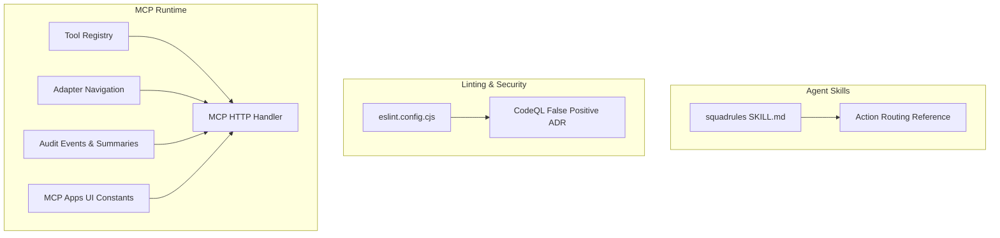

**Diagram sources**
- [SKILL.md:1-91](file://.agents/skills/squadrules/SKILL.md#L1-L91)
- [action-routing.md:1-244](file://.agents/skills/squadrules/references/action-routing.md#L1-L244)
- [eslint.config.cjs:1-18](file://eslint.config.cjs#L1-L18)
- [0020-codeql-false-positive-query-exclusions.md:1-141](file://docs/adr/0020-codeql-false-positive-query-exclusions.md#L1-L141)
- [tool-registry.ts:1-100](file://src/tools/tool-registry.ts#L1-L100)
- [adapter-navigation.ts:1-199](file://src/services/adapter-navigation.ts#L1-L199)
- [audit-log-events.ts:1-89](file://src/utils/audit-log-events.ts#L1-L89)
- [audit-mcp-summary.ts:1-169](file://src/utils/audit-mcp-summary.ts#L1-L169)
- [http-mcp-handler.ts:120-270](file://src/http/http-mcp-handler.ts#L120-L270)
- [mcp-audit-emit.ts:1-60](file://src/http/mcp-audit-emit.ts#L1-L60)
- [squadrules-ui-constants.ts:30-60](file://src/mcp-apps/squadrules-ui-constants.ts#L30-L60)

**Section sources**
- [SKILL.md:1-91](file://.agents/skills/squadrules/SKILL.md#L1-L91)
- [eslint.config.cjs:1-18](file://eslint.config.cjs#L1-L18)
- [tool-registry.ts:1-100](file://src/tools/tool-registry.ts#L1-L100)

## Core Components
This section summarizes the main extension points:

- **Skills system**: Hand-authored routing logic under `.agents/skills/`. The `squadrules` skill is the canonical action router that routes intents through `activate → forward → reward`.
- **ESLint plugins**: The repository uses a flat ESLint configuration entry that delegates to a flat config and references custom plugins for forbidden text, CodeQL line comments, and MCP widget validation.
- **Tool registry**: A single source of truth for MCP tools, their schemas, titles, descriptions, and UI metadata.
- **Audit logging**: Coarse allowlisted event emission and bounded, sanitized MCP request/response summaries.
- **Adapter navigation**: Utilities to resolve current, first, next, and previous adapter layers, with manifest pinning for stable UUIDs during execution.
- **MCP Apps UI constants**: Tool-specific UI metadata used by MCP Apps widgets.

**Section sources**
- [SKILL.md:1-91](file://.agents/skills/squadrules/SKILL.md#L1-L91)
- [eslint.config.cjs:1-18](file://eslint.config.cjs#L1-L18)
- [tool-registry.ts:1-100](file://src/tools/tool-registry.ts#L1-L100)
- [audit-log-events.ts:1-89](file://src/utils/audit-log-events.ts#L1-L89)
- [audit-mcp-summary.ts:1-169](file://src/utils/audit-mcp-summary.ts#L1-L169)
- [adapter-navigation.ts:1-199](file://src/services/adapter-navigation.ts#L1-L199)
- [squadrules-ui-constants.ts:30-60](file://src/mcp-apps/squadrules-ui-constants.ts#L30-L60)

## Architecture Overview
The extension architecture connects agent skills, linting, MCP runtime, audit logging, and UI bindings.

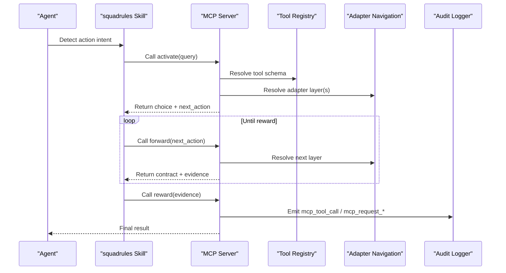

**Diagram sources**
- [SKILL.md:1-91](file://.agents/skills/squadrules/SKILL.md#L1-L91)
- [action-routing.md:1-244](file://.agents/skills/squadrules/references/action-routing.md#L1-L244)
- [tool-registry.ts:1-100](file://src/tools/tool-registry.ts#L1-L100)
- [adapter-navigation.ts:1-199](file://src/services/adapter-navigation.ts#L1-L199)
- [audit-log-events.ts:1-89](file://src/utils/audit-log-events.ts#L1-L89)
- [http-mcp-handler.ts:120-270](file://src/http/http-mcp-handler.ts#L120-L270)
- [mcp-audit-emit.ts:1-60](file://src/http/mcp-audit-emit.ts#L1-L60)

## Detailed Component Analysis

### Skills System and the `squadrules` Canonical Router
The skills system stores hand-authored routing logic under `.agents/skills/`. These skills are never auto-generated. The `squadrules` skill is the canonical action router:

- It detects action intents such as write, create, build, implement, fix, debug, deploy, publish, migrate, configure, install, update, refactor, review, test, automate, generate, document, plan, or procedure-like requests.
- It routes through `activate → forward → reward`, following server-provided `next_action` values without skipping, reordering, or merging adapter layers.
- It treats unavailable or unauthenticated MCP servers as critical errors and instructs remediation rather than proceeding.
- It emphasizes echoing verbatim server-generated URIs, nonces, hashes, IDs, and `next_action` values.

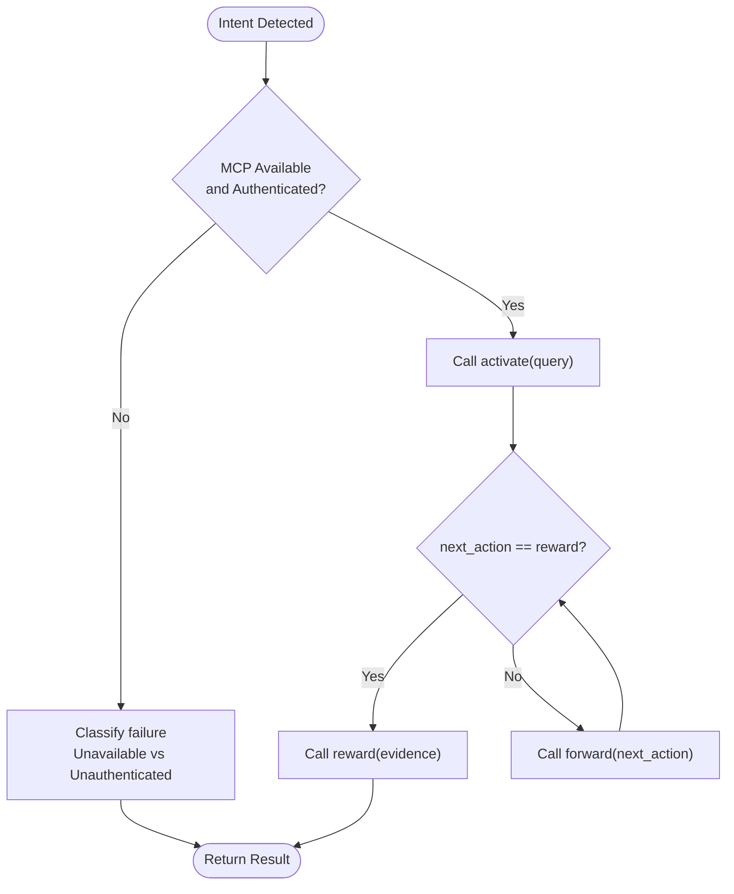

**Diagram sources**
- [SKILL.md:1-91](file://.agents/skills/squadrules/SKILL.md#L1-L91)
- [action-routing.md:1-244](file://.agents/skills/squadrules/references/action-routing.md#L1-L244)

**Section sources**
- [SKILL.md:1-91](file://.agents/skills/squadrules/SKILL.md#L1-L91)
- [action-routing.md:1-244](file://.agents/skills/squadrules/references/action-routing.md#L1-L244)

### Developing Custom ESLint Plugins
The repository’s linting entry file documents three custom plugin responsibilities:

- Forbidden text detection for protocol wording and policy-sensitive tokens.
- CodeQL line comment integrity checking for `// codeql[js/…]` annotations.
- MCP widget validation for handshake and HTML shell contracts.

The entry file delegates to a flat configuration and applies rules across `src/`, `scripts/`, `tests/`, markdown files, and context files. Inline `eslint-disable` and file comments cannot change rules because inline configuration is disabled.

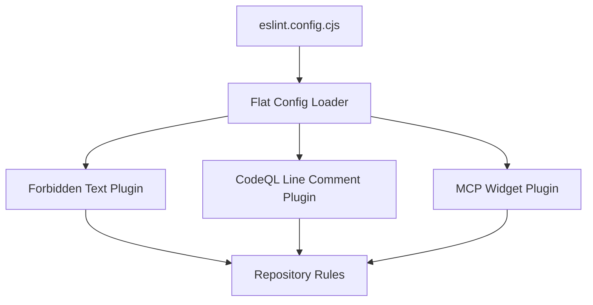

**Diagram sources**
- [eslint.config.cjs:1-18](file://eslint.config.cjs#L1-L18)

**Section sources**
- [eslint.config.cjs:1-18](file://eslint.config.cjs#L1-L18)

### CodeQL Line Comment Processing and False Positives
The repository explicitly rejects relying on inline `// codeql[...]` comments for suppression in GitHub code scanning. Instead, false positives are excluded via `query-filters` in the CodeQL configuration. The ADR documents why inline comments were inert and why the repository-wide exclusion was accepted for specific queries.

Key implications for custom extensions:

- Do not assume inline CodeQL comments suppress alerts in CI.
- Prefer documented exclusions in the CodeQL configuration when necessary.
- Keep inline comments as local documentation, but treat the configuration as authoritative.

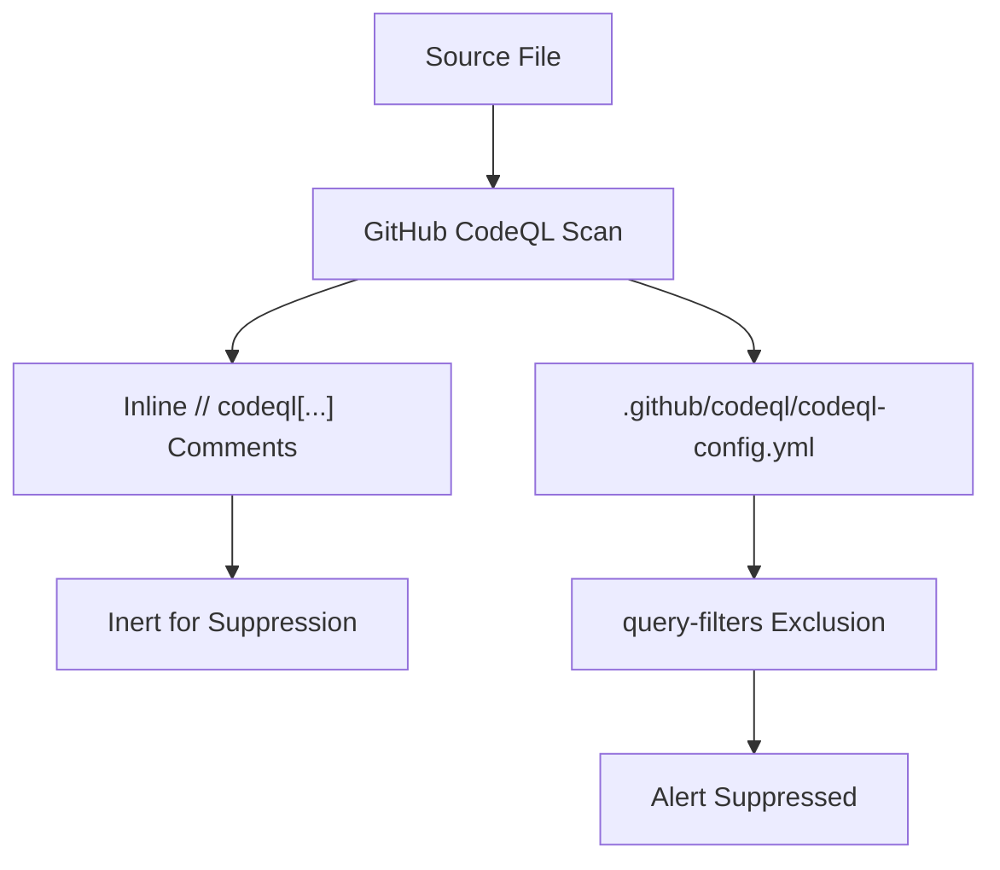

**Diagram sources**
- [0020-codeql-false-positive-query-exclusions.md:1-141](file://docs/adr/0020-codeql-false-positive-query-exclusions.md#L1-L141)

**Section sources**
- [0020-codeql-false-positive-query-exclusions.md:1-141](file://docs/adr/0020-codeql-false-positive-query-exclusions.md#L1-L141)

### MCP Widget Validation
The linting entry references an MCP widget plugin that validates MCP Apps widgets. The MCP Apps README documents how MCP Apps integrates with the MCP SDK, including `server.registerTool`, and how tool UI metadata is attached.

For custom MCP widget integrations:

- Ensure widget payloads follow the expected handshake and HTML shell contract.
- Attach `_meta` UI metadata to tool registrations so the UI can bind widgets correctly.
- Validate widget content through the custom ESLint plugin rather than ad hoc checks.

**Diagram sources**
- [eslint.config.cjs:1-18](file://eslint.config.cjs#L1-L18)
- [README.md:110-120](file://src/mcp-apps/README.md#L110-L120)
- [README.md:240-250](file://src/mcp-apps/README.md#L240-L250)

**Section sources**
- [eslint.config.cjs:1-18](file://eslint.config.cjs#L1-L18)
- [README.md:110-120](file://src/mcp-apps/README.md#L110-L120)
- [README.md:240-250](file://src/mcp-apps/README.md#L240-L250)

### Tool Registry Extension Mechanism
The canonical tool registry defines the built-in MCP tools: `activate`, `forward`, `train`, `reward`, `tune`, `delete`, `export`, and `spaces`. Each entry includes:

- Tool name and title.
- Optional UI metadata.
- Description resolved from tool documentation.
- Strict input schema and output schema.

To extend the tool surface:

1. Define new Zod schemas for input and output.
2. Add a registry entry with a unique name, title, description, and schemas.
3. Wire the tool implementation into the MCP server using the same registration pattern as built-in tools.
4. If the tool needs UI binding, attach appropriate UI metadata constants.

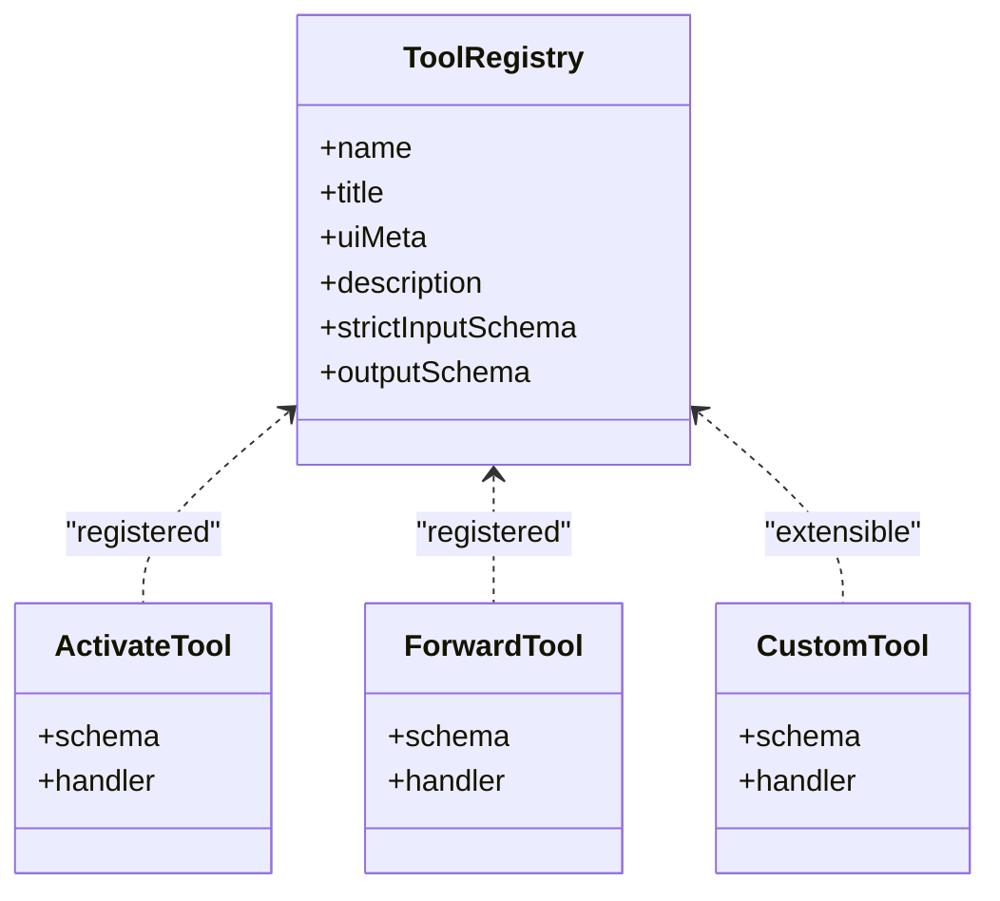

**Diagram sources**
- [tool-registry.ts:1-100](file://src/tools/tool-registry.ts#L1-L100)

**Section sources**
- [tool-registry.ts:1-100](file://src/tools/tool-registry.ts#L1-L100)

### Audit Log Event Customization
Audit logging uses a coarse allowlist for categories and events. The builder constructs audit records with timestamp, level, category, event, and additional safe bindings. For MCP events, it supports:

- `mcp_request_start`
- `mcp_request_end`
- `mcp_tool_call`

Customization guidance:

- Use the allowed categories: `audit.embedding`, `audit.anomaly`, `audit.mcp`.
- Provide structured bindings such as `stage`, `status`, `anomaly_type`, `event`, `correlation_id`, `tenant_id`, `request_id`, and `tool_name`.
- Avoid injecting secrets; rely on redaction helpers in MCP summaries.

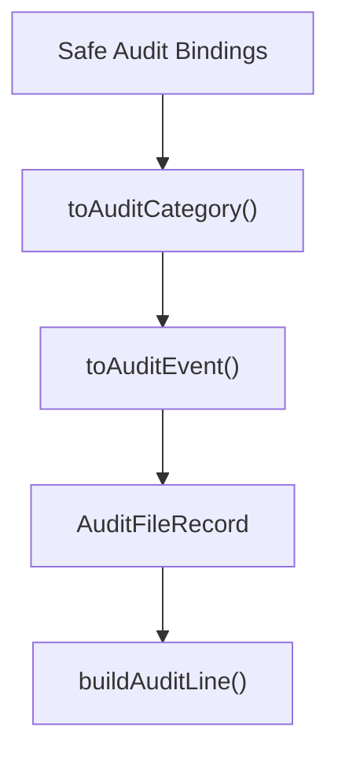

**Diagram sources**
- [audit-log-events.ts:1-89](file://src/utils/audit-log-events.ts#L1-L89)

**Section sources**
- [audit-log-events.ts:1-89](file://src/utils/audit-log-events.ts#L1-L89)

### MCP Summary Generation
MCP audit summaries sanitize and bound request arguments and responses:

- Depth-bounded recursion.
- Key-bounded object serialization.
- String length capping.
- Array item limits.
- Secret redaction.
- Tool-specific summarization (e.g., `train` content length instead of raw content).
- Error code extraction from common MCP error shapes.

For specialized use cases:

- Extend `summarizeRequestArgs` to add tool-specific truncation or metadata.
- Extend `summarizeResponse` to capture additional fields while preserving safety bounds.
- Use `extractErrorCode` to normalize error reporting across MCP tool results.

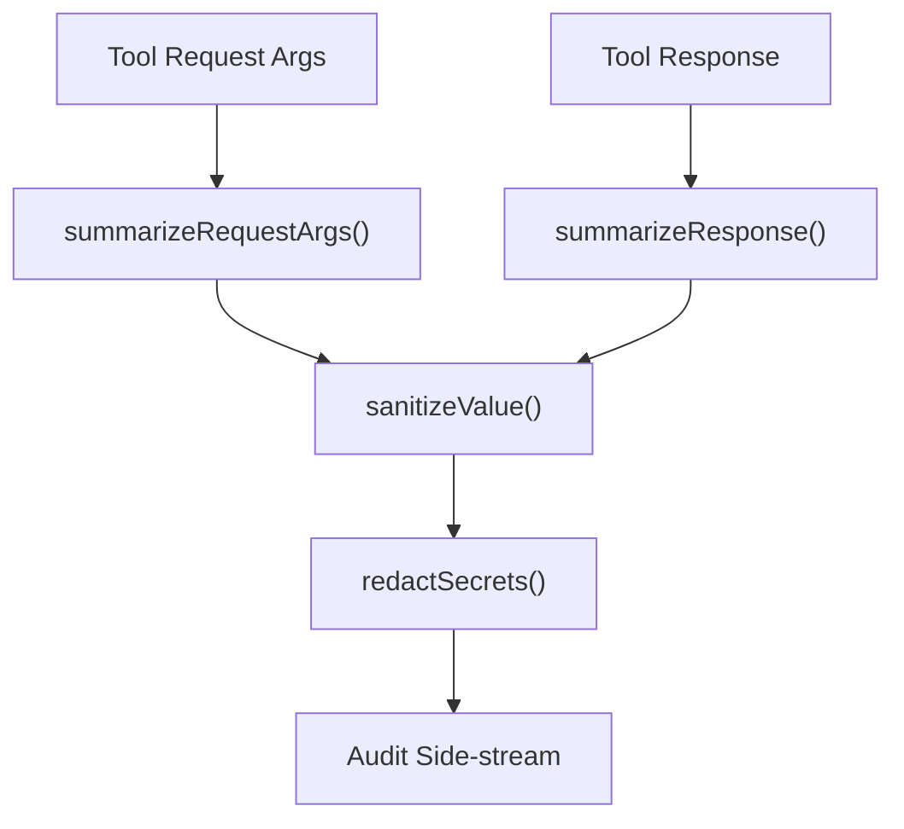

**Diagram sources**
- [audit-mcp-summary.ts:1-169](file://src/utils/audit-mcp-summary.ts#L1-L169)

**Section sources**
- [audit-mcp-summary.ts:1-169](file://src/utils/audit-mcp-summary.ts#L1-L169)

### Extending Adapter Navigation
Adapter navigation provides utilities to resolve:

- Current adapter entry.
- First adapter layer.
- Next adapter layer.
- Previous adapter layer.
- Ordered layer manifest with pinned UUIDs per execution.

To extend navigation:

- Add new resolution functions that query Qdrant adapter layers.
- Respect manifest pinning to prevent UUID churn during execution.
- Return consistent `ResolvedAdapterLayer` objects with `uuid`, `label`, `layer_index`, and `layer_count`.

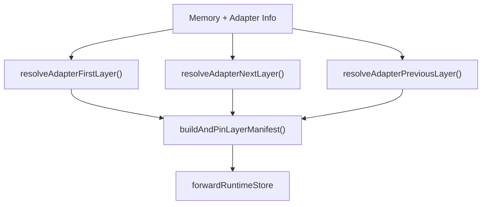

**Diagram sources**
- [adapter-navigation.ts:1-199](file://src/services/adapter-navigation.ts#L1-L199)

**Section sources**
- [adapter-navigation.ts:1-199](file://src/services/adapter-navigation.ts#L1-L199)

### Implementing Custom Middleware and External Integrations
The MCP HTTP handler emits audit events around tool calls:

- `mcp_request_start` before space context resolution.
- `mcp_request_end` after response finish.
- `mcp_tool_call` with response status and duration.

For custom middleware:

- Hook into request lifecycle around MCP dispatch.
- Preserve correlation IDs and tenant context.
- Emit audit events only through the allowlisted builders.
- Avoid blocking the hot path; offload heavy work.

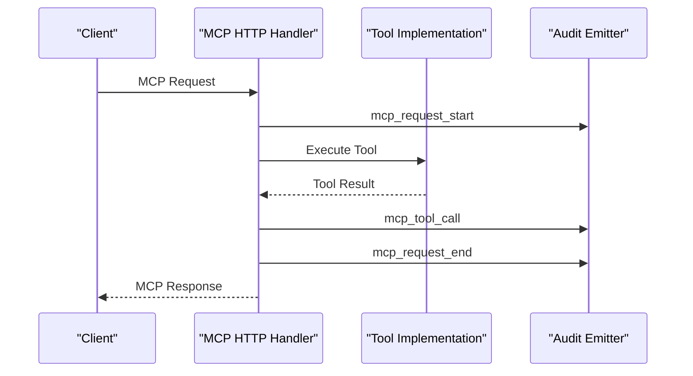

**Diagram sources**
- [http-mcp-handler.ts:120-270](file://src/http/http-mcp-handler.ts#L120-L270)
- [mcp-audit-emit.ts:1-60](file://src/http/mcp-audit-emit.ts#L1-L60)

**Section sources**
- [http-mcp-handler.ts:120-270](file://src/http/http-mcp-handler.ts#L120-L270)
- [mcp-audit-emit.ts:1-60](file://src/http/mcp-audit-emit.ts#L1-L60)

### Plugin Development Patterns
Recommended patterns for custom extensions:

- **Single source of truth**: Keep tool definitions, schemas, and UI metadata centralized.
- **Allowlists over wildcards**: Restrict audit categories and events to known values.
- **Sanitization at boundaries**: Apply secret redaction and size bounds early.
- **Manifest pinning**: Stabilize adapter layer UUIDs per execution.
- **Separation of concerns**: Keep routing logic in skills, tool logic in tools, and UI bindings in MCP Apps.

**Section sources**
- [tool-registry.ts:1-100](file://src/tools/tool-registry.ts#L1-L100)
- [audit-log-events.ts:1-89](file://src/utils/audit-log-events.ts#L1-L89)
- [audit-mcp-summary.ts:1-169](file://src/utils/audit-mcp-summary.ts#L1-L169)
- [adapter-navigation.ts:1-199](file://src/services/adapter-navigation.ts#L1-L199)

### Testing Strategies for Custom Extensions
Testing should cover:

- **Skills routing**: Verify intent detection, chain completion, and error handling for unavailable/unauthenticated MCP servers.
- **ESLint plugins**: Test forbidden text matches, CodeQL comment parsing, and MCP widget contract validation.
- **Tool registry**: Assert schema parity across MCP `tools/list`, HTTP routes, and CLI commands.
- **Audit logging**: Validate allowlisted events, sanitization, and bounded summaries.
- **Adapter navigation**: Verify first/next/previous layer resolution and manifest pinning.

Practical approaches:

- Unit tests for utility functions like `buildAuditLine`, `summarizeRequestArgs`, `summarizeResponse`, and `extractErrorCode`.
- Integration tests for MCP tool registration and HTTP handler audit emissions.
- Snapshot tests for serialized audit lines and summarized payloads.
- Contract tests for adapter layer navigation against Qdrant fixtures.

[No sources needed since this section provides general guidance]

### Deployment Considerations for Third-Party Integrations
When deploying custom integrations:

- Pin dependencies and avoid dynamic imports that pull in side effects at import time.
- Keep tool schemas and handlers aligned with the canonical registry.
- Configure audit verbosity carefully; MCP audit levels do not affect embedding/anomaly events.
- Ensure MCP endpoint URLs, health checks, and allowed tools match host configuration.
- Validate widget contracts and UI metadata before exposing tools to MCP Apps.

**Section sources**
- [tool-registry.ts:1-100](file://src/tools/tool-registry.ts#L1-L100)
- [SKILL.md:72-91](file://.agents/skills/squadrules/SKILL.md#L72-L91)

## Dependency Analysis
The key dependencies among extension components:

- Skills depend on MCP availability and authentication.
- Tool registry depends on schema modules and UI constants.
- Adapter navigation depends on memory accessors, Qdrant service, and forward runtime store.
- Audit logging depends on safe bindings and MCP summary helpers.
- MCP HTTP handler orchestrates tool execution and audit emissions.

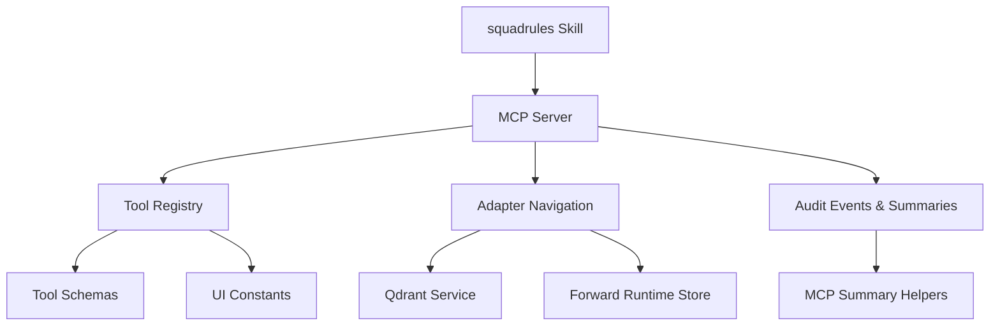

**Diagram sources**
- [SKILL.md:1-91](file://.agents/skills/squadrules/SKILL.md#L1-L91)
- [tool-registry.ts:1-100](file://src/tools/tool-registry.ts#L1-L100)
- [adapter-navigation.ts:1-199](file://src/services/adapter-navigation.ts#L1-L199)
- [audit-mcp-summary.ts:1-169](file://src/utils/audit-mcp-summary.ts#L1-L169)

**Section sources**
- [tool-registry.ts:1-100](file://src/tools/tool-registry.ts#L1-L100)
- [adapter-navigation.ts:1-199](file://src/services/adapter-navigation.ts#L1-L199)
- [audit-mcp-summary.ts:1-169](file://src/utils/audit-mcp-summary.ts#L1-L169)

## Performance Considerations
- Keep audit event emission lightweight; avoid serializing large payloads at high verbosity.
- Use manifest pinning to reduce repeated graph traversal during adapter navigation.
- Bound all serialized audit data to prevent memory pressure.
- Avoid blocking the MCP HTTP handler with synchronous I/O.
- Prefer read-only operations in linting and validation phases.

[No sources needed since this section provides general guidance]

## Troubleshooting Guide
Common issues and remedies:

- **MCP unavailable or unauthenticated**: Classify the failure, stop routing, and guide remediation. Verify endpoint URL, health check, and allowed tools.
- **Missing adapter scripts**: Obtain artifacts through `export` or `materialize`; if absent, report the missing path and repair the adapter.
- **CodeQL false positives**: Use repository-wide `query-filters` exclusions instead of relying on inline comments.
- **Audit logs too verbose**: Adjust `AUDIT_LOG_LEVEL` for MCP events; embedding/anomaly events remain unaffected.
- **Widget rendering failures**: Validate widget contracts and ensure UI metadata is attached to tool registrations.

**Section sources**
- [SKILL.md:72-91](file://.agents/skills/squadrules/SKILL.md#L72-L91)
- [action-routing.md:52-68](file://.agents/skills/squadrules/references/action-routing.md#L52-L68)
- [0020-codeql-false-positive-query-exclusions.md:51-86](file://docs/adr/0020-codeql-false-positive-query-exclusions.md#L51-L86)

## Conclusion
SquadRules provides clear extension points for skills, linting, MCP tools, audit logging, adapter navigation, and MCP Apps UI. By following the canonical patterns—hand-authored skills, centralized tool registries, allowlisted audit events, bounded summaries, and manifest-pinned navigation—you can build reliable custom integrations. Test thoroughly, keep schemas and UI metadata synchronized, and treat MCP availability and authentication as hard constraints.

[No sources needed since this section summarizes without analyzing specific files]