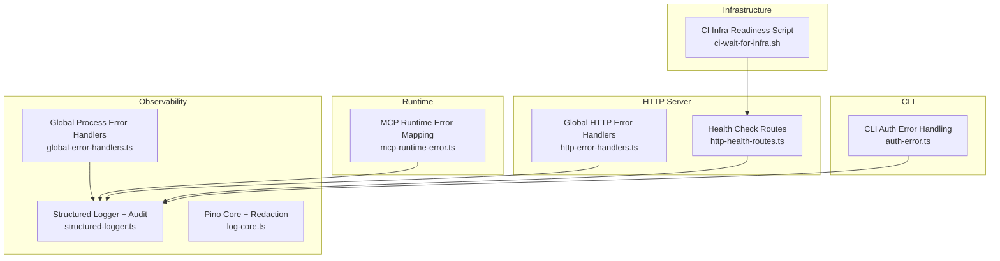
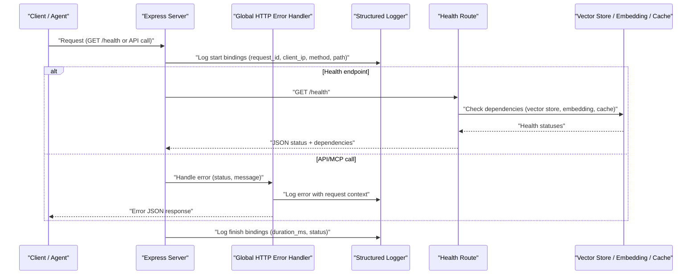
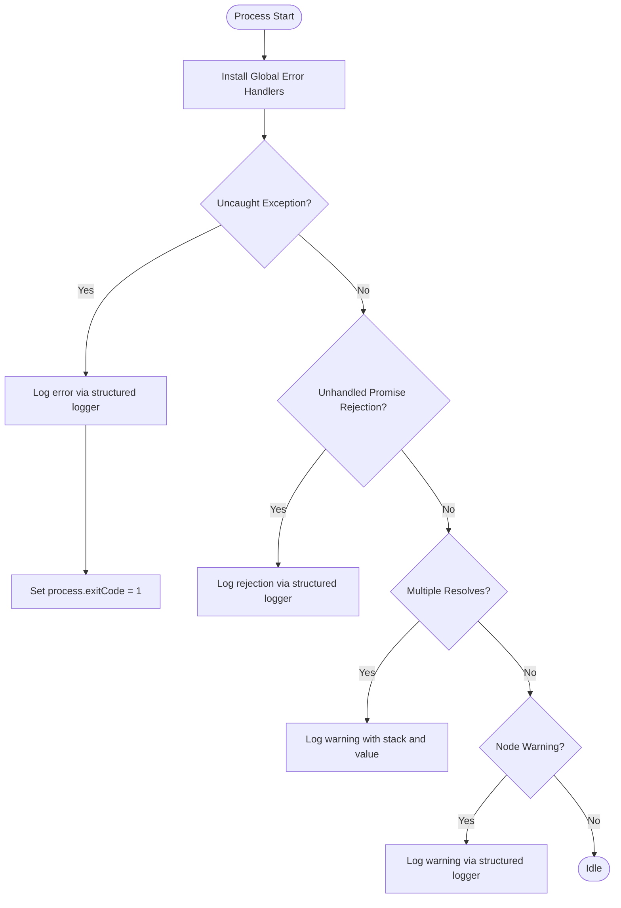
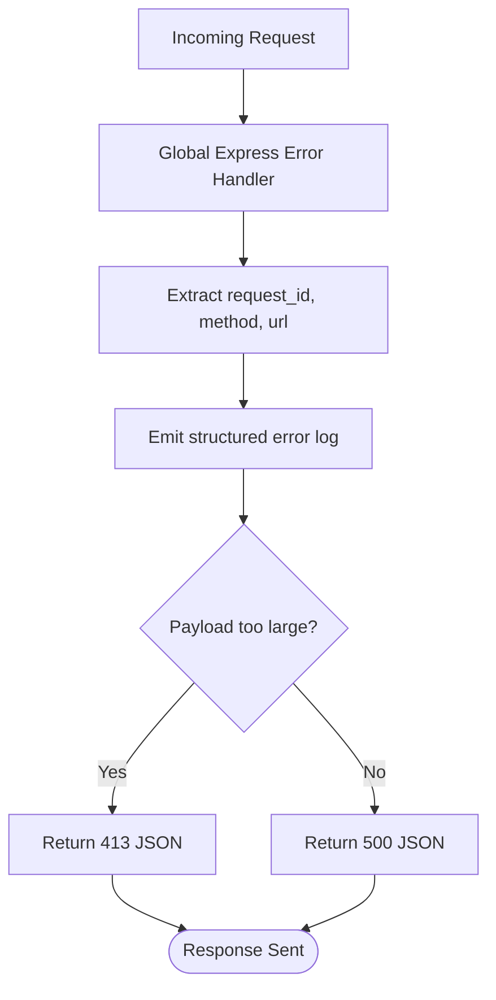
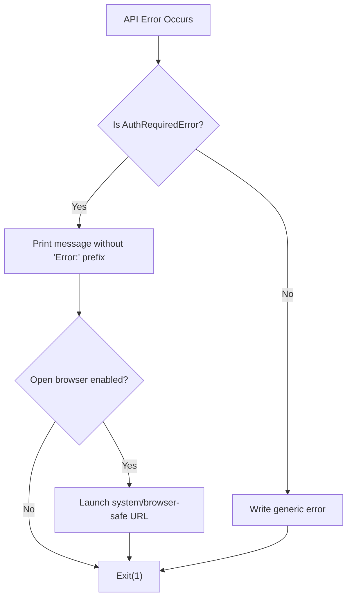
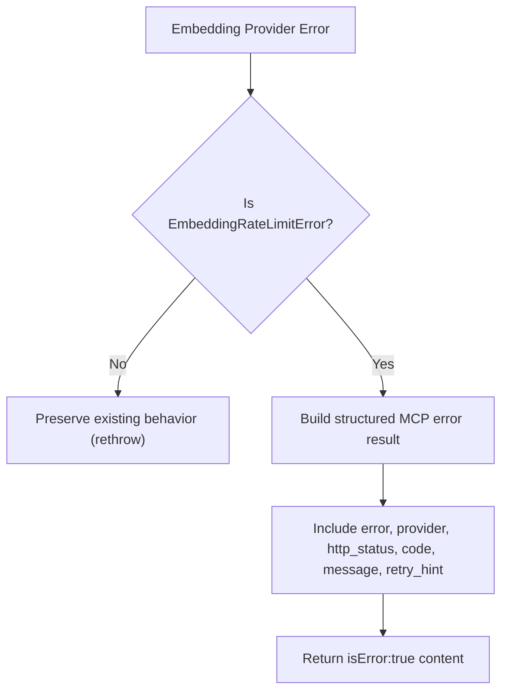
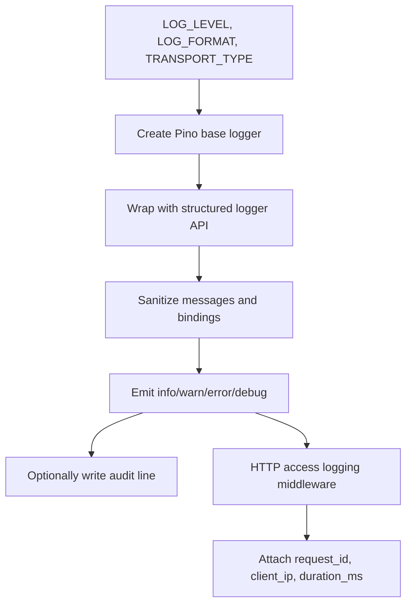
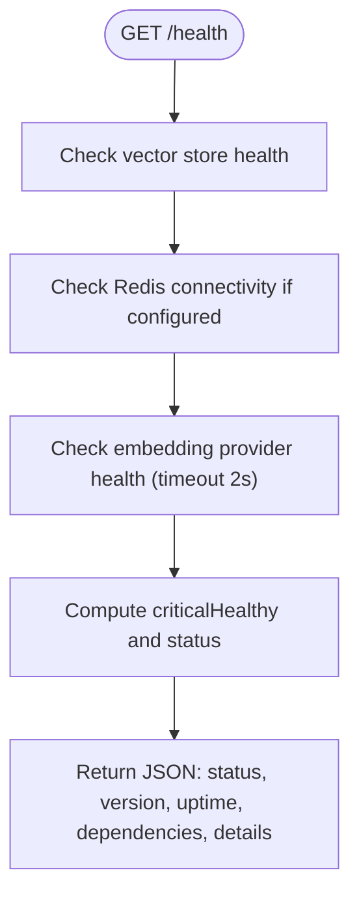
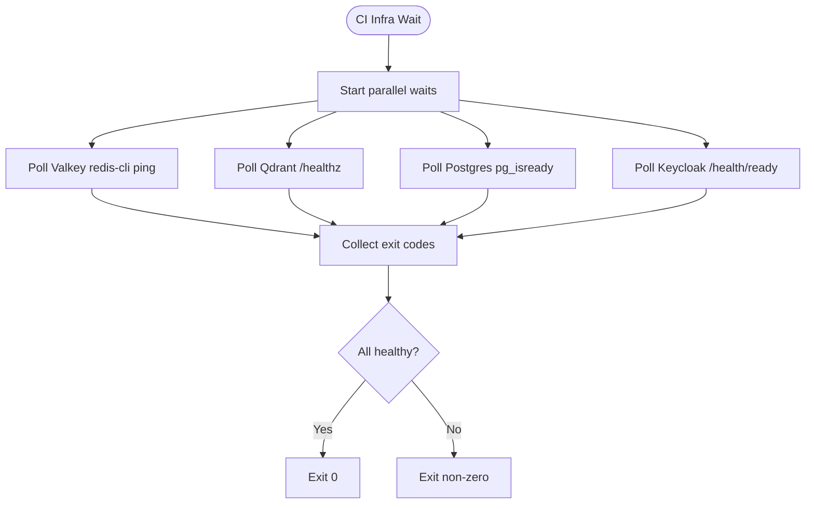
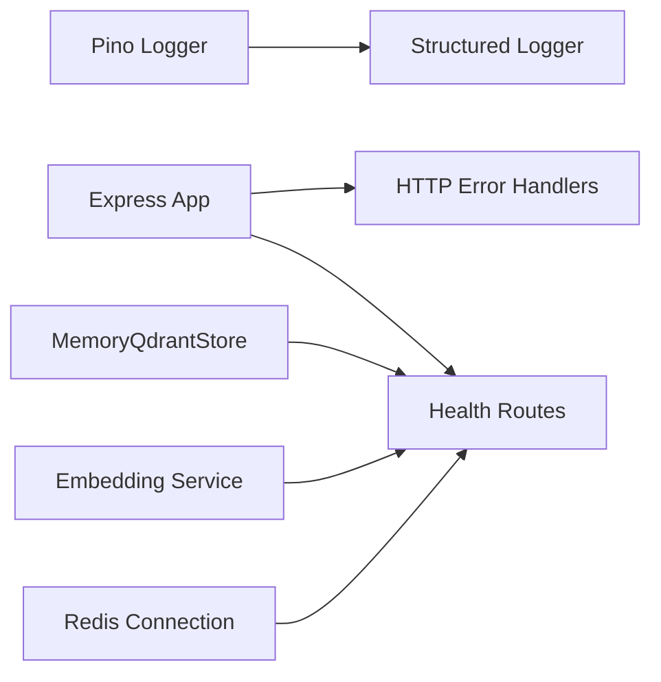

# Debugging & Troubleshooting

<cite>
**Referenced Files in This Document**
- [known-issues-and-limitations.md](file://docs/known-issues-and-limitations.md)
- [global-error-handlers.ts](file://src/utils/global-error-handlers.ts)
- [structured-logger.ts](file://src/utils/structured-logger.ts)
- [log-core.ts](file://src/utils/log-core.ts)
- [http-error-handlers.ts](file://src/http/http-error-handlers.ts)
- [auth-error.ts](file://src/cli/auth-error.ts)
- [mcp-runtime-error.ts](file://src/tools/mcp-runtime-error.ts)
- [http-health-routes.ts](file://src/http/http-health-routes.ts)
- [ci-wait-for-infra.sh](file://scripts/ci-wait-for-infra.sh)
</cite>

## Table of Contents
1. [Introduction](#introduction)
2. [Project Structure](#project-structure)
3. [Core Components](#core-components)
4. [Architecture Overview](#architecture-overview)
5. [Detailed Component Analysis](#detailed-component-analysis)
6. [Dependency Analysis](#dependency-analysis)
7. [Performance Considerations](#performance-considerations)
8. [Troubleshooting Guide](#troubleshooting-guide)
9. [Conclusion](#conclusion)
10. [Appendices](#appendices)

## Introduction
This document provides a comprehensive debugging and troubleshooting guide for SquadRules, an agent-first MCP framework where AI agents execute deterministic, auditable workflows through adapters. It consolidates known issues, error handling strategies across global process handlers, HTTP endpoints, CLI authentication flows, and MCP runtime errors; explains structured logging and log analysis techniques; and documents diagnostic tools such as health check endpoints, CI infrastructure readiness scripts, and evaluation harnesses. The goal is to help operators and developers collect debug information, analyze logs, reproduce problems, and apply workarounds efficiently.

## Project Structure
SquadRules separates concerns into clear layers:
- CLI layer handles user-facing commands, authentication prompts, and local execution.
- HTTP layer exposes REST and MCP endpoints with middleware, authentication, metrics, and error handling.
- Services layer implements embedding providers, vector stores (Qdrant or embedded LanceDB), Redis-backed caches, and memory stores.
- Utilities provide structured logging, global error capture, audit logging, and shared configuration.
- Scripts support CI readiness checks for Valkey, Qdrant, Postgres, and Keycloak.

**Diagram sources**
- [auth-error.ts:1-133](file://src/cli/auth-error.ts#L1-L133)
- [http-error-handlers.ts:1-53](file://src/http/http-error-handlers.ts#L1-L53)
- [mcp-runtime-error.ts:1-36](file://src/tools/mcp-runtime-error.ts#L1-L36)
- [global-error-handlers.ts:1-62](file://src/utils/global-error-handlers.ts#L1-L62)
- [structured-logger.ts:1-350](file://src/utils/structured-logger.ts#L1-L350)
- [log-core.ts:1-105](file://src/utils/log-core.ts#L1-L105)
- [http-health-routes.ts:1-119](file://src/http/http-health-routes.ts#L1-L119)
- [ci-wait-for-infra.sh:1-63](file://scripts/ci-wait-for-infra.sh#L1-L63)

**Section sources**
- [known-issues-and-limitations.md:1-59](file://docs/known-issues-and-limitations.md#L1-L59)

## Core Components
- Global process error handlers capture uncaught exceptions, unhandled promise rejections, multiple resolves, and Node warnings, forwarding them to the structured logger and marking non-zero exit codes when appropriate.
- HTTP error handlers centralize Express error responses, including payload-too-large detection and method-not-allowed behavior for MCP endpoints, while logging request context.
- CLI auth error handling surfaces actionable messages for authentication failures, optionally opening the login URL in a browser based on environment controls.
- MCP runtime error mapping converts embedding provider rate-limit errors into structured MCP error payloads so clients can parse actionable hints instead of raw strings.
- Structured logging uses Pino with redaction, sanitization, audit line emission, HTTP access logging, and child contexts for correlation across components.
- Health routes expose service status, dependency health (vector store, embedding provider, Redis/cache), build version, uptime, and transport type.
- CI readiness script polls Valkey, Qdrant, Postgres, and Keycloak concurrently to ensure infrastructure is ready before tests run.

**Section sources**
- [global-error-handlers.ts:1-62](file://src/utils/global-error-handlers.ts#L1-L62)
- [http-error-handlers.ts:1-53](file://src/http/http-error-handlers.ts#L1-L53)
- [auth-error.ts:1-133](file://src/cli/auth-error.ts#L1-L133)
- [mcp-runtime-error.ts:1-36](file://src/tools/mcp-runtime-error.ts#L1-L36)
- [structured-logger.ts:1-350](file://src/utils/structured-logger.ts#L1-L350)
- [log-core.ts:1-105](file://src/utils/log-core.ts#L1-L105)
- [http-health-routes.ts:1-119](file://src/http/http-health-routes.ts#L1-L119)
- [ci-wait-for-infra.sh:1-63](file://scripts/ci-wait-for-infra.sh#L1-L63)

## Architecture Overview
The debugging architecture spans four layers:
- Process-level observability via global error handlers.
- HTTP-layer diagnostics via centralized error handlers and health endpoints.
- CLI-layer user feedback via auth error handling and controlled browser launch.
- MCP-layer tooling via structured error mapping for rate limits and embedding provider issues.

**Diagram sources**
- [http-error-handlers.ts:1-53](file://src/http/http-error-handlers.ts#L1-L53)
- [structured-logger.ts:150-183](file://src/utils/structured-logger.ts#L150-L183)
- [http-health-routes.ts:13-92](file://src/http/http-health-routes.ts#L13-L92)

## Detailed Component Analysis

### Global Error Handlers
Global error handlers install process-wide listeners for uncaught exceptions, unhandled rejections, multiple resolves, and Node warnings. They forward events to the structured logger and set non-zero exit codes where appropriate, ensuring supervisors can detect abnormal termination.

**Diagram sources**
- [global-error-handlers.ts:11-61](file://src/utils/global-error-handlers.ts#L11-L61)

**Section sources**
- [global-error-handlers.ts:1-62](file://src/utils/global-error-handlers.ts#L1-L62)

### HTTP Error Responses
The HTTP error handler centralizes Express error handling, capturing request context (method, URL, request ID) and emitting structured logs. It distinguishes payload-too-large errors from generic internal server errors and returns consistent JSON responses. A dedicated route rejects GET requests to /mcp with method-not-allowed semantics.

**Diagram sources**
- [http-error-handlers.ts:9-33](file://src/http/http-error-handlers.ts#L9-L33)

**Section sources**
- [http-error-handlers.ts:1-53](file://src/http/http-error-handlers.ts#L1-L53)

### CLI Authentication Errors
CLI auth error handling defines a specific error type for authentication requirements, supports safe browser launching with environment-based controls, and prints actionable messages without verbose prefixes. It can open the login URL automatically when enabled and exits with a non-zero code.

**Diagram sources**
- [auth-error.ts:12-20](file://src/cli/auth-error.ts#L12-L20)
- [auth-error.ts:96-117](file://src/cli/auth-error.ts#L96-L117)
- [auth-error.ts:124-132](file://src/cli/auth-error.ts#L124-L132)

**Section sources**
- [auth-error.ts:1-133](file://src/cli/auth-error.ts#L1-L133)

### MCP Runtime Errors
MCP runtime error mapping transforms embedding provider rate-limit errors into structured MCP error results. Clients receive a parseable JSON payload with fields like error code, provider, HTTP status, code, message, and retry hint, enabling automated handling rather than failing JSON parsing due to raw text.

**Diagram sources**
- [mcp-runtime-error.ts:14-35](file://src/tools/mcp-runtime-error.ts#L14-L35)

**Section sources**
- [mcp-runtime-error.ts:1-36](file://src/tools/mcp-runtime-error.ts#L1-L36)

### Structured Logging and Audit
Structured logging provides:
- Consistent JSON shape via Pino core with redaction paths for sensitive headers and cookies.
- Sanitization of log messages and binding keys to prevent injection and control character leakage.
- Audit line emission to a separate file when configured, with depth and key limits to protect performance.
- HTTP access logging with request IDs, client IPs (proxy-aware), user agents, and duration tracking.
- Child logger contexts for component-scoped correlation.

**Diagram sources**
- [log-core.ts:59-91](file://src/utils/log-core.ts#L59-L91)
- [structured-logger.ts:145-148](file://src/utils/structured-logger.ts#L145-L148)
- [structured-logger.ts:150-183](file://src/utils/structured-logger.ts#L150-L183)
- [structured-logger.ts:211-335](file://src/utils/structured-logger.ts#L211-L335)

**Section sources**
- [structured-logger.ts:1-350](file://src/utils/structured-logger.ts#L1-L350)
- [log-core.ts:1-105](file://src/utils/log-core.ts#L1-L105)

### Health Check Endpoints
Health routes report service status, dependency health, build version, uptime, and transport type. They probe Qdrant (or embedded LanceDB), embedding provider health (with timeout), and Redis connectivity, returning 200 when critical dependencies are healthy and 503 otherwise. An API root lists available endpoints and indicates authentication requirements.

**Diagram sources**
- [http-health-routes.ts:15-92](file://src/http/http-health-routes.ts#L15-L92)

**Section sources**
- [http-health-routes.ts:1-119](file://src/http/http-health-routes.ts#L1-L119)

### CI Infrastructure Readiness
The CI readiness script polls Valkey, Qdrant, Postgres, and Keycloak concurrently, using docker compose exec and curl checks. It ensures all infrastructure services are ready before integration tests proceed, reducing flakiness caused by startup ordering.

**Diagram sources**
- [ci-wait-for-infra.sh:9-45](file://scripts/ci-wait-for-infra.sh#L9-L45)
- [ci-wait-for-infra.sh:47-62](file://scripts/ci-wait-for-infra.sh#L47-L62)

**Section sources**
- [ci-wait-for-infra.sh:1-63](file://scripts/ci-wait-for-infra.sh#L1-L63)

## Dependency Analysis
Key dependencies and their roles in debugging:
- Pino logger underpins structured logging and redaction.
- Express middleware integrates HTTP access logging and error handling.
- Memory store and embedding service integrate with health checks.
- Redis connection state influences health status reporting.
- Vector store selection (Qdrant vs embedded LanceDB) affects health reporting keys.

**Diagram sources**
- [structured-logger.ts:1-350](file://src/utils/structured-logger.ts#L1-L350)
- [http-error-handlers.ts:1-53](file://src/http/http-error-handlers.ts#L1-L53)
- [http-health-routes.ts:1-119](file://src/http/http-health-routes.ts#L1-L119)

**Section sources**
- [structured-logger.ts:1-350](file://src/utils/structured-logger.ts#L1-L350)
- [http-error-handlers.ts:1-53](file://src/http/http-error-handlers.ts#L1-L53)
- [http-health-routes.ts:1-119](file://src/http/http-health-routes.ts#L1-L119)

## Performance Considerations
- Health checks bound embedding provider probes with timeouts to avoid blocking the /health endpoint during test setup or slow providers.
- Audit log writes are guarded against large payloads and deep nesting to prevent performance degradation.
- Structured logging sanitizes messages and bindings to reduce overhead and protect sinks.
- In stdio transport mode, logs are directed to stderr to keep data channels clean; in HTTP mode, logs go to stdout for container consumption.

[No sources needed since this section provides general guidance]

## Troubleshooting Guide

### Authentication Failures (CLI)
Symptoms:
- CLI prints an authentication-required message and may attempt to open a login URL.
- Browser launch may be disabled or fail depending on environment variables.

Steps:
1. Inspect the CLI error output for the authentication-required message and login URL.
2. If automatic browser launch fails, verify BROWSER settings and allowed binaries.
3. Use SQUADRULES_NO_BROWSER=1 or BROWSER=true/none/no/false/0 to disable auto-open.
4. Manually open the provided login URL to complete authentication.
5. Retry the command after successful login.

Correlation:
- Look for structured logs indicating authentication flow and any browser launch attempts.
- Confirm that the backend requires authentication and returns appropriate 401 responses.

Workarounds:
- Ensure the login URL is valid and accessible from the host machine.
- Disable browser auto-open in headless environments.

**Section sources**
- [auth-error.ts:12-20](file://src/cli/auth-error.ts#L12-L20)
- [auth-error.ts:96-117](file://src/cli/auth-error.ts#L96-L117)
- [auth-error.ts:124-132](file://src/cli/auth-error.ts#L124-L132)

### Vector Search Problems
Symptoms:
- Health endpoint reports vector store unhealthy.
- Embedding provider health check fails or times out.
- Semantic search returns poor results or errors.

Steps:
1. Call GET /health and inspect dependencies and details.
2. Verify vector store backend (qdrant vs embedded-lancedb) and its health status.
3. Check embedding provider configuration and health; note timeout behavior.
4. Validate Redis connectivity if configured; otherwise confirm memory cache usage.
5. Review structured logs for embedding provider errors and rate limits.

Workarounds:
- If embedding provider is rate-limited, use the structured MCP error payload to implement retries with backoff.
- For embedded LanceDB, ensure storage paths are writable and not locked.
- For Qdrant, verify network reachability and credentials.

**Section sources**
- [http-health-routes.ts:15-92](file://src/http/http-health-routes.ts#L15-L92)
- [mcp-runtime-error.ts:14-35](file://src/tools/mcp-runtime-error.ts#L14-L35)

### Adapter Execution Errors
Symptoms:
- MCP tool calls return errors or malformed content.
- Rate limit errors surface as raw strings breaking client JSON parsing.

Steps:
1. Capture MCP tool responses and inspect content structure.
2. Detect structured error payloads for EMBEDDING_RATE_LIMIT.
3. Implement retry logic based on retry_hint (quota vs transient).
4. Review structured logs for tool operation details and error codes.

Workarounds:
- Add exponential backoff for transient rate limits.
- Notify users when quota is exhausted and prompt billing/quota resolution.

**Section sources**
- [mcp-runtime-error.ts:14-35](file://src/tools/mcp-runtime-error.ts#L14-L35)
- [structured-logger.ts:293-302](file://src/utils/structured-logger.ts#L293-L302)

### Performance Bottlenecks
Symptoms:
- Slow health checks or API responses.
- High latency in embedding operations.
- Audit log writes causing I/O pressure.

Steps:
1. Analyze HTTP access logs for duration_ms and status codes.
2. Check embedding provider health timeout behavior.
3. Monitor audit log size and depth limits.
4. Validate Redis connectivity and cache hit rates.

Workarounds:
- Tune LOG_LEVEL and LOG_FORMAT for production vs development.
- Reduce audit log verbosity or rotate files externally.
- Scale embedding providers or adjust request rates.

**Section sources**
- [structured-logger.ts:150-183](file://src/utils/structured-logger.ts#L150-L183)
- [http-health-routes.ts:24-44](file://src/http/http-health-routes.ts#L24-L44)

### Known Issues and Limitations
Issue: npm install warns about deprecated @anush008/tokenizers.
- What you see: Deprecation notice printed first during install.
- Why it happens: Transitive dependency from fastembed; archived package; arm64 binary override in repository.
- Why changing version does not fix it: Overrides only affect this repository; consumers still see deprecation.
- What would change it: Upstream fastembed adoption of official tokenizers or stopping reliance on fastembed.
- Status: Expected, not a regression.

Action:
- Ignore the warning unless you are building a consumer package and need to pin overrides yourself.
- Do not re-report without evidence of regression or changed platform matrix.

**Section sources**
- [known-issues-and-limitations.md:7-59](file://docs/known-issues-and-limitations.md#L7-L59)

## Conclusion
SquadRules provides robust debugging and troubleshooting capabilities through global error handlers, centralized HTTP error responses, CLI authentication error handling, and structured MCP runtime error mapping. Structured logging with Pino, audit lines, and HTTP access logs enable precise correlation across distributed components. Health endpoints and CI readiness scripts offer operational visibility and reliability. By following the troubleshooting guides and leveraging the diagnostic tools outlined here, teams can quickly identify, reproduce, and resolve issues related to authentication, vector search, adapter execution, and performance bottlenecks.

## Appendices

### Diagnostic Checklist
- Verify health endpoint: GET /health.
- Inspect structured logs for request_id, client_ip, duration_ms, and error_code.
- Confirm infrastructure readiness using ci-wait-for-infra.sh.
- Validate CLI authentication flow and browser launch settings.
- Handle MCP rate-limit errors using structured payloads.

[No sources needed since this section provides general guidance]