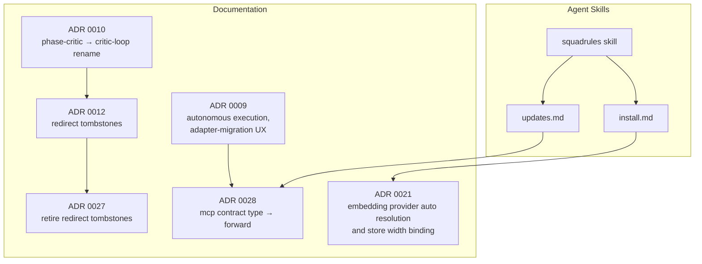
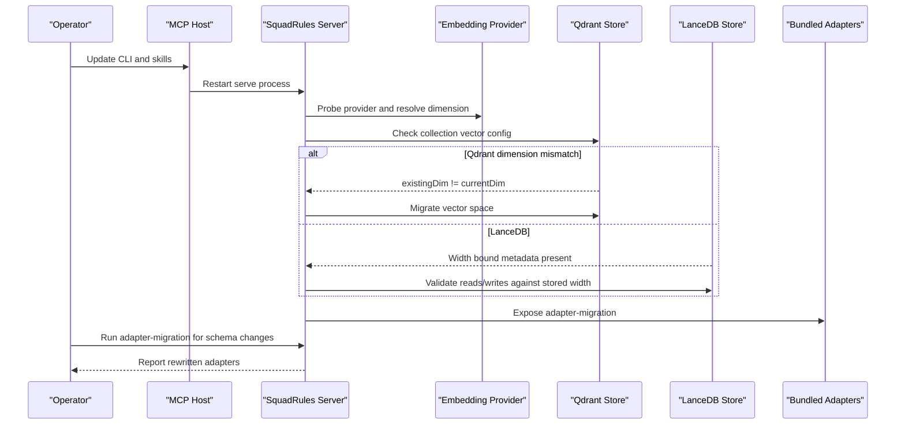
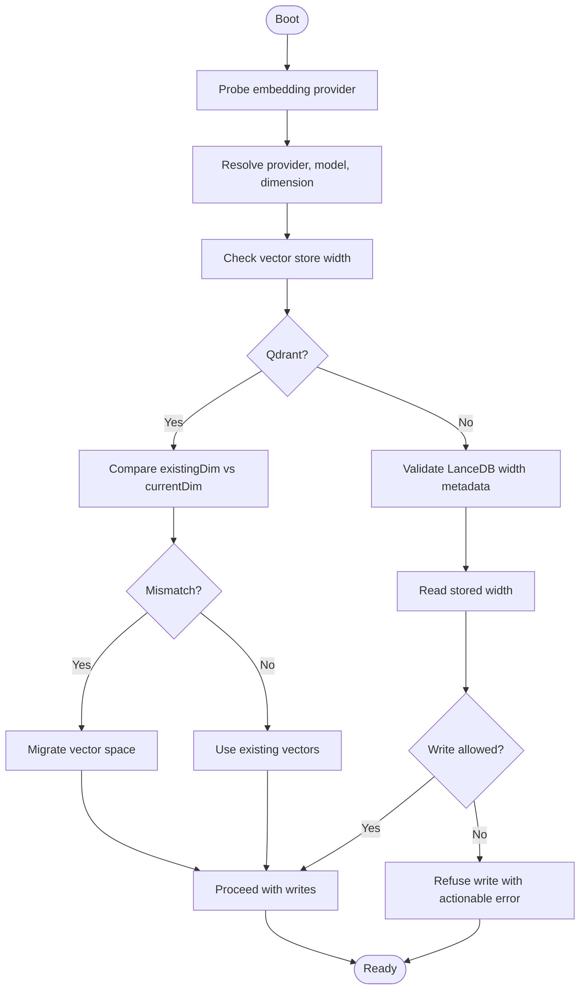
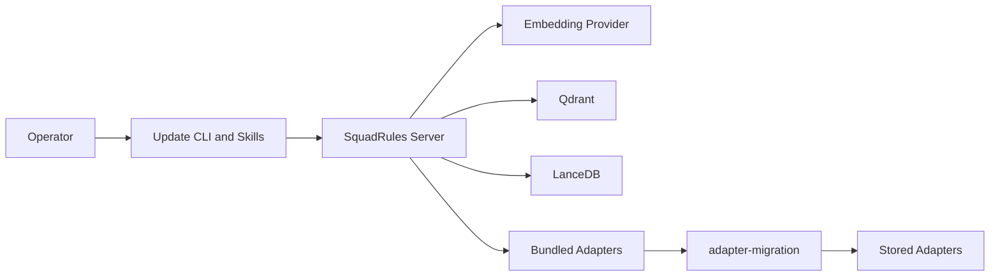

# Migration Strategies

<cite>
**Referenced Files in This Document**
- [updates.md](file://.agents/skills/squadrules/references/updates.md)
- [install.md](file://.agents/skills/squadrules/references/install.md)
- [0010-critic-loop-and-proof-splitting.md](file://docs/adr/0010-critic-loop-and-proof-splitting.md)
- [0012-redirect-tombstones-for-renamed-slugs.md](file://docs/adr/0012-redirect-tombstones-for-renamed-slugs.md)
- [0027-retire-redirect-tombstones.md](file://docs/adr/0027-retire-redirect-tombstones.md)
- [0021-embedding-provider-auto-resolution-and-store-width-binding.md](file://docs/adr/0021-embedding-provider-auto-resolution-and-store-width-binding.md)
- [0028-forward-contract-type-rename.md](file://docs/adr/0028-forward-contract-type-rename.md)
- [0009-autonomous-adapter-execution-no-human-gates.md](file://docs/adr/0009-autonomous-adapter-execution-no-human-gates.md)
- [0024-adapter-contract-verification-ladder.md](file://docs/adr/0024-adapter-contract-verification-ladder.md)
- [0025-mcp-contract-forward-link-only.md](file://docs/adr/0025-mcp-contract-forward-link-only.md)
- [0029-subagent-mcp-and-context-authority.md](file://docs/adr/0029-subagent-mcp-and-context-authority.md)
- [0034-verification-isolation-critic-hop.md](file://docs/adr/0034-verification-isolation-critic-hop.md)
- [0035-bundled-adapter-artifact-exemption.md](file://docs/adr/0035-bundled-adapter-artifact-exemption.md)
</cite>

## Table of Contents
1. [Introduction](#introduction)
2. [Project Structure](#project-structure)
3. [Core Components](#core-components)
4. [Architecture Overview](#architecture-overview)
5. [Detailed Component Analysis](#detailed-component-analysis)
6. [Dependency Analysis](#dependency-analysis)
7. [Performance Considerations](#performance-considerations)
8. [Troubleshooting Guide](#troubleshooting-guide)
9. [Conclusion](#conclusion)
10. [Appendices](#appendices)

## Introduction
This document defines the migration strategy for SquadRules upgrades and schema changes. It covers version compatibility, backward compatibility guarantees, upgrade procedures, data migration patterns, schema evolution, rollback guidance, breaking-change timelines, deprecation policy, migration tools, testing, integrity validation, partial-failure handling, common scenarios, and best practices.

SquadRules is an agent-first MCP framework where agents are primary users and humans configure preferences through agents. The core flow is activate → forward → reward. Adapters provide deterministic, auditable task execution, and agents must create or repair adapters when workflows change. Vector storage uses Qdrant (primary, remote-capable) and LanceDB (secondary, embedded). Storage also includes Redis and the filesystem; there is no traditional relational database. Skills under `.agents/skills/` are hand-authored routing logic, with `squadrules` as the canonical action router.

## Project Structure
Migration-related knowledge is primarily documented in:
- Agent skill references for installation and updates.
- Architecture Decision Records (ADRs) that define breaking changes, compatibility mechanisms, vector store migration behavior, and adapter contract evolution.
- Bundled system adapters such as `adapter-migration`, which agents use to inspect and rewrite stored adapters.

**Diagram sources**
- [updates.md:1-39](file://.agents/skills/squadrules/references/updates.md#L1-L39)
- [install.md:1-104](file://.agents/skills/squadrules/references/install.md#L1-L104)
- [0010-critic-loop-and-proof-splitting.md:1-121](file://docs/adr/0010-critic-loop-and-proof-splitting.md#L1-L121)
- [0012-redirect-tombstones-for-renamed-slugs.md:1-85](file://docs/adr/0012-redirect-tombstones-for-renamed-slugs.md#L1-L85)
- [0027-retire-redirect-tombstones.md:1-228](file://docs/adr/0027-retire-redirect-tombstones.md#L1-L228)
- [0021-embedding-provider-auto-resolution-and-store-width-binding.md:1-245](file://docs/adr/0021-embedding-provider-auto-resolution-and-store-width-binding.md#L1-L245)
- [0028-forward-contract-type-rename.md:1-276](file://docs/adr/0028-forward-contract-type-rename.md#L1-L276)
- [0009-autonomous-adapter-execution-no-human-gates.md:1-121](file://docs/adr/0009-autonomous-adapter-execution-no-human-gates.md#L1-L121)

**Section sources**
- [updates.md:1-39](file://.agents/skills/squadrules/references/updates.md#L1-L39)
- [install.md:1-104](file://.agents/skills/squadrules/references/install.md#L1-L104)
- [0010-critic-loop-and-proof-splitting.md:1-121](file://docs/adr/0010-critic-loop-and-proof-splitting.md#L1-L121)
- [0012-redirect-tombstones-for-renamed-slugs.md:1-85](file://docs/adr/0012-redirect-tombstones-for-renamed-slugs.md#L1-L85)
- [0027-retire-redirect-tombstones.md:1-228](file://docs/adr/0027-retire-redirect-tombstones.md#L1-L228)
- [0021-embedding-provider-auto-resolution-and-store-width-binding.md:1-245](file://docs/adr/0021-embedding-provider-auto-resolution-and-store-width-binding.md#L1-L245)
- [0028-forward-contract-type-rename.md:1-276](file://docs/adr/0028-forward-contract-type-rename.md#L1-L276)
- [0009-autonomous-adapter-execution-no-human-gates.md:1-121](file://docs/adr/0009-autonomous-adapter-execution-no-human-gates.md#L1-L121)

## Core Components
- Version update workflow: global npm package update, skill refresh, host restart, and bug reporting.
- Embedding provider resolution and vector store width binding, including Qdrant boot-time migration and LanceDB constraints.
- Adapter slug renames and redirect tombstone lifecycle.
- Contract schema evolution from `type: "mcp"` to `type: "forward"`.
- Migration tooling via bundled adapters, especially `adapter-migration`.

Key responsibilities:
- **Operator upgrade path**: install/update CLI and skills, restart host, verify tools.
- **Data migration path**: detect dimension mismatches, migrate Qdrant collections, refuse or re-embed LanceDB stores based on policy.
- **Schema evolution path**: rename slugs and contract types, fail closed for unknown types, guide agents to run `adapter-migration`.
- **Compatibility policy**: clean breaks without aliases unless a tombstone mechanism was temporarily justified; tombstones were later retired.

**Section sources**
- [updates.md:1-39](file://.agents/skills/squadrules/references/updates.md#L1-L39)
- [install.md:1-104](file://.agents/skills/squadrules/references/install.md#L1-L104)
- [0021-embedding-provider-auto-resolution-and-store-width-binding.md:1-245](file://docs/adr/0021-embedding-provider-auto-resolution-and-store-width-binding.md#L1-L245)
- [0010-critic-loop-and-proof-splitting.md:1-121](file://docs/adr/0010-critic-loop-and-proof-splitting.md#L1-L121)
- [0012-redirect-tombstones-for-renamed-slugs.md:1-85](file://docs/adr/0012-redirect-tombstones-for-renamed-slugs.md#L1-L85)
- [0027-retire-redirect-tombstones.md:1-228](file://docs/adr/0027-retire-redirect-tombstones.md#L1-L228)
- [0028-forward-contract-type-rename.md:1-276](file://docs/adr/0028-forward-contract-type-rename.md#L1-L276)
- [0009-autonomous-adapter-execution-no-human-gates.md:1-121](file://docs/adr/0009-autonomous-adapter-execution-no-human-gates.md#L1-L121)

## Architecture Overview
The migration architecture connects operator actions, server runtime, vector stores, and bundled adapters.

**Diagram sources**
- [updates.md:1-39](file://.agents/skills/squadrules/references/updates.md#L1-L39)
- [install.md:1-104](file://.agents/skills/squadrules/references/install.md#L1-L104)
- [0021-embedding-provider-auto-resolution-and-store-width-binding.md:1-245](file://docs/adr/0021-embedding-provider-auto-resolution-and-store-width-binding.md#L1-L245)
- [0009-autonomous-adapter-execution-no-human-gates.md:1-121](file://docs/adr/0009-autonomous-adapter-execution-no-human-gates.md#L1-L121)
- [0028-forward-contract-type-rename.md:1-276](file://docs/adr/0028-forward-contract-type-rename.md#L1-L276)

## Detailed Component Analysis

### Version Compatibility Matrix and Upgrade Procedures
- Global npm package update installs the latest release or pins a specific version.
- Installed skills are refreshed through the skills CLI; the `squadrules` skill is the only one shipped by this repository.
- After updating, restart the MCP host so it relaunches `squadrules serve` with the new version.
- If a tool misbehaves after an update, capture a report per the bug-report reference.

Upgrade procedure:
1. Update the global npm package.
2. Refresh installed skills.
3. Restart the MCP host.
4. Verify tools are available.
5. Capture diagnostics if needed.

Backward compatibility notes:
- The project generally favors clean breaks over long-lived compatibility shims, except where temporary redirect tombstones were used and later retired.
- Breaking wire and schema changes are recorded in ADRs rather than maintained through compatibility layers.

**Section sources**
- [updates.md:1-39](file://.agents/skills/squadrules/references/updates.md#L1-L39)
- [install.md:1-104](file://.agents/skills/squadrules/references/install.md#L1-L104)
- [0027-retire-redirect-tombstones.md:1-228](file://docs/adr/0027-retire-redirect-tombstones.md#L1-L228)
- [0028-forward-contract-type-rename.md:1-276](file://docs/adr/0028-forward-contract-type-rename.md#L1-L276)

### Backward Compatibility Guarantees and Deprecation Timeline
- Slug renames:
  - `phase-critic` renamed to `critic-loop`. Initially considered non-breaking due to a single consumer, but stored adapters forwarding to the old slug would break until re-pointed.
  - Redirect tombstones were introduced for deeply referenced slugs, then retired once no live instances referenced them.
- Contract schema:
  - `type: "mcp"` renamed to `type: "forward"`, flattening payload to `forward.target`.
  - Unknown contract types fail closed with a readable message and direct recovery instructions.
- Deprecation approach:
  - Temporary tombstones were used only when necessary and removed when conditions allowed.
  - No general alias table was adopted; clean breaks are preferred.

Deprecation timeline summary:
- Tombstones existed while a revisit condition was not met.
- Once the condition was met, tombstones were retired and the clean break restored.
- Contract renames ship as breaking changes without read-time normalization or compatibility aliases.

**Section sources**
- [0010-critic-loop-and-proof-splitting.md:1-121](file://docs/adr/0010-critic-loop-and-proof-splitting.md#L1-L121)
- [0012-redirect-tombstones-for-renamed-slugs.md:1-85](file://docs/adr/0012-redirect-tombstones-for-renamed-slugs.md#L1-L85)
- [0027-retire-redirect-tombstones.md:1-228](file://docs/adr/0027-retire-redirect-tombstones.md#L1-L228)
- [0028-forward-contract-type-rename.md:1-276](file://docs/adr/0028-forward-contract-type-rename.md#L1-L276)

### Data Migration Patterns and Schema Evolution Strategies
- Embedding provider auto resolution:
  - Default is `auto`; explicit OpenAI-compatible endpoints override local fastembed.
  - Provider is probed before store decisions; resolved provider/model/dimension are recorded.
  - Qdrant performs boot-time vector space migration when dimensions differ.
  - LanceDB does not perform automatic re-embedding; width mismatch is detected and writes can be refused with actionable messages.
- Vector store width binding:
  - Reads use stored width instead of query vector length to avoid silent zero-score degradation.
  - Startup logs report actual provider, model, and dimension.
- Adapter contract evolution:
  - `mcp` contract type renamed to `forward`.
  - Payload flattened to `forward.target`; `tool_name` dropped.
  - Validation rule renamed to `forward_link_only`.
  - Stored adapters with unknown types fail closed and instruct running `adapter-migration`.

**Diagram sources**
- [0021-embedding-provider-auto-resolution-and-store-width-binding.md:1-245](file://docs/adr/0021-embedding-provider-auto-resolution-and-store-width-binding.md#L1-L245)

**Section sources**
- [0021-embedding-provider-auto-resolution-and-store-width-binding.md:1-245](file://docs/adr/0021-embedding-provider-auto-resolution-and-store-width-binding.md#L1-L245)
- [0028-forward-contract-type-rename.md:1-276](file://docs/adr/0028-forward-contract-type-rename.md#L1-L276)

### Rollback Procedures
- Embedding provider and vector store:
  - Do not use forced injection as a repair path for width mismatches; it deletes and retrains against the same fixed schema and fails again.
  - For LanceDB, width migration is a full re-embed; plan for CPU cost and potential billable embeddings.
  - Restore the intended provider configuration or migrate the store according to the actionable error.
- Adapter contracts:
  - For unknown contract types, run the `adapter-migration` adapter to rewrite affected adapters in place.
  - There is no read-time normalizer; unknown types fail closed rather than being silently translated.
- Slug renames:
  - After tombstone retirement, retired slugs dangle; fix by re-pointing forwards to the canonical slug.

Rollback checklist:
1. Identify the failing component: provider resolution, vector store width, or adapter contract.
2. Apply the documented repair path: restore provider, migrate Qdrant, or run `adapter-migration`.
3. Avoid destructive shortcuts like forced injection for width issues.
4. Re-run the operation and validate success.

**Section sources**
- [0021-embedding-provider-auto-resolution-and-store-width-binding.md:1-245](file://docs/adr/0021-embedding-provider-auto-resolution-and-store-width-binding.md#L1-L245)
- [0028-forward-contract-type-rename.md:1-276](file://docs/adr/0028-forward-contract-type-rename.md#L1-L276)
- [0027-retire-redirect-tombstones.md:1-228](file://docs/adr/0027-retire-redirect-tombstones.md#L1-L228)

### Migration Tools and Testing
- `adapter-migration`:
  - Bundled adapter used by agents to review migration reports, apply changes, select scope, or abort.
  - Part of the autonomous execution model; batch operations proceed on defaults where appropriate.
- Verification ladder:
  - `adapter-migration` appears in the verification ladder and is subject to multi-condition inline gates in some bundled adapters.
- Testing migration scripts:
  - Use the critic loop and proof-splitting principles to ensure migrations are deterministic, auditable, and bounded.
  - Treat migration outputs as artifacts that should be reviewed and validated before applying.

Testing recommendations:
- Dry-run migrations in a test store.
- Validate adapter counts, contract types, and forward targets.
- Confirm vector store dimensions match the resolved provider.
- Capture logs and audit events for each migration step.

**Section sources**
- [0009-autonomous-adapter-execution-no-human-gates.md:1-121](file://docs/adr/0009-autonomous-adapter-execution-no-human-gates.md#L1-L121)
- [0024-adapter-contract-verification-ladder.md:1-200](file://docs/adr/0024-adapter-contract-verification-ladder.md#L1-L200)
- [0034-verification-isolation-critic-hop.md:1-200](file://docs/adr/0034-verification-isolation-critic-hop.md#L1-L200)
- [0035-bundled-adapter-artifact-exemption.md:1-200](file://docs/adr/0035-bundled-adapter-artifact-exemption.md#L1-L200)

### Handling Partial Failures
- Embedding provider failures:
  - Explicit provider failure is a critical error at boot; runtime failures include retry semantics.
  - For `auto` with configured-but-failing providers, the codebase documents open questions around fallback policy; do not assume silent fallback to fastembed.
- Vector store migration:
  - Qdrant migration is driven at boot when dimensions differ.
  - LanceDB requires careful planning because re-embedding is expensive and may be billable.
- Adapter migration:
  - Unknown contract types fail closed with a clear message; partial failures during rewriting should be captured and retried safely.

Partial-failure response:
1. Inspect startup logs for provider resolution and vector store warnings.
2. Check whether Qdrant reported a required migration.
3. Validate LanceDB width metadata and read/write behavior.
4. Run `adapter-migration` for schema-related failures.
5. Retry only after correcting configuration or migrating data.

**Section sources**
- [0021-embedding-provider-auto-resolution-and-store-width-binding.md:1-245](file://docs/adr/0021-embedding-provider-auto-resolution-and-store-width-binding.md#L1-L245)
- [0028-forward-contract-type-rename.md:1-276](file://docs/adr/0028-forward-contract-type-rename.md#L1-L276)

### Common Migration Scenarios
- Scenario 1: Upgrading the CLI and skills
  - Update npm package, refresh skills, restart host, verify tools.
- Scenario 2: Embedding provider changed
  - Ensure provider is explicitly configured or relies on `auto` correctly.
  - Validate vector store width; migrate Qdrant if needed; plan LanceDB re-embedding.
- Scenario 3: Adapter slug renamed
  - After tombstone retirement, re-point stored forwards to the canonical slug.
- Scenario 4: Contract type renamed
  - Run `adapter-migration` to rewrite adapters from `type: "mcp"` to `type: "forward"`.
- Scenario 5: Subagent MCP delegation added
  - Follow the subagent MCP and context authority changes; ensure delegated tool calls are named unambiguously.

**Section sources**
- [updates.md:1-39](file://.agents/skills/squadrules/references/updates.md#L1-L39)
- [install.md:1-104](file://.agents/skills/squadrules/references/install.md#L1-L104)
- [0021-embedding-provider-auto-resolution-and-store-width-binding.md:1-245](file://docs/adr/0021-embedding-provider-auto-resolution-and-store-width-binding.md#L1-L245)
- [0027-retire-redirect-tombstones.md:1-228](file://docs/adr/0027-retire-redirect-tombstones.md#L1-L228)
- [0028-forward-contract-type-rename.md:1-276](file://docs/adr/0028-forward-contract-type-rename.md#L1-L276)
- [0029-subagent-mcp-and-context-authority.md:1-200](file://docs/adr/0029-subagent-mcp-and-context-authority.md#L1-L200)

### Best Practices for Maintaining Compatibility
- Prefer clean breaks over long-lived compatibility shims.
- Use temporary redirect tombstones only when live referents exist and retire them promptly.
- Record provider/model/dimension with the store and validate reads against stored width.
- Fail closed on unknown contract types and provide actionable recovery steps.
- Use `adapter-migration` for structural changes and validate results with the critic loop and proof-splitting principles.
- Keep documentation, UI labels, and bundled adapters consistent with the current schema.

**Section sources**
- [0012-redirect-tombstones-for-renamed-slugs.md:1-85](file://docs/adr/0012-redirect-tombstones-for-renamed-slugs.md#L1-L85)
- [0027-retire-redirect-tombstones.md:1-228](file://docs/adr/0027-retire-redirect-tombstones.md#L1-L228)
- [0021-embedding-provider-auto-resolution-and-store-width-binding.md:1-245](file://docs/adr/0021-embedding-provider-auto-resolution-and-store-width-binding.md#L1-L245)
- [0028-forward-contract-type-rename.md:1-276](file://docs/adr/0028-forward-contract-type-rename.md#L1-L276)
- [0009-autonomous-adapter-execution-no-human-gates.md:1-121](file://docs/adr/0009-autonomous-adapter-execution-no-human-gates.md#L1-L121)

## Dependency Analysis
Migration dependencies span operator actions, server runtime, embedding providers, vector stores, and bundled adapters.

**Diagram sources**
- [updates.md:1-39](file://.agents/skills/squadrules/references/updates.md#L1-L39)
- [install.md:1-104](file://.agents/skills/squadrules/references/install.md#L1-L104)
- [0021-embedding-provider-auto-resolution-and-store-width-binding.md:1-245](file://docs/adr/0021-embedding-provider-auto-resolution-and-store-width-binding.md#L1-L245)
- [0009-autonomous-adapter-execution-no-human-gates.md:1-121](file://docs/adr/0009-autonomous-adapter-execution-no-human-gates.md#L1-L121)
- [0028-forward-contract-type-rename.md:1-276](file://docs/adr/0028-forward-contract-type-rename.md#L1-L276)

**Section sources**
- [updates.md:1-39](file://.agents/skills/squadrules/references/updates.md#L1-L39)
- [install.md:1-104](file://.agents/skills/squadrules/references/install.md#L1-L104)
- [0021-embedding-provider-auto-resolution-and-store-width-binding.md:1-245](file://docs/adr/0021-embedding-provider-auto-resolution-and-store-width-binding.md#L1-L245)
- [0009-autonomous-adapter-execution-no-human-gates.md:1-121](file://docs/adr/0009-autonomous-adapter-execution-no-human-gates.md#L1-L121)
- [0028-forward-contract-type-rename.md:1-276](file://docs/adr/0028-forward-contract-type-rename.md#L1-L276)

## Performance Considerations
- Qdrant migration at boot is driven by dimension detection and vector space migration.
- LanceDB width migration is a full re-embed; expect CPU-bound work and potential billable embeddings when using hosted providers.
- Forced injection is not a repair path for width mismatches and can repeat failures.
- Migration operations should be planned during low-traffic windows and monitored for duration and resource usage.

[No sources needed since this section provides general guidance]

## Troubleshooting Guide
Common symptoms and responses:
- Server cannot reach vector store:
  - Confirm Qdrant is reachable and healthy.
- Embedding errors:
  - Ensure exactly one embedding backend is configured and its endpoint/model/key are correct.
- Auth failures against remote Qdrant:
  - Set `QDRANT_API_KEY` appropriately.
- Width mismatch:
  - Review startup logs for provider resolution and vector store warnings.
  - Migrate Qdrant if required; plan LanceDB re-embedding.
- Unknown contract type:
  - Run `adapter-migration` to rewrite adapters.
  - Do not rely on read-time normalization; unknown types fail closed.

**Section sources**
- [install.md:92-104](file://.agents/skills/squadrules/references/install.md#L92-L104)
- [0021-embedding-provider-auto-resolution-and-store-width-binding.md:1-245](file://docs/adr/0021-embedding-provider-auto-resolution-and-store-width-binding.md#L1-L245)
- [0028-forward-contract-type-rename.md:1-276](file://docs/adr/0028-forward-contract-type-rename.md#L1-L276)

## Conclusion
SquadRules migration strategy emphasizes clean breaks, explicit provider resolution, strict vector store width binding, and actionable failure modes. Temporary compatibility mechanisms such as redirect tombstones were used judiciously and retired when conditions allowed. Operators should follow the documented upgrade path, validate vector store state, and use `adapter-migration` for schema changes. Testing should leverage the critic loop and proof-splitting principles to ensure deterministic, auditable migrations.

[No sources needed since this section summarizes without analyzing specific files]

## Appendices

### Appendix A: Breaking Changes Summary
- Slug rename: `phase-critic` → `critic-loop`.
- Redirect tombstones introduced and later retired.
- Contract type rename: `mcp` → `forward`, payload flattened to `forward.target`.
- Embedding provider auto resolution and vector store width binding enforced.

**Section sources**
- [0010-critic-loop-and-proof-splitting.md:1-121](file://docs/adr/0010-critic-loop-and-proof-splitting.md#L1-L121)
- [0012-redirect-tombstones-for-renamed-slugs.md:1-85](file://docs/adr/0012-redirect-tombstones-for-renamed-slugs.md#L1-L85)
- [0027-retire-redirect-tombstones.md:1-228](file://docs/adr/0027-retire-redirect-tombstones.md#L1-L228)
- [0028-forward-contract-type-rename.md:1-276](file://docs/adr/0028-forward-contract-type-rename.md#L1-L276)
- [0021-embedding-provider-auto-resolution-and-store-width-binding.md:1-245](file://docs/adr/0021-embedding-provider-auto-resolution-and-store-width-binding.md#L1-L245)

### Appendix B: Migration Tool References
- `adapter-migration` adapter:
  - Used to review migration reports, apply changes, and rewrite adapters.
  - Subject to verification ladder and multi-condition gates in bundled adapters.

**Section sources**
- [0009-autonomous-adapter-execution-no-human-gates.md:1-121](file://docs/adr/0009-autonomous-adapter-execution-no-human-gates.md#L1-L121)
- [0024-adapter-contract-verification-ladder.md:1-200](file://docs/adr/0024-adapter-contract-verification-ladder.md#L1-L200)
- [0034-verification-isolation-critic-hop.md:1-200](file://docs/adr/0034-verification-isolation-critic-hop.md#L1-L200)
- [0035-bundled-adapter-artifact-exemption.md:1-200](file://docs/adr/0035-bundled-adapter-artifact-exemption.md#L1-L200)