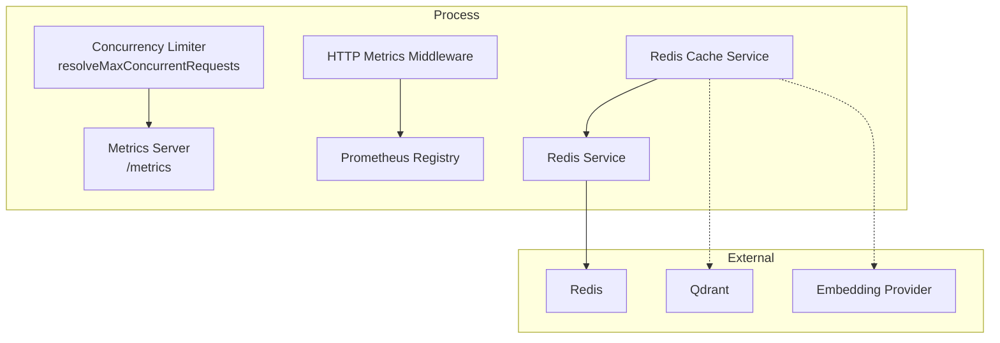
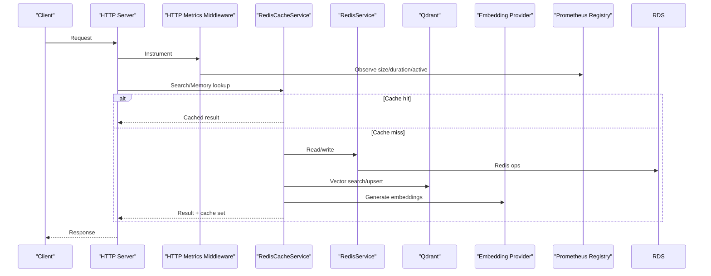
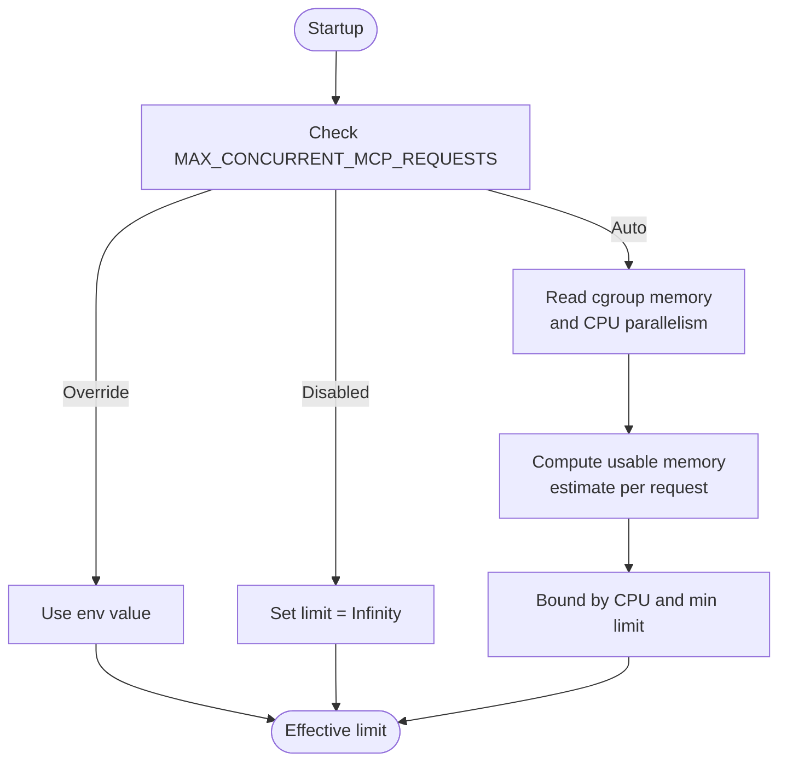
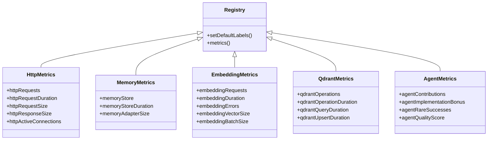
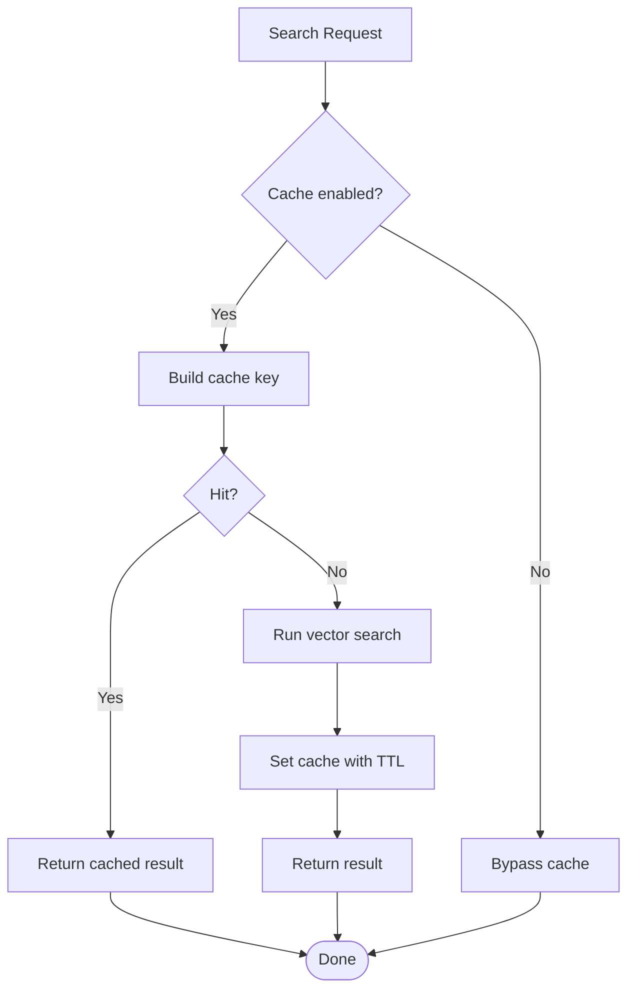
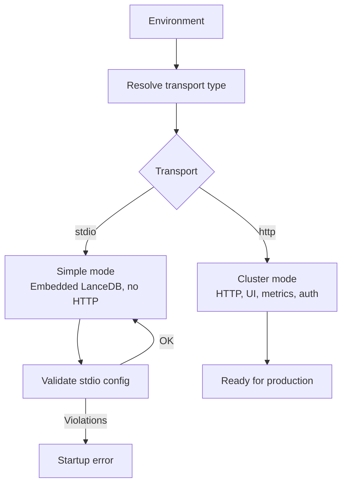
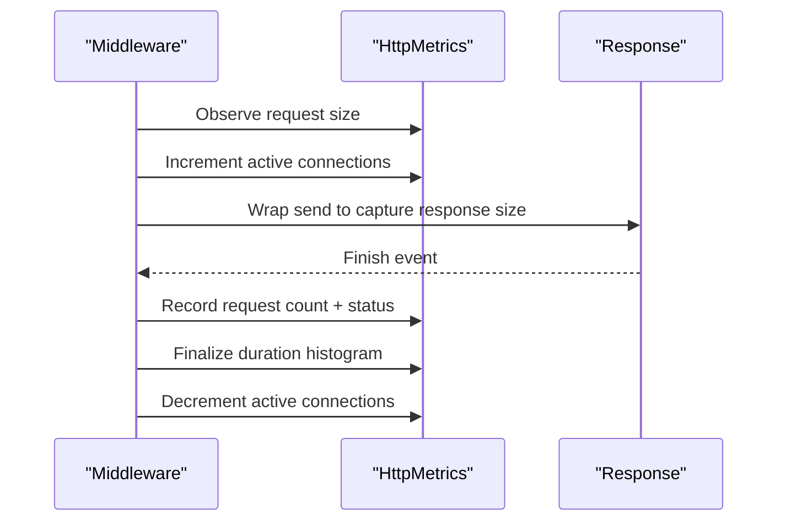
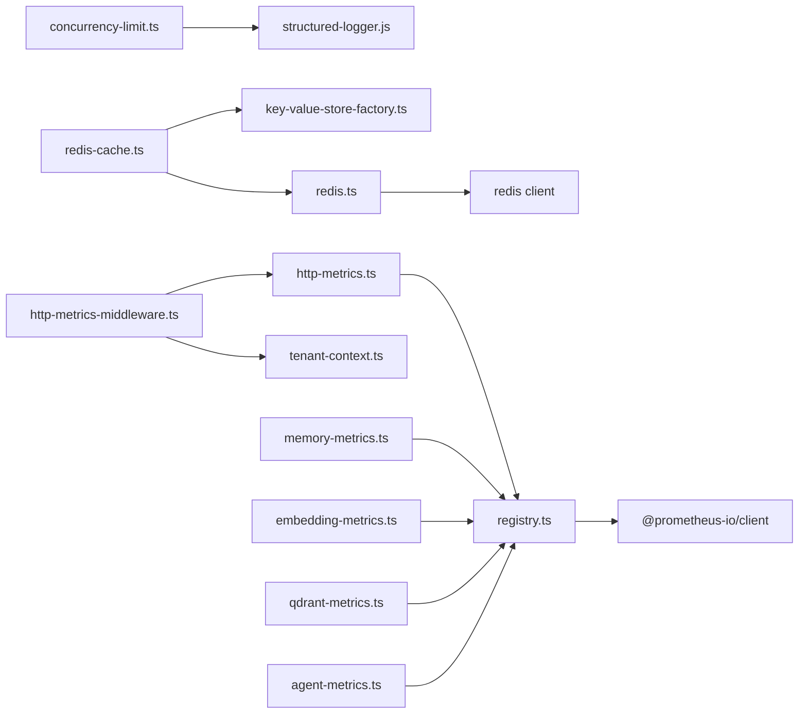

# Performance Optimization & Tuning

<cite>
**Referenced Files in This Document**
- [concurrency-limit.ts](file://src/utils/concurrency-limit.ts)
- [registry.ts](file://src/services/metrics/registry.ts)
- [http-metrics.ts](file://src/services/metrics/http-metrics.ts)
- [memory-metrics.ts](file://src/services/metrics/memory-metrics.ts)
- [embedding-metrics.ts](file://src/services/metrics/embedding-metrics.ts)
- [qdrant-metrics.ts](file://src/services/metrics/qdrant-metrics.ts)
- [agent-metrics.ts](file://src/services/metrics/agent-metrics.ts)
- [redis-cache.ts](file://src/services/redis-cache.ts)
- [redis.ts](file://src/services/redis.ts)
- [runtime-mode.ts](file://src/config/runtime-mode.ts)
- [http-metrics-middleware.ts](file://src/http/http-metrics-middleware.ts)
- [metrics-server.ts](file://src/metrics-server.ts)
</cite>

## Table of Contents
1. [Introduction](#introduction)
2. [Project Structure](#project-structure)
3. [Core Components](#core-components)
4. [Architecture Overview](#architecture-overview)
5. [Detailed Component Analysis](#detailed-component-analysis)
6. [Dependency Analysis](#dependency-analysis)
7. [Performance Considerations](#performance-considerations)
8. [Troubleshooting Guide](#troubleshooting-guide)
9. [Conclusion](#conclusion)

## Introduction
This document provides performance optimization and tuning guidance for SquadRules high-throughput scenarios. It focuses on concurrency control, rate limiting strategies, resource management, metrics collection, Redis-based caching, runtime mode implications, profiling techniques, vector search bottlenecks, embedding provider tuning, database connection tuning, scaling considerations, load balancing, monitoring key performance indicators, memory optimization, garbage collection tuning, and connection pooling best practices.

## Project Structure
The performance-critical surface area includes:
- Concurrency control at process startup to cap concurrent MCP requests based on environment or cgroup memory.
- A Prometheus metrics registry with default labels and a dedicated metrics server.
- HTTP request tracking middleware that measures duration, payload sizes, and active connections.
- Domain-specific metrics for memory operations, embeddings, Qdrant operations, and agent activity.
- Redis-backed caching for search results and memory resources, plus pub/sub invalidation.
- Runtime mode configuration that determines whether the system runs in simple (stdio) or cluster (http) mode, affecting available surfaces and isolation guarantees.

**Diagram sources**
- [concurrency-limit.ts:57-80](file://src/utils/concurrency-limit.ts#L57-L80)
- [metrics-server.ts:19-42](file://src/metrics-server.ts#L19-L42)
- [http-metrics-middleware.ts:15-70](file://src/http/http-metrics-middleware.ts#L15-L70)
- [registry.ts:11-18](file://src/services/metrics/registry.ts#L11-L18)
- [redis-cache.ts:21-36](file://src/services/redis-cache.ts#L21-L36)
- [redis.ts:26-45](file://src/services/redis.ts#L26-L45)

**Section sources**
- [concurrency-limit.ts:1-81](file://src/utils/concurrency-limit.ts#L1-L81)
- [metrics-server.ts:1-45](file://src/metrics-server.ts#L1-L45)
- [http-metrics-middleware.ts:1-73](file://src/http/http-metrics-middleware.ts#L1-L73)
- [registry.ts:1-23](file://src/services/metrics/registry.ts#L1-L23)
- [redis-cache.ts:1-274](file://src/services/redis-cache.ts#L1-L274)
- [redis.ts:1-293](file://src/services/redis.ts#L1-L293)

## Core Components
- Concurrency limiter: resolves effective MAX_CONCURRENT_MCP_REQUESTS from environment or auto-detects using cgroup memory limits and CPU availability.
- Metrics registry: central Prometheus registry with default service, version, and instance labels.
- HTTP metrics: counters and histograms for request counts, durations, request/response sizes, and active connections.
- Memory metrics: counters/histograms for store operations, durations, and adapter layer sizes.
- Embedding metrics: counters/histograms for embedding requests, durations, errors, vector sizes, and batch sizes.
- Qdrant metrics: counters/histograms for operation counts, durations, query execution time, and upsert durations.
- Agent metrics: counters/histograms for contributions, bonuses, rare successes, and quality score distribution.
- Redis cache: search result and memory resource caching with TTLs, invalidation via pub/sub, and stats counters.
- Redis service: typed key-value operations, JSON helpers, pub/sub, and connection lifecycle.
- Runtime mode: transport selection (stdio vs http), auth posture, and stdio safety checks.

**Section sources**
- [concurrency-limit.ts:57-80](file://src/utils/concurrency-limit.ts#L57-L80)
- [registry.ts:11-18](file://src/services/metrics/registry.ts#L11-L18)
- [http-metrics.ts:11-47](file://src/services/metrics/http-metrics.ts#L11-L47)
- [memory-metrics.ts:11-32](file://src/services/metrics/memory-metrics.ts#L11-L32)
- [embedding-metrics.ts:11-47](file://src/services/metrics/embedding-metrics.ts#L11-L47)
- [qdrant-metrics.ts:11-40](file://src/services/metrics/qdrant-metrics.ts#L11-L40)
- [agent-metrics.ts:12-39](file://src/services/metrics/agent-metrics.ts#L12-L39)
- [redis-cache.ts:21-36](file://src/services/redis-cache.ts#L21-L36)
- [redis.ts:26-45](file://src/services/redis.ts#L26-L45)
- [runtime-mode.ts:49-77](file://src/config/runtime-mode.ts#L49-L77)

## Architecture Overview
High-throughput flow integrates concurrency control, HTTP instrumentation, Redis caching, and domain metrics. The metrics server exposes Prometheus endpoints independently from application traffic.

**Diagram sources**
- [http-metrics-middleware.ts:15-70](file://src/http/http-metrics-middleware.ts#L15-L70)
- [redis-cache.ts:43-79](file://src/services/redis-cache.ts#L43-L79)
- [redis.ts:119-147](file://src/services/redis.ts#L119-L147)
- [metrics-server.ts:23-31](file://src/metrics-server.ts#L23-L31)

## Detailed Component Analysis

### Concurrency Control and Rate Limiting
- Effective concurrency is resolved from an environment variable; disabled when explicitly set to -1, overridden by positive values, or auto-detected using cgroup memory limits and CPU parallelism.
- Auto-detection uses a conservative per-request memory estimate and headroom factor, bounded by CPU-derived maximum and a minimum floor.
- For rate limiting, use Redis-based counters and sliding windows through the Redis service’s atomic increment and TTL semantics. Combine with the concurrency limiter to protect both CPU and I/O paths.

**Diagram sources**
- [concurrency-limit.ts:57-80](file://src/utils/concurrency-limit.ts#L57-L80)

**Section sources**
- [concurrency-limit.ts:10-12](file://src/utils/concurrency-limit.ts#L10-L12)
- [concurrency-limit.ts:27-50](file://src/utils/concurrency-limit.ts#L27-L50)
- [concurrency-limit.ts:57-80](file://src/utils/concurrency-limit.ts#L57-L80)

### Metrics Collection System
- Registry: central Prometheus registry with default labels for service, version, and instance.
- HTTP metrics: total requests, duration histogram, request/response size histograms, and active connections gauge.
- Memory metrics: store counters and durations, adapter layer size histogram.
- Embedding metrics: request counters, duration histogram, error counters, vector size histogram, batch size histogram.
- Qdrant metrics: operation counters, operation duration histogram, query duration histogram, upsert duration histogram.
- Agent metrics: contribution counters, bonus counters, rare success counters, quality score histogram.

**Diagram sources**
- [registry.ts:11-18](file://src/services/metrics/registry.ts#L11-L18)
- [http-metrics.ts:11-47](file://src/services/metrics/http-metrics.ts#L11-L47)
- [memory-metrics.ts:11-32](file://src/services/metrics/memory-metrics.ts#L11-L32)
- [embedding-metrics.ts:11-47](file://src/services/metrics/embedding-metrics.ts#L11-L47)
- [qdrant-metrics.ts:11-40](file://src/services/metrics/qdrant-metrics.ts#L11-L40)
- [agent-metrics.ts:12-39](file://src/services/metrics/agent-metrics.ts#L12-L39)

**Section sources**
- [registry.ts:1-23](file://src/services/metrics/registry.ts#L1-23)
- [http-metrics.ts:1-53](file://src/services/metrics/http-metrics.ts#L1-53)
- [memory-metrics.ts:1-38](file://src/services/metrics/memory-metrics.ts#L1-38)
- [embedding-metrics.ts:1-51](file://src/services/metrics/embedding-metrics.ts#L1-51)
- [qdrant-metrics.ts:1-42](file://src/services/metrics/qdrant-metrics.ts#L1-42)
- [agent-metrics.ts:1-48](file://src/services/metrics/agent-metrics.ts#L1-48)

### Redis-Based Caching Strategies
- Search result caching: keys include query, limit, and collapse mode; short TTL reduces stale data risk.
- Memory resource caching: global prefix per UUID with bounded TTL as a safety net against invalidation failures.
- Invalidation: pattern-based deletion for search and begin/activate caches; pub/sub channel notifies other instances.
- Stats: atomic increments for hits and misses; aggregated stats retrieval.
- Key isolation: space-scoped keys except for memory cache and OIDC state which are global.

**Diagram sources**
- [redis-cache.ts:38-79](file://src/services/redis-cache.ts#L38-L79)
- [redis-cache.ts:186-213](file://src/services/redis-cache.ts#L186-L213)
- [redis-cache.ts:215-252](file://src/services/redis-cache.ts#L215-L252)
- [redis.ts:110-117](file://src/services/redis.ts#L110-L117)

**Section sources**
- [redis-cache.ts:21-36](file://src/services/redis-cache.ts#L21-L36)
- [redis-cache.ts:38-79](file://src/services/redis-cache.ts#L38-L79)
- [redis-cache.ts:81-105](file://src/services/redis-cache.ts#L81-L105)
- [redis-cache.ts:107-139](file://src/services/redis-cache.ts#L107-L139)
- [redis-cache.ts:141-184](file://src/services/redis-cache.ts#L141-L184)
- [redis-cache.ts:186-213](file://src/services/redis-cache.ts#L186-L213)
- [redis-cache.ts:215-252](file://src/services/redis-cache.ts#L215-L252)
- [redis.ts:110-117](file://src/services/redis.ts#L110-L117)

### Runtime Mode Configurations and Performance Implications
- Transport selection: explicit TRANSPORT_TYPE overrides; otherwise local stdio launch sets stdio, all others default to http.
- Auth posture: defaults to enabled for http and disabled for stdio; explicit override allowed but validated.
- Stdio safety: disallows enabling auth under stdio and forbids external Qdrant URL in stdio to prevent shared-state inconsistencies.
- Performance impact:
  - Simple (stdio): no HTTP listener, no OAuth callback surface, embedded LanceDB only, single-user isolation.
  - Cluster (http): full REST API, Streamable HTTP MCP, browser UI, metrics, and authentication.

**Diagram sources**
- [runtime-mode.ts:49-77](file://src/config/runtime-mode.ts#L49-L77)
- [runtime-mode.ts:91-121](file://src/config/runtime-mode.ts#L91-L121)

**Section sources**
- [runtime-mode.ts:49-77](file://src/config/runtime-mode.ts#L49-L77)
- [runtime-mode.ts:91-121](file://src/config/runtime-mode.ts#L91-L121)
- [runtime-mode.ts:143-150](file://src/config/runtime-mode.ts#L143-L150)

### HTTP Request Tracking
- Middleware tracks request size, response size, active connections, and duration with tenant-aware labels.
- Active connections gauge increments on entry and decrements on finish.
- Duration histogram buckets cover fast to slow responses.

**Diagram sources**
- [http-metrics-middleware.ts:15-70](file://src/http/http-metrics-middleware.ts#L15-L70)
- [http-metrics.ts:11-47](file://src/services/metrics/http-metrics.ts#L11-L47)

**Section sources**
- [http-metrics-middleware.ts:1-73](file://src/http/http-metrics-middleware.ts#L1-L73)
- [http-metrics.ts:1-53](file://src/services/metrics/http-metrics.ts#L1-L53)

### Metrics Exposure
- Dedicated metrics server exposes /metrics and /health on a separate port for Prometheus scraping.
- Uses the central registry to serialize metrics without impacting application traffic.

**Section sources**
- [metrics-server.ts:1-45](file://src/metrics-server.ts#L1-L45)
- [registry.ts:11-18](file://src/services/metrics/registry.ts#L11-L18)

## Dependency Analysis
- Concurrency limiter depends on OS and cgroup interfaces; used at startup to inform process-level capacity.
- HTTP middleware depends on tenant context and Prometheus client types.
- Redis cache depends on key-value store factory and Redis service for persistence and pub/sub.
- Redis service wraps redis client with logging, connection events, and JSON helpers.
- All metrics modules depend on the central registry for label consistency.

**Diagram sources**
- [concurrency-limit.ts:6-8](file://src/utils/concurrency-limit.ts#L6-L8)
- [http-metrics-middleware.ts:1-9](file://src/http/http-metrics-middleware.ts#L1-L9)
- [redis-cache.ts:1-6](file://src/services/redis-cache.ts#L1-L6)
- [redis.ts:9-13](file://src/services/redis.ts#L9-L13)
- [registry.ts:1-3](file://src/services/metrics/registry.ts#L1-L3)

**Section sources**
- [concurrency-limit.ts:1-81](file://src/utils/concurrency-limit.ts#L1-L81)
- [http-metrics-middleware.ts:1-73](file://src/http/http-metrics-middleware.ts#L1-L73)
- [redis-cache.ts:1-274](file://src/services/redis-cache.ts#L1-L274)
- [redis.ts:1-293](file://src/services/redis.ts#L1-L293)
- [registry.ts:1-23](file://src/services/metrics/registry.ts#L1-L23)

## Performance Considerations

### Concurrency Control and Backpressure
- Tune MAX_CONCURRENT_MCP_REQUESTS:
  - Set a positive integer to override auto-detection.
  - Use -1 to disable hard limits (not recommended under load).
  - Leave unset or 0 to rely on cgroup memory and CPU detection.
- Monitor active HTTP connections and queue lengths to detect saturation.
- Combine with Redis-based rate limiting to smooth bursts and protect downstream services.

**Section sources**
- [concurrency-limit.ts:57-80](file://src/utils/concurrency-limit.ts#L57-L80)
- [http-metrics.ts:42-47](file://src/services/metrics/http-metrics.ts#L42-L47)

### Redis-Based Caching and Rate Limiting
- Search cache:
  - Use short TTLs to balance freshness and throughput.
  - Invalidate aggressively on writes; leverage pub/sub for multi-instance consistency.
- Memory resource cache:
  - Apply bounded TTL to avoid permanent staleness if invalidation fails.
- Rate limiting:
  - Implement token bucket or sliding window counters with Redis INCR and TTL.
  - Enforce per-tenant and per-agent quotas using tenant_id and agent_id labels where applicable.

**Section sources**
- [redis-cache.ts:38-79](file://src/services/redis-cache.ts#L38-L79)
- [redis-cache.ts:186-213](file://src/services/redis-cache.ts#L186-L213)
- [redis-cache.ts:215-252](file://src/services/redis-cache.ts#L215-L252)
- [redis.ts:191-217](file://src/services/redis.ts#L191-L217)

### Metrics-Driven Profiling
- HTTP:
  - Track p50/p95/p99 latency via httpRequestDuration.
  - Correlate request/response sizes with anomalies using httpRequestSize and httpResponseSize.
- Embeddings:
  - Monitor embeddingDuration and embeddingErrors by provider to identify slow or failing providers.
  - Inspect embeddingVectorSize and embeddingBatchSize to tune batching and payload sizing.
- Qdrant:
  - Analyze qdrantQueryDuration and qdrantUpsertDuration to find slow queries or write hotspots.
  - Use qdrantOperations to track operation mix and failure rates.
- Memory:
  - Watch memoryStoreDuration and memoryAdapterSize to detect heavy adapters or slow storage paths.
- Agents:
  - Track agentContributions and agentQualityScore distributions to understand workload composition.

**Section sources**
- [http-metrics.ts:11-47](file://src/services/metrics/http-metrics.ts#L11-L47)
- [embedding-metrics.ts:11-47](file://src/services/metrics/embedding-metrics.ts#L11-L47)
- [qdrant-metrics.ts:11-40](file://src/services/metrics/qdrant-metrics.ts#L11-L40)
- [memory-metrics.ts:11-32](file://src/services/metrics/memory-metrics.ts#L11-L32)
- [agent-metrics.ts:12-39](file://src/services/metrics/agent-metrics.ts#L12-L39)

### Vector Search Bottleneck Identification
- Focus on qdrantQueryDuration outliers; correlate with route and tenant_id to isolate problematic tenants or endpoints.
- Reduce payload sizes by limiting returned fields and collapsing results where possible.
- Tune Qdrant parameters (e.g., top-k, filters) based on observed latency and recall trade-offs.

**Section sources**
- [qdrant-metrics.ts:26-32](file://src/services/metrics/qdrant-metrics.ts#L26-L32)

### Embedding Provider Optimization
- Compare embeddingDuration across providers; prefer faster providers or adjust batching.
- Monitor embeddingErrors and status to fail fast on degraded providers.
- Adjust embeddingBatchSize to maximize throughput while respecting provider limits.

**Section sources**
- [embedding-metrics.ts:11-47](file://src/services/metrics/embedding-metrics.ts#L11-L47)

### Database Connection Tuning
- Redis:
  - Ensure connection pool sizing matches concurrency limits.
  - Use getJson/setJson for convenience; monitor errors and reconnects.
- Qdrant:
  - Keep connection reuse enabled; avoid per-request connect/disconnect.
  - Batch upserts where feasible to reduce round-trips.

**Section sources**
- [redis.ts:43-85](file://src/services/redis.ts#L43-L85)
- [redis.ts:238-287](file://src/services/redis.ts#L238-L287)

### Scaling and Load Balancing
- Horizontal scaling:
  - Run multiple instances behind a load balancer; ensure Redis is shared for session and rate-limit state.
  - Use pub/sub invalidation channels to keep caches consistent across instances.
- Vertical scaling:
  - Increase CPU and memory to raise auto-detected concurrency limits.
- Multi-tenancy:
  - Leverage tenant_id labels for per-tenant SLOs and alerts.

**Section sources**
- [redis-cache.ts:141-152](file://src/services/redis-cache.ts#L141-L152)
- [http-metrics.ts:11-47](file://src/services/metrics/http-metrics.ts#L11-L47)

### Monitoring Key Performance Indicators
- Latency: p50/p95/p99 of httpRequestDuration.
- Throughput: httpRequests rate by method/route/status.
- Resource usage: process RSS, heap, and GC pauses (via external process monitors).
- Cache effectiveness: Redis hit/miss ratios and TTL expiry rates.
- Embedding health: embeddingErrors and embeddingDuration by provider.
- Vector DB health: qdrantQueryDuration and qdrantUpsertDuration.

**Section sources**
- [http-metrics.ts:11-47](file://src/services/metrics/http-metrics.ts#L11-L47)
- [embedding-metrics.ts:11-47](file://src/services/metrics/embedding-metrics.ts#L11-L47)
- [qdrant-metrics.ts:11-40](file://src/services/metrics/qdrant-metrics.ts#L11-L40)

### Memory Optimization and Garbage Collection Tuning
- Reduce per-request allocations:
  - Reuse buffers and objects where safe.
  - Avoid large intermediate payloads; stream responses when possible.
- Tune Node.js GC:
  - Adjust --max-old-space-size and --gc-interval flags according to container memory limits.
  - Monitor RSS and heap trends; correlate with concurrency and payload sizes.

[No sources needed since this section provides general guidance]

### Connection Pooling Best Practices
- Redis:
  - Configure client options to match expected concurrency and network topology.
  - Enable keep-alive and timeouts to prevent connection leaks.
- Qdrant:
  - Maintain persistent HTTP clients; avoid per-call setup overhead.
  - Tune retry/backoff policies for transient failures.

[No sources needed since this section provides general guidance]

## Troubleshooting Guide
- High latency spikes:
  - Inspect httpRequestDuration and correlate with route and tenant_id.
  - Check qdrantQueryDuration and embeddingDuration for outlier providers or tenants.
- Cache inconsistency:
  - Verify invalidation pub/sub messages and subscriber counts.
  - Confirm TTL settings and patterns for search and memory caches.
- Redis connectivity issues:
  - Review client error logs and connection events; check masked URL and prefix configuration.
- Concurrency saturation:
  - Validate effective concurrency limit and compare with active HTTP connections.
- Runtime mode misconfiguration:
  - Ensure stdio mode does not enable auth or point to external Qdrant.

**Section sources**
- [http-metrics-middleware.ts:15-70](file://src/http/http-metrics-middleware.ts#L15-L70)
- [redis-cache.ts:141-152](file://src/services/redis-cache.ts#L141-L152)
- [redis.ts:47-85](file://src/services/redis.ts#L47-L85)
- [runtime-mode.ts:91-121](file://src/config/runtime-mode.ts#L91-L121)

## Conclusion
For high-throughput SquadRules deployments, combine process-level concurrency control, Redis-backed caching and rate limiting, comprehensive Prometheus metrics, and careful runtime mode configuration. Profile using built-in metrics to identify bottlenecks in HTTP handling, embedding generation, and Qdrant operations. Scale horizontally with shared Redis and pub/sub invalidation, and vertically by aligning container resources with auto-detected concurrency. Continuously monitor latency, throughput, cache effectiveness, and provider/database health to maintain stable performance under load.