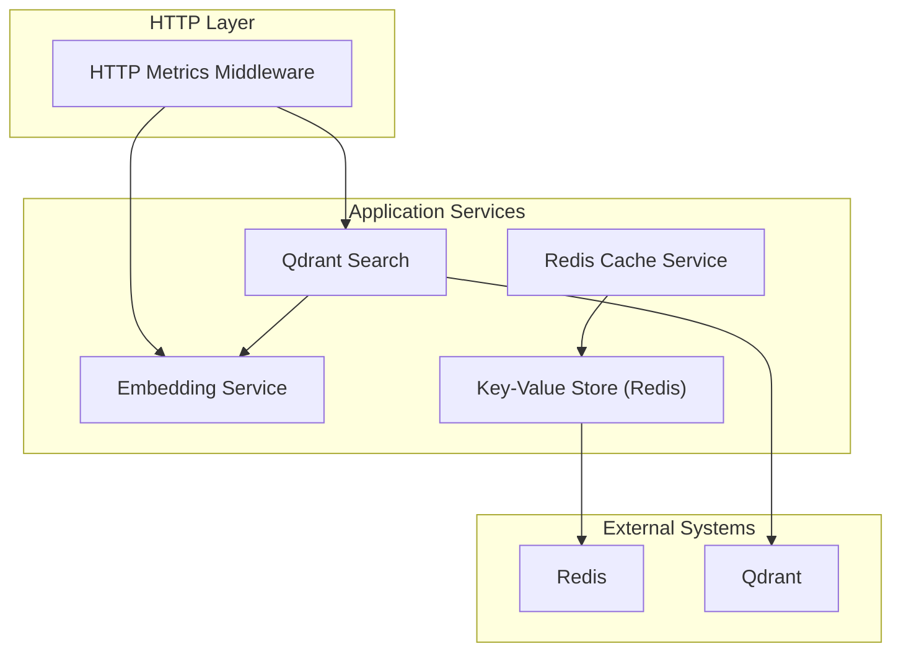
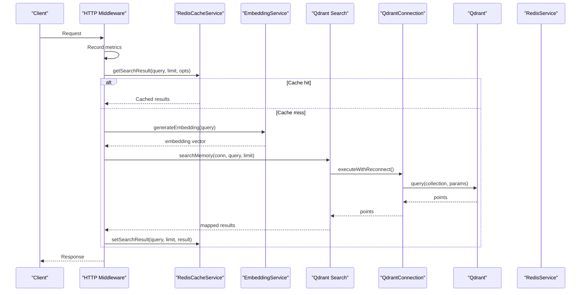
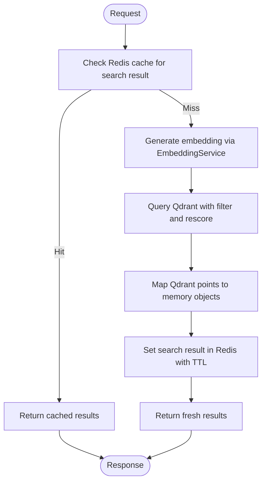
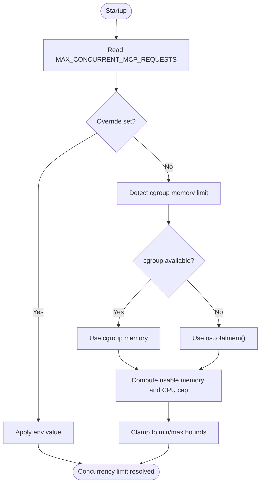
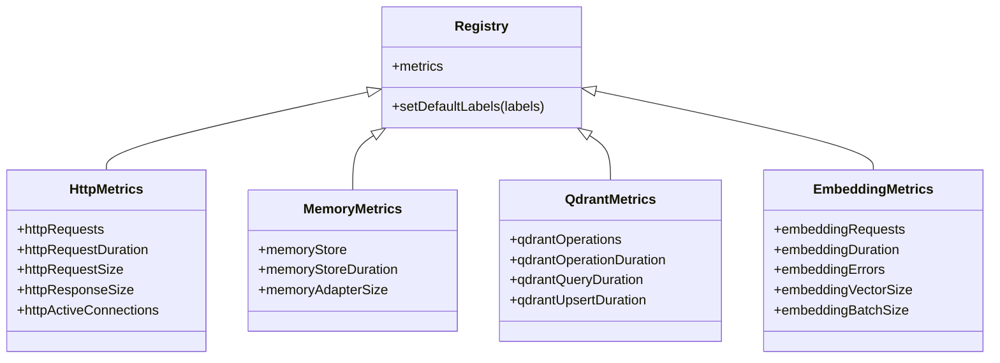
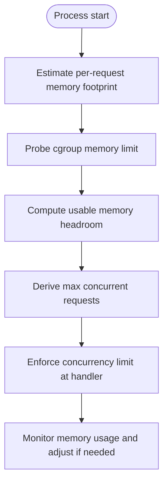
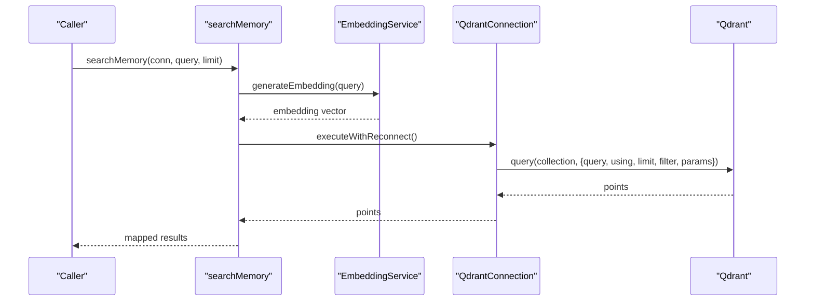
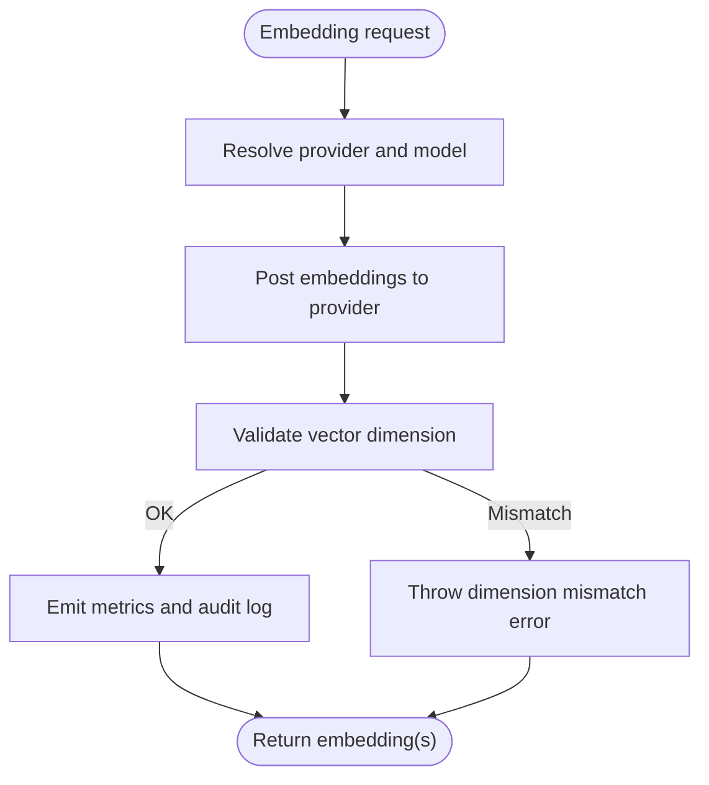
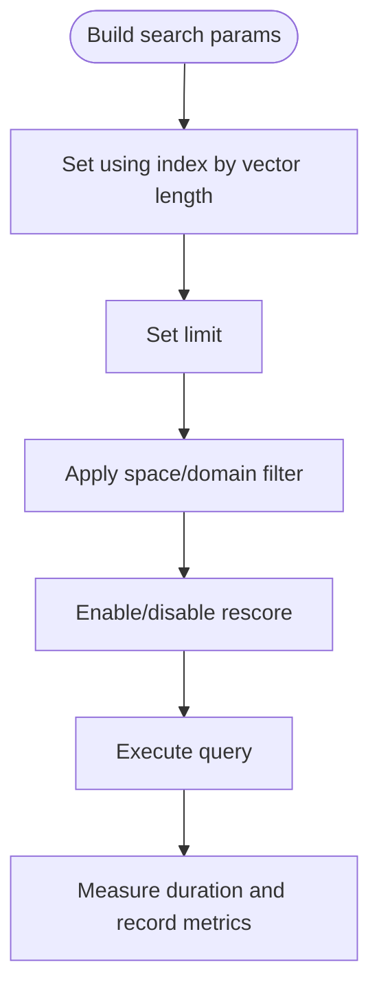
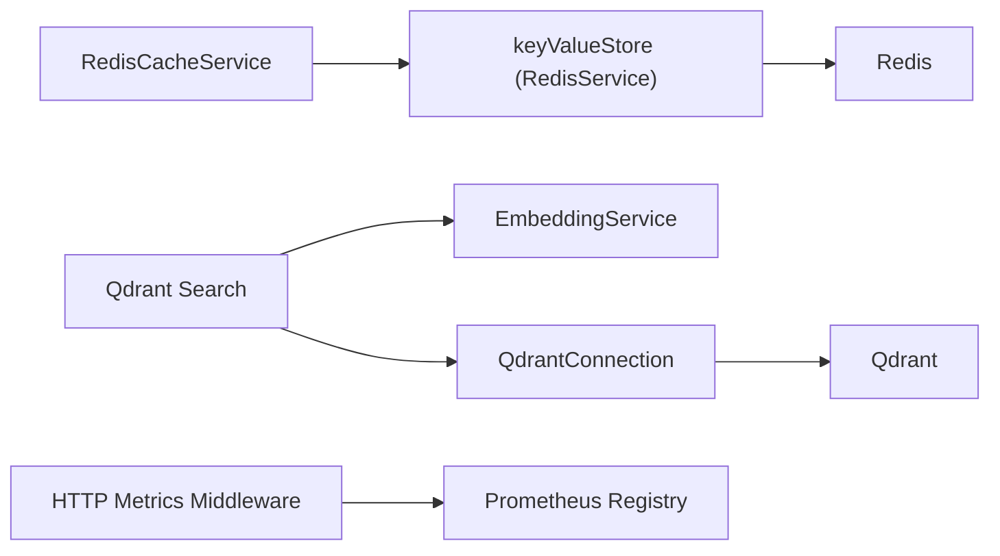

# Performance Optimization

<cite>
**Referenced Files in This Document**
- [redis-cache.ts](file://src/services/redis-cache.ts)
- [redis.ts](file://src/services/redis.ts)
- [concurrency-limit.ts](file://src/utils/concurrency-limit.ts)
- [http-metrics-middleware.ts](file://src/http/http-metrics-middleware.ts)
- [registry.ts](file://src/services/metrics/registry.ts)
- [connection.ts](file://src/services/qdrant/connection.ts)
- [search.ts](file://src/services/qdrant/search.ts)
- [service.ts](file://src/services/embedding/service.ts)
- [http-metrics.ts](file://src/services/metrics/http-metrics.ts)
- [memory-metrics.ts](file://src/services/metrics/memory-metrics.ts)
- [qdrant-metrics.ts](file://src/services/metrics/qdrant-metrics.ts)
- [embedding-metrics.ts](file://src/services/metrics/embedding-metrics.ts)
</cite>

## Table of Contents
1. [Introduction](#introduction)
2. [Project Structure](#project-structure)
3. [Core Components](#core-components)
4. [Architecture Overview](#architecture-overview)
5. [Detailed Component Analysis](#detailed-component-analysis)
6. [Dependency Analysis](#dependency-analysis)
7. [Performance Considerations](#performance-considerations)
8. [Troubleshooting Guide](#troubleshooting-guide)
9. [Conclusion](#conclusion)
10. [Appendices](#appendices)

## Introduction
This document provides advanced performance optimization guidance for SquadRules, focusing on:
- Caching strategies with Redis (search and memory resources)
- Concurrency limiting patterns based on environment and cgroup memory
- Metrics collection and monitoring via Prometheus
- Memory management, connection pooling, and resource optimization
- Vector search optimization, embedding generation caching, and database query tuning
- Benchmarking, load testing, and production monitoring setup

SquadRules is an agent-first MCP framework where AI agents drive workflows through adapters. The core flow is activate → forward → reward. Vector databases Qdrant (primary) and LanceDB (secondary) power semantic search. Redis backs sessions, rate limiting, and application caches.

## Project Structure
The performance-critical areas are organized into services and utilities:
- Redis-backed caching and key-value store abstraction
- Concurrency limiter that auto-detects safe concurrency from cgroups or CPU
- HTTP metrics middleware for request tracking
- Embedding service for vector generation with provider selection
- Qdrant client wrapper with resilient reconnection and query execution
- Prometheus metrics registry and domain-specific metric definitions

**Diagram sources**
- [http-metrics-middleware.ts:15-70](file://src/http/http-metrics-middleware.ts#L15-L70)
- [service.ts:48-128](file://src/services/embedding/service.ts#L48-L128)
- [search.ts:11-83](file://src/services/qdrant/search.ts#L11-L83)
- [redis-cache.ts:21-79](file://src/services/redis-cache.ts#L21-L79)
- [redis.ts:26-117](file://src/services/redis.ts#L26-L117)

**Section sources**
- [http-metrics-middleware.ts:15-70](file://src/http/http-metrics-middleware.ts#L15-L70)
- [service.ts:48-128](file://src/services/embedding/service.ts#L48-L128)
- [search.ts:11-83](file://src/services/qdrant/search.ts#L11-L83)
- [redis-cache.ts:21-79](file://src/services/redis-cache.ts#L21-L79)
- [redis.ts:26-117](file://src/services/redis.ts#L26-L117)

## Core Components
- RedisCacheService: Provides search result caching, memory resource caching, invalidation channels, and cache statistics. It gates behavior when Redis is not configured and uses TTLs to prevent stale data.
- RedisService: Implements a namespaced key-value store over Redis with JSON helpers, pub/sub, and error logging. Keys are prefixed by space ID except for global keys like memory cache and OIDC state.
- Concurrency Limiter: Resolves MAX_CONCURRENT_MCP_REQUESTS from environment or auto-detects from cgroup memory and CPU, enforcing a per-pod concurrency limit at startup.
- EmbeddingService: Generates embeddings via OpenAI or TEI providers, tracks metrics, validates dimensions, and supports batch operations.
- QdrantConnection: Encapsulates client initialization, TLS configuration, health checks, exponential backoff reconnection, and resilient operation execution.
- Qdrant Search: Wraps vector similarity search, builds filters, measures duration, and maps results to memory objects.
- HTTP Metrics Middleware: Tracks request counts, durations, sizes, and active connections with tenant labels.
- Metrics Registry and Domain Metrics: Central Prometheus registry with default labels; domain-specific counters/histograms for HTTP, memory, Qdrant, and embedding operations.

**Section sources**
- [redis-cache.ts:21-274](file://src/services/redis-cache.ts#L21-L274)
- [redis.ts:26-293](file://src/services/redis.ts#L26-L293)
- [concurrency-limit.ts:57-80](file://src/utils/concurrency-limit.ts#L57-L80)
- [service.ts:48-278](file://src/services/embedding/service.ts#L48-L278)
- [connection.ts:11-131](file://src/services/qdrant/connection.ts#L11-L131)
- [search.ts:11-83](file://src/services/qdrant/search.ts#L11-L83)
- [http-metrics-middleware.ts:15-70](file://src/http/http-metrics-middleware.ts#L15-L70)
- [registry.ts:11-21](file://src/services/metrics/registry.ts#L11-L21)

## Architecture Overview
The runtime path for a typical search request involves:
- HTTP middleware recording metrics
- Embedding service generating the query vector
- Qdrant search executing vector similarity with filters
- Optional Redis cache serving precomputed search results
- Redis pub/sub invalidating caches after writes

**Diagram sources**
- [http-metrics-middleware.ts:15-70](file://src/http/http-metrics-middleware.ts#L15-L70)
- [redis-cache.ts:43-79](file://src/services/redis-cache.ts#L43-L79)
- [service.ts:48-128](file://src/services/embedding/service.ts#L48-L128)
- [search.ts:11-83](file://src/services/qdrant/search.ts#L11-L83)
- [connection.ts:98-131](file://src/services/qdrant/connection.ts#L98-L131)
- [redis.ts:119-147](file://src/services/redis.ts#L119-L147)

## Detailed Component Analysis

### Redis Caching Strategy
- Search result caching:
  - Keys include query, limit, and collapse mode.
  - TTL of 5 minutes prevents long-term staleness.
  - Hit/miss counters track effectiveness.
- Memory resource caching:
  - Global keys per memory UUID with bounded TTL (1 hour).
  - Strict invalidation methods for critical write paths.
- Invalidation:
  - Pattern-based deletion for search and begin/activate caches.
  - Pub/sub channel for cross-instance invalidation signaling.
- Key namespacing:
  - Space-scoped keys except for global prefixes (memory cache, OIDC state).

**Diagram sources**
- [redis-cache.ts:43-79](file://src/services/redis-cache.ts#L43-L79)
- [service.ts:48-128](file://src/services/embedding/service.ts#L48-L128)
- [search.ts:11-83](file://src/services/qdrant/search.ts#L11-L83)

**Section sources**
- [redis-cache.ts:21-274](file://src/services/redis-cache.ts#L21-L274)
- [redis.ts:110-117](file://src/services/redis.ts#L110-L117)

### Concurrency Limiting Patterns
- Environment override:
  - Positive value sets explicit limit.
  - Negative value disables limits.
- Auto-detection:
  - Reads cgroup v2/v1 memory limits if available.
  - Uses OS total memory as fallback.
  - Computes usable memory headroom and divides by per-request estimate.
  - Caps by CPU cores multiplied by a factor.
- Minimum limit ensures baseline throughput.

**Diagram sources**
- [concurrency-limit.ts:57-80](file://src/utils/concurrency-limit.ts#L57-L80)

**Section sources**
- [concurrency-limit.ts:1-81](file://src/utils/concurrency-limit.ts#L1-L81)

### Metrics Collection and Monitoring
- Prometheus registry:
  - Default labels include service name, version, and instance ID.
  - Tenant isolation via per-metric tenant_id label.
- HTTP metrics:
  - Counters for requests, histograms for duration and payload sizes, gauge for active connections.
  - Middleware wraps response send to capture size and finish events.
- Domain metrics:
  - Memory operations: store count/duration, adapter layer size distribution.
  - Qdrant operations: operation counts, query/upsert durations.
  - Embedding operations: request counts, errors, duration, vector size, batch size.

**Diagram sources**
- [registry.ts:11-21](file://src/services/metrics/registry.ts#L11-L21)
- [http-metrics.ts:11-47](file://src/services/metrics/http-metrics.ts#L11-L47)
- [memory-metrics.ts:11-32](file://src/services/metrics/memory-metrics.ts#L11-L32)
- [qdrant-metrics.ts:11-40](file://src/services/metrics/qdrant-metrics.ts#L11-L40)
- [embedding-metrics.ts:11-47](file://src/services/metrics/embedding-metrics.ts#L11-L47)

**Section sources**
- [registry.ts:11-21](file://src/services/metrics/registry.ts#L11-L21)
- [http-metrics-middleware.ts:15-70](file://src/http/http-metrics-middleware.ts#L15-L70)
- [http-metrics.ts:11-47](file://src/services/metrics/http-metrics.ts#L11-L47)
- [memory-metrics.ts:11-32](file://src/services/metrics/memory-metrics.ts#L11-L32)
- [qdrant-metrics.ts:11-40](file://src/services/metrics/qdrant-metrics.ts#L11-L40)
- [embedding-metrics.ts:11-47](file://src/services/metrics/embedding-metrics.ts#L11-L47)

### Memory Management and Resource Optimization
- Per-request memory estimation:
  - Conservative 5 MB per request used to compute concurrency from available memory.
  - Headroom factor reduces risk of OOM under load.
- Connection resilience:
  - QdrantConnection performs health checks and exponential backoff reconnection.
  - Operations wrapped with retry logic to mitigate transient failures.
- Redis key namespacing:
  - Space-scoped keys avoid collisions across tenants.
  - Global keys reserved for memory cache and OIDC state.

**Diagram sources**
- [concurrency-limit.ts:10-12](file://src/utils/concurrency-limit.ts#L10-L12)
- [concurrency-limit.ts:67-79](file://src/utils/concurrency-limit.ts#L67-L79)

**Section sources**
- [concurrency-limit.ts:1-81](file://src/utils/concurrency-limit.ts#L1-L81)
- [connection.ts:63-96](file://src/services/qdrant/connection.ts#L63-L96)
- [redis.ts:110-117](file://src/services/redis.ts#L110-L117)

### Vector Search Optimization
- Embedding dimension validation:
  - Ensures generated vectors match expected dimension; throws on mismatch.
- Query vector reuse:
  - Embedding generated once per search call; avoids redundant computation.
- Filtering and rescore:
  - Space-aware filters applied to restrict search scope.
  - Optional rescore enabled via configuration to improve accuracy.
- Result mapping:
  - Efficiently maps Qdrant points to memory objects with metadata.

**Diagram sources**
- [search.ts:11-83](file://src/services/qdrant/search.ts#L11-L83)
- [service.ts:48-128](file://src/services/embedding/service.ts#L48-L128)
- [connection.ts:98-131](file://src/services/qdrant/connection.ts#L98-L131)

**Section sources**
- [search.ts:11-83](file://src/services/qdrant/search.ts#L11-L83)
- [service.ts:48-128](file://src/services/embedding/service.ts#L48-L128)
- [connection.ts:98-131](file://src/services/qdrant/connection.ts#L98-L131)

### Embedding Generation Caching
- Provider selection:
  - Chooses between OpenAI and TEI based on environment configuration.
- Dimension probing:
  - Probes embedding dimension at startup to ensure consistency.
- Metrics and audit:
  - Tracks latency, vector size, batch size, and errors.
  - Emits audit logs for success and failure cases.

**Diagram sources**
- [service.ts:48-128](file://src/services/embedding/service.ts#L48-L128)
- [service.ts:280-284](file://src/services/embedding/service.ts#L280-L284)

**Section sources**
- [service.ts:48-278](file://src/services/embedding/service.ts#L48-L278)

### Database Query Tuning
- Qdrant query parameters:
  - Using index name derived from vector length.
  - Limit controls top-k results.
  - Filter enforces space and domain constraints.
  - Rescore parameter toggled via configuration.
- Operation metrics:
  - Duration histograms for queries and upserts.
  - Operation counters with status and tenant labels.

**Diagram sources**
- [search.ts:27-33](file://src/services/qdrant/search.ts#L27-L33)
- [qdrant-metrics.ts:26-40](file://src/services/metrics/qdrant-metrics.ts#L26-L40)

**Section sources**
- [search.ts:11-83](file://src/services/qdrant/search.ts#L11-L83)
- [qdrant-metrics.ts:11-40](file://src/services/metrics/qdrant-metrics.ts#L11-L40)

## Dependency Analysis
- RedisCacheService depends on:
  - keyValueStore (implemented by RedisService)
  - Configuration flags for Redis availability and prefixes
  - Tenant context for space-scoped keys
- RedisService implements IKeyValueStore and exposes JSON helpers, pub/sub, and key namespacing.
- EmbeddingService depends on:
  - Provider resolver and postEmbeddings utility
  - Metrics and audit modules
- QdrantConnection encapsulates:
  - Qdrant client initialization and TLS config
  - Health checks and reconnection strategy
- Qdrant search depends on:
  - EmbeddingService for query vector generation
  - Space filter utilities and tenant context

**Diagram sources**
- [redis-cache.ts:21-79](file://src/services/redis-cache.ts#L21-L79)
- [redis.ts:26-117](file://src/services/redis.ts#L26-L117)
- [search.ts:11-83](file://src/services/qdrant/search.ts#L11-L83)
- [service.ts:48-128](file://src/services/embedding/service.ts#L48-L128)
- [connection.ts:11-131](file://src/services/qdrant/connection.ts#L11-L131)
- [http-metrics-middleware.ts:15-70](file://src/http/http-metrics-middleware.ts#L15-L70)
- [registry.ts:11-21](file://src/services/metrics/registry.ts#L11-L21)

**Section sources**
- [redis-cache.ts:21-79](file://src/services/redis-cache.ts#L21-L79)
- [redis.ts:26-117](file://src/services/redis.ts#L26-L117)
- [search.ts:11-83](file://src/services/qdrant/search.ts#L11-L83)
- [service.ts:48-128](file://src/services/embedding/service.ts#L48-L128)
- [connection.ts:11-131](file://src/services/qdrant/connection.ts#L11-L131)
- [http-metrics-middleware.ts:15-70](file://src/http/http-metrics-middleware.ts#L15-L70)
- [registry.ts:11-21](file://src/services/metrics/registry.ts#L11-L21)

## Performance Considerations
- Caching:
  - Enable Redis-backed search caching for read-heavy workloads.
  - Tune TTLs to balance freshness and throughput.
  - Use strict invalidation on critical write paths to avoid stale reads.
- Concurrency:
  - Prefer auto-detection in containerized environments; override only when necessary.
  - Monitor RSS and adjust per-request estimates if workload characteristics change.
- Embeddings:
  - Batch embeddings where possible to reduce provider round-trips.
  - Validate dimensions early to fail fast on misconfiguration.
- Qdrant:
  - Keep rescore disabled unless accuracy gains justify latency overhead.
  - Use appropriate limit values to control payload sizes.
- Metrics:
  - Expose /metrics endpoint and scrape with Prometheus.
  - Track tenant_id labels for multi-tenant isolation.
  - Alert on error rates and latency percentiles.

[No sources needed since this section provides general guidance]

## Troubleshooting Guide
- Redis connectivity:
  - Inspect connection logs and masked URL details.
  - Verify key prefix and space scoping to avoid collisions.
- Embedding failures:
  - Check provider configuration and dimension mismatches.
  - Review error counters and audit logs for root causes.
- Qdrant unavailability:
  - Observe health check failures and reconnection attempts.
  - Confirm TLS CA certificate loading and network reachability.
- HTTP anomalies:
  - Analyze request duration histograms and active connection gauges.
  - Correlate with tenant_id to isolate problematic tenants.

**Section sources**
- [redis.ts:47-85](file://src/services/redis.ts#L47-L85)
- [service.ts:103-127](file://src/services/embedding/service.ts#L103-L127)
- [connection.ts:63-96](file://src/services/qdrant/connection.ts#L63-L96)
- [http-metrics-middleware.ts:37-68](file://src/http/http-metrics-middleware.ts#L37-L68)

## Conclusion
SquadRules’ performance hinges on disciplined caching, robust concurrency control, resilient external connections, and comprehensive observability. By leveraging Redis for search and memory caching, auto-detecting safe concurrency levels, validating embedding dimensions, and tuning Qdrant queries, teams can achieve high throughput and low latency. Prometheus metrics provide actionable insights for continuous optimization and scaling decisions.

[No sources needed since this section summarizes without analyzing specific files]

## Appendices
- Benchmarking strategies:
  - Instrument embedding duration and vector size distributions.
  - Measure Qdrant query latency and result cardinality.
  - Simulate tenant mix to validate multi-tenant isolation.
- Load testing approaches:
  - Ramp up concurrent requests to verify concurrency limiter behavior.
  - Inject cache invalidation bursts to test pub/sub propagation.
  - Stress-test Redis and Qdrant endpoints independently.
- Production monitoring setup:
  - Configure Prometheus scraping for /metrics.
  - Define alerts for error rates, latency SLOs, and connection health.
  - Dashboards for HTTP, embedding, Qdrant, and memory metrics.

[No sources needed since this section provides general guidance]