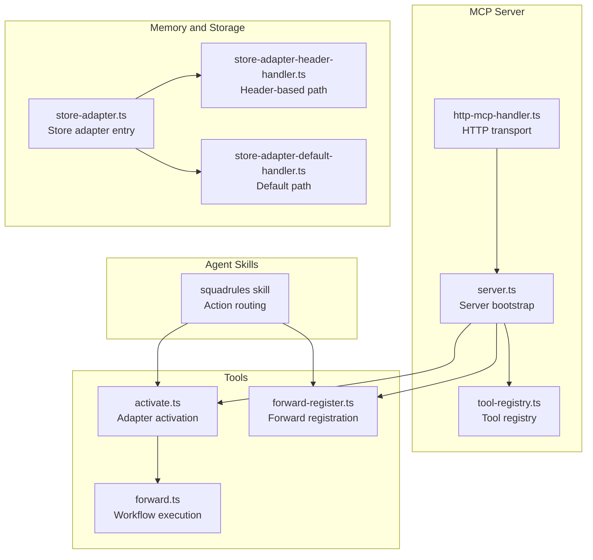
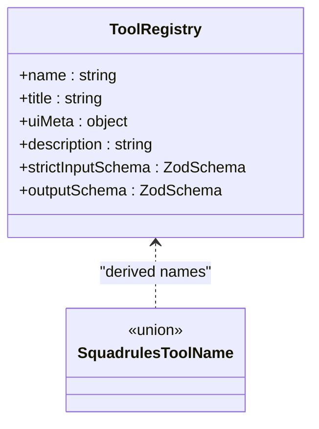
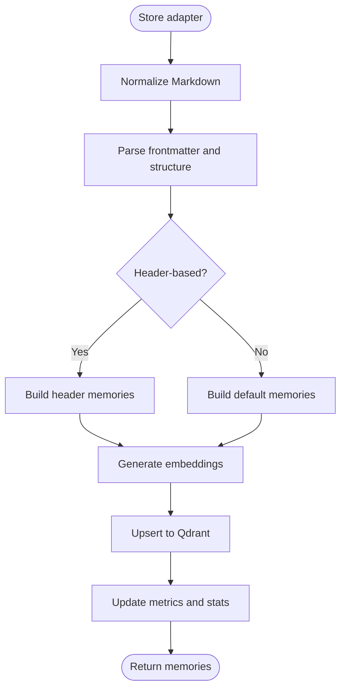
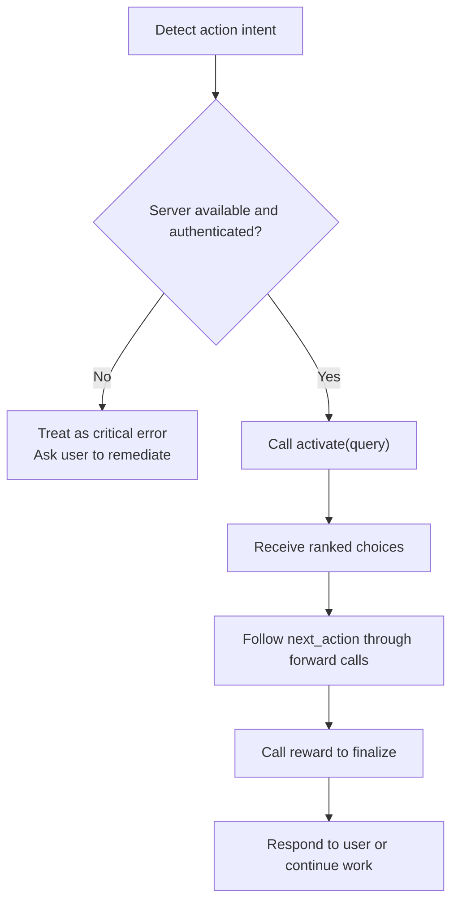
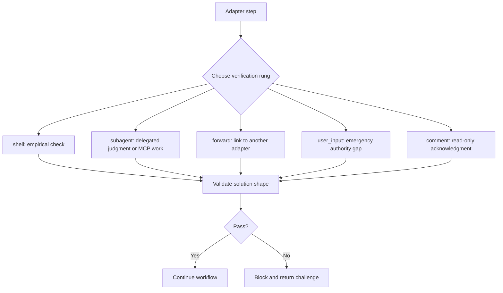
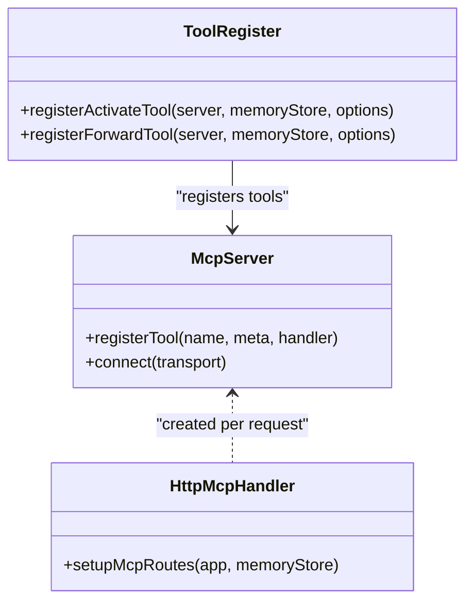
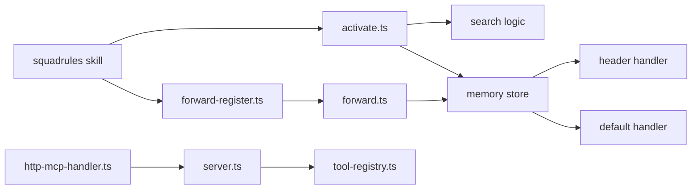

# Plugin Architecture

<cite>
**Referenced Files in This Document**
- [SKILL.md](file://.agents/skills/squadrules/SKILL.md)
- [action-routing.md](file://.agents/skills/squadrules/references/action-routing.md)
- [adapter-authoring-guide.md](file://docs/adapter-authoring-guide.md)
- [challenge-types.md](file://docs/examples/challenge-types.md)
- [tool-registry.ts](file://src/tools/tool-registry.ts)
- [server.ts](file://src/server.ts)
- [http-mcp-handler.ts](file://src/http/http-mcp-handler.ts)
- [forward-register.ts](file://src/tools/forward-register.ts)
- [activate.ts](file://src/tools/activate.ts)
- [forward.ts](file://src/tools/forward.ts)
- [store-adapter.ts](file://src/services/memory/store-adapter.ts)
- [store-adapter-header-handler.ts](file://src/services/memory/store-adapter-header-handler.ts)
- [store-adapter-default-handler.ts](file://src/services/memory/store-adapter-default-handler.ts)
</cite>

## Table of Contents
1. [Introduction](#introduction)
2. [Project Structure](#project-structure)
3. [Core Components](#core-components)
4. [Architecture Overview](#architecture-overview)
5. [Detailed Component Analysis](#detailed-component-analysis)
6. [Dependency Analysis](#dependency-analysis)
7. [Performance Considerations](#performance-considerations)
8. [Troubleshooting Guide](#troubleshooting-guide)
9. [Conclusion](#conclusion)
10. [Appendices](#appendices)

## Introduction
SquadRules is an agent-first MCP framework where AI agents are the primary users and humans configure preferences through agents. The system exposes a small, stable set of MCP tools that implement the activate → forward → reward chain. Adapters are Markdown-based workflows stored in vector memory; they provide deterministic, auditable task execution for team-specific procedures.

This document explains the plugin architecture and extension mechanisms:
- Tool registry as the single source of truth for MCP tool surface.
- Adapter pattern implementation for storing, routing, and executing domain workflows.
- Skill-based routing via hand-authored agent skills.
- Authoring context for AI agents to create or repair adapters.
- Contract definitions and verification ladder.
- Security, versioning, and deployment considerations.

## Project Structure
The repository separates runtime code from documentation and agent-facing skills:
- `.agents/skills/` contains hand-authored routing logic for AI agents.
- `docs/` contains curated authoring guides and examples.
- `src/` contains the MCP server, HTTP transport, tools, services, and storage adapters.



**Diagram sources**
- [SKILL.md:1-91](file://.agents/skills/squadrules/SKILL.md#L1-L91)
- [server.ts:44-80](file://src/server.ts#L44-L80)
- [tool-registry.ts:16-99](file://src/tools/tool-registry.ts#L16-L99)
- [http-mcp-handler.ts:115-195](file://src/http/http-mcp-handler.ts#L115-L195)
- [activate.ts:231-281](file://src/tools/activate.ts#L231-L281)
- [forward-register.ts:18-65](file://src/tools/forward-register.ts#L18-L65)
- [store-adapter.ts:35-152](file://src/services/memory/store-adapter.ts#L35-L152)

**Section sources**
- [SKILL.md:1-91](file://.agents/skills/squadrules/SKILL.md#L1-L91)
- [server.ts:44-80](file://src/server.ts#L44-L80)
- [tool-registry.ts:16-99](file://src/tools/tool-registry.ts#L16-L99)
- [http-mcp-handler.ts:115-195](file://src/http/http-mcp-handler.ts#L115-L195)

## Core Components
- **Skill-based routing**: The squadrules skill instructs AI agents to detect action intents and route them through the activate → forward → reward chain. It defines allowed tools and operational discipline.
- **Tool registry**: A canonical list of MCP tools with Zod schemas, UI metadata, and descriptions. It drives MCP tools/list, HTTP routes, and CLI commands.
- **Adapter storage**: MemoryQdrantStoreAdapter parses Markdown adapters into memories, computes embeddings, and persists them to Qdrant.
- **Activation and forwarding**: activate selects adapters; forward executes layers, validates contracts, and advances workflow state.
- **HTTP transport**: Per-request MCP servers with concurrency limits, audit logging, and error mapping.

Key responsibilities:
- Agent routing policy lives in skills, not generated code.
- Tool surface is centralized and schema-driven.
- Adapters are versioned, searchable, and executable through MCP tools.

**Section sources**
- [SKILL.md:1-91](file://.agents/skills/squadrules/SKILL.md#L1-L91)
- [tool-registry.ts:16-99](file://src/tools/tool-registry.ts#L16-L99)
- [store-adapter.ts:35-152](file://src/services/memory/store-adapter.ts#L35-L152)
- [activate.ts:168-229](file://src/tools/activate.ts#L168-L229)
- [forward.ts:91-156](file://src/tools/forward.ts#L91-L156)
- [http-mcp-handler.ts:115-195](file://src/http/http-mcp-handler.ts#L115-L195)

## Architecture Overview
The plugin architecture centers on three layers:
1. **Agent skill layer**: Hand-authored routing rules that tell agents when and how to use SquadRules.
2. **MCP tool layer**: Registered tools with strict input/output schemas and UI metadata.
3. **Adapter storage and execution layer**: Markdown adapters parsed into structured memories, embedded, searched, and executed through forward.

```mermaid
sequenceDiagram
participant Agent as "AI Agent"
participant Skill as "squadrules skill"
participant HTTP as "HTTP /mcp handler"
participant Server as "MCP server"
participant Activate as "activate tool"
participant Forward as "forward tool"
participant Store as "Memory store"
Agent->>Skill : Detect action intent
Skill->>HTTP : POST /mcp { method : "tools/call", name : "activate" }
HTTP->>Server : Create per-request MCP server
Server->>Activate : Execute activate(input)
Activate->>Store : Search adapters
Store-->>Activate : Ranked choices
Activate-->>HTTP : Activation choices + next_action
HTTP-->>Agent : Choices and instructions
Agent->>HTTP : POST /mcp { method : "tools/call", name : "forward" }
HTTP->>Server : Create per-request MCP server
Server->>Forward : Execute forward(input)
Forward->>Store : Load current layer
Store-->>Forward : Layer payload
Forward-->>HTTP : Next layer or final message
HTTP-->>Agent : Workflow progress
```

**Diagram sources**
- [SKILL.md:22-48](file://.agents/skills/squadrules/SKILL.md#L22-L48)
- [http-mcp-handler.ts:115-195](file://src/http/http-mcp-handler.ts#L115-L195)
- [server.ts:60-80](file://src/server.ts#L60-L80)
- [activate.ts:231-281](file://src/tools/activate.ts#L231-L281)
- [forward-register.ts:18-65](file://src/tools/forward-register.ts#L18-L65)
- [forward.ts:91-156](file://src/tools/forward.ts#L91-L156)

## Detailed Component Analysis

### Tool Registry System
The tool registry is the single source of truth for the MCP tool surface. Each tool entry includes:
- Canonical name and title.
- UI metadata for IDE integration.
- Strict input schema (Zod) and output schema.
- Description resolved at runtime.

Registration order matters because it determines the tools/list response and helps maintain consistency across HTTP routes and CLI commands.



**Diagram sources**
- [tool-registry.ts:16-99](file://src/tools/tool-registry.ts#L16-L99)

**Section sources**
- [tool-registry.ts:16-99](file://src/tools/tool-registry.ts#L16-L99)
- [server.ts:29-40](file://src/server.ts#L29-L40)

### Adapter Pattern Implementation
Adapters are Markdown documents that encode workflows. The adapter storage pipeline:
- Normalizes Markdown content.
- Parses frontmatter and structure.
- Builds activation search fields.
- Generates embeddings and sparse tokens.
- Persists points to Qdrant with payload metadata.

Two storage paths exist:
- Header-based adapters: H1/H2 sections mapped to layered memories.
- Default adapters: One memory per document with enhanced search text.



**Diagram sources**
- [store-adapter.ts:43-147](file://src/services/memory/store-adapter.ts#L43-L147)
- [store-adapter-header-handler.ts:30-201](file://src/services/memory/store-adapter-header-handler.ts#L30-L201)
- [store-adapter-default-handler.ts:34-254](file://src/services/memory/store-adapter-default-handler.ts#L34-L254)

**Section sources**
- [store-adapter.ts:35-152](file://src/services/memory/store-adapter.ts#L35-L152)
- [store-adapter-header-handler.ts:27-201](file://src/services/memory/store-adapter-header-handler.ts#L27-L201)
- [store-adapter-default-handler.ts:31-254](file://src/services/memory/store-adapter-default-handler.ts#L31-L254)

### Skill-Based Routing
The squadrules skill defines:
- Allowed tools: activate, forward, reward, train, tune, export, delete, spaces.
- Routing flow: detect intent → activate → follow next_action → reward.
- Safety rules: validate remote outputs, avoid secret forwarding, treat unavailability as critical.

Agents must complete the full chain before responding to users. If no adapter exists, the skill directs creation via train.



**Diagram sources**
- [SKILL.md:1-91](file://.agents/skills/squadrules/SKILL.md#L1-L91)
- [action-routing.md:1-48](file://.agents/skills/squadrules/references/action-routing.md#L1-L48)

**Section sources**
- [SKILL.md:1-91](file://.agents/skills/squadrules/SKILL.md#L1-L91)
- [action-routing.md:1-48](file://.agents/skills/squadrules/references/action-routing.md#L1-L48)

### Authoring Context for AI Agents
Authoring context enables agents to create, update, review, or delete adapters safely:
- Only valid for the author-adapter workflow slug.
- Fixes target adapter URI and operation for the run.
- Enforces structural validation through train and critic-loop review.

The forward tool validates authoring context continuity and rejects mismatches.

```mermaid
sequenceDiagram
participant Agent as "AI Agent"
participant Activate as "activate(authoring)"
participant Forward as "forward(authoring)"
participant Store as "Memory store"
Agent->>Activate : start authoring operation
Activate-->>Agent : choice with forward_first_call
Agent->>Forward : forward(first call with authoring)
Forward->>Store : validate authoring context
Store-->>Forward : proceed or reject mismatch
Forward-->>Agent : guidance for mutation steps
```

**Diagram sources**
- [activate.ts:179-212](file://src/tools/activate.ts#L179-L212)
- [forward.ts:112-131](file://src/tools/forward.ts#L112-L131)

**Section sources**
- [activate.ts:179-212](file://src/tools/activate.ts#L179-L212)
- [forward.ts:112-131](file://src/tools/forward.ts#L112-L131)

### Contract Definitions and Verification Ladder
Contracts define verification for each adapter step:
- shell: empirical checks with required interpreter.
- forward: link to another adapter only.
- subagent: delegated judgment or MCP tool work.
- user_input: emergency authority gap.
- comment: last-resort acknowledgment.

The verification ladder is ordered; higher rungs win unless genuinely inapplicable.



**Diagram sources**
- [adapter-authoring-guide.md:23-83](file://docs/adapter-authoring-guide.md#L23-L83)
- [challenge-types.md:25-90](file://docs/examples/challenge-types.md#L25-L90)

**Section sources**
- [adapter-authoring-guide.md:23-83](file://docs/adapter-authoring-guide.md#L23-L83)
- [challenge-types.md:25-90](file://docs/examples/challenge-types.md#L25-L90)

### MCP Protocol Extension Points
Extension points include:
- Registering new tools via register functions.
- Adding UI metadata to tools.
- Extending HTTP transport behavior through middleware and handlers.
- Using resources and prompts for additional capabilities.

The server registers core tools and installs a strict tools/list handler derived from the registry.



**Diagram sources**
- [server.ts:44-80](file://src/server.ts#L44-L80)
- [http-mcp-handler.ts:115-195](file://src/http/http-mcp-handler.ts#L115-L195)
- [activate.ts:231-281](file://src/tools/activate.ts#L231-L281)
- [forward-register.ts:18-65](file://src/tools/forward-register.ts#L18-L65)

**Section sources**
- [server.ts:44-80](file://src/server.ts#L44-L80)
- [http-mcp-handler.ts:115-195](file://src/http/http-mcp-handler.ts#L115-L195)
- [activate.ts:231-281](file://src/tools/activate.ts#L231-L281)
- [forward-register.ts:18-65](file://src/tools/forward-register.ts#L18-L65)

## Dependency Analysis
The following diagram shows key dependencies between components involved in plugin execution:



**Diagram sources**
- [SKILL.md:1-91](file://.agents/skills/squadrules/SKILL.md#L1-L91)
- [server.ts:44-80](file://src/server.ts#L44-L80)
- [tool-registry.ts:16-99](file://src/tools/tool-registry.ts#L16-L99)
- [http-mcp-handler.ts:115-195](file://src/http/http-mcp-handler.ts#L115-L195)
- [activate.ts:168-229](file://src/tools/activate.ts#L168-L229)
- [forward-register.ts:18-65](file://src/tools/forward-register.ts#L18-L65)
- [forward.ts:91-156](file://src/tools/forward.ts#L91-L156)
- [store-adapter.ts:35-152](file://src/services/memory/store-adapter.ts#L35-L152)

**Section sources**
- [server.ts:44-80](file://src/server.ts#L44-L80)
- [http-mcp-handler.ts:115-195](file://src/http/http-mcp-handler.ts#L115-L195)
- [activate.ts:168-229](file://src/tools/activate.ts#L168-L229)
- [forward.ts:91-156](file://src/tools/forward.ts#L91-L156)
- [store-adapter.ts:35-152](file://src/services/memory/store-adapter.ts#L35-L152)

## Performance Considerations
- Concurrency control: The HTTP handler enforces a maximum concurrent MCP request limit and returns 503 when exceeded.
- Per-request MCP servers: Avoids single-transport bottlenecks and improves isolation.
- Embedding batching: Adapter storage batches embedding generation and falls back gracefully on dimension/count mismatches.
- Sparse tokenization: BM25 tokens are computed and optionally omitted if the collection lacks sparse configuration.
- Metrics and tracing: Tool duration, input/output sizes, and execution traces support observability and tuning.

[No sources needed since this section provides general guidance]

## Troubleshooting Guide
Common issues and resolutions:
- Unavailable or unauthenticated MCP server: Treat as critical error; verify endpoint, health, and allowed tools.
- Input validation failures: Tools return structured validation errors; inspect tool description and schema.
- Missing artifacts: When shell contracts reference scripts, materialize linked artifacts before execution.
- Authoring context mismatch: Ensure forward calls reuse the returned next_call and do not change target or authoring mid-run.
- Embedding failures: Fallback to zero vectors; check embedding service configuration and dimension settings.

**Section sources**
- [action-routing.md:193-212](file://.agents/skills/squadrules/references/action-routing.md#L193-L212)
- [forward-register.ts:36-42](file://src/tools/forward-register.ts#L36-L42)
- [activate.ts:252-258](file://src/tools/activate.ts#L252-L258)
- [forward.ts:112-131](file://src/tools/forward.ts#L112-L131)
- [store-adapter-default-handler.ts:134-142](file://src/services/memory/store-adapter-default-handler.ts#L134-L142)

## Conclusion
SquadRules’ plugin architecture combines hand-authored agent skills, a schema-driven tool registry, and Markdown-based adapters persisted in vector memory. The activate → forward → reward chain ensures deterministic, auditable execution. Extensions should respect the verification ladder, preserve authoring context, and integrate through registered tools and HTTP transport. Security, versioning, and deployment rely on explicit contracts, strict schemas, and operational safeguards such as concurrency limits and audit logging.

[No sources needed since this section summarizes without analyzing specific files]

## Appendices

### How to Create Custom Plugins
- Define a new MCP tool by adding a registration function and wiring it into server bootstrap.
- Provide Zod input/output schemas and optional UI metadata.
- Use the tool registry to keep tools/list consistent.
- For domain workflows, author Markdown adapters and train them; use forward to execute layers.

**Section sources**
- [server.ts:60-80](file://src/server.ts#L60-L80)
- [tool-registry.ts:16-99](file://src/tools/tool-registry.ts#L16-L99)
- [activate.ts:231-281](file://src/tools/activate.ts#L231-L281)
- [forward-register.ts:18-65](file://src/tools/forward-register.ts#L18-L65)

### Extending the MCP Protocol
- Add new tools via register functions.
- Extend HTTP transport with middleware for auth, rate limiting, and audit.
- Use resources and prompts for additional capabilities exposed to clients.

**Section sources**
- [http-mcp-handler.ts:115-195](file://src/http/http-mcp-handler.ts#L115-L195)
- [server.ts:44-80](file://src/server.ts#L44-L80)

### Creating Domain-Specific Extensions
- Author adapters using the contract types defined in the guide.
- Use shell gates for empirical checks, subagent hops for judgment or MCP delegation, and forward links for chaining.
- Materialize scripts via export or linked artifacts before running shell contracts.

**Section sources**
- [adapter-authoring-guide.md:85-190](file://docs/adapter-authoring-guide.md#L85-L190)
- [challenge-types.md:25-90](file://docs/examples/challenge-types.md#L25-L90)

### Plugin Security, Versioning, and Deployment
- Security: Respect host policy, validate remote outputs, avoid secret forwarding, and enforce authentication.
- Versioning: Adapters carry protocol version and layer metadata; training and tuning preserve history and quality signals.
- Deployment: Use npm CLI and serve command; ensure Qdrant, embedding backend, and MCP configuration are correct.

**Section sources**
- [action-routing.md:179-212](file://.agents/skills/squadrules/references/action-routing.md#L179-L212)
- [store-adapter-default-handler.ts:96-105](file://src/services/memory/store-adapter-default-handler.ts#L96-L105)
- [SKILL.md:64-68](file://.agents/skills/squadrules/SKILL.md#L64-L68)