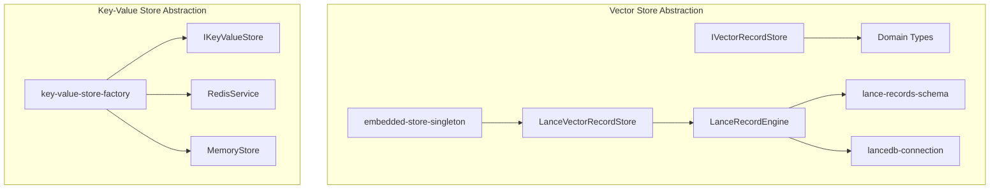
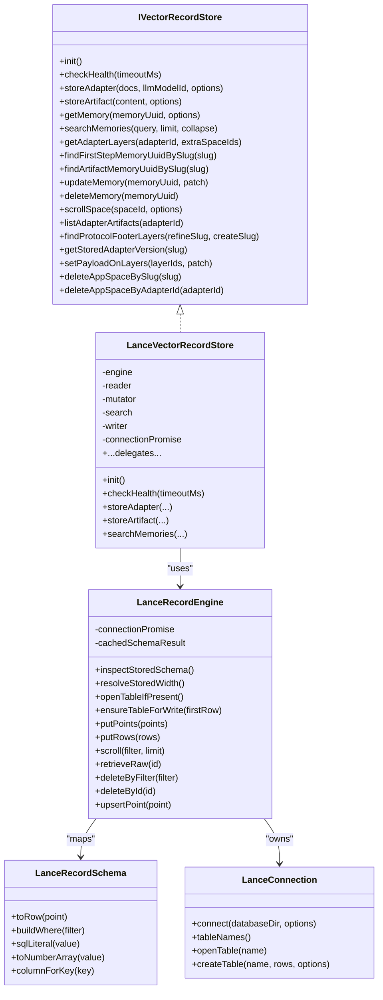
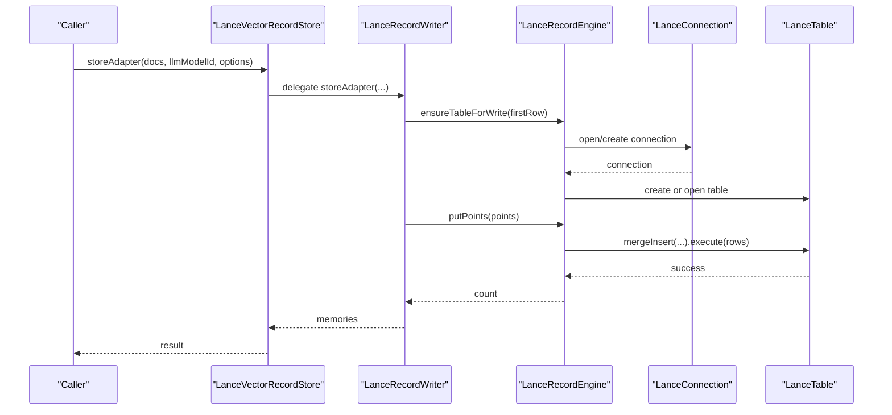
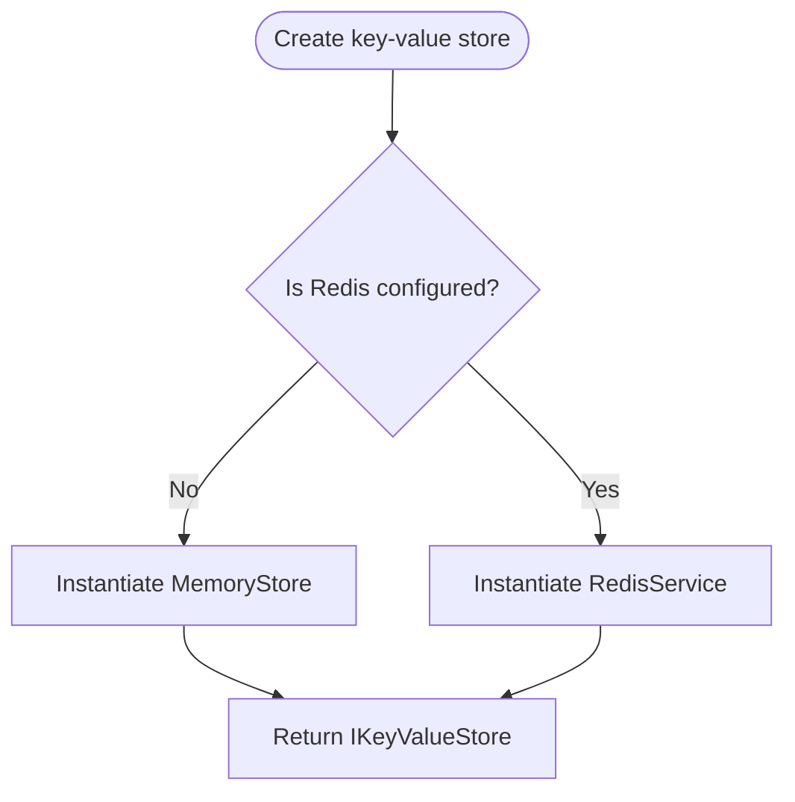
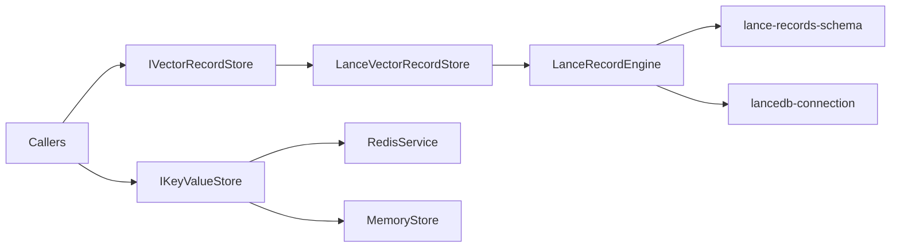

# Storage Backend Extensions

<cite>
**Referenced Files in This Document**
- [IVectorRecordStore.ts](file://src/services/vector-store/IVectorRecordStore.ts)
- [types.ts](file://src/services/vector-store/types.ts)
- [LanceVectorRecordStore.ts](file://src/services/vector-store/lancedb/LanceVectorRecordStore.ts)
- [lance-records-engine.ts](file://src/services/vector-store/lancedb/lance-records-engine.ts)
- [lance-records-schema.ts](file://src/services/vector-store/lancedb/lance-records-schema.ts)
- [lancedb-connection.ts](file://src/services/vector-store/lancedb-connection.ts)
- [embedded-store-singleton.ts](file://src/services/vector-store/embedded-store-singleton.ts)
- [commit-retry.ts](file://src/services/vector-store/commit-retry.ts)
- [key-value-store-factory.ts](file://src/services/key-value-store-factory.ts)
- [key-value-store.ts](file://src/services/key-value-store.ts)
- [redis.ts](file://src/services/redis.ts)
- [memory-store.ts](file://src/services/memory-store.ts)
- [0003-no-lancedb-store-snapshot.md](file://docs/adr/0003-no-lancedb-store-snapshot.md)
</cite>

## Table of Contents
1. [Introduction](#introduction)
2. [Project Structure](#project-structure)
3. [Core Components](#core-components)
4. [Architecture Overview](#architecture-overview)
5. [Detailed Component Analysis](#detailed-component-analysis)
6. [Dependency Analysis](#dependency-analysis)
7. [Performance Considerations](#performance-considerations)
8. [Troubleshooting Guide](#troubleshooting-guide)
9. [Conclusion](#conclusion)
10. [Appendices](#appendices)

## Introduction
This document explains how to extend SquadRules storage backends, focusing on the vector store abstraction layer, LanceDB integration patterns, and key-value store implementations. It provides guidance for creating custom storage adapters that implement connection management, query optimization, data migration strategies, error handling, and configuration selection through a factory pattern. The goal is to enable specialized use cases such as distributed storage or alternative vector databases while preserving compatibility with existing tools and services.

SquadRules uses:
- A backend-neutral vector record port for memory, adapter, and artifact records.
- An embedded LanceDB implementation for local semantic search.
- A key-value store abstraction backed by Redis in production and an in-memory store otherwise.

The design separates domain types from backend-specific payloads so callers remain portable across Qdrant, LanceDB, or future backends.

## Project Structure
The relevant storage code is organized into two main areas:
- Vector store abstraction and LanceDB implementation under `src/services/vector-store`.
- Key-value store abstraction and implementations under `src/services`.

**Diagram sources**
- [IVectorRecordStore.ts:1-74](file://src/services/vector-store/IVectorRecordStore.ts#L1-L74)
- [types.ts:1-95](file://src/services/vector-store/types.ts#L1-L95)
- [LanceVectorRecordStore.ts:1-193](file://src/services/vector-store/lancedb/LanceVectorRecordStore.ts#L1-L193)
- [lance-records-engine.ts:1-196](file://src/services/vector-store/lancedb/lance-records-engine.ts#L1-L196)
- [lance-records-schema.ts:1-189](file://src/services/vector-store/lancedb/lance-records-schema.ts#L1-L189)
- [lancedb-connection.ts:1-35](file://src/services/vector-store/lancedb-connection.ts#L1-L35)
- [embedded-store-singleton.ts:1-18](file://src/services/vector-store/embedded-store-singleton.ts#L1-L18)
- [key-value-store.ts:1-29](file://src/services/key-value-store.ts#L1-L29)
- [key-value-store-factory.ts:1-23](file://src/services/key-value-store-factory.ts#L1-L23)
- [redis.ts:1-293](file://src/services/redis.ts#L1-L293)
- [memory-store.ts:1-202](file://src/services/memory-store.ts#L1-L202)

**Section sources**
- [IVectorRecordStore.ts:1-74](file://src/services/vector-store/IVectorRecordStore.ts#L1-L74)
- [types.ts:1-95](file://src/services/vector-store/types.ts#L1-L95)
- [LanceVectorRecordStore.ts:1-193](file://src/services/vector-store/lancedb/LanceVectorRecordStore.ts#L1-L193)
- [lance-records-engine.ts:1-196](file://src/services/vector-store/lancedb/lance-records-engine.ts#L1-L196)
- [lance-records-schema.ts:1-189](file://src/services/vector-store/lancedb/lance-records-schema.ts#L1-L189)
- [lancedb-connection.ts:1-35](file://src/services/vector-store/lancedb-connection.ts#L1-L35)
- [embedded-store-singleton.ts:1-18](file://src/services/vector-store/embedded-store-singleton.ts#L1-L18)
- [key-value-store.ts:1-29](file://src/services/key-value-store.ts#L1-L29)
- [key-value-store-factory.ts:1-23](file://src/services/key-value-store-factory.ts#L1-L23)
- [redis.ts:1-293](file://src/services/redis.ts#L1-L293)
- [memory-store.ts:1-202](file://src/services/memory-store.ts#L1-L202)

## Core Components
- Vector record port: Defines backend-neutral operations for lifecycle, writes, reads, search, adapter structure, enumeration, and admin helpers. Callers should depend only on this interface when integrating new backends.
- Domain types: Define neutral shapes for memories, layers, search results, execution traces, and training pairs. These types must not import backend clients.
- LanceDB embedded store: Implements the vector record port using a single table of promoted scalar columns plus verbatim JSON payload and named vector columns. It also exposes read/admin methods used by legacy tooling.
- Lance engine: Owns the Lance connection and table, schema inspection, width resolution, atomic upserts, scans, deletes, and commit retries.
- Lance schema mapping: Converts backend-neutral points to Lance rows, promotes filterable keys, builds WHERE clauses, and normalizes vector arrays.
- Lance connection: Lazily imports the Lance SDK and opens a strong-consistency connection to a per-user directory.
- Embedded singleton: Ensures one shared Lance store instance is injected into both memory and Qdrant service slots for internal consistency.
- Key-value store abstraction: Defines a Redis-compatible API including string, hash, counter, TTL, JSON helpers, pub/sub, and lifecycle methods.
- Key-value factory: Selects Redis or in-memory implementation based on configuration.
- Redis service: Production implementation with URL masking, namespacing, error logging, and JSON helpers.
- Memory store: In-process implementation with TTL support, glob-based key matching, and no-op publish.

**Section sources**
- [IVectorRecordStore.ts:1-74](file://src/services/vector-store/IVectorRecordStore.ts#L1-L74)
- [types.ts:1-95](file://src/services/vector-store/types.ts#L1-L95)
- [LanceVectorRecordStore.ts:1-193](file://src/services/vector-store/lancedb/LanceVectorRecordStore.ts#L1-L193)
- [lance-records-engine.ts:1-196](file://src/services/vector-store/lancedb/lance-records-engine.ts#L1-L196)
- [lance-records-schema.ts:1-189](file://src/services/vector-store/lancedb/lance-records-schema.ts#L1-L189)
- [lancedb-connection.ts:1-35](file://src/services/vector-store/lancedb-connection.ts#L1-L35)
- [embedded-store-singleton.ts:1-18](file://src/services/vector-store/embedded-store-singleton.ts#L1-L18)
- [key-value-store.ts:1-29](file://src/services/key-value-store.ts#L1-L29)
- [key-value-store-factory.ts:1-23](file://src/services/key-value-store-factory.ts#L1-L23)
- [redis.ts:1-293](file://src/services/redis.ts#L1-L293)
- [memory-store.ts:1-202](file://src/services/memory-store.ts#L1-L202)

## Architecture Overview
The system composes a backend-neutral vector store port with concrete implementations and a separate key-value store abstraction for cache and transient state.

**Diagram sources**
- [IVectorRecordStore.ts:1-74](file://src/services/vector-store/IVectorRecordStore.ts#L1-L74)
- [LanceVectorRecordStore.ts:1-193](file://src/services/vector-store/lancedb/LanceVectorRecordStore.ts#L1-L193)
- [lance-records-engine.ts:1-196](file://src/services/vector-store/lancedb/lance-records-engine.ts#L1-L196)
- [lance-records-schema.ts:1-189](file://src/services/vector-store/lancedb/lance-records-schema.ts#L1-L189)
- [lancedb-connection.ts:1-35](file://src/services/vector-store/lancedb-connection.ts#L1-L35)

## Detailed Component Analysis

### Vector Store Abstraction Layer
The vector store abstraction defines a focused contract for memory, adapter, and artifact persistence. It splits lifecycle, writes, reads, search, adapter structure, enumeration, and admin helpers to keep backends small and testable.

Key responsibilities:
- Lifecycle: initialization and health checks.
- Writes: adapter chains and artifacts.
- Reads: single memory retrieval.
- Search: semantic search returning memories and scores.
- Adapter structure: layer enumeration, slug resolution, protocol footer lookup, version tracking, payload patches, and app-space deletion.
- Enumeration: space scrolling, artifact listing, and protocol step queries.

Design principles:
- Backend-neutral return shapes: callers receive `Memory`, `LayerRecord`, and outcome objects rather than raw client payloads.
- Backward compatibility: some methods mirror existing Qdrant service surfaces to ease migration without changing callers.

Implementation guidance for custom backends:
- Implement all lifecycle and write/read/search methods.
- Map your database’s point/document shape to `Memory` and `LayerRecord`.
- Preserve slug semantics and protocol footer behavior.
- Provide idempotent updates and safe deletions.
- Expose enumeration endpoints required by tools (scroll, list artifacts, protocol steps).

**Section sources**
- [IVectorRecordStore.ts:1-74](file://src/services/vector-store/IVectorRecordStore.ts#L1-L74)
- [types.ts:1-95](file://src/services/vector-store/types.ts#L1-L95)

### LanceDB Integration Patterns
LanceDB is the embedded vector backend. It stores records in a single table where:
- Scalar fields are promoted to columns for efficient filtering.
- The full payload is stored as a JSON string.
- Named vector columns hold embeddings.
- Metadata tracks provider, model, and embedding dimension.

Core components:
- `LanceVectorRecordStore`: Public port implementation delegating to reader, mutator, search, writer, and engine.
- `LanceRecordEngine`: Connection and table lifecycle, schema inspection, width resolution, atomic upserts, scans, deletes, and commit retries.
- `lance-records-schema`: Mapping between backend-neutral points and Lance rows, filter translation, and vector normalization.
- `lancedb-connection`: Lazy SDK import and strong-consistency connection to a per-user directory.
- `embedded-store-singleton`: Shared instance for DI and legacy service slots.

Data flow for writing an adapter chain:

**Diagram sources**
- [LanceVectorRecordStore.ts:184-191](file://src/services/vector-store/lancedb/LanceVectorRecordStore.ts#L184-L191)
- [lance-records-engine.ts:73-89](file://src/services/vector-store/lancedb/lance-records-engine.ts#L73-L89)
- [lance-records-engine.ts:91-118](file://src/services/vector-store/lancedb/lance-records-engine.ts#L91-L118)
- [lancedb-connection.ts:26-33](file://src/services/vector-store/lancedb-connection.ts#L26-L33)

Query optimization patterns:
- Promote frequently filtered payload keys to real columns.
- Use metadata-driven vector column names instead of runtime embedding dimensions.
- Validate vector widths against stored schema before writes.
- Serialize writes via commit retry to avoid MVCC conflicts.
- Avoid touching disk on cold reads by treating absent tables as empty.

Error handling patterns:
- Health checks wrap connection acquisition and log warnings on failure.
- Schema validation throws descriptive errors for unsupported filters or unpromoted keys.
- Commit retries encapsulate transactional failures during upserts and deletes.

Migration strategy:
- On first write, persist provider/model/dimension metadata.
- Resolve stored width from metadata; fall back to schema inspection if missing.
- Validate incoming vectors against stored width to prevent silent corruption.

**Section sources**
- [LanceVectorRecordStore.ts:1-193](file://src/services/vector-store/lancedb/LanceVectorRecordStore.ts#L1-L193)
- [lance-records-engine.ts:1-196](file://src/services/vector-store/lancedb/lance-records-engine.ts#L1-L196)
- [lance-records-schema.ts:1-189](file://src/services/vector-store/lancedb/lance-records-schema.ts#L1-L189)
- [lancedb-connection.ts:1-35](file://src/services/vector-store/lancedb-connection.ts#L1-L35)
- [embedded-store-singleton.ts:1-18](file://src/services/vector-store/embedded-store-singleton.ts#L1-L18)
- [commit-retry.ts](file://src/services/vector-store/commit-retry.ts)

### Key-Value Store Abstraction and Factory
The key-value store abstraction defines a Redis-compatible API for caching, proof-of-work state, and transient flows. Implementations include:
- Redis service: production-grade with namespacing, TTL, JSON helpers, and pub/sub.
- Memory store: in-process fallback with TTL, glob-based key matching, and no-op publish.

Factory behavior:
- If Redis is configured, select `RedisService`.
- Otherwise, select `MemoryStore`.
- Both implementations share the same interface and naming conventions.

**Diagram sources**
- [key-value-store-factory.ts:13-22](file://src/services/key-value-store-factory.ts#L13-L22)
- [key-value-store.ts:7-28](file://src/services/key-value-store.ts#L7-L28)
- [redis.ts:26-293](file://src/services/redis.ts#L26-L293)
- [memory-store.ts:27-202](file://src/services/memory-store.ts#L27-L202)

Configuration and namespacing:
- Redis URL and prefix are loaded from configuration.
- Keys are prefixed globally and optionally scoped by space ID.
- Special prefixes for memory cache and OIDC state bypass space scoping.

Error handling:
- Redis operations catch and log errors, returning safe defaults (null, empty arrays, zero counts).
- Memory operations handle TTL expiration and invalid JSON gracefully.

**Section sources**
- [key-value-store-factory.ts:1-23](file://src/services/key-value-store-factory.ts#L1-L23)
- [key-value-store.ts:1-29](file://src/services/key-value-store.ts#L1-L29)
- [redis.ts:1-293](file://src/services/redis.ts#L1-L293)
- [memory-store.ts:1-202](file://src/services/memory-store.ts#L1-L202)

### Creating Custom Storage Adapters
To implement a custom backend:

1. Choose the abstraction:
   - For vector-backed semantic search, implement `IVectorRecordStore`.
   - For simple caching or transient state, implement `IKeyValueStore`.

2. Define connection management:
   - Open connections lazily and reuse them within a process.
   - Provide health checks and graceful disconnect.
   - Handle authentication, timeouts, and retries.

3. Map data models:
   - Convert your database’s entities to `Memory` and `LayerRecord`.
   - Ensure slug semantics, protocol footers, and adapter layer ordering match expectations.

4. Optimize queries:
   - Promote filterable fields to indexed columns or equivalent structures.
   - Use metadata-driven vector column names and validate widths.
   - Batch writes and use atomic transactions where available.

5. Plan migrations:
   - Persist schema/version metadata.
   - Support incremental upgrades and backward compatibility.
   - Validate incoming data against stored schema.

6. Error handling:
   - Log context-rich errors.
   - Return safe defaults for read paths.
   - Retry idempotent writes when appropriate.

7. Testing:
   - Validate parity with existing backends for search ranking and tool behavior.
   - Exercise lifecycle, writes, reads, search, enumeration, and admin helpers.

Example scenarios:
- Distributed vector database: Implement vector indexing, sharding, and replication-aware reads/writes. Maintain slug uniqueness and consistent ordering across shards.
- Specialized vector database: Map your ANN index to named vector columns and expose similarity search with cosine or other metrics. Normalize scores to match expected ranges.
- Hybrid storage: Combine a fast in-process cache with a durable backend, mirroring the key-value store pattern.

[No sources needed since this section provides general guidance]

## Dependency Analysis
The vector store and key-value store abstractions minimize coupling between callers and backends.

**Diagram sources**
- [IVectorRecordStore.ts:1-74](file://src/services/vector-store/IVectorRecordStore.ts#L1-L74)
- [LanceVectorRecordStore.ts:1-193](file://src/services/vector-store/lancedb/LanceVectorRecordStore.ts#L1-L193)
- [lance-records-engine.ts:1-196](file://src/services/vector-store/lancedb/lance-records-engine.ts#L1-L196)
- [lance-records-schema.ts:1-189](file://src/services/vector-store/lancedb/lance-records-schema.ts#L1-L189)
- [lancedb-connection.ts:1-35](file://src/services/vector-store/lancedb-connection.ts#L1-L35)
- [key-value-store.ts:1-29](file://src/services/key-value-store.ts#L1-L29)
- [redis.ts:1-293](file://src/services/redis.ts#L1-L293)
- [memory-store.ts:1-202](file://src/services/memory-store.ts#L1-L202)

Coupling and cohesion:
- High cohesion within each backend module (engine, schema, connection).
- Low coupling at call sites due to abstract interfaces.
- Minimal cross-imports between vector and key-value subsystems.

Potential circular dependencies:
- None observed between abstraction and implementations.
- Lazy imports prevent heavy SDK bindings from loading unnecessarily.

External dependencies:
- LanceDB SDK loaded lazily.
- Redis client used by production key-value store.

**Section sources**
- [IVectorRecordStore.ts:1-74](file://src/services/vector-store/IVectorRecordStore.ts#L1-L74)
- [LanceVectorRecordStore.ts:1-193](file://src/services/vector-store/lancedb/LanceVectorRecordStore.ts#L1-L193)
- [lance-records-engine.ts:1-196](file://src/services/vector-store/lancedb/lance-records-engine.ts#L1-L196)
- [lance-records-schema.ts:1-189](file://src/services/vector-store/lancedb/lance-records-schema.ts#L1-L189)
- [lancedb-connection.ts:1-35](file://src/services/vector-store/lancedb-connection.ts#L1-L35)
- [key-value-store.ts:1-29](file://src/services/key-value-store.ts#L1-L29)
- [redis.ts:1-293](file://src/services/redis.ts#L1-L293)
- [memory-store.ts:1-202](file://src/services/memory-store.ts#L1-L202)

## Performance Considerations
- Vector store:
  - Prefer batched upserts and atomic transactions.
  - Validate vector widths early to avoid expensive rollbacks.
  - Use metadata-driven column names to reduce runtime inference.
  - Avoid unnecessary table creation on cold reads.
- Key-value store:
  - Use Redis for multi-process caches and pub/sub.
  - Use MemoryStore for single-process or development scenarios.
  - Keep TTLs reasonable to control memory usage in MemoryStore.
- Embedded LanceDB:
  - No snapshot/export path is planned; boot injection is accepted cost.
  - Strong consistency is achieved via explicit read intervals.

**Section sources**
- [lance-records-engine.ts:36-63](file://src/services/vector-store/lancedb/lance-records-engine.ts#L36-L63)
- [lance-records-engine.ts:91-118](file://src/services/vector-store/lancedb/lance-records-engine.ts#L91-L118)
- [lancedb-connection.ts:1-35](file://src/services/vector-store/lancedb-connection.ts#L1-L35)
- [0003-no-lancedb-store-snapshot.md:1-77](file://docs/adr/0003-no-lancedb-store-snapshot.md#L1-L77)

## Troubleshooting Guide
Common issues and resolutions:
- Health check failures:
  - Verify LanceDB directory permissions and availability.
  - Inspect logs for connection errors and SDK initialization messages.
- Vector width mismatches:
  - Ensure metadata reflects current embedding dimension.
  - Validate incoming vectors against stored schema before writes.
- Filter errors:
  - Confirm payload keys are promoted to columns.
  - Avoid unsupported match clauses or unpromoted keys.
- Redis connectivity:
  - Check URL masking and credentials.
  - Review error logs for network or authentication failures.
- Cache inconsistency:
  - Confirm key namespacing and TTL behavior.
  - Use Redis for multi-process environments; MemoryStore is process-local.

Operational tips:
- Enable structured logging around connection lifecycle and critical operations.
- Monitor commit retry rates to detect contention.
- Periodically validate schema and metadata consistency.

**Section sources**
- [LanceVectorRecordStore.ts:48-62](file://src/services/vector-store/lancedb/LanceVectorRecordStore.ts#L48-L62)
- [lance-records-engine.ts:91-118](file://src/services/vector-store/lancedb/lance-records-engine.ts#L91-L118)
- [lance-records-schema.ts:88-126](file://src/services/vector-store/lancedb/lance-records-schema.ts#L88-L126)
- [redis.ts:15-85](file://src/services/redis.ts#L15-L85)
- [memory-store.ts:40-51](file://src/services/memory-store.ts#L40-L51)

## Conclusion
SquadRules’ storage architecture cleanly separates concerns through well-defined abstractions. The vector store port enables pluggable backends while preserving caller compatibility. LanceDB provides a robust embedded option with careful attention to schema, width validation, and consistency. The key-value store abstraction offers flexible caching and transient state management across Redis and in-memory implementations. By following the extension guidelines—connection management, query optimization, migration planning, and error handling—you can integrate specialized storage systems while maintaining reliability and performance.

[No sources needed since this section summarizes without analyzing specific files]

## Appendices

### Configuration Options Summary
- Vector store:
  - Embedding provider and dimension influence metadata and column naming.
  - Collection labels and aliases are handled by higher-level services; embedded store treats alias operations as no-ops.
- Key-value store:
  - Redis URL and prefix determine connectivity and isolation.
  - Space-scoped keys ensure tenant separation except for global prefixes.

**Section sources**
- [lance-records-engine.ts:73-89](file://src/services/vector-store/lancedb/lance-records-engine.ts#L73-L89)
- [LanceVectorRecordStore.ts:146-173](file://src/services/vector-store/lancedb/LanceVectorRecordStore.ts#L146-L173)
- [redis.ts:33-45](file://src/services/redis.ts#L33-L45)
- [memory-store.ts:27-46](file://src/services/memory-store.ts#L27-L46)