# Architecture Decision Records

<cite>
**Referenced Files in This Document**
- [README.md](file://docs/adr/README.md)
- [0001-two-layer-adapter-write-caching.md](file://docs/adr/0001-two-layer-adapter-write-caching.md)
- [0002-boot-injection-reuse-rule.md](file://docs/adr/0002-boot-injection-reuse-rule.md)
- [0003-no-lancedb-store-snapshot.md](file://docs/adr/0003-no-lancedb-store-snapshot.md)
- [0004-fastembed-default-for-testing.md](file://docs/adr/0004-fastembed-default-for-testing.md)
- [0005-cache-keys-under-release-stamping.md](file://docs/adr/0005-cache-keys-under-release-stamping.md)
- [0006-two-integration-lanes.md](file://docs/adr/0006-two-integration-lanes.md)
- [0007-single-lane-stdio-integration-with-model-cache.md](file://docs/adr/0007-single-lane-stdio-integration-with-model-cache.md)
- [0008-bare-cli-defaults-to-stdio-and-console-log-hygiene.md](file://docs/adr/0008-bare-cli-defaults-to-stdio-and-console-log-hygiene.md)
- [0009-autonomous-adapter-execution-no-human-gates.md](file://docs/adr/0009-autonomous-adapter-execution-no-human-gates.md)
- [0010-critic-loop-and-proof-splitting.md](file://docs/adr/0010-critic-loop-and-proof-splitting.md)
- [0011-unattended-release-pr-identity.md](file://docs/adr/0011-unattended-release-pr-identity.md)
- [0012-redirect-tombstones-for-renamed-slugs.md](file://docs/adr/0012-redirect-tombstones-for-renamed-slugs.md)
- [0013-embedded-store-multiprocess-safety.md](file://docs/adr/0013-embedded-store-multiprocess-safety.md)
- [0014-always-latest-mcp-spec-and-sdk.md](file://docs/adr/0014-always-latest-mcp-spec-and-sdk.md)
- [0015-cli-local-by-default-transport-agnostic-backend.md](file://docs/adr/0015-cli-local-by-default-transport-agnostic-backend.md)
</cite>

## Table of Contents
1. [Introduction](#introduction)
2. [Project Structure](#project-structure)
3. [Core Components](#core-components)
4. [Architecture Overview](#architecture-overview)
5. [Detailed Component Analysis](#detailed-component-analysis)
6. [Dependency Analysis](#dependency-analysis)
7. [Performance Considerations](#performance-considerations)
8. [Troubleshooting Guide](#troubleshooting-guide)
9. [Conclusion](#conclusion)

## Introduction
This document synthesizes the architectural decisions recorded in the SquadRules repository’s Architecture Decision Records (ADRs). It explains why key design choices were made, what trade-offs were evaluated, and how those choices align with the agent-first philosophy and MCP protocol requirements. The focus is on two-layer adapter write caching, boot injection reuse, storage backend selection, CI transport strategy, CLI defaults, autonomous adapter execution, critic-loop evolution, embedded store concurrency, MCP spec currency, and release automation identity.

The ADR index states that these records own the “why,” while code and workflows own the “what.” They also establish provenance: early ADRs were authored during a closed pull request and later re-landed directly on `main`, so their status lines distinguish intent from current behaviour.

**Section sources**
- [README.md:1-27](file://docs/adr/README.md#L1-L27)

## Project Structure
The ADR corpus lives under `docs/adr` and is organized as one decision per file, numbered chronologically. The index table maps each ID to its title and status, and the preamble clarifies rules such as not rewriting history, linking rather than restating code, and naming an issue that can reopen a decision.

```mermaid
graph TB
Index["ADR Index<br/>docs/adr/README.md"] --> Caching["0001 Two-layer adapter write caching"]
Index --> BootReuse["0002 Boot-injection reuse rule"]
Index --> LanceSnapshot["0003 No LanceDB store snapshot"]
Index --> FastembedCI["0004 fastembed default for testing"]
Index --> StampKeys["0005 Cache keys under release stamping"]
Index --> Lanes["0006 Two integration lanes"]
Index --> SingleLane["0007 SINGLE lane stdio + model cache"]
Index --> BareCLI["0008 Bare CLI defaults to stdio"]
Index --> Autonomous["0009 Autonomous adapter execution"]
Index --> CriticLoop["0010 Rename phase-critic to critic-loop"]
Index --> ReleasePR["0011 Unattended release PR identity"]
Index --> Tombstones["0012 Redirect tombstones for renamed slugs"]
Index --> MultiProcess["0013 Embedded store multiprocess safety"]
Index --> MCPSpec["0014 Always latest MCP spec and SDK"]
Index --> CLILocal["0015 CLI local-by-default"]
```

**Diagram sources**
- [README.md:29-47](file://docs/adr/README.md#L29-L47)

**Section sources**
- [README.md:1-47](file://docs/adr/README.md#L1-L47)

## Core Components
The most consequential architectural themes across the ADRs are:

| Theme | Decision Summary | Primary ADRs |
|---|---|---|
| Adapter write caching | CI snapshot reuse and runtime boot injection are separate layers with different invalidation inputs. | [0001](file://docs/adr/0001-two-layer-adapter-write-caching.md), [0002](file://docs/adr/0002-boot-injection-reuse-rule.md), [0003](file://docs/adr/0003-no-lancedb-store-snapshot.md) |
| Embedding provider strategy | CI uses local fastembed by default; external providers are opt-in or manual. | [0004](file://docs/adr/0004-fastembed-default-for-testing.md), [0007](file://docs/adr/0007-single-lane-stdio-integration-with-model-cache.md) |
| Storage backends | Qdrant is primary; LanceDB is embedded and zero-config; no relational database. | [0003](file://docs/adr/0003-no-lancedb-store-snapshot.md), [0013](file://docs/adr/0013-embedded-store-multiprocess-safety.md) |
| CI topology | Exactly two full-suite integration lanes: cluster and single. | [0006](file://docs/adr/0006-two-integration-lanes.md), [0007](file://docs/adr/0007-single-lane-stdio-integration-with-model-cache.md) |
| CLI posture | Local-by-default, transport-agnostic backend, human-first output, stdio-clean stdout. | [0008](file://docs/adr/0008-bare-cli-defaults-to-stdio-and-console-log-hygiene.md), [0015](file://docs/adr/0015-cli-local-by-default-transport-agnostic-backend.md) |
| Agent autonomy | Bundled adapters execute autonomously; quality comes from critic-loop and objective verification. | [0009](file://docs/adr/0009-autonomous-adapter-execution-no-human-gates.md), [0010](file://docs/adr/0010-critic-loop-and-proof-splitting.md) |
| Protocol currency | Track the latest MCP spec and SDK revision deliberately. | [0014](file://docs/adr/0014-always-latest-mcp-spec-and-sdk.md) |
| Release automation | App identity for unattended Release PRs and protected auto-merge. | [0011](file://docs/adr/0011-unattended-release-pr-identity.md) |

These decisions collectively support the agent-first flow: agents create and repair adapters through deterministic, auditable tools, while humans configure preferences and review high-risk outcomes.

**Section sources**
- [0001-two-layer-adapter-write-caching.md:7-37](file://docs/adr/0001-two-layer-adapter-write-caching.md#L7-L37)
- [0002-boot-injection-reuse-rule.md:11-47](file://docs/adr/0002-boot-injection-reuse-rule.md#L11-L47)
- [0003-no-lancedb-store-snapshot.md:13-49](file://docs/adr/0003-no-lancedb-store-snapshot.md#L13-L49)
- [0004-fastembed-default-for-testing.md:17-55](file://docs/adr/0004-fastembed-default-for-testing.md#L17-L55)
- [0006-two-integration-lanes.md:9-49](file://docs/adr/0006-two-integration-lanes.md#L9-L49)
- [0008-bare-cli-defaults-to-stdio-and-console-log-hygiene.md:7-75](file://docs/adr/0008-bare-cli-defaults-to-stdio-and-console-log-hygiene.md#L7-L75)
- [0009-autonomous-adapter-execution-no-human-gates.md:7-53](file://docs/adr/0009-autonomous-adapter-execution-no-human-gates.md#L7-L53)
- [0010-critic-loop-and-proof-splitting.md:10-61](file://docs/adr/0010-critic-loop-and-proof-splitting.md#L10-L61)
- [0013-embedded-store-multiprocess-safety.md:7-51](file://docs/adr/0013-embedded-store-multiprocess-safety.md#L7-L51)
- [0014-always-latest-mcp-spec-and-sdk.md:9-42](file://docs/adr/0014-always-latest-mcp-spec-and-sdk.md#L9-L42)
- [0015-cli-local-by-default-transport-agnostic-backend.md:7-72](file://docs/adr/0015-cli-local-by-default-transport-agnostic-backend.md#L7-L72)

## Architecture Overview
At a high level, SquadRules is an MCP server whose core data path is `activate → forward → reward`. Adapters provide deterministic task execution backed by vector stores for semantic search. The system avoids a traditional relational database and instead combines Redis-like session/rate-limit concerns, Qdrant for remote-capable vector search, LanceDB for embedded vector search, and the filesystem for configuration and adapters.

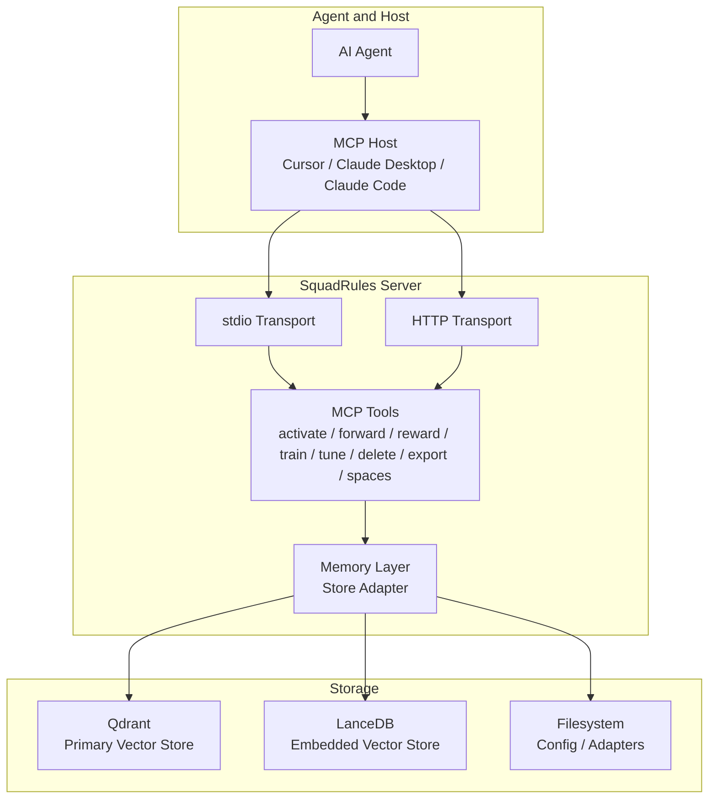

This architecture supports both hosted deployments (Qdrant, HTTP, auth) and zero-config local use (LanceDB, stdio, local CLI). The CLI’s transport-agnostic backend lets the same tool core run against either surface without duplicating business logic.

**Diagram sources**
- [0004-fastembed-default-for-testing.md:17-55](file://docs/adr/0004-fastembed-default-for-testing.md#L17-L55)
- [0006-two-integration-lanes.md:24-49](file://docs/adr/0006-two-integration-lanes.md#L24-L49)
- [0008-bare-cli-defaults-to-stdio-and-console-log-hygiene.md:37-56](file://docs/adr/0008-bare-cli-defaults-to-stdio-and-console-log-hygiene.md#L37-L56)
- [0013-embedded-store-multiprocess-safety.md:7-51](file://docs/adr/0013-embedded-store-multiprocess-safety.md#L7-L51)
- [0015-cli-local-by-default-transport-agnostic-backend.md:23-44](file://docs/adr/0015-cli-local-by-default-transport-agnostic-backend.md#L23-L44)

**Section sources**
- [0006-two-integration-lanes.md:24-49](file://docs/adr/0006-two-integration-lanes.md#L24-L49)
- [0015-cli-local-by-default-transport-agnostic-backend.md:23-44](file://docs/adr/0015-cli-local-by-default-transport-agnostic-backend.md#L23-L44)

## Detailed Component Analysis

### Two-Layer Adapter Write Caching
Adapter writes embed layers and are expensive in both CI and first boot. The project intentionally separates two caches:

- **Layer 1 — CI snapshot reuse:** Reuses a pre-seeded Qdrant collection across jobs. Its identity is based on seed inputs, not on released package versions.
- **Layer 2 — Runtime boot injection:** Runs on every server start and trains shipped adapters into the configured store. Its identity compares stored adapter version versus shipped version.

The two layers answer different questions: whether we may reuse a cross-job database, versus whether we may reuse process-local state. A Layer 1 hit does not make Layer 2 cheap, and a Layer 2 skip does not remove the need for seeded CI fixtures.

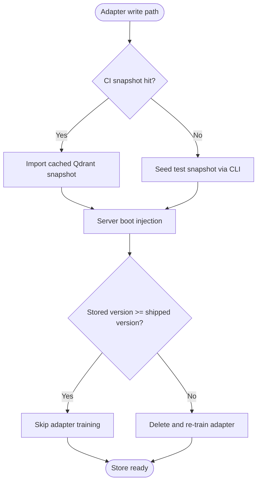

**Diagram sources**
- [0001-two-layer-adapter-write-caching.md:7-37](file://docs/adr/0001-two-layer-adapter-write-caching.md#L7-L37)
- [0002-boot-injection-reuse-rule.md:30-47](file://docs/adr/0002-boot-injection-reuse-rule.md#L30-L47)

Key trade-offs:
- Keeping layers separate preserves distinct invalidation semantics but introduces confusion risk.
- The reader defect that broke Layer 2 reuse was fixed on `main`, making warm boots skip in-sync adapters.
- Layer 1 remains parked because its original OpenAI-quota motivation weakened after local embeddings arrived.

**Section sources**
- [0001-two-layer-adapter-write-caching.md:7-73](file://docs/adr/0001-two-layer-adapter-write-caching.md#L7-L73)
- [0002-boot-injection-reuse-rule.md:11-75](file://docs/adr/0002-boot-injection-reuse-rule.md#L11-L75)

### Boot Injection Reuse Rule
Boot injection reuse is decided by semver comparison, not content hash. If a stored adapter version exists and the shipped version is not greater, the adapter is skipped; otherwise it is deleted and re-trained. The slug is the adapter identity, not static UUIDs.

A structural-repair switch allows operators to bypass the version check when the store is corrupted or dimension-mismatched. The escape hatch is exposed through an environment variable and documented as a recovery path rather than requiring a code change.

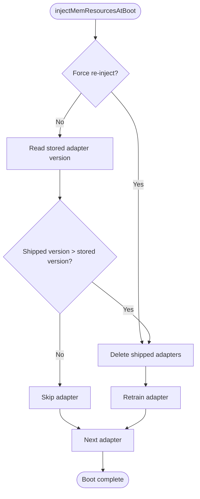

**Diagram sources**
- [0002-boot-injection-reuse-rule.md:30-47](file://docs/adr/0002-boot-injection-reuse-rule.md#L30-L47)

Rationale and consequences:
- Semver matches how skills and adapters are published, simplifying the rule compared to content hashing.
- The stamped version line means releases move the version even if adapter body text is unchanged, so upgrades retrain once per install.
- Content hashes remain written for future change detection but are not read today.
- The fix unified readers through one accessor and restored the intended skip behavior.

**Section sources**
- [0002-boot-injection-reuse-rule.md:11-100](file://docs/adr/0002-boot-injection-reuse-rule.md#L11-L100)

### No LanceDB Store Snapshot in CI
The embedded LanceDB store lives under a user config directory. A proposal existed to mirror the Qdrant snapshot approach by exporting and restoring the data directory in CI. The decision rejects this because the mechanism would add CI complexity for no measured saving.

With the boot-injection reuse rule working, a warm boot skips in-sync adapters, removing the cost a snapshot would target. Without the fix, the saved time was too small to justify a cross-job store artifact.

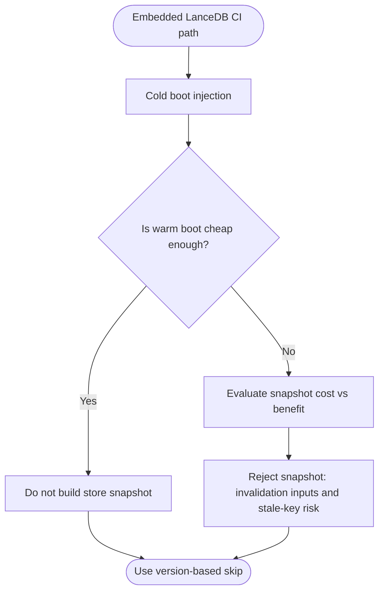

**Diagram sources**
- [0003-no-lancedb-store-snapshot.md:13-49](file://docs/adr/0003-no-lancedb-store-snapshot.md#L13-L49)

Decision criteria:
- Value over complexity: a small time saving did not justify new scripts and workflow steps.
- Invalidated cache risk: a store snapshot carries adapter set, vector width, and format-version dependencies.
- Future-proofing: if warm boots become cheap again, the decision is reinforced rather than reversed.

**Section sources**
- [0003-no-lancedb-store-snapshot.md:13-77](file://docs/adr/0003-no-lancedb-store-snapshot.md#L13-L77)

### FastEmbed Default for Testing
CI now embeds locally by default. External providers are used only when explicitly configured, and the single integration lane is key-free by construction. Model weights are cached separately from application config, following XDG-style conventions.

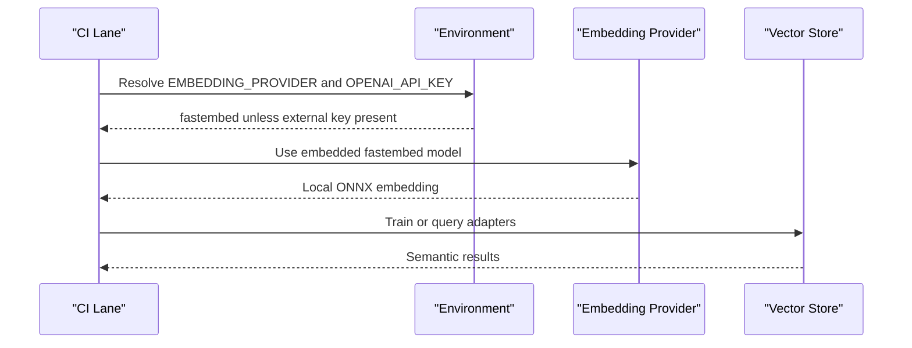

**Diagram sources**
- [0004-fastembed-default-for-testing.md:17-55](file://docs/adr/0004-fastembed-default-for-testing.md#L17-L55)
- [0007-single-lane-stdio-integration-with-model-cache.md:35-45](file://docs/adr/0007-single-lane-stdio-integration-with-model-cache.md#L35-L45)

Trade-offs:
- Removes quota-driven merge-gate ambiguity and enables fork PRs without secrets.
- Requires careful handling of cold-start latency, Jest worker constraints, and shared model caches.
- Does not eliminate coverage of external providers; a manual probe remains available.

**Section sources**
- [0004-fastembed-default-for-testing.md:17-116](file://docs/adr/0004-fastembed-default-for-testing.md#L17-L116)
- [0007-single-lane-stdio-integration-with-model-cache.md:7-45](file://docs/adr/0007-single-lane-stdio-integration-with-model-cache.md#L7-L45)

### Cache Keys Under Release Stamping
Cache identities must not be derived from release-stamped values. Versions are stamped at build time, so built artifacts differ from source trees when the package version changes. Cache keys should pin behaviour through editable inputs, not through values that change with every release.

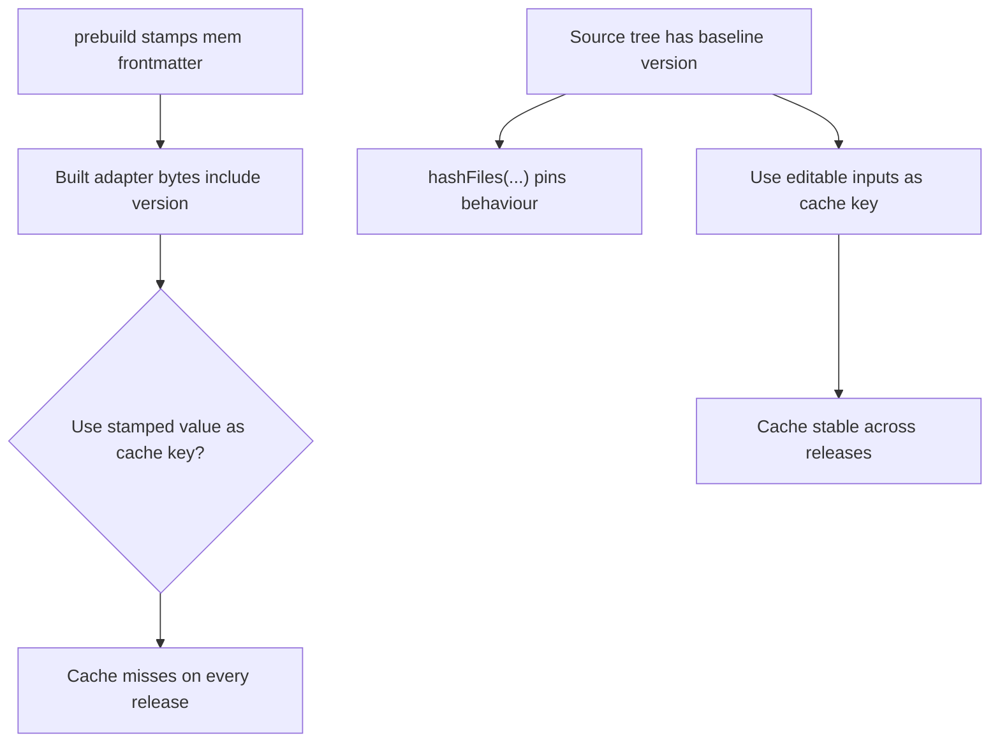

**Diagram sources**
- [0005-cache-keys-under-release-stamping.md:6-38](file://docs/adr/0005-cache-keys-under-release-stamping.md#L6-L38)

Implications:
- Caches stop invalidating on every release.
- Version equality is an update signal, not proof that two artifacts are identical programs.
- Any future cache or reuse work inherits this constraint.

**Section sources**
- [0005-cache-keys-under-release-stamping.md:6-61](file://docs/adr/0005-cache-keys-under-release-stamping.md#L6-L61)

### Two Integration Lanes and SINGLE Lane Model Cache
The intended topology is exactly two full-suite integration lanes: cluster and single. Both run the entire suite and gate merges. The SINGLE lane validates the zero-config product story using stdio, embedded LanceDB, and local fastembed.

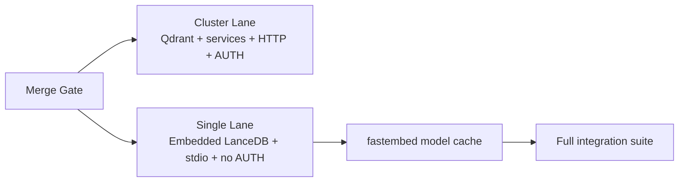

**Diagram sources**
- [0006-two-integration-lanes.md:24-49](file://docs/adr/0006-two-integration-lanes.md#L24-L49)
- [0007-single-lane-stdio-integration-with-model-cache.md:35-55](file://docs/adr/0007-single-lane-stdio-integration-with-model-cache.md#L35-L55)

Coverage deltas are explicit: the no-auth plus Qdrant combination is not run, and the cluster lane does not exercise the embedded backend. The zero-config story moved from advisory to merge-gated.

**Section sources**
- [0006-two-integration-lanes.md:9-96](file://docs/adr/0006-two-integration-lanes.md#L9-L96)
- [0007-single-lane-stdio-integration-with-model-cache.md:7-105](file://docs/adr/0007-single-lane-stdio-integration-with-model-cache.md#L7-L105)

### Bare CLI Defaults to stdio and Console Log Hygiene
Bare CLI invocation now defaults to `serve` over stdio, preserving stdout for MCP protocol frames. Logging goes to stderr, numeric log levels are labelled, and per-operation audit messages are demoted to debug where appropriate.

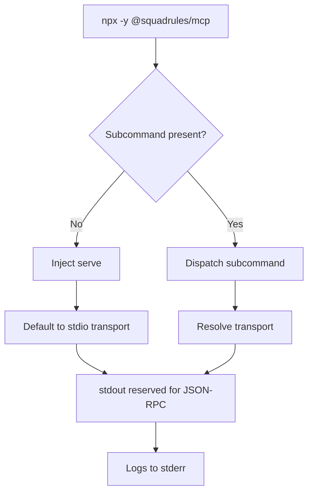

**Diagram sources**
- [0008-bare-cli-defaults-to-stdio-and-console-log-hygiene.md:37-75](file://docs/adr/0008-bare-cli-defaults-to-stdio-and-console-log-hygiene.md#L37-L75)

Consequences:
- Zero-config MCP host launch works without extra arguments.
- Audit detail is preserved at debug level and in the audit log file.
- Operators debugging embedding issues must enable debug logging or consult audit logs.

**Section sources**
- [0008-bare-cli-defaults-to-stdio-and-console-log-hygiene.md:7-130](file://docs/adr/0008-bare-cli-defaults-to-stdio-and-console-log-hygiene.md#L7-L130)

### Autonomous Adapter Execution and Critic Loop Evolution
Bundled adapters execute autonomously. Human confirmation gates were replaced with objective verification and critic-loop contracts. The former `phase-critic` was renamed to `critic-loop` to communicate that the agent must loop until the verdict is `PASS`, with bounded iterations and requirement-gap detection.

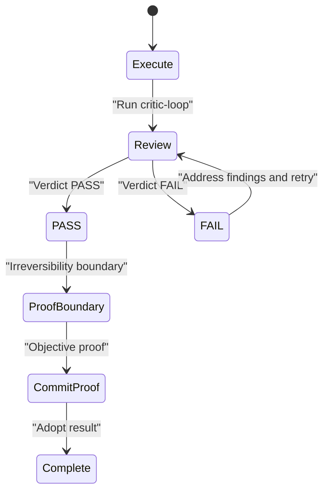

**Diagram sources**
- [0009-autonomous-adapter-execution-no-human-gates.md:23-53](file://docs/adr/0009-autonomous-adapter-execution-no-human-gates.md#L23-L53)
- [0010-critic-loop-and-proof-splitting.md:30-61](file://docs/adr/0010-critic-loop-and-proof-splitting.md#L30-L61)

Renaming was backward-incompatible in principle but accepted as a non-breaking refactor because there is a single consumer. Deeply referenced slugs later received redirect tombstones rather than clean breaks.

**Section sources**
- [0009-autonomous-adapter-execution-no-human-gates.md:7-108](file://docs/adr/0009-autonomous-adapter-execution-no-human-gates.md#L7-L108)
- [0010-critic-loop-and-proof-splitting.md:10-121](file://docs/adr/0010-critic-loop-and-proof-splitting.md#L10-L121)

### Redirect Tombstones for Renamed Slugs
When a renamed app-space adapter slug is deeply referenced by stored adapters, the retired slug is kept as a thin redirect tombstone. The replacement adapter remains the single home for real behaviour; the tombstone forwards callers to the new slug.

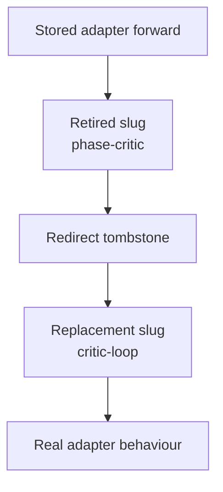

**Diagram sources**
- [0012-redirect-tombstones-for-renamed-slugs.md:19-35](file://docs/adr/0012-redirect-tombstones-for-renamed-slugs.md#L19-L35)

Trade-offs:
- Avoids silent dangles for stored adapters.
- Adds one hop and coexistence of two slugs.
- Simpler than a general alias table for now; reconsider if many slugs accumulate.

**Section sources**
- [0012-redirect-tombstones-for-renamed-slugs.md:8-85](file://docs/adr/0012-redirect-tombstones-for-renamed-slugs.md#L8-L85)

### Embedded Store Multiprocess Safety
The embedded LanceDB store is safe across multiple local processes. Each process opens the shared directory directly, relying on MVCC, strong-consistency reads, bounded commit retries, and atomic batched publishes.

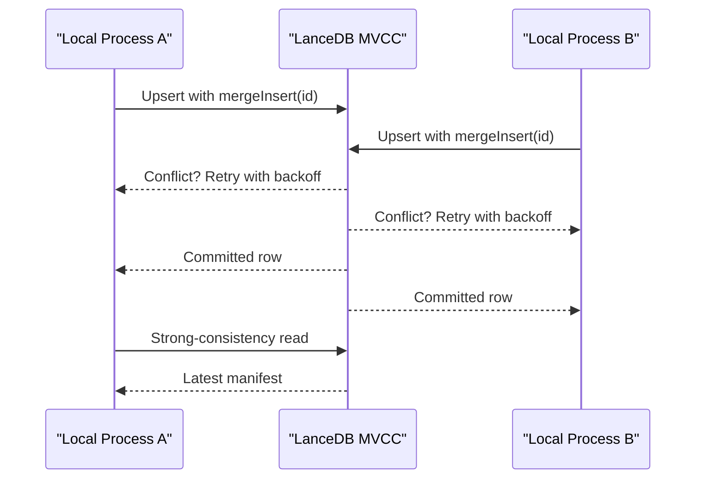

**Diagram sources**
- [0013-embedded-store-multiprocess-safety.md:27-51](file://docs/adr/0013-embedded-store-multiprocess-safety.md#L27-L51)

Caveats:
- Per-process application-level cache can still have a short staleness window.
- Compaction is deferred.
- For always-fresh shared writers, the HTTP transport is preferred.

**Section sources**
- [0013-embedded-store-multiprocess-safety.md:7-109](file://docs/adr/0013-embedded-store-multiprocess-safety.md#L7-L109)

### Always Latest MCP Spec and SDK
The project tracks the latest published MCP spec revision and the SDK that implements it. This avoids silently downgrading negotiation and ensures newly added capabilities are adopted deliberately.

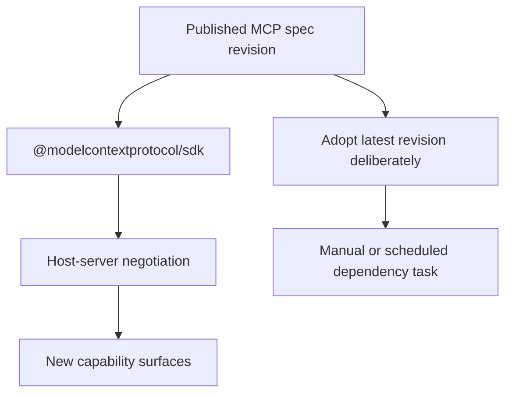

**Diagram sources**
- [0014-always-latest-mcp-spec-and-sdk.md:9-42](file://docs/adr/0014-always-latest-mcp-spec-and-sdk.md#L9-L42)

Trade-offs:
- Improves interop and capability visibility.
- Requires disciplined upgrades and test validation.
- Not automated through Renovate; Dependabot owns security updates.

**Section sources**
- [0014-always-latest-mcp-spec-and-sdk.md:9-103](file://docs/adr/0014-always-latest-mcp-spec-and-sdk.md#L9-L103)

### CLI Local-by-Default with Transport-Agnostic Backend
The CLI resolves to a local sentinel by default, running commands in-process against the embedded store. An `ActionBackend` interface abstracts HTTP and local transports, sharing the same core logic. Output is human-first, with structured machine-friendly options.

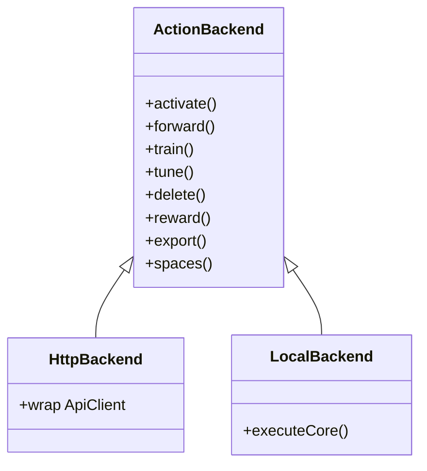

**Diagram sources**
- [0015-cli-local-by-default-transport-agnostic-backend.md:34-44](file://docs/adr/0015-cli-local-by-default-transport-agnostic-backend.md#L34-L44)

Design implications:
- Zero-config local use without spawning a server.
- One core, two transports, no drift.
- Auth commands remain HTTP-only.
- Breaking changes are intentional and documented.

**Section sources**
- [0015-cli-local-by-default-transport-agnostic-backend.md:7-132](file://docs/adr/0015-cli-local-by-default-transport-agnostic-backend.md#L7-L132)

### Conceptual Overview
The decisions above form a coherent operating model:

- Agents are primary users; humans configure preferences and review high-risk outcomes.
- Adapters are deterministic, auditable, and versioned.
- Storage is transport-agnostic: Qdrant for remote scale, LanceDB for zero-config local use.
- CI proves both hosted and embedded paths without depending on paid quotas.
- The CLI is friendly to humans and compatible with machines.
- MCP protocol currency is deliberate, not accidental.

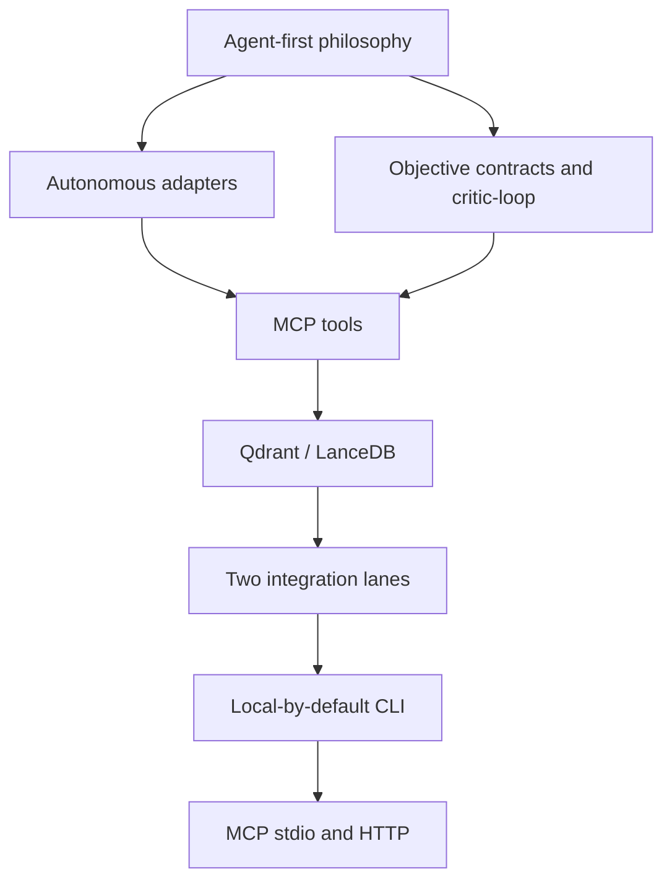

[No sources needed since this diagram shows conceptual workflow, not actual code structure]

## Dependency Analysis
The ADRs show clear coupling between performance, CI, storage, and CLI posture:

- Boot-injection reuse ([0002]) determines whether CI and local boots pay embedding costs.
- Fastembed defaults ([0004]) and model caching ([0007]) control CI wall-clock and secret exposure.
- No LanceDB snapshot ([0003]) depends on the correctness of the reuse rule.
- Two integration lanes ([0006]) enforce substrate coverage without hand-curated suites.
- CLI defaults ([0008], [0015]) affect how humans interact with the same core used by MCP tools.
- Embedded store concurrency ([0013]) affects multi-process local usage enabled by the CLI.
- MCP spec currency ([0014]) affects host interoperability.
- Release automation ([0011]) affects long-term maintenance and publication trust.

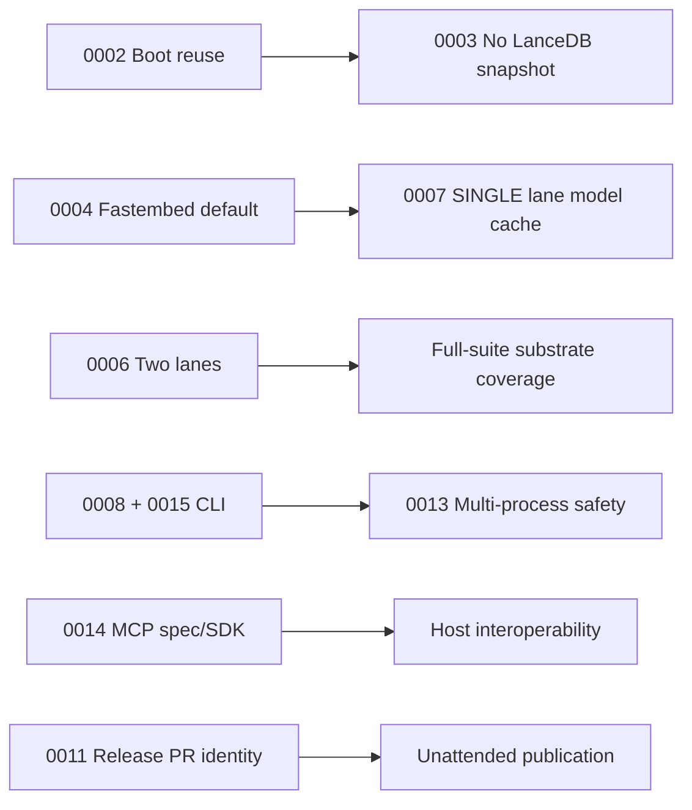

**Diagram sources**
- [0002-boot-injection-reuse-rule.md:30-47](file://docs/adr/0002-boot-injection-reuse-rule.md#L30-L47)
- [0003-no-lancedb-store-snapshot.md:22-49](file://docs/adr/0003-no-lancedb-store-snapshot.md#L22-L49)
- [0004-fastembed-default-for-testing.md:35-55](file://docs/adr/0004-fastembed-default-for-testing.md#L35-L55)
- [0006-two-integration-lanes.md:24-49](file://docs/adr/0006-two-integration-lanes.md#L24-L49)
- [0007-single-lane-stdio-integration-with-model-cache.md:35-55](file://docs/adr/0007-single-lane-stdio-integration-with-model-cache.md#L35-L55)
- [0008-bare-cli-defaults-to-stdio-and-console-log-hygiene.md:37-75](file://docs/adr/0008-bare-cli-defaults-to-stdio-and-console-log-hygiene.md#L37-L75)
- [0013-embedded-store-multiprocess-safety.md:27-51](file://docs/adr/0013-embedded-store-multiprocess-safety.md#L27-L51)
- [0014-always-latest-mcp-spec-and-sdk.md:28-42](file://docs/adr/0014-always-latest-mcp-spec-and-sdk.md#L28-L42)
- [0015-cli-local-by-default-transport-agnostic-backend.md:23-72](file://docs/adr/0015-cli-local-by-default-transport-agnostic-backend.md#L23-L72)
- [0011-unattended-release-pr-identity.md:21-49](file://docs/adr/0011-unattended-release-pr-identity.md#L21-L49)

**Section sources**
- [0002-boot-injection-reuse-rule.md:30-75](file://docs/adr/0002-boot-injection-reuse-rule.md#L30-L75)
- [0003-no-lancedb-store-snapshot.md:22-49](file://docs/adr/0003-no-lancedb-store-snapshot.md#L22-L49)
- [0004-fastembed-default-for-testing.md:35-55](file://docs/adr/0004-fastembed-default-for-testing.md#L35-L55)
- [0006-two-integration-lanes.md:24-49](file://docs/adr/0006-two-integration-lanes.md#L24-L49)
- [0007-single-lane-stdio-integration-with-model-cache.md:35-55](file://docs/adr/0007-single-lane-stdio-integration-with-model-cache.md#L35-L55)
- [0008-bare-cli-defaults-to-stdio-and-console-log-hygiene.md:37-75](file://docs/adr/0008-bare-cli-defaults-to-stdio-and-console-log-hygiene.md#L37-L75)
- [0013-embedded-store-multiprocess-safety.md:27-51](file://docs/adr/0013-embedded-store-multiprocess-safety.md#L27-L51)
- [0014-always-latest-mcp-spec-and-sdk.md:28-42](file://docs/adr/0014-always-latest-mcp-spec-and-sdk.md#L28-L42)
- [0015-cli-local-by-default-transport-agnostic-backend.md:23-72](file://docs/adr/0015-cli-local-by-default-transport-agnostic-backend.md#L23-L72)
- [0011-unattended-release-pr-identity.md:21-49](file://docs/adr/0011-unattended-release-pr-identity.md#L21-L49)

## Performance Considerations
Several ADRs address performance explicitly:

- Adapter write caching distinguishes CI fixture provisioning from runtime reuse.
- Boot-injection reuse eliminates repeated embedding when versions are in sync.
- Local fastembed removes OpenAI quota pressure and makes CI predictable.
- SINGLE lane model caching reduces cold-start penalties without changing runtime behavior.
- Embedded store concurrency relies on MVCC and bounded retries rather than a daemon.
- CLI local mode avoids server-boot cost and lazy-loads embeddings only when needed.

Recommendations for future contributors:
- Treat version as an update signal, not a cache identity.
- Prefer objectivity and bounded loops over human confirmation for routine work.
- Keep transport-specific concerns out of the core tool logic.
- Validate both Qdrant-hosted and embedded-zero-config paths in CI.
- Monitor cold-start costs separately from steady-state query costs.

[No sources needed since this section provides general guidance]

## Troubleshooting Guide
Common operational scenarios and their ADR-backed guidance:

| Symptom | Likely Cause | Recommended Action |
|---|---|---|
| Warm boot still retrains adapters | Boot-injection reader defect or forced re-inject | Check whether `MEM_BOOT_FORCE_INJECT` is set; verify version accessor and stored adapter version. |
| CI runs spend OpenAI quota unexpectedly | External provider selected or key present | Blank `OPENAI_API_KEY`; pin `EMBEDDING_PROVIDER=fastembed`; confirm lane configuration. |
| SINGLE lane times out on first run | Cold fastembed download and ONNX warmup | Ensure model cache is restored; allow initial cache miss within timeout. |
| CLI prints help or corrupts MCP stream | Bare invocation not defaulting to stdio or logs leaking to stdout | Run with no subcommand; ensure logs go to stderr. |
| Multiple local processes conflict | Shared LanceDB directory opened concurrently | Rely on MVCC and commit retry; avoid excessive concurrent writes; use HTTP transport for always-fresh writer. |
| Stored adapter forwards break after rename | Renamed slug without tombstone | Add redirect tombstone or re-point stored adapter to new slug. |
| Host cannot negotiate new capabilities | SDK behind latest spec | Upgrade `@modelcontextprotocol/sdk` deliberately and validate stdio and integration lanes. |
| Release PR cannot merge automatically | Missing App token or required checks held | Provision GitHub App token; verify native auto-merge and required checks. |

**Section sources**
- [0002-boot-injection-reuse-rule.md:42-75](file://docs/adr/0002-boot-injection-reuse-rule.md#L42-L75)
- [0004-fastembed-default-for-testing.md:35-87](file://docs/adr/0004-fastembed-default-for-testing.md#L35-L87)
- [0007-single-lane-stdio-integration-with-model-cache.md:47-87](file://docs/adr/0007-single-lane-stdio-integration-with-model-cache.md#L47-L87)
- [0008-bare-cli-defaults-to-stdio-and-console-log-hygiene.md:37-97](file://docs/adr/0008-bare-cli-defaults-to-stdio-and-console-log-hygiene.md#L37-L97)
- [0012-redirect-tombstones-for-renamed-slugs.md:19-51](file://docs/adr/0012-redirect-tombstones-for-renamed-slugs.md#L19-L51)
- [0013-embedded-store-multiprocess-safety.md:27-69](file://docs/adr/0013-embedded-store-multiprocess-safety.md#L27-L69)
- [0014-always-latest-mcp-spec-and-sdk.md:52-69](file://docs/adr/0014-always-latest-mcp-spec-and-sdk.md#L52-L69)
- [0011-unattended-release-pr-identity.md:21-49](file://docs/adr/0011-unattended-release-pr-identity.md#L21-L49)

## Conclusion
SquadRules’ architecture decisions consistently favor agent-first operation, deterministic adapters, and clear separation between human configuration and machine execution. The two-layer caching strategy, semver-based boot reuse, local-by-default CLI, transport-agnostic backend, and dual storage backends together support both hosted production and zero-config local development. CI is designed to prove meaningful substrates without depending on paid quotas, and the MCP protocol surface is kept current through deliberate upgrades.

For future contributors, the most important principles are:

- Separate CI artifact reuse from runtime state reuse.
- Use version as an update signal, never as a cache identity.
- Prefer objective verification and bounded critic loops over human confirmation gates.
- Keep transports and backends interchangeable around a single core.
- Validate both Qdrant and embedded paths.
- Treat MCP spec and SDK currency as product requirements.
- Automate releases with least-privilege App identity and protected merge flows.

[No sources needed since this section summarizes without analyzing specific files]