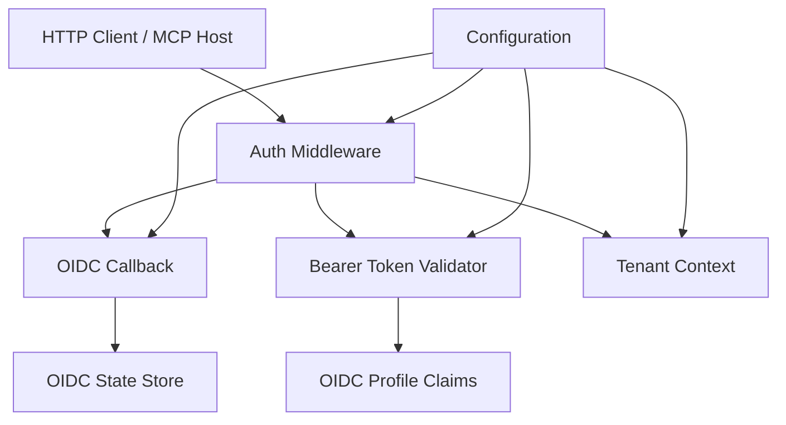
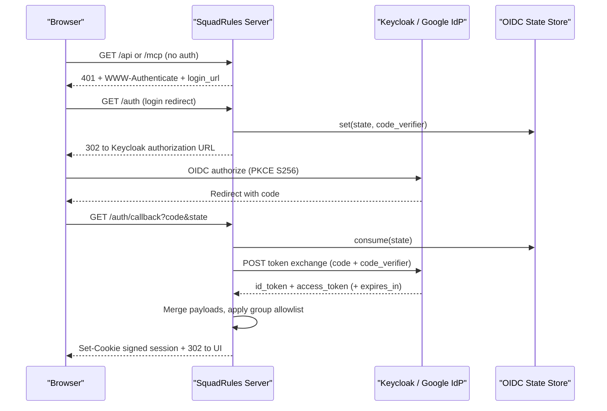
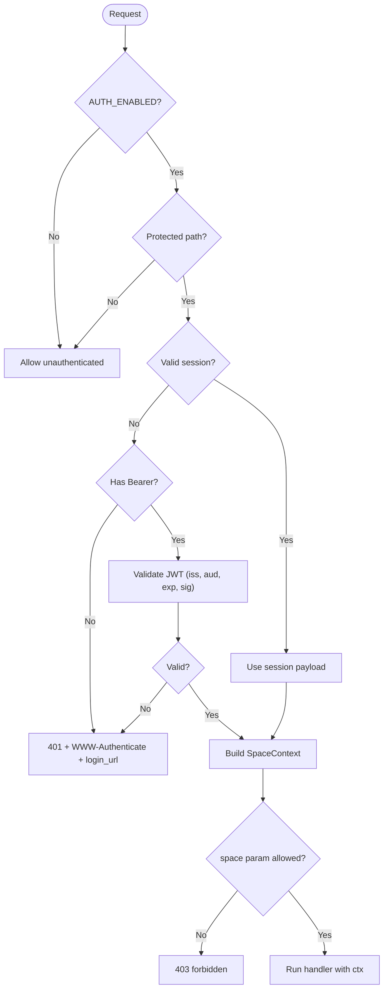
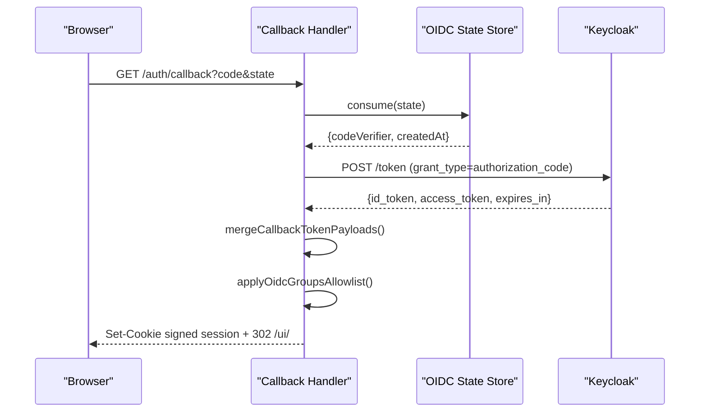
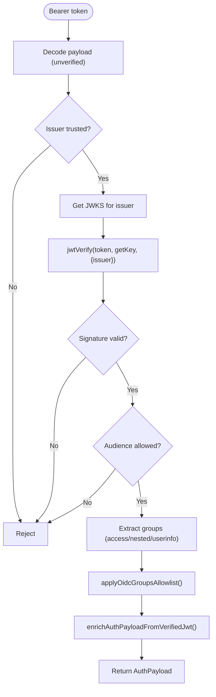
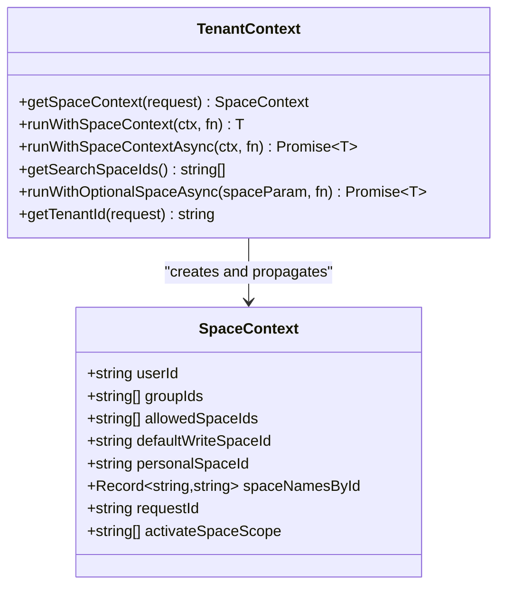
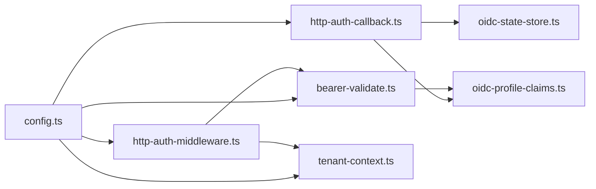

# Authentication & Security

<cite>
**Referenced Files in This Document**
- [http-auth-middleware.ts](file://src/http/http-auth-middleware.ts)
- [http-auth-callback.ts](file://src/http/http-auth-callback.ts)
- [http-auth-oidc-redirect.ts](file://src/http/http-auth-oidc-redirect.ts)
- [bearer-validate.ts](file://src/http/bearer-validate.ts)
- [oidc-profile-claims.ts](file://src/http/oidc-profile-claims.ts)
- [oidc-state-store.ts](file://src/services/oidc-state-store.ts)
- [tenant-context.ts](file://src/utils/tenant-context.ts)
- [config.ts](file://src/config.ts)
- [http-www-authenticate.ts](file://src/http/http-www-authenticate.ts)
- [audit-log.md](file://docs/security/audit-log.md)
- [threat-model.md](file://docs/security/threat-model.md)
</cite>

## Table of Contents
1. [Introduction](#introduction)
2. [Project Structure](#project-structure)
3. [Core Components](#core-components)
4. [Architecture Overview](#architecture-overview)
5. [Detailed Component Analysis](#detailed-component-analysis)
6. [Dependency Analysis](#dependency-analysis)
7. [Performance Considerations](#performance-considerations)
8. [Troubleshooting Guide](#troubleshooting-guide)
9. [Conclusion](#conclusion)
10. [Appendices](#appendices)

## Introduction
This document describes the security model for SquadRules authentication and authorization. It covers OIDC/OAuth2 integration with Keycloak, optional Google IdP support through Keycloak, JWT validation, session management, role-based access control via groups, tenant isolation, space-level permissions, audit logging, and security hardening guidance. It also documents the authentication flows for both HTTP and stdio transports and provides configuration references for identity providers and compliance considerations.

SquadRules is an agent-first MCP framework where agents are primary users. Authentication validates both human and agent requests using JWT tokens from Keycloak or federated IdPs such as Google. Authorization is derived from token groups and mapped to deterministic space IDs for tenant isolation.

## Project Structure
The authentication and authorization system spans HTTP middleware, OIDC callback handling, Bearer token validation, profile claim processing, OIDC state storage, and tenant context derivation. Configuration is centralized and includes rate limits, allowed issuers and audiences, group allowlists, and audit settings.

**Diagram sources**
- [http-auth-middleware.ts:172-327](file://src/http/http-auth-middleware.ts#L172-L327)
- [http-auth-callback.ts:122-228](file://src/http/http-auth-callback.ts#L122-L228)
- [bearer-validate.ts:120-208](file://src/http/bearer-validate.ts#L120-L208)
- [oidc-profile-claims.ts:119-153](file://src/http/oidc-profile-claims.ts#L119-L153)
- [oidc-state-store.ts:50-61](file://src/services/oidc-state-store.ts#L50-L61)
- [tenant-context.ts:256-291](file://src/utils/tenant-context.ts#L256-L291)
- [config.ts:140-194](file://src/config.ts#L140-L194)

**Section sources**
- [http-auth-middleware.ts:1-330](file://src/http/http-auth-middleware.ts#L1-L330)
- [http-auth-callback.ts:1-231](file://src/http/http-auth-callback.ts#L1-L231)
- [bearer-validate.ts:1-209](file://src/http/bearer-validate.ts#L1-L209)
- [oidc-profile-claims.ts:1-288](file://src/http/oidc-profile-claims.ts#L1-L288)
- [oidc-state-store.ts:1-76](file://src/services/oidc-state-store.ts#L1-L76)
- [tenant-context.ts:1-312](file://src/utils/tenant-context.ts#L1-L312)
- [config.ts:1-350](file://src/config.ts#L1-L350)

## Core Components
- Auth middleware enforces authentication on protected paths, supports browser sessions and Bearer tokens, and attaches a space context for tenant isolation.
- OIDC callback exchanges authorization codes for tokens, signs a secure session cookie, and handles logout flows.
- Bearer validator verifies JWT issuer, audience, expiration, and signature using JWKS; it can enrich groups via userinfo when needed.
- OIDC profile claims normalize groups, derive account labels, and merge id_token/access_token payloads safely.
- OIDC state store persists PKCE state across instances using Redis or in-memory fallback.
- Tenant context derives deterministic space IDs from sub, groups, realm, and issuer, enabling strict multi-tenant isolation.
- Configuration centralizes environment variables for Keycloak, OIDC scopes, trusted issuers, allowed audiences, group allowlist, rate limits, and audit settings.

**Section sources**
- [http-auth-middleware.ts:1-330](file://src/http/http-auth-middleware.ts#L1-L330)
- [http-auth-callback.ts:1-231](file://src/http/http-auth-callback.ts#L1-L231)
- [bearer-validate.ts:1-209](file://src/http/bearer-validate.ts#L1-L209)
- [oidc-profile-claims.ts:1-288](file://src/http/oidc-profile-claims.ts#L1-L288)
- [oidc-state-store.ts:1-76](file://src/services/oidc-state-store.ts#L1-L76)
- [tenant-context.ts:1-312](file://src/utils/tenant-context.ts#L1-L312)
- [config.ts:1-350](file://src/config.ts#L1-L350)

## Architecture Overview
The system uses two authentication paths:
- Browser-initiated OIDC login with PKCE and signed session cookies.
- Machine-to-machine Bearer JWT validation against Keycloak (or federated IdPs).

Authorization is derived from token groups and mapped to space IDs. The middleware sets a space context that restricts read/write operations per tenant and space.

**Diagram sources**
- [http-auth-middleware.ts:172-327](file://src/http/http-auth-middleware.ts#L172-L327)
- [http-auth-oidc-redirect.ts:15-66](file://src/http/http-auth-oidc-redirect.ts#L15-L66)
- [http-auth-callback.ts:122-228](file://src/http/http-auth-callback.ts#L122-L228)
- [oidc-state-store.ts:50-61](file://src/services/oidc-state-store.ts#L50-L61)

## Detailed Component Analysis

### HTTP Authentication Middleware
The middleware protects `/api`, `/api/*`, `/mcp`, `/ui`, and `/ui/*`. When `AUTH_ENABLED` is true:
- Browser GET requests without a valid session are redirected to OIDC login.
- MCP clients receive 401 with `WWW-Authenticate` and structured JSON-RPC errors when appropriate.
- Bearer tokens are validated only when trusted issuers and allowed audiences are configured.
- A space context is attached based on `req.auth` and request parameters.

Session handling:
- Session cookie name: `squadrules_session`.
- Cookie payload is HMAC-SHA256 signed with `SESSION_SECRET`.
- Expiration is checked; expired or malformed cookies are rejected.

Bearer handling:
- Validates issuer, audience, expiration, and signature via JWKS.
- Returns structured error responses with `error=invalid_token` and optional `login_url`.

Space scoping:
- If a `space` or `space_id` query parameter is provided, it must be in the user’s allowed spaces.
- The middleware narrows `allowedSpaceIds` and `defaultWriteSpaceId` accordingly.

**Diagram sources**
- [http-auth-middleware.ts:172-327](file://src/http/http-auth-middleware.ts#L172-L327)

**Section sources**
- [http-auth-middleware.ts:1-330](file://src/http/http-auth-middleware.ts#L1-L330)
- [http-www-authenticate.ts:17-47](file://src/http/http-www-authenticate.ts#L17-L47)

### OIDC Callback and Logout
The callback endpoint:
- Requires `AUTH_ENABLED`, `KEYCLOAK_URL`, `SESSION_SECRET`, and `AUTH_CALLBACK_BASE_URL`.
- Validates `code` and `state`; consumes PKCE state atomically.
- Exchanges the code for tokens at Keycloak’s token endpoint.
- Merges id_token and access_token payloads, ensuring consistent `sub` and deriving `iss`/`realm`.
- Applies the group allowlist and computes session TTL from `expires_in` or access token expiry.
- Sets a secure, httpOnly session cookie and redirects to the UI.

Logout flow:
- Clears the Squadrules session cookie.
- Optionally performs RP-initiated logout to Keycloak with `id_token_hint`.
- Redirects to continue-signin or back to the UI.

**Diagram sources**
- [http-auth-callback.ts:122-228](file://src/http/http-auth-callback.ts#L122-L228)
- [oidc-state-store.ts:50-61](file://src/services/oidc-state-store.ts#L50-L61)

**Section sources**
- [http-auth-callback.ts:1-231](file://src/http/http-auth-callback.ts#L1-L231)

### Bearer Token Validation
Bearer validation:
- Uses `jose` to verify JWT signatures via JWKS fetched from the issuer’s certs endpoint.
- Checks issuer against `AUTH_TRUSTED_ISSUERS`, audience against `AUTH_ALLOWED_AUDIENCES`, and expiration.
- Supports Keycloak special cases: accepts `aud="account"` or empty `aud` when issuer contains `/realms/`.
- Extracts groups from access token, nested id_token, or userinfo endpoint.
- Optionally merges userinfo groups into access token groups.
- Enriches the auth payload with whitelisted profile fields and account labels.

**Diagram sources**
- [bearer-validate.ts:120-208](file://src/http/bearer-validate.ts#L120-L208)

**Section sources**
- [bearer-validate.ts:1-209](file://src/http/bearer-validate.ts#L1-L209)

### OIDC Profile Claims and Group Allowlist
Profile claims:
- Whitelists safe fields: preferred_username, name, given_name, family_name, email, email_verified, identity_provider.
- Derives account kind (`local` vs `sso`) and label (e.g., `Google (SSO)`).
- Normalizes groups from arrays, strings, or JSON-encoded arrays.

Group allowlist:
- Supports exact matches and prefix matches (entries ending with `/`).
- Case-insensitive path matching after normalization.
- Empty allowlist keeps all token groups; non-empty restricts which paths become spaces.

Merging callback payloads:
- Ensures consistent `sub` between id_token and access_token.
- Prefers access token groups; falls back to id_token groups.
- Derives `iss` and `realm` deterministically for space ID generation.

**Section sources**
- [oidc-profile-claims.ts:1-288](file://src/http/oidc-profile-claims.ts#L1-L288)

### OIDC State Store
The OIDC state store manages PKCE state (`code_verifier`) for login transactions:
- Keys are global because login has no space context.
- TTL is 10 minutes.
- Backend selection depends on whether Redis is configured; otherwise, in-memory fallback is used.
- Atomic consume operation prevents replay attacks.

**Section sources**
- [oidc-state-store.ts:1-76](file://src/services/oidc-state-store.ts#L1-L76)

### Tenant Context and Space-Level Permissions
Tenant context:
- Uses AsyncLocalStorage to propagate space context across async boundaries.
- Derives deterministic space IDs from `sub`, `groups`, `realm`, and `iss`.
- Personal space ID format: `user:{realm}:{uuidv5(iss + "\\nuser\\n" + sub)}`.
- Group space ID format: `group:{realm}:{uuidv5(iss + "\\ngroup\\n" + fullPath)}`.
- When `AUTH_ENABLED` is true but no auth context exists, a sentinel space is used to prevent accidental data sharing.

Space scoping:
- Query parameters `space` or `space_id` narrow allowed spaces and default write space.
- Search may include the Squadrules app space unless explicitly scoped.
- Writes use `defaultWriteSpaceId`; reads may include app space depending on scope.

**Diagram sources**
- [tenant-context.ts:23-42](file://src/utils/tenant-context.ts#L23-L42)
- [tenant-context.ts:256-291](file://src/utils/tenant-context.ts#L256-L291)

**Section sources**
- [tenant-context.ts:1-312](file://src/utils/tenant-context.ts#L1-L312)

## Dependency Analysis
Authentication components depend on configuration and shared services:
- Middleware depends on OIDC redirect utilities, bearer validation, tenant context, and WWW-Authenticate helpers.
- Callback depends on OIDC state store and profile claims merging.
- Bearer validation depends on jose library and profile claims enrichment.
- Tenant context depends on config constants and space resolution utilities.

**Diagram sources**
- [config.ts:140-194](file://src/config.ts#L140-L194)
- [http-auth-middleware.ts:172-327](file://src/http/http-auth-middleware.ts#L172-L327)
- [bearer-validate.ts:120-208](file://src/http/bearer-validate.ts#L120-L208)
- [http-auth-callback.ts:122-228](file://src/http/http-auth-callback.ts#L122-L228)
- [oidc-state-store.ts:50-61](file://src/services/oidc-state-store.ts#L50-L61)
- [oidc-profile-claims.ts:119-153](file://src/http/oidc-profile-claims.ts#L119-L153)
- [tenant-context.ts:256-291](file://src/utils/tenant-context.ts#L256-L291)

**Section sources**
- [config.ts:1-350](file://src/config.ts#L1-L350)
- [http-auth-middleware.ts:1-330](file://src/http/http-auth-middleware.ts#L1-L330)
- [bearer-validate.ts:1-209](file://src/http/bearer-validate.ts#L1-L209)
- [http-auth-callback.ts:1-231](file://src/http/http-auth-callback.ts#L1-L231)
- [oidc-state-store.ts:1-76](file://src/services/oidc-state-store.ts#L1-L76)
- [oidc-profile-claims.ts:1-288](file://src/http/oidc-profile-claims.ts#L1-L288)
- [tenant-context.ts:1-312](file://src/utils/tenant-context.ts#L1-L312)

## Performance Considerations
- JWKS caching reduces repeated key fetching per issuer.
- OIDC state store uses atomic operations to avoid race conditions during login.
- Userinfo calls for groups are optional and bounded by timeout; failures degrade gracefully to empty groups.
- Audit logging splits rich events from coarse file lines to reduce overhead.
- Rate limiting is configurable for HTTP, auth, and MCP routes.

[No sources needed since this section provides general guidance]

## Troubleshooting Guide
Common issues and resolutions:
- Missing OIDC configuration: Ensure `AUTH_ENABLED`, `KEYCLOAK_URL`, `KEYCLOAK_REALM`, `KEYCLOAK_CLIENT_ID`, `AUTH_CALLBACK_BASE_URL`, and `SESSION_SECRET` are set.
- Invalid token errors: Verify `AUTH_TRUSTED_ISSUERS` and `AUTH_ALLOWED_AUDIENCES`; check Keycloak client scopes and protocol mappers.
- Group spaces missing: Confirm Keycloak Group Membership mapper and `OIDC_GROUPS_ALLOWLIST`; consider enabling `OIDC_BEARER_MERGE_USERINFO_GROUPS`.
- Session not persisting: Check `SESSION_SECRET` and `AUTH_CALLBACK_BASE_URL` HTTPS setting for Secure cookie flag.
- Audit logs not written: Ensure `AUDIT_LOG_FILE` is set and categories match allowlisted values; review sanitization and level settings.

**Section sources**
- [config.ts:247-265](file://src/config.ts#L247-L265)
- [bearer-validate.ts:120-208](file://src/http/bearer-validate.ts#L120-L208)
- [oidc-profile-claims.ts:119-153](file://src/http/oidc-profile-claims.ts#L119-L153)
- [audit-log.md:30-47](file://docs/security/audit-log.md#L30-L47)

## Conclusion
SquadRules implements a robust, multi-path authentication and authorization system centered on OIDC/OAuth2 with Keycloak and federated IdPs like Google. Browser sessions and machine-to-machine Bearer tokens are supported, with strict tenant isolation via deterministic space IDs derived from token claims. Group-based roles map to spaces, and audit logging provides operational visibility. Proper configuration of issuers, audiences, group allowlists, and rate limits is essential for secure deployment.

[No sources needed since this section summarizes without analyzing specific files]

## Appendices

### Authentication Flows

#### HTTP Transport Flow
- Browser-initiated login with PKCE and signed session cookies.
- MCP clients receive 401 with `WWW-Authenticate` and structured JSON-RPC errors when authentication is required.
- Bearer tokens are validated against trusted issuers and allowed audiences.

**Section sources**
- [http-auth-middleware.ts:172-327](file://src/http/http-auth-middleware.ts#L172-L327)
- [http-www-authenticate.ts:17-47](file://src/http/http-www-authenticate.ts#L17-L47)

#### Stdio Transport Flow
- Stdio mode runs local simple mode with embedded LanceDB and no HTTP listener.
- `AUTH_ENABLED` defaults to false for stdio; explicit enablement requires complete auth configuration.
- Local writes target a personal space; no shared default space when auth is enabled.

**Section sources**
- [config.ts:131-139](file://src/config.ts#L131-L139)
- [tenant-context.ts:57-74](file://src/utils/tenant-context.ts#L57-L74)

### Identity Provider Configuration

#### Keycloak Setup
- Configure realm, client, redirect URIs, and Group Membership protocol mapper.
- Set `KEYCLOAK_URL`, `KEYCLOAK_REALM`, `KEYCLOAK_CLIENT_ID`, `AUTH_CALLBACK_BASE_URL`, and `SESSION_SECRET`.
- For server-side calls, optionally set `KEYCLOAK_INTERNAL_URL` for Docker networking.

**Section sources**
- [config.ts:140-151](file://src/config.ts#L140-L151)
- [bearer-validate.ts:43-59](file://src/http/bearer-validate.ts#L43-L59)

#### Google IdP Support
- Add Google as a federated IdP in Keycloak realm.
- Ensure identity provider mapping emits `identity_provider` claim for account labeling.
- Verify redirect URIs and scopes align with Keycloak client configuration.

**Section sources**
- [oidc-profile-claims.ts:16-22](file://src/http/oidc-profile-claims.ts#L16-L22)

### Security Best Practices
- Enable `AUTH_ENABLED` in production and validate all required environment variables.
- Restrict `OIDC_GROUPS_ALLOWLIST` to only necessary group paths.
- Use HTTPS for `AUTH_CALLBACK_BASE_URL` to enforce Secure cookies.
- Configure rate limits for HTTP, auth, and MCP routes.
- Monitor audit logs for embedding anomalies and MCP tool calls.
- Rotate secrets regularly and keep them out of source control.

**Section sources**
- [config.ts:162-194](file://src/config.ts#L162-L194)
- [audit-log.md:145-156](file://docs/security/audit-log.md#L145-L156)

### Threat Mitigations
- Data poisoning mitigated by input validation, schema enforcement, and anomaly logging.
- Prompt injection mitigated by deterministic adapter execution and structured validation.
- Cross-tenant leakage mitigated by space-scoped filtering and strict tenant-aware checks.
- Embedding API abuse mitigated by rate limiting and structured audit records.
- Supply-chain risks mitigated by CI scanning, SBOM generation, and image signing.

**Section sources**
- [threat-model.md:48-105](file://docs/security/threat-model.md#L48-L105)

### Compliance Considerations
- Audit logging specification defines event categories, levels, and sanitization policies.
- Operators should map controls to their own compliance frameworks.
- Retention and rotation of audit logs are environment responsibilities.

**Section sources**
- [audit-log.md:1-29](file://docs/security/audit-log.md#L1-L29)
- [audit-log.md:157-179](file://docs/security/audit-log.md#L157-L179)