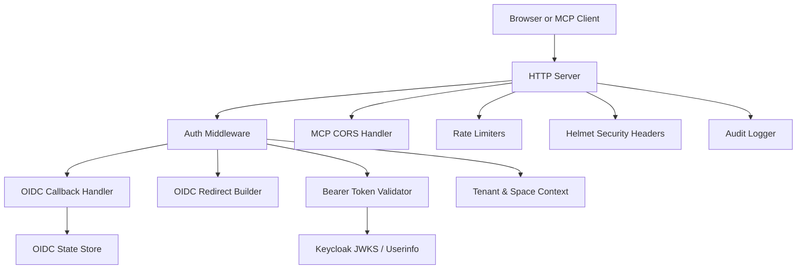
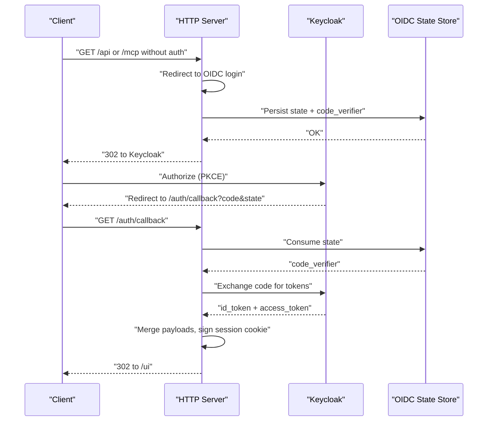
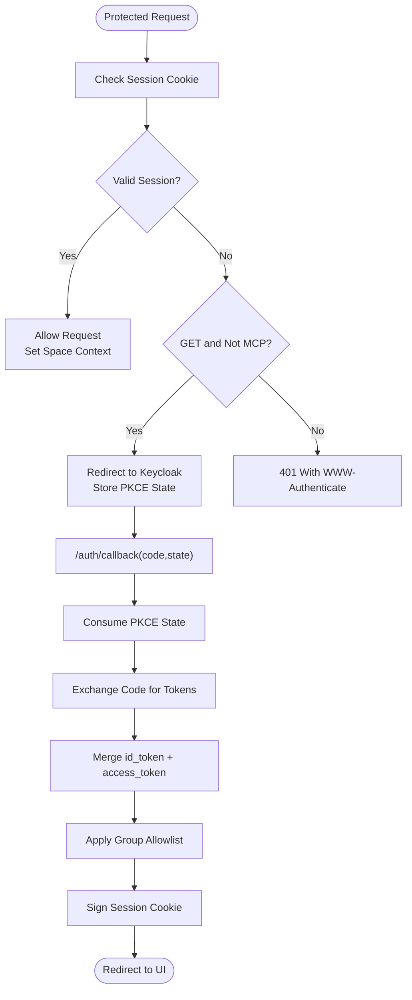
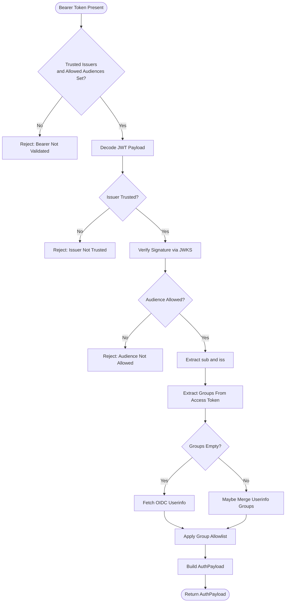
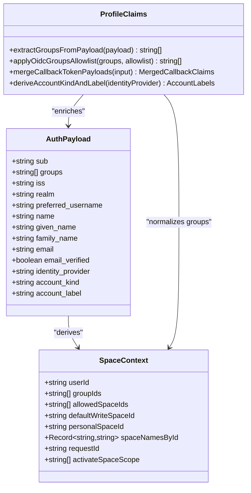
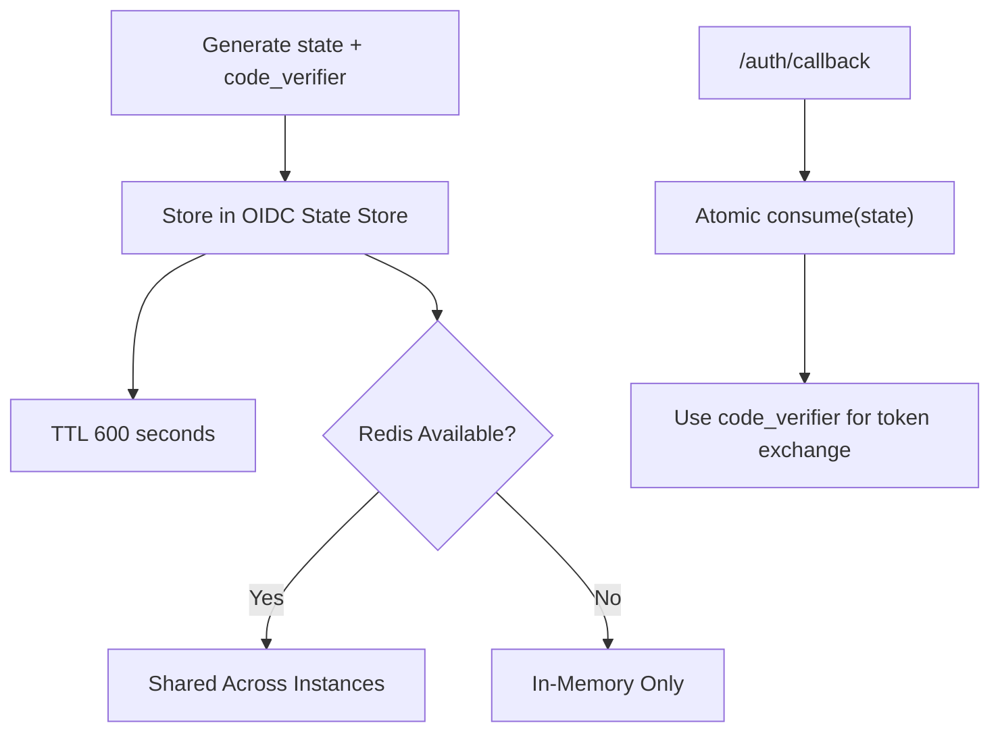
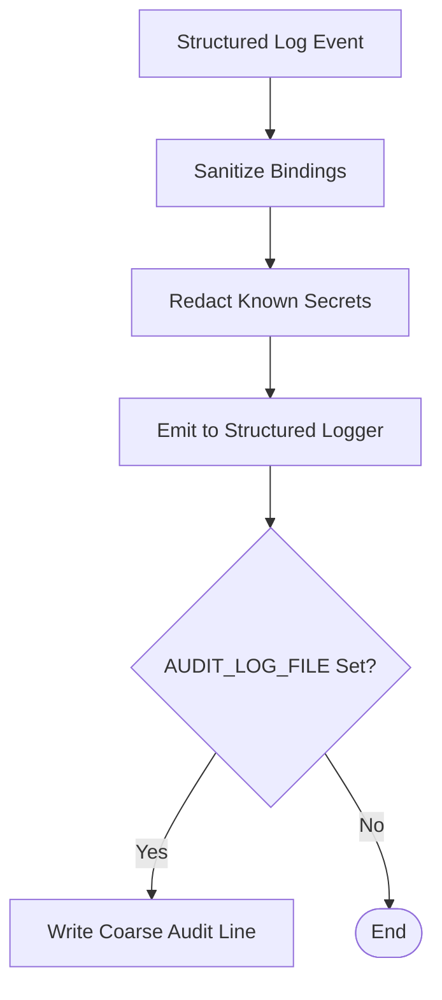
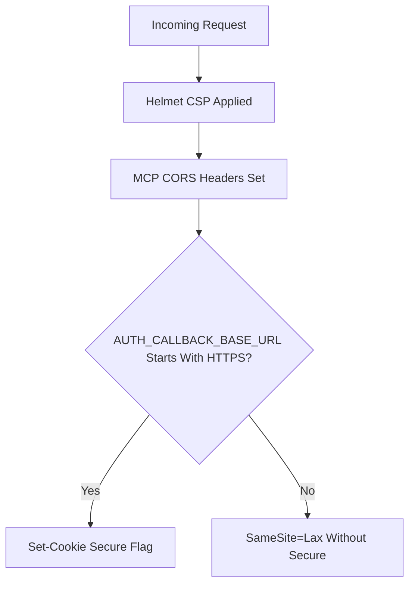
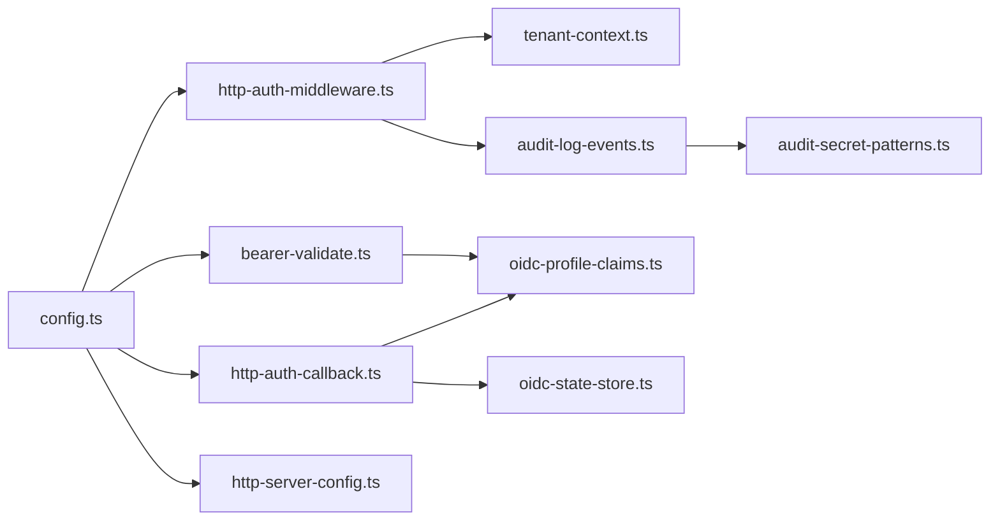

# Authentication & Security

<cite>
**Referenced Files in This Document**
- [threat-model.md](file://docs/security/threat-model.md)
- [audit-log.md](file://docs/security/audit-log.md)
- [incident-runbook.md](file://docs/security/incident-runbook.md)
- [http-auth-middleware.ts](file://src/http/http-auth-middleware.ts)
- [bearer-validate.ts](file://src/http/bearer-validate.ts)
- [http-auth-oidc-redirect.ts](file://src/http/http-auth-oidc-redirect.ts)
- [http-auth-callback.ts](file://src/http/http-auth-callback.ts)
- [oidc-state-store.ts](file://src/services/oidc-state-store.ts)
- [oidc-profile-claims.ts](file://src/http/oidc-profile-claims.ts)
- [tenant-context.ts](file://src/utils/tenant-context.ts)
- [config.ts](file://src/config.ts)
- [http-mcp-cors.ts](file://src/http/http-mcp-cors.ts)
- [http-server-config.ts](file://src/http/http-server-config.ts)
- [audit-log-events.ts](file://src/utils/audit-log-events.ts)
- [audit-secret-patterns.ts](file://src/utils/audit-secret-patterns.ts)
</cite>

## Table of Contents
1. [Introduction](#introduction)
2. [Project Structure](#project-structure)
3. [Core Components](#core-components)
4. [Architecture Overview](#architecture-overview)
5. [Detailed Component Analysis](#detailed-component-analysis)
6. [Dependency Analysis](#dependency-analysis)
7. [Performance Considerations](#performance-considerations)
8. [Troubleshooting Guide](#troubleshooting-guide)
9. [Conclusion](#conclusion)
10. [Appendices](#appendices)

## Introduction
This document provides comprehensive security documentation for the SquadRules framework, focusing on authentication mechanisms, authorization models, OIDC/OAuth2 integration with Keycloak, bearer token validation, group-based and space-scoped authorization, threat modeling, audit logging, sensitive data handling, and production hardening guidance. It is intended for operators, platform engineers, and security reviewers who need to understand how identity flows into access decisions and how those decisions are logged and protected.

SquadRules is an agent-first MCP framework where AI agents drive workflows through adapters. Identity and authorization are central because agents may perform read, write, search, training, and export operations that touch tenant-scoped memory and vector stores. The system supports browser-initiated OIDC login via Keycloak and programmatic Bearer token authentication for MCP clients. Authorization is derived from authenticated claims and mapped to space-scoped contexts that constrain reads and writes.

## Project Structure
Security-related functionality spans HTTP middleware, OIDC redirect and callback handlers, JWT validation, profile claim processing, OIDC state storage, tenant/space context derivation, configuration, CORS, rate limiting, helmet security headers, and structured audit logging.

**Diagram sources**
- [http-auth-middleware.ts:172-327](file://src/http/http-auth-middleware.ts#L172-L327)
- [bearer-validate.ts:120-208](file://src/http/bearer-validate.ts#L120-L208)
- [http-auth-callback.ts:122-229](file://src/http/http-auth-callback.ts#L122-L229)
- [http-auth-oidc-redirect.ts:15-78](file://src/http/http-auth-oidc-redirect.ts#L15-L78)
- [oidc-state-store.ts:50-75](file://src/services/oidc-state-store.ts#L50-L75)
- [tenant-context.ts:256-303](file://src/utils/tenant-context.ts#L256-L303)
- [http-mcp-cors.ts:3-28](file://src/http/http-mcp-cors.ts#L3-L28)
- [http-server-config.ts:74-99](file://src/http/http-server-config.ts#L74-L99)

**Section sources**
- [http-auth-middleware.ts:1-330](file://src/http/http-auth-middleware.ts#L1-L330)
- [bearer-validate.ts:1-209](file://src/http/bearer-validate.ts#L1-L209)
- [http-auth-callback.ts:1-231](file://src/http/http-auth-callback.ts#L1-L231)
- [http-auth-oidc-redirect.ts:1-92](file://src/http/http-auth-oidc-redirect.ts#L1-L92)
- [oidc-state-store.ts:1-76](file://src/services/oidc-state-store.ts#L1-L76)
- [oidc-profile-claims.ts:1-288](file://src/http/oidc-profile-claims.ts#L1-L288)
- [tenant-context.ts:1-312](file://src/utils/tenant-context.ts#L1-L312)
- [config.ts:1-351](file://src/config.ts#L1-L351)
- [http-mcp-cors.ts:1-29](file://src/http/http-mcp-cors.ts#L1-L29)
- [http-server-config.ts:1-100](file://src/http/http-server-config.ts#L1-L100)

## Core Components
- Authentication middleware enforces session or Bearer authentication for protected paths and derives space-scoped context.
- OIDC redirect builder constructs PKCE authorization URLs and persists transient login state.
- OIDC callback exchanges authorization codes for tokens, merges id_token and access_token payloads, signs a secure session cookie, and redirects users.
- Bearer token validator verifies issuer, audience, expiration, signature via JWKS, and optionally enriches groups from OIDC userinfo.
- OIDC profile claim processor whitelists safe claims, normalizes groups, derives account labels, and merges token payloads safely.
- OIDC state store persists PKCE code verifier and state using Redis when configured, otherwise in-memory.
- Tenant and space context maps authenticated identity to personal and group spaces, constraining allowed operations.
- Configuration centralizes environment variables for Keycloak, OIDC scopes, trusted issuers, allowed audiences, group allowlists, rate limits, and audit settings.
- CORS handler configures MCP-specific cross-origin behavior.
- Server configuration applies helmet CSP, rate limiters, JSON body limits, and structured logging.
- Audit logging emits embedding/anomaly/MCP events and optional append-only audit file lines with secret redaction.

**Section sources**
- [http-auth-middleware.ts:172-327](file://src/http/http-auth-middleware.ts#L172-L327)
- [bearer-validate.ts:120-208](file://src/http/bearer-validate.ts#L120-L208)
- [http-auth-callback.ts:122-229](file://src/http/http-auth-callback.ts#L122-L229)
- [http-auth-oidc-redirect.ts:15-78](file://src/http/http-auth-oidc-redirect.ts#L15-L78)
- [oidc-state-store.ts:50-75](file://src/services/oidc-state-store.ts#L50-L75)
- [oidc-profile-claims.ts:119-153](file://src/http/oidc-profile-claims.ts#L119-L153)
- [tenant-context.ts:217-248](file://src/utils/tenant-context.ts#L217-L248)
- [config.ts:141-195](file://src/config.ts#L141-L195)
- [http-mcp-cors.ts:3-28](file://src/http/http-mcp-cors.ts#L3-L28)
- [http-server-config.ts:74-99](file://src/http/http-server-config.ts#L74-L99)
- [audit-log.md:30-47](file://docs/security/audit-log.md#L30-L47)

## Architecture Overview
The authentication architecture supports two primary flows:

- Browser-initiated OIDC login:
  - Unauthenticated GET requests to protected paths redirect to Keycloak with PKCE.
  - Keycloak returns an authorization code to `/auth/callback`.
  - The server exchanges the code for tokens, merges payloads, sets a signed session cookie, and redirects to the UI.

- Programmatic Bearer authentication:
  - MCP clients send a Bearer token.
  - The server validates issuer, audience, expiration, and signature against Keycloak JWKS.
  - Groups may be enriched from userinfo if missing from the access token.
  - Authenticated claims are converted into space-scoped context.

**Diagram sources**
- [http-auth-middleware.ts:301-305](file://src/http/http-auth-middleware.ts#L301-L305)
- [http-auth-oidc-redirect.ts:52-78](file://src/http/http-auth-oidc-redirect.ts#L52-L78)
- [oidc-state-store.ts:53-60](file://src/services/oidc-state-store.ts#L53-L60)
- [http-auth-callback.ts:122-229](file://src/http/http-auth-callback.ts#L122-L229)

**Section sources**
- [http-auth-middleware.ts:172-327](file://src/http/http-auth-middleware.ts#L172-L327)
- [http-auth-callback.ts:122-229](file://src/http/http-auth-callback.ts#L122-L229)
- [http-auth-oidc-redirect.ts:15-78](file://src/http/http-auth-oidc-redirect.ts#L15-L78)
- [oidc-state-store.ts:50-75](file://src/services/oidc-state-store.ts#L50-L75)

## Detailed Component Analysis

### OIDC Browser Login and Logout Flow
The browser flow uses PKCE to avoid exposing client secrets. The server generates a random state and code verifier, stores them in the OIDC state store, and redirects the browser to Keycloak. On callback, the server consumes the state atomically, exchanges the code for tokens, merges id_token and access_token payloads, applies group filtering, computes session TTL, signs a secure session cookie, and redirects to the UI. Logout clears the session cookie and can initiate RP-initiated logout at Keycloak with an `id_token_hint` when available.

**Diagram sources**
- [http-auth-middleware.ts:190-305](file://src/http/http-auth-middleware.ts#L190-L305)
- [http-auth-oidc-redirect.ts:52-78](file://src/http/http-auth-oidc-redirect.ts#L52-L78)
- [oidc-state-store.ts:53-60](file://src/services/oidc-state-store.ts#L53-L60)
- [http-auth-callback.ts:122-229](file://src/http/http-auth-callback.ts#L122-L229)

**Section sources**
- [http-auth-middleware.ts:172-327](file://src/http/http-auth-middleware.ts#L172-L327)
- [http-auth-callback.ts:1-231](file://src/http/http-auth-callback.ts#L1-L231)
- [http-auth-oidc-redirect.ts:1-92](file://src/http/http-auth-oidc-redirect.ts#L1-L92)
- [oidc-state-store.ts:1-76](file://src/services/oidc-state-store.ts#L1-L76)

### Bearer Token Validation and Enrichment
Bearer tokens are validated only when trusted issuers and allowed audiences are configured. Validation checks issuer, audience, expiration, and signature via JWKS. If groups are absent from the access token, the server may fetch user info using the same token to obtain group membership. Groups are then filtered by the OIDC group allowlist and used to derive space context.

**Diagram sources**
- [bearer-validate.ts:120-208](file://src/http/bearer-validate.ts#L120-L208)
- [oidc-profile-claims.ts:119-153](file://src/http/oidc-profile-claims.ts#L119-L153)

**Section sources**
- [bearer-validate.ts:1-209](file://src/http/bearer-validate.ts#L1-L209)
- [oidc-profile-claims.ts:1-288](file://src/http/oidc-profile-claims.ts#L1-L288)

### Group-Based Authorization and Space Scoping
Authorization is not based solely on user identity; it is derived from groups and realm/issuer information. Personal spaces are deterministic per user and issuer, while group spaces are derived from normalized group paths. The middleware narrows allowed spaces when a `space` query parameter is provided, enforcing strict isolation.

**Diagram sources**
- [bearer-validate.ts:22-39](file://src/http/bearer-validate.ts#L22-L39)
- [tenant-context.ts:23-42](file://src/utils/tenant-context.ts#L23-L42)
- [oidc-profile-claims.ts:78-95](file://src/http/oidc-profile-claims.ts#L78-L95)
- [oidc-profile-claims.ts:119-153](file://src/http/oidc-profile-claims.ts#L119-L153)
- [oidc-profile-claims.ts:200-256](file://src/http/oidc-profile-claims.ts#L200-L256)

**Section sources**
- [tenant-context.ts:217-303](file://src/utils/tenant-context.ts#L217-L303)
- [oidc-profile-claims.ts:78-153](file://src/http/oidc-profile-claims.ts#L78-L153)
- [oidc-profile-claims.ts:200-256](file://src/http/oidc-profile-claims.ts#L200-L256)

### OIDC State Storage and PKCE Security
PKCE state is stored with a short TTL and consumed atomically to prevent replay. When Redis is configured, state is shared across instances; otherwise, it falls back to in-memory storage. This design ensures login works in clustered deployments while keeping transient secrets out of cookies.

**Diagram sources**
- [http-auth-oidc-redirect.ts:52-78](file://src/http/http-auth-oidc-redirect.ts#L52-L78)
- [oidc-state-store.ts:16-60](file://src/services/oidc-state-store.ts#L16-L60)

**Section sources**
- [oidc-state-store.ts:1-76](file://src/services/oidc-state-store.ts#L1-L76)
- [http-auth-oidc-redirect.ts:52-78](file://src/http/http-auth-oidc-redirect.ts#L52-L78)

### Sensitive Data Handling and Secret Redaction
Audit logs sanitize strings and object keys to prevent control characters and line breaks from breaking log lines. Known secret patterns such as Bearer tokens and common provider prefixes are redacted before writing to sinks. This reduces the risk of credential leakage in operational logs.

**Diagram sources**
- [audit-log.md:84-88](file://docs/security/audit-log.md#L84-L88)
- [audit-log-events.ts:68-88](file://src/utils/audit-log-events.ts#L68-L88)
- [audit-secret-patterns.ts:6-26](file://src/utils/audit-secret-patterns.ts#L6-L26)

**Section sources**
- [audit-log.md:84-88](file://docs/security/audit-log.md#L84-L88)
- [audit-log-events.ts:1-89](file://src/utils/audit-log-events.ts#L1-L89)
- [audit-secret-patterns.ts:1-27](file://src/utils/audit-secret-patterns.ts#L1-L27)

### Security Headers, CORS, and HTTPS Considerations
The server applies helmet with a restrictive content security policy suitable for API endpoints. CORS is configured for the MCP endpoint to expose `WWW-Authenticate` and allow necessary headers. HTTPS is enforced for the session cookie when the callback base URL starts with HTTPS. Operators should place the service behind a reverse proxy that terminates TLS and enforces modern security policies.

**Diagram sources**
- [http-server-config.ts:33-47](file://src/http/http-server-config.ts#L33-L47)
- [http-mcp-cors.ts:3-28](file://src/http/http-mcp-cors.ts#L3-L28)
- [http-auth-callback.ts:69-72](file://src/http/http-auth-callback.ts#L69-L72)

**Section sources**
- [http-server-config.ts:33-47](file://src/http/http-server-config.ts#L33-L47)
- [http-mcp-cors.ts:3-28](file://src/http/http-mcp-cors.ts#L3-L28)
- [http-auth-callback.ts:69-72](file://src/http/http-auth-callback.ts#L69-L72)

## Dependency Analysis
Authentication and authorization depend on configuration, OIDC providers, key-value storage, and structured logging.

**Diagram sources**
- [config.ts:141-195](file://src/config.ts#L141-L195)
- [http-auth-middleware.ts:172-327](file://src/http/http-auth-middleware.ts#L172-L327)
- [bearer-validate.ts:120-208](file://src/http/bearer-validate.ts#L120-L208)
- [http-auth-callback.ts:122-229](file://src/http/http-auth-callback.ts#L122-L229)
- [oidc-profile-claims.ts:119-153](file://src/http/oidc-profile-claims.ts#L119-L153)
- [tenant-context.ts:256-303](file://src/utils/tenant-context.ts#L256-L303)
- [oidc-state-store.ts:50-75](file://src/services/oidc-state-store.ts#L50-L75)
- [audit-log-events.ts:68-88](file://src/utils/audit-log-events.ts#L68-L88)
- [audit-secret-patterns.ts:6-26](file://src/utils/audit-secret-patterns.ts#L6-L26)

**Section sources**
- [config.ts:141-195](file://src/config.ts#L141-L195)
- [http-auth-middleware.ts:172-327](file://src/http/http-auth-middleware.ts#L172-L327)
- [bearer-validate.ts:120-208](file://src/http/bearer-validate.ts#L120-L208)
- [http-auth-callback.ts:122-229](file://src/http/http-auth-callback.ts#L122-L229)
- [oidc-profile-claims.ts:119-153](file://src/http/oidc-profile-claims.ts#L119-L153)
- [tenant-context.ts:256-303](file://src/utils/tenant-context.ts#L256-L303)
- [oidc-state-store.ts:50-75](file://src/services/oidc-state-store.ts#L50-L75)
- [audit-log-events.ts:68-88](file://src/utils/audit-log-events.ts#L68-L88)
- [audit-secret-patterns.ts:6-26](file://src/utils/audit-secret-patterns.ts#L6-L26)

## Performance Considerations
- JWKS caching avoids repeated network calls for the same issuer.
- OIDC userinfo fetch has an 8-second timeout and degrades gracefully when unavailable.
- Group merging from userinfo is optional and controlled by configuration.
- Rate limiters protect `/auth`, `/api`, and `/mcp` endpoints independently.
- Structured logging and audit file writes are designed to avoid blocking request handling.

[No sources needed since this section provides general guidance]

## Troubleshooting Guide
Common issues include misconfigured OIDC callbacks, missing session secrets, invalid PKCE state, expired tokens, and insufficient group mapping.

- **Missing OIDC configuration**: When `AUTH_ENABLED=true`, required variables must be set; otherwise startup throws an error.
- **Invalid state on callback**: If PKCE state is missing or expired, the callback redirects with an error.
- **Token exchange failure**: Non-OK responses from Keycloak result in redirect errors.
- **Mismatched subject**: Merging id_token and access_token fails when subjects differ.
- **Bearer not validated**: If trusted issuers or allowed audiences are missing, Bearer requests receive a specific rejection message.
- **Group visibility**: If groups do not appear in spaces, ensure Keycloak’s Group Membership mapper is configured and consider enabling userinfo group merging.

Operational investigation should use `request_id`, `tenant_id`, and category-based filters in structured logs and the optional audit file.

**Section sources**
- [config.ts:254-266](file://src/config.ts#L254-L266)
- [http-auth-callback.ts:135-199](file://src/http/http-auth-callback.ts#L135-L199)
- [http-auth-middleware.ts:237-251](file://src/http/http-auth-middleware.ts#L237-L251)
- [audit-log.md:47-88](file://docs/security/audit-log.md#L47-L88)
- [incident-runbook.md:29-64](file://docs/security/incident-runbook.md#L29-L64)

## Conclusion
SquadRules implements a layered security model combining OIDC browser login, Bearer JWT validation, group-based authorization, and deterministic space scoping. The system emphasizes traceability through structured logs and optional audit files, restricts sensitive data exposure through sanitization and redaction, and applies defensive defaults such as helmet CSP, rate limiting, and CORS controls. Production deployments should enforce HTTPS, configure Keycloak carefully, rotate secrets regularly, monitor anomaly events, and follow the incident runbook for containment and recovery.

[No sources needed since this section summarizes without analyzing specific files]

## Appendices

### Threat Model Summary
The threat model identifies assets such as adapter chains, memory content, embeddings, tenant authorization context, sessions, cache entries, and provider credentials. It covers attackers including malicious tenants, insiders, external probes, supply-chain compromise, and provider abuse. Mitigations include input validation, audit logging, anomaly detection, space-scoped filtering, rate limiting, CI scanning, SBOM generation, image signing, and incident playbooks.

**Section sources**
- [threat-model.md:27-105](file://docs/security/threat-model.md#L27-L105)

### Audit Logging Specification
Audit logging centers on embedding/search anomaly events and MCP tool call events. The main structured logger receives rich records; an optional append-only file receives coarse lines for allowlisted categories. MCP audit levels control verbosity for MCP events. Correlation uses `request_id` and `correlation_id`.

**Section sources**
- [audit-log.md:1-47](file://docs/security/audit-log.md#L1-L47)
- [audit-log.md:69-155](file://docs/security/audit-log.md#L69-L155)
- [audit-log.md:157-187](file://docs/security/audit-log.md#L157-L187)

### Configuration Reference for Authentication Backends
Key configuration areas include:
- Keycloak connection: `KEYCLOAK_URL`, `KEYCLOAK_INTERNAL_URL`, `KEYCLOAK_REALM`, `KEYCLOAK_CLIENT_ID`.
- Callback and session: `AUTH_CALLBACK_BASE_URL`, `SESSION_SECRET`, `SESSION_MAX_AGE_SEC`.
- Bearer validation: `AUTH_MODE`, `AUTH_TRUSTED_ISSUERS`, `AUTH_ALLOWED_AUDIENCES`.
- Group filtering: `OIDC_GROUPS_ALLOWLIST`, `OIDC_BEARER_MERGE_USERINFO_GROUPS`.
- Rate limits: `AUTH_RATE_LIMIT_WINDOW_MS`, `AUTH_RATE_LIMIT_MAX`, `HTTP_RATE_LIMIT_WINDOW_MS`, `HTTP_RATE_LIMIT_MAX`, `MCP_RATE_LIMIT_WINDOW_MS`, `MCP_RATE_LIMIT_MAX`.
- Audit: `AUDIT_LOG_FILE`, `AUDIT_LOG_LEVEL`.

**Section sources**
- [config.ts:141-195](file://src/config.ts#L141-L195)
- [config.ts:121-126](file://src/config.ts#L121-L126)
- [config.ts:99-105](file://src/config.ts#L99-L105)

### Hardening Guidelines for Production
- Always enable HTTPS and set `AUTH_CALLBACK_BASE_URL` to an HTTPS origin so the session cookie uses the Secure flag.
- Configure Keycloak with explicit client scopes, Group Membership mappers, and restricted post-logout redirect URIs.
- Set `AUTH_TRUSTED_ISSUERS` and `AUTH_ALLOWED_AUDIENCES` explicitly rather than relying on defaults.
- Restrict `OIDC_GROUPS_ALLOWLIST` to only the group paths that should become spaces.
- Enable `AUDIT_LOG_FILE` and ship it to a secure, append-only log store with rotation and retention policies.
- Monitor `audit.anomaly` events for unusual latency, norms, dimension mismatches, zero results, and low scores.
- Place the service behind a reverse proxy that enforces TLS, HSTS, modern cipher suites, and request size limits.
- Rotate `SESSION_SECRET`, Keycloak client secrets, and embedding provider keys regularly.
- Review the incident runbook and maintain clear escalation paths for sev-1 and sev-2 events.

**Section sources**
- [http-auth-callback.ts:69-72](file://src/http/http-auth-callback.ts#L69-L72)
- [config.ts:254-266](file://src/config.ts#L254-L266)
- [audit-log.md:30-47](file://docs/security/audit-log.md#L30-L47)
- [incident-runbook.md:17-27](file://docs/security/incident-runbook.md#L17-L27)