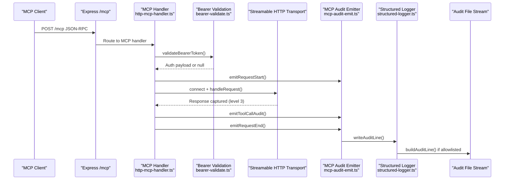
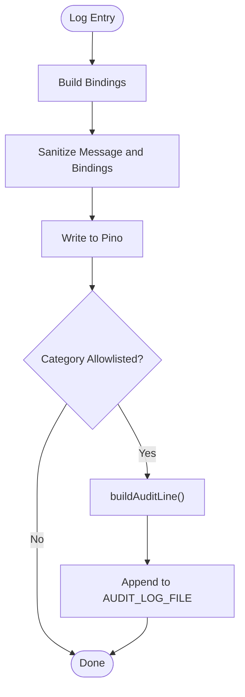
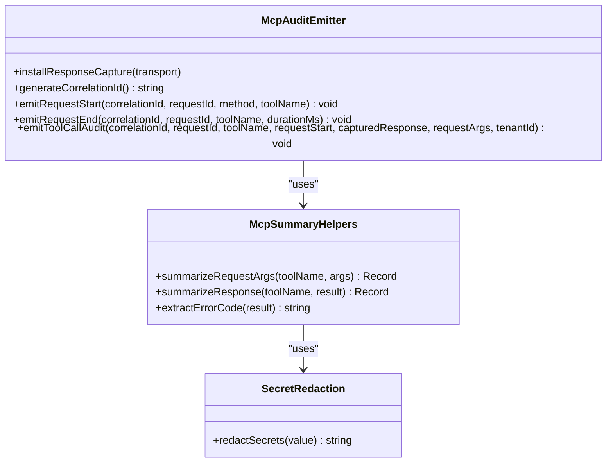
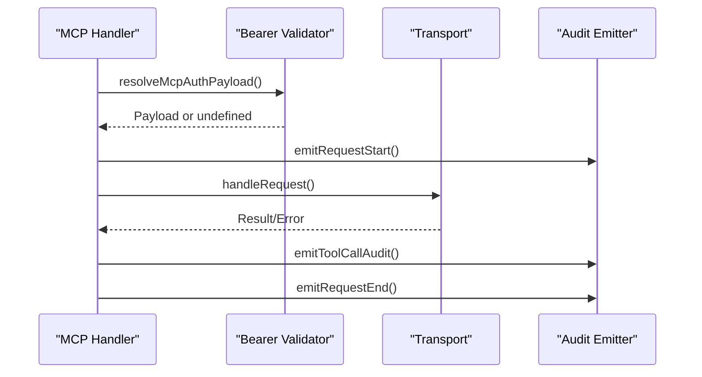
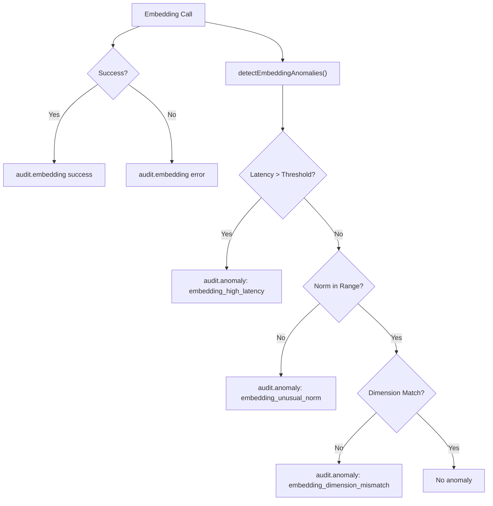
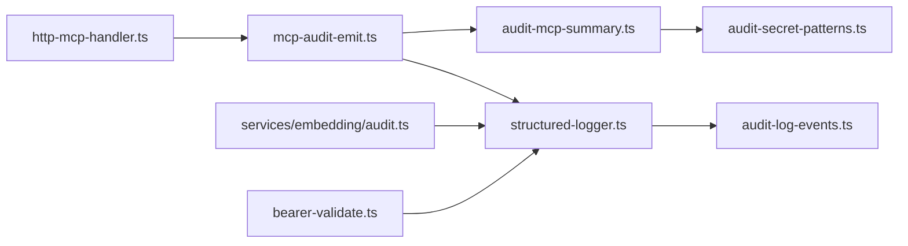

# Audit Logging and Monitoring

<cite>
**Referenced Files in This Document**
- [audit-log.md](file://docs/security/audit-log.md)
- [structured-logger.ts](file://src/utils/structured-logger.ts)
- [audit-log-events.ts](file://src/utils/audit-log-events.ts)
- [mcp-audit-emit.ts](file://src/http/mcp-audit-emit.ts)
- [http-mcp-handler.ts](file://src/http/http-mcp-handler.ts)
- [audit-mcp-summary.ts](file://src/utils/audit-mcp-summary.ts)
- [audit-secret-patterns.ts](file://src/utils/audit-secret-patterns.ts)
- [embedding-audit.ts](file://src/services/embedding/audit.ts)
- [bearer-validate.ts](file://src/http/bearer-validate.ts)
- [config.ts](file://src/config.ts)
</cite>

## Table of Contents
1. [Introduction](#introduction)
2. [Project Structure](#project-structure)
3. [Core Components](#core-components)
4. [Architecture Overview](#architecture-overview)
5. [Detailed Component Analysis](#detailed-component-analysis)
6. [Dependency Analysis](#dependency-analysis)
7. [Performance Considerations](#performance-considerations)
8. [Troubleshooting Guide](#troubleshooting-guide)
9. [Compliance and Security Reporting](#compliance-and-security-reporting)
10. [Conclusion](#conclusion)

## Introduction
This document explains SquadRules audit logging and security monitoring with a focus on structured logs, MCP audit events, embedding and search anomaly detection, authentication-related log entries, and the optional append-only audit file stream. It also covers filtering, correlation, sanitization, and operational guidance for operators who need to investigate agent-driven workflows.

SquadRules is an agent-first MCP framework where AI agents drive operations through tools such as activate, forward, train, reward, tune, delete, export, and spaces. The audit system is designed so that operators can reconstruct tool usage, embedding/search behavior, and request lifecycles using stable `category` values and correlation identifiers.

## Project Structure
The audit and monitoring capabilities are implemented across several focused modules:

- Documentation specification: `docs/security/audit-log.md`
- Structured logger and HTTP access logging: `src/utils/structured-logger.ts`
- Coarse audit JSONL builder and category allowlist: `src/utils/audit-log-events.ts`
- MCP audit emission helpers: `src/http/mcp-audit-emit.ts`
- MCP HTTP handler and request lifecycle: `src/http/http-mcp-handler.ts`
- MCP request/response summarization and secret redaction: `src/utils/audit-mcp-summary.ts`, `src/utils/audit-secret-patterns.ts`
- Embedding and search anomaly audit: `src/services/embedding/audit.ts`
- Bearer token validation and auth logging: `src/http/bearer-validate.ts`
- Environment configuration for audit verbosity and file path: `src/config.ts`

```mermaid
graph TB
Client["MCP Client"] --> HttpHandler["HTTP MCP Handler<br/>http-mcp-handler.ts"]
HttpHandler --> AuditEmit["MCP Audit Emitter<br/>mcp-audit-emit.ts"]
HttpHandler --> Logger["Structured Logger<br/>structured-logger.ts"]
AuditEmit --> Logger
Logger --> AuditFile["Audit File Stream<br/>AUDIT_LOG_FILE"]
HttpHandler --> EmbeddingAudit["Embedding & Search Audit<br/>services/embedding/audit.ts"]
EmbeddingAudit --> Logger
HttpHandler --> BearerValidate["Bearer Validation<br/>bearer-validate.ts"]
AuditEmit --> McpSummary["MCP Summary Helpers<br/>audit-mcp-summary.ts"]
McpSummary --> SecretPatterns["Secret Redaction<br/>audit-secret-patterns.ts"]
Logger --> AuditEvents["Audit Line Builder<br/>audit-log-events.ts"]
```

**Diagram sources**
- [http-mcp-handler.ts:115-348](file://src/http/http-mcp-handler.ts#L115-L348)
- [mcp-audit-emit.ts:1-118](file://src/http/mcp-audit-emit.ts#L1-L118)
- [structured-logger.ts:1-350](file://src/utils/structured-logger.ts#L1-L350)
- [embedding-audit.ts:1-197](file://src/services/embedding/audit.ts#L1-L197)
- [bearer-validate.ts:1-209](file://src/http/bearer-validate.ts#L1-L209)
- [audit-mcp-summary.ts:1-169](file://src/utils/audit-mcp-summary.ts#L1-L169)
- [audit-secret-patterns.ts:1-27](file://src/utils/audit-secret-patterns.ts#L1-L27)
- [audit-log-events.ts:1-89](file://src/utils/audit-log-events.ts#L1-L89)

**Section sources**
- [audit-log.md:1-217](file://docs/security/audit-log.md#L1-L217)
- [structured-logger.ts:1-350](file://src/utils/structured-logger.ts#L1-L350)
- [audit-log-events.ts:1-89](file://src/utils/audit-log-events.ts#L1-L89)
- [mcp-audit-emit.ts:1-118](file://src/http/mcp-audit-emit.ts#L1-L118)
- [http-mcp-handler.ts:115-348](file://src/http/http-mcp-handler.ts#L115-L348)
- [audit-mcp-summary.ts:1-169](file://src/utils/audit-mcp-summary.ts#L1-L169)
- [audit-secret-patterns.ts:1-27](file://src/utils/audit-secret-patterns.ts#L1-L27)
- [embedding-audit.ts:1-197](file://src/services/embedding/audit.ts#L1-L197)
- [bearer-validate.ts:1-209](file://src/http/bearer-validate.ts#L1-L209)
- [config.ts:97-105](file://src/config.ts#L97-L105)

## Core Components
The audit system has three primary responsibilities:

1. **Structured logging**: All application logs use Pino through a shared structured logger. Logs include request metadata, client IP, duration, error codes, and sanitized bindings.
2. **Audit event categories**: Stable categories identify investigation-relevant events:
   - `audit.embedding`: embedding success or failure, provider-stage outcomes.
   - `audit.anomaly`: heuristic anomalies such as high latency, unusual vector norm, dimension mismatch, zero results, or low search score.
   - `audit.mcp`: MCP tool call lifecycle events including start, tool call, and end.
3. **Optional audit file stream**: When `AUDIT_LOG_FILE` is set, qualifying events write one coarse JSON line per event. This side channel is allowlisted and sanitized; it does not duplicate tenant/provider/metrics fields into embedding/anomaly lines.

Key configuration variables:

| Variable | Default | Effect |
|----------|---------|--------|
| `AUDIT_LOG_FILE` | Empty | Enables an append-only audit file when non-empty. Failure to open disables the stream without breaking requests. |
| `AUDIT_LOG_LEVEL` | `1` | Controls MCP audit detail: `0` off, `1` metadata, `2` request arguments, `3` response body. Does not affect `audit.embedding` or `audit.anomaly`. |

**Section sources**
- [audit-log.md:30-46](file://docs/security/audit-log.md#L30-L46)
- [audit-log.md:69-87](file://docs/security/audit-log.md#L69-L87)
- [audit-log.md:89-103](file://docs/security/audit-log.md#L89-L103)
- [config.ts:97-105](file://src/config.ts#L97-L105)
- [structured-logger.ts:40-53](file://src/utils/structured-logger.ts#L40-L53)

## Architecture Overview
The MCP request flow integrates authentication, audit emission, structured logging, and optional audit file output.

**Diagram sources**
- [http-mcp-handler.ts:115-348](file://src/http/http-mcp-handler.ts#L115-L348)
- [bearer-validate.ts:120-208](file://src/http/bearer-validate.ts#L120-L208)
- [mcp-audit-emit.ts:44-117](file://src/http/mcp-audit-emit.ts#L44-L117)
- [structured-logger.ts:144-148](file://src/utils/structured-logger.ts#L144-L148)
- [audit-log-events.ts:68-88](file://src/utils/audit-log-events.ts#L68-L88)

## Detailed Component Analysis

### Structured Logger and Audit Sink
The structured logger wraps Pino and provides:

- Consistent JSON shape for all logs.
- HTTP access logging with method, path, status, duration, client IP, user agent, and request ID.
- Sanitization of messages, object keys, strings, arrays, objects, errors, and dates before they reach any sink.
- An optional audit file stream opened at startup from `AUDIT_LOG_FILE`.
- A public `writeAuditLine(level, bindings)` API used by MCP audit emission and other audit producers.

Sanitization safeguards include:

- Control character neutralization.
- String length caps.
- Array item limits.
- Object key limits and depth limits.
- Safe cloning for Pino serialization.

**Diagram sources**
- [structured-logger.ts:55-148](file://src/utils/structured-logger.ts#L55-L148)
- [audit-log-events.ts:68-88](file://src/utils/audit-log-events.ts#L68-L88)

**Section sources**
- [structured-logger.ts:1-350](file://src/utils/structured-logger.ts#L1-L350)

### MCP Audit Events
MCP audit events are emitted at three points:

- `mcp_request_start`: Before space context is established; `tenant_id` is `'unknown'`.
- `mcp_tool_call`: After tool execution completes, inside space context; includes level-dependent request/response data.
- `mcp_request_end`: In the response finish handler; includes duration and tool name.

Correlation model:

- `request_id`: JSON-RPC request identifier.
- `correlation_id`: Server-generated grouping identifier for related requests within a short time window per tenant.

Verbosity levels:

| Level | Name | Captured Data |
|-------|------|---------------|
| `0` | Off | No MCP audit events |
| `1` | Metadata | Tool name, correlation ID, tenant ID, request ID, timestamps, duration, status, error code |
| `2` | Request | Level 1 plus sanitized request arguments |
| `3` | Full | Level 2 plus sanitized response body |

**Diagram sources**
- [mcp-audit-emit.ts:18-117](file://src/http/mcp-audit-emit.ts#L18-L117)
- [audit-mcp-summary.ts:18-169](file://src/utils/audit-mcp-summary.ts#L18-L169)
- [audit-secret-patterns.ts:6-26](file://src/utils/audit-secret-patterns.ts#L6-L26)

**Section sources**
- [mcp-audit-emit.ts:1-118](file://src/http/mcp-audit-emit.ts#L1-L118)
- [audit-mcp-summary.ts:1-169](file://src/utils/audit-mcp-summary.ts#L1-L169)
- [audit-secret-patterns.ts:1-27](file://src/utils/audit-secret-patterns.ts#L1-L27)
- [audit-log.md:105-155](file://docs/security/audit-log.md#L105-L155)

### MCP HTTP Handler Integration
The MCP handler:

- Creates a new transport per request.
- Emits `mcp_request_start` early.
- Validates bearer tokens when authentication is enabled.
- Tracks concurrent requests and applies backpressure.
- Captures responses for audit level 3.
- Emits `mcp_tool_call` after tool execution.
- Emits `mcp_request_end` in the response finish handler.
- Uses `AsyncLocalStorage` to store request context.

Authentication integration:

- If `AUTH_ENABLED` is true, bearer tokens are validated against trusted issuers and allowed audiences.
- Missing or invalid tokens produce appropriate JSON-RPC errors and HTTP headers for UI discovery endpoints.

**Diagram sources**
- [http-mcp-handler.ts:44-60](file://src/http/http-mcp-handler.ts#L44-L60)
- [http-mcp-handler.ts:115-348](file://src/http/http-mcp-handler.ts#L115-L348)
- [bearer-validate.ts:120-208](file://src/http/bearer-validate.ts#L120-L208)
- [mcp-audit-emit.ts:44-117](file://src/http/mcp-audit-emit.ts#L44-L117)

**Section sources**
- [http-mcp-handler.ts:1-348](file://src/http/http-mcp-handler.ts#L1-L348)
- [bearer-validate.ts:1-209](file://src/http/bearer-validate.ts#L1-L209)

### Embedding and Search Anomaly Audit
Embedding and search audit logic produces:

- `audit.embedding` records for embedding success and error cases.
- `audit.anomaly` records for heuristic anomalies:
  - High embedding latency.
  - Unusual vector norm.
  - Dimension mismatch.
  - Zero search results for non-trivial queries.
  - Low search score below threshold.

These records include tenant ID, request ID, provider/model information, latency, thresholds, and severity. Error-severity anomalies use error-level structured logging; warning-severity anomalies use warning-level structured logging.

**Diagram sources**
- [embedding-audit.ts:60-157](file://src/services/embedding/audit.ts#L60-L157)

**Section sources**
- [embedding-audit.ts:1-197](file://src/services/embedding/audit.ts#L1-L197)
- [audit-log.md:50-58](file://docs/security/audit-log.md#L50-L58)
- [audit-log.md:74-80](file://docs/security/audit-log.md#L74-L80)

### Authentication Logs and Authorization Decisions
Authentication-related logging focuses on bearer token validation:

- Issuer validation.
- Audience validation.
- Expiration and signature verification via JWKS.
- Optional trace logging controlled by environment variables.
- Group resolution from JWT claims or OIDC userinfo.
- Group allowlist filtering.

Authorization decisions are reflected in:

- Successful bearer validation producing an auth payload.
- Rejected tokens logged with issuer, audience, or verification failure details.
- MCP handler returning unauthorized responses when authentication is required but missing.

Note: The current audit implementation does not define dedicated `audit.auth` or `audit.authorization` categories. Operators should correlate authentication logs with MCP audit events using `request_id`, `tenant_id`, and timestamp.

**Section sources**
- [bearer-validate.ts:120-208](file://src/http/bearer-validate.ts#L120-L208)
- [http-mcp-handler.ts:44-60](file://src/http/http-mcp-handler.ts#L44-L60)
- [http-mcp-handler.ts:151-165](file://src/http/http-mcp-handler.ts#L151-L165)

### Audit File Stream and Event Categories
The audit file stream writes only allowlisted categories:

- `audit.embedding`
- `audit.anomaly`
- `audit.mcp`

For embedding and anomaly events, the file line contains a derived `event` label such as `embedding_success`, `embedding_error`, `embedding_provider_success`, `embedding_provider_error`, `embedding_high_latency`, `embedding_unusual_norm`, `embedding_dimension_mismatch`, `search_zero_results`, `search_low_score`, or `embedding_other_anomaly`.

For MCP events, the file line passes through `mcp_tool_call`, `mcp_request_start`, or `mcp_request_end`, with level-dependent fields.

**Section sources**
- [audit-log-events.ts:1-89](file://src/utils/audit-log-events.ts#L1-L89)
- [audit-log.md:157-186](file://docs/security/audit-log.md#L157-L186)

## Dependency Analysis
The audit system has clear separation between emission, sanitization, and storage:

- MCP handler emits lifecycle events.
- MCP audit emitter prepares correlation IDs, durations, status, and level-dependent summaries.
- Structured logger sanitizes and routes to Pino and optionally to the audit file.
- Audit event builder maps bindings to coarse file records.
- Embedding audit emits embedding and anomaly records independently of MCP events.
- Bearer validation logs authentication decisions without defining a dedicated audit category.

**Diagram sources**
- [http-mcp-handler.ts:115-348](file://src/http/http-mcp-handler.ts#L115-L348)
- [mcp-audit-emit.ts:1-118](file://src/http/mcp-audit-emit.ts#L1-L118)
- [structured-logger.ts:1-350](file://src/utils/structured-logger.ts#L1-L350)
- [audit-log-events.ts:1-89](file://src/utils/audit-log-events.ts#L1-L89)
- [embedding-audit.ts:1-197](file://src/services/embedding/audit.ts#L1-L197)
- [bearer-validate.ts:1-209](file://src/http/bearer-validate.ts#L1-L209)
- [audit-mcp-summary.ts:1-169](file://src/utils/audit-mcp-summary.ts#L1-L169)
- [audit-secret-patterns.ts:1-27](file://src/utils/audit-secret-patterns.ts#L1-L27)

**Section sources**
- [audit-log.md:206-216](file://docs/security/audit-log.md#L206-L216)

## Performance Considerations
- The audit file stream is optional and fails closed: if opening the file fails, the stream stays disabled and request handling continues.
- Audit writes are bounded by maximum line size, depth, key count, and string length to prevent oversized records.
- MCP audit level controls CPU and I/O cost: level 0 avoids MCP audit emission; level 3 captures full responses, increasing memory and serialization overhead.
- Embedding anomaly checks add lightweight heuristics around latency, vector norm, and dimension comparison.
- Concurrent MCP request tracking prevents overload but may reject requests under heavy load.

[No sources needed since this section provides general guidance]

## Troubleshooting Guide
Common operational scenarios:

| Symptom | Investigation Steps |
|---------|---------------------|
| No MCP audit events in audit file | Check `AUDIT_LOG_LEVEL`; ensure it is greater than `0`. Verify `AUDIT_LOG_FILE` is set and writable. |
| Embedding anomalies appear frequently | Inspect `audit.anomaly` records for `embedding_high_latency`, `embedding_unusual_norm`, or `embedding_dimension_mismatch`. Tune thresholds via environment variables. |
| Search returns zero results | Look for `search_zero_results` anomalies and verify query length and indexing state. |
| Authentication failures | Review bearer validation logs for issuer, audience, expiration, or signature errors. Confirm Keycloak configuration and trusted issuers. |
| Large MCP payloads slow down audit writing | Reduce `AUDIT_LOG_LEVEL` or avoid level 3 in production. |
| Correlation across multiple requests | Use `correlation_id` and `request_id` to group events. |

Filtering techniques:

- Filter main structured logs by `category`, `tenant_id`, and `request_id`.
- Use the audit file for a compact, allowlisted side channel.
- Use journey export scripts to group audit lines by `correlation_id` for replay and diff.

**Section sources**
- [audit-log.md:25-28](file://docs/security/audit-log.md#L25-L28)
- [audit-log.md:188-197](file://docs/security/audit-log.md#L188-L197)
- [bearer-validate.ts:120-208](file://src/http/bearer-validate.ts#L120-L208)

## Compliance and Security Reporting
The audit specification states that it does not assert alignment with a specific compliance framework; customers map controls in their own assessments. Operators should treat the following as evidence sources:

- `audit.embedding` and `audit.anomaly` records for embedding and search quality.
- `audit.mcp` records for MCP tool usage, duration, status, and sanitized request/response snapshots.
- HTTP access logs for method, path, status, duration, client IP, and request ID.
- Authentication logs for bearer token validation outcomes.

Recommended reporting practices:

- Retain both the main structured log and the optional audit file according to organizational retention policies.
- Rotate and secure the audit file externally; the application does not implement built-in rotation parameters.
- Redact secrets automatically through the shared redaction patterns.
- Map audit categories to internal control objectives rather than assuming a predefined compliance schema.

**Section sources**
- [audit-log.md:13-14](file://docs/security/audit-log.md#L13-L14)
- [audit-log.md:43-46](file://docs/security/audit-log.md#L43-L46)
- [audit-secret-patterns.ts:1-27](file://src/utils/audit-secret-patterns.ts#L1-L27)

## Conclusion
SquadRules audit logging centers on structured logs with stable categories and an optional append-only audit file. MCP audit events provide request lifecycle visibility, while embedding and search anomaly records expose operational health. Authentication logs capture bearer validation decisions, and sanitization ensures safe audit output. Operators should combine main structured logs, the audit file, correlation identifiers, and external log aggregation tools to support incident triage, performance tuning, and compliance reporting.

[No sources needed since this section summarizes without analyzing specific files]