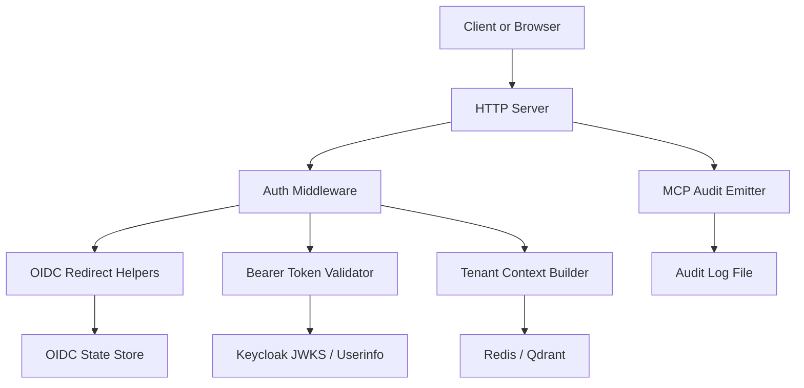
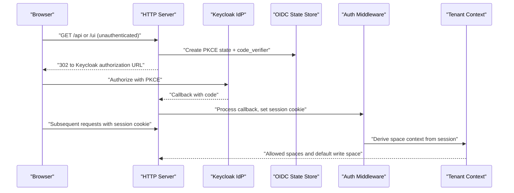
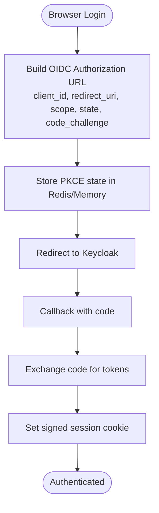
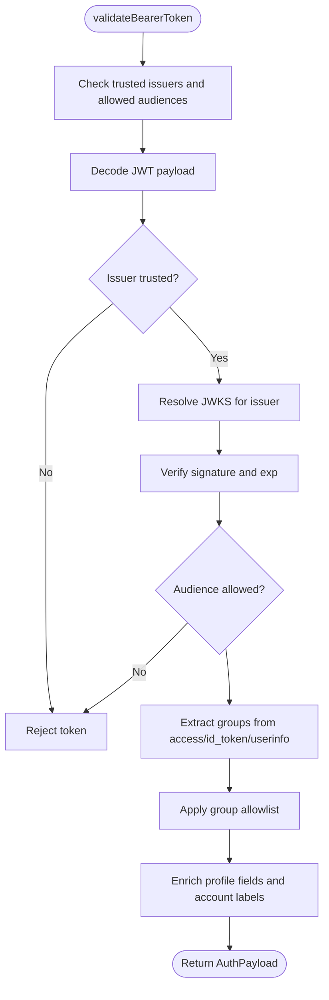
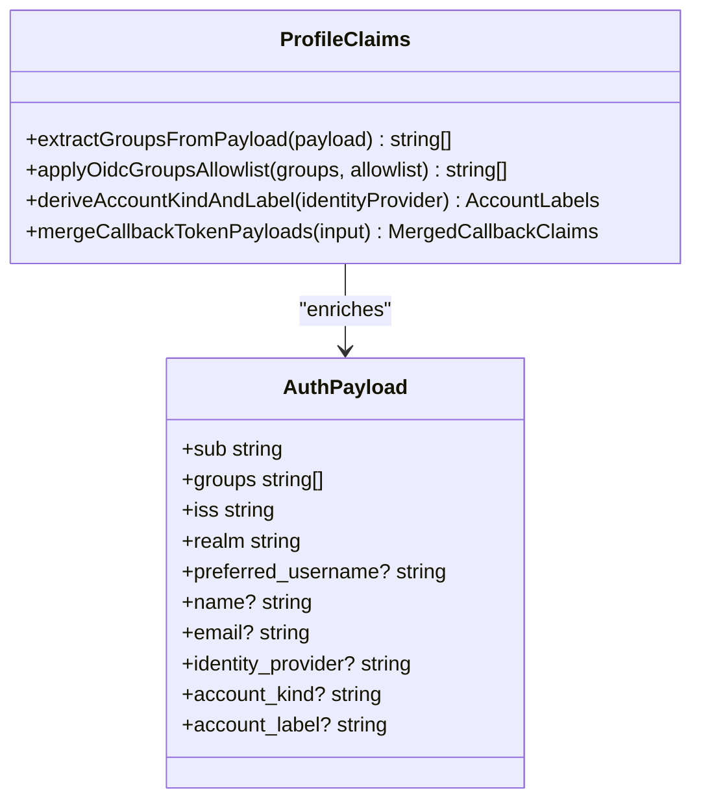
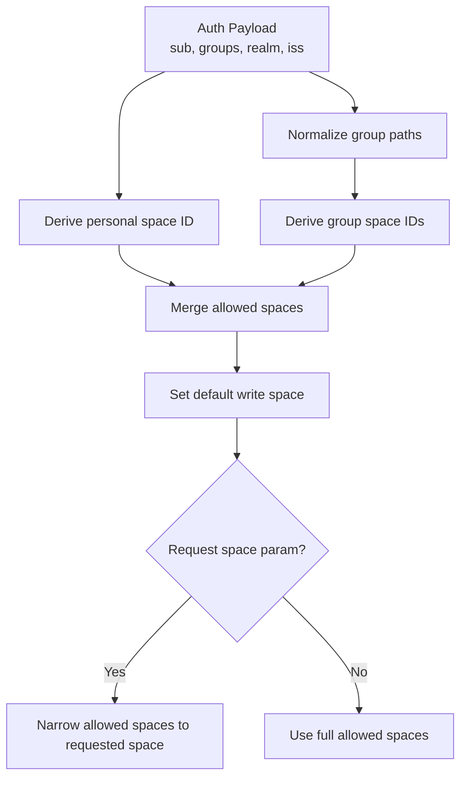
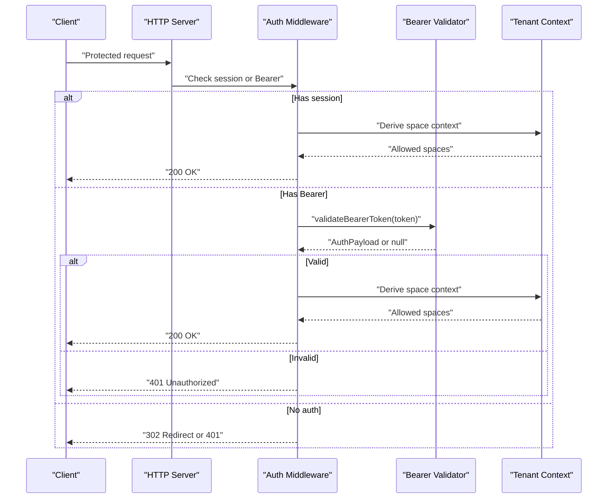
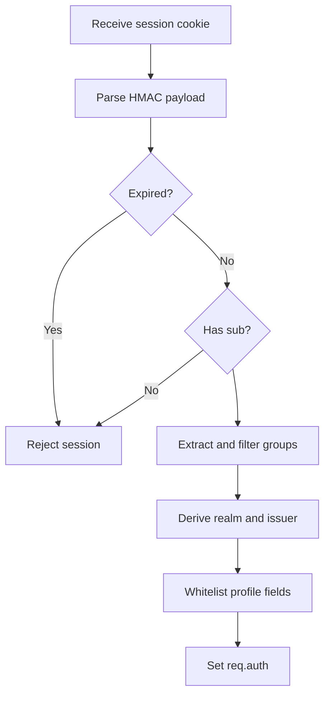
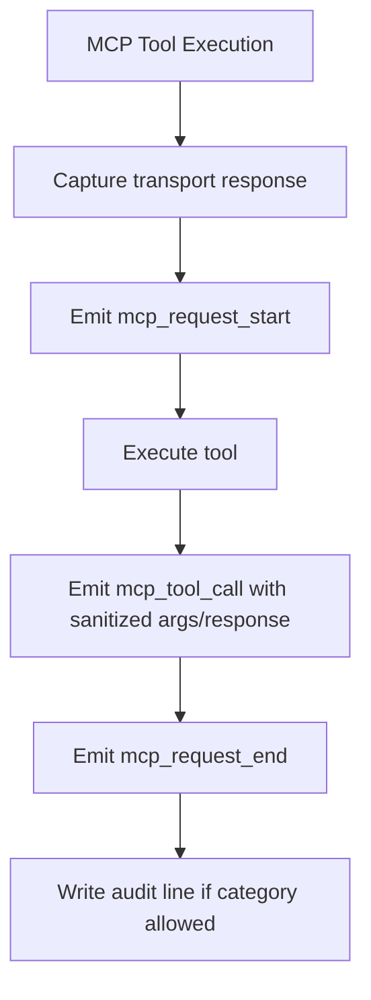
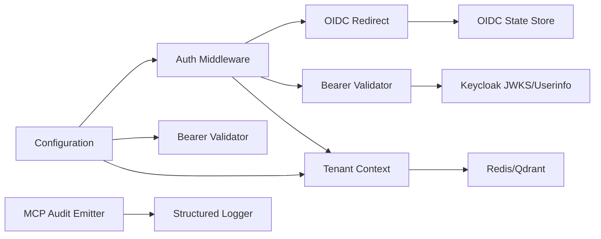

# Authentication and Security

<cite>
**Referenced Files in This Document**
- [http-auth-middleware.ts](file://src/http/http-auth-middleware.ts)
- [bearer-validate.ts](file://src/http/bearer-validate.ts)
- [http-auth-oidc-redirect.ts](file://src/http/http-auth-oidc-redirect.ts)
- [oidc-profile-claims.ts](file://src/http/oidc-profile-claims.ts)
- [oidc-scopes.ts](file://src/http/oidc-scopes.ts)
- [oidc-state-store.ts](file://src/services/oidc-state-store.ts)
- [tenant-context.ts](file://src/utils/tenant-context.ts)
- [mcp-audit-emit.ts](file://src/http/mcp-audit-emit.ts)
- [audit-log-events.ts](file://src/utils/audit-log-events.ts)
- [audit-log.md](file://docs/security/audit-log.md)
- [incident-runbook.md](file://docs/security/incident-runbook.md)
- [threat-model.md](file://docs/security/threat-model.md)
</cite>

## Table of Contents
1. [Introduction](#introduction)
2. [Project Structure](#project-structure)
3. [Core Components](#core-components)
4. [Architecture Overview](#architecture-overview)
5. [Detailed Component Analysis](#detailed-component-analysis)
6. [Dependency Analysis](#dependency-analysis)
7. [Performance Considerations](#performance-considerations)
8. [Troubleshooting Guide](#troubleshooting-guide)
9. [Conclusion](#conclusion)
10. [Appendices](#appendices)

## Introduction
This document provides comprehensive security documentation for SquadRules, focusing on authentication, authorization, tenant isolation, audit logging, threat modeling, and incident response. It explains Keycloak OIDC integration, JWT bearer validation, OAuth2 flows with PKCE, role-based access control via groups, space-based tenant isolation, session management, and operational security practices.

SquadRules is an agent-first MCP framework where AI agents are primary users. Authentication supports both browser-initiated OIDC login and programmatic Bearer token usage. Authorization derives user identity and group membership from OIDC claims to compute per-user and per-group spaces. Audit logging captures embedding, anomaly, and MCP tool call events for investigation and compliance.

## Project Structure
The security-relevant implementation spans HTTP middleware, OIDC redirect helpers, JWT validation, profile claim processing, OIDC state storage, tenant context derivation, and audit emission utilities. Documentation artifacts include the threat model, audit log specification, and incident runbook.

**Diagram sources**
- [http-auth-middleware.ts:172-327](file://src/http/http-auth-middleware.ts#L172-L327)
- [http-auth-oidc-redirect.ts:15-78](file://src/http/http-auth-oidc-redirect.ts#L15-L78)
- [bearer-validate.ts:120-208](file://src/http/bearer-validate.ts#L120-L208)
- [oidc-state-store.ts:50-75](file://src/services/oidc-state-store.ts#L50-L75)
- [tenant-context.ts:217-291](file://src/utils/tenant-context.ts#L217-L291)
- [mcp-audit-emit.ts:44-117](file://src/http/mcp-audit-emit.ts#L44-L117)

**Section sources**
- [http-auth-middleware.ts:1-330](file://src/http/http-auth-middleware.ts#L1-L330)
- [bearer-validate.ts:1-209](file://src/http/bearer-validate.ts#L1-L209)
- [http-auth-oidc-redirect.ts:1-92](file://src/http/http-auth-oidc-redirect.ts#L1-L92)
- [oidc-profile-claims.ts:1-288](file://src/http/oidc-profile-claims.ts#L1-L288)
- [oidc-scopes.ts:1-31](file://src/http/oidc-scopes.ts#L1-L31)
- [oidc-state-store.ts:1-76](file://src/services/oidc-state-store.ts#L1-L76)
- [tenant-context.ts:1-312](file://src/utils/tenant-context.ts#L1-L312)
- [mcp-audit-emit.ts:1-118](file://src/http/mcp-audit-emit.ts#L1-L118)
- [audit-log-events.ts:1-89](file://src/utils/audit-log-events.ts#L1-L89)
- [audit-log.md:1-217](file://docs/security/audit-log.md#L1-L217)
- [incident-runbook.md:1-115](file://docs/security/incident-runbook.md#L1-L115)
- [threat-model.md:1-131](file://docs/security/threat-model.md#L1-L131)

## Core Components
- Authentication middleware enforces protected paths, supports session cookies and Bearer tokens, redirects browsers to Keycloak, and returns structured 401 responses for MCP clients.
- Bearer token validator verifies issuer, audience, expiration, and signature using JWKS; it enriches groups via userinfo when needed.
- OIDC redirect helpers build authorization URLs with PKCE, store transient state in Redis or memory, and support RP-initiated logout.
- Profile claim processing whitelists fields, normalizes groups, merges callback payloads, and derives account labels.
- OIDC state store persists PKCE code verifier and timestamps with TTL.
- Tenant context maps authenticated claims to deterministic space IDs for personal and group spaces, enforcing strict isolation.
- Audit emission records MCP tool calls, request start/end, and optional file-side audit lines.

**Section sources**
- [http-auth-middleware.ts:172-327](file://src/http/http-auth-middleware.ts#L172-L327)
- [bearer-validate.ts:120-208](file://src/http/bearer-validate.ts#L120-L208)
- [http-auth-oidc-redirect.ts:15-78](file://src/http/http-auth-oidc-redirect.ts#L15-L78)
- [oidc-profile-claims.ts:74-153](file://src/http/oidc-profile-claims.ts#L74-L153)
- [oidc-state-store.ts:50-75](file://src/services/oidc-state-store.ts#L50-L75)
- [tenant-context.ts:217-291](file://src/utils/tenant-context.ts#L217-L291)
- [mcp-audit-emit.ts:44-117](file://src/http/mcp-audit-emit.ts#L44-L117)

## Architecture Overview
The system uses two authentication paths:
- Browser flow: unauthenticated GET requests to protected paths redirect to Keycloak with PKCE; after callback, a signed session cookie is established.
- Programmatic flow: Bearer tokens are validated against trusted issuers and allowed audiences; groups may be fetched from OIDC userinfo.

Authorization derives space context from sub, groups, realm, and issuer. Space IDs are deterministic UUIDs derived from issuer and group paths, ensuring consistent tenant isolation across deployments.

**Diagram sources**
- [http-auth-oidc-redirect.ts:52-78](file://src/http/http-auth-oidc-redirect.ts#L52-L78)
- [http-auth-middleware.ts:172-327](file://src/http/http-auth-middleware.ts#L172-L327)
- [oidc-state-store.ts:50-75](file://src/services/oidc-state-store.ts#L50-L75)
- [tenant-context.ts:217-291](file://src/utils/tenant-context.ts#L217-L291)

## Detailed Component Analysis

### Keycloak OIDC Integration and OAuth2 Flows
- Authorization URL construction includes client ID, redirect URI, response type code, scopes openid/profile/email, PKCE state, code challenge S256, and prompt login.
- PKCE state is stored with TTL for secure code exchange.
- Logout builds end-session redirect with post_logout_redirect_uri and optional id_token_hint.
- Supported scopes include openid, profile, email, squadrules-groups, offline_access.

**Diagram sources**
- [http-auth-oidc-redirect.ts:15-78](file://src/http/http-auth-oidc-redirect.ts#L15-L78)
- [oidc-state-store.ts:50-75](file://src/services/oidc-state-store.ts#L50-L75)
- [oidc-scopes.ts:1-31](file://src/http/oidc-scopes.ts#L1-L31)

**Section sources**
- [http-auth-oidc-redirect.ts:15-78](file://src/http/http-auth-oidc-redirect.ts#L15-L78)
- [oidc-state-store.ts:16-75](file://src/services/oidc-state-store.ts#L16-L75)
- [oidc-scopes.ts:1-31](file://src/http/oidc-scopes.ts#L1-L31)

### JWT Bearer Token Validation
- Validates issuer against trusted list, audience against allowed list, expiration, and signature via JWKS.
- Supports internal Keycloak URL resolution for Docker environments.
- Enriches groups from access token, nested id_token, or OIDC userinfo endpoint.
- Applies group allowlist filtering and whitelisted profile field extraction.

**Diagram sources**
- [bearer-validate.ts:120-208](file://src/http/bearer-validate.ts#L120-L208)
- [oidc-profile-claims.ts:74-153](file://src/http/oidc-profile-claims.ts#L74-L153)

**Section sources**
- [bearer-validate.ts:41-109](file://src/http/bearer-validate.ts#L41-L109)
- [bearer-validate.ts:120-208](file://src/http/bearer-validate.ts#L120-L208)
- [oidc-profile-claims.ts:155-190](file://src/http/oidc-profile-claims.ts#L155-L190)

### Role-Based Access Control and Group Mapping
- Groups are normalized from arrays, strings, or JSON array strings.
- Group allowlist supports exact matches and prefix matching for hierarchical paths.
- Account kind and label derive from identity provider, distinguishing local vs SSO accounts.

**Diagram sources**
- [oidc-profile-claims.ts:74-153](file://src/http/oidc-profile-claims.ts#L74-L153)
- [oidc-profile-claims.ts:182-190](file://src/http/oidc-profile-claims.ts#L182-L190)
- [bearer-validate.ts:22-39](file://src/http/bearer-validate.ts#L22-L39)

**Section sources**
- [oidc-profile-claims.ts:74-153](file://src/http/oidc-profile-claims.ts#L74-L153)
- [oidc-profile-claims.ts:182-190](file://src/http/oidc-profile-claims.ts#L182-L190)

### Space-Based Tenant Isolation
- Personal space ID is deterministic based on issuer and sub.
- Group space IDs are deterministic based on issuer and normalized group path.
- Allowed spaces include personal and group spaces; default write space is personal.
- Request-scoped space narrowing restricts operations to a single allowed space.

**Diagram sources**
- [tenant-context.ts:217-291](file://src/utils/tenant-context.ts#L217-L291)
- [tenant-context.ts:156-179](file://src/utils/tenant-context.ts#L156-L179)

**Section sources**
- [tenant-context.ts:217-291](file://src/utils/tenant-context.ts#L217-L291)
- [tenant-context.ts:156-179](file://src/utils/tenant-context.ts#L156-L179)

### Security Middleware and Bearer Validation Flow
- Protected paths include /api, /api/*, /mcp, /ui, /ui/*.
- Unauthenticated browser GET redirects to Keycloak; other methods return 401 with WWW-Authenticate.
- Bearer validation requires configured trusted issuers and allowed audiences; otherwise rejects with informative error.
- Space context is attached to request and used by downstream handlers.

**Diagram sources**
- [http-auth-middleware.ts:172-327](file://src/http/http-auth-middleware.ts#L172-L327)
- [bearer-validate.ts:120-208](file://src/http/bearer-validate.ts#L120-L208)
- [tenant-context.ts:256-291](file://src/utils/tenant-context.ts#L256-L291)

**Section sources**
- [http-auth-middleware.ts:151-160](file://src/http/http-auth-middleware.ts#L151-L160)
- [http-auth-middleware.ts:172-327](file://src/http/http-auth-middleware.ts#L172-L327)

### Session Management
- Session cookie name is squadrules_session.
- Cookie payload is HMAC-signed with SESSION_SECRET; expiration and sub are checked.
- OIDC id_token hint is peeked from session for RP-initiated logout.
- When AUTH_ENABLED, unauthenticated no-context uses sentinel space to prevent sharing default data.

**Diagram sources**
- [http-auth-middleware.ts:49-133](file://src/http/http-auth-middleware.ts#L49-L133)
- [tenant-context.ts:76-87](file://src/utils/tenant-context.ts#L76-L87)

**Section sources**
- [http-auth-middleware.ts:49-133](file://src/http/http-auth-middleware.ts#L49-L133)
- [tenant-context.ts:76-87](file://src/utils/tenant-context.ts#L76-L87)

### Audit Logging and Incident Response
- Audit categories include audit.embedding, audit.anomaly, and audit.mcp.
- MCP audit levels control detail captured in the optional audit file.
- Sanitization redacts secrets and bounds sizes for safe logging.
- Incident runbook prescribes traceability by request_id, tenant_id, and correlation_id.

**Diagram sources**
- [mcp-audit-emit.ts:24-117](file://src/http/mcp-audit-emit.ts#L24-L117)
- [audit-log-events.ts:68-88](file://src/utils/audit-log-events.ts#L68-L88)
- [audit-log.md:89-155](file://docs/security/audit-log.md#L89-L155)

**Section sources**
- [mcp-audit-emit.ts:44-117](file://src/http/mcp-audit-emit.ts#L44-L117)
- [audit-log-events.ts:1-89](file://src/utils/audit-log-events.ts#L1-L89)
- [audit-log.md:30-47](file://docs/security/audit-log.md#L30-L47)
- [audit-log.md:89-155](file://docs/security/audit-log.md#L89-L155)
- [incident-runbook.md:47-99](file://docs/security/incident-runbook.md#L47-L99)

## Dependency Analysis
Authentication components depend on configuration values such as AUTH_ENABLED, AUTH_MODE, AUTH_TRUSTED_ISSUERS, AUTH_ALLOWED_AUDIENCES, KEYCLOAK_URL, KEYCLOAK_INTERNAL_URL, and OIDC_GROUPS_ALLOWLIST. The middleware composes OIDC redirect helpers, bearer validation, and tenant context derivation. Audit emission depends on structured logger sanitization and config-driven verbosity.

**Diagram sources**
- [http-auth-middleware.ts:172-327](file://src/http/http-auth-middleware.ts#L172-L327)
- [bearer-validate.ts:120-208](file://src/http/bearer-validate.ts#L120-L208)
- [oidc-state-store.ts:50-75](file://src/services/oidc-state-store.ts#L50-L75)
- [tenant-context.ts:217-291](file://src/utils/tenant-context.ts#L217-L291)
- [mcp-audit-emit.ts:44-117](file://src/http/mcp-audit-emit.ts#L44-L117)

**Section sources**
- [http-auth-middleware.ts:172-327](file://src/http/http-auth-middleware.ts#L172-L327)
- [bearer-validate.ts:120-208](file://src/http/bearer-validate.ts#L120-L208)
- [oidc-state-store.ts:50-75](file://src/services/oidc-state-store.ts#L50-L75)
- [tenant-context.ts:217-291](file://src/utils/tenant-context.ts#L217-L291)
- [mcp-audit-emit.ts:44-117](file://src/http/mcp-audit-emit.ts#L44-L117)

## Performance Considerations
- JWKS caching reduces repeated key fetching per issuer.
- OIDC userinfo fetch has an 8-second timeout to avoid blocking long-running requests.
- Redis-backed OIDC state store enables horizontal scaling without session affinity.
- Audit file writes are append-only and filtered by category to minimize overhead.

[No sources needed since this section provides general guidance]

## Troubleshooting Guide
Common issues and mitigations:
- Missing AUTH_CALLBACK_BASE_URL causes 503 during login URL generation.
- Bearer tokens rejected due to missing trusted issuers or allowed audiences result in 401 with explanatory message.
- OIDC userinfo returning no groups indicates missing protocol mapper; configure group membership mapping in Keycloak.
- Cross-tenant access suspicion requires correlating logs by request_id and verifying space filters.

Operational steps:
- Inspect structured logs for category audit.mcp, audit.embedding, and audit.anomaly.
- Use AUDIT_LOG_FILE to capture append-only audit lines for investigations.
- Follow incident runbook playbooks for data poisoning, embedding abuse, and cross-tenant leakage.

**Section sources**
- [http-auth-middleware.ts:289-327](file://src/http/http-auth-middleware.ts#L289-L327)
- [bearer-validate.ts:70-100](file://src/http/bearer-validate.ts#L70-L100)
- [audit-log.md:157-187](file://docs/security/audit-log.md#L157-L187)
- [incident-runbook.md:66-99](file://docs/security/incident-runbook.md#L66-L99)

## Conclusion
SquadRules implements robust authentication and authorization through Keycloak OIDC, JWT bearer validation, and deterministic space-based tenant isolation. The middleware supports both browser and programmatic flows, while audit logging and incident procedures provide operational visibility and response readiness. Production deployments should enforce trusted issuers, allowed audiences, group allowlists, and secure secret management to mitigate risks identified in the threat model.

[No sources needed since this section summarizes without analyzing specific files]

## Appendices

### Configuration Examples

#### Keycloak Setup
- Configure Keycloak realm and client with scopes openid, profile, email, squadrules-groups, offline_access.
- Map group membership to token claims so groups appear in access tokens or userinfo.
- Register redirect URIs for /auth/callback and post_logout_redirect_uri for logout flows.
- Set environment variables:
  - KEYCLOAK_URL
  - KEYCLOAK_INTERNAL_URL (for Docker)
  - KEYCLOAK_REALM
  - KEYCLOAK_CLIENT_ID
  - AUTH_CALLBACK_BASE_URL
  - AUTH_ENABLED=true
  - AUTH_TRUSTED_ISSUERS
  - AUTH_ALLOWED_AUDIENCES
  - OIDC_GROUPS_ALLOWLIST (optional)

**Section sources**
- [http-auth-oidc-redirect.ts:15-32](file://src/http/http-auth-oidc-redirect.ts#L15-L32)
- [oidc-scopes.ts:1-31](file://src/http/oidc-scopes.ts#L1-L31)
- [bearer-validate.ts:41-63](file://src/http/bearer-validate.ts#L41-L63)

#### Google IdP Integration
- Add Google as an identity provider in Keycloak realm.
- Ensure identity_provider claim is emitted in tokens or userinfo.
- Account labels will reflect Google (SSO) automatically.

**Section sources**
- [oidc-profile-claims.ts:16-22](file://src/http/oidc-profile-claims.ts#L16-L22)
- [oidc-profile-claims.ts:182-190](file://src/http/oidc-profile-claims.ts#L182-L190)

#### Custom Authentication Providers
- Extend OIDC groups allowlist to map custom group paths to spaces.
- If using non-Keycloak OIDC providers, ensure issuer and audience match configured trusted lists.
- For custom identity providers, ensure identity_provider claim is present to derive account labels.

**Section sources**
- [oidc-profile-claims.ts:119-153](file://src/http/oidc-profile-claims.ts#L119-L153)
- [bearer-validate.ts:120-208](file://src/http/bearer-validate.ts#L120-L208)

### Security Best Practices and Vulnerability Mitigations
- Always set AUTH_TRUSTED_ISSUERS and AUTH_ALLOWED_AUDIENCES when enabling Bearer auth.
- Restrict OIDC_GROUPS_ALLOWLIST to only necessary group paths.
- Rotate SESSION_SECRET and provider API keys regularly.
- Enable AUDIT_LOG_FILE for append-only audit streams and configure rotation externally.
- Monitor audit.anomaly events for unusual norms, latency spikes, and search quality warnings.
- Enforce rate limiting at the gateway or server level.
- Keep dependencies updated and use CI scanning and SBOM generation.

**Section sources**
- [http-auth-middleware.ts:230-251](file://src/http/http-auth-middleware.ts#L230-L251)
- [oidc-profile-claims.ts:119-153](file://src/http/oidc-profile-claims.ts#L119-L153)
- [audit-log.md:30-47](file://docs/security/audit-log.md#L30-L47)
- [threat-model.md:97-114](file://docs/security/threat-model.md#L97-L114)