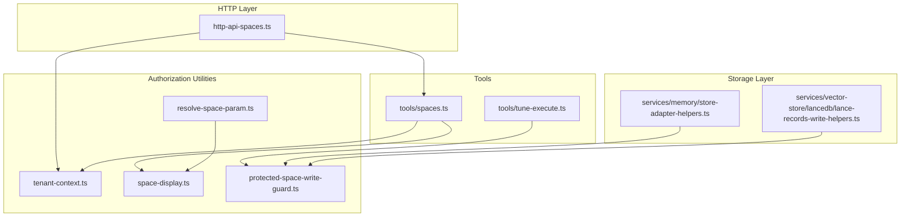
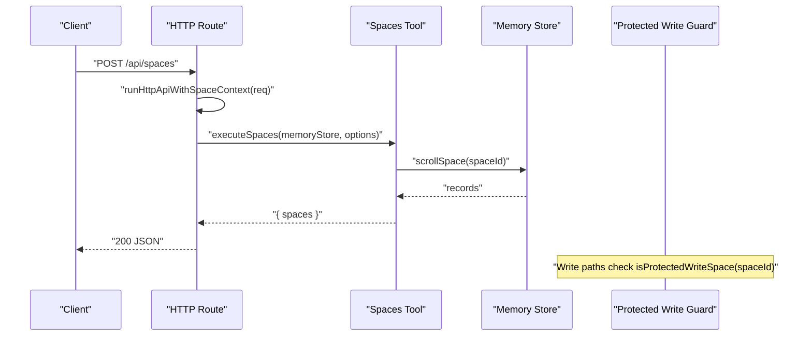
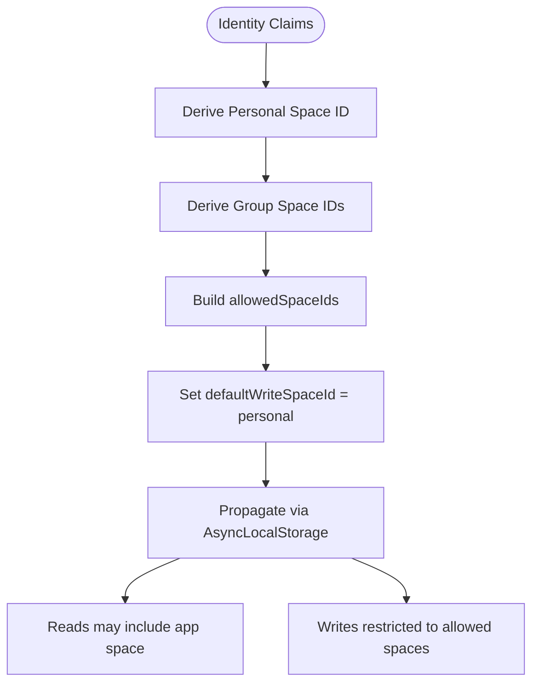
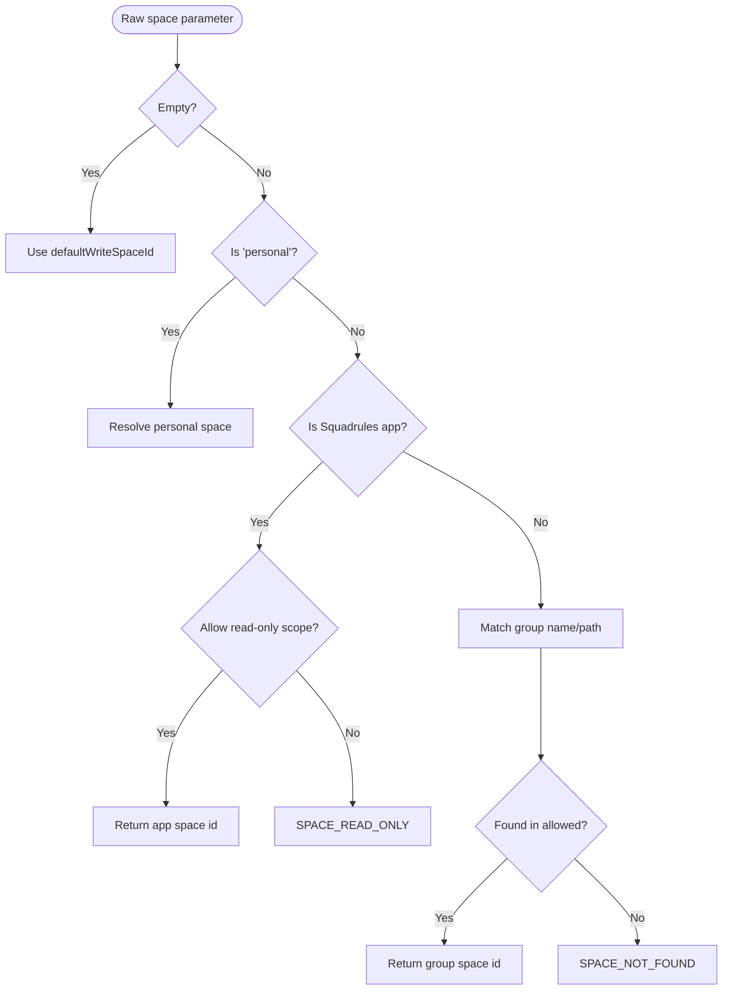
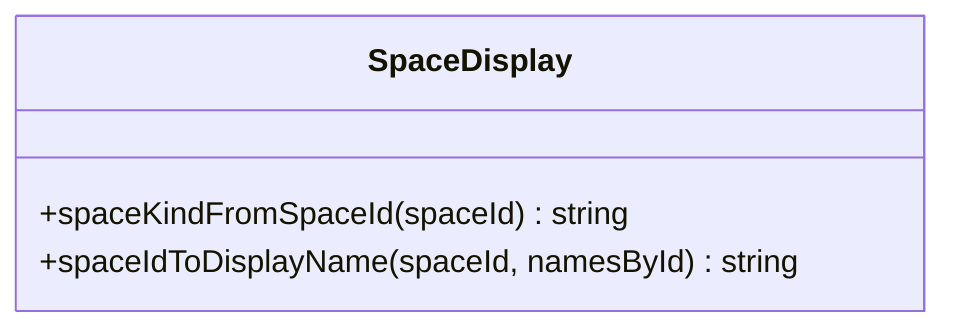
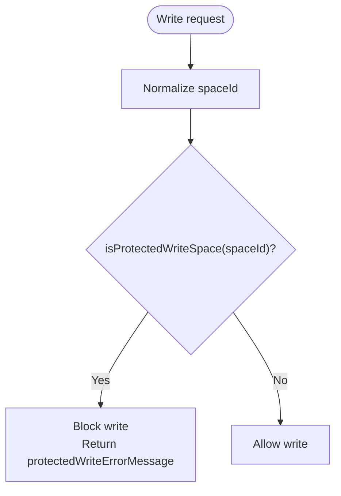
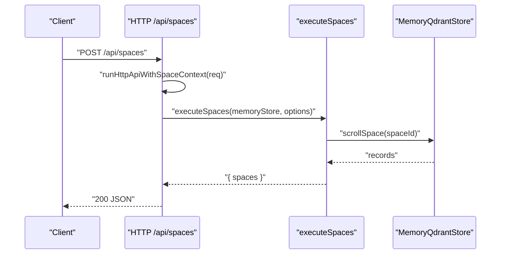
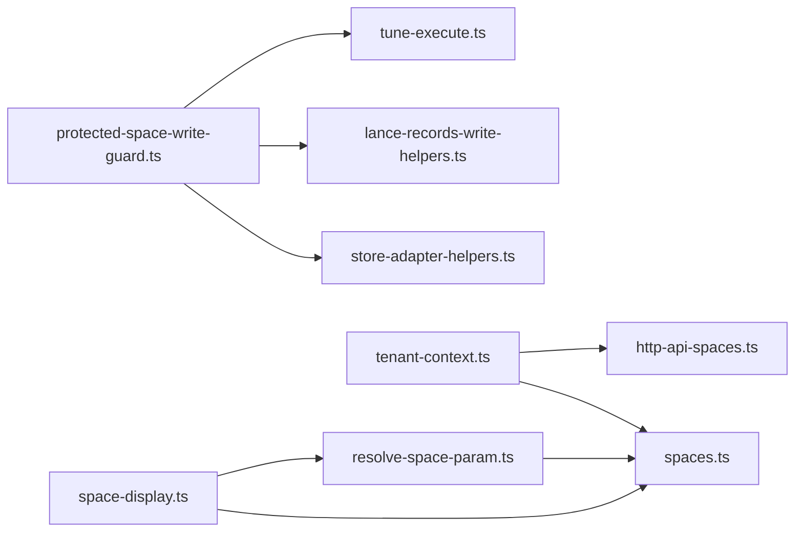

# Authorization and Permissions

<cite>
**Referenced Files in This Document**
- [protected-space-write-guard.ts](file://src/utils/protected-space-write-guard.ts)
- [tenant-context.ts](file://src/utils/tenant-context.ts)
- [resolve-space-param.ts](file://src/utils/resolve-space-param.ts)
- [space-display.ts](file://src/utils/space-display.ts)
- [spaces.ts](file://src/tools/spaces.ts)
- [http-api-spaces.ts](file://src/http/http-api-spaces.ts)
- [store-adapter-helpers.ts](file://src/services/memory/store-adapter-helpers.ts)
- [lance-records-write-helpers.ts](file://src/services/vector-store/lancedb/lance-records-write-helpers.ts)
- [tune-execute.ts](file://src/tools/tune-execute.ts)
</cite>

## Table of Contents
1. [Introduction](#introduction)
2. [Project Structure](#project-structure)
3. [Core Components](#core-components)
4. [Architecture Overview](#architecture-overview)
5. [Detailed Component Analysis](#detailed-component-analysis)
6. [Dependency Analysis](#dependency-analysis)
7. [Performance Considerations](#performance-considerations)
8. [Troubleshooting Guide](#troubleshooting-guide)
9. [Conclusion](#conclusion)

## Introduction
This document explains the SquadRules authorization and permission system with a focus on space-based multi-tenancy, role-based access control derived from identity groups, and strict write protection for built-in spaces. It covers:

- Space-based multi-tenancy and tenant context propagation.
- User groups, personal spaces, group spaces, and the read-only Squadrules app space.
- Permission enforcement for reads and writes.
- The protected space write guard that prevents unauthorized modifications to system or application spaces.
- Practical examples of space configuration, permission matrices, and access control patterns.
- Common authorization scenarios and troubleshooting approaches.

SquadRules is an agent-first MCP framework where agents are primary users. Human operators configure preferences through agents, while the platform enforces isolation between tenants using spaces and identity-derived permissions.

## Project Structure
The authorization and permission logic spans utilities, tools, HTTP routes, and storage helpers:

- Tenant context and space resolution utilities define how identities map to allowed spaces and default write targets.
- Tools expose operations such as listing spaces and tuning adapters within the current tenant context.
- HTTP routes wrap handlers with the active space context so downstream services can access it without request references.
- Storage helpers enforce write guards at the persistence layer to prevent accidental or malicious overwrites of protected spaces.

**Diagram sources**
- [tenant-context.ts:1-312](file://src/utils/tenant-context.ts#L1-L312)
- [resolve-space-param.ts:1-117](file://src/utils/resolve-space-param.ts#L1-L117)
- [space-display.ts:1-38](file://src/utils/space-display.ts#L1-L38)
- [protected-space-write-guard.ts:1-17](file://src/utils/protected-space-write-guard.ts#L1-L17)
- [spaces.ts:1-255](file://src/tools/spaces.ts#L1-L255)
- [http-api-spaces.ts:1-32](file://src/http/http-api-spaces.ts#L1-L32)
- [store-adapter-helpers.ts:1-100](file://src/services/memory/store-adapter-helpers.ts#L1-L100)
- [lance-records-write-helpers.ts:1-100](file://src/services/vector-store/lancedb/lance-records-write-helpers.ts#L1-L100)
- [tune-execute.ts:1-100](file://src/tools/tune-execute.ts#L1-L100)

**Section sources**
- [tenant-context.ts:1-312](file://src/utils/tenant-context.ts#L1-L312)
- [spaces.ts:1-255](file://src/tools/spaces.ts#L1-L255)
- [http-api-spaces.ts:1-32](file://src/http/http-api-spaces.ts#L1-L32)

## Core Components
- SpaceContext defines the active tenant context, including user identifier, group identifiers, allowed space identifiers, default write space, personal space, optional human-readable space names, and optional narrowed search scope.
- Tenant context utilities provide functions to create, propagate, and retrieve the active context across synchronous and asynchronous boundaries.
- Space parameter resolution maps user-friendly inputs like “personal” or group names into canonical space identifiers, enforcing read-only constraints for the Squadrules app space.
- Space display utilities convert internal space identifiers into human-readable labels for tool outputs and UI.
- Protected space write guard identifies protected spaces and provides error messages when writes are attempted against them.
- Spaces tool lists available spaces and adapter counts within the current context.
- HTTP spaces route exposes a REST endpoint that executes the spaces tool under the active space context.
- Storage helpers apply the protected space write guard during memory and vector store writes.
- Tune execution tool checks protected spaces before performing write operations.

**Section sources**
- [tenant-context.ts:23-42](file://src/utils/tenant-context.ts#L23-L42)
- [resolve-space-param.ts:10-20](file://src/utils/resolve-space-param.ts#L10-L20)
- [space-display.ts:7-37](file://src/utils/space-display.ts#L7-L37)
- [protected-space-write-guard.ts:5-16](file://src/utils/protected-space-write-guard.ts#L5-L16)
- [spaces.ts:42-48](file://src/tools/spaces.ts#L42-L48)
- [http-api-spaces.ts:11-31](file://src/http/http-api-spaces.ts#L11-L31)
- [store-adapter-helpers.ts:1-100](file://src/services/memory/store-adapter-helpers.ts#L1-L100)
- [lance-records-write-helpers.ts:1-100](file://src/services/vector-store/lancedb/lance-records-write-helpers.ts#L1-L100)
- [tune-execute.ts:1-100](file://src/tools/tune-execute.ts#L1-L100)

## Architecture Overview
The authorization architecture combines identity-derived permissions with explicit space scoping and layered write guards:

- Identity (Keycloak JWT) supplies user identifier, groups, realm, and issuer. These values determine personal and group space identifiers.
- SpaceContext propagates allowed spaces and default write target through AsyncLocalStorage so storage services can enforce isolation without request references.
- Read operations may include the Squadrules app space for discovery and search unless explicitly scoped otherwise.
- Write operations are restricted to allowed spaces and blocked for protected spaces.
- Tools and HTTP endpoints use the active context to resolve writable targets and render responses.

**Diagram sources**
- [http-api-spaces.ts:11-31](file://src/http/http-api-spaces.ts#L11-L31)
- [spaces.ts:172-189](file://src/tools/spaces.ts#L172-L189)
- [protected-space-write-guard.ts:5-16](file://src/utils/protected-space-write-guard.ts#L5-L16)

## Detailed Component Analysis

### Tenant Context and Multi-Tenancy
The tenant context system derives per-user and per-group spaces from identity claims:

- Personal space ID is deterministic based on issuer, realm, and user identifier.
- Group spaces are derived from Keycloak full group paths.
- Allowed spaces include personal and all groups; default write space is personal.
- When authentication is enabled but no auth context exists, a sentinel space is used to ensure strict isolation.
- Optional narrowed scopes allow read-only targeting of the Squadrules app space for activation/search without allowing writes.

**Diagram sources**
- [tenant-context.ts:187-248](file://src/utils/tenant-context.ts#L187-L248)
- [tenant-context.ts:256-303](file://src/utils/tenant-context.ts#L256-L303)

**Section sources**
- [tenant-context.ts:20-87](file://src/utils/tenant-context.ts#L20-L87)
- [tenant-context.ts:187-248](file://src/utils/tenant-context.ts#L187-L248)
- [tenant-context.ts:256-303](file://src/utils/tenant-context.ts#L256-L303)

### Space Parameter Resolution
Space parameter resolution converts user-facing inputs into canonical space identifiers:

- Empty or undefined input resolves to the default write space.
- “personal” resolves to the JWT-derived personal space when available.
- The Squadrules app space is read-only for writes; it can be resolved for read-only scopes only when explicitly allowed.
- Group names and canonical group paths are matched against allowed spaces.
- Errors distinguish missing spaces from read-only violations.

**Diagram sources**
- [resolve-space-param.ts:26-103](file://src/utils/resolve-space-param.ts#L26-L103)

**Section sources**
- [resolve-space-param.ts:10-20](file://src/utils/resolve-space-param.ts#L10-L20)
- [resolve-space-param.ts:26-103](file://src/utils/resolve-space-param.ts#L26-L103)

### Space Display and Types
Space display utilities translate internal space identifiers into human-readable labels:

- Personal spaces display as “Personal”.
- Group spaces display as “Group: /full/path”.
- The Squadrules app space displays as “Squadrules app”.
- Other space kinds fall back to generic labels or raw identifiers.

**Diagram sources**
- [space-display.ts:7-37](file://src/utils/space-display.ts#L7-L37)

**Section sources**
- [space-display.ts:7-37](file://src/utils/space-display.ts#L7-L37)

### Protected Space Write Guard
The protected space write guard prevents writes to system and application spaces:

- Protected spaces include the Squadrules app space and system sentinel spaces.
- Any write attempt to a protected space returns a clear error message instructing users to fork to a personal or group space.
- The guard is applied in multiple write paths, including memory store adapter helpers, LanceDB record helpers, and tune execution.

**Diagram sources**
- [protected-space-write-guard.ts:5-16](file://src/utils/protected-space-write-guard.ts#L5-L16)
- [store-adapter-helpers.ts:60-90](file://src/services/memory/store-adapter-helpers.ts#L60-L90)
- [lance-records-write-helpers.ts:55-85](file://src/services/vector-store/lancedb/lance-records-write-helpers.ts#L55-L85)
- [tune-execute.ts:60-70](file://src/tools/tune-execute.ts#L60-L70)

**Section sources**
- [protected-space-write-guard.ts:1-17](file://src/utils/protected-space-write-guard.ts#L1-L17)
- [store-adapter-helpers.ts:1-100](file://src/services/memory/store-adapter-helpers.ts#L1-L100)
- [lance-records-write-helpers.ts:1-100](file://src/services/vector-store/lancedb/lance-records-write-helpers.ts#L1-L100)
- [tune-execute.ts:1-100](file://src/tools/tune-execute.ts#L1-L100)

### Spaces Tool and HTTP Endpoint
The spaces tool lists available spaces and adapter counts within the current context:

- It uses the active space context to determine which spaces to report.
- It optionally includes adapter titles and artifacts.
- The HTTP endpoint wraps execution with the active space context and returns structured JSON.

**Diagram sources**
- [http-api-spaces.ts:11-31](file://src/http/http-api-spaces.ts#L11-L31)
- [spaces.ts:172-189](file://src/tools/spaces.ts#L172-L189)

**Section sources**
- [spaces.ts:1-255](file://src/tools/spaces.ts#L1-L255)
- [http-api-spaces.ts:1-32](file://src/http/http-api-spaces.ts#L1-L32)

## Dependency Analysis
The authorization components have clear dependencies:

- Tools depend on tenant context for current space and on space display for labels.
- HTTP routes depend on tenant context to propagate context across async handlers.
- Storage helpers depend on the protected space write guard to enforce write policies.
- Space parameter resolution depends on space display for label matching and on config constants for the app space.

**Diagram sources**
- [protected-space-write-guard.ts:1-17](file://src/utils/protected-space-write-guard.ts#L1-L17)
- [store-adapter-helpers.ts:1-100](file://src/services/memory/store-adapter-helpers.ts#L1-L100)
- [lance-records-write-helpers.ts:1-100](file://src/services/vector-store/lancedb/lance-records-write-helpers.ts#L1-L100)
- [tune-execute.ts:1-100](file://src/tools/tune-execute.ts#L1-L100)
- [tenant-context.ts:1-312](file://src/utils/tenant-context.ts#L1-L312)
- [spaces.ts:1-255](file://src/tools/spaces.ts#L1-L255)
- [http-api-spaces.ts:1-32](file://src/http/http-api-spaces.ts#L1-L32)
- [space-display.ts:1-38](file://src/utils/space-display.ts#L1-L38)
- [resolve-space-param.ts:1-117](file://src/utils/resolve-space-param.ts#L1-L117)

**Section sources**
- [protected-space-write-guard.ts:1-17](file://src/utils/protected-space-write-guard.ts#L1-L17)
- [tenant-context.ts:1-312](file://src/utils/tenant-context.ts#L1-L312)
- [spaces.ts:1-255](file://src/tools/spaces.ts#L1-L255)
- [http-api-spaces.ts:1-32](file://src/http/http-api-spaces.ts#L1-L32)
- [space-display.ts:1-38](file://src/utils/space-display.ts#L1-L38)
- [resolve-space-param.ts:1-117](file://src/utils/resolve-space-param.ts#L1-L117)

## Performance Considerations
- Tenant context retrieval is lightweight and uses AsyncLocalStorage to avoid passing request objects through deep call stacks.
- Space listing scrolls records per space with pagination disabled for simplicity; consider limiting result size in high-volume environments.
- Protected write checks are constant-time comparisons against normalized space identifiers.
- Avoid unnecessary narrowing of activateSpaceScope to reduce repeated validation overhead.

[No sources needed since this section provides general guidance]

## Troubleshooting Guide
Common authorization scenarios and resolutions:

- Cannot write to “Squadrules app”:
  - Cause: Attempting to write to the read-only app space.
  - Resolution: Use “personal” or a group name; fork adapters into a personal or group space.
  - Relevant code: protected space write guard and space parameter resolution.

- Group not found in allowed spaces:
  - Cause: The requested group is not part of the user’s allowed spaces.
  - Resolution: Verify Keycloak group membership and realm/issuer mapping.
  - Relevant code: space parameter resolution.

- No default space in context:
  - Cause: Authentication enabled with no auth context or misconfigured environment.
  - Resolution: Ensure authentication is configured or disable AUTH for local development.
  - Relevant code: tenant context defaults and no-default context.

- Requested space is not in your allowed spaces:
  - Cause: Narrowed space scope does not include the requested space.
  - Resolution: Use a space from allowedSpaceIds or remove the narrow scope.
  - Relevant code: runWithOptionalSpaceAsync validation.

- Adapter listing shows unexpected spaces:
  - Cause: Search includes the Squadrules app space by default unless explicitly scoped.
  - Resolution: Adjust activateSpaceScope if you need strict scoping.
  - Relevant code: getSearchSpaceIds and runWithOptionalSpaceAsync.

**Section sources**
- [protected-space-write-guard.ts:5-16](file://src/utils/protected-space-write-guard.ts#L5-L16)
- [resolve-space-param.ts:26-103](file://src/utils/resolve-space-param.ts#L26-L103)
- [tenant-context.ts:76-87](file://src/utils/tenant-context.ts#L76-L87)
- [tenant-context.ts:156-179](file://src/utils/tenant-context.ts#L156-L179)
- [tenant-context.ts:141-150](file://src/utils/tenant-context.ts#L141-L150)

## Conclusion
SquadRules implements robust space-based multi-tenancy with identity-derived permissions and strict write protection:

- Personal and group spaces are derived from Keycloak claims and propagated via AsyncLocalStorage.
- Reads may include the Squadrules app space for discovery; writes are restricted to allowed spaces.
- The protected space write guard blocks modifications to system and application spaces across storage layers.
- Tools and HTTP endpoints operate within the active tenant context, ensuring consistent authorization behavior.
- Clear error messages guide users toward safe, authorized actions such as forking into personal or group spaces.

[No sources needed since this section summarizes without analyzing specific files]