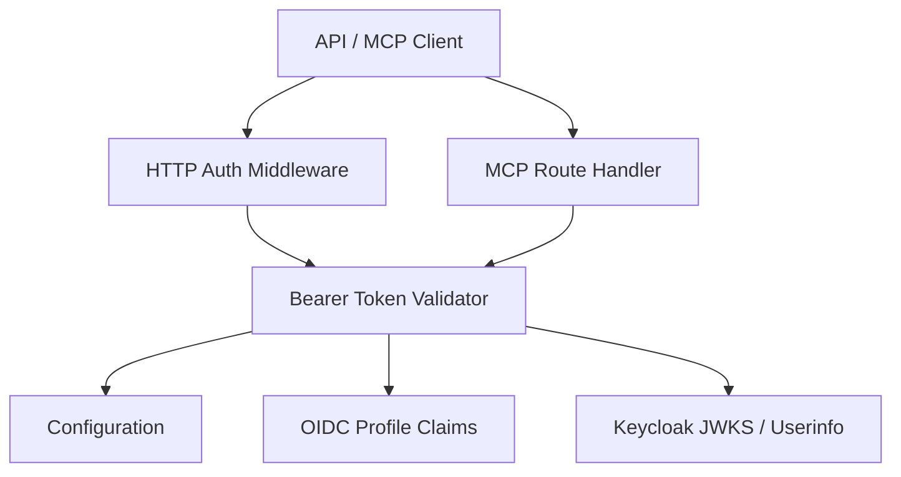
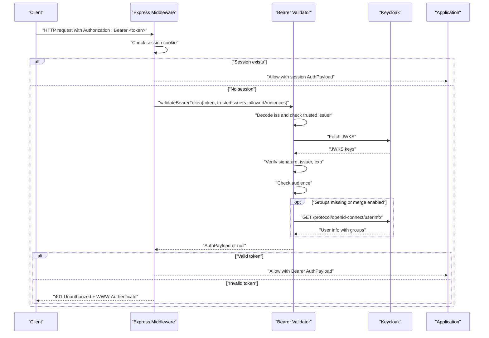
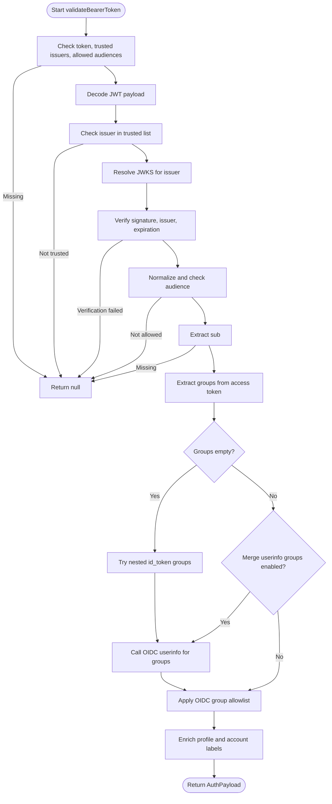
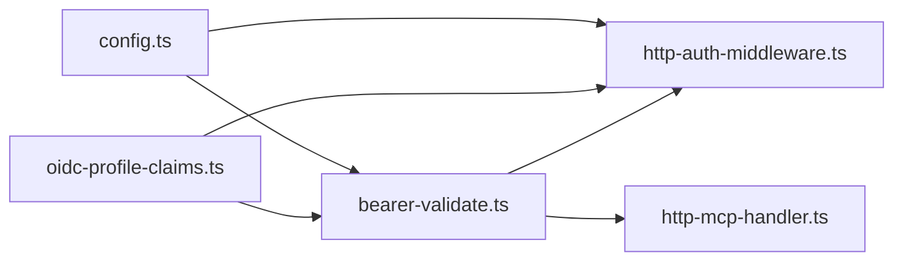

# Bearer Token Validation

<cite>
**Referenced Files in This Document**
- [bearer-validate.ts](file://src/http/bearer-validate.ts)
- [http-auth-middleware.ts](file://src/http/http-auth-middleware.ts)
- [config.ts](file://src/config.ts)
- [oidc-profile-claims.ts](file://src/http/oidc-profile-claims.ts)
- [http-mcp-handler.ts](file://src/http/http-mcp-handler.ts)
</cite>

## Table of Contents
1. [Introduction](#introduction)
2. [Project Structure](#project-structure)
3. [Core Components](#core-components)
4. [Architecture Overview](#architecture-overview)
5. [Detailed Component Analysis](#detailed-component-analysis)
6. [Dependency Analysis](#dependency-analysis)
7. [Performance Considerations](#performance-considerations)
8. [Troubleshooting Guide](#troubleshooting-guide)
9. [Conclusion](#conclusion)
10. [Appendices](#appendices)

## Introduction
This document explains how SquadRules validates Bearer JWT access tokens and how that path differs from the session-based authentication path. It covers:

- How access tokens are validated against trusted issuers and allowed audiences.
- The token structure, validation rules, and error handling.
- Configuration options `AUTH_TRUSTED_ISSUERS` and `AUTH_ALLOWED_AUDIENCES`.
- Differences between session-based and Bearer token authentication.
- Examples of valid and invalid tokens, expected error responses, and integration patterns for API clients.
- Security best practices for token handling and storage.

SquadRules uses Keycloak or another OIDC provider to issue JWTs. Browser flows typically use an HTTP-only session cookie after an OIDC callback, while programmatic MCP and REST clients commonly send a Bearer access token. Both paths produce the same internal `AuthPayload`, but they differ in where identity is stored and how it is verified.

## Project Structure
Bearer token validation lives under the HTTP layer:

- `src/http/bearer-validate.ts`: Core JWT verification logic.
- `src/http/http-auth-middleware.ts`: Express middleware that chooses session vs Bearer auth and returns standardized 401 responses.
- `src/config.ts`: Environment-driven configuration for trusted issuers, allowed audiences, and related OIDC behavior.
- `src/http/oidc-profile-claims.ts`: Shared claim extraction, group allowlist filtering, realm derivation, and profile enrichment.
- `src/http/http-mcp-handler.ts`: MCP endpoint that also validates Bearer tokens when no session is present.

**Diagram sources**
- [http-auth-middleware.ts:172-286](file://src/http/http-auth-middleware.ts#L172-L286)
- [bearer-validate.ts:120-208](file://src/http/bearer-validate.ts#L120-L208)
- [http-mcp-handler.ts:44-59](file://src/http/http-mcp-handler.ts#L44-L59)
- [config.ts:163-195](file://src/config.ts#L163-L195)
- [oidc-profile-claims.ts:78-153](file://src/http/oidc-profile-claims.ts#L78-L153)

**Section sources**
- [bearer-validate.ts:1-209](file://src/http/bearer-validate.ts#L1-L209)
- [http-auth-middleware.ts:1-330](file://src/http/http-auth-middleware.ts#L1-L330)
- [config.ts:141-195](file://src/config.ts#L141-L195)
- [oidc-profile-claims.ts:1-288](file://src/http/oidc-profile-claims.ts#L1-L288)
- [http-mcp-handler.ts:1-348](file://src/http/http-mcp-handler.ts#L1-L348)

## Core Components

### Bearer Token Validator
The validator performs these checks:

1. Rejects empty tokens or missing configuration.
2. Decodes the JWT payload without verifying the signature.
3. Checks that the issuer is in the trusted issuer list.
4. Resolves the JWKS URL for the issuer and verifies the signature, issuer, and expiration using `jose`.
5. Validates audience:
   - Accepts explicit configured audiences.
   - Accepts Keycloak “account” audience when the issuer contains `/realms/`.
   - Accepts empty audience when the issuer contains `/realms/`.
6. Requires a non-empty `sub`.
7. Derives groups from:
   - Access token `groups`.
   - Nested `id_token` inside the access token.
   - OIDC userinfo endpoint if groups are still empty or merging is enabled.
8. Applies the OIDC group allowlist.
9. Enriches the result with whitelisted profile claims and account labels.

The returned `AuthPayload` includes `sub`, `groups`, `iss`, `realm`, and optional profile fields such as username, name, email, and identity provider.

**Section sources**
- [bearer-validate.ts:22-39](file://src/http/bearer-validate.ts#L22-L39)
- [bearer-validate.ts:120-208](file://src/http/bearer-validate.ts#L120-L208)

### HTTP Authentication Middleware
The middleware implements the request-time decision logic:

- If authentication is disabled, requests pass through.
- Protected paths include `/api`, `/api/*`, `/mcp`, `/ui`, and `/ui/*`.
- Session cookies take priority when present.
- Bearer tokens are validated only when:
  - Trusted issuers and allowed audiences are configured.
  - `AUTH_MODE=oidc_bearer` or authentication is enabled.
- Unauthenticated browser GET requests may redirect to the OIDC login flow.
- Non-browser or MCP requests receive structured 401 JSON responses with `WWW-Authenticate`.

**Section sources**
- [http-auth-middleware.ts:172-327](file://src/http/http-auth-middleware.ts#L172-L327)

### Configuration
Configuration is environment-driven:

- `AUTH_TRUSTED_ISSUERS_STRING` is parsed into `AUTH_TRUSTED_ISSUERS`.
- If not explicitly set, it can be derived from `KEYCLOAK_URL` and `KEYCLOAK_REALM`.
- Localhost and loopback aliases are expanded automatically.
- `AUTH_ALLOWED_AUDIENCES_STRING` is parsed into `AUTH_ALLOWED_AUDIENCES`.
- If not explicitly set, defaults include the server client ID and CLI client ID.
- When Keycloak realm issuers are detected, `account` is added to allowed audiences.
- `AUTH_MODE` controls whether Bearer tokens are strictly validated.
- `OIDC_GROUPS_ALLOWLIST` filters which groups become usable spaces.
- `OIDC_BEARER_MERGE_USERINFO_GROUPS` enables merging userinfo groups into Bearer auth.

**Section sources**
- [config.ts:163-195](file://src/config.ts#L163-L195)
- [config.ts:305-344](file://src/config.ts#L305-L344)

### OIDC Profile Claims
Shared utilities handle:

- Extracting groups from arrays, strings, or JSON-encoded strings.
- Filtering groups through an allowlist supporting exact matches and path prefixes.
- Deriving realm from issuer URLs.
- Whitelisting profile claims to avoid leaking arbitrary JWT claims.
- Deriving account kind and label based on identity provider.

**Section sources**
- [oidc-profile-claims.ts:78-153](file://src/http/oidc-profile-claims.ts#L78-L153)
- [oidc-profile-claims.ts:163-180](file://src/http/oidc-profile-claims.ts#L163-L180)
- [oidc-profile-claims.ts:182-190](file://src/http/oidc-profile-claims.ts#L182-L190)
- [oidc-profile-claims.ts:271-287](file://src/http/oidc-profile-claims.ts#L271-L287)

### MCP Handler Bearer Fallback
The MCP route handler independently resolves Bearer authentication when no session is available. It calls the same `validateBearerToken` function so MCP clients can authenticate via Bearer even if the middleware did not attach `req.auth`.

**Section sources**
- [http-mcp-handler.ts:44-59](file://src/http/http-mcp-handler.ts#L44-L59)

## Architecture Overview

**Diagram sources**
- [http-auth-middleware.ts:190-286](file://src/http/http-auth-middleware.ts#L190-L286)
- [bearer-validate.ts:120-208](file://src/http/bearer-validate.ts#L120-L208)

## Detailed Component Analysis

### Bearer Token Validation Flow

**Diagram sources**
- [bearer-validate.ts:120-208](file://src/http/bearer-validate.ts#L120-L208)
- [oidc-profile-claims.ts:78-153](file://src/http/oidc-profile-claims.ts#L78-L153)

**Section sources**
- [bearer-validate.ts:120-208](file://src/http/bearer-validate.ts#L120-L208)

### Session-Based Authentication Path

Session-based authentication is used primarily by browsers after an OIDC callback:

1. The OIDC callback stores an HMAC-signed session cookie containing `sub`, `groups`, `iss`, `realm`, and whitelisted profile fields.
2. The middleware parses and verifies the cookie signature.
3. The middleware checks the session expiration.
4. Groups are filtered through the OIDC group allowlist.
5. The resulting `AuthPayload` is attached to the request.

This path does not call the OIDC userinfo endpoint per request because identity data is already embedded in the session cookie.

**Section sources**
- [http-auth-middleware.ts:49-133](file://src/http/http-auth-middleware.ts#L49-L133)
- [oidc-profile-claims.ts:119-153](file://src/http/oidc-profile-claims.ts#L119-L153)

### Bearer Token Authentication Path

Bearer authentication is used by programmatic clients:

1. The middleware extracts the `Authorization: Bearer <token>` header.
2. It requires trusted issuers and allowed audiences to be configured.
3. It calls `validateBearerToken`.
4. If validation succeeds, `req.auth` is set.
5. If validation fails, the middleware returns a structured 401 response with `WWW-Authenticate`.

For MCP clients, the route handler also attempts Bearer validation when no session is present.

**Section sources**
- [http-auth-middleware.ts:135-143](file://src/http/http-auth-middleware.ts#L135-L143)
- [http-auth-middleware.ts:231-286](file://src/http/http-auth-middleware.ts#L231-L286)
- [http-mcp-handler.ts:44-59](file://src/http/http-mcp-handler.ts#L44-L59)

### Token Structure and Validation Rules

#### Expected Token Fields

| Field | Purpose | Validation Behavior |
|---|---|---|
| `iss` | Issuer URL | Must match a trusted issuer. |
| `aud` | Audience(s) | Must match allowed audiences, or satisfy Keycloak compatibility rules. |
| `exp` | Expiration time | Verified by `jwtVerify`. |
| `sub` | Subject identifier | Required; must be a non-empty string. |
| `groups` | Group membership | Used for space authorization; may come from access token, nested `id_token`, or userinfo. |
| `id_token` | Optional nested ID token | Used as a fallback source for groups when access token lacks them. |
| Profile claims | Username, name, email, identity provider | Whitelisted and enriched into `AuthPayload`. |

#### Validation Rules

- Empty tokens are rejected.
- Missing trusted issuers or allowed audiences prevent Bearer validation.
- Issuer must be trusted before signature verification.
- Signature, issuer, and expiration are verified using JWKS.
- Audience validation supports:
  - Explicit configured audiences.
  - Keycloak `account` audience when the issuer contains `/realms/`.
  - Empty audience when the issuer contains `/realms/`.
- Groups are normalized and filtered by the OIDC group allowlist.
- Userinfo is optionally called to obtain or merge groups.

**Section sources**
- [bearer-validate.ts:120-208](file://src/http/bearer-validate.ts#L120-L208)
- [oidc-profile-claims.ts:78-95](file://src/http/oidc-profile-claims.ts#L78-L95)
- [oidc-profile-claims.ts:119-153](file://src/http/oidc-profile-claims.ts#L119-L153)

### Error Handling

#### Invalid or Missing Bearer Configuration

When Bearer tokens are present but issuer/audience configuration is incomplete, the middleware returns:

- Status code: `401`
- Body: `{ error: "bearer_not_validated", message: "..." }`
- `WWW-Authenticate` header is set.

**Section sources**
- [http-auth-middleware.ts:237-252](file://src/http/http-auth-middleware.ts#L237-L252)

#### Invalid, Expired, or Rejected Tokens

When `validateBearerToken` returns `null` or throws:

- Status code: `401`
- Body: `{ error: "invalid_token", message: "...", reauth_required: true, login_url?: "..." }`
- `WWW-Authenticate` header is set with `error=invalid_token`.

**Section sources**
- [http-auth-middleware.ts:253-286](file://src/http/http-auth-middleware.ts#L253-L286)

#### Unauthenticated Requests Without Bearer

When no session and no Bearer token exist:

- Browser GET requests may redirect to the OIDC login URL.
- Other requests return `401` with a JSON body including `login_url`.
- MCP JSON-RPC requests receive a structured JSON-RPC authentication error.

**Section sources**
- [http-auth-middleware.ts:289-327](file://src/http/http-auth-middleware.ts#L289-L327)

### Configuration Options

#### AUTH_TRUSTED_ISSUERS

- Type: Comma-separated string.
- Default: Derived from `KEYCLOAK_URL` and `KEYCLOAK_REALM` when not explicitly set.
- Behavior:
  - Expanded to include localhost and loopback variants.
  - Required for strict Bearer validation.
- Example values:
  - `http://keycloak:8080/realms/squadrules-dev`
  - `https://keycloak.example.com/realms/squadrules-prod`

#### AUTH_ALLOWED_AUDIENCES

- Type: Comma-separated string.
- Default: Server client ID, CLI client ID, and `account` when Keycloak realm issuers are detected.
- Behavior:
  - Explicit configuration overrides defaults.
  - Does not inject magic values when explicitly set.
- Example values:
  - `squadrules-mcp`
  - `squadrules-cli,squadrules-mcp`

#### Related OIDC Configuration

| Option | Purpose |
|---|---|
| `AUTH_MODE` | Enables strict Bearer validation when set to `oidc_bearer`. |
| `OIDC_GROUPS_ALLOWLIST` | Filters which groups become usable spaces. |
| `OIDC_BEARER_MERGE_USERINFO_GROUPS` | Merges userinfo groups into Bearer auth. |
| `KEYCLOAK_URL` | Base URL for Keycloak. |
| `KEYCLOAK_INTERNAL_URL` | Internal host for server-side Keycloak calls. |
| `KEYCLOAK_REALM` | Realm used to derive default trusted issuers. |
| `KEYCLOAK_CLIENT_ID` | Default audience when not explicitly configured. |
| `KEYCLOAK_CLI_CLIENT_ID` | CLI audience when different from server client ID. |

**Section sources**
- [config.ts:163-195](file://src/config.ts#L163-L195)
- [config.ts:305-344](file://src/config.ts#L305-L344)

### Valid and Invalid Token Examples

#### Valid Token Characteristics

- Issuer matches a trusted issuer.
- Audience matches an allowed audience, or satisfies Keycloak compatibility rules.
- Token is not expired.
- Signature is valid against the issuer’s JWKS.
- Subject is present.
- Groups are either present or can be resolved via userinfo.

#### Invalid Token Characteristics

- Missing or malformed token.
- Issuer not in trusted issuer list.
- Audience not in allowed audience list.
- Expired token.
- Invalid signature.
- Missing subject.
- Misconfigured server-side issuer/audience settings.

#### Example Error Responses

| Scenario | Status | Response Shape |
|---|---:|---|
| Bearer configured but issuer/audience missing | `401` | `{ error: "bearer_not_validated", message: "..." }` |
| Invalid or expired token | `401` | `{ error: "invalid_token", message: "...", reauth_required: true }` |
| No session and no Bearer | `401` | `{ error: "Unauthorized", message: "Authentication required", login_url?: "..." }` |
| MCP JSON-RPC unauthenticated | `401` | JSON-RPC 2.0 error envelope with authentication guidance |

**Section sources**
- [http-auth-middleware.ts:237-327](file://src/http/http-auth-middleware.ts#L237-L327)

### Integration Patterns for API Clients

#### REST API Clients

- Send `Authorization: Bearer <access_token>`.
- Handle `401` responses.
- On `invalid_token`, refresh credentials and retry.
- Use `login_url` when provided to guide users to sign in.

#### MCP Clients

- Send `Authorization: Bearer <access_token>` on `/mcp`.
- Expect JSON-RPC 2.0 responses.
- Treat `401` with `WWW-Authenticate` as a signal to reconnect after authentication.
- Do not assume redirects will work; MCP discovery requires structured errors.

#### Browser Clients

- Prefer session-based authentication after OIDC callback.
- Bearer tokens are supported but less common for interactive UI flows.
- Redirects are used for unauthenticated browser GET requests.

**Section sources**
- [http-auth-middleware.ts:172-327](file://src/http/http-auth-middleware.ts#L172-L327)
- [http-mcp-handler.ts:149-166](file://src/http/http-mcp-handler.ts#L149-L166)

## Dependency Analysis

**Diagram sources**
- [config.ts:163-195](file://src/config.ts#L163-L195)
- [bearer-validate.ts:1-20](file://src/http/bearer-validate.ts#L1-L20)
- [http-auth-middleware.ts:1-31](file://src/http/http-auth-middleware.ts#L1-L31)
- [http-mcp-handler.ts:1-21](file://src/http/http-mcp-handler.ts#L1-L21)

### Coupling and Cohesion

- `bearer-validate.ts` is focused on JWT verification and group resolution.
- `http-auth-middleware.ts` coordinates session vs Bearer selection and HTTP-level error responses.
- `oidc-profile-claims.ts` provides reusable claim processing logic shared by both paths.
- `config.ts` centralizes environment configuration and derives defaults.
- `http-mcp-handler.ts` reuses the same validator for MCP-specific flows.

### External Dependencies

- `jose` handles JWT decoding and JWKS-based verification.
- Keycloak provides JWKS and OIDC userinfo endpoints.
- Express middleware integrates authentication into the HTTP request pipeline.

**Section sources**
- [bearer-validate.ts:1-20](file://src/http/bearer-validate.ts#L1-L20)
- [http-auth-middleware.ts:1-31](file://src/http/http-auth-middleware.ts#L1-L31)

## Performance Considerations

- JWKS is cached per issuer to avoid repeated network fetches.
- Userinfo calls are limited to cases where groups are missing or merging is enabled.
- Userinfo requests have an 8-second timeout.
- Session validation is local and faster than Bearer validation because it avoids external network calls.
- Bearer validation adds latency due to JWKS resolution and optional userinfo calls.

Recommendations:

- Keep `AUTH_TRUSTED_ISSUERS` minimal to reduce issuer diversity.
- Ensure Keycloak is reachable and responsive.
- Prefer session-based authentication for interactive browser flows.
- Use Bearer tokens for stateless programmatic clients.
- Monitor logs for userinfo failures and missing group mappers.

[No sources needed since this section provides general guidance]

## Troubleshooting Guide

### Common Issues

| Symptom | Likely Cause | Resolution |
|---|---|---|
| `bearer_not_validated` | Missing `AUTH_TRUSTED_ISSUERS` or `AUTH_ALLOWED_AUDIENCES` | Configure both and ensure `AUTH_MODE=oidc_bearer` or `AUTH_ENABLED=true`. |
| `invalid_token` | Expired, unsigned, wrong issuer, or wrong audience | Refresh token, verify Keycloak configuration, and confirm client audience. |
| Missing groups in API response | Access token lacks groups | Enable group mapping in Keycloak or rely on userinfo merging. |
| Spaces do not appear despite groups | OIDC group allowlist filters groups | Review `OIDC_GROUPS_ALLOWLIST`. |
| Userinfo fetch fails | Network issues or missing protocol mapper | Check Keycloak connectivity and group membership mapper configuration. |

### Debugging Tips

- Enable trace logging with `AUTH_TRACE=true` or `LOG_LEVEL=trace`.
- Inspect logs for issuer, audience, and userinfo diagnostics.
- Validate that `KEYCLOAK_URL` and `KEYCLOAK_INTERNAL_URL` resolve correctly in Docker environments.
- Confirm that the client ID matches the token audience.
- Verify that the realm issuer contains `/realms/` when relying on Keycloak audience compatibility.

**Section sources**
- [bearer-validate.ts:127-149](file://src/http/bearer-validate.ts#L127-L149)
- [bearer-validate.ts:151-164](file://src/http/bearer-validate.ts#L151-L164)
- [bearer-validate.ts:170-190](file://src/http/bearer-validate.ts#L170-L190)
- [http-auth-middleware.ts:231-286](file://src/http/http-auth-middleware.ts#L231-L286)

## Conclusion
Bearer token validation in SquadRules is designed for secure, auditable, and interoperable machine-to-machine authentication. It enforces trusted issuers, allowed audiences, signature verification, expiration checks, and controlled group resolution. Session-based authentication remains the preferred path for browsers, while Bearer tokens provide a stateless alternative for API and MCP clients. Correct configuration of `AUTH_TRUSTED_ISSUERS` and `AUTH_ALLOWED_AUDIENCES`, along with proper Keycloak group mappings, is essential for reliable operation.

[No sources needed since this section summarizes without analyzing specific files]

## Appendices

### Security Best Practices

- Store `SESSION_SECRET` securely; it signs session cookies.
- Set `AUTH_TRUSTED_ISSUERS` explicitly in production.
- Set `AUTH_ALLOWED_AUDIENCES` explicitly to limit accepted clients.
- Restrict `OIDC_GROUPS_ALLOWLIST` to only the groups that should become spaces.
- Avoid logging full JWTs; the implementation intentionally whitelists profile claims.
- Use HTTPS for all OIDC and API traffic.
- Rotate Keycloak signing keys and monitor JWKS availability.
- Limit bearer token lifetime and refresh tokens appropriately at the IdP.
- Do not store bearer tokens in long-lived client-side storage unless necessary; prefer secure transport and short-lived tokens.

**Section sources**
- [oidc-profile-claims.ts:1-7](file://src/http/oidc-profile-claims.ts#L1-L7)
- [http-auth-middleware.ts:65-80](file://src/http/http-auth-middleware.ts#L65-L80)
- [config.ts:163-195](file://src/config.ts#L163-L195)