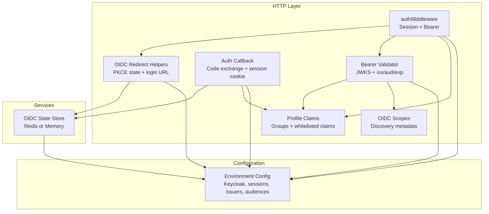
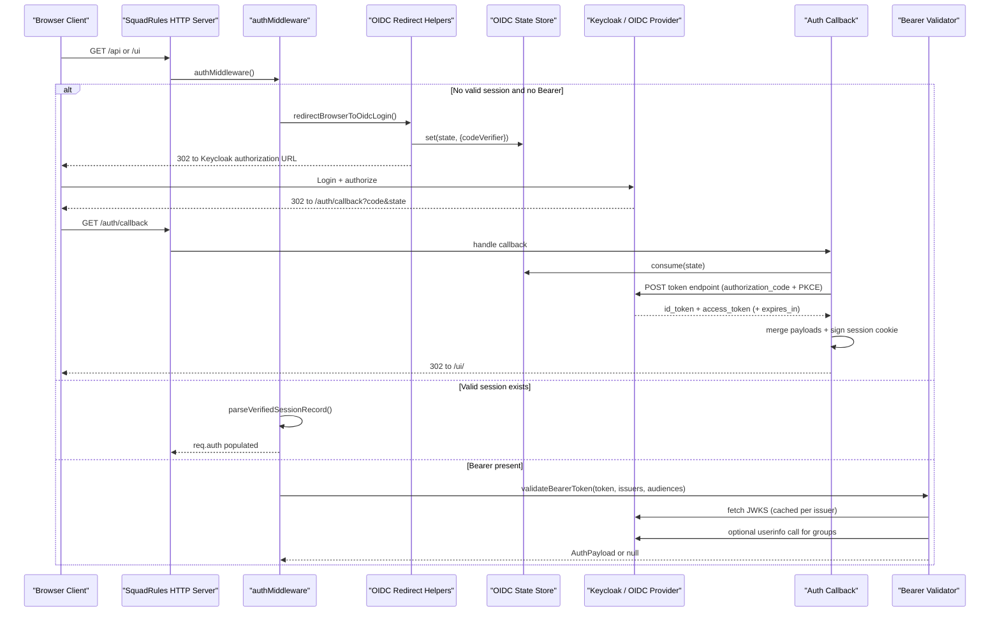
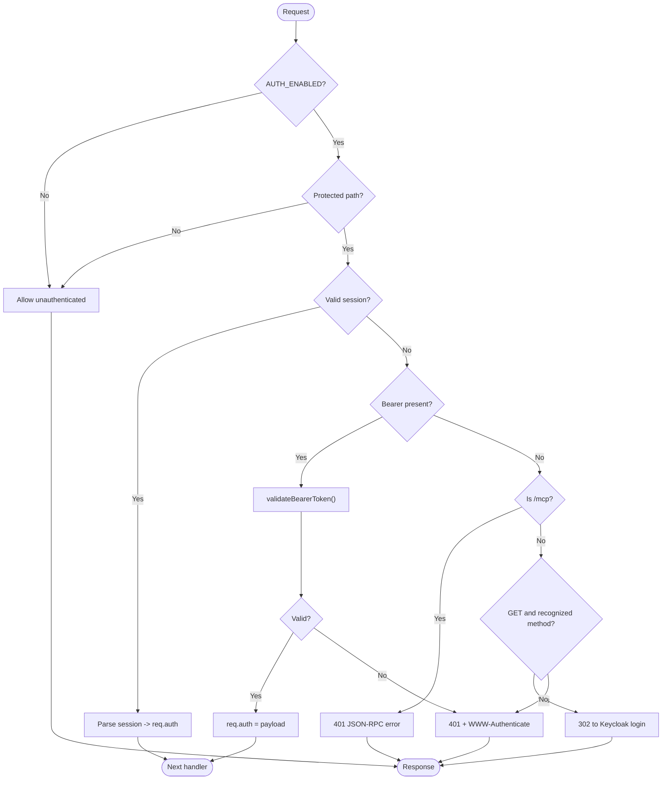
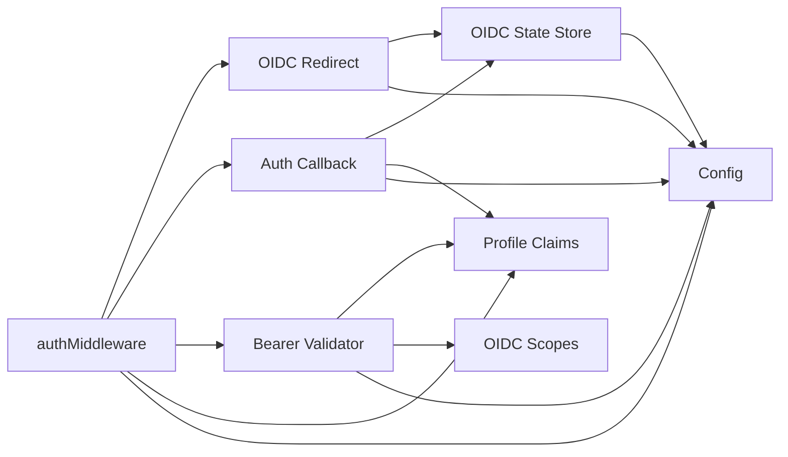

# OIDC Authentication Flow

<cite>
**Referenced Files in This Document**
- [http-auth-middleware.ts](file://src/http/http-auth-middleware.ts)
- [http-auth-oidc-redirect.ts](file://src/http/http-auth-oidc-redirect.ts)
- [http-auth-callback.ts](file://src/http/http-auth-callback.ts)
- [bearer-validate.ts](file://src/http/bearer-validate.ts)
- [oidc-profile-claims.ts](file://src/http/oidc-profile-claims.ts)
- [oidc-state-store.ts](file://src/services/oidc-state-store.ts)
- [config.ts](file://src/config.ts)
- [oidc-scopes.ts](file://src/http/oidc-scopes.ts)
</cite>

## Table of Contents
1. [Introduction](#introduction)
2. [Project Structure](#project-structure)
3. [Core Components](#core-components)
4. [Architecture Overview](#architecture-overview)
5. [Detailed Component Analysis](#detailed-component-analysis)
6. [Dependency Analysis](#dependency-analysis)
7. [Performance Considerations](#performance-considerations)
8. [Troubleshooting Guide](#troubleshooting-guide)
9. [Conclusion](#conclusion)

## Introduction
This document explains the OIDC authentication flow used by SquadRules. It covers:
- Keycloak integration and OAuth 2.0 Authorization Code flow with PKCE for browser-based login.
- JWT Bearer token validation for programmatic MCP clients.
- Session cookie handling, redirect logic, callback processing, and logout behavior.
- Configuration for Keycloak, Google IdP, and custom OIDC providers.
- Security considerations around issuer verification, audience checking, group allowlisting, and token lifetime management.

SquadRules supports two authenticated request paths:
- Browser session cookies for UI and interactive flows.
- Bearer access tokens for MCP tool calls and API requests.

The system is designed so that both paths produce a consistent `AuthPayload` containing user identity, groups, realm, and optional profile fields.

## Project Structure
The OIDC implementation lives under `src/http` and `src/services`, with configuration centralized in `src/config.ts`.

**Diagram sources**
- [http-auth-middleware.ts:1-330](file://src/http/http-auth-middleware.ts#L1-L330)
- [http-auth-oidc-redirect.ts:1-92](file://src/http/http-auth-oidc-redirect.ts#L1-L92)
- [http-auth-callback.ts:1-231](file://src/http/http-auth-callback.ts#L1-L231)
- [bearer-validate.ts:1-209](file://src/http/bearer-validate.ts#L1-L209)
- [oidc-profile-claims.ts:1-288](file://src/http/oidc-profile-claims.ts#L1-L288)
- [oidc-state-store.ts:1-76](file://src/services/oidc-state-store.ts#L1-L76)
- [config.ts:141-344](file://src/config.ts#L141-L344)
- [oidc-scopes.ts:1-31](file://src/http/oidc-scopes.ts#L1-L31)

**Section sources**
- [http-auth-middleware.ts:1-330](file://src/http/http-auth-middleware.ts#L1-L330)
- [http-auth-oidc-redirect.ts:1-92](file://src/http/http-auth-oidc-redirect.ts#L1-L92)
- [http-auth-callback.ts:1-231](file://src/http/http-auth-callback.ts#L1-L231)
- [bearer-validate.ts:1-209](file://src/http/bearer-validate.ts#L1-L209)
- [oidc-profile-claims.ts:1-288](file://src/http/oidc-profile-claims.ts#L1-L288)
- [oidc-state-store.ts:1-76](file://src/services/oidc-state-store.ts#L1-L76)
- [config.ts:141-344](file://src/config.ts#L141-L344)
- [oidc-scopes.ts:1-31](file://src/http/oidc-scopes.ts#L1-L31)

## Core Components
- **Authentication middleware**: Enforces authentication on protected routes, handles session cookies, redirects browsers to Keycloak, and validates Bearer tokens when configured.
- **OIDC redirect helpers**: Generate PKCE state, code challenge, and authorization URLs; store transient login state.
- **Callback handler**: Exchanges the authorization code for tokens, merges id_token and access_token claims, signs a session cookie, and redirects back to the UI.
- **Bearer validator**: Validates JWTs using JWKS, checks issuer, audience, expiration, and enriches groups via userinfo when needed.
- **Profile claims utilities**: Whitelist and normalize OIDC claims, derive account labels, merge callback payloads, and apply group allowlists.
- **OIDC state store**: Stores PKCE state (code verifier and timestamp) with TTL, backed by Redis or in-memory storage.
- **Configuration**: Centralizes environment variables for Keycloak, sessions, trusted issuers, allowed audiences, and group filtering.

**Section sources**
- [http-auth-middleware.ts:1-330](file://src/http/http-auth-middleware.ts#L1-L330)
- [http-auth-oidc-redirect.ts:1-92](file://src/http/http-auth-oidc-redirect.ts#L1-L92)
- [http-auth-callback.ts:1-231](file://src/http/http-auth-callback.ts#L1-L231)
- [bearer-validate.ts:1-209](file://src/http/bearer-validate.ts#L1-L209)
- [oidc-profile-claims.ts:1-288](file://src/http/oidc-profile-claims.ts#L1-L288)
- [oidc-state-store.ts:1-76](file://src/services/oidc-state-store.ts#L1-L76)
- [config.ts:141-344](file://src/config.ts#L141-L344)

## Architecture Overview
The authentication architecture combines browser-driven OIDC login with server-side JWT validation for API/MCP clients.

**Diagram sources**
- [http-auth-middleware.ts:172-327](file://src/http/http-auth-middleware.ts#L172-L327)
- [http-auth-oidc-redirect.ts:52-78](file://src/http/http-auth-oidc-redirect.ts#L52-L78)
- [http-auth-callback.ts:122-229](file://src/http/http-auth-callback.ts#L122-L229)
- [bearer-validate.ts:120-208](file://src/http/bearer-validate.ts#L120-L208)
- [oidc-state-store.ts:50-61](file://src/services/oidc-state-store.ts#L50-L61)

## Detailed Component Analysis

### Authentication Middleware
The middleware enforces authentication for protected paths (`/api`, `/api/*`, `/mcp`, `/ui`, `/ui/*`) when `AUTH_ENABLED` is true. It supports:
- Session cookies signed with HMAC-SHA256 using `SESSION_SECRET`.
- Bearer token validation against trusted issuers and allowed audiences.
- Special handling for MCP JSON-RPC requests at `/mcp`, returning structured errors when authentication is required.
- Optional space scoping based on query parameters.

Key behaviors:
- Unauthenticated browser GET requests are redirected to Keycloak.
- Non-GET or MCP requests without credentials return 401 with WWW-Authenticate headers and a login URL.
- Bearer tokens are validated only when `AUTH_TRUSTED_ISSUERS` and `AUTH_ALLOWED_AUDIENCES` are configured.
- Groups from tokens are filtered through an allowlist before being attached to the request context.

**Diagram sources**
- [http-auth-middleware.ts:151-327](file://src/http/http-auth-middleware.ts#L151-L327)

**Section sources**
- [http-auth-middleware.ts:35-133](file://src/http/http-auth-middleware.ts#L35-L133)
- [http-auth-middleware.ts:135-160](file://src/http/http-auth-middleware.ts#L135-L160)
- [http-auth-middleware.ts:172-327](file://src/http/http-auth-middleware.ts#L172-L327)

### OIDC Redirect Helpers
These helpers generate PKCE-compliant authorization URLs and manage transient login state:
- `buildOidcAuthorizationUrl`: Constructs the Keycloak authorization URL with `response_type=code`, `scope=openid profile email`, `state`, `code_challenge`, and `prompt=login`.
- `redirectBrowserToOidcLogin`: Generates random state and code verifier, stores PKCE state in Redis/memory, and redirects the browser.
- `createOidcLoginUrlForApiResponse` and `safeCreateOidcLoginUrlForApiResponse`: Provide login URLs for API responses when authentication is required.

Security notes:
- State values are random and stored with a short TTL.
- PKCE prevents authorization code interception attacks.
- The redirect URI must match Keycloak client configuration.

**Section sources**
- [http-auth-oidc-redirect.ts:15-32](file://src/http/http-auth-oidc-redirect.ts#L15-L32)
- [http-auth-oidc-redirect.ts:52-78](file://src/http/http-auth-oidc-redirect.ts#L52-L78)
- [http-auth-oidc-redirect.ts:84-91](file://src/http/http-auth-oidc-redirect.ts#L84-L91)

### Auth Callback Handler
The callback exchanges the authorization code for tokens and establishes a session:
- Validates presence of `code` and `state`.
- Consumes PKCE state atomically from the state store.
- Calls Keycloak token endpoint with `grant_type=authorization_code`, `client_id`, `code`, `redirect_uri`, and `code_verifier`.
- Merges id_token and access_token payloads, ensuring `sub` consistency.
- Applies group allowlist and derives account kind/label.
- Signs a session cookie with HMAC-SHA256 and sets appropriate cookie options.
- Redirects to `/ui/` after successful login.

Session lifetime:
- Uses `expires_in` from the token response or access token `exp` to compute `Max-Age`.
- Falls back to `SESSION_MAX_AGE_SEC` if neither is available.

Logout support:
- RP-initiated logout clears the session cookie and optionally sends an `id_token_hint` to Keycloak’s end session endpoint.
- After logout, users are redirected to continue-signin or fallback UI.

**Section sources**
- [http-auth-callback.ts:34-67](file://src/http/http-auth-callback.ts#L34-L67)
- [http-auth-callback.ts:99-120](file://src/http/http-auth-callback.ts#L99-L120)
- [http-auth-callback.ts:122-229](file://src/http/http-auth-callback.ts#L122-L229)

### Bearer Token Validation
Bearer validation ensures programmatic clients send valid JWTs:
- Checks issuer against `AUTH_TRUSTED_ISSUERS`.
- Verifies signature using JWKS fetched from the issuer’s `/protocol/openid-connect/certs`.
- Validates audience against `AUTH_ALLOWED_AUDIENCES`, including special handling for Keycloak’s `account` audience.
- Ensures token is not expired.
- Extracts groups from the access token, nested id_token, or OIDC userinfo endpoint.
- Optionally merges userinfo groups with access token groups.
- Applies group allowlist and enriches the auth payload with whitelisted profile fields.

JWKS caching:
- JWKS instances are cached per issuer to reduce network overhead.

Internal Keycloak URL:
- When `KEYCLOAK_INTERNAL_URL` is set, server-side calls use it instead of the public URL, enabling Docker networking.

**Section sources**
- [bearer-validate.ts:41-63](file://src/http/bearer-validate.ts#L41-L63)
- [bearer-validate.ts:70-100](file://src/http/bearer-validate.ts#L70-L100)
- [bearer-validate.ts:102-114](file://src/http/bearer-validate.ts#L102-L114)
- [bearer-validate.ts:120-208](file://src/http/bearer-validate.ts#L120-L208)

### Profile Claims and Group Filtering
Profile claim utilities provide consistent handling of OIDC data:
- `decodeJwtPayloadSegment`: Decodes JWT payload without signature verification.
- `realmFromIssuer`: Derives realm from issuer URL.
- `extractGroupsFromPayload`: Normalizes groups from arrays, strings, or JSON-encoded arrays.
- `applyOidcGroupsAllowlist`: Filters groups based on exact matches or path prefixes.
- `mergeCallbackTokenPayloads`: Combines id_token and access_token claims safely.
- `enrichAuthPayloadFromVerifiedJwt`: Adds whitelisted profile fields and account labels.

Group allowlist behavior:
- Empty allowlist keeps all token groups.
- Exact entries match group names or paths (slash optional).
- Prefix entries (ending with `/`) match any group whose normalized path starts with the prefix.
- Matching is case-insensitive for path comparisons.

**Section sources**
- [oidc-profile-claims.ts:56-72](file://src/http/oidc-profile-claims.ts#L56-L72)
- [oidc-profile-claims.ts:74-95](file://src/http/oidc-profile-claims.ts#L74-L95)
- [oidc-profile-claims.ts:110-153](file://src/http/oidc-profile-claims.ts#L110-L153)
- [oidc-profile-claims.ts:192-256](file://src/http/oidc-profile-claims.ts#L192-L256)
- [oidc-profile-claims.ts:271-287](file://src/http/oidc-profile-claims.ts#L271-L287)

### OIDC State Store
The state store manages PKCE state for login transactions:
- Stores `codeVerifier` and creation timestamp with a 10-minute TTL.
- Provides atomic `consume` operation to prevent replay attacks.
- Backed by Redis when configured, otherwise falls back to in-memory storage.
- Keys are global (no space namespace) because login has no space context.

Backend selection:
- Determined by `isRedisConfigured` in configuration.
- Logs backend type at startup.

**Section sources**
- [oidc-state-store.ts:16-28](file://src/services/oidc-state-store.ts#L16-L28)
- [oidc-state-store.ts:50-61](file://src/services/oidc-state-store.ts#L50-L61)
- [oidc-state-store.ts:68-75](file://src/services/oidc-state-store.ts#L68-L75)

### Configuration
Configuration centralizes OIDC and security settings:
- Keycloak URLs, realm, and client IDs.
- Session secret and maximum age.
- Trusted issuers and allowed audiences.
- Group allowlist for restricting SQUADRULES spaces.
- Bearer userinfo group merging behavior.
- OIDC scopes supported for discovery.

Startup validation:
- When `AUTH_ENABLED=true`, missing required environment variables cause startup failure.
- Default audiences include Keycloak client IDs and `account` for realm issuers.
- Issuer list includes localhost/127.0.0.1 aliases for development.

**Section sources**
- [config.ts:141-152](file://src/config.ts#L141-L152)
- [config.ts:163-195](file://src/config.ts#L163-L195)
- [config.ts:252-266](file://src/config.ts#L252-L266)
- [config.ts:305-344](file://src/config.ts#L305-L344)
- [oidc-scopes.ts:1-31](file://src/http/oidc-scopes.ts#L1-L31)

## Dependency Analysis
The authentication components have clear dependency relationships:

**Diagram sources**
- [http-auth-middleware.ts:1-330](file://src/http/http-auth-middleware.ts#L1-L330)
- [http-auth-oidc-redirect.ts:1-92](file://src/http/http-auth-oidc-redirect.ts#L1-L92)
- [http-auth-callback.ts:1-231](file://src/http/http-auth-callback.ts#L1-L231)
- [bearer-validate.ts:1-209](file://src/http/bearer-validate.ts#L1-L209)
- [oidc-profile-claims.ts:1-288](file://src/http/oidc-profile-claims.ts#L1-L288)
- [oidc-state-store.ts:1-76](file://src/services/oidc-state-store.ts#L1-L76)
- [config.ts:141-344](file://src/config.ts#L141-L344)
- [oidc-scopes.ts:1-31](file://src/http/oidc-scopes.ts#L1-L31)

**Section sources**
- [http-auth-middleware.ts:1-330](file://src/http/http-auth-middleware.ts#L1-L330)
- [bearer-validate.ts:1-209](file://src/http/bearer-validate.ts#L1-L209)
- [oidc-profile-claims.ts:1-288](file://src/http/oidc-profile-claims.ts#L1-L288)
- [oidc-state-store.ts:1-76](file://src/services/oidc-state-store.ts#L1-L76)
- [config.ts:141-344](file://src/config.ts#L141-L344)

## Performance Considerations
- **JWKS caching**: JWKS instances are cached per issuer to avoid repeated network calls during token validation.
- **OIDC state TTL**: PKCE state entries expire after 10 minutes, preventing stale state accumulation.
- **Userinfo calls**: Optional userinfo calls for groups are bounded by timeout and logged when failing.
- **Session cookie parsing**: HMAC verification and base64 decoding are lightweight operations performed per request.
- **Redis vs memory**: OIDC state store uses Redis when configured for multi-instance deployments, falling back to in-memory for single-instance setups.

[No sources needed since this section provides general guidance]

## Troubleshooting Guide

### Common Issues and Resolutions

**Missing configuration for AUTH_ENABLED**
- Symptom: Startup error indicating missing environment variables.
- Resolution: Set `KEYCLOAK_URL`, `KEYCLOAK_REALM`, `KEYCLOAK_CLIENT_ID`, `AUTH_CALLBACK_BASE_URL`, and `SESSION_SECRET`.

**Invalid or expired state in callback**
- Symptom: Redirect to `/?error=invalid_state`.
- Resolution: Ensure OIDC state store is accessible and not exhausted; check Redis connectivity and TTL settings.

**Token exchange failed**
- Symptom: Redirect to `/?error=token_exchange_failed`.
- Resolution: Verify Keycloak client configuration, redirect URIs, and network connectivity to Keycloak.

**Bearer token rejected**
- Symptom: 401 with `bearer_not_validated` or invalid token messages.
- Resolution: Configure `AUTH_TRUSTED_ISSUERS` and `AUTH_ALLOWED_AUDIENCES`; ensure tokens are issued by trusted Keycloak realms.

**Groups not appearing in spaces**
- Symptom: User lacks expected group membership in API responses.
- Resolution: Configure Keycloak Group Membership mapper; verify `OIDC_GROUPS_ALLOWLIST` allows desired groups; enable `OIDC_BEARER_MERGE_USERINFO_GROUPS` if needed.

**Session cookie issues**
- Symptom: Users remain logged out or cannot access UI.
- Resolution: Check `SESSION_SECRET` is set; verify `AUTH_CALLBACK_BASE_URL` matches Keycloak redirect URIs; ensure HTTPS for secure cookies in production.

**MCP client authentication failures**
- Symptom: MCP clients receive 401 with WWW-Authenticate header.
- Resolution: Ensure Bearer tokens are valid and include trusted issuer and allowed audience; reconnect MCP host if it caches old credentials.

**Debugging techniques**
- Enable trace logging by setting `AUTH_TRACE=true` or `LOG_LEVEL=trace`.
- Inspect middleware logs for session and bearer validation decisions.
- Verify Keycloak JWKS endpoint accessibility from the application server.
- Test OIDC scopes supported via discovery endpoints.

**Section sources**
- [http-auth-middleware.ts:230-286](file://src/http/http-auth-middleware.ts#L230-L286)
- [http-auth-callback.ts:122-199](file://src/http/http-auth-callback.ts#L122-L199)
- [bearer-validate.ts:120-208](file://src/http/bearer-validate.ts#L120-L208)
- [config.ts:252-266](file://src/config.ts#L252-L266)

## Conclusion
SquadRules implements a robust OIDC authentication flow supporting both browser-based sessions and programmatic Bearer tokens. The system integrates with Keycloak and supports Google IdP and other OIDC providers through standard OAuth 2.0 and OIDC protocols. Security is enforced through issuer verification, audience checking, group allowlisting, and PKCE state management. Proper configuration of environment variables and Keycloak client settings is essential for reliable operation. The modular design allows for flexible deployment across different environments while maintaining consistent authentication behavior.

[No sources needed since this section summarizes without analyzing specific files]