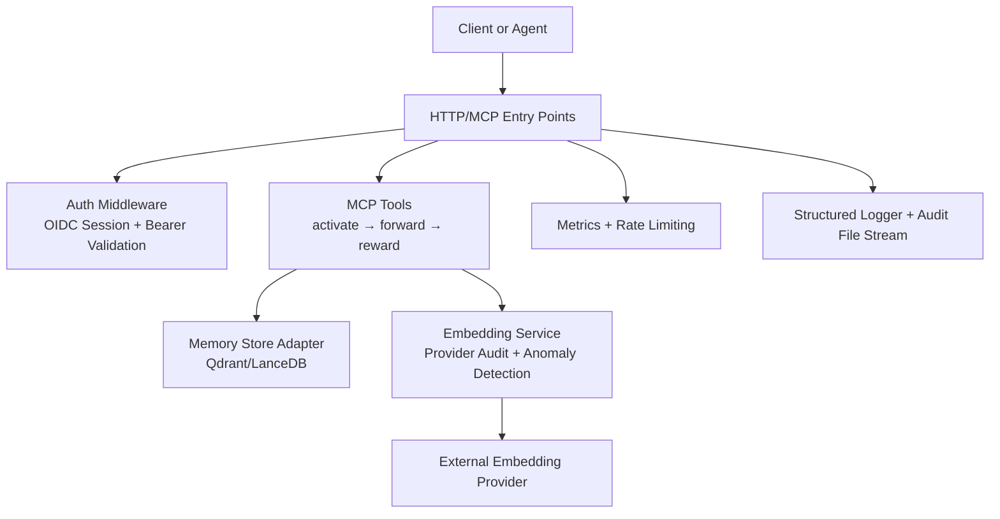
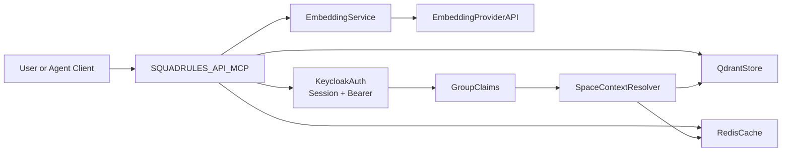
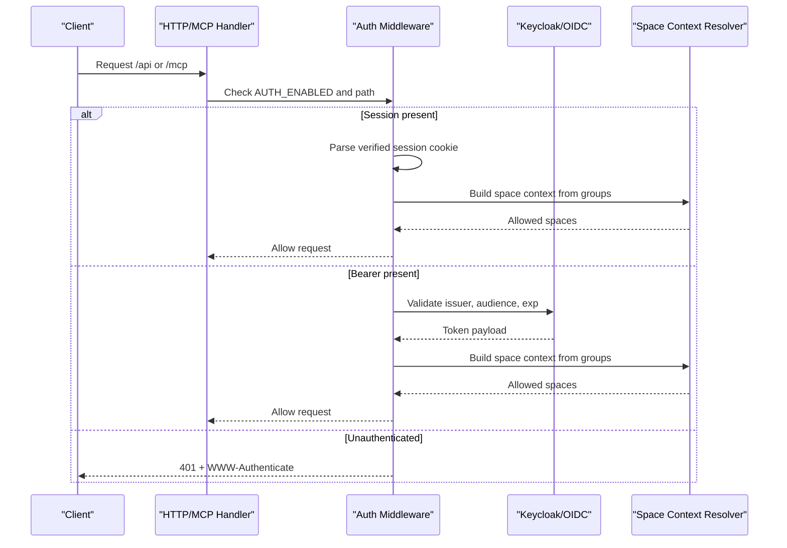
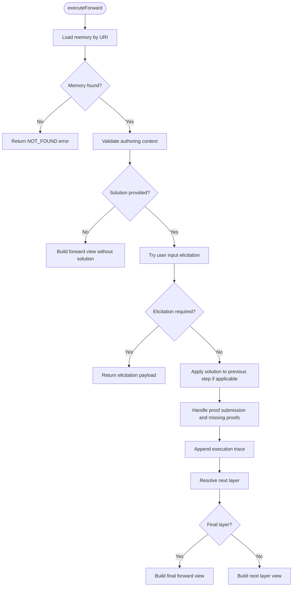
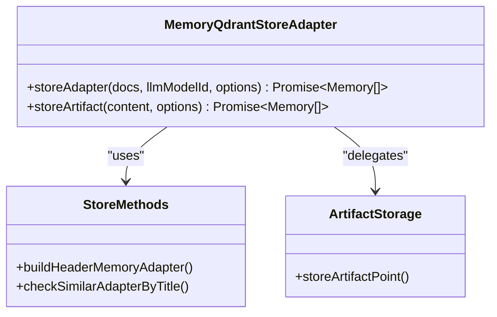
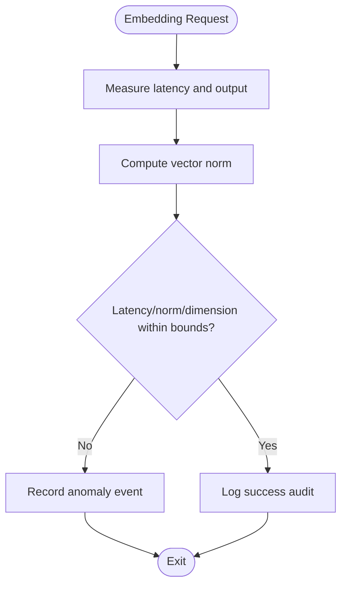
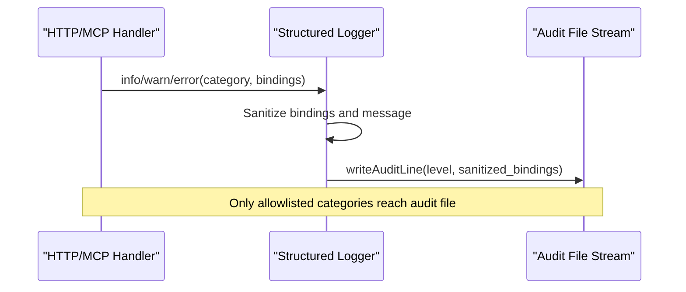
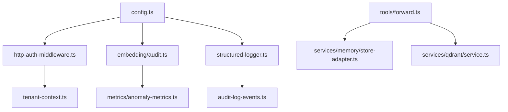

# Threat Model and Security Analysis

<cite>
**Referenced Files in This Document**
- [threat-model.md](file://docs/security/threat-model.md)
- [incident-runbook.md](file://docs/security/incident-runbook.md)
- [audit-log.md](file://docs/security/audit-log.md)
- [code-security-setup.md](file://docs/security/code-security-setup.md)
- [http-auth-middleware.ts](file://src/http/http-auth-middleware.ts)
- [store-adapter.ts](file://src/services/memory/store-adapter.ts)
- [forward.ts](file://src/tools/forward.ts)
- [audit.ts](file://src/services/embedding/audit.ts)
- [structured-logger.ts](file://src/utils/structured-logger.ts)
- [config.ts](file://src/config.ts)
</cite>

## Table of Contents
1. [Introduction](#introduction)
2. [Project Structure](#project-structure)
3. [Core Components](#core-components)
4. [Architecture Overview](#architecture-overview)
5. [Detailed Component Analysis](#detailed-component-analysis)
6. [Dependency Analysis](#dependency-analysis)
7. [Performance Considerations](#performance-considerations)
8. [Troubleshooting Guide](#troubleshooting-guide)
9. [Conclusion](#conclusion)
10. [Appendices](#appendices)

## Introduction
This document provides a comprehensive threat model and security analysis for SquadRules, an agent-first MCP framework where AI agents are the primary users and humans configure preferences through agents. The core workflow is activate → forward → reward, with deterministic adapter execution and strong auditability. The system uses Keycloak-based OIDC authentication, Redis for sessions and rate limiting, Qdrant as the primary vector store, LanceDB as an embedded secondary store, and external embedding providers.

The threat model aligns to NIST SP 800-218A and covers:
- System boundaries and trust boundaries
- Asset inventory and protection goals
- Threat actors and realistic attack scenarios
- Mitigations implemented across identity, storage, adapters, embeddings, and observability
- Incident response procedures, monitoring, and audit logging
- Supply-chain controls and operational best practices
- Compliance considerations and assessment methodology

## Project Structure
SquadRules exposes HTTP and MCP entry points, enforces authentication and authorization, routes requests into tools (activate, forward, train, reward, tune, delete, export, spaces), persists memory and artifacts in vector stores, emits structured logs and audit events, and integrates with external embedding providers.

**Diagram sources**
- [http-auth-middleware.ts:172-327](file://src/http/http-auth-middleware.ts#L172-L327)
- [store-adapter.ts:43-152](file://src/services/memory/store-adapter.ts#L43-L152)
- [forward.ts:91-339](file://src/tools/forward.ts#L91-L339)
- [audit.ts:60-197](file://src/services/embedding/audit.ts#L60-L197)
- [structured-logger.ts:144-148](file://src/utils/structured-logger.ts#L144-L148)
- [config.ts:99-126](file://src/config.ts#L99-L126)

**Section sources**
- [threat-model.md:7-25](file://docs/security/threat-model.md#L7-L25)
- [audit-log.md:16-28](file://docs/security/audit-log.md#L16-L28)

## Core Components
- Authentication and Authorization: OIDC session cookies and optional Bearer token validation; space-scoped access control derived from group claims.
- Adapter Execution: Deterministic adapter chain with search → begin → next → attest semantics, proof-of-work checks, and authoring context enforcement.
- Memory Storage: Qdrant-backed memory with artifact storage, title similarity checks, slug normalization, and metadata tracking.
- Embedding Pipeline: Provider abstraction with latency, norm, and dimension anomaly detection; structured audit records per request.
- Observability: Structured HTTP logging, MCP tool call audit events, embedding/anomaly audit categories, and optional append-only audit file stream.
- Configuration: Centralized environment variables for auth, rate limits, embedding thresholds, audit verbosity, and storage backends.

**Section sources**
- [http-auth-middleware.ts:172-327](file://src/http/http-auth-middleware.ts#L172-L327)
- [forward.ts:91-339](file://src/tools/forward.ts#L91-L339)
- [store-adapter.ts:43-152](file://src/services/memory/store-adapter.ts#L43-L152)
- [audit.ts:60-197](file://src/services/embedding/audit.ts#L60-L197)
- [structured-logger.ts:144-148](file://src/utils/structured-logger.ts#L144-L148)
- [config.ts:99-126](file://src/config.ts#L99-L126)

## Architecture Overview
The system boundary includes API surface, identity layer, storage systems, and external embedding providers. Traffic enters via HTTP or MCP, passes through authentication and authorization, and flows into embedding and storage paths.

**Diagram sources**
- [threat-model.md:13-25](file://docs/security/threat-model.md#L13-L25)
- [http-auth-middleware.ts:172-327](file://src/http/http-auth-middleware.ts#L172-L327)
- [config.ts:141-195](file://src/config.ts#L141-L195)

## Detailed Component Analysis

### Authentication and Authorization
Authentication supports two paths:
- OIDC browser session cookie with HMAC verification and expiration check.
- Optional Bearer token validation against trusted issuers and allowed audiences when configured.

Authorization derives space context from authenticated claims and enforces tenant-aware access. Requests to protected paths without valid credentials receive 401 responses with WWW-Authenticate headers and JSON-RPC-compatible errors for MCP clients.

**Diagram sources**
- [http-auth-middleware.ts:172-327](file://src/http/http-auth-middleware.ts#L172-L327)
- [config.ts:141-195](file://src/config.ts#L141-L195)

**Section sources**
- [http-auth-middleware.ts:172-327](file://src/http/http-auth-middleware.ts#L172-L327)
- [config.ts:141-195](file://src/config.ts#L141-L195)

### Adapter Execution and AI Agent Workflows
The forward tool implements the deterministic adapter execution flow:
- Load current layer and resolve next/previous layers.
- Enforce authoring context constraints for specific adapters.
- Apply proof-of-work submission and validate previous steps.
- Append execution traces and update step quality metrics.
- Return structured views indicating must_obey, next_action, challenge, and finality.

**Diagram sources**
- [forward.ts:91-339](file://src/tools/forward.ts#L91-L339)

**Section sources**
- [forward.ts:91-339](file://src/tools/forward.ts#L91-L339)

### Memory Storage and Data Protection
The memory store adapter normalizes markdown, parses frontmatter, validates protocol slugs, checks similar adapters by title, and delegates to header-based or default adapter storage. Artifacts are stored separately with MIME type, name, adapter URI, LLM model ID, and relative path.

**Diagram sources**
- [store-adapter.ts:35-152](file://src/services/memory/store-adapter.ts#L35-L152)

**Section sources**
- [store-adapter.ts:43-152](file://src/services/memory/store-adapter.ts#L43-L152)

### Embedding Security and Anomaly Detection
Embedding audit and anomaly detection monitor:
- Latency exceeding warning thresholds.
- Vector norms outside expected ranges.
- Dimension mismatches between expected and actual outputs.
- Search anomalies such as zero results for non-trivial queries and low top scores.

**Diagram sources**
- [audit.ts:94-157](file://src/services/embedding/audit.ts#L94-L157)
- [audit.ts:159-197](file://src/services/embedding/audit.ts#L159-L197)

**Section sources**
- [audit.ts:60-197](file://src/services/embedding/audit.ts#L60-L197)

### Audit Logging and Incident Tracing
Audit logging provides:
- Structured HTTP access logs with request_id, client_ip, duration_ms, and error_code.
- MCP tool call audit events at configurable verbosity levels.
- Embedding and anomaly audit categories with tenant and request correlation.
- Optional append-only audit file stream for allowlisted categories.

**Diagram sources**
- [structured-logger.ts:144-148](file://src/utils/structured-logger.ts#L144-L148)
- [audit-log.md:157-178](file://docs/security/audit-log.md#L157-L178)

**Section sources**
- [structured-logger.ts:144-148](file://src/utils/structured-logger.ts#L144-L148)
- [audit-log.md:16-28](file://docs/security/audit-log.md#L16-L28)
- [audit-log.md:89-155](file://docs/security/audit-log.md#L89-L155)

## Dependency Analysis
Key dependencies and relationships:
- HTTP/MCP handlers depend on auth middleware and space context resolver.
- Forward tool depends on memory store, qdrant service, execution trace store, and proof-of-work store.
- Embedding service emits audit events and anomaly metrics.
- Structured logger writes to Pino and optional audit file stream.
- Configuration centralizes environment variables for auth, rate limits, embedding thresholds, and audit verbosity.

**Diagram sources**
- [config.ts:99-126](file://src/config.ts#L99-L126)
- [http-auth-middleware.ts:172-327](file://src/http/http-auth-middleware.ts#L172-L327)
- [forward.ts:91-339](file://src/tools/forward.ts#L91-L339)
- [store-adapter.ts:43-152](file://src/services/memory/store-adapter.ts#L43-L152)
- [audit.ts:60-197](file://src/services/embedding/audit.ts#L60-L197)
- [structured-logger.ts:144-148](file://src/utils/structured-logger.ts#L144-L148)

**Section sources**
- [config.ts:99-126](file://src/config.ts#L99-L126)
- [http-auth-middleware.ts:172-327](file://src/http/http-auth-middleware.ts#L172-L327)
- [forward.ts:91-339](file://src/tools/forward.ts#L91-L339)
- [store-adapter.ts:43-152](file://src/services/memory/store-adapter.ts#L43-L152)
- [audit.ts:60-197](file://src/services/embedding/audit.ts#L60-L197)
- [structured-logger.ts:144-148](file://src/utils/structured-logger.ts#L144-L148)

## Performance Considerations
- Embedding latency thresholds and retry budgets help contain provider abuse and cost amplification.
- Search limit caps prevent excessive resolution latency and resource consumption.
- Structured logging sanitization and bounded audit lines avoid log injection and sink overload.
- Rate limiting configuration applies to HTTP, auth, and MCP routes to mitigate denial-of-service attempts.

[No sources needed since this section provides general guidance]

## Troubleshooting Guide
Incident response focuses on request-level traceability, embedding abuse, and cross-tenant isolation risks. Operators should:
- Collect entry evidence including alert payloads, request_id, time window, tenant/space identifiers, and suspected operations.
- Trace request flow using structured logs and audit logs filtered by category and tenant.
- Confirm tenant boundaries by verifying tenant_id, space_id, and auth context across all related events.
- Inspect write operations by validating created_by, modified_by, created_at, and modified_at for affected memories.
- Assess blast radius by identifying impacted spaces, users, and tools.
- Contain by revoking compromised credentials, disabling risky paths, and blocking abuse patterns.
- Recover and verify by confirming expected behavior and running focused regression tests.

Common playbooks include data poisoning suspicion, embedding API abuse or key compromise, and cross-tenant access suspicion.

**Section sources**
- [incident-runbook.md:7-45](file://docs/security/incident-runbook.md#L7-L45)
- [incident-runbook.md:66-99](file://docs/security/incident-runbook.md#L66-L99)

## Conclusion
SquadRules implements a layered security architecture centered on OIDC authentication, deterministic adapter execution, vector store isolation, embedding anomaly detection, and comprehensive audit logging. Residual risks remain around heuristic anomaly detection, third-party embedding providers, identity misconfiguration, and operational delays in key rotation. Continuous review after major changes, strict incident response procedures, and robust supply-chain controls are essential for production deployments.

[No sources needed since this section summarizes without analyzing specific files]

## Appendices

### Security Best Practices for Production Deployments
- Enable and enforce code-security workflows on main branches, including dependency review, npm audit, and CodeQL.
- Turn on secret scanning and push protection to prevent credential leakage.
- Configure AUDIT_LOG_FILE and AUDIT_LOG_LEVEL appropriately for audit visibility and compliance.
- Set AUTH_TRUSTED_ISSUERS and AUTH_ALLOWED_AUDIENCES when using Bearer tokens.
- Rotate secrets regularly and keep sensitive values out of source control.
- Monitor embedding latency, vector norms, dimension mismatches, and search anomalies.
- Use Redis for sessions and rate limiting; ensure proper network segmentation and access controls.
- Maintain Qdrant snapshots and backups according to organizational retention policies.

**Section sources**
- [code-security-setup.md:5-38](file://docs/security/code-security-setup.md#L5-L38)
- [audit-log.md:30-46](file://docs/security/audit-log.md#L30-L46)
- [config.ts:99-126](file://src/config.ts#L99-L126)
- [config.ts:141-195](file://src/config.ts#L141-L195)

### Compliance Considerations and Assessment Methodology
- Map SquadRules controls to organizational compliance frameworks during assessments.
- Treat audit.embedding, audit.anomaly, and audit.mcp as primary investigation channels.
- Preserve evidence by correlating request_id, tenant_id, and space_id across logs.
- Review threat model after every major auth, storage, or release pipeline change.
- Add new threat scenarios when introducing external dependencies or privileged operations.

**Section sources**
- [audit-log.md:1-14](file://docs/security/audit-log.md#L1-L14)
- [threat-model.md:125-131](file://docs/security/threat-model.md#L125-L131)