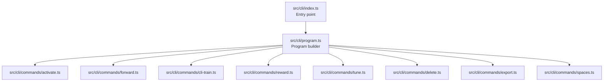
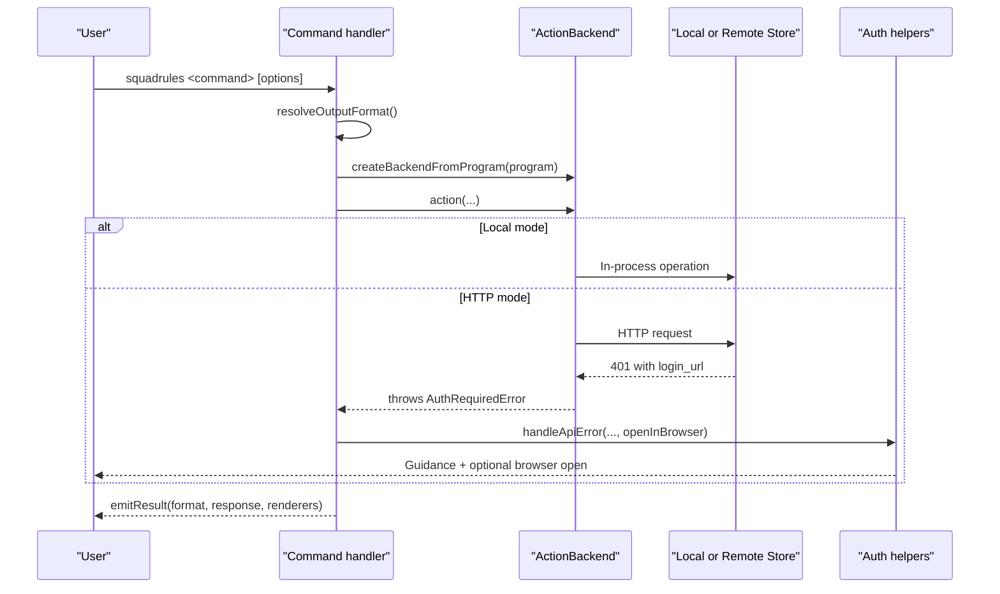
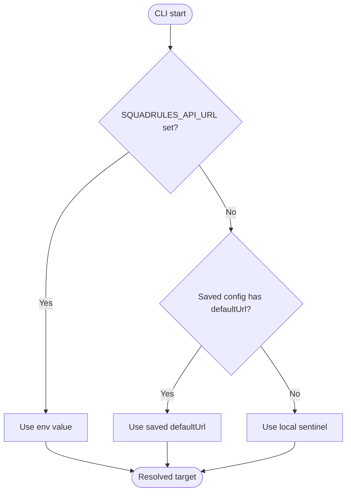
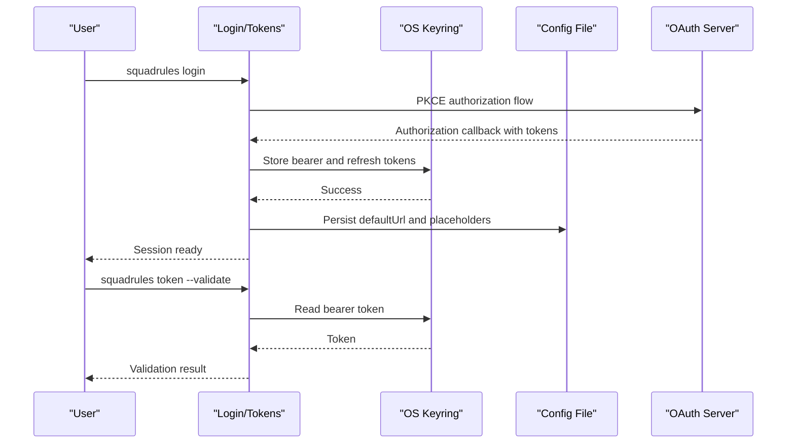
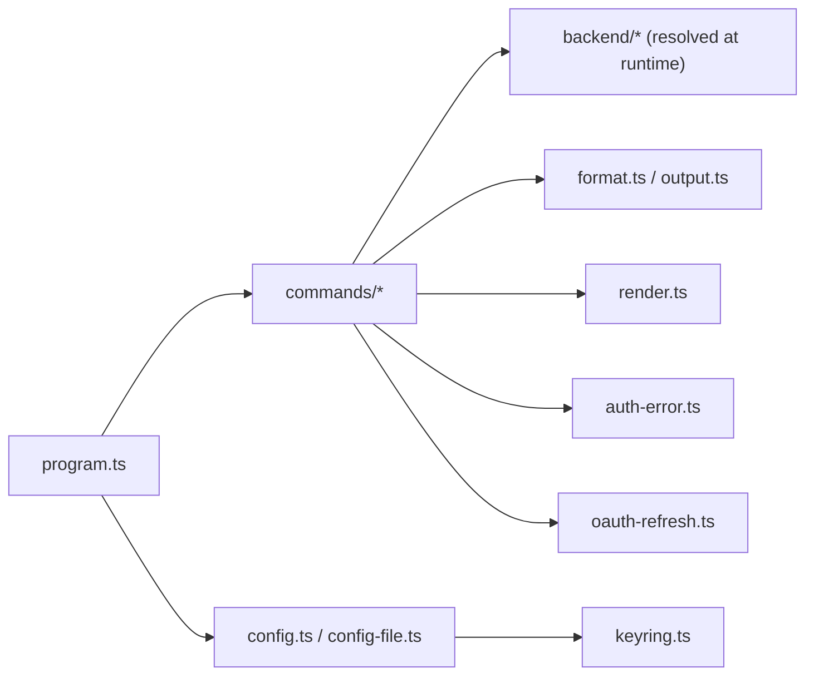

# CLI Interface

<cite>
**Referenced Files in This Document**
- [CLI.md](file://docs/CLI.md)
- [index.ts](file://src/cli/index.ts)
- [program.ts](file://src/cli/program.ts)
- [config.ts](file://src/cli/config.ts)
- [config-file.ts](file://src/cli/config-file.ts)
- [auth-error.ts](file://src/cli/auth-error.ts)
- [oauth-refresh.ts](file://src/cli/oauth-refresh.ts)
- [keyring.ts](file://src/cli/keyring.ts)
- [activate.ts](file://src/cli/commands/activate.ts)
- [forward.ts](file://src/cli/commands/forward.ts)
- [reward.ts](file://src/cli/commands/reward.ts)
- [tune.ts](file://src/cli/commands/tune.ts)
- [delete.ts](file://src/cli/commands/delete.ts)
- [export.ts](file://src/cli/commands/export.ts)
- [spaces.ts](file://src/cli/commands/spaces.ts)
- [cli-train.ts](file://src/cli/commands/cli-train.ts)
</cite>

## Table of Contents
1. [Introduction](#introduction)
2. [Project Structure](#project-structure)
3. [Core Components](#core-components)
4. [Architecture Overview](#architecture-overview)
5. [Detailed Component Analysis](#detailed-component-analysis)
6. [Dependency Analysis](#dependency-analysis)
7. [Performance Considerations](#performance-considerations)
8. [Troubleshooting Guide](#troubleshooting-guide)
9. [Conclusion](#conclusion)
10. [Appendices](#appendices)

## Introduction
This document describes the SquadRules command-line interface that provides programmatic access to the framework’s MCP tools: activate, forward, train, reward, tune, delete, export, and spaces. It covers invocation, global options, output formats, configuration and authentication flows, scripting patterns, and platform-specific behavior. The CLI is local-by-default: without configuration it runs in-process against an embedded store; after login it targets a remote HTTP server automatically.

The functional reference for commands, environment variables, and output formats is maintained alongside the codebase documentation.

**Section sources**
- [CLI.md:1-45](file://docs/CLI.md#L1-L45)

## Project Structure
At runtime, the CLI entry point initializes logging, detects MCP host invocation, and delegates argument parsing to the Commander-based program builder. The program registers all data commands plus serve, login, logout, and token management. Global options are applied before each action so that flags like `--url` and `--no-browser` propagate consistently across subcommands.

**Diagram sources**
- [index.ts:1-21](file://src/cli/index.ts#L1-L21)
- [program.ts:31-79](file://src/cli/program.ts#L31-L79)

**Section sources**
- [index.ts:1-21](file://src/cli/index.ts#L1-L21)
- [program.ts:1-81](file://src/cli/program.ts#L1-L81)

## Core Components
- Invocation model:
  - Three equivalent binaries (`squadrules`, `sq`, `sqr`) share one entry point.
  - Bare invocation with piped stdin starts the MCP server over stdio; interactive terminal usage shows help.
- Local-by-default execution:
  - Without configuration, commands run in-process against the embedded store using a local sentinel target.
  - After `login`, subsequent commands use the saved HTTP API URL unless overridden by `--url`.
- Global options:
  - `-u, --url`: API base URL or local sentinel.
  - `--timeout`, `--retries`, `--format`, `--space`, `--reseed`, `--no-browser`.
- Output formats:
  - `auto`, `pretty`, `json`, `text`; `auto` emits JSON when not attached to a TTY for stable scripting.

These behaviors are implemented by the entry point, program builder, and shared configuration helpers.

**Section sources**
- [CLI.md:9-75](file://docs/CLI.md#L9-L75)
- [index.ts:1-21](file://src/cli/index.ts#L1-L21)
- [program.ts:31-61](file://src/cli/program.ts#L31-L61)
- [config.ts:8-20](file://src/cli/config.ts#L8-L20)

## Architecture Overview
The CLI follows a consistent flow per command: parse arguments, create a backend (local or HTTP), call the corresponding action, render results through a unified formatter, and handle authentication errors by printing guidance and optionally opening a browser.

**Diagram sources**
- [activate.ts:12-35](file://src/cli/commands/activate.ts#L12-L35)
- [forward.ts:12-32](file://src/cli/commands/forward.ts#L12-L32)
- [auth-error.ts:12-20](file://src/cli/auth-error.ts#L12-L20)
- [auth-error.ts:124-132](file://src/cli/auth-error.ts#L124-L132)

## Detailed Component Analysis

### Global Options and Configuration Resolution
- Default URL resolution order:
  1. Command-line `--url`.
  2. Environment variable `SQUADRULES_API_URL`.
  3. Saved config default URL.
  4. Local sentinel for embedded store.
- Environment variables:
  - `SQUADRULES_API_URL`, `SQUADRULES_TIMEOUT_MS`, `SQUADRULES_RETRIES`, `SQUADRULES_FORMAT`, `MEM_BOOT_FORCE_INJECT`.
- Profile-like behavior:
  - Config supports multiple environments keyed by normalized API URL.
  - Tokens may be stored in the OS keyring; the file stores only non-secret metadata and placeholders when applicable.

**Diagram sources**
- [config.ts:8-20](file://src/cli/config.ts#L8-L20)
- [config-file.ts:72-83](file://src/cli/config-file.ts#L72-L83)

**Section sources**
- [CLI.md:29-57](file://docs/CLI.md#L29-L57)
- [CLI.md:248-257](file://docs/CLI.md#L248-L257)
- [config.ts:8-20](file://src/cli/config.ts#L8-L20)
- [config-file.ts:1-11](file://src/cli/config-file.ts#L1-L11)
- [config-file.ts:72-83](file://src/cli/config-file.ts#L72-L83)

### Authentication Flow
- Browser-based login:
  - Uses PKCE via the configured OAuth server.
  - Stores bearer and refresh tokens securely when the OS keyring is available.
- Token management:
  - `token --validate` prints and validates the stored token.
  - `logout` clears stored credentials for the current target.
- Offline operation:
  - Against the local sentinel, auth commands print guidance and fall back to a localhost default.
- Refresh flow:
  - Discovers token endpoints from `.well-known/oauth-protected-resource`.
  - Exchanges refresh tokens for new access tokens with a client ID dedicated to the CLI.

**Diagram sources**
- [auth-error.ts:96-117](file://src/cli/auth-error.ts#L96-L117)
- [oauth-refresh.ts:26-51](file://src/cli/oauth-refresh.ts#L26-L51)
- [oauth-refresh.ts:62-96](file://src/cli/oauth-refresh.ts#L62-L96)
- [keyring.ts:145-169](file://src/cli/keyring.ts#L145-L169)
- [keyring.ts:188-210](file://src/cli/keyring.ts#L188-L210)
- [config-file.ts:90-207](file://src/cli/config-file.ts#L90-L207)

**Section sources**
- [CLI.md:231-246](file://docs/CLI.md#L231-L246)
- [auth-error.ts:12-20](file://src/cli/auth-error.ts#L12-L20)
- [auth-error.ts:22-27](file://src/cli/auth-error.ts#L22-L27)
- [auth-error.ts:96-117](file://src/cli/auth-error.ts#L96-L117)
- [oauth-refresh.ts:8-10](file://src/cli/oauth-refresh.ts#L8-L10)
- [oauth-refresh.ts:26-51](file://src/cli/oauth-refresh.ts#L26-L51)
- [oauth-refresh.ts:62-96](file://src/cli/oauth-refresh.ts#L62-L96)
- [keyring.ts:1-6](file://src/cli/keyring.ts#L1-L6)
- [keyring.ts:104-111](file://src/cli/keyring.ts#L104-L111)
- [keyring.ts:145-169](file://src/cli/keyring.ts#L145-L169)
- [keyring.ts:188-210](file://src/cli/keyring.ts#L188-L210)
- [config-file.ts:1-11](file://src/cli/config-file.ts#L1-L11)
- [config-file.ts:90-207](file://src/cli/config-file.ts#L90-L207)

### Command Reference

#### activate
- Purpose: Find the best matching adapter for a query.
- Usage: `squadrules activate <query...> [--space <space>]`
- Parameters:
  - `<query...>`: Search query (multiple words allowed).
  - `--space <space>`: Scope results to this space (`personal` or a group name).
- Output: Structured activation result rendered according to `--format`.

**Section sources**
- [CLI.md:79-85](file://docs/CLI.md#L79-L85)
- [activate.ts:12-35](file://src/cli/commands/activate.ts#L12-L35)

#### forward
- Purpose: Run the first or next layer of an adapter.
- Usage: `squadrules forward <uri> [--solution <json>]`
- Parameters:
  - `<uri>`: SQUADRULES adapter or layer URI.
  - `--solution <json>`: Forward solution as JSON string.
- Output: Structured forward step result rendered according to `--format`.

**Section sources**
- [CLI.md:87-93](file://docs/CLI.md#L87-L93)
- [forward.ts:12-32](file://src/cli/commands/forward.ts#L12-L32)

#### reward
- Purpose: Record a reward signal for an adapter execution.
- Usage: `squadrules reward <uri> <outcome> <feedback> [--score <number>] [--rater <rater>] [--rubric-version <version>] [--model <model>]`
- Parameters:
  - `<uri>`: SQUADRULES layer URI.
  - `<outcome>`: `success` or `failure`.
  - `<feedback>`: Human-readable feedback describing completion or failure.
  - `--score <number>`: Normalized reward score in the 0..1 range.
  - `--rater <rater>`: Evaluator identifier used for export gating.
  - `--rubric-version <version>`: Rubric or policy version used for evaluation.
  - `--model <model>`: LLM model ID for attribution.
- Validation: Enforces outcome values and numeric score format.

**Section sources**
- [CLI.md:95-103](file://docs/CLI.md#L95-L103)
- [reward.ts:13-66](file://src/cli/commands/reward.ts#L13-L66)

#### tune
- Purpose: Update one or more adapter layers.
- Usage: `squadrules tune <uris...> [--file <file> | --files <files...> | --updates <json>] [--space <space>] [--allow-sensitive-upload]`
- Parameters:
  - `<uris...>`: One or more adapter or layer URIs.
  - `--file <file>`: Apply one markdown file to all specified URIs.
  - `--files <files...>`: Provide one markdown file per URI (count must match).
  - `--updates <json>`: Provide updates object as JSON string.
  - `--space <space>`: Move all layers of each target adapter to this space (move-only when used alone).
  - `--allow-sensitive-upload`: Allow uploads containing token-like or private-key-like text.
- Behavior: Supports move-only operations and integration test evidence injection via environment.

**Section sources**
- [CLI.md:105-113](file://docs/CLI.md#L105-L113)
- [tune.ts:32-115](file://src/cli/commands/tune.ts#L32-L115)

#### delete
- Purpose: Delete one or more adapter or layer resources.
- Usage: `squadrules delete <uris...>`
- Parameters:
  - `<uris...>`: Adapter or layer URIs to delete.

**Section sources**
- [CLI.md:115-121](file://docs/CLI.md#L115-L121)
- [delete.ts:13-30](file://src/cli/commands/delete.ts#L13-L30)

#### spaces
- Purpose: List available spaces and adapter counts.
- Usage: `squadrules spaces [--include-adapter-titles]`
- Parameters:
  - `--include-adapter-titles`: Include per-space adapter titles and layer counts.

**Section sources**
- [CLI.md:123-129](file://docs/CLI.md#L123-L129)
- [spaces.ts:12-34](file://src/cli/commands/spaces.ts#L12-L34)

#### train
- Purpose: Register a new adapter from markdown, attach a text artifact to an adapter, or fork an existing adapter.
- Usage:
  - Single markdown file: `squadrules train ./my-adapter.md --model gpt-4 [--space personal] [--force]`
  - Directory batch: `squadrules train ./adapters --recursive --model gpt-4`
  - Fork: `squadrules train --source-adapter-uri squadrules://adapter/my-adapter --model gpt-4`
  - Artifact: `squadrules train ./notes.txt --adapter squadrules://adapter/my-adapter [--mime text/plain]`
- Parameters:
  - `[path]`: Markdown/artifact file path or directory (omit when forking).
  - `--model <model>`: Required for fork and artifact modes; used for attribution otherwise.
  - `--force`: Force update if an adapter with the same label already exists.
  - `--recursive`: Include nested `.md` files when path is a directory.
  - `--source-adapter-uri <uri>`: Fork from an existing adapter (requires `--model`).
  - `--space <space>`: Target space for train or fork.
  - `--adapter <uri>`: Artifact mode parent adapter URI.
  - `--artifact-name <name>`: Artifact filename override.
  - `--mime <mime>`: MIME override for artifacts.
  - `--relative-path <path>`: Optional skill-root-relative path for export bundles.
  - `--allow-sensitive-upload`: Allow sensitive content in uploads.
- Batch semantics:
  - Each `.md` becomes an adapter; sibling files with recognizable extensions are attached to every `.md` in that directory when `--model` is set.
  - Certain flags are single-file only and rejected in directory batch mode.

**Section sources**
- [CLI.md:131-165](file://docs/CLI.md#L131-L165)
- [cli-train.ts:40-211](file://src/cli/commands/cli-train.ts#L40-L211)

#### export
- Purpose: Machine-facing bulk export of adapters and artifacts to disk. Never dumps content bytes to stdout.
- Usage: `squadrules export [uri] [--adapters <uri-or-slug>...] [--all-adapters --space <name>] [--as <format>] [--delivery <download_ref|inline_base64>] [--directory <dir>] [--out <dir>] [--to <file>] [--zip-out <file>]`
- Parameters:
  - `[uri]`: Single-selection mode for adapter or layer URI.
  - `--adapters <uri-or-slug>`: Repeatable selection of adapters by URI or slug.
  - `--all-adapters`: Export every adapter in `--space`.
  - `--space <name>`: Space name required with `--all-adapters`.
  - `--as <format>`: Content format: `skill_zip` (default), `markdown`, `skill_tree`, `source`, `trace_jsonl`, `reward_jsonl`, `sft_jsonl`, `preference_jsonl`.
  - `--delivery <mode>`: `skill_zip` only. `download_ref` returns a capability URL; `inline_base64` embeds zip bytes in the response. Local mode defaults to `inline_base64`.
  - `--directory <dir>`: Local mode only with `--as markdown`; writes `<dir>/<slug>.md` per adapter. Cannot combine with `--out`, `--to`, or `--zip-out`.
  - `--out <dir>`: Write artifacts into this directory (default: current directory).
  - `--to <file>`: Write payload of a single `<uri>` to this exact path; requires non-`skill_zip` `--as`.
  - `--zip-out <file>`: Write `skill_zip` bytes to this explicit file path.
- Selection rules:
  - Exactly one selection mode: positional `<uri>`, `--adapters`, or `--all-adapters`.
  - `--space` is only valid with `--all-adapters`.
- Output:
  - Compact summary on stdout; `--format json` emits a manifest of written artifacts without content bytes.

**Section sources**
- [CLI.md:166-219](file://docs/CLI.md#L166-L219)
- [export.ts:21-31](file://src/cli/commands/export.ts#L21-L31)
- [export.ts:43-143](file://src/cli/commands/export.ts#L43-L143)
- [export.ts:184-199](file://src/cli/commands/export.ts#L184-L199)
- [export.ts:201-266](file://src/cli/commands/export.ts#L201-L266)
- [export.ts:296-345](file://src/cli/commands/export.ts#L296-L345)

### Output Formatting and Rendering
- Global `--format` controls rendering for all data commands:
  - `auto`: Pretty on TTY, JSON when piped.
  - `pretty`: Human-readable summary; next-call hints go to stderr.
  - `json`: Full structured response on stdout.
  - `text`: Minimal plain-text rendering.
- Commands provide pretty and text renderers and pass a `nextCall` hint where applicable.

**Section sources**
- [CLI.md:60-75](file://docs/CLI.md#L60-L75)
- [program.ts:41-46](file://src/cli/program.ts#L41-L46)
- [activate.ts:26-30](file://src/cli/commands/activate.ts#L26-L30)
- [forward.ts:23-27](file://src/cli/commands/forward.ts#L23-L27)

### Scripting and Automation Patterns
- Stable machine output:
  - Use `--format json` for deterministic parsing in scripts and CI.
  - Avoid piping human-readable summaries; prefer JSON manifests from export.
- Batch operations:
  - `train` directory mode processes multiple adapters and siblings.
  - `export --all-adapters` exports entire spaces efficiently.
- Error handling:
  - Commands validate inputs locally (e.g., reward outcomes, tune file counts).
  - Network and auth errors are handled centrally; `--no-browser` disables browser launch in automation.
- CI/CD integration:
  - Set `SQUADRULES_API_URL` to target servers explicitly.
  - Use `--no-browser` and pre-stored tokens for unattended runs.
  - Prefer `export --format json` manifests to track written artifacts.

**Section sources**
- [CLI.md:60-75](file://docs/CLI.md#L60-L75)
- [CLI.md:159-165](file://docs/CLI.md#L159-L165)
- [reward.ts:31-42](file://src/cli/commands/reward.ts#L31-L42)
- [tune.ts:68-96](file://src/cli/commands/tune.ts#L68-L96)
- [auth-error.ts:22-27](file://src/cli/auth-error.ts#L22-L27)

### Advanced Usage Patterns
- Custom output formatting:
  - Combine `--format json` with `jq` or other parsers for downstream processing.
- Verbose logging and debugging:
  - Inspect error messages printed by commands; auth errors include guidance and optional browser links.
  - For local development, ensure the local sentinel is used or explicitly set `--url`.
- Platform-specific considerations:
  - Browser launching respects `BROWSER` and system defaults; unsafe overrides are ignored.
  - Keyring fallback: If the OS keyring is unavailable or times out, secrets degrade to config file storage with warnings.

**Section sources**
- [CLI.md:60-75](file://docs/CLI.md#L60-L75)
- [auth-error.ts:34-87](file://src/cli/auth-error.ts#L34-L87)
- [auth-error.ts:96-117](file://src/cli/auth-error.ts#L96-L117)
- [keyring.ts:45-64](file://src/cli/keyring.ts#L45-L64)
- [keyring.ts:104-132](file://src/cli/keyring.ts#L104-L132)

### Shell Integration and Productivity Tips
- Equivalent binaries:
  - Use `squadrules`, `sq`, or `sqr` interchangeably.
- Quick invocation:
  - Use `npx -y @squadrules/mcp` for one-off runs without global install.
- Local-first workflow:
  - Run commands locally without server setup; switch to remote after `login`.
- Alias common patterns:
  - Create aliases for frequent `export` or `train` batches.
  - Pin adapter slugs in frontmatter to avoid ambiguity in scripts.

**Section sources**
- [CLI.md:9-27](file://docs/CLI.md#L9-L27)
- [CLI.md:29-45](file://docs/CLI.md#L29-L45)
- [CLI.md:151-165](file://docs/CLI.md#L151-L165)

## Dependency Analysis
The CLI composes small, focused modules:
- Program registration and global option propagation.
- Per-command handlers that delegate to a backend abstraction.
- Shared configuration, auth error handling, and output formatting.
- Secure credential storage via keyring with config-file fallback.

**Diagram sources**
- [program.ts:31-79](file://src/cli/program.ts#L31-L79)
- [activate.ts:12-35](file://src/cli/commands/activate.ts#L12-L35)
- [config.ts:8-20](file://src/cli/config.ts#L8-L20)
- [config-file.ts:90-207](file://src/cli/config-file.ts#L90-L207)
- [keyring.ts:145-169](file://src/cli/keyring.ts#L145-L169)
- [oauth-refresh.ts:26-51](file://src/cli/oauth-refresh.ts#L26-L51)

**Section sources**
- [program.ts:31-79](file://src/cli/program.ts#L31-L79)
- [activate.ts:12-35](file://src/cli/commands/activate.ts#L12-L35)
- [config.ts:8-20](file://src/cli/config.ts#L8-L20)
- [config-file.ts:90-207](file://src/cli/config-file.ts#L90-L207)
- [keyring.ts:145-169](file://src/cli/keyring.ts#L145-L169)
- [oauth-refresh.ts:26-51](file://src/cli/oauth-refresh.ts#L26-L51)

## Performance Considerations
- Local mode avoids network overhead by running in-process against the embedded store.
- Batch operations (`train` directories, `export --all-adapters`) reduce round trips and improve throughput.
- Keyring timeouts are bounded to prevent hangs; degradation latches avoid repeated stalls.
- Output formatting uses efficient renderers and avoids dumping large payloads to stdout.

[No sources needed since this section provides general guidance]

## Troubleshooting Guide
- Authentication failures:
  - Ensure `login` succeeded for the active target or pass `--url` explicitly.
  - If the OS keyring is unavailable, re-run `login` to restore secure storage.
- Browser not opening:
  - Check `BROWSER` environment variable; set to `none` to disable browser launch.
  - Verify system browser binaries are accessible.
- Export issues:
  - Use `--as skill_tree` when download references are unsupported locally.
  - Validate selection flags: exactly one of `<uri>`, `--adapters`, or `--all-adapters`.
- Train validation:
  - Confirm `--model` is provided for fork and artifact modes.
  - Ensure file paths exist and are regular files.

**Section sources**
- [CLI.md:231-246](file://docs/CLI.md#L231-L246)
- [auth-error.ts:22-27](file://src/cli/auth-error.ts#L22-L27)
- [auth-error.ts:96-117](file://src/cli/auth-error.ts#L96-L117)
- [keyring.ts:104-132](file://src/cli/keyring.ts#L104-L132)
- [export.ts:43-143](file://src/cli/commands/export.ts#L43-L143)
- [cli-train.ts:82-103](file://src/cli/commands/cli-train.ts#L82-L103)

## Conclusion
The SquadRules CLI offers a consistent, script-friendly interface for activating, executing, rewarding, tuning, deleting, exporting, and listing adapters and spaces. Its local-by-default design simplifies development, while robust configuration and authentication support enable secure remote workflows. With stable output formats, clear validation, and platform-aware behavior, it integrates well into both interactive and automated environments.

[No sources needed since this section summarizes without analyzing specific files]

## Appendices

### Environment Variables Summary
- `SQUADRULES_API_URL`: Default target (HTTP URL or local sentinel).
- `SQUADRULES_TIMEOUT_MS`: Default request timeout in milliseconds.
- `SQUADRULES_RETRIES`: Default max retries.
- `SQUADRULES_FORMAT`: Default output format.
- `MEM_BOOT_FORCE_INJECT`: Force boot re-injection (same as `--reseed`).

**Section sources**
- [CLI.md:248-257](file://docs/CLI.md#L248-L257)