# CLI Interface

<cite>
**Referenced Files in This Document**
- [CLI.md](file://docs/CLI.md)
- [index.ts](file://src/cli/index.ts)
- [program.ts](file://src/cli/program.ts)
- [config.ts](file://src/cli/config.ts)
- [config-file.ts](file://src/cli/config-file.ts)
- [config-file-write.ts](file://src/cli/config-file-write.ts)
- [keyring.ts](file://src/cli/keyring.ts)
- [auth-error.ts](file://src/cli/auth-error.ts)
- [commands/activate.ts](file://src/cli/commands/activate.ts)
- [commands/forward.ts](file://src/cli/commands/forward.ts)
- [commands/reward.ts](file://src/cli/commands/reward.ts)
- [commands/tune.ts](file://src/cli/commands/tune.ts)
- [commands/delete.ts](file://src/cli/commands/delete.ts)
- [commands/spaces.ts](file://src/cli/commands/spaces.ts)
- [commands/export.ts](file://src/cli/commands/export.ts)
- [commands/serve.ts](file://src/cli/commands/serve.ts)
- [commands/login.ts](file://src/cli/commands/login.ts)
- [commands/logout.ts](file://src/cli/commands/logout.ts)
- [commands/token.ts](file://src/cli/commands/token.ts)
- [commands/cli-train.ts](file://src/cli/commands/cli-train.ts)
</cite>

## Table of Contents
1. [Introduction](#introduction)
2. [Project Structure](#project-structure)
3. [Core Components](#core-components)
4. [Architecture Overview](#architecture-overview)
5. [Detailed Component Analysis](#detailed-component-analysis)
6. [Dependency Analysis](#dependency-analysis)
7. [Performance Considerations](#performance-considerations)
8. [Troubleshooting Guide](#troubleshooting-guide)
9. [Security Considerations](#security-considerations)
10. [Conclusion](#conclusion)

## Introduction
This document is the comprehensive command-line interface reference for SquadRules. It explains how to install and invoke the CLI, configure local and remote targets, authenticate with an OAuth server, run data commands, manage skills and spaces, train adapters, export bundles, and operate a local or HTTP server. It also covers environment variables, configuration file behavior, error handling, exit codes, and security best practices for credential management.

The CLI ships three equivalent binaries: `squadrules`, `sq`, and `sqr`. Without arguments, it defaults to starting the MCP server over stdio when stdin is not a TTY; otherwise it shows help. With no explicit target, data commands run locally against the embedded store. Authentication is required only for HTTP targets.

**Section sources**
- [CLI.md:1-44](file://docs/CLI.md#L1-L44)
- [index.ts:1-19](file://src/cli/index.ts#L1-L19)

## Project Structure
The CLI is implemented as a Commander-based program that registers subcommands under a single entry point. Global options are applied before each action, and most commands follow the same pattern: resolve backend, call a backend method, render output, and handle errors.

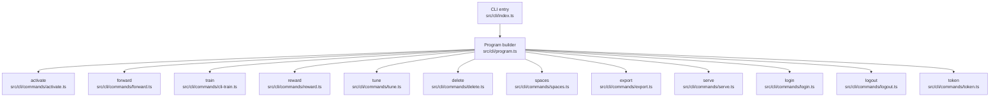

**Diagram sources**
- [index.ts:1-19](file://src/cli/index.ts#L1-L19)
- [program.ts:31-79](file://src/cli/program.ts#L31-L79)
- [commands/activate.ts:12-35](file://src/cli/commands/activate.ts#L12-L35)
- [commands/forward.ts:12-32](file://src/cli/commands/forward.ts#L12-L32)
- [commands/cli-train.ts:40-211](file://src/cli/commands/cli-train.ts#L40-L211)
- [commands/reward.ts:13-66](file://src/cli/commands/reward.ts#L13-L66)
- [commands/tune.ts:32-115](file://src/cli/commands/tune.ts#L32-L115)
- [commands/delete.ts:13-30](file://src/cli/commands/delete.ts#L13-L30)
- [commands/spaces.ts:12-34](file://src/cli/commands/spaces.ts#L12-L34)
- [commands/export.ts:185-224](file://src/cli/commands/export.ts#L185-L224)
- [commands/serve.ts:92-195](file://src/cli/commands/serve.ts#L92-L195)
- [commands/login.ts:255-287](file://src/cli/commands/login.ts#L255-L287)
- [commands/logout.ts:10-20](file://src/cli/commands/logout.ts#L10-L20)
- [commands/token.ts:11-52](file://src/cli/commands/token.ts#L11-L52)

**Section sources**
- [program.ts:31-79](file://src/cli/program.ts#L31-L79)

## Core Components
- Invocation and default transport: The entry point auto-appends `serve` when invoked without arguments and stdin is piped, enabling MCP hosts to launch the process with stdio.
- Global options: `-u/--url`, `--timeout`, `--retries`, `--format`, `--space`, `--reseed`, and `--no-browser` apply across all commands.
- Output formats: `auto`, `pretty`, `json`, and `text` control rendering; `auto` emits JSON when not attached to a terminal.
- Configuration resolution: The API URL resolves from CLI flag, then environment variable `SQUADRULES_API_URL`, then saved config file, then local sentinel.
- Authentication: `login`, `token`, and `logout` manage bearer tokens and refresh tokens via OAuth PKCE or direct token validation. Tokens can be stored in the OS keyring or config file.
- Local development: `serve` starts the MCP server with stdio or HTTP, supports `.env`, metrics port, and updates the CLI default URL when running locally.

**Section sources**
- [CLI.md:46-75](file://docs/CLI.md#L46-L75)
- [config.ts:8-27](file://src/cli/config.ts#L8-L27)
- [program.ts:31-61](file://src/cli/program.ts#L31-L61)
- [commands/serve.ts:92-195](file://src/cli/commands/serve.ts#L92-L195)
- [commands/login.ts:255-287](file://src/cli/commands/login.ts#L255-L287)

## Architecture Overview
The CLI follows a consistent flow: parse global options, select backend (local or HTTP), execute command logic, format output, and handle authentication-related errors.

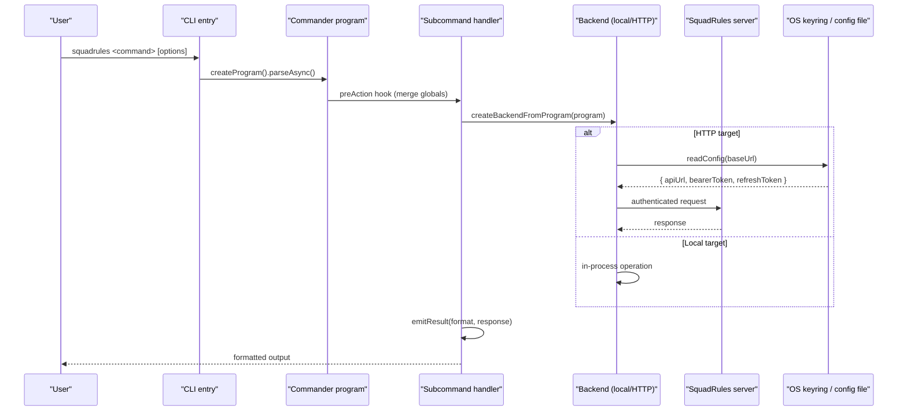

**Diagram sources**
- [index.ts:11-19](file://src/cli/index.ts#L11-L19)
- [program.ts:47-61](file://src/cli/program.ts#L47-L61)
- [commands/activate.ts:18-34](file://src/cli/commands/activate.ts#L18-L34)
- [commands/login.ts:73-87](file://src/cli/commands/login.ts#L73-L87)
- [config-file.ts:90-207](file://src/cli/config-file.ts#L90-L207)

## Detailed Component Analysis

### activate
Finds the best matching adapter for a query. Supports scoping by space and renders pretty/text/json output with next-call hints.

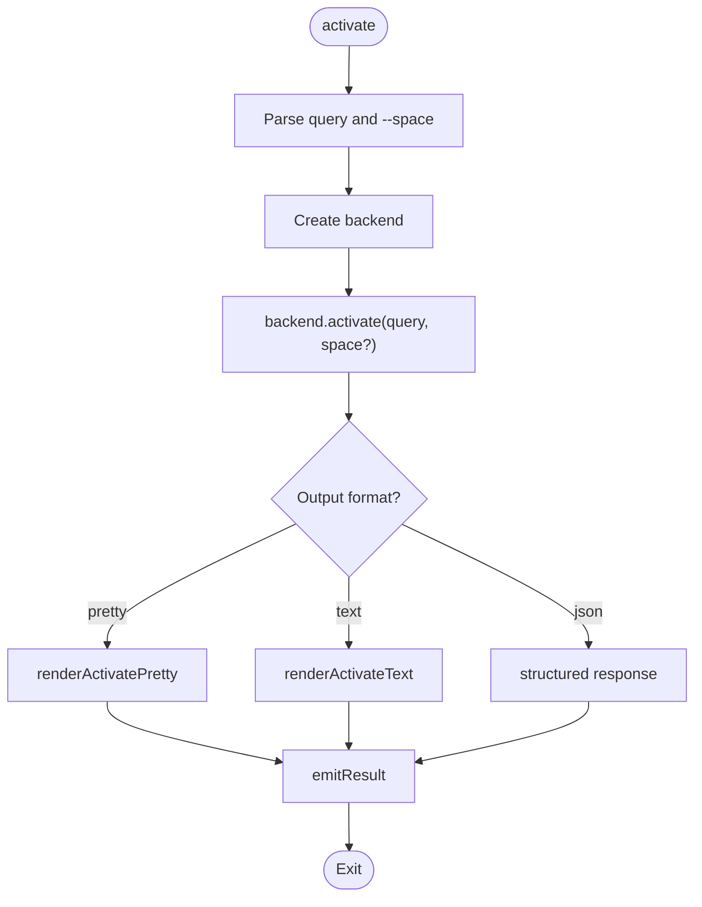

**Diagram sources**
- [commands/activate.ts:12-35](file://src/cli/commands/activate.ts#L12-L35)

**Section sources**
- [commands/activate.ts:12-35](file://src/cli/commands/activate.ts#L12-L35)

### forward
Runs the first or next layer of an adapter. Accepts a URI and optional solution payload.

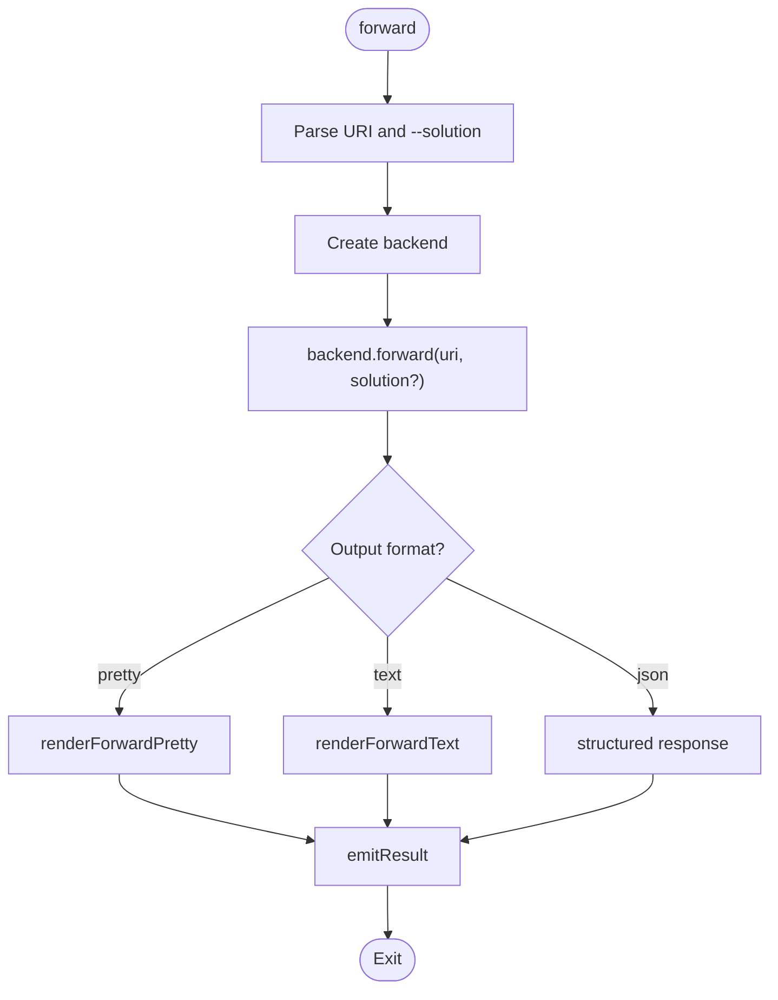

**Diagram sources**
- [commands/forward.ts:12-32](file://src/cli/commands/forward.ts#L12-L32)

**Section sources**
- [commands/forward.ts:12-32](file://src/cli/commands/forward.ts#L12-L32)

### reward
Records a reward signal for an adapter execution. Validates outcome and score, then sends structured reward metadata.

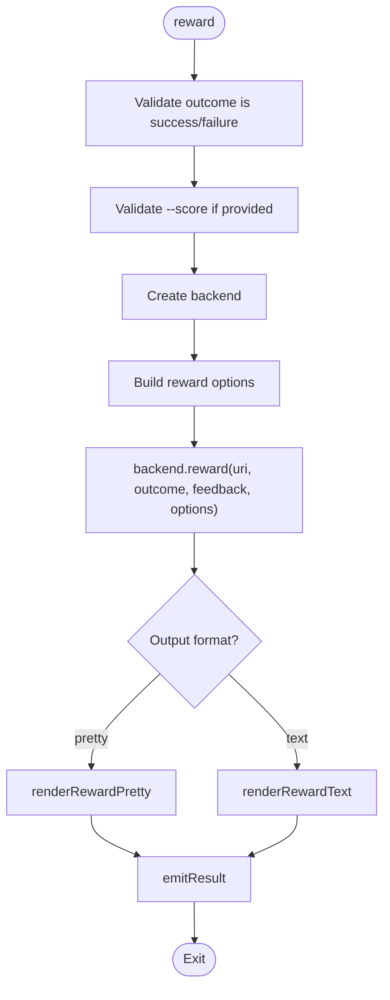

**Diagram sources**
- [commands/reward.ts:13-66](file://src/cli/commands/reward.ts#L13-L66)

**Section sources**
- [commands/reward.ts:13-66](file://src/cli/commands/reward.ts#L13-L66)

### tune
Updates one or more adapter layers. Supports move-only operations, markdown files, JSON updates, and sensitive upload guard.

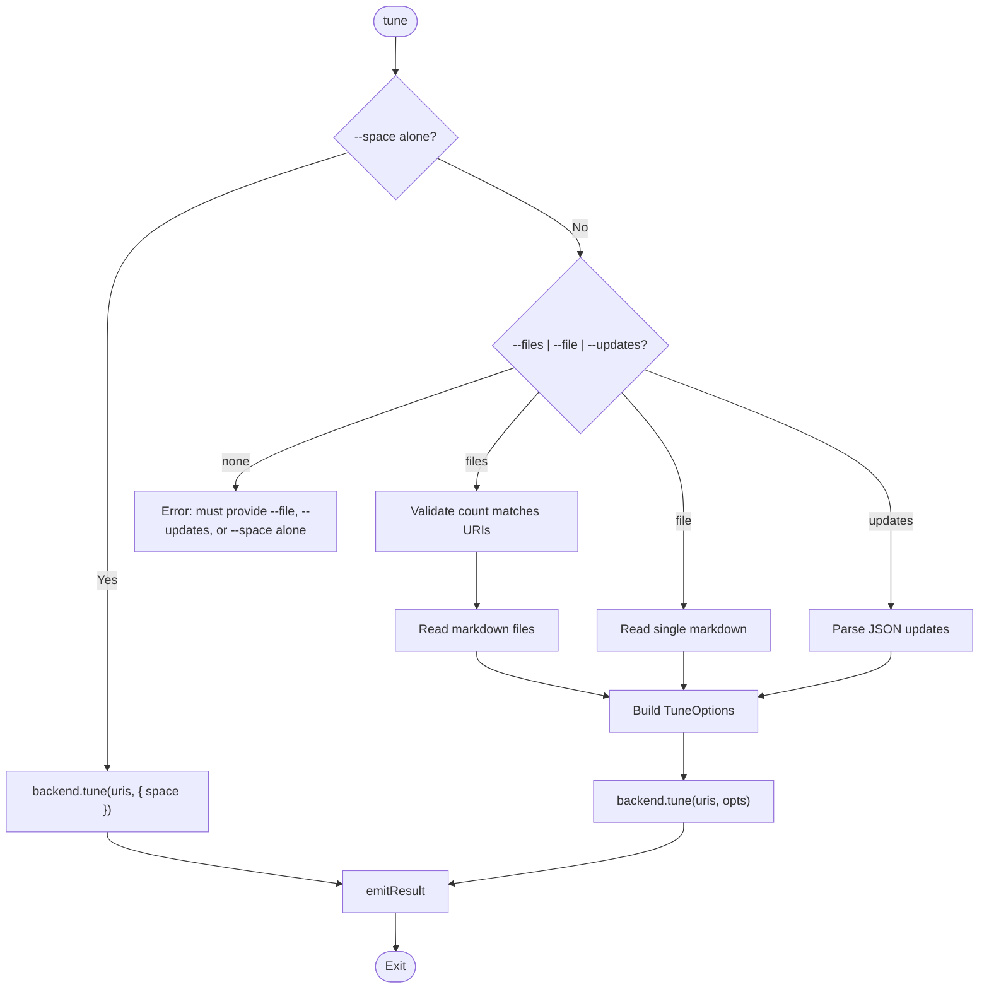

**Diagram sources**
- [commands/tune.ts:32-115](file://src/cli/commands/tune.ts#L32-L115)

**Section sources**
- [commands/tune.ts:32-115](file://src/cli/commands/tune.ts#L32-L115)

### delete
Deletes one or more adapter or layer resources.

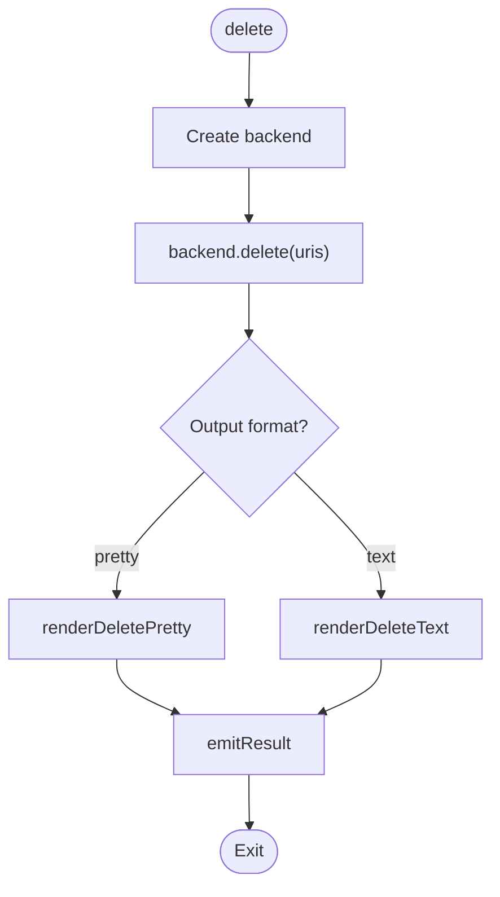

**Diagram sources**
- [commands/delete.ts:13-30](file://src/cli/commands/delete.ts#L13-L30)

**Section sources**
- [commands/delete.ts:13-30](file://src/cli/commands/delete.ts#L13-L30)

### spaces
Lists available spaces and adapter counts, optionally including per-space adapter titles.

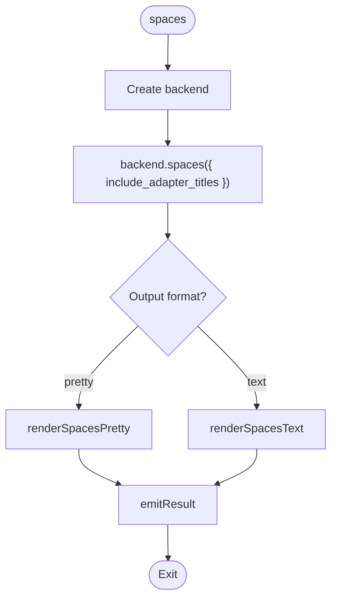

**Diagram sources**
- [commands/spaces.ts:12-34](file://src/cli/commands/spaces.ts#L12-L34)

**Section sources**
- [commands/spaces.ts:12-34](file://src/cli/commands/spaces.ts#L12-L34)

### export
Machine-facing bulk export command. Writes artifacts to disk and prints a compact summary or JSON manifest. Never dumps content bytes to stdout.

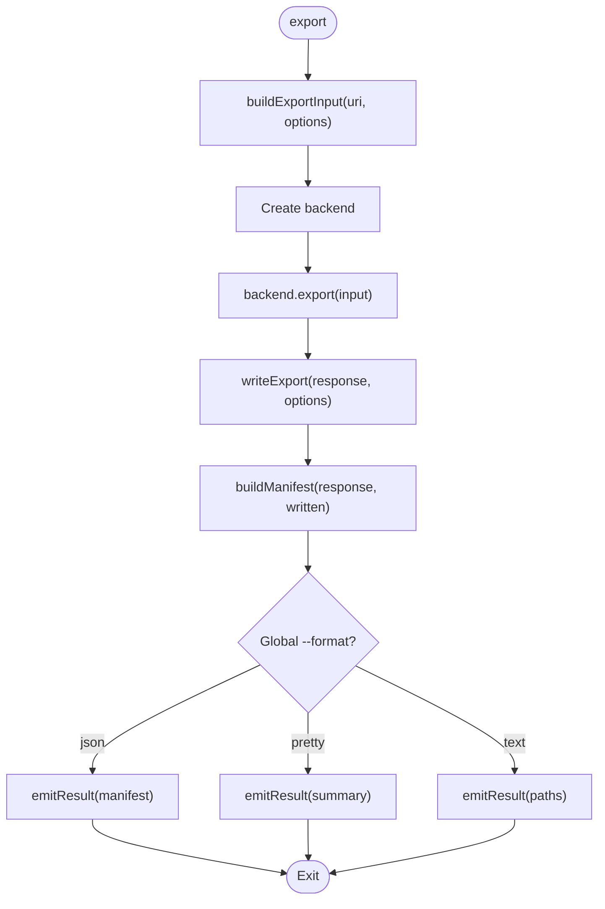

**Diagram sources**
- [commands/export.ts:45-87](file://src/cli/commands/export.ts#L45-L87)
- [commands/export.ts:122-155](file://src/cli/commands/export.ts#L122-L155)
- [commands/export.ts:157-183](file://src/cli/commands/export.ts#L157-L183)
- [commands/export.ts:185-224](file://src/cli/commands/export.ts#L185-L224)

**Section sources**
- [commands/export.ts:45-87](file://src/cli/commands/export.ts#L45-L87)
- [commands/export.ts:122-155](file://src/cli/commands/export.ts#L122-L155)
- [commands/export.ts:157-183](file://src/cli/commands/export.ts#L157-L183)
- [commands/export.ts:185-224](file://src/cli/commands/export.ts#L185-L224)

### serve
Starts the MCP server with stdio or HTTP. Loads `.env`, validates ports, sets transport, and spawns the bootstrap process. When `--server-port` is used, it updates the CLI default URL.

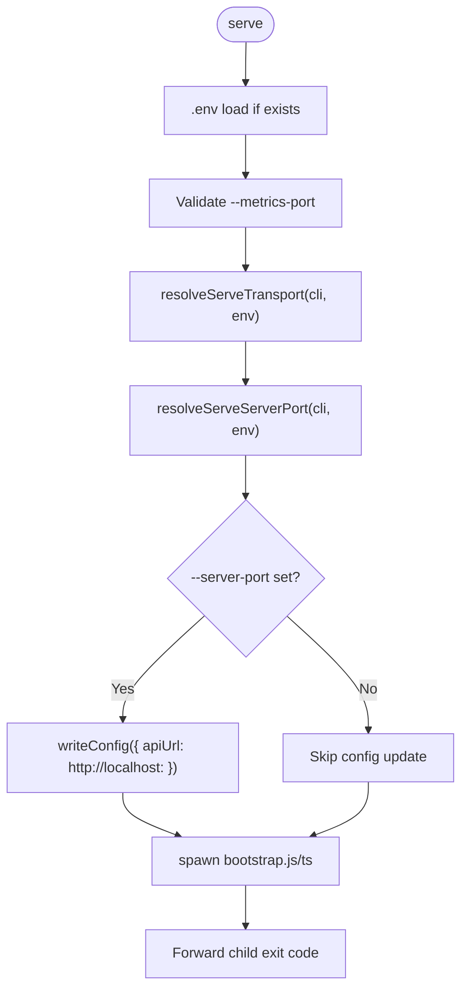

**Diagram sources**
- [commands/serve.ts:21-42](file://src/cli/commands/serve.ts#L21-L42)
- [commands/serve.ts:92-195](file://src/cli/commands/serve.ts#L92-L195)

**Section sources**
- [commands/serve.ts:21-42](file://src/cli/commands/serve.ts#L21-L42)
- [commands/serve.ts:92-195](file://src/cli/commands/serve.ts#L92-L195)

### login
Authenticates via browser PKCE or direct token validation. Stores bearer and refresh tokens in the OS keyring when available, falling back to the config file.

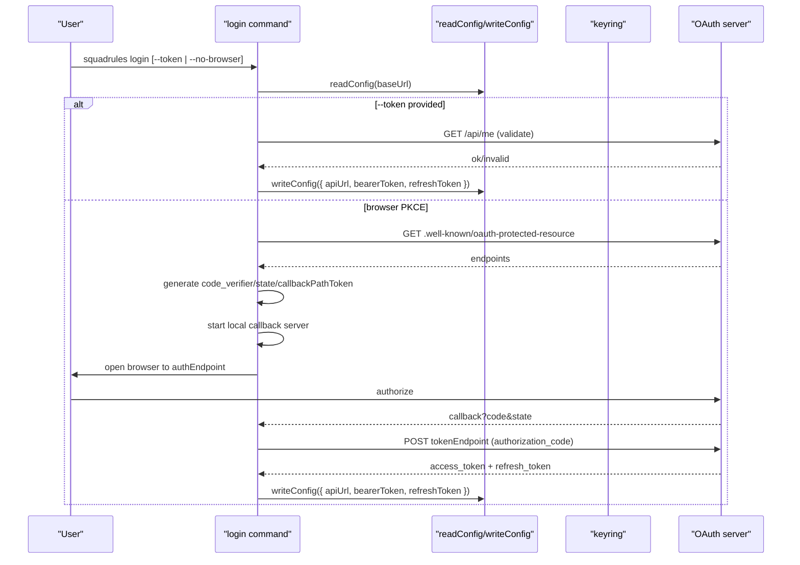

**Diagram sources**
- [commands/login.ts:80-102](file://src/cli/commands/login.ts#L80-L102)
- [commands/login.ts:112-253](file://src/cli/commands/login.ts#L112-L253)
- [commands/login.ts:255-287](file://src/cli/commands/login.ts#L255-L287)
- [config-file.ts:90-207](file://src/cli/config-file.ts#L90-L207)
- [keyring.ts:145-223](file://src/cli/keyring.ts#L145-L223)

**Section sources**
- [commands/login.ts:80-102](file://src/cli/commands/login.ts#L80-L102)
- [commands/login.ts:112-253](file://src/cli/commands/login.ts#L112-L253)
- [commands/login.ts:255-287](file://src/cli/commands/login.ts#L255-L287)
- [config-file.ts:90-207](file://src/cli/config-file.ts#L90-L207)
- [keyring.ts:145-223](file://src/cli/keyring.ts#L145-L223)

### logout
Clears stored credentials for the current environment.

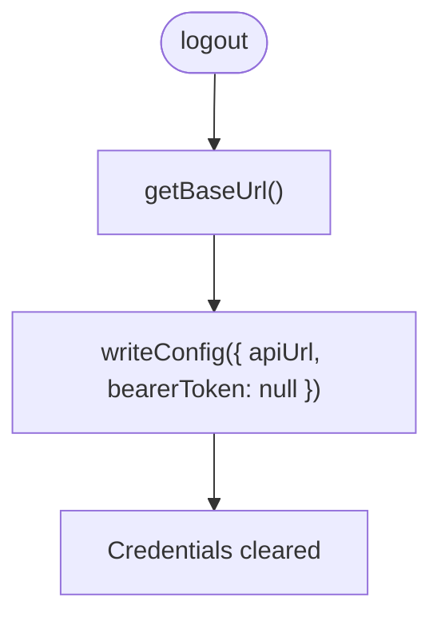

**Diagram sources**
- [commands/logout.ts:10-20](file://src/cli/commands/logout.ts#L10-L20)

**Section sources**
- [commands/logout.ts:10-20](file://src/cli/commands/logout.ts#L10-L20)

### token
Prints the stored bearer token to stdout, optionally validating it or triggering login.

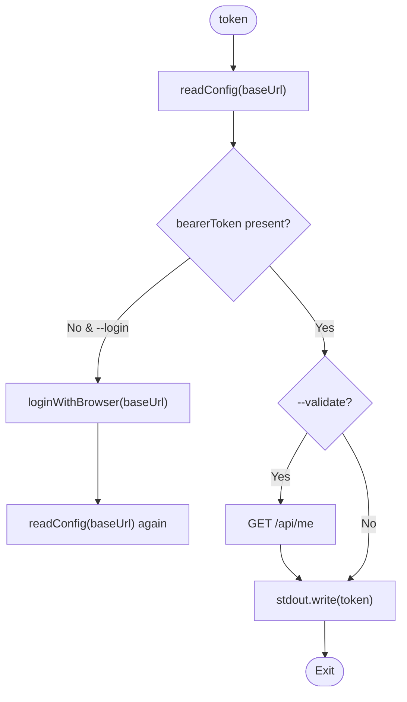

**Diagram sources**
- [commands/token.ts:11-52](file://src/cli/commands/token.ts#L11-L52)
- [commands/login.ts:80-87](file://src/cli/commands/login.ts#L80-L87)

**Section sources**
- [commands/token.ts:11-52](file://src/cli/commands/token.ts#L11-L52)

### train
Registers new adapters from markdown, attaches artifacts, or forks existing adapters. Supports directory batch processing.

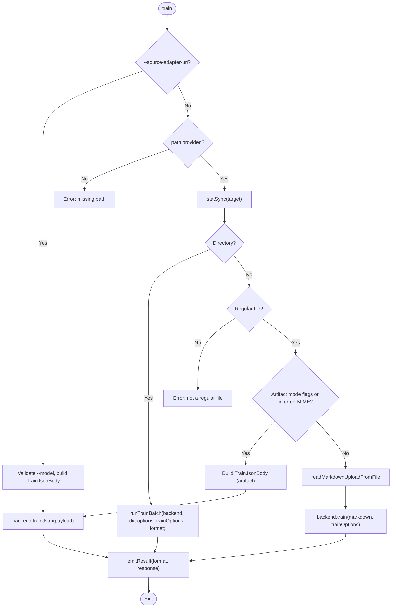

**Diagram sources**
- [commands/cli-train.ts:40-211](file://src/cli/commands/cli-train.ts#L40-L211)

**Section sources**
- [commands/cli-train.ts:40-211](file://src/cli/commands/cli-train.ts#L40-L211)

## Dependency Analysis
The CLI depends on several subsystems:

- Command registration and global options: `program.ts`
- Configuration resolution: `config.ts`, `config-file.ts`, `config-file-write.ts`
- Credential storage: `keyring.ts`
- Authentication helpers and error handling: `auth-error.ts`
- Subcommands: `commands/*`
- Environment variables: `SQUADRULES_*` and `SERVER_PORT`, `TRANSPORT_TYPE`, `METRICS_PORT`

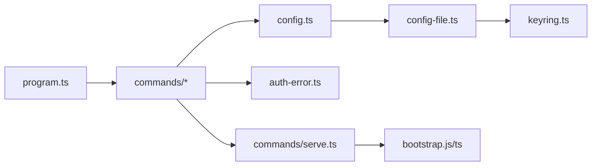

**Diagram sources**
- [program.ts:31-79](file://src/cli/program.ts#L31-L79)
- [config.ts:8-27](file://src/cli/config.ts#L8-L27)
- [config-file.ts:90-207](file://src/cli/config-file.ts#L90-L207)
- [keyring.ts:145-223](file://src/cli/keyring.ts#L145-L223)
- [commands/serve.ts:92-195](file://src/cli/commands/serve.ts#L92-L195)

**Section sources**
- [program.ts:31-79](file://src/cli/program.ts#L31-L79)
- [config.ts:8-27](file://src/cli/config.ts#L8-L27)
- [config-file.ts:90-207](file://src/cli/config-file.ts#L90-L207)
- [keyring.ts:145-223](file://src/cli/keyring.ts#L145-L223)
- [commands/serve.ts:92-195](file://src/cli/commands/serve.ts#L92-L195)

## Performance Considerations
- Local-by-default mode avoids network latency by using the embedded store.
- Request timeouts and retries are configurable globally; use `--timeout` and `--retries` to tune network calls.
- Export is designed for machine consumption and writes directly to disk without streaming large payloads through stdout.
- Keyring operations have a timeout and degradation latch to prevent blocking the CLI when the OS keychain is unresponsive.

[No sources needed since this section provides general guidance]

## Troubleshooting Guide
Common issues and resolutions:

- Authentication failures:
  - If a command returns an authentication error, the CLI may attempt to open the login URL. Use `--no-browser` to suppress browser opening.
  - Validate your token with `squadrules token --validate`. If invalid, re-run `squadrules login`.
  - For local targets, the CLI falls back to `http://localhost:3000` for auth commands; pass `--url http://<host>:<port>` to target a specific server.

- Browser not opening:
  - Set `BROWSER=true` or `BROWSER=none` to disable automatic browser launching.
  - On unsupported systems, manually open the printed login URL.

- Keyring unavailable:
  - The CLI warns once and stores tokens in the config file when the OS keyring is unavailable or timed out.
  - If the keychain becomes reachable later, re-authenticate to migrate secrets back to the keyring.

- Export selection errors:
  - Ensure exactly one selection mode: positional `<uri>`, `--adapters`, or `--all-adapters --space`.
  - `--all-adapters` requires `--space`.

- Train input errors:
  - Missing path or non-regular file triggers explicit errors.
  - Artifact mode requires `--adapter` and `--model`; MIME inference may require `--mime`.

- Serve startup errors:
  - Invalid `--metrics-port` or `--server-port` values cause immediate errors.
  - If updating the CLI default URL fails, the command reports the error and exits.

Exit codes:
- Most commands exit with status 0 on success.
- Validation errors and API errors typically exit with status 1.
- `reward` explicitly exits with 1 for invalid outcome or score.
- `login` exits with 1 if token validation fails or browser login fails.
- `token` exits with 1 if no token is stored or validation fails.

**Section sources**
- [auth-error.ts:119-132](file://src/cli/auth-error.ts#L119-L132)
- [commands/reward.ts:31-42](file://src/cli/commands/reward.ts#L31-L42)
- [commands/login.ts:255-287](file://src/cli/commands/login.ts#L255-L287)
- [commands/token.ts:11-52](file://src/cli/commands/token.ts#L11-L52)
- [commands/export.ts:45-87](file://src/cli/commands/export.ts#L45-L87)
- [commands/cli-train.ts:82-109](file://src/cli/commands/cli-train.ts#L82-L109)
- [commands/serve.ts:116-140](file://src/cli/commands/serve.ts#L116-L140)

## Security Considerations
- Credential storage:
  - Tokens are preferentially stored in the OS keyring when available. If unavailable, they fall back to the config file.
  - The config file uses placeholders for keychain-stored tokens and migrates inline secrets to the keyring on first read.

- Browser security:
  - The CLI validates URLs and restricts allowed browser binaries. Unsafe `BROWSER` overrides are ignored.
  - Control browser launching via `BROWSER` and `SQUADRULES_NO_BROWSER`.

- Token validation:
  - `login --token` validates tokens against `/api/me` before storing them.
  - `token --validate` checks token validity before printing.

- Sensitive uploads:
  - `tune` and `train` support `--allow-sensitive-upload` to permit uploads containing token-like or private-key-like text. Use cautiously.

- Local vs remote:
  - Local mode has no auth server; auth commands automatically fall back to localhost. Always specify `--url` for production servers.

**Section sources**
- [config-file.ts:1-11](file://src/cli/config-file.ts#L1-L11)
- [config-file.ts:90-207](file://src/cli/config-file.ts#L90-L207)
- [config-file-write.ts:44-171](file://src/cli/config-file-write.ts#L44-L171)
- [keyring.ts:1-6](file://src/cli/keyring.ts#L1-L6)
- [auth-error.ts:22-77](file://src/cli/auth-error.ts#L22-L77)
- [commands/login.ts:80-102](file://src/cli/commands/login.ts#L80-L102)
- [commands/tune.ts:44-44](file://src/cli/commands/tune.ts#L44-L44)
- [commands/cli-train.ts:59-60](file://src/cli/commands/cli-train.ts#L59-L60)

## Conclusion
The SquadRules CLI provides a consistent, secure, and flexible interface for interacting with both local and remote SquadRules instances. It supports activation, forwarding, rewarding, tuning, deletion, listing spaces, training adapters, exporting bundles, and serving the MCP server. Configuration resolution, environment variables, and authentication handling are designed for safe local development and robust remote operations. Follow the troubleshooting and security sections to diagnose issues and protect credentials effectively.

[No sources needed since this section summarizes without analyzing specific files]