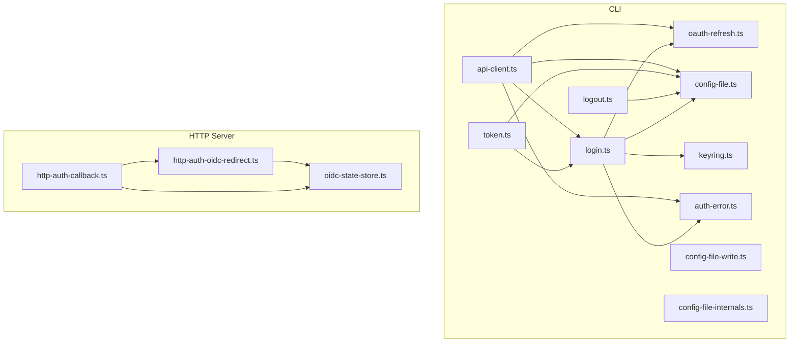
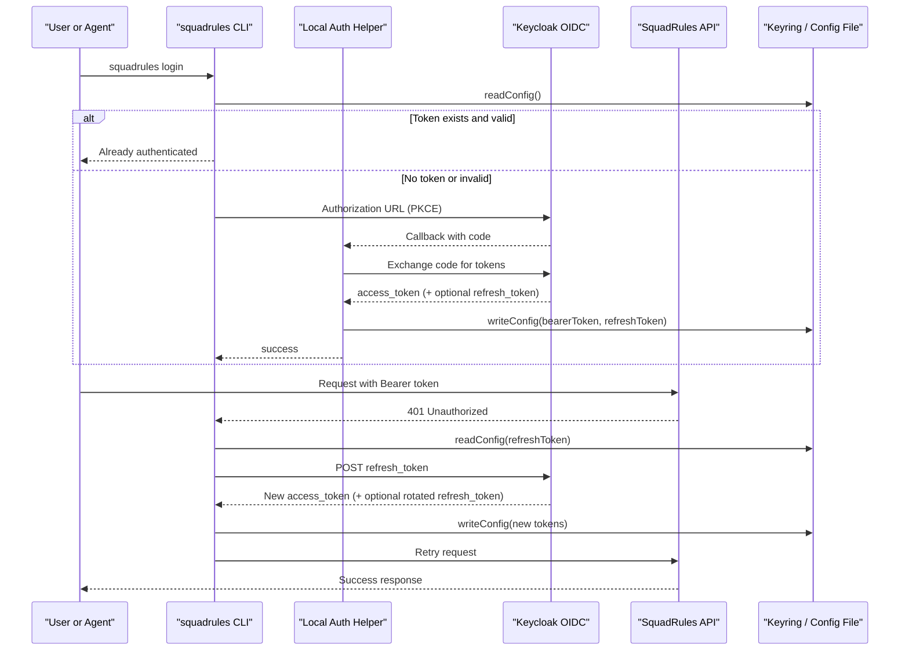
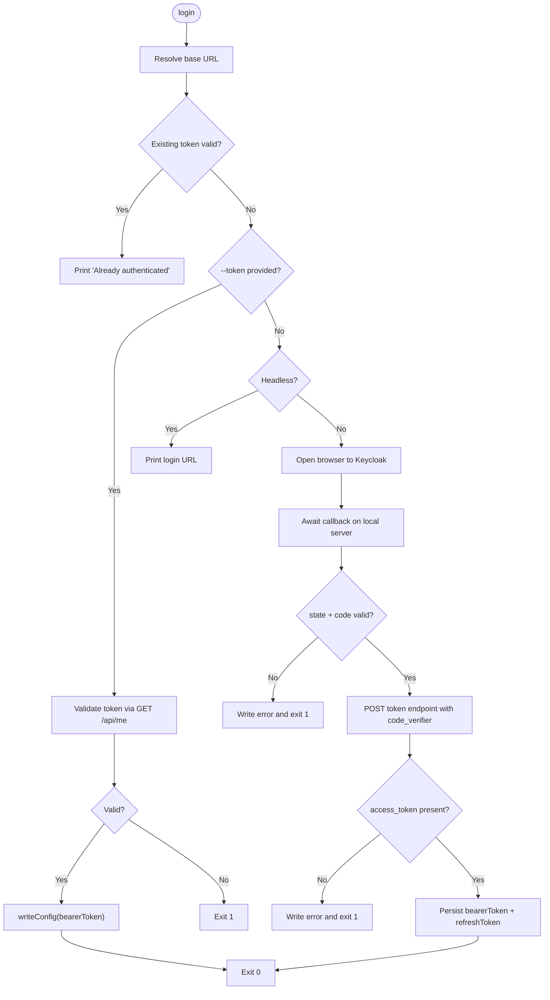
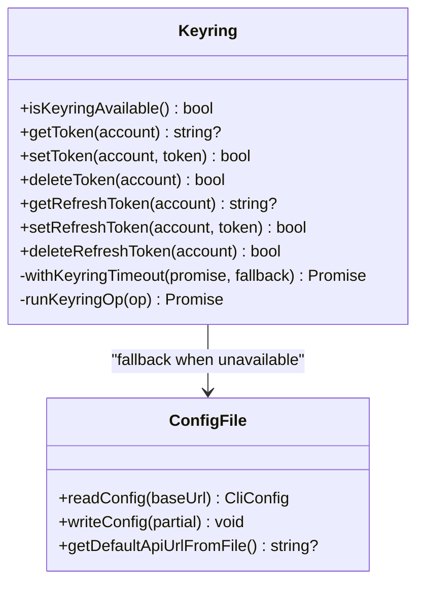
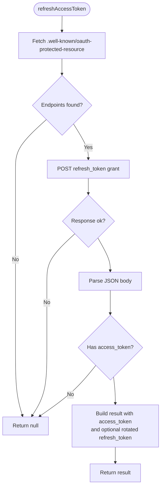
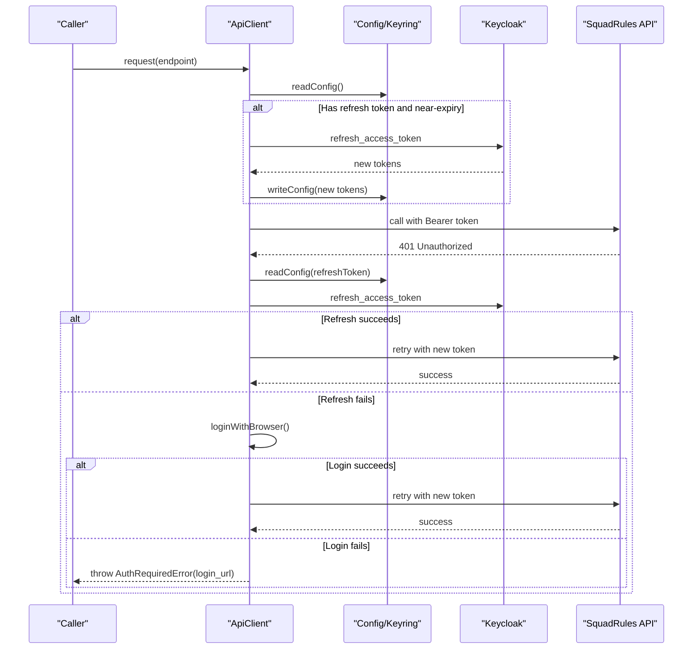
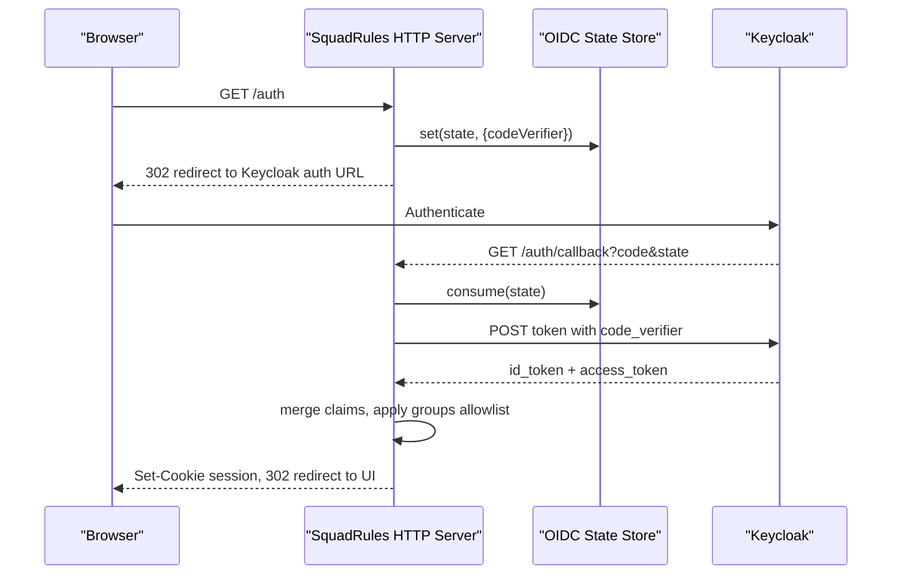
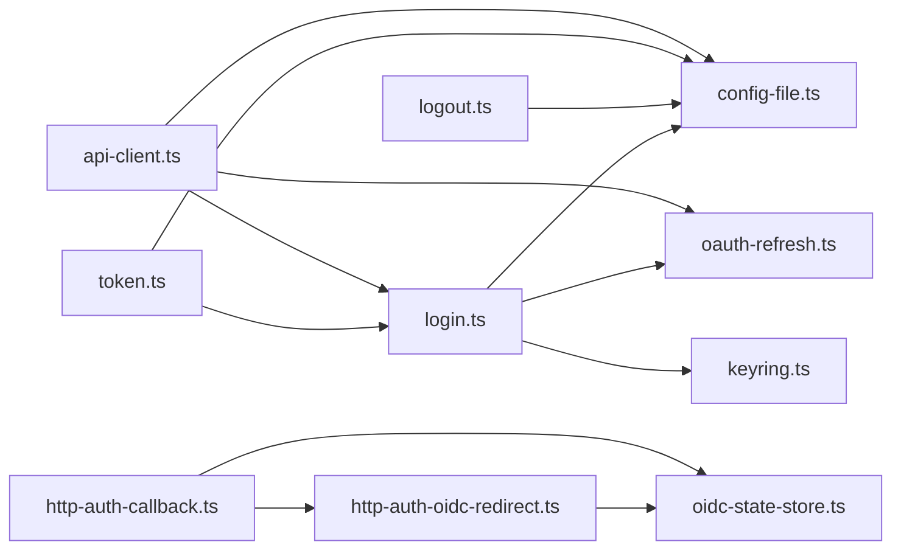

# Authentication Commands

<cite>
**Referenced Files in This Document**
- [login.ts](file://src/cli/commands/login.ts)
- [logout.ts](file://src/cli/commands/logout.ts)
- [token.ts](file://src/cli/commands/token.ts)
- [keyring.ts](file://src/cli/keyring.ts)
- [oauth-refresh.ts](file://src/cli/oauth-refresh.ts)
- [auth-error.ts](file://src/cli/auth-error.ts)
- [config-file.ts](file://src/cli/config-file.ts)
- [config-file-write.ts](file://src/cli/config-file-write.ts)
- [config-file-internals.ts](file://src/cli/config-file-internals.ts)
- [api-client.ts](file://src/cli/api-client.ts)
- [http-auth-oidc-redirect.ts](file://src/http/http-auth-oidc-redirect.ts)
- [http-auth-callback.ts](file://src/http/http-auth-callback.ts)
- [oidc-state-store.ts](file://src/services/oidc-state-store.ts)
</cite>

## Table of Contents
1. [Introduction](#introduction)
2. [Project Structure](#project-structure)
3. [Core Components](#core-components)
4. [Architecture Overview](#architecture-overview)
5. [Detailed Component Analysis](#detailed-component-analysis)
6. [Dependency Analysis](#dependency-analysis)
7. [Performance Considerations](#performance-considerations)
8. [Troubleshooting Guide](#troubleshooting-guide)
9. [Conclusion](#conclusion)
10. [Appendices](#appendices)

## Introduction
This document explains the SquadRules authentication commands and their integration with Keycloak OIDC. It covers:
- `squadrules login`, `squadrules logout`, and `squadrules token`
- Browser-based PKCE login and headless operation modes
- Secure credential storage via the OS keyring with config file fallback
- OAuth2 refresh-token flow and proactive token refresh
- Session management for browser-based server auth
- Error handling, troubleshooting, security best practices, and deployment examples

SquadRules is an agent-first MCP framework where AI agents are primary users and humans configure preferences through agents. Authentication supports both CLI automation and interactive browser flows so that agents and operators can work consistently across development, CI/CD, and production environments.

## Project Structure
Authentication spans CLI commands, secure storage, OAuth helpers, API client behavior, and HTTP server OIDC endpoints. The most relevant files are:

**Diagram sources**
- [login.ts:1-288](file://src/cli/commands/login.ts#L1-L288)
- [logout.ts:1-21](file://src/cli/commands/logout.ts#L1-L21)
- [token.ts:1-53](file://src/cli/commands/token.ts#L1-L53)
- [keyring.ts:1-224](file://src/cli/keyring.ts#L1-L224)
- [oauth-refresh.ts:1-111](file://src/cli/oauth-refresh.ts#L1-L111)
- [auth-error.ts:1-133](file://src/cli/auth-error.ts#L1-L133)
- [config-file.ts:1-208](file://src/cli/config-file.ts#L1-L208)
- [config-file-write.ts:1-172](file://src/cli/config-file-write.ts#L1-L172)
- [config-file-internals.ts:1-68](file://src/cli/config-file-internals.ts#L1-L68)
- [api-client.ts:1-341](file://src/cli/api-client.ts#L1-L341)
- [http-auth-oidc-redirect.ts:1-92](file://src/http/http-auth-oidc-redirect.ts#L1-L92)
- [http-auth-callback.ts:1-231](file://src/http/http-auth-callback.ts#L1-L231)
- [oidc-state-store.ts:1-76](file://src/services/oidc-state-store.ts#L1-L76)

**Section sources**
- [login.ts:1-288](file://src/cli/commands/login.ts#L1-L288)
- [logout.ts:1-21](file://src/cli/commands/logout.ts#L1-L21)
- [token.ts:1-53](file://src/cli/commands/token.ts#L1-L53)
- [keyring.ts:1-224](file://src/cli/keyring.ts#L1-L224)
- [oauth-refresh.ts:1-111](file://src/cli/oauth-refresh.ts#L1-L111)
- [auth-error.ts:1-133](file://src/cli/auth-error.ts#L1-L133)
- [config-file.ts:1-208](file://src/cli/config-file.ts#L1-L208)
- [config-file-write.ts:1-172](file://src/cli/config-file-write.ts#L1-L172)
- [config-file-internals.ts:1-68](file://src/cli/config-file-internals.ts#L1-L68)
- [api-client.ts:1-341](file://src/cli/api-client.ts#L1-L341)
- [http-auth-oidc-redirect.ts:1-92](file://src/http/http-auth-oidc-redirect.ts#L1-L92)
- [http-auth-callback.ts:1-231](file://src/http/http-auth-callback.ts#L1-L231)
- [oidc-state-store.ts:1-76](file://src/services/oidc-state-store.ts#L1-L76)

## Core Components
- Login command: validates tokens, opens a browser for PKCE login, or prints a login URL when headless.
- Logout command: clears stored credentials for the current environment.
- Token command: prints the stored bearer token to stdout, optionally validating it or triggering login.
- Keyring system: stores bearer and refresh tokens in the OS keyring; falls back to a local config file when unavailable.
- OAuth refresh: discovers OIDC endpoints and exchanges refresh tokens for new access tokens.
- API client: integrates auto-login, proactive refresh, retry logic, and error handling.
- HTTP OIDC endpoints: build Keycloak authorization URLs, handle callback exchange, and manage sessions.

**Section sources**
- [login.ts:29-288](file://src/cli/commands/login.ts#L29-L288)
- [logout.ts:10-20](file://src/cli/commands/logout.ts#L10-L20)
- [token.ts:11-52](file://src/cli/commands/token.ts#L11-L52)
- [keyring.ts:1-224](file://src/cli/keyring.ts#L1-L224)
- [oauth-refresh.ts:1-111](file://src/cli/oauth-refresh.ts#L1-L111)
- [api-client.ts:46-341](file://src/cli/api-client.ts#L46-L341)
- [http-auth-oidc-redirect.ts:15-92](file://src/http/http-auth-oidc-redirect.ts#L15-L92)
- [http-auth-callback.ts:84-231](file://src/http/http-auth-callback.ts#L84-L231)

## Architecture Overview
The authentication architecture combines CLI-driven flows with server-side OIDC endpoints.

**Diagram sources**
- [login.ts:112-253](file://src/cli/commands/login.ts#L112-L253)
- [oauth-refresh.ts:62-96](file://src/cli/oauth-refresh.ts#L62-L96)
- [config-file.ts:90-207](file://src/cli/config-file.ts#L90-L207)
- [config-file-write.ts:44-171](file://src/cli/config-file-write.ts#L44-L171)
- [api-client.ts:101-250](file://src/cli/api-client.ts#L101-L250)

## Detailed Component Analysis

### Login Command
Responsibilities:
- Resolve the effective base URL for auth commands.
- Validate an existing token by calling `/api/me`.
- Open a browser for PKCE login or print a login URL when headless.
- Handle callback validation, state verification, and token exchange.
- Persist tokens using the keyring with config file fallback.

Key behaviors:
- Local target fallback: when the resolved target is local, auth commands use a localhost HTTP default and print guidance.
- PKCE parameters: generates `code_verifier`, `code_challenge`, `state`, and a request-bound callback path token.
- Callback server: binds to a local port, validates `state` and `code`, handles errors, and exchanges the code for tokens.
- Timeout control: uses shared timeout resolution for network calls.

**Diagram sources**
- [login.ts:73-102](file://src/cli/commands/login.ts#L73-L102)
- [login.ts:112-253](file://src/cli/commands/login.ts#L112-L253)
- [login.ts:255-288](file://src/cli/commands/login.ts#L255-L288)

**Section sources**
- [login.ts:29-288](file://src/cli/commands/login.ts#L29-L288)

### Logout Command
Responsibilities:
- Clear stored bearer and refresh credentials for the current environment.
- Respect local target fallback and print guidance.

Behavior:
- Writes configuration with null tokens, which deletes from keyring when available and removes placeholders from the config file.

**Section sources**
- [logout.ts:10-20](file://src/cli/commands/logout.ts#L10-L20)
- [config-file-write.ts:77-125](file://src/cli/config-file-write.ts#L77-L125)

### Token Command
Responsibilities:
- Print the stored bearer token to stdout for scripting.
- Optionally validate the token against `/api/me`.
- Optionally trigger browser login if no valid token exists.

Behavior:
- Uses the same base URL resolution and local target fallback as login.
- Exits with non-zero status on missing or invalid tokens.

**Section sources**
- [token.ts:11-52](file://src/cli/commands/token.ts#L11-L52)
- [login.ts:73-87](file://src/cli/commands/login.ts#L73-L87)

### Keyring System
Responsibilities:
- Provide OS-native secure storage for bearer and refresh tokens.
- Fall back to a local config file when the native binding is unavailable or times out.
- Protect against hangs by timing out keyring operations and degrading gracefully.

Key features:
- Service name and account separation for bearer vs refresh tokens.
- Degradation latch: once a keyring operation times out, subsequent operations short-circuit to the config file.
- Placeholder sentinel in config file to indicate tokens are stored in the keyring.

**Diagram sources**
- [keyring.ts:1-224](file://src/cli/keyring.ts#L1-L224)
- [config-file.ts:1-208](file://src/cli/config-file.ts#L1-L208)
- [config-file-write.ts:1-172](file://src/cli/config-file-write.ts#L1-L172)
- [config-file-internals.ts:1-68](file://src/cli/config-file-internals.ts#L1-L68)

**Section sources**
- [keyring.ts:1-224](file://src/cli/keyring.ts#L1-L224)
- [config-file.ts:40-207](file://src/cli/config-file.ts#L40-L207)
- [config-file-write.ts:25-171](file://src/cli/config-file-write.ts#L25-L171)
- [config-file-internals.ts:9-68](file://src/cli/config-file-internals.ts#L9-L68)

### OAuth Refresh Mechanism
Responsibilities:
- Discover OIDC endpoints from the protected resource metadata.
- Exchange refresh tokens for new access tokens.
- Support rotated refresh tokens.
- Compute JWT expiration skew for proactive refresh.

Behavior:
- Hardcoded CLI client ID used for refresh requests.
- Returns null on network/HTTP/body failures.

**Diagram sources**
- [oauth-refresh.ts:26-51](file://src/cli/oauth-refresh.ts#L26-L51)
- [oauth-refresh.ts:62-111](file://src/cli/oauth-refresh.ts#L62-L111)

**Section sources**
- [oauth-refresh.ts:1-111](file://src/cli/oauth-refresh.ts#L1-L111)

### API Client Integration
Responsibilities:
- Centralize authentication for all API calls.
- Auto-login when needed.
- Proactively refresh tokens before expiry.
- Retry on transient network errors and rate limits.
- Handle 401 responses by attempting refresh and then login.

Key behaviors:
- Constructor resolves base URL from explicit options, environment, config file, or defaults.
- Singleflight refresh: coalesces concurrent refresh attempts per client instance.
- Proactive refresh skew: refreshes when the access token expires within a small window.
- 401 handling: tries refresh first, then browser login, then throws `AuthRequiredError` with a login URL when available.

**Diagram sources**
- [api-client.ts:46-250](file://src/cli/api-client.ts#L46-L250)
- [oauth-refresh.ts:62-96](file://src/cli/oauth-refresh.ts#L62-L96)
- [config-file.ts:90-207](file://src/cli/config-file.ts#L90-L207)

**Section sources**
- [api-client.ts:46-341](file://src/cli/api-client.ts#L46-L341)
- [auth-error.ts:12-20](file://src/cli/auth-error.ts#L12-L20)
- [auth-error.ts:124-133](file://src/cli/auth-error.ts#L124-L133)

### Browser-Based OIDC Flow (Server Side)
Responsibilities:
- Build Keycloak authorization URLs with PKCE.
- Handle callback exchange and session cookie creation.
- Manage logout and post-logout redirects.

Key behaviors:
- State store persists PKCE state with TTL.
- Callback validates state, exchanges code for tokens, merges claims, applies group allowlist, and sets a signed session cookie.
- Logout clears session and optionally ends Keycloak SSO.

**Diagram sources**
- [http-auth-oidc-redirect.ts:15-92](file://src/http/http-auth-oidc-redirect.ts#L15-L92)
- [http-auth-callback.ts:122-229](file://src/http/http-auth-callback.ts#L122-L229)
- [oidc-state-store.ts:16-76](file://src/services/oidc-state-store.ts#L16-L76)

**Section sources**
- [http-auth-oidc-redirect.ts:15-92](file://src/http/http-auth-oidc-redirect.ts#L15-L92)
- [http-auth-callback.ts:84-231](file://src/http/http-auth-callback.ts#L84-L231)
- [oidc-state-store.ts:1-76](file://src/services/oidc-state-store.ts#L1-L76)

## Dependency Analysis
The authentication subsystem has clear boundaries:
- CLI commands depend on config file and keyring for persistence.
- API client depends on OAuth refresh utilities and login helper for auto-login.
- HTTP server OIDC endpoints depend on OIDC state store and configuration.

**Diagram sources**
- [login.ts:1-288](file://src/cli/commands/login.ts#L1-L288)
- [logout.ts:1-21](file://src/cli/commands/logout.ts#L1-L21)
- [token.ts:1-53](file://src/cli/commands/token.ts#L1-L53)
- [api-client.ts:1-341](file://src/cli/api-client.ts#L1-L341)
- [oauth-refresh.ts:1-111](file://src/cli/oauth-refresh.ts#L1-L111)
- [config-file.ts:1-208](file://src/cli/config-file.ts#L1-L208)
- [keyring.ts:1-224](file://src/cli/keyring.ts#L1-L224)
- [http-auth-oidc-redirect.ts:1-92](file://src/http/http-auth-oidc-redirect.ts#L1-L92)
- [http-auth-callback.ts:1-231](file://src/http/http-auth-callback.ts#L1-L231)
- [oidc-state-store.ts:1-76](file://src/services/oidc-state-store.ts#L1-L76)

**Section sources**
- [login.ts:1-288](file://src/cli/commands/login.ts#L1-L288)
- [api-client.ts:1-341](file://src/cli/api-client.ts#L1-L341)
- [http-auth-callback.ts:1-231](file://src/http/http-auth-callback.ts#L1-L231)

## Performance Considerations
- Keyring timeouts: keyring operations are wrapped with a timeout to avoid indefinite hangs; degradation prevents repeated stalls.
- Proactive refresh: reduces 401 churn by refreshing tokens before they expire.
- Singleflight refresh: coalesces concurrent refresh attempts to avoid redundant network calls.
- Retry and backoff: API client retries transient network errors with exponential backoff and jitter.
- Rate limit handling: respects `Retry-After` headers and retries up to a bounded count.

[No sources needed since this section provides general guidance]

## Troubleshooting Guide
Common issues and resolutions:
- Keyring unavailable:
  - Symptom: warnings about storing tokens in the config file or messages indicating native binding unavailable or timed out.
  - Resolution: ensure OS keychain is accessible; if locked, unlock it or run login again. If persistent, rely on config file fallback.
- Missing OIDC metadata:
  - Symptom: login reports server did not return auth metadata.
  - Resolution: verify `.well-known/oauth-protected-resource` is reachable and returns valid endpoints.
- Port conflicts during login:
  - Symptom: callback port in use or inaccessible.
  - Resolution: set `SQUADRULES_LOGIN_CALLBACK_PORT` to another port.
- Headless mode:
  - Symptom: browser does not open.
  - Resolution: use `--no-browser` or set `SQUADRULES_NO_BROWSER=1`; copy the printed login URL manually.
- Invalid callback:
  - Symptom: callback receives missing code or state mismatch.
  - Resolution: ensure the full URL is used and do not share partial links; re-run login.
- Token exchange failure:
  - Symptom: token exchange returns an error or no access token.
  - Resolution: check network connectivity, Keycloak configuration, and client registration; inspect logs for detailed error text.
- 401 after refresh:
  - Symptom: API returns 401 even after refresh.
  - Resolution: re-authenticate via login; verify refresh token validity and rotation behavior.

Security best practices:
- Prefer keyring storage for secrets; avoid committing tokens.
- Use HTTPS for `AUTH_CALLBACK_BASE_URL` to enable secure cookies.
- Restrict allowed browsers via environment variables and avoid unsafe overrides.
- Keep Keycloak realm, client ID, and secret values out of source control.

**Section sources**
- [keyring.ts:45-132](file://src/cli/keyring.ts#L45-L132)
- [login.ts:112-253](file://src/cli/commands/login.ts#L112-L253)
- [auth-error.ts:22-117](file://src/cli/auth-error.ts#L22-L117)
- [oauth-refresh.ts:26-51](file://src/cli/oauth-refresh.ts#L26-L51)
- [http-auth-callback.ts:69-73](file://src/http/http-auth-callback.ts#L69-L73)

## Conclusion
SquadRules authentication provides robust support for both interactive and automated workflows. The CLI commands offer flexible login modes, secure credential storage, and seamless integration with Keycloak OIDC. The API client ensures resilient operation with proactive refresh, retries, and helpful error handling. For browser-based server usage, OIDC endpoints manage state, token exchange, and session lifecycle. Following the recommended configurations and troubleshooting steps will help maintain secure and reliable authentication across development, CI/CD, and production deployments.

[No sources needed since this section summarizes without analyzing specific files]

## Appendices

### Deployment Scenarios

- Development:
  - Run local server and use `squadrules login` with browser or `--no-browser`.
  - Keyring may be unavailable in containers; expect config file fallback.
  - Use `SQUADRULES_API_URL` to point to local server.

- CI/CD:
  - Use `squadrules token --validate` to assert a valid token.
  - Pre-provision tokens via `squadrules login --token` or inject into keyring/config.
  - Disable browser opening with `SQUADRULES_NO_BROWSER=1`.

- Production:
  - Ensure Keycloak is configured and `.well-known/oauth-protected-resource` is reachable.
  - Configure `AUTH_CALLBACK_BASE_URL` with HTTPS for secure cookies.
  - Monitor OIDC state store backend (Redis or memory) and availability.

[No sources needed since this section provides general guidance]