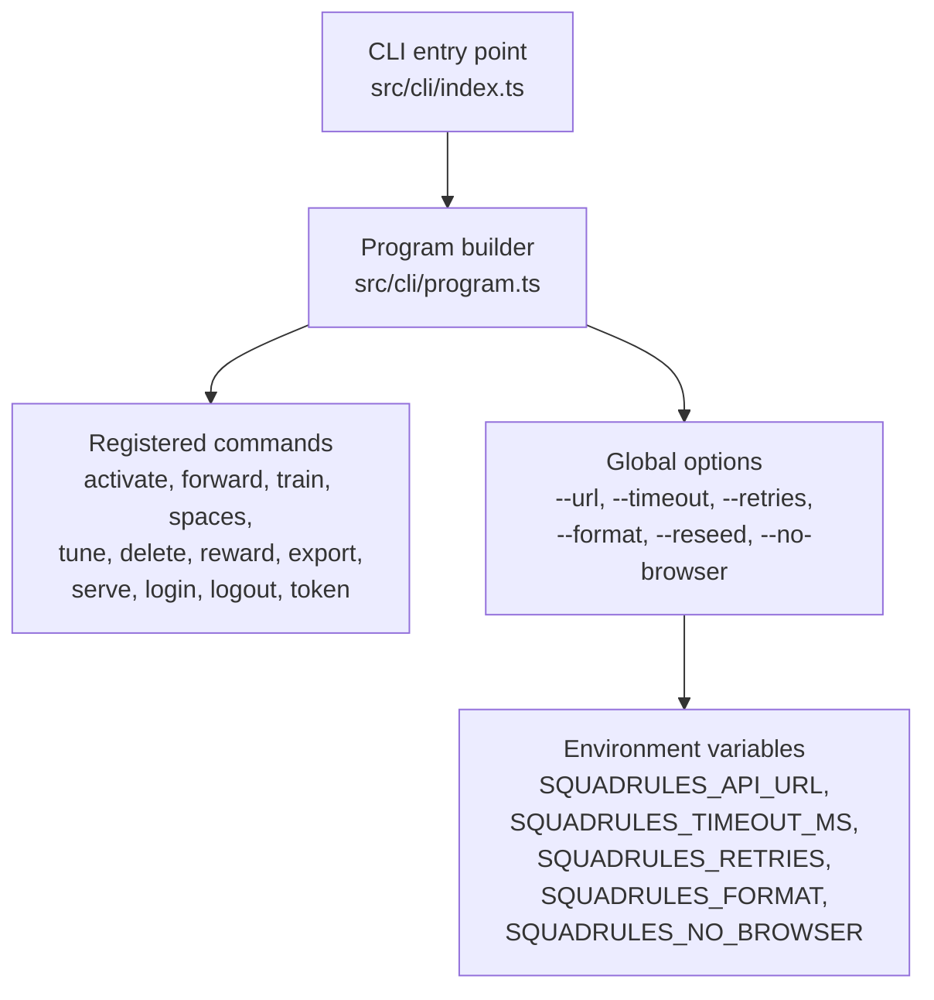
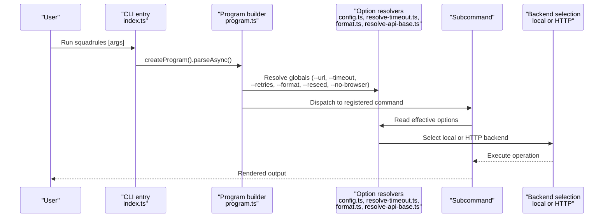
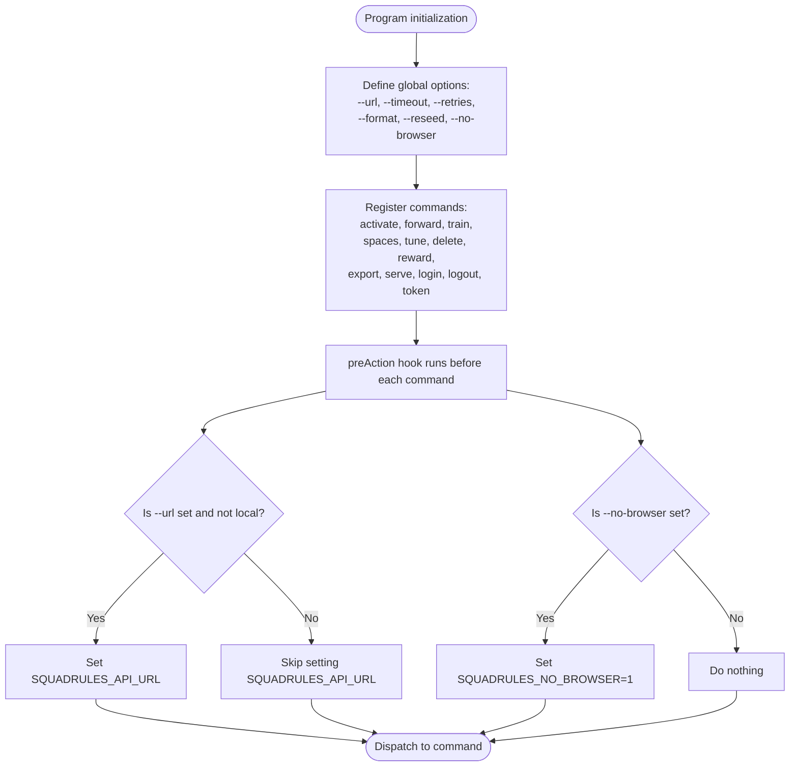
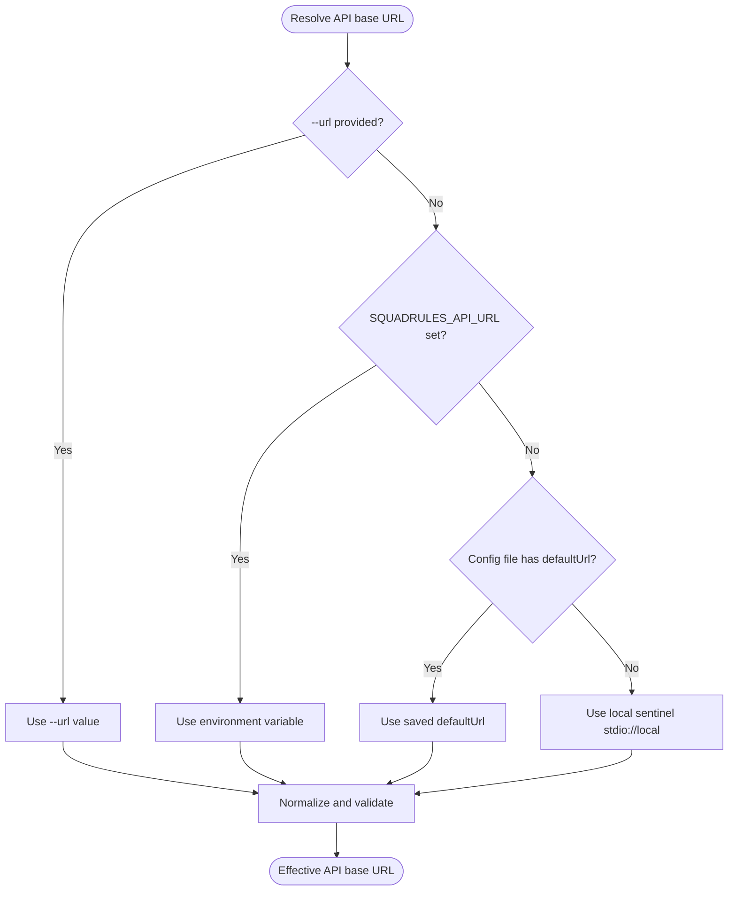
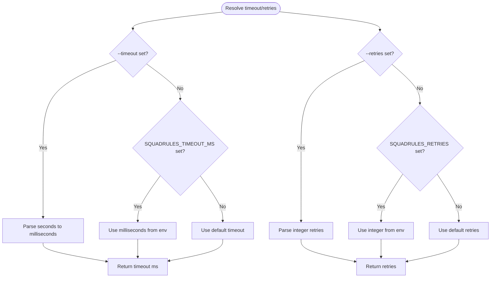
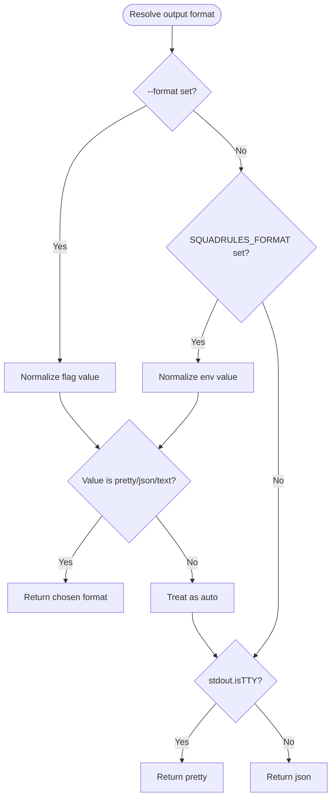
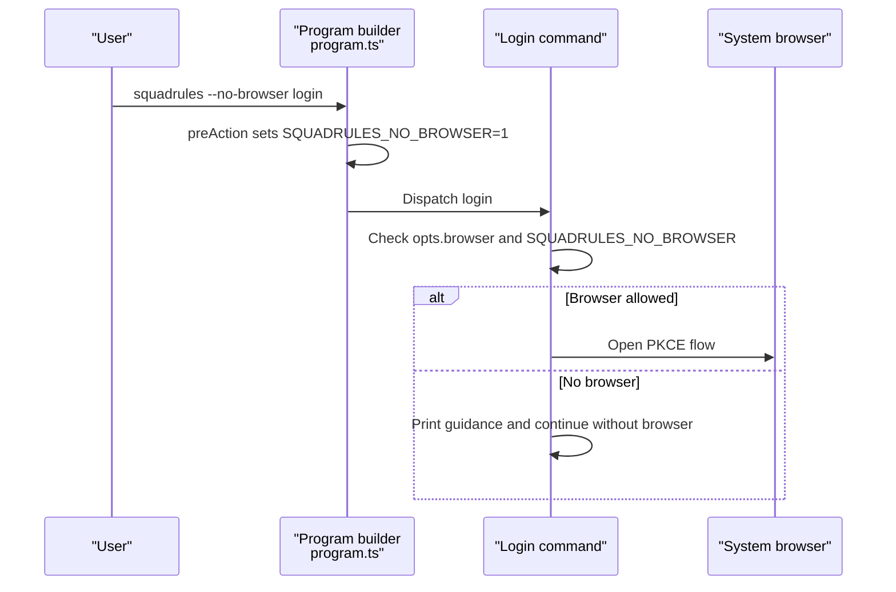
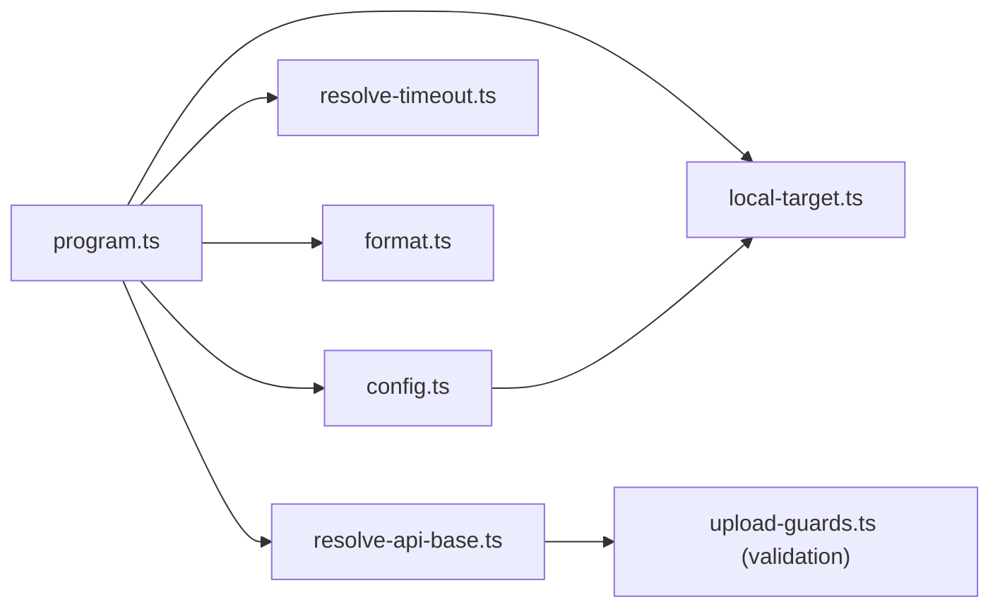

# CLI Overview and Global Options

<cite>
**Referenced Files in This Document**
- [index.ts](file://src/cli/index.ts)
- [program.ts](file://src/cli/program.ts)
- [config.ts](file://src/cli/config.ts)
- [local-target.ts](file://src/cli/local-target.ts)
- [resolve-api-base.ts](file://src/cli/resolve-api-base.ts)
- [resolve-timeout.ts](file://src/cli/resolve-timeout.ts)
- [format.ts](file://src/cli/format.ts)
- [CLI.md](file://docs/CLI.md)
</cite>

## Table of Contents
1. [Introduction](#introduction)
2. [Project Structure](#project-structure)
3. [Core Components](#core-components)
4. [Architecture Overview](#architecture-overview)
5. [Detailed Component Analysis](#detailed-component-analysis)
6. [Dependency Analysis](#dependency-analysis)
7. [Performance Considerations](#performance-considerations)
8. [Troubleshooting Guide](#troubleshooting-guide)
9. [Conclusion](#conclusion)

## Introduction
This document explains the SquadRules command-line interface (CLI) as the human-facing entry point for interacting with the SquadRules REST API and local embedded store. It covers how the CLI is invoked, how commands are registered, and how global options propagate to subcommands. It also documents all global options, their environment variable mappings, and practical usage patterns. Finally, it clarifies the relationship between CLI commands and MCP tools.

The CLI is designed around a small set of global settings that control where requests go, how they behave over the network, and how output is rendered. Commands such as activate, forward, reward, tune, delete, export, spaces, serve, login, logout, and token are registered at the root program and inherit these global settings.

## Project Structure
At runtime, the CLI entry point initializes logging, decides whether to run the MCP server or show help, parses arguments, and dispatches to the appropriate command. The program builder registers all commands and defines global options.

**Diagram sources**
- [index.ts:1-21](file://src/cli/index.ts#L1-L21)
- [program.ts:31-80](file://src/cli/program.ts#L31-L80)

**Section sources**
- [index.ts:1-21](file://src/cli/index.ts#L1-L21)
- [program.ts:31-80](file://src/cli/program.ts#L31-L80)

## Core Components
- CLI entry point: routes logs early, defaults to `serve` when invoked without arguments from an MCP host, and parses arguments asynchronously.
- Program builder: defines the CLI name, description, version, global options, pre-action hooks, and command registration.
- Configuration helpers: resolve the default API URL, including local mode and environment/file fallbacks.
- Local target utilities: define and detect the local sentinel used by the embedded store.
- Option resolvers: normalize timeout, retries, format, and API base URL across commands.

Key responsibilities:
- Provide a consistent configuration surface through global options.
- Propagate selected globals into process-level environment variables so downstream modules can read them uniformly.
- Keep local-mode behavior explicit and isolated from HTTP-only flows.

**Section sources**
- [index.ts:1-21](file://src/cli/index.ts#L1-L21)
- [program.ts:31-80](file://src/cli/program.ts#L31-L80)
- [config.ts:1-28](file://src/cli/config.ts#L1-L28)
- [local-target.ts:1-17](file://src/cli/local-target.ts#L1-L17)
- [resolve-timeout.ts:1-52](file://src/cli/resolve-timeout.ts#L1-L52)
- [format.ts:1-36](file://src/cli/format.ts#L1-L36)
- [resolve-api-base.ts:1-17](file://src/cli/resolve-api-base.ts#L1-L17)

## Architecture Overview
The CLI follows a layered approach:
- Invocation layer decides whether to start the MCP server or parse user commands.
- Command layer registers commands and attaches global options.
- Resolution layer normalizes options and environment variables.
- Backend layer selects either the local embedded store or the HTTP backend based on the resolved API base URL.

**Diagram sources**
- [index.ts:11-19](file://src/cli/index.ts#L11-L19)
- [program.ts:31-80](file://src/cli/program.ts#L31-L80)
- [config.ts:14-20](file://src/cli/config.ts#L14-L20)
- [resolve-timeout.ts:16-51](file://src/cli/resolve-timeout.ts#L16-L51)
- [format.ts:29-35](file://src/cli/format.ts#L29-L35)
- [resolve-api-base.ts:9-16](file://src/cli/resolve-api-base.ts#L9-L16)

## Detailed Component Analysis

### CLI Entry Point
The entry point ensures logging is configured before any shared logger is created, then decides whether to run the MCP server automatically when stdin is not a TTY. Otherwise, it parses arguments and delegates to the program builder.

Practical implications:
- When launched by an MCP host via stdio, the CLI starts the server automatically.
- When run interactively by a human, it shows help unless a subcommand is provided.

**Section sources**
- [index.ts:1-21](file://src/cli/index.ts#L1-L21)

### Program Builder and Global Options
The program builder defines the CLI identity and registers all commands. It also defines the global options and propagates selected values into environment variables for downstream consumers.

Global options:
- `-u, --url <url>`: API base URL or local sentinel. Default comes from configuration resolution.
- `--timeout <seconds>`: Request timeout in seconds. Environment mapping: `SQUADRULES_TIMEOUT_MS`.
- `--retries <n>`: Max retries on network errors. Environment mapping: `SQUADRULES_RETRIES`.
- `--format <format>`: Output format (`auto`, `pretty`, `json`, `text`). Environment mapping: `SQUADRULES_FORMAT`.
- `--reseed`: Local mode flag to force retrain of bundled app-space adapters.
- `--no-browser`: Prevent opening a browser during authentication flows.

Propagation behavior:
- A pre-action hook merges root globals into subcommands.
- For non-serve commands, if `--url` is set and not a local sentinel, it is written to `SQUADRULES_API_URL`.
- If `--no-browser` is set, it writes `SQUADRULES_NO_BROWSER=1`.

**Diagram sources**
- [program.ts:31-80](file://src/cli/program.ts#L31-L80)

**Section sources**
- [program.ts:31-80](file://src/cli/program.ts#L31-L80)

### API Base URL Resolution and Local Mode
The default API URL resolves in this order:
1. Explicit `--url` option.
2. `SQUADRULES_API_URL` environment variable.
3. Saved configuration file default URL.
4. Local sentinel `stdio://local` (aliases include `local` and `stdio`).

Local mode means running in-process against the embedded store without an HTTP hop or authentication.

Resolution helpers:
- `getCliApiUrlDefault()` returns the effective default URL.
- `isLocalTarget()` detects local sentinel values.
- `getResolvedApiBaseFromProgram()` validates and normalizes the effective URL after parsing.

**Diagram sources**
- [config.ts:14-20](file://src/cli/config.ts#L14-L20)
- [local-target.ts:6-16](file://src/cli/local-target.ts#L6-L16)
- [resolve-api-base.ts:9-16](file://src/cli/resolve-api-base.ts#L9-L16)

**Section sources**
- [config.ts:1-28](file://src/cli/config.ts#L1-L28)
- [local-target.ts:1-17](file://src/cli/local-target.ts#L1-L17)
- [resolve-api-base.ts:1-17](file://src/cli/resolve-api-base.ts#L1-L17)

### Timeout and Retries Resolution
Timeout and retries are resolved consistently across data-path clients and HTTP-only auth commands.

Precedence:
- CLI flag takes priority.
- Environment variable is next.
- Defaults apply when neither is set.

Details:
- `--timeout <seconds>` converts to milliseconds; environment variable `SQUADRULES_TIMEOUT_MS` is already in milliseconds.
- `--retries <n>` accepts non-negative integers; environment variable `SQUADRULES_RETRIES` provides a numeric default.

**Diagram sources**
- [resolve-timeout.ts:16-51](file://src/cli/resolve-timeout.ts#L16-L51)

**Section sources**
- [resolve-timeout.ts:1-52](file://src/cli/resolve-timeout.ts#L1-L52)

### Output Format Resolution
The `--format` option controls rendering for data commands. Accepted values are `auto`, `pretty`, `json`, and `text`.

Behavior:
- `auto` renders pretty on a terminal and JSON when stdout is piped or redirected.
- `pretty` produces human-readable summaries.
- `json` emits structured responses suitable for machine consumption.
- `text` outputs minimal plain text.

Precedence:
- `--format` flag.
- `SQUADRULES_FORMAT` environment variable.
- Auto-detection based on TTY.

**Diagram sources**
- [format.ts:29-35](file://src/cli/format.ts#L29-L35)

**Section sources**
- [format.ts:1-36](file://src/cli/format.ts#L1-L36)

### Authentication Flow and No-Browser Mode
Authentication-related commands use the resolved timeout and may open a browser for OAuth flows. The `--no-browser` flag prevents opening a browser, which is useful in tests or scripts.

Propagation:
- The program’s pre-action hook sets `SQUADRULES_NO_BROWSER=1` when `--no-browser` is present.
- Auth commands check both the parsed option and the environment variable.

**Diagram sources**
- [program.ts:47-61](file://src/cli/program.ts#L47-L61)

**Section sources**
- [program.ts:47-61](file://src/cli/program.ts#L47-L61)

### Relationship Between CLI Commands and MCP Tools
The CLI exposes a command surface that mirrors the MCP tool surface. Commands such as activate, forward, reward, tune, delete, export, and spaces correspond to MCP tools that agents invoke. The CLI acts as a human-friendly wrapper around the same underlying operations exposed to MCP hosts.

Key points:
- MCP hosts typically launch the CLI in stdio mode; the entry point defaults to `serve` when stdin is not a TTY.
- Data commands render output in formats suitable for both humans and machines, enabling agent pipelines to consume structured responses.
- The activate → forward → reward chain is supported by corresponding CLI commands and MCP tools.

**Section sources**
- [index.ts:11-19](file://src/cli/index.ts#L11-L19)
- [CLI.md:77-229](file://docs/CLI.md#L77-L229)

## Dependency Analysis
Global options and their resolution form a cohesive dependency graph:

Notes:
- `program.ts` orchestrates option definitions and propagation.
- `config.ts` depends on `local-target.ts` to determine the local sentinel.
- `resolve-api-base.ts` normalizes and validates the effective URL.
- `resolve-timeout.ts` and `format.ts` provide independent, reusable resolution logic.

**Diagram sources**
- [program.ts:31-80](file://src/cli/program.ts#L31-L80)
- [config.ts:1-28](file://src/cli/config.ts#L1-L28)
- [local-target.ts:1-17](file://src/cli/local-target.ts#L1-L17)
- [resolve-timeout.ts:1-52](file://src/cli/resolve-timeout.ts#L1-L52)
- [format.ts:1-36](file://src/cli/format.ts#L1-L36)
- [resolve-api-base.ts:1-17](file://src/cli/resolve-api-base.ts#L1-L17)

**Section sources**
- [program.ts:31-80](file://src/cli/program.ts#L31-L80)
- [config.ts:1-28](file://src/cli/config.ts#L1-L28)
- [local-target.ts:1-17](file://src/cli/local-target.ts#L1-L17)
- [resolve-timeout.ts:1-52](file://src/cli/resolve-timeout.ts#L1-L52)
- [format.ts:1-36](file://src/cli/format.ts#L1-L36)
- [resolve-api-base.ts:1-17](file://src/cli/resolve-api-base.ts#L1-L17)

## Performance Considerations
- Local mode avoids HTTP overhead by running in-process against the embedded store.
- Timeouts prevent long hangs on unresponsive servers; configure conservatively for interactive use and more aggressively for automated pipelines.
- Retries improve resilience against transient network errors but should be balanced against latency expectations.
- Using `--format json` enables efficient machine processing and reduces parsing overhead in scripts.

[No sources needed since this section provides general guidance]

## Troubleshooting Guide
Common issues and resolutions:
- Missing API base URL: Ensure `--url` is set or `SQUADRULES_API_URL` is exported. Local mode defaults to the embedded store when no remote URL is configured.
- Authentication failures: Verify the OAuth server is reachable and credentials are stored correctly. Use `--no-browser` in automated environments.
- Network timeouts: Increase `--timeout` or adjust `SQUADRULES_TIMEOUT_MS`. Tune `--retries` or `SQUADRULES_RETRIES` for flaky networks.
- Unexpected output format: Confirm `--format` or `SQUADRULES_FORMAT`; remember `auto` switches to JSON when stdout is not a TTY.

Operational tips:
- Use `squadrules --help` to inspect available commands and options.
- Prefer explicit flags in scripts for deterministic behavior.
- Leverage local mode for development and testing without configuring a remote server.

**Section sources**
- [CLI.md:46-59](file://docs/CLI.md#L46-L59)
- [CLI.md:231-246](file://docs/CLI.md#L231-L246)
- [CLI.md:248-257](file://docs/CLI.md#L248-L257)

## Conclusion
The SquadRules CLI provides a clear, configurable entry point for interacting with the SquadRules REST API and local embedded store. Global options unify configuration across commands, while environment variables enable flexible deployment profiles. Local mode simplifies development, and the integration with MCP tools ensures consistency between human and agent workflows. By understanding the precedence rules and propagation behavior, users can reliably operate the CLI in interactive, scripted, and automated contexts.

[No sources needed since this section summarizes without analyzing specific files]