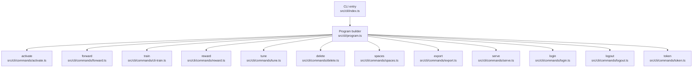
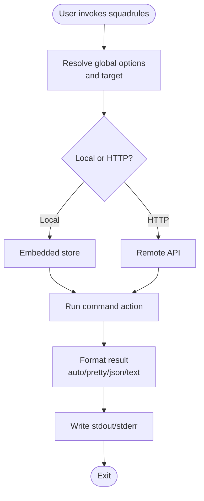
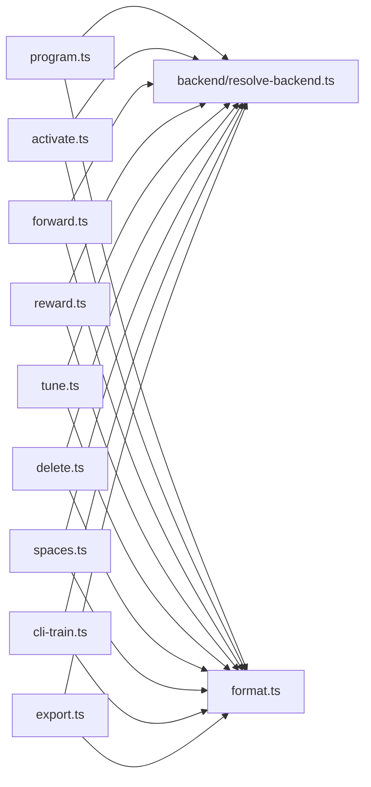

# CLI Reference

<cite>
**Referenced Files in This Document**   
- [index.ts](file://src/cli/index.ts)
- [program.ts](file://src/cli/program.ts)
- [CLI.md](file://docs/CLI.md)
- [activate.ts](file://src/cli/commands/activate.ts)
- [forward.ts](file://src/cli/commands/forward.ts)
- [reward.ts](file://src/cli/commands/reward.ts)
- [tune.ts](file://src/cli/commands/tune.ts)
- [delete.ts](file://src/cli/commands/delete.ts)
- [spaces.ts](file://src/cli/commands/spaces.ts)
- [cli-train.ts](file://src/cli/commands/cli-train.ts)
- [export.ts](file://src/cli/commands/export.ts)
- [serve.ts](file://src/cli/commands/serve.ts)
- [login.ts](file://src/cli/commands/login.ts)
- [logout.ts](file://src/cli/commands/logout.ts)
- [token.ts](file://src/cli/commands/token.ts)
</cite>

## Table of Contents
1. [Introduction](#introduction)
2. [Project Structure](#project-structure)
3. [Core Components](#core-components)
4. [Architecture Overview](#architecture-overview)
5. [Detailed Component Analysis](#detailed-component-analysis)
6. [Dependency Analysis](#dependency-analysis)
7. [Performance Considerations](#performance-considerations)
8. [Troubleshooting Guide](#troubleshooting-guide)
9. [Conclusion](#conclusion)
10. [Appendices](#appendices)

## Introduction
This document is the authoritative command-line reference for SquadRules. It covers invocation, global options, output formatting, every available command, authentication with Keycloak, service management through `serve`, data operations, configuration behavior, and practical automation examples. The CLI is designed around an agent-first workflow: agents activate adapters, forward steps, and record rewards; humans configure preferences and manage spaces.

The entry point supports three equivalent binaries (`squadrules`, `sq`, `sqr`) and defaults to local embedded mode unless a remote API URL is configured or provided. A bare invocation without a subcommand starts the MCP server over stdio when stdin is not a terminal.

**Section sources**
- [index.ts:1-21](file://src/cli/index.ts#L1-L21)
- [CLI.md:9-45](file://docs/CLI.md#L9-L45)

## Project Structure
The CLI is built on Commander.js. The program registers global options, propagates environment settings into child commands, and wires each command module into the top-level program. Commands are organized one file per command under `src/cli/commands`.



**Diagram sources**
- [index.ts:11-19](file://src/cli/index.ts#L11-L19)
- [program.ts:31-79](file://src/cli/program.ts#L31-L79)

**Section sources**
- [program.ts:1-81](file://src/cli/program.ts#L1-L81)
- [CLI.md:46-59](file://docs/CLI.md#L46-L59)

## Core Components
- Global options apply to all commands and may appear before or after the subcommand. They control target resolution, timeouts, retries, output format, space scoping, local reseed behavior, and browser behavior.
- Output formats include `auto`, `pretty`, `json`, and `text`. `auto` emits JSON when stdout is not a TTY, making it safe for scripts.
- Local-by-default mode runs against the embedded store without HTTP or authentication. Authentication commands fall back to `http://localhost:3000` when no remote URL is configured.
- Configuration is persisted by `login`; subsequent commands use the stored API URL unless overridden by `-u/--url`.

Key global options:
- `-u, --url <url>`: API base URL or local sentinel.
- `--timeout <seconds>`: Request timeout.
- `--retries <n>`: Network retry count.
- `--format <format>`: Output rendering format.
- `--space <space>`: Space scope.
- `--reseed`: Force local re-injection of bundled adapters.
- `--no-browser`: Disable automatic browser opening during auth flows.

Environment variables:
- `SQUADRULES_API_URL`
- `SQUADRULES_TIMEOUT_MS`
- `SQUADRULES_RETRIES`
- `SQUADRULES_FORMAT`
- `MEM_BOOT_FORCE_INJECT`

**Section sources**
- [CLI.md:46-75](file://docs/CLI.md#L46-L75)
- [CLI.md:248-257](file://docs/CLI.md#L248-L257)
- [program.ts:34-61](file://src/cli/program.ts#L34-L61)

## Architecture Overview
The CLI follows a consistent pattern:
1. Parse arguments and resolve global options.
2. Create a backend based on the resolved target (local or HTTP).
3. Execute the command action.
4. Emit structured results using the selected output format.
5. Handle errors uniformly, including optional browser-based login prompts.



[No sources needed since this diagram shows conceptual workflow, not actual code structure]

## Detailed Component Analysis

### Global Invocation and Defaults
- Bare invocation without a subcommand starts `serve` when stdin is not a TTY.
- The program sets version, description, and global options, then registers all commands.
- A pre-action hook propagates `-u/--url` and `--no-browser` into process environment variables for downstream helpers.

Usage highlights:
- `squadrules --help`
- `squadrules -u http://localhost:3000 spaces`
- `squadrules --format json activate "deploy a release"`

**Section sources**
- [index.ts:11-19](file://src/cli/index.ts#L11-L19)
- [program.ts:31-79](file://src/cli/program.ts#L31-L79)

### activate
Finds the best matching adapter for a query. Supports scoping to a space.

Signature:
- `squadrules activate <query...> [--space <space>]`

Options:
- `--space <space>`: Scope to `personal` or a group name.

Behavior:
- Resolves backend from the program.
- Calls the backend activation endpoint.
- Emits pretty, text, or JSON output with a next-call hint.

Example:
- `squadrules activate "how do I deploy a release" --space personal`

**Section sources**
- [activate.ts:12-35](file://src/cli/commands/activate.ts#L12-L35)
- [CLI.md:77-85](file://docs/CLI.md#L77-L85)

### forward
Runs the first or next layer of an adapter.

Signature:
- `squadrules forward <uri> [--solution <json>]`

Options:
- `--solution <json>`: Provide solution input as a JSON string.

Behavior:
- Parses optional JSON solution.
- Calls the backend forward endpoint.
- Emits pretty, text, or JSON output with a next-call hint.

Example:
- `squadrules forward squadrules://layer/my-step --solution '{"param": "value"}'`

**Section sources**
- [forward.ts:12-32](file://src/cli/commands/forward.ts#L12-L32)
- [CLI.md:87-93](file://docs/CLI.md#L87-L93)

### reward
Records a reward signal for an adapter execution.

Signature:
- `squadrules reward <uri> <outcome> <feedback> [--score <number>] [--rater <rater>] [--rubric-version <version>] [--model <model>]`

Validation:
- `outcome` must be `success` or `failure`.
- `--score` must be a number if provided.

Options:
- `--score <number>`: Normalized score in 0..1.
- `--rater <rater>`: Evaluator identifier.
- `--rubric-version <version>`: Rubric/policy version.
- `--model <model>`: LLM model ID for attribution.

Example:
- `squadrules reward squadrules://layer/step-1 success "Deployed successfully" --score 1 --rater human-reviewer --rubric-version v2 --model gpt-4`

**Section sources**
- [reward.ts:13-66](file://src/cli/commands/reward.ts#L13-L66)
- [CLI.md:95-103](file://docs/CLI.md#L95-L103)

### tune
Updates one or more adapter layers or moves them between spaces.

Signature:
- `squadrules tune <uris...> [--file <file> | --files <files...> | --updates <json>] [--space <space>] [--allow-sensitive-upload]`

Modes:
- Move-only: provide `--space` without `--file`, `--files`, or `--updates`.
- Apply markdown: provide `--file` (applied to all URIs) or `--files` (one per URI).
- Apply updates object: provide `--updates <json>`.

Options:
- `--file <file>`: Single markdown file applied to all URIs.
- `--files <files...>`: One markdown file per URI.
- `--updates <json>`: Updates object as JSON.
- `--space <space>`: Move target space.
- `--allow-sensitive-upload`: Allow uploads containing token-like or private-key-like text.

Validation:
- Number of files must match number of URIs when using `--files`.
- Must provide at least one of `--file`, `--files`, `--updates`, or `--space` alone.

Example:
- `squadrules tune squadrules://adapter/my-adapter --file ./updated.md --space team-alpha`
- `squadrules tune squadrules://adapter/a squadrules://adapter/b --files ./a.md ./b.md`
- `squadrules tune squadrules://adapter/x --updates '{"layers":[{"name":"step1","prompt":"Updated prompt"}]}'`

**Section sources**
- [tune.ts:32-115](file://src/cli/commands/tune.ts#L32-L115)
- [CLI.md:105-113](file://docs/CLI.md#L105-L113)

### delete
Deletes one or more adapter or layer resources.

Signature:
- `squadrules delete <uris...>`

Example:
- `squadrules delete squadrules://adapter/old-workflow squadrules://layer/step-2`

**Section sources**
- [delete.ts:13-30](file://src/cli/commands/delete.ts#L13-L30)
- [CLI.md:115-121](file://docs/CLI.md#L115-L121)

### spaces
Lists available spaces and adapter counts.

Signature:
- `squadrules spaces [--include-adapter-titles]`

Options:
- `--include-adapter-titles`: Include per-space adapter titles and layer counts.

Example:
- `squadrules spaces --include-adapter-titles`

**Section sources**
- [spaces.ts:12-34](file://src/cli/commands/spaces.ts#L12-L34)
- [CLI.md:123-129](file://docs/CLI.md#L123-L129)

### train
Registers a new adapter from markdown, attaches artifacts, or forks an existing adapter.

Signatures:
- Single markdown file: `squadrules train ./my-adapter.md --model gpt-4 [--space personal] [--force]`
- Directory batch: `squadrules train ./adapters --recursive --model gpt-4`
- Fork: `squadrules train --source-adapter-uri squadrules://adapter/my-adapter --model gpt-4`
- Artifact attachment: `squadrules train ./notes.txt --adapter squadrules://adapter/my-adapter [--mime text/plain]`

Options:
- `--model <model>`: Required for fork and artifact modes; used for attribution otherwise.
- `--force`: Force update if an adapter with the same label exists.
- `--recursive`: Include nested `.md` files in directory batches.
- `--source-adapter-uri <uri>`: Fork from an existing adapter.
- `--space <space>`: Target space for train or fork.
- `--adapter <uri>`: Parent adapter URI for artifact mode.
- `--artifact-name <name>`: Artifact filename override.
- `--mime <mime>`: MIME override for artifact mode.
- `--relative-path <path>`: Skill-root-relative path for export bundles.
- `--allow-sensitive-upload`: Allow sensitive content in uploads.

Batch behavior:
- Each `.md` becomes an adapter.
- Sibling files with recognizable extensions attach to every `.md` in that directory.
- `--adapter`, `--artifact-name`, `--mime`, and `--relative-path` are single-file only.

Examples:
- `squadrules train ./adapters --recursive --model claude-3`
- `squadrules train --source-adapter-uri squadrules://adapter/release-check --model gpt-4 --space qa`
- `squadrules train ./gate.py --adapter squadrules://adapter/release-check --mime application/x-python --relative-path artifacts/gate.py`

**Section sources**
- [cli-train.ts:40-211](file://src/cli/commands/cli-train.ts#L40-L211)
- [CLI.md:131-165](file://docs/CLI.md#L131-L165)

### export
Machine-facing bulk export command. It writes files and prints only a compact summary or JSON manifest; it never dumps adapter or content bytes to stdout.

Signature:
- `squadrules export [uri] [--adapters <uri-or-slug>...] [--all-adapters --space <name>] [--as <format>] [--delivery <download_ref|inline_base64>] [--directory <dir>] [--out <dir>] [--to <file>] [--zip-out <file>]`

Selection modes (mutually exclusive):
- Positional `<uri>`: single selection.
- `--adapters <uri-or-slug>`: repeatable flag for multiple adapters.
- `--all-adapters --space <name>`: export every adapter in a space.

Content formats (`--as`):
- `skill_zip` (default)
- `markdown`
- `skill_tree`
- `source`
- `trace_jsonl`
- `reward_jsonl`
- `sft_jsonl`
- `preference_jsonl`

Delivery modes (`--delivery`, skill_zip only):
- `download_ref`: backend returns a capability URL; the CLI downloads it.
- `inline_base64`: zip bytes come back in the response.

Output controls:
- `--out <dir>`: write artifacts into this directory.
- `--to <file>`: write a single payload to an exact path (non-skill_zip formats only).
- `--zip-out <file>`: write skill_zip bytes to an explicit file.
- `--directory <dir>`: local mode only, markdown only; writes `<dir>/<slug>.md` per adapter.

Examples:
- `squadrules export --all-adapters --space personal --out ./out`
- `squadrules export squadrules://adapter/my-adapter --as markdown --out ./out`
- `squadrules export --all-adapters --space personal --as markdown --directory ./backup`
- `squadrules export squadrules://artifact/my-gate --as source --to "$SQUADRULES_LOCAL_ARTIFACT_DIR/artifacts/my-gate.py"`

**Section sources**
- [export.ts:21-345](file://src/cli/commands/export.ts#L21-L345)
- [CLI.md:166-219](file://docs/CLI.md#L166-L219)

### serve
Runs the MCP server with stdio or HTTP transport. Root `--url` does not set the listen address; use `--server-port` or `SERVER_PORT`.

Signature:
- `squadrules serve [--transport <stdio|http>] [--server-port <port>] [--metrics-port <n>] [--env-file <path>]`

Options:
- `--env-file <path>`: Path to dotenv file (default `.env`).
- `--metrics-port <n>`: Metrics listen port.
- `--transport <mode>`: Transport override (`stdio` or `http`).
- `--server-port <port>`: Main HTTP listener port; also updates CLI default URL when provided.

Behavior:
- Loads `.env` if present.
- Validates transport and ports.
- Spawns the bootstrap process with appropriate environment variables.
- On HTTP with `--server-port`, persists `apiUrl` so later commands connect to the served instance.

Examples:
- `squadrules serve --transport http --server-port 3000`
- `squadrules serve --transport stdio`
- `squadrules serve --metrics-port 9090 --env-file .env.local`

**Section sources**
- [serve.ts:92-195](file://src/cli/commands/serve.ts#L92-L195)
- [CLI.md:221-229](file://docs/CLI.md#L221-L229)

### Authentication: login, logout, token
Authentication commands require an OAuth server. Against the local sentinel, they print guidance and fall back to `http://localhost:3000`.

#### login
- `squadrules login --url http://localhost:3000`
- `squadrules login --token <token>`
- `squadrules login --no-browser`

Behavior:
- If a valid token already exists, prints confirmation and exits successfully.
- Browser PKCE flow opens a local callback server, exchanges the authorization code for tokens, and stores credentials.
- `--token` validates the token via `/api/me` and stores it.

#### logout
- `squadrules logout`

Behavior:
- Clears stored bearer and refresh tokens for the current API URL.

#### token
- `squadrules token --validate`
- `squadrules token --login`

Behavior:
- Prints the stored bearer token to stdout.
- Optional validation against `/api/me`.
- Optional interactive login if no valid token exists.

Examples:
- `squadrules login --url http://localhost:3000`
- `squadrules logout`
- `TOKEN=$(squadrules token --validate); echo "$TOKEN"`

**Section sources**
- [login.ts:255-287](file://src/cli/commands/login.ts#L255-L287)
- [logout.ts:10-20](file://src/cli/commands/logout.ts#L10-L20)
- [token.ts:11-52](file://src/cli/commands/token.ts#L11-L52)
- [CLI.md:231-246](file://docs/CLI.md#L231-L246)

### Common Administrative Tasks and Automation Scenarios

#### Initialize a local development server and authenticate
```bash
squadrules serve --transport http --server-port 3000 &
squadrules login --url http://localhost:3000
```

#### Register adapters from a directory
```bash
squadrules train ./adapters --recursive --model gpt-4 --space personal
```

#### Fork an adapter into a team space
```bash
squadrules train --source-adapter-uri squadrules://adapter/base-release --model claude-3 --space engineering
```

#### Attach a gate script to an adapter
```bash
squadrules train ./gate.py --adapter squadrules://adapter/release-check --mime application/x-python --relative-path artifacts/gate.py
```

#### Export all adapters in a space as skill zips
```bash
squadrules export --all-adapters --space personal --out ./exports
```

#### Export a single adapter as flat markdown
```bash
squadrules export squadrules://adapter/my-adapter --as markdown --out ./exports
```

#### Materialize an artifact at a known path for stdio contracts
```bash
squadrules export squadrules://artifact/my-gate --as source --to "$SQUADRULES_LOCAL_ARTIFACT_DIR/artifacts/my-gate.py"
```

#### Record a successful run and a failed run
```bash
squadrules reward squadrules://layer/step-1 success "Deployment succeeded" --score 1 --rater ci-bot --rubric-version v2 --model gpt-4
squadrules reward squadrules://layer/step-1 failure "Build failed" --score 0 --rater ci-bot --rubric-version v2 --model gpt-4
```

#### Update an adapter layer and move it to a team space
```bash
squadrules tune squadrules://adapter/my-adapter --file ./updated.md --space team-alpha
```

#### List spaces with adapter details
```bash
squadrules spaces --include-adapter-titles
```

**Section sources**
- [CLI.md:131-219](file://docs/CLI.md#L131-L219)
- [CLI.md:221-246](file://docs/CLI.md#L221-L246)

## Dependency Analysis
Commands share common dependencies:
- Backend resolution: `createBackendFromProgram(program)` selects local or HTTP backend based on global options.
- Output formatting: `resolveOutputFormat(program)` chooses among auto/pretty/json/text.
- Error handling: `handleApiError(error, !isBrowserDisabled())` centralizes error presentation and optional browser login prompts.
- Rendering helpers: command-specific render functions produce pretty and text outputs.



**Diagram sources**
- [program.ts:31-79](file://src/cli/program.ts#L31-L79)
- [activate.ts:12-35](file://src/cli/commands/activate.ts#L12-L35)
- [forward.ts:12-32](file://src/cli/commands/forward.ts#L12-L32)
- [reward.ts:13-66](file://src/cli/commands/reward.ts#L13-L66)
- [tune.ts:32-115](file://src/cli/commands/tune.ts#L32-L115)
- [delete.ts:13-30](file://src/cli/commands/delete.ts#L13-L30)
- [spaces.ts:12-34](file://src/cli/commands/spaces.ts#L12-L34)
- [cli-train.ts:40-211](file://src/cli/commands/cli-train.ts#L40-L211)
- [export.ts:296-345](file://src/cli/commands/export.ts#L296-L345)

**Section sources**
- [program.ts:31-79](file://src/cli/program.ts#L31-L79)

## Performance Considerations
- Use `--format json` in scripts to avoid pretty-print overhead and ensure stable machine-readable output.
- Prefer `--all-adapters` exports with `--out` for bulk operations; avoid piping large payloads through stdout.
- For local development, prefer local mode to eliminate network latency and authentication overhead.
- When training directories, use `--recursive` judiciously; very large directories increase upload and processing time.
- Set `--timeout` appropriately for slow networks or remote servers.

[No sources needed since this section provides general guidance]

## Troubleshooting Guide
Common issues and resolutions:
- **Auth fallback message**: When running auth commands locally, the CLI falls back to `http://localhost:3000`. Pass `--url http://<host>:<port>` to target a specific server.
- **Invalid outcome or score**: `reward` requires `success` or `failure` for outcome and a numeric score if provided.
- **Missing selection for export**: `export` requires exactly one selection mode: positional `<uri>`, `--adapters`, or `--all-adapters --space`.
- **Incompatible export flags**: `--directory` is local-mode and markdown-only; `--to` cannot combine with `--out` or `--zip-out`; `--delivery` is only valid with `skill_zip`.
- **File not found**: `train` and `tune` validate file existence and report clear errors.
- **Port conflicts**: `serve` validates ports and reports invalid values; `login` callback port can be configured via `SQUADRULES_LOGIN_CALLBACK_PORT`.

Operational tips:
- Use `squadrules token --validate` to verify stored credentials before automation.
- Use `squadrules logout` to clear stale credentials when switching environments.
- Use `squadrules --no-browser` in CI or headless environments.

**Section sources**
- [CLI.md:231-246](file://docs/CLI.md#L231-L246)
- [reward.ts:31-42](file://src/cli/commands/reward.ts#L31-L42)
- [export.ts:48-143](file://src/cli/commands/export.ts#L48-L143)
- [serve.ts:21-42](file://src/cli/commands/serve.ts#L21-L42)
- [login.ts:131-133](file://src/cli/commands/login.ts#L131-L133)

## Conclusion
The SquadRules CLI provides a consistent, script-friendly interface for activating adapters, forwarding steps, recording rewards, tuning workflows, managing spaces, exporting assets, serving the MCP runtime, and authenticating with Keycloak. Its local-by-default design simplifies development, while explicit flags and environment variables support robust automation. Use `--format json` for machine consumption, prefer local mode for speed, and rely on the documented selection and delivery constraints for reliable exports.

[No sources needed since this section summarizes without analyzing specific files]

## Appendices

### Environment Variables Reference
- `SQUADRULES_API_URL`: Default target (http URL or local sentinel).
- `SQUADRULES_TIMEOUT_MS`: Default request timeout in milliseconds.
- `SQUADRULES_RETRIES`: Default max retries.
- `SQUADRULES_FORMAT`: Default output format.
- `MEM_BOOT_FORCE_INJECT`: Force boot re-injection (same as `--reseed`).
- `SQUADRULES_LOGIN_CALLBACK_PORT`: Callback port for browser login flow.

**Section sources**
- [CLI.md:248-257](file://docs/CLI.md#L248-L257)
- [login.ts:131-133](file://src/cli/commands/login.ts#L131-L133)