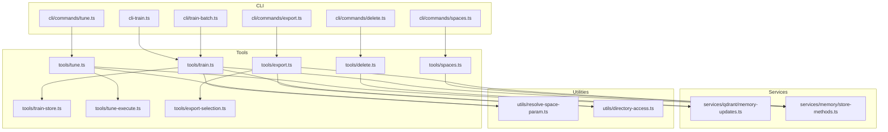
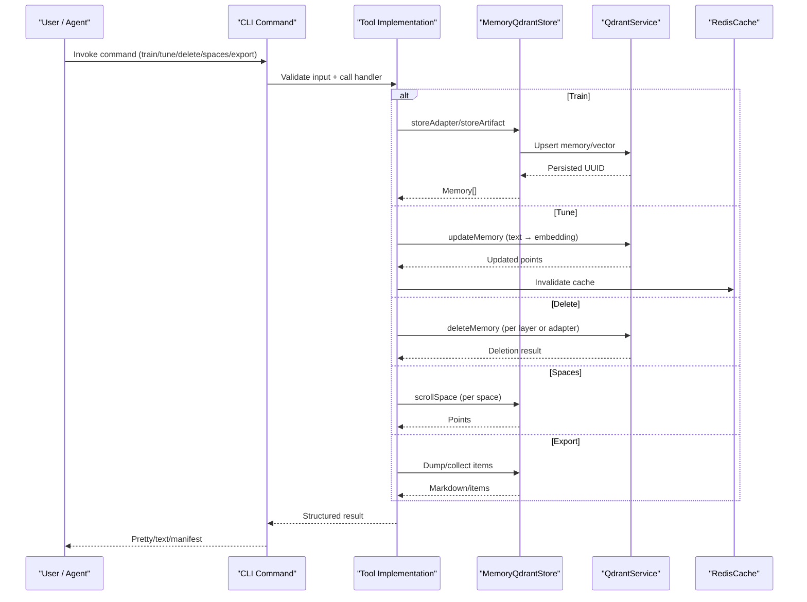
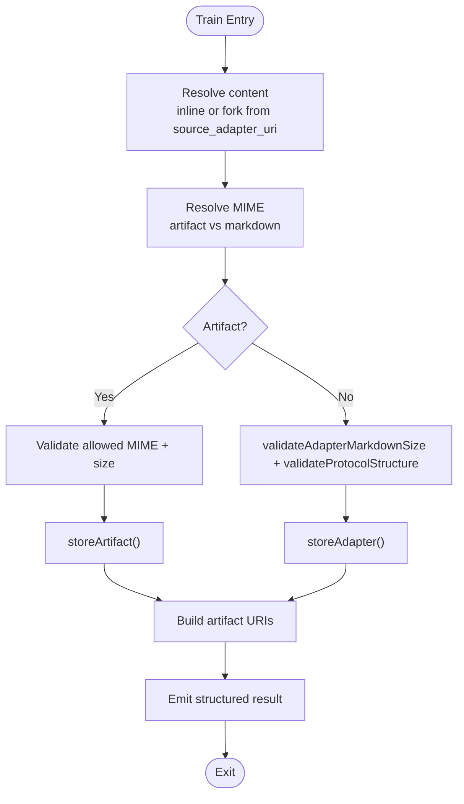
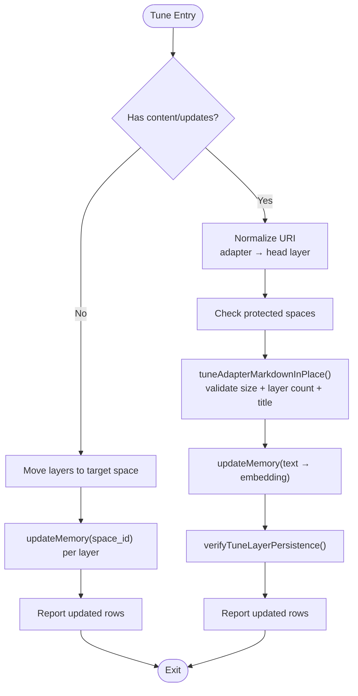
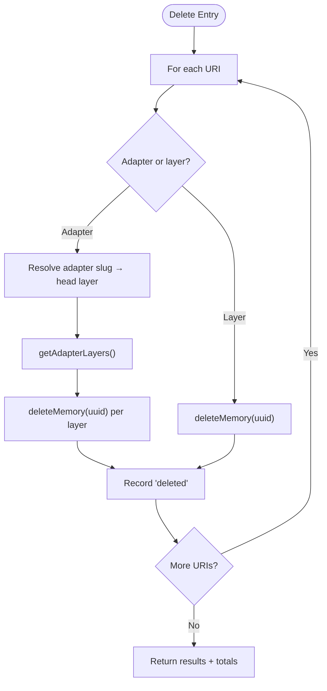
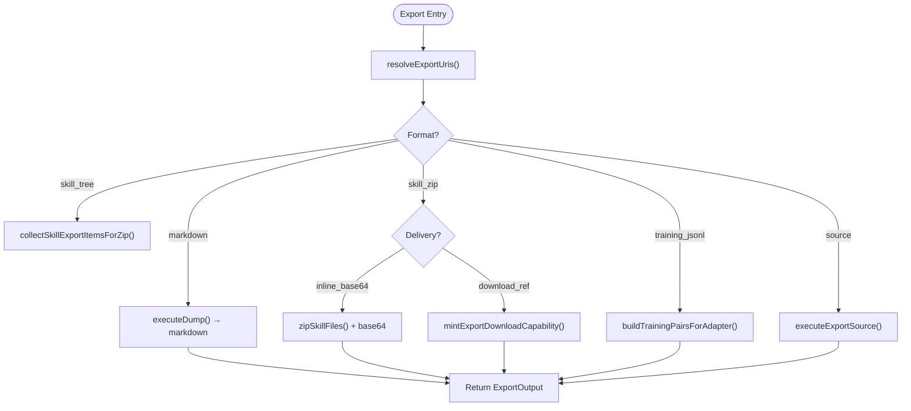
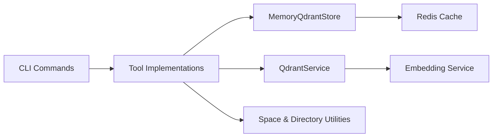

# Data Management Commands

<cite>
**Referenced Files in This Document**
- [train.ts](file://src/tools/train.ts)
- [tune.ts](file://src/tools/tune.ts)
- [delete.ts](file://src/tools/delete.ts)
- [spaces.ts](file://src/tools/spaces.ts)
- [export.ts](file://src/tools/export.ts)
- [train-store.ts](file://src/tools/train-store.ts)
- [tune-execute.ts](file://src/tools/tune-execute.ts)
- [export-selection.ts](file://src/tools/export-selection.ts)
- [memory-updates.ts](file://src/services/qdrant/memory-updates.ts)
- [store-methods.ts](file://src/services/memory/store-methods.ts)
- [resolve-space-param.ts](file://src/utils/resolve-space-param.ts)
- [directory-access.ts](file://src/utils/directory-access.ts)
- [cli-train.ts](file://src/cli/commands/cli-train.ts)
- [train-batch.ts](file://src/cli/train-batch.ts)
- [tune.ts](file://src/cli/commands/tune.ts)
- [delete.ts](file://src/cli/commands/delete.ts)
- [spaces.ts](file://src/cli/commands/spaces.ts)
- [export.ts](file://src/cli/commands/export.ts)
</cite>

## Table of Contents
1. [Introduction](#introduction)
2. [Project Structure](#project-structure)
3. [Core Components](#core-components)
4. [Architecture Overview](#architecture-overview)
5. [Detailed Component Analysis](#detailed-component-analysis)
6. [Dependency Analysis](#dependency-analysis)
7. [Performance Considerations](#performance-considerations)
8. [Troubleshooting Guide](#troubleshooting-guide)
9. [Conclusion](#conclusion)

## Introduction
This document explains the SquadRules data management commands that control the lifecycle of adapters, layers, artifacts, and multi-tenant spaces: train, tune, delete, spaces, and export. It focuses on how these commands register new adapters, update existing content, remove resources, manage spaces, and produce portable exports. It also covers validation, batch operations, progress tracking, error recovery, migration strategies, integration patterns, and performance guidance for large-scale operations.

Key concepts:
- Adapters are versioned, layered documents stored as memories with vector embeddings for semantic search.
- Spaces provide multi-tenant isolation; human-friendly space names resolve to canonical space IDs.
- Vector storage uses Qdrant (primary) and LanceDB (secondary), with Redis-backed caching.
- CLI commands wrap MCP tools and HTTP routes, providing machine-readable output and safe file handling.

## Project Structure
The data management surface is split between:
- CLI command handlers that parse flags, validate input, and render results.
- Tool implementations that perform business logic, validation, persistence, and telemetry.
- Storage services that interact with Qdrant, embedding providers, and caches.
- Utilities for space resolution, directory safety, and URI normalization.

**Diagram sources**
- [cli-train.ts](file://src/cli/commands/cli-train.ts)
- [train-batch.ts](file://src/cli/train-batch.ts)
- [train.ts](file://src/tools/train.ts)
- [tune.ts](file://src/tools/tune.ts)
- [delete.ts](file://src/tools/delete.ts)
- [spaces.ts](file://src/tools/spaces.ts)
- [export.ts](file://src/tools/export.ts)
- [train-store.ts](file://src/tools/train-store.ts)
- [tune-execute.ts](file://src/tools/tune-execute.ts)
- [export-selection.ts](file://src/tools/export-selection.ts)
- [memory-updates.ts](file://src/services/qdrant/memory-updates.ts)
- [store-methods.ts](file://src/services/memory/store-methods.ts)
- [resolve-space-param.ts](file://src/utils/resolve-space-param.ts)
- [directory-access.ts](file://src/utils/directory-access.ts)

**Section sources**
- [train.ts](file://src/tools/train.ts)
- [tune.ts](file://src/tools/tune.ts)
- [delete.ts](file://src/tools/delete.ts)
- [spaces.ts](file://src/tools/spaces.ts)
- [export.ts](file://src/tools/export.ts)
- [train-store.ts](file://src/tools/train-store.ts)
- [tune-execute.ts](file://src/tools/tune-execute.ts)
- [export-selection.ts](file://src/tools/export-selection.ts)
- [memory-updates.ts](file://src/services/qdrant/memory-updates.ts)
- [store-methods.ts](file://src/services/memory/store-methods.ts)
- [resolve-space-param.ts](file://src/utils/resolve-space-param.ts)
- [directory-access.ts](file://src/utils/directory-access.ts)

## Core Components
- Train: Registers new adapters or artifacts, validates protocol structure, computes embeddings, and returns layer/artifact URIs. Supports directory-based batch training and fork-from-source workflows.
- Tune: Updates existing adapter layers or moves them across spaces. Validates markdown size, layer count, and adapter identity, then persists updates and invalidates caches.
- Delete: Removes one or more adapter resources by URI, including all layers when an adapter URI is provided.
- Spaces: Lists available spaces with adapter counts and optional per-adapter titles, layer counts, and artifact metadata.
- Export: Produces portable outputs: flat markdown, skill tree JSON, skill ZIP bundles, source dumps, and training JSONL variants. Supports selection by URI, list of adapters, or all adapters in a space.

**Section sources**
- [train.ts](file://src/tools/train.ts)
- [tune.ts](file://src/tools/tune.ts)
- [delete.ts](file://src/tools/delete.ts)
- [spaces.ts](file://src/tools/spaces.ts)
- [export.ts](file://src/tools/export.ts)

## Architecture Overview
The commands follow a consistent flow:
1. CLI parses arguments and resolves backend/target.
2. Input is validated against schemas.
3. Business logic executes tool functions.
4. Persistence occurs via memory store and Qdrant service.
5. Telemetry and metrics are recorded.
6. Results are emitted in pretty/text formats or machine manifests.

**Diagram sources**
- [train.ts](file://src/tools/train.ts)
- [tune.ts](file://src/tools/tune.ts)
- [delete.ts](file://src/tools/delete.ts)
- [spaces.ts](file://src/tools/spaces.ts)
- [export.ts](file://src/tools/export.ts)
- [memory-updates.ts](file://src/services/qdrant/memory-updates.ts)
- [store-methods.ts](file://src/services/memory/store-methods.ts)

## Detailed Component Analysis

### Train Command
Purpose:
- Register new adapters from markdown or attach artifacts to adapters.
- Resolve content from inline text or a source adapter (fork).
- Validate protocol structure and sizes, compute embeddings, and persist.
- Support directory-based batch training with per-file status reporting.

Key behaviors:
- Content resolution supports inline content or forking from another adapter’s head layer.
- Artifact uploads require explicit MIME type or name inference and are allowlisted.
- Directory mode scans `.md` files, skips README-like docs, and attaches sibling artifacts when model is provided.
- Returns structured items with layer or artifact URIs and optional adapter URIs.

Validation and error handling:
- Protocol structure validation guides users to creation flows when missing fields exist.
- Duplicate or similar adapter detection returns actionable errors with next steps.
- Review evidence is required for non-artifact, non-fork training.

Progress tracking:
- Batch manifest includes per-file status, resulting URIs, and artifact upload outcomes.
- Metrics capture call duration, input/output sizes, and duplicate/similar adapter events.

**Diagram sources**
- [train.ts](file://src/tools/train.ts)
- [train-store.ts](file://src/tools/train-store.ts)

**Section sources**
- [train.ts](file://src/tools/train.ts)
- [train-store.ts](file://src/tools/train-store.ts)
- [train-batch.ts](file://src/cli/train-batch.ts)
- [directory-access.ts](file://src/utils/directory-access.ts)

### Tune Command
Purpose:
- Update existing adapter layers in place or move layers to a different space.
- Enforce adapter identity, layer count consistency, and protected-space write guards.
- Recalculate embeddings when text changes and invalidate caches.

Key behaviors:
- Adapter-level tuning requires matching H1 title and layer count; otherwise, use train(force_update=true).
- Space-only moves update space_id for all layers of each target adapter.
- Per-URI results include updated layer URIs and messages indicating success or failure.

Validation and error handling:
- Protected spaces reject writes with clear messages.
- Layer count mismatches guide users to structural changes via train.
- Review evidence is required when updating content.

**Diagram sources**
- [tune-execute.ts](file://src/tools/tune-execute.ts)
- [memory-updates.ts](file://src/services/qdrant/memory-updates.ts)

**Section sources**
- [tune.ts](file://src/tools/tune.ts)
- [tune-execute.ts](file://src/tools/tune-execute.ts)
- [memory-updates.ts](file://src/services/qdrant/memory-updates.ts)

### Delete Command
Purpose:
- Remove one or more adapter resources by URI.
- When deleting an adapter URI, delete all its layers.

Key behaviors:
- Iterates over URIs, normalizes adapter URIs, fetches layers, and deletes each layer.
- Returns per-URI results with status and message, plus totals for deleted and failed entries.

Error handling:
- Individual failures do not abort the batch; they are recorded as failed entries.

**Diagram sources**
- [delete.ts](file://src/tools/delete.ts)
- [memory-updates.ts](file://src/services/qdrant/memory-updates.ts)

**Section sources**
- [delete.ts](file://src/tools/delete.ts)
- [memory-updates.ts](file://src/services/qdrant/memory-updates.ts)

### Spaces Command
Purpose:
- List available spaces with adapter counts and optionally detailed adapter information.

Key behaviors:
- Uses current request space context to enumerate allowed spaces plus app space.
- Groups points by adapter ID, derives titles/slugs, and counts layers.
- Optionally includes artifact metadata filtered by allowed MIME types.

Output:
- Human-readable space info with type (personal/group/app/other), adapter_count, and optional adapters array.

**Section sources**
- [spaces.ts](file://src/tools/spaces.ts)

### Export Command
Purpose:
- Provide portable exports of adapters, skills, and training datasets.

Key behaviors:
- Selection modes: single URI, list of adapters, or all adapters in a space.
- Formats:
  - markdown: flat adapter markdown dump.
  - skill_tree: JSON tree of skills and files.
  - skill_zip: ZIP bundle with optional inline base64 or capability download reference.
  - trace_jsonl, reward_jsonl, sft_jsonl, preference_jsonl: training-oriented NDJSON streams.
  - source: raw source export for artifacts or URIs.
- Directory mode writes `<dir>/<slug>.md` per adapter in local mode only.

Validation and safety:
- Directory access is restricted to SIMPLE/stdio or CLI local backend with allowlist checks, depth limits, and symlink resolution.
- Skill ZIP delivery supports inline base64 or server-side download references.

**Diagram sources**
- [export.ts](file://src/tools/export.ts)
- [export-selection.ts](file://src/tools/export-selection.ts)
- [directory-access.ts](file://src/utils/directory-access.ts)

**Section sources**
- [export.ts](file://src/tools/export.ts)
- [export-selection.ts](file://src/tools/export-selection.ts)
- [directory-access.ts](file://src/utils/directory-access.ts)

## Dependency Analysis
- CLI commands depend on tool implementations for business logic and rendering helpers for output formatting.
- Tools depend on:
  - MemoryQdrantStore for adapter/artifact persistence and retrieval.
  - QdrantService for vector operations, layer enumeration, and updates/deletes.
  - Embedding service for computing vectors when text changes.
  - Redis cache for read/write consistency and search result caching.
  - Utilities for space resolution and directory safety.

**Diagram sources**
- [train.ts](file://src/tools/train.ts)
- [tune.ts](file://src/tools/tune.ts)
- [delete.ts](file://src/tools/delete.ts)
- [spaces.ts](file://src/tools/spaces.ts)
- [export.ts](file://src/tools/export.ts)
- [memory-updates.ts](file://src/services/qdrant/memory-updates.ts)
- [store-methods.ts](file://src/services/memory/store-methods.ts)
- [resolve-space-param.ts](file://src/utils/resolve-space-param.ts)
- [directory-access.ts](file://src/utils/directory-access.ts)

**Section sources**
- [train.ts](file://src/tools/train.ts)
- [tune.ts](file://src/tools/tune.ts)
- [delete.ts](file://src/tools/delete.ts)
- [spaces.ts](file://src/tools/spaces.ts)
- [export.ts](file://src/tools/export.ts)
- [memory-updates.ts](file://src/services/qdrant/memory-updates.ts)
- [store-methods.ts](file://src/services/memory/store-methods.ts)
- [resolve-space-param.ts](file://src/utils/resolve-space-param.ts)
- [directory-access.ts](file://src/utils/directory-access.ts)

## Performance Considerations
- Embedding computation:
  - Tune recalculates embeddings only when text changes; reuse existing vectors otherwise.
  - Train computes embeddings during adapter/artifact storage.
- Caching:
  - Read paths use Redis-backed cache; updates trigger strict cache invalidation to avoid stale reads.
- Search optimization:
  - Hybrid dense + BM25 search with pre-fetch legs and RRF fusion reduces latency and improves ranking quality.
- Batch operations:
  - Directory scanning enforces depth and adapter count limits to prevent runaway workloads.
  - Export directory mode writes files directly in-process for local mode, avoiding large payloads over HTTP.
- Large-scale operations:
  - Prefer skill_zip with download references for bulk skill bundles to reduce payload size.
  - Use `--all-adapters --space` with caution; max adapter count guard prevents excessive exports.

[No sources needed since this section provides general guidance]

## Troubleshooting Guide
Common issues and resolutions:
- Duplicate or similar adapter:
  - The train command returns structured errors indicating duplicates or near-duplicates; use force_update with a stable adapter id to replace, or inspect suggested matches.
- Invalid protocol structure:
  - Missing required fields trigger guided creation flows; follow the next_action hint to open the creation workflow.
- Protected space writes:
  - Tune rejects writes to protected spaces; choose a writable personal or group space.
- Directory access denied:
  - Ensure the path is absolute, within allowed prefixes, and not too deep; configure environment allowlists if necessary.
- Export delivery problems:
  - skill_zip with download_ref requires a capable backend; switch to inline_base64 or skill_tree for local environments.

Operational tips:
- Inspect per-URI results from tune and delete to identify partial failures.
- Use batch manifests from directory train to reconcile successes and failures.
- Monitor metrics for tool calls, durations, and errors to detect anomalies.

**Section sources**
- [train.ts](file://src/tools/train.ts)
- [tune-execute.ts](file://src/tools/tune-execute.ts)
- [delete.ts](file://src/tools/delete.ts)
- [directory-access.ts](file://src/utils/directory-access.ts)
- [export.ts](file://src/tools/export.ts)

## Conclusion
SquadRules’ data management commands provide a robust, auditable pipeline for registering, updating, removing, enumerating, and exporting adapters and their artifacts. Validation, space-awareness, and safety constraints ensure reliable operation at scale. By leveraging batch modes, secure directory handling, and flexible export formats, teams can integrate these commands into automated workflows while maintaining performance and correctness.

[No sources needed since this section summarizes without analyzing specific files]