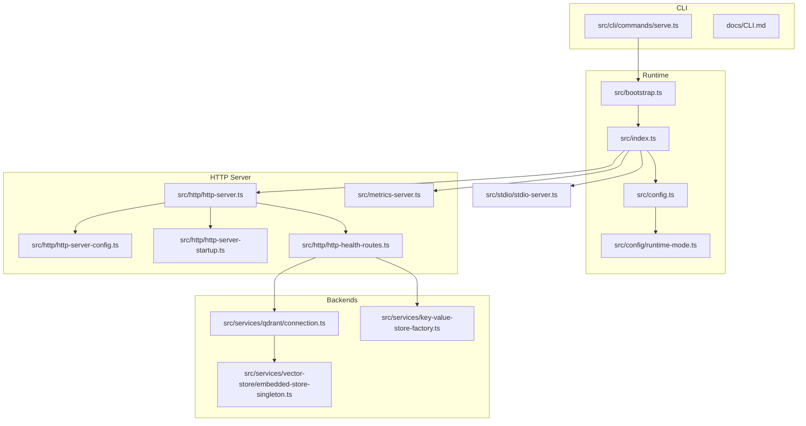
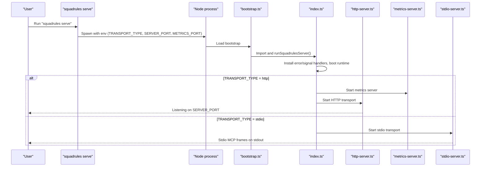
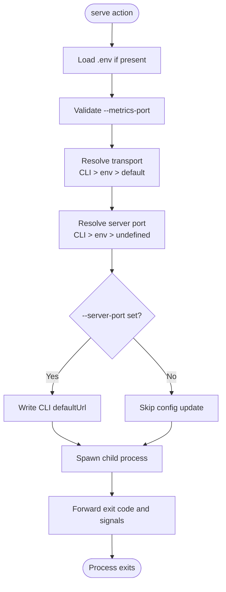
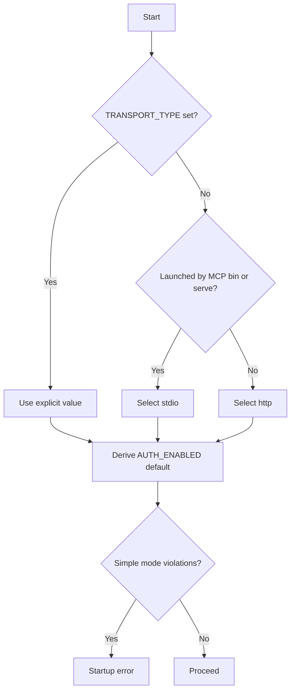
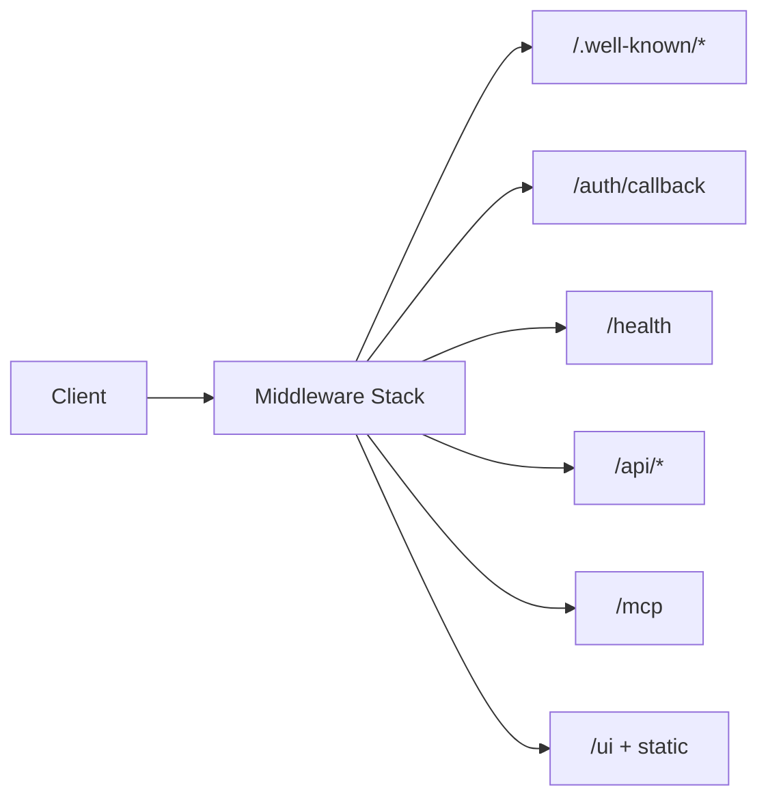
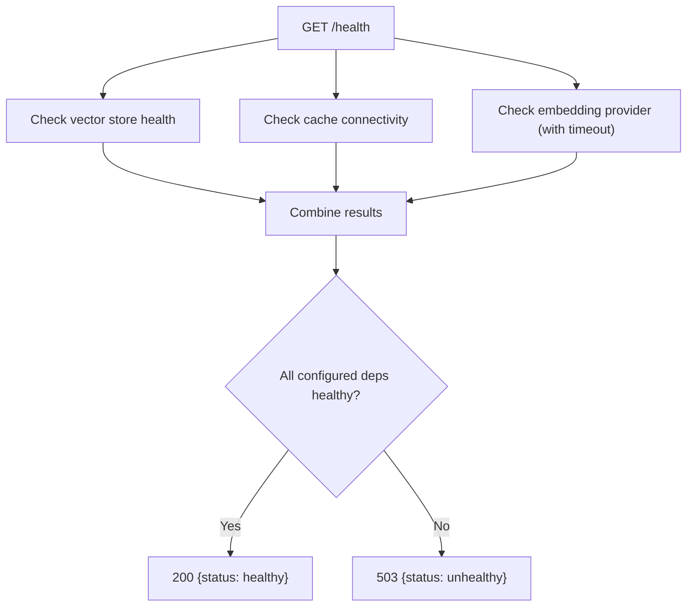
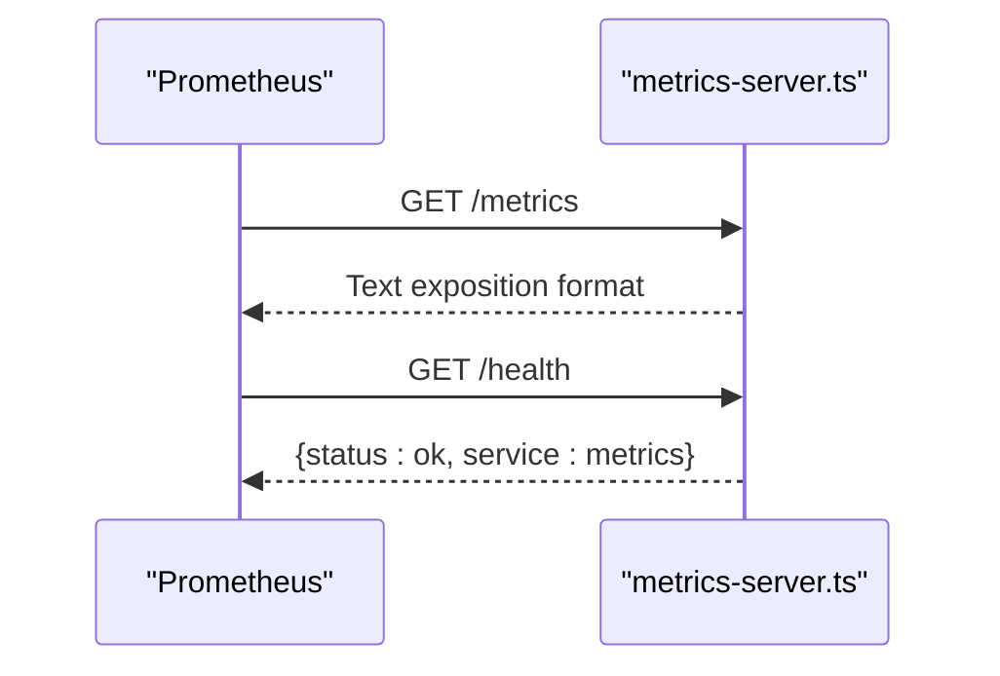
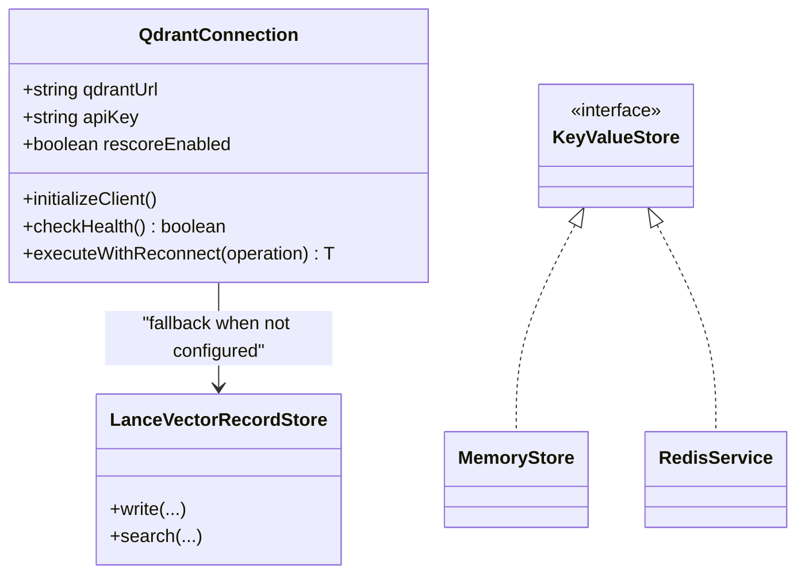
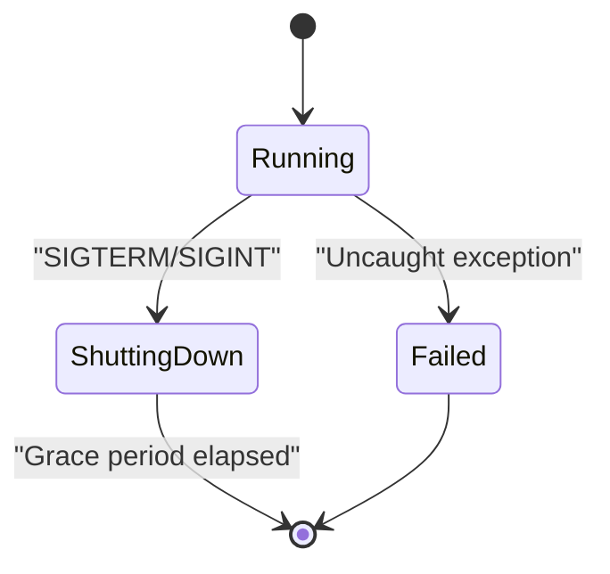
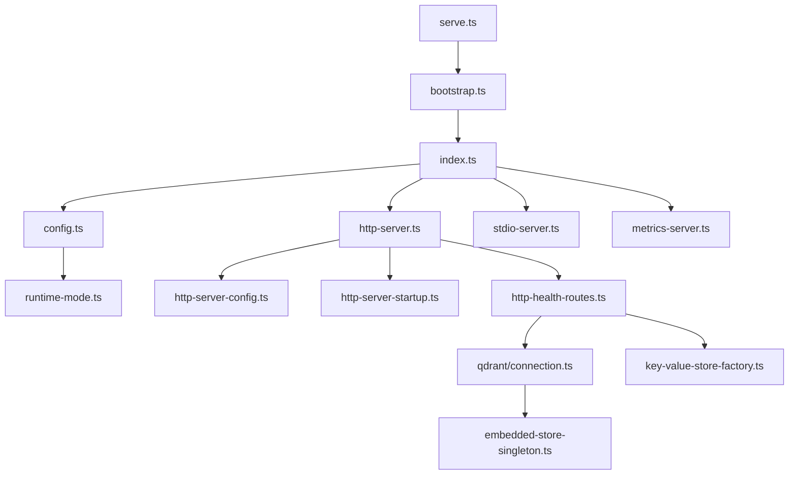

# Service Management Commands

<cite>
**Referenced Files in This Document**
- [serve.ts](file://src/cli/commands/serve.ts)
- [CLI.md](file://docs/CLI.md)
- [bootstrap.ts](file://src/bootstrap.ts)
- [index.ts](file://src/index.ts)
- [config.ts](file://src/config.ts)
- [runtime-mode.ts](file://src/config/runtime-mode.ts)
- [http-server.ts](file://src/http/http-server.ts)
- [http-server-config.ts](file://src/http/http-server-config.ts)
- [http-server-startup.ts](file://src/http/http-server-startup.ts)
- [http-health-routes.ts](file://src/http/http-health-routes.ts)
- [metrics-server.ts](file://src/metrics-server.ts)
- [stdio-server.ts](file://src/stdio/stdio-server.ts)
- [connection.ts](file://src/services/qdrant/connection.ts)
- [embedded-store-singleton.ts](file://src/services/vector-store/embedded-store-singleton.ts)
- [key-value-store-factory.ts](file://src/services/key-value-store-factory.ts)
</cite>

## Table of Contents
1. [Introduction](#introduction)
2. [Project Structure](#project-structure)
3. [Core Components](#core-components)
4. [Architecture Overview](#architecture-overview)
5. [Detailed Component Analysis](#detailed-component-analysis)
6. [Dependency Analysis](#dependency-analysis)
7. [Performance Considerations](#performance-considerations)
8. [Troubleshooting Guide](#troubleshooting-guide)
9. [Conclusion](#conclusion)
10. [Appendices](#appendices)

## Introduction
This document explains the `squadrules serve` command and the server management capabilities it controls. It covers how to start the SquadRules MCP server in different runtime modes, configure HTTP endpoints, manage database connections, handle process lifecycle, expose health checks and metrics, and operate the service in development, containerized, and production environments.

Key concepts:
- Runtime modes are driven by transport selection:
  - Simple mode (`stdio`) is a local single-user MCP server with embedded LanceDB and no HTTP listener.
  - Cluster mode (`http`) exposes REST API, Streamable HTTP MCP, browser UI, metrics, and authentication.
- The CLI `serve` command spawns the same bootstrap used by Docker Compose or direct Node execution, but lets you override transport and ports for convenience.
- Health checks report dependency status (vector store, cache, embedding provider).
- Metrics are exposed on a separate server when running in HTTP mode.

## Project Structure
The service management surface spans the CLI command, bootstrap entrypoint, runtime configuration, HTTP server wiring, stdio transport, metrics server, and backend connection modules.

**Diagram sources**
- [serve.ts:92-195](file://src/cli/commands/serve.ts#L92-L195)
- [bootstrap.ts:1-34](file://src/bootstrap.ts#L1-L34)
- [index.ts:60-129](file://src/index.ts#L60-L129)
- [config.ts:245-280](file://src/config.ts#L245-L280)
- [runtime-mode.ts:49-77](file://src/config/runtime-mode.ts#L49-L77)
- [http-server.ts:22-58](file://src/http/http-server.ts#L22-L58)
- [http-server-config.ts:74-99](file://src/http/http-server-config.ts#L74-L99)
- [http-server-startup.ts:10-27](file://src/http/http-server-startup.ts#L10-L27)
- [http-health-routes.ts:13-91](file://src/http/http-health-routes.ts#L13-L91)
- [metrics-server.ts:19-42](file://src/metrics-server.ts#L19-L42)
- [stdio-server.ts:6-12](file://src/stdio/stdio-server.ts#L6-L12)
- [connection.ts:24-61](file://src/services/qdrant/connection.ts#L24-L61)
- [embedded-store-singleton.ts:14-16](file://src/services/vector-store/embedded-store-singleton.ts#L14-L16)
- [key-value-store-factory.ts:13-22](file://src/services/key-value-store-factory.ts#L13-L22)

**Section sources**
- [serve.ts:92-195](file://src/cli/commands/serve.ts#L92-L195)
- [CLI.md:221-229](file://docs/CLI.md#L221-L229)
- [bootstrap.ts:1-34](file://src/bootstrap.ts#L1-L34)
- [index.ts:60-129](file://src/index.ts#L60-L129)

## Core Components
- `squadrules serve`: Spawns the server process with controlled environment variables, validates options, optionally updates CLI config, and forwards child process signals.
- Bootstrap and index: Install global error handlers, signal handlers, boot the runtime, select transport, and start HTTP or stdio transports.
- Configuration: Centralizes environment parsing, runtime mode resolution, port defaults, rate limits, and auth posture.
- HTTP server: Express application with middleware, routes, CORS, auth, health, API, MCP, and static UI.
- Metrics server: Separate `/metrics` endpoint for Prometheus scraping.
- Backends: Qdrant client with TLS and retry behavior; embedded LanceDB singleton; Redis-backed or in-memory key-value store.

**Section sources**
- [serve.ts:21-60](file://src/cli/commands/serve.ts#L21-L60)
- [serve.ts:92-195](file://src/cli/commands/serve.ts#L92-L195)
- [bootstrap.ts:1-34](file://src/bootstrap.ts#L1-L34)
- [index.ts:60-129](file://src/index.ts#L60-L129)
- [config.ts:245-280](file://src/config.ts#L245-L280)
- [http-server.ts:22-58](file://src/http/http-server.ts#L22-L58)
- [metrics-server.ts:19-42](file://src/metrics-server.ts#L19-L42)
- [connection.ts:24-61](file://src/services/qdrant/connection.ts#L24-L61)
- [embedded-store-singleton.ts:14-16](file://src/services/vector-store/embedded-store-singleton.ts#L14-L16)
- [key-value-store-factory.ts:13-22](file://src/services/key-value-store-factory.ts#L13-L22)

## Architecture Overview
The `serve` command delegates to the same bootstrap used by direct Node execution. Transport selection determines whether the process starts an HTTP server or a stdio MCP transport. In HTTP mode, a dedicated metrics server runs on a separate port.

**Diagram sources**
- [serve.ts:161-192](file://src/cli/commands/serve.ts#L161-L192)
- [bootstrap.ts:32-34](file://src/bootstrap.ts#L32-L34)
- [index.ts:60-129](file://src/index.ts#L60-L129)
- [http-server.ts:50-58](file://src/http/http-server.ts#L50-L58)
- [metrics-server.ts:19-42](file://src/metrics-server.ts#L19-L42)
- [stdio-server.ts:6-12](file://src/stdio/stdio-server.ts#L6-L12)

## Detailed Component Analysis

### Serve Command and Process Lifecycle
- Options:
  - `--transport <stdio|http>` overrides `TRANSPORT_TYPE`.
  - `--server-port <port>` sets `SERVER_PORT` for the child process and updates CLI default URL.
  - `--metrics-port <n>` sets `METRICS_PORT`.
  - `--env-file <path>` loads dotenv before spawning.
- Validation:
  - Port range validation enforces 1–65535.
  - Invalid transport values produce immediate errors.
- Environment propagation:
  - Sets `TRANSPORT_TYPE`, `SQUADRULES_LOG_STDERR`, `SQUADRULES_CLI_SERVE`, and `SQUADRULES_CLI_TRANSPORT_SOURCE`.
  - Forwards `SERVER_PORT` when provided.
- Child process handling:
  - Inherits stdio so logs flow through the parent.
  - Propagates exit codes and forwards OS signals to the parent process.

**Diagram sources**
- [serve.ts:21-60](file://src/cli/commands/serve.ts#L21-L60)
- [serve.ts:105-192](file://src/cli/commands/serve.ts#L105-L192)

**Section sources**
- [serve.ts:21-60](file://src/cli/commands/serve.ts#L21-L60)
- [serve.ts:92-195](file://src/cli/commands/serve.ts#L92-L195)

### Runtime Modes and Transport Resolution
- Two supported modes:
  - Simple mode (`stdio`): Local single-user MCP server, embedded LanceDB only, no HTTP listener, no metrics, no OAuth callback surface.
  - Cluster mode (`http`): Deployed posture with REST API, Streamable HTTP MCP, browser UI, metrics, and authentication enabled by default.
- Resolution rules:
  - Explicit `TRANSPORT_TYPE` always wins.
  - If not explicit, `stdio` is selected when launched via the MCP bin or `squadrules serve`; otherwise, `http` is the default.
- Auth posture:
  - Defaults to true for `http`, false for `stdio`.
  - Explicit `AUTH_ENABLED=true` under `stdio` is rejected at startup.
- Local-mode guards:
  - Prevents using external Qdrant in stdio mode because per-process caches would be inconsistent.

**Diagram sources**
- [runtime-mode.ts:49-77](file://src/config/runtime-mode.ts#L49-L77)
- [runtime-mode.ts:91-136](file://src/config/runtime-mode.ts#L91-L136)

**Section sources**
- [runtime-mode.ts:49-77](file://src/config/runtime-mode.ts#L49-L77)
- [runtime-mode.ts:91-136](file://src/config/runtime-mode.ts#L91-L136)
- [config.ts:245-280](file://src/config.ts#L245-L280)

### HTTP Server Configuration and Endpoints
- Middleware stack:
  - Structured logging.
  - HTTP metrics middleware.
  - Helmet with minimal CSP.
  - Per-route rate limiting for `/auth`, `/api`, and `/mcp`.
  - JSON body parser with configurable size limit.
- Route registration order:
  - Auth callback and well-known discovery before auth middleware.
  - Health, export downloads, API routes, MCP routes, UI static files.
- Startup:
  - Listens on `0.0.0.0` with error handling for address-in-use and other failures.
  - Logs health check and MCP endpoint URLs.

**Diagram sources**
- [http-server.ts:22-47](file://src/http/http-server.ts#L22-L47)
- [http-server-config.ts:74-99](file://src/http/http-server-config.ts#L74-L99)
- [http-server-startup.ts:10-27](file://src/http/http-server-startup.ts#L10-L27)

**Section sources**
- [http-server.ts:22-58](file://src/http/http-server.ts#L22-L58)
- [http-server-config.ts:74-99](file://src/http/http-server-config.ts#L74-L99)
- [http-server-startup.ts:10-27](file://src/http/http-server-startup.ts#L10-L27)

### Health Checks and Readiness
- `/health` reports:
  - Vector store backend health (Qdrant or embedded LanceDB).
  - Cache backend status (Redis or memory).
  - Embedding provider health with timeout protection.
  - Build version, uptime, transport type, and dependency details.
- Status determination:
  - Overall status is healthy only when configured dependencies are reachable and authenticated where required.
  - Returns 200 for healthy, 503 for unhealthy.

**Diagram sources**
- [http-health-routes.ts:13-91](file://src/http/http-health-routes.ts#L13-L91)

**Section sources**
- [http-health-routes.ts:13-91](file://src/http/http-health-routes.ts#L13-L91)

### Metrics Exposure and Monitoring
- Dedicated metrics server:
  - Exposes `/metrics` for Prometheus scraping.
  - Provides a lightweight `/health` endpoint for the metrics service.
- Integration:
  - Starts automatically in HTTP mode.
  - Uses the shared metrics registry initialized by system metrics imports.

**Diagram sources**
- [metrics-server.ts:19-42](file://src/metrics-server.ts#L19-L42)
- [index.ts:83-86](file://src/index.ts#L83-L86)

**Section sources**
- [metrics-server.ts:19-42](file://src/metrics-server.ts#L19-L42)
- [index.ts:83-86](file://src/index.ts#L83-L86)

### Database Connections and Storage Selection
- Vector storage:
  - External Qdrant when `QDRANT_URL` is set.
  - Embedded LanceDB when no external Qdrant is configured.
  - Embedded store is a singleton to ensure consistency across facades.
- Key-value store:
  - Redis when `KEY_VALUE_STORE_URL` or `REDIS_URL` is set.
  - In-memory store otherwise.
- Qdrant client:
  - Supports TLS with custom CA certificate path.
  - Includes health checking and exponential backoff reconnection attempts.

**Diagram sources**
- [connection.ts:24-61](file://src/services/qdrant/connection.ts#L24-L61)
- [connection.ts:63-130](file://src/services/qdrant/connection.ts#L63-L130)
- [embedded-store-singleton.ts:14-16](file://src/services/vector-store/embedded-store-singleton.ts#L14-L16)
- [key-value-store-factory.ts:13-22](file://src/services/key-value-store-factory.ts#L13-L22)

**Section sources**
- [connection.ts:24-61](file://src/services/qdrant/connection.ts#L24-L61)
- [connection.ts:63-130](file://src/services/qdrant/connection.ts#L63-L130)
- [embedded-store-singleton.ts:14-16](file://src/services/vector-store/embedded-store-singleton.ts#L14-L16)
- [key-value-store-factory.ts:13-22](file://src/services/key-value-store-factory.ts#L13-L22)

### Process Lifecycle and Graceful Shutdown
- Global error handling:
  - Bootstrap installs uncaught exception and unhandled rejection handlers that log structured messages and set non-zero exit codes.
- Signal handling:
  - Index installs SIGTERM and SIGINT handlers that log shutdown and force exit after a short grace period to avoid hanging handles.
- Child process forwarding:
  - `serve` forwards child exit codes and OS signals to the parent process.

**Diagram sources**
- [bootstrap.ts:16-30](file://src/bootstrap.ts#L16-L30)
- [index.ts:44-53](file://src/index.ts#L44-L53)
- [serve.ts:182-192](file://src/cli/commands/serve.ts#L182-L192)

**Section sources**
- [bootstrap.ts:16-30](file://src/bootstrap.ts#L16-L30)
- [index.ts:44-53](file://src/index.ts#L44-L53)
- [serve.ts:182-192](file://src/cli/commands/serve.ts#L182-L192)

## Dependency Analysis
The following diagram shows how the CLI, runtime, HTTP server, and backends depend on each other during service management.

**Diagram sources**
- [serve.ts:92-195](file://src/cli/commands/serve.ts#L92-L195)
- [bootstrap.ts:32-34](file://src/bootstrap.ts#L32-L34)
- [index.ts:60-129](file://src/index.ts#L60-L129)
- [config.ts:245-280](file://src/config.ts#L245-L280)
- [runtime-mode.ts:49-77](file://src/config/runtime-mode.ts#L49-L77)
- [http-server.ts:22-58](file://src/http/http-server.ts#L22-L58)
- [http-server-config.ts:74-99](file://src/http/http-server-config.ts#L74-L99)
- [http-server-startup.ts:10-27](file://src/http/http-server-startup.ts#L10-L27)
- [http-health-routes.ts:13-91](file://src/http/http-health-routes.ts#L13-L91)
- [connection.ts:24-61](file://src/services/qdrant/connection.ts#L24-L61)
- [embedded-store-singleton.ts:14-16](file://src/services/vector-store/embedded-store-singleton.ts#L14-L16)
- [key-value-store-factory.ts:13-22](file://src/services/key-value-store-factory.ts#L13-L22)

**Section sources**
- [serve.ts:92-195](file://src/cli/commands/serve.ts#L92-L195)
- [index.ts:60-129](file://src/index.ts#L60-L129)
- [http-server.ts:22-58](file://src/http/http-server.ts#L22-L58)

## Performance Considerations
- Rate limiting:
  - Configure per-route windows and limits for `/auth`, `/api`, and `/mcp` via environment variables.
- Body size limits:
  - Tune JSON body limits and train raw upload limits to prevent oversized payloads.
- Embedding provider tuning:
  - Adjust retry policies, latency warnings, and norm thresholds for embedding providers.
- Search parameters:
  - Control overfetch factor, max fetch, group collapse, and choice caps to balance recall and performance.
- Concurrency:
  - Use `MAX_CONCURRENT_MCP_REQUESTS` to cap concurrent MCP requests when needed.
- Metrics isolation:
  - Keep metrics on a separate port to avoid impacting application traffic.

[No sources needed since this section provides general guidance]

## Troubleshooting Guide
Common startup issues and resolutions:
- Port already in use:
  - The HTTP server logs a clear message and exits when the configured port is occupied. Choose another port via `--server-port` or `SERVER_PORT`.
- Invalid port values:
  - Ports must be between 1 and 65535. Correct the value passed to `--server-port` or `SERVER_PORT`.
- Invalid transport:
  - Only `stdio` and `http` are valid. Set `--transport` correctly or adjust `TRANSPORT_TYPE`.
- Authentication misconfiguration:
  - When `AUTH_ENABLED=true`, required OIDC variables must be set. Ensure `KEYCLOAK_URL`, `KEYCLOAK_REALM`, `KEYCLOAK_CLIENT_ID`, `AUTH_CALLBACK_BASE_URL`, and `SESSION_SECRET` are configured.
- Simple mode violations:
  - Do not enable authentication or set `QDRANT_URL` in stdio mode. Use embedded LanceDB and disable auth, or switch to HTTP mode.
- Health check failures:
  - Inspect `/health` response for dependency statuses. Verify Qdrant connectivity, Redis availability, and embedding provider configuration.

Operational best practices:
- Use `--env-file` to isolate environment-specific settings for development and production.
- Prefer container orchestration with explicit `SERVER_PORT` and `METRICS_PORT` mappings.
- Monitor `/health` and `/metrics` for readiness and capacity planning.
- Enable structured logging and audit logging for observability.

**Section sources**
- [http-server-startup.ts:17-24](file://src/http/http-server-startup.ts#L17-L24)
- [serve.ts:21-27](file://src/cli/commands/serve.ts#L21-L27)
- [serve.ts:47-60](file://src/cli/commands/serve.ts#L47-L60)
- [config.ts:254-266](file://src/config.ts#L254-L266)
- [runtime-mode.ts:91-136](file://src/config/runtime-mode.ts#L91-L136)
- [http-health-routes.ts:13-91](file://src/http/http-health-routes.ts#L13-L91)

## Conclusion
The `squadrules serve` command provides a consistent way to launch the SquadRules MCP server in either simple or cluster mode. By controlling transport, ports, and environment variables, operators can run the service locally for development or deploy it in containers for production. Health checks and metrics integration support reliable operations, while strict runtime-mode guards prevent unsafe configurations. Proper tuning of rate limits, body sizes, and backend connections ensures predictable performance and resilience.

[No sources needed since this section summarizes without analyzing specific files]

## Appendices

### Environment Variables Reference
- Server and transport:
  - `TRANSPORT_TYPE`: `stdio` or `http`.
  - `SERVER_PORT`: Main HTTP listen port.
  - `METRICS_PORT`: Metrics server port.
- Authentication:
  - `AUTH_ENABLED`: Enable/disable authentication.
  - `KEYCLOAK_URL`, `KEYCLOAK_REALM`, `KEYCLOAK_CLIENT_ID`, `AUTH_CALLBACK_BASE_URL`, `SESSION_SECRET`: OIDC configuration.
- Backends:
  - `QDRANT_URL`, `QDRANT_API_KEY`, `QDRANT_COLLECTION`: External vector store.
  - `KEY_VALUE_STORE_URL` or `REDIS_URL`: Network key-value store.
- Performance:
  - `HTTP_RATE_LIMIT_WINDOW_MS`, `HTTP_RATE_LIMIT_MAX`, `AUTH_RATE_LIMIT_*`, `MCP_RATE_LIMIT_*`.
  - `HTTP_JSON_BODY_LIMIT`, `HTTP_TRAIN_RAW_BODY_LIMIT`.
  - `EMBEDDING_*` tuning variables.
  - `SQUADRULES_SEARCH_*` search tuning variables.
  - `MAX_CONCURRENT_MCP_REQUESTS`.

**Section sources**
- [config.ts:117-126](file://src/config.ts#L117-L126)
- [config.ts:141-161](file://src/config.ts#L141-L161)
- [config.ts:245-280](file://src/config.ts#L245-L280)
- [CLI.md:248-257](file://docs/CLI.md#L248-L257)

### Example Workflows

- Development workflow (local stdio):
  - Run `squadrules serve --transport stdio` to start a local MCP server with embedded LanceDB.
  - Use `squadrules activate ...` against the local target.

- Development workflow (local HTTP):
  - Run `squadrules serve --transport http --server-port 3000 --metrics-port 9090`.
  - Access `/health` and `/metrics` for diagnostics.

- Containerized deployment:
  - Set `TRANSPORT_TYPE=http`, `SERVER_PORT`, `METRICS_PORT`, and OIDC variables.
  - Map container ports to host ports and configure ingress or reverse proxy as needed.

- Production scaling:
  - Run multiple replicas behind a load balancer.
  - Use external Qdrant and Redis for shared state.
  - Monitor `/health` and scrape `/metrics` from Prometheus.

**Section sources**
- [CLI.md:221-229](file://docs/CLI.md#L221-L229)
- [serve.ts:92-195](file://src/cli/commands/serve.ts#L92-L195)
- [http-health-routes.ts:13-91](file://src/http/http-health-routes.ts#L13-L91)
- [metrics-server.ts:19-42](file://src/metrics-server.ts#L19-L42)