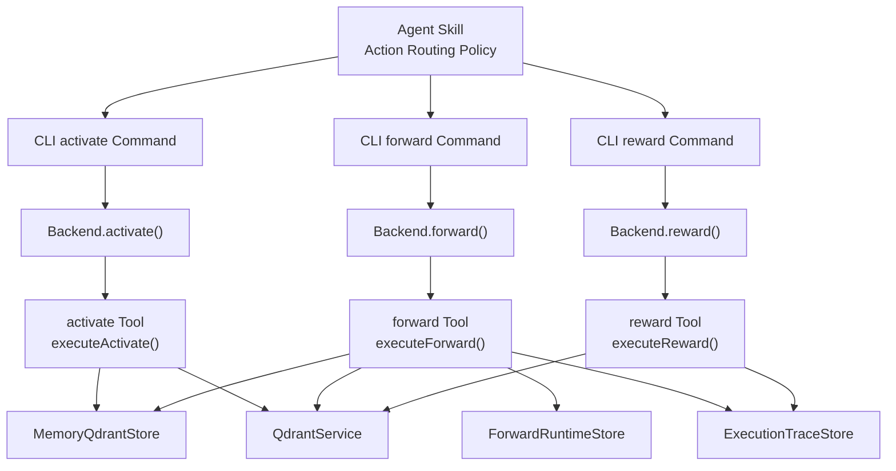
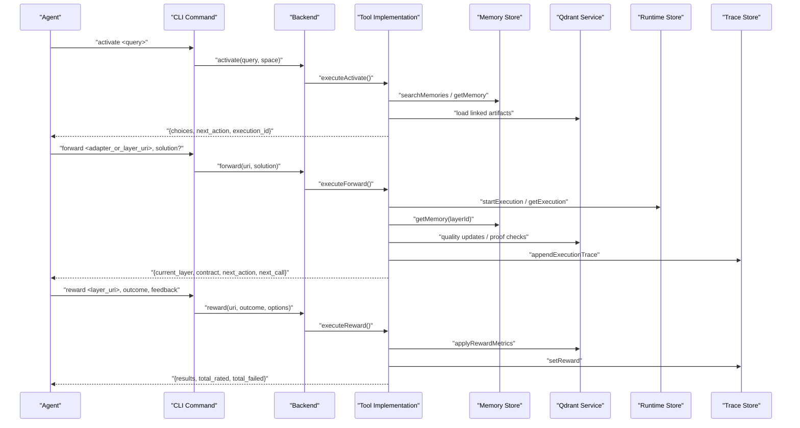
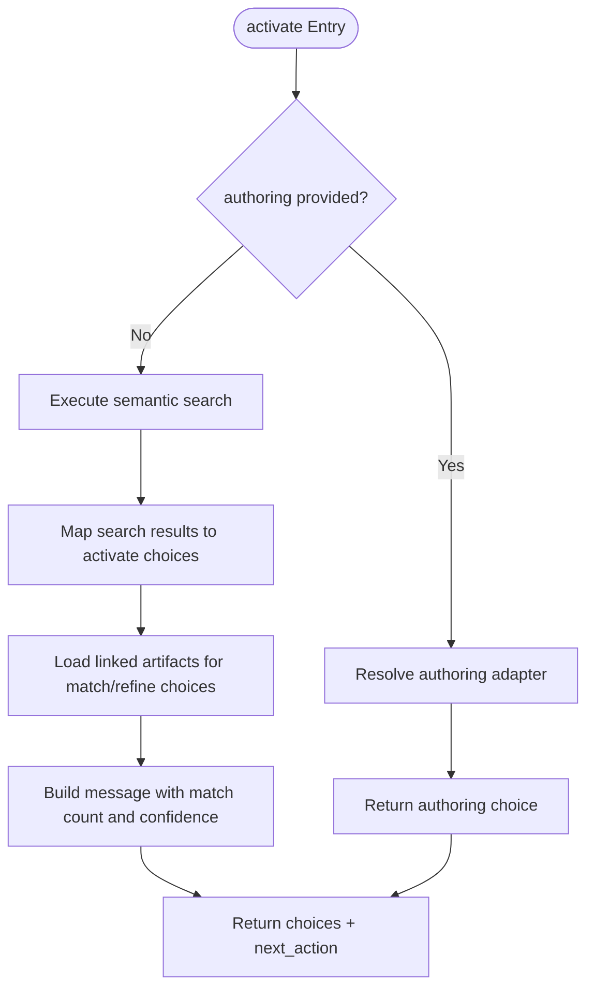
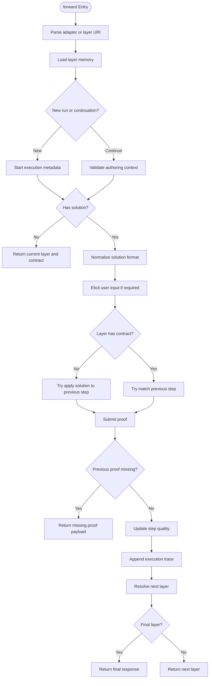
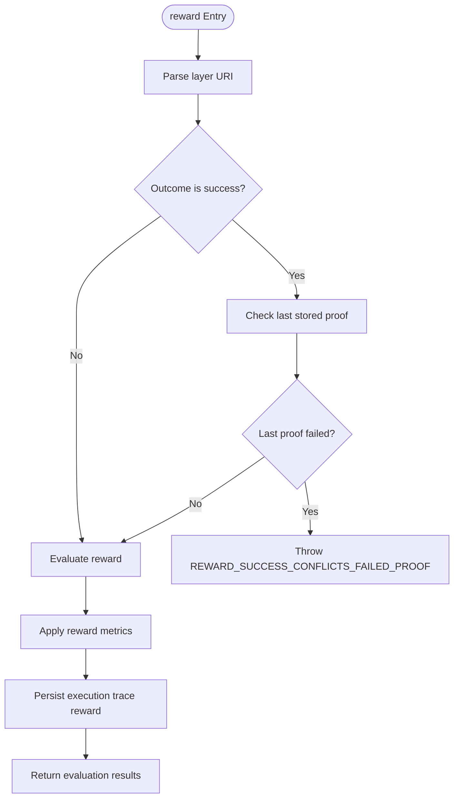
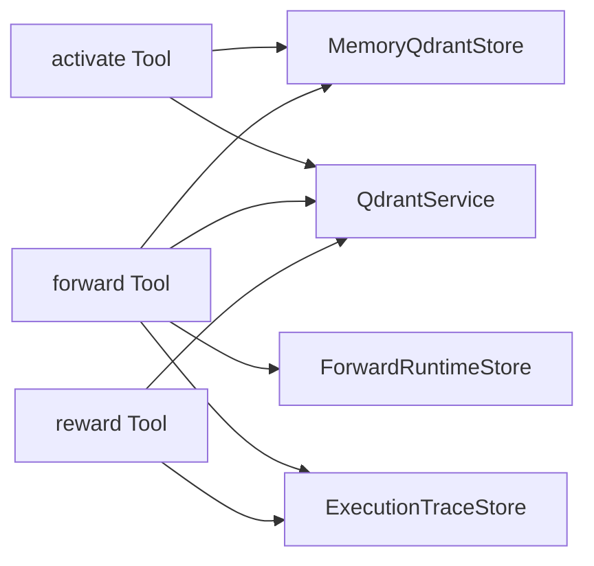

# Workflow Commands

<cite>
**Referenced Files in This Document**
- [SKILL.md](file://.agents/skills/squadrules/SKILL.md)
- [activate.ts (CLI)](file://src/cli/commands/activate.ts)
- [forward.ts (CLI)](file://src/cli/commands/forward.ts)
- [reward.ts (CLI)](file://src/cli/commands/reward.ts)
- [activate.ts (tool)](file://src/tools/activate.ts)
- [activate_schema.ts](file://src/tools/activate_schema.ts)
- [forward.ts (tool)](file://src/tools/forward.ts)
- [forward_schema.ts](file://src/tools/forward_schema.ts)
- [reward.ts (tool)](file://src/tools/reward.ts)
- [reward_schema.ts](file://src/tools/reward_schema.ts)
- [store.ts (memory store)](file://src/services/memory/store.ts)
- [service.ts (Qdrant service)](file://src/services/qdrant/service.ts)
- [forward-runtime-store.ts](file://src/services/forward-runtime-store.ts)
- [execution-trace-store.ts](file://src/services/execution-trace-store.ts)
</cite>

## Table of Contents
1. [Introduction](#introduction)
2. [Project Structure](#project-structure)
3. [Core Components](#core-components)
4. [Architecture Overview](#architecture-overview)
5. [Detailed Component Analysis](#detailed-component-analysis)
6. [Dependency Analysis](#dependency-analysis)
7. [Performance Considerations](#performance-considerations)
8. [Troubleshooting Guide](#troubleshooting-guide)
9. [Conclusion](#conclusion)
10. [Appendices](#appendices)

## Introduction
SquadRules implements an agent-first workflow through three MCP tools that form a strict activation, execution, and feedback loop:

- **activate**: selects the best adapter or protocol for a query and returns ranked choices with deterministic next actions.
- **forward**: executes one layer of an adapter contract, supports multi-layer chains, proof-of-work validation, user input elicitation, and authoring workflows.
- **reward**: records outcome-based feedback, evaluates eligibility for training exports, and persists metrics and traces.

The agent skill defines the routing discipline: detect intent, call `activate`, follow `next_action` through `forward` calls until completion, materialize linked artifacts when required, then call `reward`. The server-side implementation enforces URI contracts, stateful execution tracking, memory retrieval, and Qdrant-backed quality and reward propagation.

## Project Structure
The workflow commands are exposed both as CLI subcommands and as MCP tools:

| Layer | Responsibility | Key Files |
|---|---|---|
| Agent skill | Defines the activate→forward→reward routing policy | [.agents/skills/squadrules/SKILL.md](file://.agents/skills/squadrules/SKILL.md) |
| CLI commands | Parse arguments, call backend methods, render results | [src/cli/commands/activate.ts](file://src/cli/commands/activate.ts), [src/cli/commands/forward.ts](file://src/cli/commands/forward.ts), [src/cli/commands/reward.ts](file://src/cli/commands/reward.ts) |
| Tool implementations | Validate inputs, execute workflow logic, return structured outputs | [src/tools/activate.ts](file://src/tools/activate.ts), [src/tools/forward.ts](file://src/tools/forward.ts), [src/tools/reward.ts](file://src/tools/reward.ts) |
| Input/output schemas | Zod schemas defining MCP tool contracts | [src/tools/activate_schema.ts](file://src/tools/activate_schema.ts), [src/tools/forward_schema.ts](file://src/tools/forward_schema.ts), [src/tools/reward_schema.ts](file://src/tools/reward_schema.ts) |
| Memory and vector services | Adapter storage, search, quality updates, reward propagation | [src/services/memory/store.ts](file://src/services/memory/store.ts), [src/services/qdrant/service.ts](file://src/services/qdrant/service.ts) |
| Execution state stores | Runtime execution metadata and execution traces | [src/services/forward-runtime-store.ts](file://src/services/forward-runtime-store.ts), [src/services/execution-trace-store.ts](file://src/services/execution-trace-store.ts) |

**Diagram sources**
- [SKILL.md:29-48](file://.agents/skills/squadrules/SKILL.md#L29-L48)
- [activate.ts (CLI):12-34](file://src/cli/commands/activate.ts#L12-L34)
- [forward.ts (CLI):12-31](file://src/cli/commands/forward.ts#L12-L31)
- [reward.ts (CLI):13-65](file://src/cli/commands/reward.ts#L13-L65)
- [activate.ts (tool):168-228](file://src/tools/activate.ts#L168-L228)
- [forward.ts (tool):91-152](file://src/tools/forward.ts#L91-L152)
- [reward.ts (tool):28-130](file://src/tools/reward.ts#L28-L130)

**Section sources**
- [SKILL.md:1-91](file://.agents/skills/squadrules/SKILL.md#L1-L91)
- [activate.ts (CLI):1-36](file://src/cli/commands/activate.ts#L1-L36)
- [forward.ts (CLI):1-33](file://src/cli/commands/forward.ts#L1-L33)
- [reward.ts (CLI):1-67](file://src/cli/commands/reward.ts#L1-L67)

## Core Components
The three workflow commands share common design patterns:

| Command | Primary Purpose | State Behavior | Main Dependencies |
|---|---|---|---|
| `activate` | Search adapters and return ranked choices with `next_action` instructions | Stateless per call; optional `execution_id` enables refinement sequences | Memory store, Qdrant service, search utilities, artifact loader |
| `forward` | Execute or continue an adapter layer with deterministic contract handling | Starts or continues an execution; pins runtime metadata and traces | Memory store, Qdrant service, runtime store, trace store, proof-of-work store |
| `reward` | Record outcome and optional score/feedback for a completed layer | Persists metrics and execution trace reward; does not start new work | Qdrant service, trace store, reward evaluation |

All three commands validate inputs with Zod schemas, emit MCP tool metrics, and return structured content suitable for both human-facing rendering and machine consumption.

**Section sources**
- [activate_schema.ts:86-135](file://src/tools/activate_schema.ts#L86-L135)
- [forward_schema.ts:234-314](file://src/tools/forward_schema.ts#L234-L314)
- [reward_schema.ts:10-48](file://src/tools/reward_schema.ts#L10-L48)
- [activate.ts (tool):231-280](file://src/tools/activate.ts#L231-L280)
- [forward.ts (tool):91-152](file://src/tools/forward.ts#L91-L152)
- [reward.ts (tool):132-175](file://src/tools/reward.ts#L132-L175)

## Architecture Overview
The SquadRules workflow is an MCP-driven pipeline where agents drive the control flow and the server enforces contracts and persistence.

**Diagram sources**
- [SKILL.md:35-48](file://.agents/skills/squadrules/SKILL.md#L35-L48)
- [activate.ts (tool):168-228](file://src/tools/activate.ts#L168-L228)
- [forward.ts (tool):91-339](file://src/tools/forward.ts#L91-L339)
- [reward.ts (tool):28-130](file://src/tools/reward.ts#L28-L130)
- [forward-runtime-store.ts:27-46](file://src/services/forward-runtime-store.ts#L27-L46)
- [execution-trace-store.ts:119-186](file://src/services/execution-trace-store.ts#L119-L186)

## Detailed Component Analysis

### Activate Command
The `activate` command finds the best matching adapter or protocol for a query and returns actionable choices. It is the entry point into the SquadRules workflow.

#### Responsibilities
- Accept a short query describing the agent’s action intent.
- Optionally scope results to a space.
- Support authoring mode for adapter creation, review, or update.
- Return ranked choices with roles: `match`, `refine`, or `create`.
- Provide `next_action` instructions telling the agent how to proceed.
- Include linked artifact materialization instructions when adapters require executable scripts.

#### Input Schema
| Field | Type | Required | Description |
|---|---|---:|---|
| `query` | string | Yes | Activation query used to find the best matching adapter. |
| `execution_id` | UUID string | No | Server-issued ID for refinement sequences; echo it back when refining. |
| `space` | string | No | Scope results to a named space. |
| `space_id` | string | No | Alias for `space`. |
| `max_choices` | integer | No | Maximum adapter choices returned, bounded by configured limits. |
| `authoring` | object | No | Authoring operation and target adapter URI; routes to the authoring workflow instead of normal execution. |

#### Output Schema
| Field | Type | Description |
|---|---|---|
| `must_obey` | boolean | Always true; pick one choice and follow its `next_action`. |
| `message` | string | Human-readable guidance including match count and confidence. |
| `next_action` | string | Global directive to pick a choice and follow its instruction. |
| `execution_id` | UUID string | Server-issued execution ID for this activation run. |
| `query` | string | Echo of the request query. |
| `choices` | array | Ranked adapter choices discriminated by role. |
| `squadrules_local_artifact_dir` | string[] | Client-resolved artifact directory hints. |
| `transport` | enum | MCP transport mode (`stdio` or `http`). |

#### Choice Roles
| Role | Meaning | `forward_first_call` | Typical Next Action |
|---|---|---:|---|
| `match` | Existing stored adapter matches the query. | Present | Call `forward` with the adapter URI and no solution to start. |
| `refine` | Stored adapter suggested for refinement. | Present | Call `forward` with the adapter URI and no solution to start refinement. |
| `create` | No existing adapter matched; create a new one. | Null | Follow creation footer guidance. |

#### Authoring Mode
When `authoring` is supplied, `activate` resolves the built-in authoring adapter and returns a single choice whose `next_action` instructs copying `forward_first_call` into `forward`. This separates authoring guidance from adapter execution.

**Diagram sources**
- [activate.ts (tool):44-166](file://src/tools/activate.ts#L44-L166)
- [activate.ts (tool):179-228](file://src/tools/activate.ts#L179-L228)

**Section sources**
- [activate.ts (CLI):12-34](file://src/cli/commands/activate.ts#L12-L34)
- [activate.ts (tool):44-228](file://src/tools/activate.ts#L44-L228)
- [activate_schema.ts:5-135](file://src/tools/activate_schema.ts#L5-L135)

### Forward Command
The `forward` command executes workflow steps deterministically. It supports starting a new run with an adapter URI or continuing an existing run with a layer URI that includes `?execution_id=`.

#### Responsibilities
- Parse and validate adapter or layer URIs.
- Start a new execution or resume an existing one.
- Pin runtime metadata and layer manifests on first forward.
- Load the current layer’s memory and contract.
- Handle solutions without a contract by applying them to previous steps when appropriate.
- Handle solutions with a contract through proof submission, missing-proof handling, and step progression.
- Persist execution traces and update step quality.
- Return the next layer, final completion signal, or explicit `next_call`.

#### Input Schema
| Field | Type | Required | Description |
|---|---|---:|---|
| `uri` | string | Yes | Adapter URI to start, or layer URI to continue. |
| `solution` | object | Conditional | Required only for continuation calls; omitted on start calls. |
| `authoring` | object | No | Authoring context copied from `activate.forward_first_call`; fixed for the run. |

#### Solution Contract
| Field | Type | Description |
|---|---|---|
| `type` | enum | One of `shell`, `forward`, `user_input`, `comment`, `subagent`. |
| `outcome` | enum | Universal outcome signal: `success`, `failure`, or `skipped`. |
| `evidence` | object | Type-specific proof payload. |
| `nonce` | string | Echo nonce from contract for proof-based layers. |
| `proof_hash` | string | Echo proof hash from previous layer when required. |
| `trace` | string | Optional reasoning trace stored with the execution trace. |

Deprecated fields such as top-level `shell`, `forward`, `user_input`, and `comment` are still accepted but normalized into the v2 envelope.

#### Output Schema
| Field | Type | Description |
|---|---|---|
| `authoring` | object | Echoed authoring context when applicable. |
| `must_obey` | boolean | Always true; follow the returned `next_action`. |
| `current_layer` | object | Current layer URI and markdown content. |
| `contract` | object | Contract describing the expected solution shape. |
| `next_action` | string | Instruction for the next step. |
| `proof_hash` | string | Proof hash when present. |
| `execution_id` | string | Execution identifier. |
| `message` | string | Contextual status or error guidance. |
| `error_code` | string | Error code such as `MISSING_PROOF`. |
| `retry_count` | number | Retry guidance for missing-proof flows. |
| `next_call` | object | Explicit next MCP call: another `forward` or `reward`. |
| `activation_space_name` | string | Space name from activation context. |
| `context_adapter_name` | string | Adapter name from activation context. |
| `current_layer_label` | string | Label for the current layer. |
| `adapter_layer_index` | number | Index of the current layer. |
| `adapter_layer_count` | number | Total number of layers. |
| `squadrules_local_artifact_dir` | string[] | Artifact directory hints. |

#### Deterministic Execution Flow

**Diagram sources**
- [forward.ts (tool):91-339](file://src/tools/forward.ts#L91-L339)

**Section sources**
- [forward.ts (CLI):12-31](file://src/cli/commands/forward.ts#L12-L31)
- [forward.ts (tool):43-339](file://src/tools/forward.ts#L43-L339)
- [forward_schema.ts:16-314](file://src/tools/forward_schema.ts#L16-L314)
- [forward-runtime-store.ts:7-46](file://src/services/forward-runtime-store.ts#L7-L46)
- [execution-trace-store.ts:119-186](file://src/services/execution-trace-store.ts#L119-L186)

### Reward Command
The `reward` command records feedback after adapter execution completes. It validates that success rewards do not conflict with failed proofs, evaluates eligibility for training export, and persists metrics and traces.

#### Responsibilities
- Require a layer URI.
- Reject success rewards when the layer’s last stored proof failed.
- Evaluate outcome, optional score, rater, rubric version, and LLM model attribution.
- Apply reward metrics to Qdrant-backed quality data.
- Persist reward data to the execution trace store.
- Return evaluation labels, blockers, and totals.

#### Input Schema
| Field | Type | Required | Description |
|---|---|---:|---|
| `uri` | string | Yes | Layer URI of the final layer. |
| `outcome` | enum | Yes | `success` or `failure`. |
| `score` | number | No | Normalized reward score between 0 and 1. |
| `feedback` | string | No | Optional evaluator feedback. |
| `rater` | string | No | Human evaluator identifier. |
| `rubric_version` | string | No | Rubric or policy version tag. |
| `llm_model_id` | string | No | LLM model identifier for attribution. |

#### Output Schema
| Field | Type | Description |
|---|---|---|
| `results` | array | Per-result evaluation including outcome, score, feedback, grader kind, label, and export eligibility. |
| `total_rated` | number | Total rated entries. |
| `total_failed` | number | Total failed entries. |
| `next_call` | null | Reward does not start further workflow steps. |

#### Eligibility Blockers
| Blocker | Meaning |
|---|---|
| `missing_rubric_version` | Rubric version was not provided. |
| `missing_evaluator_identity` | Neither rater nor LLM model ID was provided. |
| `outcome_not_success` | Only successful outcomes can be exported for SFT/preference training. |
| `score_below_sft_threshold` | Score below supervised fine-tuning threshold. |
| `score_below_preference_threshold` | Score below preference-training threshold. |

**Diagram sources**
- [reward.ts (tool):28-130](file://src/tools/reward.ts#L28-L130)
- [reward_schema.ts:10-48](file://src/tools/reward_schema.ts#L10-L48)

**Section sources**
- [reward.ts (CLI):13-65](file://src/cli/commands/reward.ts#L13-L65)
- [reward.ts (tool):19-130](file://src/tools/reward.ts#L19-L130)
- [reward_schema.ts:1-53](file://src/tools/reward_schema.ts#L1-L53)

## Dependency Analysis
The workflow commands depend on several shared services:

| Component | Used By | Purpose |
|---|---|---|
| `MemoryQdrantStore` | `activate`, `forward` | Retrieve adapter layers, search memories, list artifacts, and manage Qdrant-backed memory. |
| `QdrantService` | `activate`, `forward`, `reward` | Quality updates, reward propagation, search, and protocol lookups. |
| `ForwardRuntimeStore` | `forward` | Persist execution metadata, pinned layer manifests, and authoring context. |
| `ExecutionTraceStore` | `forward`, `reward` | Persist execution traces, rewards, and training pairs. |
| Zod schemas | All tools | Input validation and MCP schema generation. |

**Diagram sources**
- [activate.ts (tool):168-228](file://src/tools/activate.ts#L168-L228)
- [forward.ts (tool):91-339](file://src/tools/forward.ts#L91-L339)
- [reward.ts (tool):28-130](file://src/tools/reward.ts#L28-L130)
- [store.ts:29-149](file://src/services/memory/store.ts#L29-L149)
- [service.ts:17-151](file://src/services/qdrant/service.ts#L17-L151)
- [forward-runtime-store.ts:27-46](file://src/services/forward-runtime-store.ts#L27-L46)
- [execution-trace-store.ts:31-186](file://src/services/execution-trace-store.ts#L31-L186)

**Section sources**
- [store.ts:29-149](file://src/services/memory/store.ts#L29-L149)
- [service.ts:17-151](file://src/services/qdrant/service.ts#L17-L151)
- [forward-runtime-store.ts:27-46](file://src/services/forward-runtime-store.ts#L27-L46)
- [execution-trace-store.ts:31-186](file://src/services/execution-trace-store.ts#L31-L186)

## Performance Considerations
- **Activation cost**: `activate` performs semantic search and may load linked artifacts for each visible choice. Use `max_choices` to limit result volume and avoid unnecessary artifact resolution.
- **Forward latency**: Multi-layer adapters incur repeated memory loads, proof checks, and trace appends. Continuation calls reuse execution metadata; avoid restarting runs unnecessarily.
- **Trace persistence**: Execution traces are appended per layer and persisted asynchronously in some paths; failures are logged rather than failing the main workflow, so trace loss should be monitored separately.
- **Reward persistence**: Reward persistence errors are wrapped as service-unavailable-style errors, allowing retry semantics while preserving idempotency expectations.
- **Storage selection**: Qdrant is primary; LanceDB is embedded secondary. The trace store and embedded store abstractions allow different backends without changing tool logic.

[No sources needed since this section provides general guidance]

## Troubleshooting Guide

### Common Activation Issues
- **No matches**: When zero matches exist, `activate` suggests creating a new adapter. If matches exist but confidence is low, refine the query using the returned `execution_id`.
- **Artifact loading failures**: If linked artifacts cannot be loaded, the choice warns that script paths may be unknown and instructs re-running `activate` or exporting the adapter before running shell contracts.
- **Authoring workflow unavailable**: If the built-in authoring workflow is missing, `activate` throws an error indicating the authoring workflow must be restored.

### Common Forward Issues
- **Layer or adapter not found**: A missing layer or adapter raises a `NOT_FOUND` error.
- **Authoring context mismatch**: Continuing a run with a different authoring operation, target, or workflow raises `AUTHORING_CONTEXT_MISMATCH`.
- **Invalid authoring workflow**: Supplying `authoring` on a non-authoring adapter raises `INVALID_AUTHORING_WORKFLOW`.
- **Missing proof**: When a previous layer’s proof is incomplete, `forward` returns a missing-proof payload with `error_code`, `retry_count`, and `next_action`.
- **Solution forbidden on start**: Sending `solution` on a start call raises a validation error; omit `solution` on the first call and include it only on continuation calls.
- **Solution required on continuation**: Calling a layer URI with `?execution_id=` without `solution` raises a validation error.

### Common Reward Issues
- **Invalid URI**: `reward` requires a layer URI; adapter URIs are rejected.
- **Success conflicts with failed proof**: Recording success for a layer whose last stored proof failed raises `REWARD_SUCCESS_CONFLICTS_FAILED_PROOF`.
- **Reward persistence failure**: Persistence errors are wrapped as `REWARD_FAILED` with a retryable message.

### Debugging Techniques
- Inspect `execution_id` across `activate`, `forward`, and `reward` calls to correlate a single workflow run.
- Use `next_action` and `next_call` to verify the intended next step.
- For shell contracts, ensure linked artifacts are materialized and verified before execution.
- Monitor MCP tool metrics for call counts, durations, input/output sizes, and error rates.
- Review execution traces to reconstruct tensor inputs, outputs, and rewards per layer.

**Section sources**
- [activate.ts (tool):84-96](file://src/tools/activate.ts#L84-L96)
- [activate.ts (tool):179-189](file://src/tools/activate.ts#L179-L189)
- [forward.ts (tool):104-131](file://src/tools/forward.ts#L104-L131)
- [forward.ts (tool):288-316](file://src/tools/forward.ts#L288-L316)
- [forward_schema.ts:231-258](file://src/tools/forward_schema.ts#L231-L258)
- [reward.ts (tool):32-54](file://src/tools/reward.ts#L32-L54)
- [reward.ts (tool):74-106](file://src/tools/reward.ts#L74-L106)

## Conclusion
The SquadRules workflow commands implement a disciplined agent-driven pipeline:

- `activate` turns ambiguous intent into concrete adapter choices with deterministic next actions.
- `forward` executes adapter layers with strong contract enforcement, proof validation, authoring support, and persistent execution traces.
- `reward` closes the loop by recording outcome-based feedback, evaluating training eligibility, and propagating quality signals.

Together, these commands integrate with the memory system, Qdrant-backed vector storage, runtime state stores, and the broader agent ecosystem defined by the SquadRules skill. Correct usage requires following the full chain, echoing authoritative identifiers, respecting URI contracts, and treating incomplete chains as invalid stopping points.

[No sources needed since this section summarizes without analyzing specific files]

## Appendices

### Practical Workflow Cycle Example
This example demonstrates a complete cycle without embedding raw JSON payloads.

1. **Detect intent**: An agent receives a request such as “run the build pipeline for this repository.”
2. **Call activate**: Pass a concise query like “build pipeline repository” and optionally a space.
3. **Inspect choices**: Choose the highest-confidence `match` or `refine` choice. Read its `next_action` and `forward_first_call`.
4. **Materialize artifacts**: If the choice lists linked artifacts, export them to the local artifact directory and verify digests before proceeding.
5. **Call forward**: Start with the adapter URI and no solution. Receive the contract and current layer.
6. **Provide solution**: On continuation, call `forward` again with the layer URI including `?execution_id=...` and a solution whose `type` matches the contract.
7. **Repeat forward**: Continue until the response indicates completion or returns an explicit `reward` `next_call`.
8. **Call reward**: Record `success` or `failure` with optional score, feedback, rater, rubric version, and LLM model ID.
9. **Respond**: Return the final result to the user or continue downstream work as directed by the adapter output.

**Section sources**
- [SKILL.md:35-48](file://.agents/skills/squadrules/SKILL.md#L35-L48)
- [activate_schema.ts:108-135](file://src/tools/activate_schema.ts#L108-L135)
- [forward_schema.ts:234-314](file://src/tools/forward_schema.ts#L234-L314)
- [reward_schema.ts:10-48](file://src/tools/reward_schema.ts#L10-L48)

### Adapter Authoring Context
Adapter authors should treat `activate`, `forward`, and `reward` as the canonical integration surface:

- Adapters define contracts that constrain valid solutions.
- Authors should provide clear layer instructions so agents can produce correct evidence.
- Linked artifacts should be exported and verified before shell execution.
- Rewards should include rubric versions and evaluator identity when training exportability matters.
- The authoring workflow is separate from adapter execution and is invoked through `activate.authoring`.

**Section sources**
- [SKILL.md:22-53](file://.agents/skills/squadrules/SKILL.md#L22-L53)
- [activate.ts (tool):179-212](file://src/tools/activate.ts#L179-L212)
- [forward_schema.ts:16-45](file://src/tools/forward_schema.ts#L16-L45)
- [reward_schema.ts:10-18](file://src/tools/reward_schema.ts#L10-L18)